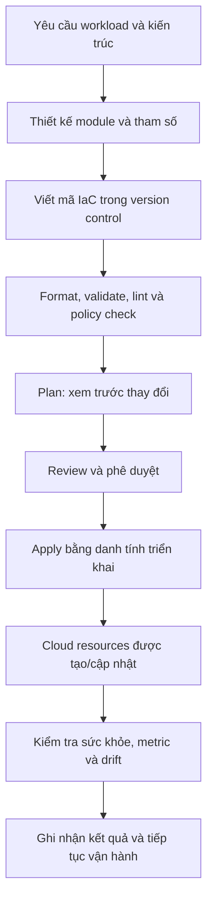
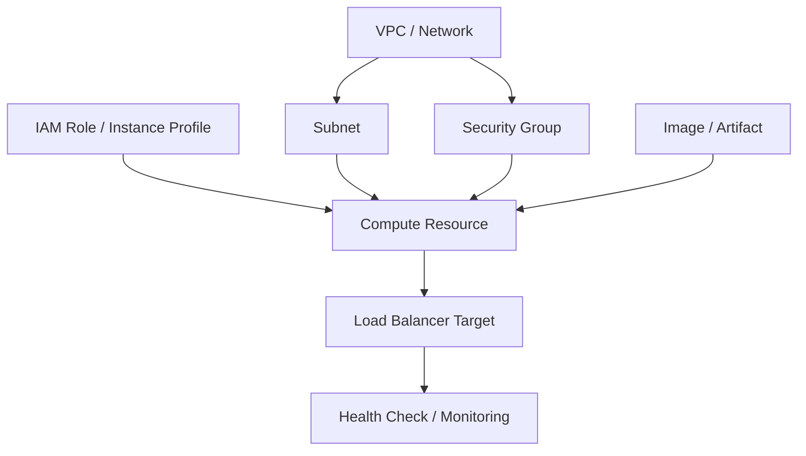
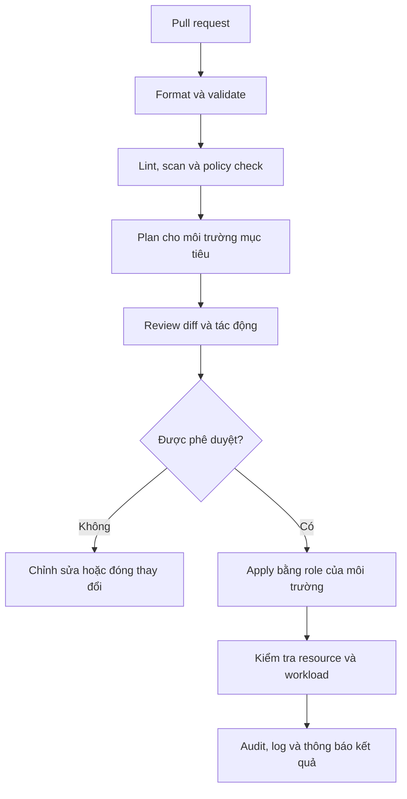
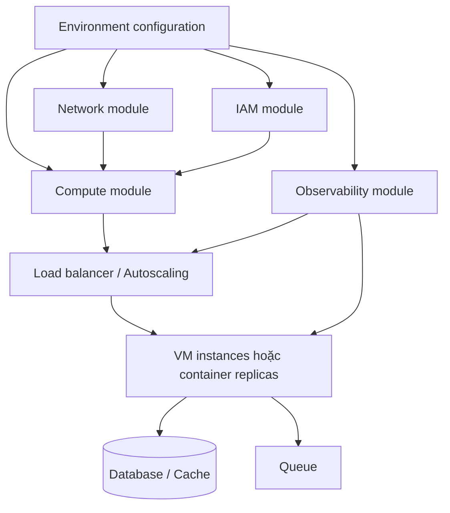

# Thiết kế hạ tầng compute dưới dạng mã

Hạ tầng compute trên cloud thường gồm máy ảo, mạng ảo, đĩa, nhóm mở rộng, cluster container, workload và danh tính dịch vụ. Nếu tạo từng tài nguyên bằng thao tác thủ công trên console, cấu hình giữa môi trường dễ lệch nhau, khó truy vết thay đổi và khó khôi phục khi xảy ra sự cố. **Infrastructure as Code (IaC)** giải quyết vấn đề này bằng cách mô tả hạ tầng trong các tệp có thể quản lý bằng phiên bản, kiểm tra, xem trước và triển khai lặp lại.

Thiết kế IaC tốt giúp đội ngũ cấp phát compute nhất quán, kiểm soát quyền và mạng, triển khai thay đổi có thể xem xét, mở rộng tải và quản lý chi phí. Trong phạm vi **CLOUD_CORE_SERVICES_COMPUTE**, IaC kết nối việc chọn VM, container hoặc serverless với cấu hình CPU, bộ nhớ, mạng, lưu trữ, bảo mật và khả năng vận hành. Mã hạ tầng phải thể hiện được trạng thái mong muốn của hệ thống, đồng thời giúp người vận hành hiểu tài nguyên nào được tạo, phụ thuộc vào đâu và ai chịu trách nhiệm khi thay đổi.

## Mục tiêu học tập

Sau bài này, bạn có thể:

- Giải thích IaC và phân biệt cách tiếp cận khai báo với cách tiếp cận mệnh lệnh.
- Nhận diện provider, resource, data source, module, variable, output và state trong một dự án IaC.
- Thiết kế cấu trúc mã cho hạ tầng compute có thể tái sử dụng giữa các môi trường.
- Quản lý dependency, state, drift, secret, quyền truy cập và vòng đời tài nguyên.
- Xây dựng quy trình kiểm tra, xem trước, phê duyệt và triển khai thay đổi an toàn.
- Mô tả cách IaC cấp phát VM, nhóm mở rộng, container platform và hàm serverless.
- Đánh giá khả năng bảo trì, độ tin cậy và chi phí của thiết kế hạ tầng dưới dạng mã.

## 1. IaC là gì và giải quyết vấn đề nào?

IaC là cách mô tả hạ tầng bằng tệp cấu hình hoặc mã nguồn để công cụ tự động tạo, cập nhật và quản lý tài nguyên. Thay vì ghi lại một danh sách thao tác cần bấm trên console, đội ngũ mô tả trạng thái mong muốn: mạng nào cần có, VM dùng loại máy nào, workload chạy ở đâu, quyền nào được cấp và tài nguyên phải có những nhãn nào.

Ví dụ, một môi trường ứng dụng có thể được mô tả gồm:

- Một mạng riêng với subnet, route và quy tắc firewall.
- Một nhóm VM hoặc container chạy ứng dụng.
- Một load balancer phân phối lưu lượng đến các instance khỏe mạnh.
- Một danh tính workload có quyền tối thiểu để đọc dữ liệu.
- Một chính sách lưu trữ, backup, log và cảnh báo.

Khi các thành phần này nằm trong mã, đội ngũ có thể review thay đổi, lưu lịch sử, chạy kiểm tra tự động và dựng lại môi trường theo cùng một quy trình. IaC cũng giúp giảm sai sót do thao tác thủ công và tạo bằng chứng về cấu hình đã được phê duyệt.

### 1.1. Cách tiếp cận khai báo và mệnh lệnh

Có hai cách mô tả phổ biến:

- **Khai báo (declarative):** mô tả trạng thái cuối cùng cần đạt. Công cụ so sánh trạng thái mong muốn với trạng thái hiện tại rồi quyết định cần tạo, cập nhật hoặc xóa tài nguyên nào.
- **Mệnh lệnh (imperative):** mô tả tuần tự các lệnh hoặc bước phải thực hiện để đạt trạng thái mong muốn.

Ví dụ về ý tưởng:

```text
Khai báo:
  Môi trường cần có 3 instance web trong subnet riêng.
  Mỗi instance dùng image đã duyệt và role web-runtime.

Mệnh lệnh:
  Tạo instance thứ nhất.
  Tạo instance thứ hai.
  Tạo instance thứ ba.
  Gắn subnet, firewall và role cho từng instance.
```

Công cụ khai báo như Terraform hoặc OpenTofu thường phù hợp để quản lý vòng đời tài nguyên cloud. Công cụ mệnh lệnh như shell script, cloud CLI hoặc playbook cấu hình vẫn hữu ích cho bootstrap và tác vụ vận hành cụ thể. Một hệ thống có thể kết hợp cả hai, nhưng cần xác định rõ công cụ nào là nguồn sự thật cho từng tài nguyên để tránh hai quy trình cùng sửa một đối tượng.

### 1.2. Các đặc tính quan trọng

| Đặc tính | Ý nghĩa trong vận hành compute |
|---|---|
| Có thể tái tạo | Có thể dựng lại môi trường từ mã và các đầu vào đã được quản lý. |
| Có lịch sử | Mỗi thay đổi được lưu trong version control, có người thực hiện và nội dung review. |
| Nhất quán | Các môi trường dùng cùng module và quy tắc, chỉ khác tham số được phép. |
| Có thể xem trước | Plan cho biết tài nguyên nào sẽ được tạo, cập nhật hoặc xóa trước khi áp dụng. |
| Có thể kiểm tra | Mã được định dạng, validate, lint và kiểm tra policy trước khi triển khai. |
| Có thể kiểm toán | Có thể truy vết thay đổi, phê duyệt, state và kết quả triển khai. |
| Có thể tự động hóa | Pipeline có thể kiểm tra và triển khai theo quy trình đã định. |

IaC không tự làm cho kiến trúc đúng hoặc an toàn. Một cấu hình sai được tự động triển khai có thể tạo ra nhiều tài nguyên sai rất nhanh. Chất lượng phụ thuộc vào thiết kế, review, kiểm thử, quyền triển khai và khả năng quan sát.

## 2. Vòng đời cấp phát bằng IaC

Một quy trình IaC thường bắt đầu từ yêu cầu workload, chuyển thành mã cấu hình, được kiểm tra và sau đó áp dụng lên tài khoản cloud.



Các bước này tạo thành vòng lặp. Khi yêu cầu thay đổi, đội ngũ cập nhật mã, chạy lại kiểm tra và xem trước tác động. Công cụ đối chiếu cấu hình trong mã với state và tài nguyên thực tế để đề xuất hành động tiếp theo.

### 2.1. Các thành phần cơ bản

| Thành phần | Vai trò |
|---|---|
| Provider | Plugin kết nối với API của cloud hoặc nền tảng khác để quản lý tài nguyên. |
| Resource | Một đối tượng hạ tầng do IaC tạo hoặc quản lý, ví dụ VM, subnet, disk, cluster hay function. |
| Data source | Đọc thông tin của tài nguyên hoặc dữ liệu đã tồn tại mà không tạo tài nguyên đó. |
| Module | Nhóm resource và cấu hình liên quan thành đơn vị có giao diện đầu vào/đầu ra rõ ràng. |
| Variable | Tham số đầu vào như vùng, loại máy, subnet, số replica hoặc môi trường. |
| Local value | Giá trị tính toán hoặc biểu thức dùng lại trong cấu hình. |
| Output | Giá trị được công bố sau khi áp dụng, ví dụ endpoint hoặc ID tài nguyên. |
| State | Bản ghi ánh xạ cấu hình IaC với các tài nguyên thực tế mà công cụ đang quản lý. |
| Backend | Nơi lưu state; backend từ xa thường hỗ trợ kiểm soát truy cập và khóa state. |
| Dependency graph | Đồ thị thứ tự phụ thuộc giúp công cụ xác định tài nguyên nào cần tạo trước. |

### 2.2. Công cụ thường gặp

- **Terraform và OpenTofu:** dùng cấu hình khai báo, provider và state để quản lý nhiều nền tảng cloud.
- **CloudFormation, ARM/Bicep và các công cụ native:** mô tả tài nguyên theo hệ sinh thái của từng nhà cung cấp.
- **Pulumi:** cho phép mô tả hạ tầng bằng ngôn ngữ lập trình được hỗ trợ.
- **Ansible và công cụ cấu hình máy:** thường dùng để cài package, cấu hình dịch vụ hoặc bootstrap hệ điều hành sau khi tài nguyên compute đã được tạo.

Không cần chọn công cụ chỉ vì nó có nhiều tính năng. Hãy cân nhắc nền tảng đích, kỹ năng đội ngũ, khả năng review, state, hệ sinh thái module, policy, tích hợp CI/CD và chi phí vận hành. Trong các ví dụ tiếp theo, cú pháp Terraform HCL được dùng để minh họa một quy trình khai báo phổ biến.

## 3. Nguyên tắc thiết kế dự án IaC

Một dự án IaC nên giúp người đọc hiểu cấu trúc hệ thống mà không phải lần theo hàng trăm dòng cấu hình lặp lại. Thiết kế cần cân bằng giữa khả năng tái sử dụng, tính rõ ràng và mức độ trừu tượng.

### 3.1. Tách lớp nền tảng và workload

Có thể chia hạ tầng thành các nhóm trách nhiệm:

1. **Nền tảng dùng chung:** tài khoản/project, network, subnet, route, DNS, log, KMS và policy nền.
2. **Compute platform:** VM image, launch template, node pool, container cluster, registry hoặc nền tảng serverless.
3. **Workload:** API, worker, function, autoscaling, load balancer, service identity và cấu hình ứng dụng.
4. **Dữ liệu và quan sát:** database, volume, object storage, backup, metric, log và cảnh báo.

Phân lớp giúp quản lý vòng đời và quyền triển khai rõ ràng. Thay đổi mã ứng dụng không nên buộc phải tạo lại mạng nền; thay đổi subnet không nên bị ẩn trong module triển khai một hàm nhỏ.

### 3.2. Thiết kế module theo ranh giới có ý nghĩa

Module nên đại diện cho một khả năng hạ tầng có giao diện ổn định, chẳng hạn `network`, `compute_vm`, `container_service` hoặc `serverless_function`. Một module tốt thường có:

- Input được đặt tên rõ và có kiểu dữ liệu.
- Validation cho các giá trị quan trọng.
- Output chỉ công bố thông tin cần cho module gọi.
- Default an toàn, tránh mở quyền hoặc cổng rộng.
- Tag/label chuẩn để phân bổ chi phí và tìm chủ sở hữu.
- README hoặc tài liệu mô tả mục đích, giới hạn và ví dụ sử dụng.
- Version được quản lý để thay đổi giao diện có thể kiểm soát.

Không nên tạo module cho từng resource nhỏ đến mức người dùng phải truyền hàng chục tham số nội bộ. Cũng không nên tạo một module khổng lồ quản lý toàn bộ tài khoản và mọi workload. Module cần phản ánh ranh giới thay đổi và quyền sở hữu thực tế.

### 3.3. Tách cấu hình theo môi trường

Development, staging và production có thể dùng cùng module nhưng khác tham số:

| Tham số | Development | Staging | Production |
|---|---|---|---|
| Số replica tối thiểu | Thấp | Gần production | Theo SLO và tải |
| Kích thước compute | Nhỏ để tiết kiệm | Gần cấu hình production | Theo benchmark và dự phòng |
| Dữ liệu | Dữ liệu thử nghiệm | Dữ liệu giả lập hoặc đã che thông tin | Dữ liệu nghiệp vụ theo policy |
| Quyền truy cập | Nhóm phát triển có kiểm soát | Nhóm kiểm thử/vận hành | Quyền tối thiểu, phê duyệt chặt |
| Backup và retention | Theo nhu cầu thử nghiệm | Kiểm thử quy trình restore | Theo RPO/RTO và yêu cầu lưu trữ |
| Thay đổi | Có thể tự động áp dụng | Review trước khi triển khai | Plan, phê duyệt và triển khai có kiểm soát |

Không nên sao chép toàn bộ thư mục cấu hình cho từng môi trường rồi chỉnh sửa thủ công. Cách này tạo nhiều bản gần giống nhau và dễ lệch. Nên tái sử dụng module, dùng file biến hoặc workspace/state tách biệt theo mô hình quản lý đã chọn. Production cần state, quyền và quy trình phê duyệt riêng phù hợp với mức độ quan trọng.

### 3.4. Đặt tên, tag và cấu trúc thư mục

Tên resource nên giúp nhận diện môi trường, ứng dụng, vai trò và miền triển khai. Tag/label có thể gồm `environment`, `service`, `owner`, `cost_center`, `managed_by` và `data_classification` nếu policy cho phép.

Một cấu trúc minh họa:

```text
infrastructure/
  modules/
    network/
    compute-vm/
    container-service/
    serverless-function/
  environments/
    dev/
      main.tf
      variables.tf
      outputs.tf
      dev.tfvars
    staging/
      main.tf
      variables.tf
      outputs.tf
      staging.tfvars
    production/
      main.tf
      variables.tf
      outputs.tf
      production.tfvars
```

Đây chỉ là một cách tổ chức. Với dự án lớn, có thể tách repository hoặc state theo domain/team để giảm phạm vi ảnh hưởng. Điều quan trọng là có quy ước thống nhất, ranh giới state rõ và đường đi từ module đến môi trường triển khai dễ hiểu.

## 4. Mô tả hạ tầng compute bằng IaC

Compute là tập hợp nhiều loại tài nguyên có vòng đời khác nhau. Module nên mô tả rõ cấu hình tài nguyên, phụ thuộc, identity, mạng và cách thay thế khi cập nhật.

### 4.1. Máy ảo và nhóm mở rộng

Một VM thường cần các thuộc tính:

- Image/AMI hoặc machine image đã được phê duyệt.
- Loại máy, vCPU, RAM, accelerator nếu có và vùng/zone.
- Subnet, security group/firewall, NIC và route.
- Đĩa hệ thống, đĩa dữ liệu, mã hóa và chính sách backup.
- Workload identity/instance profile và quyền truy cập dịch vụ.
- User data hoặc bootstrap để cấu hình ban đầu.
- Tag, metric, log, health check và chính sách thay thế.

Với ứng dụng cần mở rộng, thường mô tả launch template hoặc machine template cùng autoscaling group/managed instance group. Mã phải chỉ rõ min/max/desired capacity, health check, load balancer, placement và chính sách cập nhật. Không nên hardcode một số lượng instance lớn cố định nếu tải biến động và dịch vụ có thể autoscale.

### 4.2. Container platform

IaC có thể tạo cluster, node pool hoặc dịch vụ task/container, registry, IAM role, network và load balancer. Cần tách trách nhiệm giữa control plane, worker node và workload:

- Cluster module quản lý cấu hình nền, phiên bản và quyền truy cập API.
- Node pool hoặc task module quản lý CPU, RAM, loại máy, autoscaling và placement.
- Workload module quản lý image digest, port, health check, secret reference, resource request/limit và replica.
- Network/storage module quản lý service discovery, ingress, network policy và volume.

Image nên được tham chiếu bằng tag bất biến hoặc digest đã kiểm tra. Nếu dùng tag có thể bị ghi đè như `latest`, một lần chạy IaC sau có thể kéo nội dung khác mà mã cấu hình không thể hiện rõ thay đổi đó.

### 4.3. Hàm serverless

Một function resource thường gồm package hoặc artifact, runtime, handler, memory, timeout, environment configuration, execution role, event trigger, concurrency và log retention. IaC cần tạo cả quyền cho nguồn sự kiện gọi hàm và quyền hàm truy cập dịch vụ đích.

Các trigger như queue, object storage, HTTP endpoint hoặc lịch chạy nên được khai báo cùng chính sách retry, dead-letter và giới hạn concurrency khi nền tảng hỗ trợ. Secret chỉ nên được tham chiếu từ secret manager; không đưa giá trị bí mật vào file biến hoặc mã nguồn.

### 4.4. Tài nguyên GPU và bộ tăng tốc

Với workload GPU, IaC cần thể hiện loại instance/accelerator, số GPU, vùng có loại máy đó, driver/image, CPU và RAM host, storage dataset, network và quota. Không nên chỉ khai báo số GPU mà bỏ qua topology, băng thông mạng hoặc khả năng lưu trữ vì các thành phần đó có thể giới hạn pipeline.

Các cấu hình accelerator thường có giá cao và quota vùng hạn chế. Nên tách biến cho loại máy, số lượng thiết bị, thời lượng, vùng và chiến lược dự phòng; thêm budget/tag để nhận diện chi phí. Kiểm tra quota và khả năng cấp phát trước khi triển khai quy mô lớn.

## 5. Ví dụ Terraform: triển khai một VM có kiểm soát

Ví dụ dưới đây minh họa một VM ứng dụng trên AWS bằng Terraform. VPC/subnet, security group và instance profile đã được tạo bởi lớp nền tảng và được truyền vào module. Cách tách này giúp module compute tập trung vào vòng đời VM; các policy mạng và quyền nền được review ở nơi sở hữu chúng.

### 5.1. Khai báo provider và phiên bản

```hcl
terraform {
  required_version = ">= 1.6.0, < 2.0.0"

  required_providers {
    aws = {
      source  = "hashicorp/aws"
      version = ">= 5.0, < 7.0"
    }
  }
}

provider "aws" {
  region = var.aws_region
}
```

Giới hạn phiên bản provider tạo ra một khoảng tương thích. File `terraform.lock.hcl` ghi lại phiên bản provider đã được chọn và checksum; nên đưa file này vào version control để các lần chạy có kết quả nhất quán. Xác thực cloud nên dùng role hoặc credential ngắn hạn do môi trường triển khai cung cấp, không ghi access key vào mã.

### 5.2. Khai báo biến đầu vào

```hcl
variable "aws_region" {
  description = "Region triển khai workload"
  type        = string
}

variable "ami_id" {
  description = "ID image đã được kiểm tra và phê duyệt"
  type        = string
}

variable "instance_type" {
  description = "Loại EC2 instance theo benchmark workload"
  type        = string
}

variable "subnet_id" {
  description = "Subnet riêng đã được tạo bởi network module"
  type        = string
}

variable "security_group_ids" {
  description = "Các security group đã được review"
  type        = set(string)
}

variable "instance_profile_name" {
  description = "Instance profile với quyền tối thiểu cho ứng dụng"
  type        = string
}

variable "root_volume_size_gb" {
  description = "Dung lượng đĩa hệ thống"
  type        = number
  default     = 30

  validation {
    condition     = var.root_volume_size_gb >= 20 && var.root_volume_size_gb <= 500
    error_message = "Dung lượng root volume phải nằm trong khoảng 20 đến 500 GB cho module mẫu."
  }
}

variable "environment" {
  description = "Tên môi trường"
  type        = string
}

variable "service_name" {
  description = "Tên workload hoặc dịch vụ"
  type        = string
}
```

Validation giúp phát hiện một số giá trị sai ngay khi chạy plan. Giới hạn 20–500 GB chỉ là quy tắc của module ví dụ; module thực tế phải dựa trên yêu cầu ứng dụng và giới hạn dịch vụ. Không nên biến một giá trị mẫu thành giới hạn chung cho mọi workload.

### 5.3. Khai báo VM

```hcl
resource "aws_instance" "app" {
  ami                    = var.ami_id
  instance_type          = var.instance_type
  subnet_id              = var.subnet_id
  vpc_security_group_ids = var.security_group_ids
  iam_instance_profile   = var.instance_profile_name

  monitoring = true

  metadata_options {
    http_endpoint = "enabled"
    http_tokens   = "required"
  }

  root_block_device {
    volume_type           = "gp3"
    volume_size           = var.root_volume_size_gb
    encrypted             = true
    delete_on_termination = true
  }

  tags = {
    Name        = "${var.service_name}-${var.environment}"
    Service     = var.service_name
    Environment = var.environment
    ManagedBy   = "terraform"
  }
}

output "instance_id" {
  description = "ID của VM đã triển khai"
  value       = aws_instance.app.id
}

output "private_ip" {
  description = "Địa chỉ IP riêng của VM"
  value       = aws_instance.app.private_ip
}
```

Trong ví dụ:

- `ami_id` trỏ đến image đã được kiểm tra và phê duyệt.
- `instance_type` được chọn từ benchmark CPU/RAM và đặc tính tải.
- `subnet_id` và `security_group_ids` được cung cấp từ module mạng.
- `iam_instance_profile` gắn danh tính workload với quyền truy cập dịch vụ cần thiết.
- `metadata_options` yêu cầu token cho instance metadata service theo cơ chế IMDSv2.
- Root volume được mã hóa và có kích thước lấy từ biến.
- Tag giúp nhận diện chủ sở hữu và phân bổ chi phí.

Đây là ví dụ minh họa resource EC2. Khi dùng trong production, cần bổ sung quy tắc security group phù hợp, chính sách backup, log/agent, health check, bảo vệ dữ liệu, cập nhật image và quy trình thay thế instance. Nếu ứng dụng cần HA hoặc autoscaling, nên triển khai bằng launch template và autoscaling group thay vì coi một VM đơn lẻ là toàn bộ dịch vụ.

### 5.4. Đầu vào theo môi trường

File biến môi trường có thể chứa tham số không nhạy cảm:

```hcl
aws_region             = "ap-southeast-1"
ami_id                 = "ami-0123456789abcdef0"
instance_type          = "t3.small"
subnet_id              = "subnet-0123456789abcdef0"
security_group_ids     = ["sg-0123456789abcdef0"]
instance_profile_name  = "web-runtime"
root_volume_size_gb    = 30
environment            = "staging"
service_name           = "orders-api"
```

Các ID và loại máy ở đây chỉ là giá trị minh họa, cần thay bằng tài nguyên thực tế đã được kiểm tra trong tài khoản/vùng đích. File biến production cần được review và kiểm soát quyền truy cập. Không lưu mật khẩu, token, private key hoặc secret vào file `.tfvars` được commit.

## 6. Dependency graph và thứ tự cấp phát

Một workload compute có nhiều phụ thuộc. VM cần subnet và security group; load balancer cần listener và target group; autoscaling group cần launch template; container service cần cluster, role, network và image; function cần execution role và trigger.



Terraform xây dựng dependency graph từ tham chiếu giữa resource. Ví dụ `subnet_id = aws_subnet.private.id` vừa lấy giá trị ID vừa tạo quan hệ phụ thuộc. Công cụ biết subnet phải tồn tại trước khi tạo VM.

### 6.1. Dependency ngầm và tường minh

Ưu tiên dependency được thể hiện qua tham chiếu dữ liệu đầu ra của resource. `depends_on` chỉ nên dùng khi có phụ thuộc thực tế nhưng không thể biểu diễn bằng tham chiếu trực tiếp, chẳng hạn cần chờ một policy attachment hoàn tất trước khi tạo resource khác dù không dùng output của policy.

Dùng `depends_on` quá rộng có thể tuần tự hóa các thao tác vốn có thể chạy song song, làm plan khó hiểu và tăng thời gian triển khai. Nếu xuất hiện vòng phụ thuộc, cần xem lại ranh giới module hoặc cách tài nguyên tham chiếu lẫn nhau.

### 6.2. Data source và tài nguyên được quản lý bên ngoài

Data source hữu ích khi module cần đọc thông tin đã tồn tại, ví dụ lấy subnet, image hoặc thông tin tài khoản. Tuy nhiên, việc đọc một tài nguyên không đồng nghĩa IaC sở hữu vòng đời của nó. Cần ghi rõ tài nguyên nào do module hiện tại quản lý, tài nguyên nào do đội nền tảng hoặc một state khác quản lý.

Tránh để hai state hoặc hai công cụ cùng quản lý một resource. Hai bộ điều khiển có thể liên tục ghi đè cấu hình của nhau hoặc tạo drift khó giải thích.

## 7. Quản lý state, backend và khóa

State là thành phần quan trọng của các công cụ như Terraform. Nó ánh xạ địa chỉ resource trong cấu hình với ID và thuộc tính của đối tượng thực tế. State giúp công cụ biết tài nguyên nào thuộc quyền quản lý của dự án và cần làm gì khi cấu hình thay đổi.

### 7.1. Vì sao state phải được bảo vệ?

State có thể chứa:

- ID, địa chỉ, metadata và thuộc tính tài nguyên.
- Output hoặc giá trị biến được đánh dấu nhạy cảm.
- Một số giá trị secret mà provider trả về hoặc công cụ phải lưu để quản lý resource.

Do đó state phải được xem như dữ liệu nhạy cảm. Đưa state lên Git hoặc chia sẻ rộng có thể làm lộ thông tin hạ tầng và bí mật. Nên dùng remote backend có mã hóa, phân quyền, versioning và cơ chế khóa state phù hợp.

### 7.2. Remote state và state locking

Trong nhóm làm việc, state nên nằm ở backend từ xa thay vì mỗi người giữ một bản local độc lập. Backend có thể cung cấp:

- Lưu trữ tập trung để pipeline và thành viên được phân quyền dùng cùng state.
- Mã hóa khi lưu và khi truyền.
- Khóa state trong lúc plan/apply theo cơ chế backend hỗ trợ.
- Versioning hoặc lịch sử để phục hồi khi state bị thay đổi sai.
- Phân quyền theo môi trường hoặc domain để giới hạn phạm vi truy cập.

Không chạy nhiều thao tác apply đồng thời trên cùng state nếu backend không hỗ trợ khóa an toàn. Khi gặp lock, cần xác minh tiến trình nào đang chạy và xử lý stale lock theo hướng dẫn công cụ; không xóa lock tùy tiện vì có thể làm hỏng state.

### 7.3. Tách state theo ranh giới ảnh hưởng

Tách state giúp giới hạn blast radius và quyền truy cập. Ví dụ, network nền, cluster platform và từng workload production có thể có state riêng. Tuy nhiên, tách quá nhỏ khiến dependency liên state và quy trình phối hợp phức tạp.

Một cách quyết định là hỏi:

- Thành phần có vòng đời và nhóm sở hữu riêng không?
- Thay đổi thành phần này có cần quyền rộng hơn các workload khác không?
- Có cần triển khai độc lập hoặc khôi phục độc lập không?
- Các module khác cần đọc output nào từ thành phần này?

Chỉ tách khi lợi ích về quyền, vòng đời hoặc phạm vi ảnh hưởng lớn hơn chi phí quản lý dependency liên state.

## 8. Drift và quản lý thay đổi ngoài IaC

**Configuration drift** xảy ra khi trạng thái tài nguyên thực tế khác với trạng thái được mô tả trong mã. Drift có thể xuất hiện do người vận hành sửa trực tiếp trên console, một automation khác thay đổi resource, hoặc dịch vụ tự cập nhật thuộc tính do nhà cung cấp quản lý.

Ví dụ: mã IaC giới hạn security group chỉ cho phép HTTPS từ load balancer, nhưng một người vận hành mở thêm cổng SSH từ Internet để xử lý sự cố. Lần plan tiếp theo có thể phát hiện khác biệt và đề xuất đóng lại rule đó.

### 8.1. Cách xử lý drift

1. Chạy plan hoặc công cụ phát hiện drift trong chế độ không thay đổi tài nguyên.
2. Xác định thay đổi có chủ ý, thay đổi khẩn cấp hay thay đổi không được phê duyệt.
3. Nếu thay đổi hợp lệ, cập nhật mã IaC để phản ánh trạng thái mong muốn và review.
4. Nếu thay đổi sai, lập kế hoạch đưa tài nguyên về trạng thái chuẩn.
5. Ghi lại sự cố, người thực hiện, lý do và biện pháp ngăn tái diễn.

Không nên tự động apply mọi khác biệt mà chưa review. Một plan có thể đề xuất xóa và tạo lại VM, đĩa hoặc network; hành động đó có thể gây downtime hoặc mất dữ liệu nếu tài nguyên chưa được bảo vệ.

### 8.2. Import tài nguyên có sẵn

Khi chuyển một môi trường được tạo thủ công sang IaC, có thể cần import resource vào state. Trước khi import:

- Xác nhận resource thuộc quyền quản lý của dự án và không có state khác sở hữu.
- Viết cấu hình mô tả chính xác trạng thái cần duy trì.
- Import bằng cơ chế phù hợp với công cụ và phiên bản.
- Chạy plan, điều chỉnh cấu hình cho đến khi không còn thay đổi ngoài dự kiến.
- Lưu lịch sử và xác định quy trình quản lý resource từ thời điểm đó.

Import chỉ tạo liên kết trong state; nó không tự sinh ra cấu hình hoàn chỉnh hoặc chứng minh resource đang an toàn.

## 9. Bảo mật trong thiết kế IaC

IaC có quyền tạo tài nguyên và thay đổi bảo mật của cả môi trường. Vì vậy repository, state, pipeline và danh tính triển khai đều là thành phần quan trọng của bề mặt tấn công.

### 9.1. Quản lý secret

- Không commit password, API token, private key hoặc access key vào Git.
- Không truyền secret qua tham số dòng lệnh có thể bị ghi vào log hoặc process list.
- Dùng secret manager, KMS hoặc cơ chế credential ngắn hạn của nền tảng.
- Giới hạn ai được đọc biến môi trường, state, plan artifact và log pipeline.
- Hiểu rằng `sensitive = true` chủ yếu che giá trị trong một số đầu ra; nó không bảo đảm secret không được lưu trong state.
- Xoay vòng credential và thu hồi quyền sau khi thay đổi người sở hữu hoặc phát hiện lộ lọt.

### 9.2. Danh tính triển khai

Pipeline IaC nên dùng role có quyền đúng với môi trường và nhóm resource cần thay đổi. Ưu tiên cơ chế federation hoặc credential ngắn hạn thay cho access key dài hạn. Production nên có phê duyệt và danh tính triển khai riêng, audit log và quyền giới hạn theo state.

Không dùng quyền administrator toàn tài khoản chỉ để tránh lỗi permission trong lần chạy đầu. Hãy phân tích API/action còn thiếu và cấp quyền cụ thể. Các quyền xóa hoặc thay đổi network, IAM và storage thường có tác động lớn nên cần kiểm soát riêng.

### 9.3. Kiểm soát cấu hình mạng và compute

Module nên đặt default an toàn:

- VM ở subnet riêng nếu workload không cần địa chỉ công khai.
- Security group/firewall chỉ mở port và nguồn truy cập cần thiết.
- Metadata service và instance identity được bảo vệ theo cơ chế của nền tảng.
- Disk, snapshot và storage được mã hóa theo policy.
- Workload dùng identity riêng với quyền tối thiểu.
- Container chạy non-root khi có thể, giới hạn CPU/RAM và tránh privileged mode.
- Function có timeout, concurrency và trigger được giới hạn theo tải dự kiến.
- Image và artifact dùng nguồn đã duyệt, có phiên bản/digest và được quét.

### 9.4. Kiểm tra policy trước khi triển khai

Policy as Code có thể kiểm tra các quy tắc như:

- Không tạo VM có public IP ngoài nhóm được phê duyệt.
- Không tạo disk không mã hóa.
- Không mở cổng quản trị cho toàn Internet.
- Tài nguyên production phải có owner, environment và cost center.
- Không cho workload dùng role quản trị toàn tài khoản.
- Không triển khai image không có digest hoặc không đạt quy trình kiểm tra.

Policy cần phản ánh rủi ro và ngoại lệ hợp lệ. Nếu rule quá cứng hoặc không có quy trình ngoại lệ, đội vận hành có thể tìm cách né kiểm soát thay vì tuân thủ.

## 10. Quy trình kiểm tra và triển khai IaC

Một thay đổi IaC nên đi qua các bước có thể lặp lại. Ví dụ với Terraform:

```bash
terraform fmt -check -recursive
terraform init -backend=true
terraform validate
terraform plan -out=tfplan
terraform show tfplan
terraform apply tfplan
```

Các lệnh trên thể hiện một luồng cơ bản. `init` tải provider/module và khởi tạo backend; `validate` kiểm tra cấu trúc và kiểu; `plan` tính toán thay đổi; `apply` thực hiện plan đã xem xét. Trong pipeline thật, cần xác định rõ working directory, workspace/backend, biến môi trường và danh tính xác thực trước khi chạy.

File plan có thể chứa dữ liệu nhạy cảm và cần được bảo vệ như state. Plan cũng có thể trở nên cũ nếu tài nguyên thay đổi sau lúc tạo; trước khi apply, phải tuân thủ cơ chế kiểm tra tính hợp lệ của plan và quy trình phê duyệt.

### 10.1. Pipeline CI/CD minh họa



Trong quy trình này:

- Pull request phải thể hiện mã thay đổi và lý do thay đổi.
- CI chạy format, validate, lint, scan và policy check.
- Plan được tạo cho đúng backend/state và môi trường.
- Reviewer đọc cả resource bị tạo mới, thuộc tính bị thay đổi và resource bị xóa/thay thế.
- Production apply chỉ chạy sau khi có phê duyệt theo quy trình tổ chức.
- Sau apply, pipeline kiểm tra health, endpoint, quyền và metric cơ bản.

### 10.2. Đọc plan trước khi apply

Khi review plan, cần chú ý:

- Có resource nào bị xóa hoặc thay thế không?
- Thay đổi có ảnh hưởng subnet, route, security group, IAM, disk hoặc địa chỉ IP không?
- Có thay đổi thuộc tính nào gây restart hoặc downtime không?
- Có tăng số lượng instance, GPU, disk hoặc load balancer làm tăng chi phí không?
- Có thay đổi nào làm giảm bảo mật, retention hoặc khả năng backup không?
- Có giá trị secret hoặc dữ liệu nhạy cảm xuất hiện trong artifact không?

Không nên phê duyệt chỉ vì plan báo “thành công”. Cần hiểu tác động của các hành động dự kiến và xác định phương án rollback hoặc phục hồi.

## 11. Quản lý vòng đời và thay thế tài nguyên

Cloud resource không phải lúc nào cũng cập nhật tại chỗ. Một số thuộc tính của VM, subnet, cluster hoặc disk có thể buộc công cụ tạo resource mới rồi xóa resource cũ. Nếu không hiểu vòng đời, một thay đổi nhỏ trong mã có thể làm gián đoạn ứng dụng.

### 11.1. Các chiến lược cập nhật

- **In-place update:** thay đổi thuộc tính trực tiếp trên resource hiện có nếu API hỗ trợ.
- **Create before destroy:** tạo resource thay thế trước khi xóa resource cũ, khi loại tài nguyên và giới hạn cho phép.
- **Rolling update:** thay từng instance/replica theo đợt để duy trì sức chứa.
- **Blue/green:** triển khai môi trường mới song song rồi chuyển traffic sau khi xác minh.
- **Canary:** chuyển một phần traffic sang phiên bản mới để quan sát trước khi mở rộng.

Chiến lược phù hợp phụ thuộc loại tài nguyên, stateful data, capacity, quota, health check và yêu cầu downtime. `create_before_destroy` không tự bảo đảm zero downtime; hai resource có thể tranh chấp tên, IP, volume hoặc quota. Cần thiết kế rõ điểm chuyển traffic và cách giữ dữ liệu nhất quán.

### 11.2. Meta-arguments và vòng đời

Terraform cung cấp các cơ chế như `lifecycle` để điều khiển một số hành vi. Ví dụ:

```hcl
resource "example_resource" "critical" {
  name = "production-data"

  lifecycle {
    prevent_destroy = true
  }
}
```

Đây là ví dụ minh họa vì `example_resource` không phải resource của provider thật. `prevent_destroy` có thể ngăn một số thao tác xóa ngoài ý muốn khi resource vẫn còn cấu hình, nhưng không thay thế backup hoặc quy trình phê duyệt. Xóa block cấu hình, thay state hoặc thao tác ngoài IaC vẫn có thể dẫn đến mất tài nguyên nếu không có kiểm soát khác.

`ignore_changes` cũng cần dùng thận trọng. Nó có thể phù hợp với thuộc tính do hệ thống ngoài quản lý, nhưng nếu bỏ qua quá nhiều thuộc tính, drift quan trọng có thể bị che giấu. Hãy ghi rõ ai là chủ sở hữu của thuộc tính bị bỏ qua và cách kiểm tra nó.

### 11.3. Xóa tài nguyên và bảo vệ dữ liệu

Trước khi xóa compute hoặc storage, xác định:

- Resource có chứa dữ liệu bền vững hay chỉ là compute stateless?
- Disk có bị xóa cùng VM khi terminate không?
- Snapshot/backup mới nhất có thể restore được không?
- Load balancer, DNS và client có đang trỏ đến resource đó không?
- Có phụ thuộc từ state hoặc module khác không?
- Ai phê duyệt thao tác và có cửa sổ bảo trì không?

Trong production, thao tác destroy cần được giới hạn bằng quyền, review plan và quy trình xác nhận. Không dùng `terraform destroy` như bước dọn dẹp thông thường nếu chưa xác định phạm vi state và tác động dữ liệu.

## 12. Kiểm thử và chất lượng mã IaC

Kiểm tra cú pháp chỉ là bước đầu. Một cấu hình có thể hợp lệ nhưng tạo mạng không truy cập được, VM thiếu quyền, cluster không đủ capacity hoặc function không nhận được sự kiện.

Các lớp kiểm tra hữu ích:

1. **Format và validate:** phát hiện định dạng, lỗi cú pháp, tham chiếu hoặc kiểu dữ liệu sai.
2. **Lint và static analysis:** phát hiện pattern lỗi, cấu hình không an toàn hoặc cách dùng provider đáng ngờ.
3. **Security scan và policy:** kiểm tra public exposure, encryption, IAM, secret và tag bắt buộc.
4. **Unit/module test:** xác minh input validation, output và logic module bằng test mà công cụ hỗ trợ.
5. **Plan review:** xác minh hành động dự kiến với state và môi trường thật.
6. **Integration test:** triển khai vào môi trường thử nghiệm rồi kiểm tra endpoint, quyền, health check và kết nối.
7. **Drift check:** định kỳ đối chiếu mã với tài nguyên thực tế.

### 12.1. Kiểm thử module compute

Một module VM có thể được kiểm tra với các tình huống:

- Từ chối cấu hình thiếu image ID hoặc subnet ID.
- Không cho phép security group mở cổng quản trị ra toàn Internet nếu policy cấm.
- Đảm bảo disk mã hóa và workload identity được gắn.
- Kiểm tra tag bắt buộc được truyền vào resource.
- Xác nhận output không vô tình công bố secret.
- Kiểm tra thay đổi loại máy hoặc image có tạo replacement hay không.

Một module container có thể kiểm tra request/limit, image digest, quyền service account và readiness probe. Module FaaS có thể kiểm tra timeout, concurrency, role, trigger và dead-letter configuration.

### 12.2. Kiểm tra sau triển khai

Sau apply, cần xác minh trạng thái thật:

- VM đã khởi động, cloud-init/bootstrap hoàn tất và agent gửi metric chưa?
- Container task/Pod đã healthy và nhận được traffic chưa?
- Function có quyền đọc trigger và ghi kết quả không?
- Security group, route, IAM và secret reference đúng với thiết kế không?
- Autoscaling có tăng/giảm theo tín hiệu và không vượt quota không?
- Backup, log, dashboard và cảnh báo đã được bật chưa?

Một lần apply thành công chỉ cho biết API tạo/cập nhật resource đã hoàn tất theo công cụ. Nó không chứng minh ứng dụng đã sẵn sàng phục vụ nghiệp vụ.

## 13. Những lỗi thiết kế IaC thường gặp

| Lỗi | Hậu quả | Cách phòng tránh |
|---|---|---|
| Hardcode ID, region hoặc loại máy khắp mã | Khó tái sử dụng và dễ triển khai nhầm vùng | Dùng variable, local và module interface rõ ràng |
| Lặp lại cấu hình giữa các môi trường | Dev/staging/production dần lệch nhau | Dùng module chung và tham số hóa khác biệt có chủ đích |
| Module quá lớn | Khó review, quyền rộng và blast radius lớn | Tách theo vòng đời và ranh giới sở hữu |
| Module quá nhỏ | Quá nhiều abstraction và tham số nội bộ | Nhóm resource thành khả năng hạ tầng có ý nghĩa |
| State local hoặc commit vào Git | Xung đột và lộ thông tin hạ tầng/secret | Remote backend, encryption, access control và locking |
| Nhiều state cùng quản lý một resource | Ghi đè lẫn nhau và drift liên tục | Xác định một chủ sở hữu duy nhất cho mỗi resource |
| Apply không review plan | Xóa/thay thế resource hoặc mở quyền ngoài dự kiến | Review diff, phê duyệt và kiểm soát production |
| Lưu secret trong tfvars hoặc output | Lộ credential trong Git, state hoặc log | Secret manager và credential ngắn hạn |
| Dùng `ignore_changes` rộng | Drift quan trọng không được phát hiện | Chỉ bỏ qua thuộc tính có owner và lý do rõ ràng |
| Dùng tag image có thể thay đổi | Triển khai không tái lập được | Dùng version bất biến hoặc digest |
| Tự động xóa resource khi cleanup | Mất dữ liệu hoặc gián đoạn dịch vụ | Phân biệt stateless/stateful, backup và review destroy |
| Không theo dõi quota/chi phí | Apply thất bại hoặc tạo hóa đơn vượt dự kiến | Kiểm tra quota, budget và giới hạn autoscaling |

## 14. Ví dụ thiết kế: nền tảng API có autoscaling

Một hệ thống API thương mại điện tử cần phục vụ lưu lượng thay đổi theo giờ. Thiết kế IaC có thể chia thành các module:



Network module tạo VPC/VNet, subnet riêng, route và security group. IAM module tạo role cho workload chỉ có quyền truy cập các dịch vụ cần thiết. Compute module tạo launch template hoặc container service với image đã duyệt, CPU/RAM phù hợp và health check. Load balancer phân phối traffic; autoscaling tăng replica khi request rate hoặc CPU vượt ngưỡng. Observability module tạo log, metric và cảnh báo.

Các quyết định cần được thể hiện trong mã:

- `min_capacity`, `max_capacity` và tín hiệu autoscaling được chọn từ benchmark và SLO.
- Instance/container dùng subnet riêng; chỉ load balancer có điểm vào công khai nếu kiến trúc yêu cầu.
- Image được cố định theo phiên bản hoặc digest.
- Workload identity không dùng access key dài hạn.
- Database và storage có state, backup, retention và quyền riêng.
- Tag ghi nhận service, environment, owner và cost center.
- Production state được lưu ở backend riêng, có locking và quyền apply được giới hạn.

Khi phát hành phiên bản API mới, pipeline tạo plan, reviewer xem resource bị thay đổi, sau đó apply theo chiến lược rolling hoặc canary. Sau triển khai, kiểm tra health, latency, error rate, autoscaling và kết nối database. Nếu phiên bản mới lỗi, rollback workload theo image trước đó; state và dữ liệu bền vững vẫn được bảo vệ theo chính sách riêng.

## 15. Checklist trước khi đưa IaC vào production

**Thiết kế và cấu trúc**

- [ ] Mỗi resource có một chủ sở hữu IaC rõ ràng.
- [ ] Module phản ánh ranh giới workload và vòng đời hợp lý.
- [ ] Cấu hình môi trường dùng module chung và tham số hóa có kiểm soát.
- [ ] Dependency được thể hiện bằng tham chiếu; `depends_on` chỉ dùng khi cần.
- [ ] Tên, tag và output tuân theo quy ước của tổ chức.

**State và bảo mật**

- [ ] State được lưu ở backend phù hợp, mã hóa và giới hạn quyền.
- [ ] State locking/versioning được bật nếu backend hỗ trợ.
- [ ] Secret không nằm trong Git, plan artifact hoặc log không được bảo vệ.
- [ ] Pipeline dùng role/credential ngắn hạn và quyền tối thiểu.
- [ ] Network, disk, IAM, image và runtime có default an toàn.

**Kiểm tra và triển khai**

- [ ] Format, validate, lint, scan và policy check chạy tự động.
- [ ] Plan được review, nhất là hành động xóa hoặc replacement.
- [ ] Production apply có phê duyệt và audit trail.
- [ ] Có kiểm tra sức khỏe workload sau triển khai.
- [ ] Có chiến lược rollout, rollback và xử lý drift.

**Vận hành và chi phí**

- [ ] Quota và khả năng cấp phát được kiểm tra trước khi scale.
- [ ] Autoscaling có min/max và giới hạn phù hợp.
- [ ] Có backup/restore cho dữ liệu bền vững.
- [ ] Có metric, log, cảnh báo và owner xử lý.
- [ ] Có tag, budget và rà soát tài nguyên nhàn rỗi.
- [ ] Có quy trình import, nâng cấp module/provider và di chuyển state.

## 16. Kết luận

Thiết kế hạ tầng compute dưới dạng mã biến cấu hình cloud thành tài sản có thể review, tái tạo, kiểm tra và quản lý theo phiên bản. Một dự án IaC cần có module với giao diện rõ ràng, dependency minh bạch, state được bảo vệ, quy trình plan/apply có kiểm soát và chính sách bảo mật phù hợp.

Khi áp dụng cho VM, container, serverless hoặc GPU, mã phải thể hiện đầy đủ CPU, bộ nhớ, image, mạng, identity, lưu trữ, scaling và quan sát. IaC giúp tự động hóa cấp phát, nhưng chất lượng production còn phụ thuộc kiểm thử, phê duyệt, xử lý drift, backup, rollout/rollback và theo dõi chi phí. Hãy thiết kế module theo vòng đời và quyền sở hữu thực tế, sau đó xác nhận hành vi bằng plan, triển khai thử và kiểm tra workload sau apply.

## Thuật ngữ cần nhớ

| Thuật ngữ | Ý nghĩa |
|---|---|
| Infrastructure as Code (IaC) | Cách mô tả và quản lý tài nguyên hạ tầng bằng mã hoặc tệp cấu hình. |
| Declarative | Cách mô tả trạng thái mong muốn để công cụ tự xác định thay đổi cần thực hiện. |
| Imperative | Cách mô tả tuần tự các lệnh hoặc bước để tạo trạng thái mong muốn. |
| Provider | Plugin kết nối công cụ IaC với API của nền tảng. |
| Resource | Đối tượng hạ tầng do IaC quản lý. |
| Data source | Cơ chế đọc thông tin của tài nguyên hoặc dữ liệu có sẵn. |
| Module | Nhóm cấu hình hạ tầng có giao diện đầu vào/đầu ra. |
| State | Bản ghi ánh xạ cấu hình với tài nguyên thực tế. |
| Backend | Nơi lưu state và có thể cung cấp khóa, versioning, kiểm soát truy cập. |
| Plan | Bản xem trước hành động tạo, cập nhật, thay thế hoặc xóa resource. |
| Apply | Thực thi các thay đổi đã được plan xác định. |
| Drift | Khác biệt giữa trạng thái thực tế và trạng thái được quản lý trong mã/state. |
| Idempotency | Tính chất chạy lại cùng cấu hình không tạo thêm thay đổi ngoài trạng thái mong muốn. |
| Policy as Code | Biểu diễn quy tắc bảo mật/vận hành thành kiểm tra tự động trên cấu hình. |
| Blast radius | Phạm vi tài nguyên hoặc dịch vụ có thể bị ảnh hưởng bởi một thay đổi/sự cố. |
| Remote state locking | Cơ chế khóa state khi có thao tác để tránh nhiều tiến trình sửa cùng lúc. |
