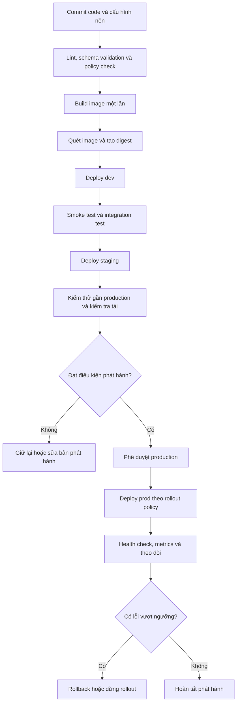

# Phân tách cấu hình compute theo môi trường phát triển và sản xuất

## Bối cảnh: cùng một ứng dụng, nhiều môi trường vận hành

Một ứng dụng thường đi qua nhiều môi trường trước khi phục vụ người dùng thật. Môi trường phát triển (development/dev) hỗ trợ lập trình, thử nghiệm và gỡ lỗi. Môi trường kiểm thử hoặc staging giúp xác minh bản phát hành trong điều kiện gần production. Môi trường sản xuất (production/prod) phục vụ lưu lượng thật và dữ liệu thật, vì vậy cần ưu tiên tính sẵn sàng, bảo mật, khả năng khôi phục và kiểm soát thay đổi.

Các môi trường có thể chạy cùng mã ứng dụng nhưng cần cấu hình compute khác nhau. Dev có thể dùng VM nhỏ, ít replica, dữ liệu giả lập và lịch tự động tắt. Production có thể cần nhiều vùng khả dụng, giới hạn truy cập chặt, autoscaling, giám sát đầy đủ và năng lực dự phòng. Nếu dùng một cấu hình duy nhất cho mọi môi trường, nhóm phát triển có thể tốn chi phí ở dev hoặc vô tình đưa thiết lập thử nghiệm không an toàn vào production.

**Phân tách cấu hình compute theo môi trường** là cách tổ chức các tham số hạ tầng và runtime sao cho mỗi môi trường có năng lực, chính sách và kết nối phù hợp, trong khi vẫn giữ được tính nhất quán của ứng dụng và quy trình triển khai.

Trong module **CLOUD_CORE_SERVICES_COMPUTE**, chủ đề này kết nối việc chọn CPU, RAM, image, storage, network và bảo mật với cấp phát tự động, triển khai lặp lại, mở rộng tải, tính sẵn sàng và tối ưu chi phí.

## 1. Mục tiêu của việc tách môi trường

Tách môi trường không chỉ là đặt tên `dev` và `prod` cho hai nhóm máy. Mỗi môi trường cần có ranh giới và mục đích rõ ràng.

| Mục tiêu | Development | Production |
|---|---|---|
| Mục đích | Phát triển, thử nghiệm, gỡ lỗi | Phục vụ người dùng và nghiệp vụ thật |
| Dữ liệu | Dữ liệu giả, dữ liệu đã ẩn danh hoặc bộ dữ liệu thử nghiệm | Dữ liệu thật theo chính sách lưu trữ và truy cập |
| Năng lực compute | Nhỏ, linh hoạt, có thể tạm thời | Được sizing theo tải, SLA/SLO và dự phòng |
| Số bản sao | Có thể một replica hoặc ít node | Thường có nhiều replica và phân tán theo miền lỗi nếu yêu cầu sẵn sàng đòi hỏi |
| Quyền truy cập | Nhóm phát triển được cấp quyền phù hợp để thử nghiệm | Quyền tối thiểu, có phê duyệt và audit |
| Mạng | Có thể mở kết nối thử nghiệm có kiểm soát | Phân đoạn chặt, giới hạn ingress/egress và kết nối riêng |
| Logging | Có thể tăng mức chi tiết để gỡ lỗi | Có cấu trúc, có cảnh báo và kiểm soát dữ liệu nhạy cảm |
| Thay đổi | Nhanh, thường xuyên | Có kiểm tra, phê duyệt và kế hoạch rollback |
| Chi phí | Ưu tiên tiết kiệm và tự động thu hồi | Cân bằng chi phí với hiệu năng, tính sẵn sàng và rủi ro |

Môi trường staging thường nằm giữa dev và prod: cấu hình nên gần production để kiểm thử hành vi triển khai, nhưng dữ liệu và quyền truy cập vẫn phải được giới hạn. Không nhất thiết mọi tổ chức đều có đủ ba môi trường; điều quan trọng là xác định rõ ranh giới kiểm thử và vận hành.

## 2. Phân loại cấu hình: phần dùng chung và phần theo môi trường

Trước khi tạo các file cấu hình riêng, hãy xác định tham số nào thực sự cần khác nhau. Nếu sao chép toàn bộ cấu hình thành nhiều bản độc lập, các môi trường dễ lệch nhau theo thời gian.

### 2.1. Cấu hình dùng chung

Những thuộc tính mô tả ứng dụng và quy tắc vận hành có thể giữ thống nhất:

- Tên dịch vụ, cổng ứng dụng và giao thức.
- Phiên bản runtime, thư viện nền tảng và yêu cầu hệ điều hành.
- Cấu trúc health endpoint, log format và metric cơ bản.
- Quy tắc gắn nhãn tài nguyên như service, owner và component.
- Chính sách bảo mật nền tảng, ví dụ không chạy ứng dụng bằng root nếu không cần.
- Cấu trúc khai báo CPU/RAM và cách autoscaling được cấu hình, nếu các giá trị cụ thể được override theo môi trường.

### 2.2. Cấu hình cần khác nhau

Các giá trị phụ thuộc môi trường thường gồm:

- Kích thước VM/instance, số node, số replica, CPU và RAM.
- Min/max của autoscaling, ngưỡng scale và mức dự phòng.
- Region, availability zone, subnet, route, firewall và load balancer.
- Loại, kích thước, hiệu năng và chính sách backup của volume.
- Địa chỉ endpoint của database, cache, queue và dịch vụ bên ngoài.
- Mức log, sampling, retention và ngưỡng cảnh báo.
- Quota, giới hạn concurrency, timeout và rate limit.
- Danh tính dịch vụ, quyền IAM và tham chiếu đến secret.
- Tag chi phí, lịch bật/tắt và chính sách lưu giữ tài nguyên.

### 2.3. Không đưa secret vào cấu hình thông thường

Endpoint, tên bucket hoặc mức log thường có thể lưu dưới dạng cấu hình. Password, API token, private key, certificate private key và thông tin xác thực phải được quản lý bằng secret manager hoặc cơ chế cấp phát bí mật phù hợp. File cấu hình chỉ nên chứa tên hoặc đường dẫn tham chiếu đến secret.

Ví dụ, `DATABASE_HOST` có thể là biến cấu hình; `DATABASE_PASSWORD` nên được lấy từ secret store bằng workload identity hoặc cơ chế xác thực ngắn hạn. Không commit secret vào Git, không nhúng secret vào image và không đưa secret vào user data có thể đọc qua metadata/API.

## 3. Mô hình tổ chức cấu hình

Một cách dễ quản lý là có cấu hình nền dùng chung và các lớp override theo môi trường. Thứ tự nạp cần được quy định rõ để tránh một giá trị production vô tình bị ghi đè bởi giá trị mặc định.

Ví dụ cấu trúc thư mục:

```text
deploy/
  base/
    app-config.yaml
    compute.yaml
    network-policy.yaml
  overlays/
    dev/
      compute.yaml
      app-config.yaml
    staging/
      compute.yaml
      app-config.yaml
    prod/
      compute.yaml
      app-config.yaml
  modules/
    compute/
      main.tf
      variables.tf
      outputs.tf
      environments/
        dev.tfvars
        staging.tfvars
        prod.tfvars
```

Đây là một ví dụ tổ chức, không phải quy ước bắt buộc. Với Kubernetes có thể dùng Helm values hoặc Kustomize overlays; với Terraform có thể dùng module chung và file biến riêng; với nền tảng VM có thể dùng template/image chung cùng tham số khởi tạo theo môi trường.

Một cấu hình nền có thể mô tả các thuộc tính ổn định:

```yaml
service:
  name: orders-api
  port: 8080
  health_path: /health/ready
compute:
  cpu_request: "500m"
  memory_request: "512Mi"
  cpu_limit: "2"
  memory_limit: "2Gi"
observability:
  metrics_enabled: true
  structured_logs: true
```

Lớp dev override số lượng bản sao và endpoint thử nghiệm:

```yaml
environment: dev
replicas: 1
autoscaling:
  enabled: false
database:
  host: dev-db.internal
logging:
  level: debug
  retention_days: 3
```

Lớp production có thể đặt năng lực và chính sách khác:

```yaml
environment: prod
replicas: 3
autoscaling:
  enabled: true
  min_replicas: 3
  max_replicas: 20
database:
  host: prod-db.internal
logging:
  level: info
  retention_days: 30
```

Các tên host và giá trị trong ví dụ chỉ mang tính minh họa. Trong hệ thống thực, endpoint phải đến từ hạ tầng đã được cấp phát; số replica và retention phải dựa trên tải, yêu cầu nghiệp vụ, chính sách dữ liệu và ngân sách.

### 3.1. Quy tắc hợp nhất cấu hình

Một quy trình hợp nhất rõ ràng thường theo các bước:

1. Nạp cấu hình nền đã được kiểm soát phiên bản.
2. Nạp lớp override của đúng môi trường.
3. Lấy secret từ secret manager bằng danh tính của môi trường hoặc workload.
4. Kiểm tra schema, kiểu dữ liệu, giá trị bắt buộc và giới hạn an toàn.
5. Tạo cấu hình triển khai cuối cùng và lưu lại phiên bản/commit dùng để triển khai.

Không nên dựa vào thứ tự ngẫu nhiên giữa các file hoặc cho phép biến môi trường tùy ý ghi đè mọi giá trị. Hãy định nghĩa precedence và validate để biết giá trị cuối cùng đến từ đâu.

## 4. Tách cấu hình compute: CPU, RAM và autoscaling

Dev và production thường có mức tải và mục tiêu khác nhau. Cấu hình compute nên phản ánh mục tiêu đó, đồng thời giữ cùng một cách khai báo để dễ so sánh.

### 4.1. CPU và bộ nhớ

Ở dev, có thể dùng VM hoặc container nhỏ để giảm chi phí, miễn là đủ cho tác vụ phát triển và kiểm thử. Production cần được sizing từ benchmark và metric thực tế: CPU utilization, throttling, memory working set, OOM, độ trễ và throughput. Không nên chọn cấu hình production chỉ bằng cách nhân số vCPU của dev lên một hệ số cố định.

Với container, `requests` thường ảnh hưởng đến quyết định lập lịch; `limits` đặt mức tiêu thụ tối đa theo cơ chế runtime. Với VM, shape quy định số vCPU/RAM được cấp. Cần kiểm tra quota và capacity trong đúng vùng, họ máy và pool. Tài nguyên cấp phát lớn hơn không tự động làm ứng dụng nhanh hơn nếu nút thắt nằm ở database, lock, mạng hoặc thuật toán.

### 4.2. Số replica và autoscaling

Dev có thể chạy một replica và tắt autoscaling nếu mục tiêu là kiểm thử chức năng. Staging nên thử cả scale-out/scale-in khi đó là một phần của hành vi production. Production thường cần số replica tối thiểu để duy trì khả năng phục vụ khi một instance lỗi hoặc trong lúc rollout; min/max phải dựa trên tải, thời gian khởi động và quota.

Ví dụ cấu hình Kubernetes Deployment và HorizontalPodAutoscaler ở mức khái niệm:

```yaml
apiVersion: apps/v1
kind: Deployment
metadata:
  name: orders-api
spec:
  replicas: 3
  selector:
    matchLabels:
      app: orders-api
  template:
    metadata:
      labels:
        app: orders-api
    spec:
      containers:
        - name: api
          image: registry.example.invalid/orders-api:1.8.0
          resources:
            requests:
              cpu: "500m"
              memory: "512Mi"
            limits:
              cpu: "2"
              memory: "2Gi"
          ports:
            - containerPort: 8080
```

Production có thể áp dụng HPA riêng:

```yaml
apiVersion: autoscaling/v2
kind: HorizontalPodAutoscaler
metadata:
  name: orders-api
spec:
  scaleTargetRef:
    apiVersion: apps/v1
    kind: Deployment
    name: orders-api
  minReplicas: 3
  maxReplicas: 20
  metrics:
    - type: Resource
      resource:
        name: cpu
        target:
          type: Utilization
          averageUtilization: 65
```

HPA là ví dụ cho autoscaling theo CPU. Dịch vụ có thể cần metric khác như độ dài hàng đợi, số request đang xử lý hoặc concurrency. HPA cũng không tự bổ sung node nếu cluster hết capacity; cần cấu hình node autoscaler và bảo đảm quota cloud, IP subnet cùng capacity vùng đủ cho node mới.

### 4.3. Lịch tài nguyên và loại instance

Dev/test có thể dùng lịch tự động tắt ngoài giờ, instance có thể thu hồi (nếu workload chịu được gián đoạn) hoặc pool dùng chung. Production thường cần capacity ổn định, chính sách thay thế instance và phân tán qua các miền lỗi. Không dùng loại instance dễ bị thu hồi cho workload production quan trọng nếu chưa thiết kế khả năng chịu gián đoạn và phục hồi.

## 5. Tách cấu hình mạng và lưu trữ

Ranh giới mạng và dữ liệu là phần quan trọng của việc cô lập môi trường. Một lỗi cấu hình endpoint có thể khiến ứng dụng dev kết nối nhầm database production hoặc một workload production vô tình mở cổng quản trị ra Internet.

### 5.1. Mạng

Nên xác định mạng, subnet và chính sách firewall riêng cho từng môi trường. Tùy mức cô lập cần thiết, dev và prod có thể ở các project/account hoặc VPC/VNet khác nhau. Nếu dùng chung mạng vật lý hoặc mạng logic, cần có phân đoạn, route và quy tắc truy cập rõ ràng.

| Thành phần | Development | Production |
|---|---|---|
| VPC/VNet | Mạng dev hoặc mạng sandbox được kiểm soát | Mạng production có ranh giới quản trị riêng |
| Subnet | Có thể đơn giản hơn, vẫn giới hạn quyền truy cập | Phân vùng public/private theo vai trò |
| Ingress | Chỉ nhóm phát triển hoặc VPN/dev gateway | Qua load balancer, WAF hoặc cổng truy cập được phê duyệt |
| Egress | Cho phép truy cập công cụ cần cho phát triển, có kiểm soát | Giới hạn đích ra ngoài, dùng proxy/NAT hoặc private endpoint khi phù hợp |
| DNS | Tên miền nội bộ/dev riêng | Tên miền production và quản lý thay đổi chặt |
| Quản trị | Truy cập từ mạng phát triển hoặc bastion | Bastion, session manager hoặc truy cập zero-trust có audit |

Không nên dựa vào tên hostname để cô lập môi trường. Hãy xác minh bằng network policy, security group/firewall, route table, IAM và thử kết nối từ workload thực tế.

### 5.2. Lưu trữ và backup

Dev thường có thể dùng volume nhỏ hơn, hiệu năng thấp hơn hoặc dữ liệu có thể tạo lại. Production cần chọn loại volume theo IOPS, throughput, độ trễ, độ bền và yêu cầu phục hồi. Backup production cần có lịch, retention, mã hóa, quyền truy cập và kiểm tra restore định kỳ.

Không nên để dev và prod dùng chung volume hoặc cùng một bản dữ liệu có thể ghi trực tiếp. Nếu cần dữ liệu production cho kiểm thử, hãy dùng bản sao đã ẩn danh hoặc biến đổi theo chính sách dữ liệu, đặt trong môi trường có quyền và thời hạn rõ ràng.

### 5.3. Database và dịch vụ phụ trợ

Mỗi môi trường nên trỏ đến database, cache, queue và storage endpoint tương ứng. Dev thường dùng database riêng nhỏ hoặc dịch vụ giả lập; production dùng dịch vụ được sizing và bảo vệ theo yêu cầu nghiệp vụ. Cấu hình endpoint phải được validate để ngăn việc deploy dev trỏ nhầm vào production.

Migration schema cần có quy trình kiểm thử và triển khai. Không tự động chạy migration phá hủy dữ liệu production chỉ vì một ứng dụng khởi động. Có thể tách bước migration khỏi rollout ứng dụng, kiểm tra tương thích ngược và chuẩn bị phương án phục hồi.

## 6. Bảo mật và danh tính theo môi trường

Mỗi môi trường cần danh tính và quyền truy cập riêng. Tài khoản hoặc workload identity dùng ở dev không nên có quyền đọc secret, bucket hay database production. Nhóm phát triển có thể có quyền tạo/xóa tài nguyên dev; thay đổi production cần quyền hẹp hơn và có audit.

Các nguyên tắc cần áp dụng:

- Dùng account/project/subscription hoặc namespace riêng khi cần ranh giới quản trị mạnh.
- Tạo IAM role/service account riêng cho từng môi trường và cấp quyền tối thiểu.
- Tách secret store, key mã hóa và certificate theo môi trường.
- Không dùng chung credential giữa dev, staging và prod.
- Hạn chế quyền truy cập production theo nhóm, thời hạn và quy trình phê duyệt.
- Ghi lại ai thay đổi cấu hình, thời điểm, giá trị trước/sau và lý do.
- Quét image, package và cấu hình trước khi triển khai; vá lỗi theo mức độ rủi ro và lịch vận hành.

Một cấu hình `debug=true`, cổng quản trị mở rộng hoặc log chứa payload nhạy cảm có thể phù hợp trong sandbox nhưng không được tự động mang sang production. Nên có policy kiểm tra những giá trị cấm hoặc bắt buộc trước khi pipeline được phép triển khai.

## 7. Giữ tính nhất quán giữa các môi trường

Tách cấu hình không có nghĩa là tạo ra các hệ thống hoàn toàn khác nhau. Nếu dev chạy runtime, image hoặc kiến trúc khác production, lỗi có thể chỉ xuất hiện sau khi phát hành. Mục tiêu là giữ những yếu tố có ảnh hưởng đến hành vi ứng dụng càng giống nhau càng tốt, và chỉ thay đổi các giá trị thực sự phụ thuộc môi trường.

### 7.1. Dùng cùng artifact đã được build

Build ứng dụng một lần, gắn version hoặc digest bất biến, sau đó promote cùng artifact qua staging đến production. Không build lại một binary khác chỉ vì môi trường đích khác nhau. Cấu hình môi trường được đưa vào lúc triển khai hoặc lúc runtime.

Ví dụ:

```text
commit 8f31c2a
    |
    v
build image orders-api:1.8.0
    |
    v
image digest sha256:...
    |
    +--> deploy dev
    |
    +--> deploy staging
    |
    +--> deploy prod (sau khi được phê duyệt)
```

Image tag có thể thay đổi hoặc bị ghi đè nếu registry cho phép. Với phát hành quan trọng, nên triển khai bằng digest bất biến để xác định chính xác nội dung đã được kiểm thử.

### 7.2. Giữ gần nhau các yếu tố nền tảng

Staging nên gần production về kiến trúc CPU, loại runtime, phiên bản hệ điều hành, network path, storage class và cơ chế autoscaling nếu các yếu tố đó ảnh hưởng kết quả kiểm thử. Quy mô có thể nhỏ hơn để tiết kiệm, nhưng cần ghi nhận khác biệt và hiểu giới hạn của kiểm thử.

Không phải lúc nào staging cũng cần bằng production về số node hoặc dung lượng. Với kiểm thử tải, cần môi trường có capacity phù hợp và dữ liệu mô phỏng đủ đại diện; với kiểm thử chức năng, quy mô nhỏ hơn có thể chấp nhận được.

### 7.3. Kiểm soát configuration drift

Configuration drift xảy ra khi cấu hình thực tế khác với cấu hình được khai báo. Ví dụ, một kỹ sư sửa security group trực tiếp trên console nhưng không cập nhật IaC; lần triển khai sau có thể ghi đè thay đổi hoặc giữ lại một lỗ hổng không được kiểm soát.

Để giảm drift:

- Quản lý hạ tầng bằng IaC hoặc hệ thống cấu hình có version control.
- Hạn chế thay đổi thủ công; nếu cần sửa khẩn cấp, ghi lại và đưa thay đổi về mã nguồn sau đó.
- Chạy plan/diff định kỳ để so sánh trạng thái thực tế với trạng thái mong muốn.
- Bảo vệ state file, phân tách state theo môi trường và tránh nhiều pipeline cùng sửa một state.
- Dùng policy-as-code để kiểm tra cấu hình trước khi áp dụng.
- Lưu lại commit, artifact digest và kết quả triển khai cho từng môi trường.

## 8. Triển khai cấu hình qua pipeline

Pipeline nên áp dụng cùng một quy trình kiểm tra cho mọi môi trường, nhưng quyền và điều kiện phát hành có thể khác nhau. Một luồng thường gặp:



Các bước kiểm tra nên bao gồm:

1. **Syntax và schema:** file YAML/JSON/HCL hợp lệ; trường bắt buộc có mặt và đúng kiểu.
2. **Validation theo môi trường:** region, subnet, image, instance family, quota và endpoint tồn tại trong môi trường đích.
3. **Policy check:** production không bật debug, không dùng public IP ngoài chính sách, không mở cổng quản trị cho mọi nguồn và không thiếu mã hóa/backup bắt buộc.
4. **Security scan:** image, dependency, IaC và cấu hình được quét theo quy trình của tổ chức.
5. **Plan/review:** xem trước tài nguyên sẽ tạo, sửa hoặc xóa; yêu cầu phê duyệt khi thay đổi ảnh hưởng production.
6. **Deploy:** áp dụng cấu hình đã xác thực và dùng artifact digest đã được kiểm thử.
7. **Post-deploy verification:** kiểm tra trạng thái VM/pod, health endpoint, log, metric, lỗi và độ trễ.

### 8.1. Rollout và rollback

Production nên có chiến lược triển khai giảm phạm vi ảnh hưởng, chẳng hạn rolling update, canary hoặc blue-green nếu nền tảng hỗ trợ. Bắt đầu với một phần nhỏ lưu lượng, theo dõi error rate, latency, saturation và health check rồi mới mở rộng.

Rollback ứng dụng có thể chỉ cần quay lại artifact digest trước đó, nhưng rollback cấu hình hạ tầng hoặc database có thể phức tạp hơn. Thay đổi schema dữ liệu nên ưu tiên tương thích ngược trong giai đoạn chuyển tiếp. Với thay đổi không thể đảo ngược, cần backup, migration plan và quy trình khôi phục được thử nghiệm trước.

### 8.2. Ví dụ tham số IaC theo môi trường

Một module Terraform có thể nhận các biến chung, trong khi mỗi môi trường cung cấp file giá trị riêng:

```hcl
# variables.tf
variable "environment" {
  type = string
}

variable "instance_type" {
  type = string
}

variable "min_instances" {
  type = number
}

variable "max_instances" {
  type = number
}
```

```hcl
# environments/dev.tfvars
environment    = "dev"
instance_type  = "general-small"
min_instances  = 1
max_instances  = 2
```

```hcl
# environments/prod.tfvars
environment    = "prod"
instance_type  = "general-medium"
min_instances  = 3
max_instances  = 20
```

Áp dụng bằng workspace hoặc backend/state được phân tách phù hợp, ví dụ:

```bash
terraform plan -var-file="environments/dev.tfvars"
terraform apply -var-file="environments/dev.tfvars"
```

Lệnh trên minh họa cách truyền giá trị dev. Production cần dùng state/backend và quyền triển khai dành riêng cho prod, xem lại plan và thực hiện phê duyệt theo quy trình. Không dùng chung state giữa các môi trường nếu điều đó khiến thao tác ở môi trường này có thể tác động nhầm tài nguyên môi trường khác.

## 9. Kiểm thử cấu hình trước khi phát hành

Kiểm thử cấu hình cần xác minh cả giá trị lẫn hành vi thực tế của workload. Một file hợp lệ về cú pháp vẫn có thể chỉ sai subnet, thiếu quota hoặc tạo VM không đủ RAM.

| Loại kiểm thử | Ví dụ nội dung | Mục tiêu |
|---|---|---|
| Static validation | Schema, kiểu dữ liệu, giá trị bắt buộc, giới hạn min/max | Phát hiện lỗi cấu hình sớm |
| Infrastructure plan | Diff IaC, số VM/node, volume, IP và policy thay đổi | Nhận diện thay đổi ngoài dự kiến |
| Security policy | IAM tối thiểu, encryption, ingress/egress, không lộ secret | Ngăn cấu hình không an toàn |
| Smoke test | Health endpoint, DNS, kết nối dependency | Xác minh dịch vụ vừa triển khai có thể hoạt động |
| Integration test | Kết nối database, queue, storage và API liên quan | Xác minh các thành phần phối hợp đúng |
| Load test | Throughput, latency, CPU/RAM, autoscaling và capacity | Kiểm tra cấu hình đáp ứng tải mục tiêu |
| Resilience test | Mất một instance/node/zone, restart và phục hồi | Kiểm tra dự phòng và khả năng tự phục hồi |
| Restore test | Khôi phục volume/database từ backup | Xác minh dữ liệu có thể phục hồi |

Dev có thể dùng kiểm thử nhanh và dữ liệu giả lập. Staging nên thực hiện các bài test gần production, đặc biệt là migration, autoscaling, backup/restore và rollout. Production cần giám sát liên tục và có thể dùng canary hoặc synthetic checks để phát hiện lỗi sau triển khai.

## 10. Quản lý cấu hình và dữ liệu nhạy cảm

Cấu hình cần có chủ sở hữu, nguồn chân lý và lịch sử thay đổi. Một tham số nên có một nơi được xem là nguồn chính thức; tránh để cùng giá trị tồn tại ở file YAML, pipeline variable, console và secret store nhưng không có quy tắc ưu tiên.

Phân loại thông tin theo cách lưu trữ:

| Loại thông tin | Ví dụ | Cách quản lý |
|---|---|---|
| Cấu hình không nhạy cảm | Port, log level, replica count, feature flag | Version control và review |
| Tham số môi trường | Region, subnet ID, database host, storage class | File biến/overlay riêng, có validation |
| Secret | Password, token, private key | Secret manager, quyền tối thiểu, rotation |
| Trạng thái hạ tầng | Terraform state, resource ID, output | Backend có kiểm soát truy cập, encryption và locking |
| Audit record | Người thay đổi, thời gian, commit, plan và kết quả | Hệ thống log/audit có retention phù hợp |

Secret rotation nên được thiết kế để ứng dụng có thể nhận credential mới mà không cần đưa secret vào Git. Khi có sự cố lộ secret, cần thu hồi và thay thế credential, kiểm tra audit log và xác định phạm vi môi trường bị ảnh hưởng.

## 11. Theo dõi chi phí và quyền sở hữu tài nguyên

Tách môi trường giúp phân bổ chi phí rõ hơn nếu tài nguyên được gắn tag hoặc label thống nhất. Nên gắn các thuộc tính như `environment`, `service`, `owner`, `team`, `cost-center` và `expires-at` cho tài nguyên phù hợp.

Các biện pháp tối ưu thường gặp:

- Đặt lịch tắt VM, cluster hoặc môi trường dev không hoạt động ngoài giờ.
- Thu hồi volume, IP, snapshot và tài nguyên thử nghiệm hết hạn.
- Dùng instance nhỏ hơn ở dev nếu đáp ứng được nhu cầu kiểm thử.
- Dùng autoscaling và right-sizing ở production dựa trên metric, giữ headroom cần thiết.
- Theo dõi chi phí theo service và environment để phát hiện tài nguyên tăng bất thường.
- Đặt budget/alert theo môi trường; cảnh báo chi phí production không thay thế cảnh báo năng lực và sức khỏe dịch vụ.

Không nên áp dụng chính sách thu hồi tự động của dev vào production. Tài nguyên production có thể cần tồn tại ngay cả khi mức sử dụng thấp để đáp ứng yêu cầu sẵn sàng hoặc khôi phục.

## 12. Quy trình thực hành phân tách dev và prod

Có thể áp dụng trình tự sau khi đưa một dịch vụ compute mới vào vận hành:

1. **Xác định mục tiêu và ranh giới:** quyết định cần dev, staging và prod; xác định project/account, network và nhóm người dùng của từng môi trường.
2. **Chọn nguồn cấu hình:** tạo module hoặc cấu hình nền dùng chung; xác định các tham số sẽ override theo môi trường.
3. **Thiết kế compute:** chọn image/runtime, CPU/RAM, replica, autoscaling và capacity dự phòng cho từng môi trường.
4. **Tách network và storage:** xác định subnet, firewall, endpoint, volume, backup và chính sách dữ liệu riêng.
5. **Thiết lập danh tính và secret:** tạo role/service identity, secret store và quyền truy cập riêng; không chia sẻ credential giữa môi trường.
6. **Tạo pipeline:** validate cấu hình, build artifact một lần, deploy theo thứ tự dev → staging → prod và lưu lại digest/commit.
7. **Kiểm thử:** chạy smoke, integration, load, resilience và restore test phù hợp với rủi ro.
8. **Phê duyệt và phát hành:** xem plan, phê duyệt production, rollout có giám sát và chuẩn bị rollback.
9. **Theo dõi drift và chi phí:** so sánh trạng thái thực tế với IaC, kiểm tra tag, quota, metric và budget định kỳ.

### Checklist trước khi triển khai production

- [ ] Artifact có version/digest bất biến và đã được kiểm thử ở môi trường trước.
- [ ] CPU/RAM, replica, quota và capacity đáp ứng tải mục tiêu cùng headroom.
- [ ] Network chỉ mở các luồng cần thiết; không có cổng quản trị công khai ngoài chính sách.
- [ ] IAM và workload identity dùng quyền tối thiểu, tách biệt khỏi dev.
- [ ] Secret được lấy từ secret manager; không nằm trong image, Git hoặc user data.
- [ ] Storage được mã hóa và backup theo yêu cầu; quy trình restore đã được kiểm tra.
- [ ] Health check, log, metric và cảnh báo hoạt động.
- [ ] Plan đã được review; thay đổi production có người chịu trách nhiệm và phương án rollback.
- [ ] Tag/label và budget giúp nhận diện chi phí production.

## 13. Những nhầm lẫn thường gặp

**Tách môi trường chỉ cần đổi tên.** Tên `dev` hoặc `prod` không tạo ra ranh giới bảo mật. Cần phân tách danh tính, mạng, dữ liệu, quyền và trạng thái hạ tầng.

**Dev phải giống production ở mọi thông số.** Dev có thể nhỏ và rẻ hơn. Điều cần giữ gần nhau là những yếu tố ảnh hưởng hành vi ứng dụng; các khác biệt về quy mô cần được ghi nhận và kiểm thử ở staging.

**Production chỉ cần tăng CPU và RAM.** Tính sẵn sàng còn phụ thuộc số replica, miền lỗi, storage, network, quota, autoscaling, health check và khả năng phục hồi.

**Có file cấu hình riêng nghĩa là đã tách secret.** Secret vẫn có thể bị copy vào file hoặc image. Cần dùng secret manager và quyền truy cập riêng.

**Build riêng cho mỗi môi trường giúp an toàn hơn.** Build lại có thể tạo ra artifact khác nhau. Nên build một lần và promote cùng digest; chỉ thay đổi cấu hình môi trường.

**Sửa trực tiếp trên console là cách nhanh và không ảnh hưởng IaC.** Thay đổi thủ công tạo configuration drift. Nếu phải xử lý khẩn cấp, cần ghi lại và đồng bộ thay đổi về nguồn cấu hình chính thức.

**Rollback luôn chỉ là quay lại phiên bản ứng dụng trước.** Thay đổi database, volume hoặc network có thể không đảo ngược đơn giản. Cần thiết kế migration tương thích và kế hoạch khôi phục riêng.

## Kết luận

Phân tách cấu hình compute theo môi trường giúp mỗi giai đoạn phát triển có mức tài nguyên, mạng, bảo mật và chính sách vận hành phù hợp. Cấu hình nền và các lớp override giữ được tính nhất quán, trong khi các giá trị như CPU/RAM, replica, endpoint, subnet, secret và backup được quản lý riêng theo môi trường. Kết hợp IaC, build artifact một lần, validation, policy check, pipeline có phê duyệt và theo dõi configuration drift giúp triển khai lặp lại, giảm lỗi cấu hình và cân bằng giữa chi phí dev với yêu cầu sẵn sàng của production.
