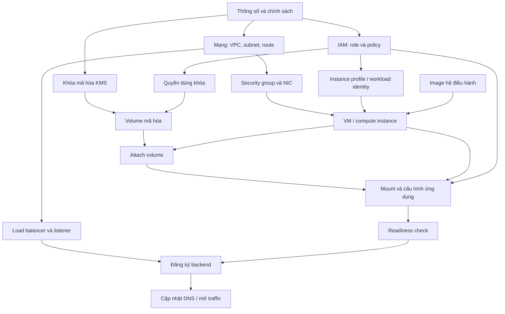

# Quản lý thứ tự phụ thuộc giữa máy, đĩa, mạng và quyền truy cập

## 1. Vì sao thứ tự cấp phát quan trọng?

Một máy ảo có thể được tạo thành công nhưng ứng dụng bên trong vẫn không hoạt động. Máy chưa có đường ra mạng, không đọc được secret, không gắn được volume, không phân giải được DNS hoặc không có quyền truy cập dịch vụ cần thiết. Những lỗi này thường xuất hiện khi các tài nguyên cloud được tạo theo thứ tự không phù hợp hoặc khi quy trình chỉ chờ thao tác tạo tài nguyên hoàn tất mà không kiểm tra trạng thái sẵn sàng.

Một workload compute thường phụ thuộc vào nhiều lớp: danh tính và quyền truy cập, mạng, khóa mã hóa, lưu trữ, image, máy ảo hoặc container, cấu hình khởi động, dịch vụ phụ trợ và điểm nhận lưu lượng. Các lớp này có quan hệ trước-sau. Ví dụ, volume mã hóa cần khóa KMS và quyền sử dụng khóa; VM cần subnet và chính sách mạng; ứng dụng cần volume đã gắn và mount; load balancer chỉ nên chuyển request đến instance đã vượt qua health check.

Tự động hóa tốt mô tả các quan hệ đó thành một đồ thị phụ thuộc, sau đó tạo tài nguyên theo thứ tự hợp lệ. Những nhánh độc lập có thể chạy song song. Những bước cần dịch vụ thực sự sẵn sàng phải có điều kiện chờ và kiểm tra rõ ràng. Khi xóa hoặc thay thế hệ thống, trình tự thường đảo ngược để không phá hỏng tài nguyên còn đang được sử dụng.

Trong bài học này, người học sẽ:

- Phân biệt phụ thuộc tạo tài nguyên, phụ thuộc sẵn sàng và phụ thuộc lúc chạy.
- Xây dựng đồ thị phụ thuộc giữa IAM, mạng, khóa, đĩa, compute và ứng dụng.
- Chọn thứ tự cấp phát hợp lý cho VM, container và workload serverless.
- Dùng Infrastructure as Code (IaC), orchestration, retry và health check để điều phối quy trình.
- Thiết kế bootstrap có tính lặp lại, quản lý secret an toàn và tránh tạo tài nguyên trùng lặp.
- Xử lý lỗi, thay thế, rollback và xóa tài nguyên theo thứ tự an toàn.

## 2. Hiểu các loại phụ thuộc

### 2.1. Phụ thuộc tạo tài nguyên (creation dependency)

Một tài nguyên chỉ có thể được tạo khi tài nguyên khác đã tồn tại. Ví dụ, network interface cần subnet; subnet cần virtual network; volume mã hóa cần khóa và quyền sử dụng khóa; instance cần network interface hoặc subnet hợp lệ.

Đây là quan hệ rõ ràng nhất trong IaC. Công cụ có thể suy ra thứ tự khi một tài nguyên tham chiếu trực tiếp output hoặc thuộc tính của tài nguyên khác. Nếu không có tham chiếu trực tiếp nhưng vẫn có quan hệ bắt buộc, cần khai báo phụ thuộc tường minh.

### 2.2. Phụ thuộc sẵn sàng (readiness dependency)

Tài nguyên đã được tạo nhưng dịch vụ bên trong chưa sẵn sàng. Một VM có thể ở trạng thái `running` nhưng hệ điều hành chưa boot xong. Một volume đã được attach ở control plane nhưng thiết bị chưa xuất hiện trong hệ điều hành. Một database đã được tạo nhưng chưa chấp nhận kết nối. Một load balancer đã có listener nhưng target chưa healthy.

Phụ thuộc readiness cần một điều kiện kiểm tra, ví dụ:

- Cloud API báo instance ở trạng thái phù hợp.
- Agent quản trị hoặc cloud-init báo bootstrap hoàn tất.
- Thiết bị block xuất hiện và có thể truy cập trong hệ điều hành.
- Ứng dụng trả về HTTP 200 trên endpoint readiness.
- Database chấp nhận kết nối và hoàn tất bước khởi tạo schema.
- Target group báo đủ số backend healthy theo chính sách.

Chỉ chờ lệnh tạo tài nguyên trả về thành công là chưa đủ. Thời gian chờ nên có deadline, retry có giới hạn và thông báo lỗi cụ thể.

### 2.3. Phụ thuộc lúc chạy (runtime dependency)

Ứng dụng cần một dịch vụ khác trong suốt quá trình hoạt động. Ví dụ, API cần database, worker cần message queue, function cần object storage hoặc dịch vụ secret. Các dịch vụ này có thể đã sẵn sàng lúc triển khai nhưng vẫn có thể tạm thời mất kết nối sau đó.

Runtime dependency cần được xử lý trong chính ứng dụng bằng timeout, retry có backoff, circuit breaker, connection pool và thông báo lỗi phù hợp. Thứ tự cấp phát ban đầu không thể bảo đảm một dịch vụ sẽ luôn hoạt động trong suốt vòng đời workload.

### 2.4. Phụ thuộc khi xóa hoặc thay thế (lifecycle dependency)

Thứ tự xóa thường đi ngược thứ tự tạo. Cần ngừng nhận traffic trước khi xóa backend, tháo volume trước khi xóa instance nếu muốn giữ dữ liệu, xóa attachment trước volume và giữ khóa mã hóa cho đến khi không còn dữ liệu cần giải mã.

Một số tài nguyên có thể bị bảo vệ hoặc có vòng đời độc lập, chẳng hạn database, volume chứa dữ liệu, khóa mã hóa và backup. Không nên để một thao tác destroy thông thường xóa nhầm tài nguyên có dữ liệu quan trọng.

### 2.5. Phụ thuộc cứng và phụ thuộc mềm

**Phụ thuộc cứng** là điều kiện bắt buộc. Ví dụ, instance không thể gắn NIC vào subnet chưa tồn tại. **Phụ thuộc mềm** là điều kiện cải thiện khả năng hoạt động nhưng có thể được xử lý bằng fallback. Ví dụ, một dịch vụ telemetry chưa sẵn sàng có thể không nên chặn toàn bộ quá trình khởi động ứng dụng nếu ứng dụng vẫn có thể hoạt động an toàn khi thiếu telemetry.

Phân loại đúng giúp quy trình không chờ vô hạn vì một dịch vụ phụ trợ không thiết yếu. Với phụ thuộc mềm, cần xác định hành vi suy giảm, cảnh báo và cách khôi phục sau đó.

## 3. Đồ thị phụ thuộc và thứ tự thực thi

### 3.1. Mô hình đồ thị có hướng không chu trình

Có thể biểu diễn mỗi tài nguyên hoặc bước triển khai bằng một node. Một cạnh `A -> B` có nghĩa A phải tồn tại hoặc đạt điều kiện trước khi B được thực hiện. Đồ thị hợp lệ cho một quy trình cấp phát thông thường cần không có chu trình phụ thuộc.

Ví dụ một workload VM có volume dữ liệu riêng:



Các nhánh mạng, IAM, khóa và image có thể được chuẩn bị song song nếu không có phụ thuộc bổ sung. VM chỉ nên khởi tạo khi subnet/NIC, danh tính và image đã đáp ứng yêu cầu. Ứng dụng chỉ được đánh dấu sẵn sàng sau khi volume, cấu hình và quyền truy cập cần thiết hoạt động.

### 3.2. Sắp xếp theo thứ tự tô-pô

Thứ tự tô-pô (topological order) là một thứ tự thực thi trong đó mọi node đều xuất hiện sau các node mà nó phụ thuộc. Một đồ thị có thể có nhiều thứ tự hợp lệ. Điều này cho phép chạy song song các nhánh độc lập, thay vì tuần tự hóa toàn bộ quá trình.

Ví dụ, trong lúc tạo subnet, có thể đồng thời tạo IAM role và khóa mã hóa. Khi các nhánh này hoàn tất, có thể tạo NIC, volume và instance theo các quan hệ tương ứng. Nếu khóa mã hóa cần policy riêng, policy phải sẵn sàng trước thao tác tạo volume hoặc trước lúc workload truy cập dữ liệu.

Nếu đồ thị có chu trình, cần xem lại thiết kế. Một ví dụ là VM cần DNS trỏ đến chính VM để khởi động, trong khi bản ghi DNS lại cần địa chỉ IP của VM. Có thể phá vòng phụ thuộc bằng địa chỉ ổn định, load balancer, service discovery hoặc một bước cấu hình sau khi VM được tạo.

### 3.3. Không đồng nhất “đã tạo” với “đã dùng được”

Các API cloud thường bất đồng bộ. Một yêu cầu tạo tài nguyên có thể trả về ID ngay, trong khi control plane tiếp tục triển khai ở nền. Một số thay đổi IAM, DNS, route hoặc policy cũng cần thời gian để lan truyền.

Vì vậy, mỗi bước cần xác định rõ điều kiện hoàn tất. Ví dụ:

| Bước | Điều kiện tạo xong | Điều kiện sẵn sàng để bước sau dùng |
|---|---|---|
| Tạo subnet | Có subnet ID | Route, địa chỉ và chính sách mạng đã áp dụng |
| Gán IAM role | Role tồn tại | Policy đã gắn và workload nhận được danh tính/credential |
| Tạo volume | Có volume ID | Volume ở trạng thái có thể attach và khóa mã hóa hoạt động |
| Tạo VM | Có instance ID | Hệ điều hành boot xong, agent hoặc health check phản hồi |
| Attach volume | Control plane báo attached | Thiết bị xuất hiện trong OS, filesystem mount thành công |
| Deploy ứng dụng | Artifact đã được cài | Ứng dụng vượt readiness check và truy cập được dependency |
| Tạo load balancer | Listener tồn tại | Backend healthy và chính sách health check đạt yêu cầu |

## 4. Xây dựng thứ tự phụ thuộc theo từng lớp

### 4.1. Lớp danh tính và quyền truy cập

IAM thường cần được chuẩn bị trước khi compute khởi động nếu workload phải truy cập secret, object storage, registry, database hoặc dịch vụ quản lý cấu hình ngay trong bootstrap.

Trình tự thường gồm:

1. Tạo service account, role hoặc workload identity.
2. Tạo policy với quyền tối thiểu cần thiết.
3. Gắn policy vào role hoặc service identity.
4. Cấu hình trust relationship để đúng workload có thể nhận danh tính.
5. Cấp role cho VM, node, pod hoặc function.
6. Kiểm tra workload có thể lấy credential tạm thời và gọi đúng dịch vụ.

Không nhúng access key dài hạn vào image, user-data, script bootstrap hoặc source control. Nếu dùng secret manager, workload identity phải có quyền đọc đúng secret và đúng phiên bản. Nếu secret được mã hóa bằng KMS, cần có quyền giải mã phù hợp và policy khóa phải cho phép principal cần thiết.

Một số dịch vụ yêu cầu service-linked role hoặc quyền của control plane để tạo tài nguyên thay mặt khách hàng. Đây là quyền triển khai hạ tầng, khác với quyền runtime mà ứng dụng sử dụng. Cần phân biệt hai danh tính để tránh cấp quyền quản trị cloud quá rộng cho tiến trình ứng dụng.

### 4.2. Lớp mạng

Mạng thường được tạo trước compute vì NIC và instance cần subnet, route và chính sách truy cập hợp lệ.

Trình tự mạng cơ bản:

1. Tạo virtual network/VPC và dải địa chỉ IP.
2. Tạo subnet theo vùng khả dụng hoặc fault domain.
3. Tạo route table, route nội bộ, NAT hoặc kết nối riêng khi cần.
4. Tạo security group/firewall rule và network ACL theo kiến trúc.
5. Tạo DNS private zone, resolver hoặc endpoint dịch vụ nếu cần.
6. Tạo NIC hoặc cấu hình mạng cho compute.
7. Tạo load balancer, listener và health check; có thể thực hiện song song với các nhánh khác nếu không phụ thuộc backend.

Quy tắc mạng nên theo nguyên tắc tối thiểu: chỉ mở cổng ứng dụng cần thiết, giới hạn nguồn truy cập và tách luồng quản trị với luồng dữ liệu. Không mở SSH/RDP ra toàn Internet chỉ để bootstrap dễ hơn. Có thể dùng session manager, bastion được kiểm soát hoặc kênh quản trị riêng.

Đối với ứng dụng private, kiểm tra cả đường egress. VM có thể nhận IP nội bộ và vẫn không tải được package hoặc image nếu thiếu NAT, proxy hoặc private endpoint. Nếu workload lấy secret hoặc registry qua endpoint riêng, endpoint và DNS liên quan phải sẵn sàng trước bước bootstrap.

### 4.3. Lớp khóa và lưu trữ

Volume mã hóa có thể phụ thuộc vào khóa KMS, key policy và quyền sử dụng khóa. Với volume được tạo từ snapshot, snapshot nguồn và quyền đọc snapshot cũng là dependency. Volume block thường gắn với một vùng khả dụng hoặc miền placement nhất định; VM và volume phải tương thích về vị trí.

Trình tự điển hình:

1. Tạo hoặc chọn khóa mã hóa và policy.
2. Xác minh principal triển khai có quyền tạo volume bằng khóa đó.
3. Tạo volume hoặc khôi phục từ snapshot.
4. Tạo VM trong vùng tương thích.
5. Attach volume vào VM.
6. Chờ thiết bị xuất hiện trong hệ điều hành.
7. Xác định thiết bị đúng bằng UUID, serial hoặc metadata ổn định.
8. Tạo filesystem nếu là volume mới và mount vào mount point đã định.
9. Thiết lập quyền sở hữu, quyền truy cập và chính sách backup.

Không chạy lệnh format một cách mù quáng trên thiết bị tìm thấy đầu tiên. Trên VM có thể có nhiều disk; chọn sai thiết bị có thể xóa dữ liệu. Script bootstrap cần kiểm tra volume đã có filesystem chưa, dùng UUID hoặc định danh ổn định để mount và bảo đảm thao tác có thể chạy lại an toàn.

Với filesystem mạng, cần chuẩn bị network route, security rule, DNS, mount target và quyền truy cập trước khi mount. Với object storage, không có bước attach như block volume; thay vào đó, workload cần endpoint, danh tính và policy truy cập.

### 4.4. Lớp image và compute

Image phải có hệ điều hành, kiến trúc CPU, driver và agent phù hợp với loại instance. Nếu workload cần GPU, cần xác minh image có driver/runtime tương thích hoặc có quy trình cài đặt đã kiểm thử. Image nên được quản lý theo phiên bản bất biến để có thể tái tạo môi trường.

Khi tạo VM, các dependency thường gồm:

- Subnet, NIC, security group hoặc firewall policy.
- IAM role, instance profile hoặc workload identity.
- Image ID và cấu hình boot.
- Volume root, data volume hoặc snapshot nguồn.
- Placement, zone, quota và loại instance.
- Metadata service và cơ chế cung cấp cấu hình khởi động.

Một số thuộc tính như NIC, root disk và boot volume được tạo đồng thời trong API tạo instance. Dù vậy, về mặt logic, chúng vẫn có quan hệ phụ thuộc và cần được biểu diễn trong cấu hình để tránh tạo instance với sai subnet, sai quyền hoặc sai image.

### 4.5. Lớp bootstrap và ứng dụng

Sau khi VM boot, bootstrap thường thực hiện các bước:

1. Chờ network interface và DNS hoạt động.
2. Nhận credential qua workload identity.
3. Lấy cấu hình và secret từ dịch vụ quản lý tương ứng.
4. Xác minh volume và mount filesystem.
5. Cài package hoặc tải artifact từ registry.
6. Cấu hình service, biến môi trường và quyền thư mục.
7. Khởi động ứng dụng và agent quan sát.
8. Chạy readiness check.

Bootstrap cần phân biệt lỗi tạm thời và lỗi cấu hình. DNS chưa lan truyền hoặc API secret manager tạm thời timeout có thể retry. Image sai kiến trúc, role thiếu quyền hoặc filesystem không đúng định dạng cần báo lỗi rõ ràng để sửa cấu hình, không retry vô hạn.

## 5. Quản lý thứ tự trong Infrastructure as Code

### 5.1. Dependency ngầm định qua tham chiếu

Các công cụ IaC thường suy ra dependency khi thuộc tính của tài nguyên này tham chiếu output của tài nguyên khác. Ví dụ, instance nhận `subnet_id` từ subnet resource thì công cụ hiểu subnet phải được tạo trước instance.

Ưu điểm là đồ thị phản ánh quan hệ dữ liệu thực tế và dễ bảo trì. Khi có thể, hãy dùng output/input giữa module thay vì hard-code ID. Điều này giúp thay đổi tên hoặc cấu hình tài nguyên mà không phải tự sửa nhiều chỗ.

### 5.2. Dependency tường minh

Một số quan hệ không thể hiện qua thuộc tính tham chiếu. Ví dụ, instance cần chờ policy IAM được gắn hoàn tất, hoặc một bước bootstrap cần chờ cấu hình mạng bổ sung. Khi đó, có thể khai báo dependency tường minh như `depends_on` trong Terraform hoặc `DependsOn` trong CloudFormation.

Chỉ khai báo dependency tường minh khi có lý do kỹ thuật cụ thể. Phụ thuộc quá rộng khiến nhiều tài nguyên phải chờ không cần thiết, giảm khả năng chạy song song và làm kế hoạch triển khai khó hiểu. Dependency ở mức tạo tài nguyên cũng không thay thế readiness check ở tầng ứng dụng.

Ví dụ minh họa dạng HCL rút gọn:

```hcl
resource "example_instance" "app" {
  subnet_id         = example_subnet.private.id
  security_group_id = example_security_group.app.id
  image_id          = example_image.app.id
  role_id           = example_role.app.id

  # Chỉ dùng khi quan hệ này không được biểu diễn qua thuộc tính tham chiếu.
  depends_on = [example_role_policy.app_runtime]
}
```

Tên resource trong ví dụ là placeholder để minh họa quan hệ; cần thay bằng resource type của provider cloud thực tế. Việc instance được tạo xong vẫn không chứng minh ứng dụng đã boot hoặc policy đã lan truyền đến mọi thành phần runtime.

### 5.3. Tách module theo ranh giới trách nhiệm

Một cấu trúc module có thể gồm:

- `network`: VPC/VNet, subnet, route, firewall, endpoint và DNS.
- `identity`: role, policy, trust relationship và quyền đọc secret.
- `storage`: key, volume, snapshot, backup và filesystem.
- `compute`: image, instance, NIC, autoscaling và placement.
- `application`: bootstrap, cấu hình, deploy và health check.
- `traffic`: load balancer, target registration, listener và DNS công khai.

Module nên công bố output cần thiết như subnet ID, security group ID, role ID, volume ID, instance ID và endpoint. Tránh để module tự tra cứu hoặc sửa tài nguyên nội bộ của module khác qua các cách không được quản lý, vì điều đó làm dependency khó thấy và dễ gây drift.

### 5.4. Plan, apply và state

IaC thường có bước lập kế hoạch (plan) trước khi áp dụng (apply). Plan giúp phát hiện tài nguyên sẽ tạo, sửa hoặc xóa. State ghi nhận mối liên hệ giữa cấu hình và tài nguyên thực tế; cần lưu state ở nơi được bảo vệ, hỗ trợ khóa khi chạy đồng thời và có backup.

Không chỉnh sửa state bằng tay nếu không hiểu hậu quả. Khi tài nguyên đã tồn tại ngoài IaC, dùng quy trình import hoặc adoption phù hợp. Sau khi apply, cần kiểm tra output, trạng thái dịch vụ và drift. Apply thành công chỉ cho biết các thao tác theo provider đã hoàn tất theo điều kiện của công cụ; không bảo đảm ứng dụng đạt readiness.

## 6. Orchestration, readiness và retry

### 6.1. Khi nào cần workflow orchestration?

Với quy trình nhiều bước, nhiều dịch vụ hoặc có thời gian chờ dài, workflow orchestration giúp quản lý trạng thái và điều phối rõ ràng. Một workflow có thể:

- Chạy các nhánh độc lập song song.
- Chờ sự kiện hoặc trạng thái từ cloud API.
- Retry bước lỗi tạm thời theo chính sách.
- Dừng sớm khi gặp lỗi không thể khắc phục tự động.
- Gọi bước bù trừ hoặc rollback khi một nhánh thất bại.
- Lưu trạng thái để tiếp tục sau khi worker hoặc scheduler khởi động lại.

Với quy trình đơn giản, IaC và script bootstrap có thể đủ. Với workflow phức tạp, nhiều nhánh, thời gian chạy dài hoặc cần phê duyệt, nên cân nhắc state machine hoặc dịch vụ orchestration chuyên dụng.

### 6.2. Retry có giới hạn

Các lỗi như timeout mạng, API throttling, DNS propagation hoặc tài nguyên chưa sẵn sàng có thể tạm thời. Retry nên có exponential backoff và jitter để tránh nhiều worker cùng gửi lại request vào một thời điểm.

Một chính sách minh họa:

```text
attempt = 0
deadline = thời điểm bắt đầu + 10 phút

while chưa đạt readiness và thời điểm hiện tại < deadline:
    kiểm tra trạng thái
    nếu đã sẵn sàng: tiếp tục
    nếu lỗi cấu hình hoặc lỗi không thể retry: dừng và báo lỗi
    chờ min(max_delay, base_delay * 2^attempt) + jitter
    attempt = attempt + 1

nếu hết deadline: báo timeout kèm trạng thái và log gần nhất
```

Đây là thuật toán minh họa, không phải giá trị mặc định cho mọi dịch vụ. Deadline và số lần retry cần dựa trên SLO, thời gian khởi động dự kiến và giới hạn API. Không retry vô hạn vì có thể che giấu lỗi cấu hình và giữ tài nguyên tính phí trong thời gian dài.

### 6.3. Idempotency

Một bước idempotent có thể chạy lại mà không tạo ra tác dụng phụ ngoài ý muốn. Ví dụ, tạo một thư mục nếu chưa tồn tại, mount volume theo UUID nếu chưa mount hoặc áp dụng cấu hình mong muốn thay vì thêm một dòng cấu hình mỗi lần chạy.

Với API tạo tài nguyên, dùng idempotency token nếu dịch vụ hỗ trợ. Nếu không, trước khi tạo lại cần kiểm tra tài nguyên đã được tạo ở lần trước hay chưa. Đặt tên, tag và metadata theo workload/environment để có thể truy vết và đối chiếu.

Idempotency đặc biệt quan trọng khi workflow bị timeout sau khi cloud đã tạo tài nguyên nhưng phản hồi chưa về. Nếu chạy lại một cách mù quáng, có thể tạo VM, volume, địa chỉ IP hoặc load balancer trùng lặp.

### 6.4. Readiness, liveness và startup probe

Ba loại kiểm tra có mục đích khác nhau:

- **Startup probe:** cho biết ứng dụng đã hoàn tất khởi động ban đầu chưa. Hữu ích với ứng dụng khởi động lâu hoặc thực hiện migration lúc boot.
- **Readiness probe:** cho biết instance có thể nhận traffic hay chưa. Nếu chưa sẵn sàng, cần loại instance khỏi backend routing.
- **Liveness probe:** cho biết tiến trình còn hoạt động hay cần khởi động lại. Không nên dùng liveness để kiểm tra mọi dependency bên ngoài, vì database mất kết nối ngắn hạn có thể khiến toàn bộ instance restart liên tục.

Health endpoint nên phản ánh đúng điều kiện cần thiết để phục vụ request. Nếu ứng dụng cần database để xử lý nghiệp vụ, readiness có thể kiểm tra khả năng kết nối database với timeout ngắn. Tuy nhiên, một dịch vụ phụ trợ không thiết yếu không nên khiến toàn bộ ứng dụng bị đánh dấu unhealthy nếu ứng dụng vẫn có chế độ hoạt động suy giảm an toàn.

## 7. Bootstrap máy ảo và quản lý đĩa

### 7.1. Image bất biến và cấu hình lúc khởi động

Có hai cách phổ biến để chuẩn bị máy:

- **Pre-baked image:** cài sẵn hệ điều hành, agent và phần mềm nền trong image đã được kiểm thử. Khi khởi động, VM chỉ tải cấu hình môi trường và secret cần thiết.
- **Bootstrap lúc boot:** dùng cloud-init, user-data, startup script hoặc configuration management để cài đặt và cấu hình khi máy khởi động.

Image bất biến giúp thời gian boot ngắn và môi trường nhất quán. Bootstrap linh hoạt hơn khi cấu hình thay đổi thường xuyên, nhưng phụ thuộc mạng, package repository, registry và dịch vụ cấu hình. Có thể kết hợp hai cách: image chứa phần mềm nền, bootstrap chỉ thực hiện cấu hình môi trường và khởi động dịch vụ.

### 7.2. Trình tự attach và mount volume

Đối với block storage, cần phân biệt trạng thái ở control plane và trạng thái trong hệ điều hành. Sau khi API báo attach thành công, OS có thể cần thêm thời gian để phát hiện thiết bị. Script cần chờ thiết bị đúng xuất hiện, kiểm tra filesystem và mount vào đúng vị trí.

Quy trình an toàn:

1. Xác định volume theo ID hoặc metadata được truyền từ IaC.
2. Chờ volume được attach vào instance đúng.
3. Chờ thiết bị xuất hiện trong OS và xác định bằng serial/UUID hoặc thuộc tính ổn định.
4. Kiểm tra filesystem hiện có.
5. Chỉ format khi xác nhận đây là volume mới, chưa có dữ liệu cần giữ và bước khởi tạo được cho phép.
6. Mount theo UUID hoặc định danh ổn định, không phụ thuộc tên thiết bị có thể thay đổi.
7. Kiểm tra mount thành công và quyền truy cập trước khi khởi động ứng dụng.

Nếu volume chứa dữ liệu cần giữ, không format trong bootstrap. Dùng snapshot và backup theo chính sách trước các thao tác thay đổi filesystem. Cấu hình mount bền vững cần xử lý trường hợp volume tạm thời chưa xuất hiện để hệ thống không rơi vào trạng thái boot lỗi khó chẩn đoán.

### 7.3. Phụ thuộc giữa dịch vụ hệ điều hành

Trong Linux, systemd có thể biểu diễn quan hệ giữa service, mount và network. Ví dụ, ứng dụng cần volume đã mount nên unit service cần khai báo phụ thuộc vào mount point hoặc thiết bị tương ứng. Nếu ứng dụng gọi dịch vụ qua mạng ngay lúc boot, có thể cần `network-online.target`, nhưng mục tiêu này chỉ có ý nghĩa nếu network manager thực sự chờ cấu hình mạng hoàn tất.

Không nên giả định `network.target` đồng nghĩa DNS, route hoặc endpoint từ xa đã sẵn sàng. Ứng dụng vẫn cần timeout và retry cho kết nối mạng. Tương tự, `After=` trong systemd chỉ sắp xếp thứ tự khởi động giữa unit; nó không tự xác minh database bên ngoài đã phục vụ request.

### 7.4. Bảo vệ secret trong bootstrap

User-data hoặc startup script có thể được lưu trong metadata, log hoặc lịch sử thay đổi tùy nền tảng. Không đặt mật khẩu, private key hay token dài hạn trực tiếp trong đó. Thay vào đó, bootstrap lấy secret qua workload identity và secret manager, chỉ đọc đúng secret cần thiết và hạn chế ghi giá trị nhạy cảm ra log.

Kiểm tra cả quyền truy cập metadata service. Nếu nền tảng hỗ trợ cơ chế bảo vệ metadata endpoint, bật cơ chế phù hợp để giảm nguy cơ tiến trình không tin cậy lấy credential. Secret nên có vòng đời, khả năng rotate và audit log rõ ràng.

## 8. Phụ thuộc trong container và serverless

### 8.1. Container và Kubernetes

Container image cần tồn tại trong registry và node phải có quyền pull image. Pod có thể phụ thuộc vào service account, secret, config map, persistent volume claim, storage class, CSI driver, network policy và service discovery.

Một trình tự phổ biến:

1. Chuẩn bị namespace, service account và quyền RBAC/IAM cần thiết.
2. Chuẩn bị secret/config và quyền truy cập secret manager.
3. Chuẩn bị storage class, persistent volume hoặc CSI dependency nếu workload cần dữ liệu bền vững.
4. Chuẩn bị network policy, service và ingress.
5. Triển khai workload và chờ pod được schedule, image pull và container start.
6. Chờ startup/readiness probe đạt yêu cầu.
7. Chỉ đưa pod vào endpoint phục vụ traffic khi readiness thành công.

Kubernetes controller liên tục đối chiếu trạng thái mong muốn với trạng thái thực tế. Điều đó giúp tự khôi phục một số lỗi, nhưng không loại bỏ dependency. Ví dụ, pod có thể ở trạng thái Pending vì thiếu GPU, PVC chưa bind hoặc node affinity không khớp. Cần quan sát event và condition để xác định nguyên nhân.

### 8.2. Serverless function và event source

Function thường phụ thuộc vào execution role, secret, khóa mã hóa, network configuration, layer/package và event source. Trigger không nên được kích hoạt trước khi function, quyền invoke và các dependency runtime đã sẵn sàng.

Trình tự triển khai thường gồm:

1. Tạo execution role và policy runtime.
2. Chuẩn bị secret, KMS key và quyền đọc/giải mã.
3. Chuẩn bị VPC/subnet/security group nếu function cần truy cập mạng riêng.
4. Đóng gói và triển khai function hoặc image.
5. Cấu hình biến môi trường, timeout, memory, concurrency và logging.
6. Tạo quyền cho event source gọi function.
7. Tạo event mapping hoặc trigger ở trạng thái kiểm soát.
8. Kiểm tra invocation thử, log, retry và dead-letter destination.
9. Bật trigger hoặc chuyển traffic khi function đáp ứng điều kiện.

Một số nền tảng tự quản lý thứ tự giữa function và event source ở mức control plane. Dù vậy, vẫn cần xác minh quyền invoke, hành vi retry, xử lý sự kiện trùng lặp và khả năng quan sát trước khi bật trigger sản xuất.

## 9. Xử lý lỗi và rollback theo dependency

### 9.1. Phân loại lỗi

| Nhóm lỗi | Ví dụ | Cách xử lý |
|---|---|---|
| Lỗi cấu hình | Sai subnet, thiếu quyền IAM, image sai kiến trúc | Dừng bước, báo rõ tài nguyên/thuộc tính cần sửa |
| Lỗi tạm thời | API timeout, throttling, DNS chưa lan truyền | Retry có backoff và deadline |
| Lỗi readiness | VM boot lâu, volume chưa xuất hiện, app chưa healthy | Thu thập trạng thái/log, chờ trong giới hạn rồi thất bại rõ ràng |
| Lỗi phụ thuộc | Database hoặc registry không truy cập được | Kiểm tra network, DNS, IAM, endpoint và trạng thái dịch vụ |
| Lỗi một phần | Mạng và IAM đã tạo nhưng compute thất bại | Giữ hoặc dọn tài nguyên theo chính sách, cập nhật trạng thái workflow |
| Lỗi dữ liệu | Mount sai hoặc migration schema lỗi | Ngừng traffic, giữ dữ liệu, phục hồi từ backup/snapshot theo quy trình |

### 9.2. Rollback không phải lúc nào cũng là xóa tất cả

Với tài nguyên stateless, rollback có thể hủy instance hoặc quay về image/phiên bản trước. Với tài nguyên stateful như volume, database, object storage và KMS key, xóa tự động có thể gây mất dữ liệu hoặc làm dữ liệu không thể giải mã.

Thiết kế rollback theo từng lớp:

- Ngừng nhận traffic hoặc đưa backend ra khỏi load balancer.
- Dừng ứng dụng hoặc worker để không ghi thêm dữ liệu.
- Chuyển về phiên bản ứng dụng trước hoặc khôi phục cấu hình.
- Giữ volume/database và tạo snapshot nếu cần.
- Chỉ tháo/xóa attachment sau khi xác nhận không còn tiến trình sử dụng.
- Giữ khóa mã hóa cho đến khi dữ liệu đã được di chuyển hoặc hết thời hạn lưu giữ.
- Dọn tài nguyên tạm theo danh sách được phê duyệt và cập nhật IaC state.

Một số thay đổi không thể rollback đơn giản, ví dụ schema migration phá vỡ tương thích hoặc dữ liệu đã ghi theo định dạng mới. Khi đó, cần chiến lược expand-and-contract, dual-read/write hoặc backup/restore được thử nghiệm trước.

### 9.3. Xóa theo thứ tự ngược

Trình tự teardown điển hình cho một ứng dụng VM:

1. Ngừng nhận traffic, cập nhật DNS hoặc route theo kế hoạch.
2. Gỡ backend khỏi load balancer và chờ connection drain.
3. Dừng ứng dụng và worker.
4. Sao lưu hoặc xác nhận chính sách giữ dữ liệu.
5. Tháo volume khỏi instance nếu cần giữ lại.
6. Xóa instance và NIC tạm.
7. Xóa volume chỉ khi đã được xác nhận không cần giữ.
8. Xóa load balancer, security rule, subnet hoặc network khi không còn tài nguyên phụ thuộc.
9. Thu hồi IAM role và policy sau khi workload không còn sử dụng.
10. Chỉ vô hiệu hóa hoặc xóa KMS key khi không còn dữ liệu, snapshot hoặc backup cần khóa đó.

Thứ tự cụ thể phụ thuộc kiến trúc. Không xóa network, role hoặc key chỉ vì VM đã bị xóa; có thể còn workload khác sử dụng các tài nguyên dùng chung.

## 10. Ví dụ triển khai theo dependency

### Ví dụ 1: VM ứng dụng có data volume riêng

Một API chạy trên VM trong subnet riêng. Ứng dụng đọc cấu hình từ secret manager và lưu dữ liệu trên volume mã hóa. Traffic chỉ được chuyển đến VM sau khi ứng dụng sẵn sàng.

**Trình tự:**

1. Tạo VPC, subnet, route, security group và endpoint cần thiết.
2. Tạo KMS key, key policy, IAM role và quyền đọc secret.
3. Tạo volume mã hóa trong vùng tương thích.
4. Tạo NIC và VM từ image đã kiểm thử, gắn role runtime.
5. Attach volume và chờ thiết bị xuất hiện trong OS.
6. Bootstrap mount volume, lấy secret, cài/cấu hình ứng dụng và khởi động service.
7. Kiểm tra readiness, kết nối database và quyền ghi vào volume.
8. Đăng ký VM vào target group, chờ healthy rồi mới mở traffic.

**Điểm cần xác minh:** volume đã attach đúng instance; filesystem không bị format nhầm; role chỉ đọc secret cần thiết; VM có egress đến dependency; health check phản ánh khả năng phục vụ thực tế.

### Ví dụ 2: Dịch vụ container cần persistent storage

Một worker container chạy trên Kubernetes, đọc message từ queue và ghi kết quả vào persistent volume. Worker cần service account để đọc queue và storage driver để mount volume.

**Trình tự:** chuẩn bị namespace và IAM/RBAC; tạo storage class/PVC và network policy; triển khai secret/config; triển khai worker; chờ volume bind, pod schedule, image pull và readiness; sau đó mới tăng consumer concurrency. Nếu worker không cần lưu trạng thái cục bộ, cân nhắc object storage hoặc database thay cho volume gắn riêng để dễ thay thế pod.

**Điểm cần xác minh:** CSI driver hoạt động; zone của volume tương thích node; quyền đọc queue và ghi dữ liệu tối thiểu; xử lý message trùng lặp khi pod restart; readiness không báo thành công trước khi worker thực sự có thể xử lý.

### Ví dụ 3: Function xử lý sự kiện từ object storage

Một function được gọi khi có tệp mới. Function cần quyền đọc object nguồn, ghi kết quả, ghi log và giải mã secret cấu hình.

**Trình tự:** tạo execution role và policy; chuẩn bị secret/KMS; triển khai function; kiểm tra invocation trực tiếp bằng dữ liệu thử; tạo quyền invoke và event mapping; cấu hình retry/dead-letter; sau cùng mới bật trigger trên bucket hoặc event source.

**Điểm cần xác minh:** event không được kích hoạt trước khi quyền và function sẵn sàng; function xử lý idempotent; retry không tạo bản ghi hoặc object trùng; giới hạn concurrency không làm quá tải dịch vụ đích.

## 11. Những sai lầm thường gặp

- **Chỉ dựa vào thứ tự khai báo trong file:** thứ tự dòng không phải lúc nào cũng là dependency graph. Hãy biểu diễn quan hệ bằng tham chiếu hoặc dependency tường minh.
- **Coi API tạo tài nguyên trả về thành công là readiness:** VM, volume, database và load balancer đều có thể cần thời gian để sẵn sàng.
- **Dùng `depends_on` thay cho health check:** dependency IaC thường chỉ điều khiển thứ tự thao tác control plane, không xác minh ứng dụng.
- **Tạo VM trước khi có quyền runtime:** bootstrap có thể thất bại khi lấy secret, registry image hoặc cấu hình.
- **Thiếu egress hoặc private endpoint:** máy có IP và security group đúng vẫn không tải được artifact hoặc gọi dịch vụ cần thiết.
- **Format volume mỗi lần boot:** có thể xóa dữ liệu khi script chạy lại hoặc thiết bị được nhận diện khác tên.
- **Nhúng secret vào user-data hoặc image:** bí mật có thể xuất hiện trong metadata, log, state hoặc image registry.
- **Retry vô hạn:** giữ tài nguyên tính phí và che giấu lỗi cấu hình.
- **Không làm idempotent:** workflow chạy lại có thể tạo trùng VM, volume hoặc trigger.
- **Bật traffic trước readiness:** người dùng nhận lỗi trong khi ứng dụng vẫn đang bootstrap.
- **Xóa tài nguyên dùng chung:** network, IAM hoặc KMS có thể còn phục vụ workload khác.
- **Không lưu lịch sử thay đổi:** khó xác định bước nào tạo tài nguyên và vì sao một dependency bị lỗi.

## 12. Checklist trước khi tự động hóa provisioning

- [ ] Đã liệt kê tất cả tài nguyên và dependency của workload.
- [ ] Đã phân biệt creation, readiness, runtime và lifecycle dependency.
- [ ] Đã xây dựng đồ thị không chu trình và xác định nhánh có thể chạy song song.
- [ ] Đã chuẩn bị IAM, trust relationship, secret permission và KMS policy.
- [ ] Đã tạo network, route, firewall, DNS và endpoint trước khi workload cần dùng.
- [ ] Đã xác minh vị trí, mã hóa, snapshot và quyền truy cập của volume/storage.
- [ ] Đã chọn image, cấu hình compute, NIC, role và placement phù hợp.
- [ ] Đã thiết kế bootstrap idempotent, không chứa secret tĩnh và có log an toàn.
- [ ] Đã chờ volume/device, network, service và ứng dụng đạt readiness.
- [ ] Đã dùng retry có giới hạn, backoff, jitter và phân loại lỗi.
- [ ] Đã đăng ký backend hoặc bật event trigger sau khi dependency sẵn sàng.
- [ ] Đã kiểm tra plan/state, drift, rollback và bảo vệ tài nguyên stateful.
- [ ] Đã thiết kế teardown theo thứ tự ngược và giữ dữ liệu/khóa cần thiết.
- [ ] Đã thử nghiệm lỗi một phần, chạy lại workflow và khôi phục.

## 13. Kết luận

Provisioning compute là một quy trình có nhiều dependency giữa danh tính, mạng, khóa mã hóa, lưu trữ, image, máy ảo hoặc container, bootstrap và traffic. Đồ thị phụ thuộc giúp xác định bước nào phải chạy trước, bước nào có thể chạy song song và điều kiện nào cần được kiểm tra trước khi tiếp tục.

Hãy phân biệt tài nguyên đã được tạo với dịch vụ đã sẵn sàng. Dùng IaC để mô tả tài nguyên và dependency, orchestration để quản lý các bước dài, retry có giới hạn cho lỗi tạm thời và health check để xác nhận ứng dụng có thể phục vụ. Bootstrap phải idempotent, secret phải được lấy qua danh tính workload, còn rollback và teardown phải bảo vệ volume, database và khóa mã hóa. Khi các nguyên tắc này được áp dụng nhất quán, hệ thống VM, container và serverless có thể được triển khai lặp lại, dễ chẩn đoán và an toàn hơn.
