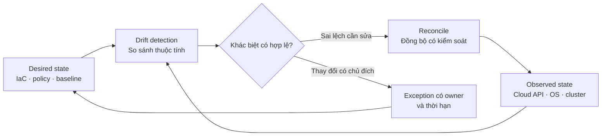

# Phát hiện configuration drift và đồng bộ với cấu hình chuẩn

Trong hạ tầng cloud, cấu hình máy ảo, mạng, lưu trữ, quyền truy cập và hệ điều hành thường được tạo bằng Infrastructure as Code (IaC) hoặc công cụ quản lý cấu hình. Theo thời gian, trạng thái thực tế có thể khác với cấu hình đã khai báo: một người mở thêm cổng firewall trực tiếp trên console, một máy được tăng CPU thủ công, một package được cập nhật ngoài pipeline hoặc một agent thay đổi file cấu hình. Sự khác biệt này được gọi là **configuration drift**.

Drift có thể xuất hiện vì thao tác khẩn cấp, thay đổi thủ công, lỗi tự động hóa, cập nhật từ nhà cung cấp hoặc vì cấu hình mong muốn chưa mô tả đầy đủ các giá trị động. Nếu không phát hiện và xử lý, môi trường sẽ mất tính nhất quán, khó tái tạo, khó kiểm toán và có thể phát sinh rủi ro bảo mật hoặc chi phí.

Phát hiện drift không chỉ là tìm ra hai giá trị khác nhau. Đội vận hành cần xác định thay đổi đó có hợp lệ không, có ảnh hưởng đến dịch vụ không, nguồn nào là chuẩn và cách đồng bộ nào an toàn. Một thay đổi thực tế đôi khi là bản sửa khẩn cấp cần được đưa ngược vào mã nguồn; một thay đổi khác có thể là sai lệch cần hoàn tác. Quy trình tốt phải phân biệt được hai trường hợp này.

## 1. Desired state, observed state và configuration drift

**Desired state** là trạng thái mong muốn được mô tả trong mã IaC, cấu hình chuẩn, policy hoặc hệ thống quản lý cấu hình. Nó xác định tài nguyên nào cần tồn tại và các thuộc tính quan trọng của chúng, ví dụ loại instance, số lượng VM, subnet, quy tắc firewall, dung lượng disk, phiên bản package và chính sách SSH.

**Observed state** là trạng thái thực tế được đọc từ cloud control plane, hệ điều hành, Kubernetes API hoặc công cụ kiểm kê. Nó phản ánh tài nguyên đang tồn tại và các giá trị hiện tại tại thời điểm quan sát.

**Configuration drift** xuất hiện khi observed state khác desired state ở một thuộc tính được quản lý và sự khác biệt đó không được giải thích bởi quy tắc động hoặc ngoại lệ đã phê duyệt.

Ví dụ, cấu hình chuẩn khai báo security group chỉ cho phép HTTPS từ load balancer. Một kỹ sư mở cổng SSH từ Internet để xử lý sự cố và quên đóng lại. Desired state vẫn giới hạn nguồn truy cập; observed state có thêm rule SSH công khai. Đây là drift có tác động bảo mật và cần được xử lý sớm.



Mục tiêu không phải làm cho mọi giá trị luôn giống nhau một cách máy móc. Hệ thống cần xác định rõ thuộc tính nào được quản lý, giá trị nào được phép thay đổi tự động và ngoại lệ nào có thời hạn. Ví dụ, số lượng VM trong autoscaling group có thể thay đổi theo tải; đó là hành vi mong muốn nếu desired state quản lý min/max/target policy thay vì một số lượng instance cố định.

## 2. Drift xuất hiện ở đâu?

Trong module hạ tầng tính toán cloud, drift có thể xảy ra ở nhiều lớp:

| Lớp | Ví dụ drift | Tác động có thể có |
|---|---|---|
| Compute | Thay đổi instance type, CPU option, số lượng VM hoặc placement | Hiệu năng, chi phí và tính sẵn sàng thay đổi |
| Network | Mở thêm cổng, đổi route, subnet, IP hoặc NIC | Mất kết nối, lộ dịch vụ hoặc định tuyến sai |
| Storage | Đổi dung lượng, loại volume, encryption hoặc retention | Chi phí, hiệu năng và khả năng khôi phục thay đổi |
| IAM / security | Thêm quyền, đổi role, tắt mã hóa hoặc logging | Mở rộng bề mặt tấn công và vi phạm chính sách |
| OS / guest | Sửa SSH, firewall, kernel parameter, service hoặc package | Môi trường không nhất quán, lỗi ứng dụng |
| Image / boot | Dùng image cũ, đổi boot mode hoặc driver | Khác biệt khi tạo máy mới và khi khôi phục |
| Accelerator | Thay GPU profile, driver hoặc runtime | Workload không chạy hoặc hiệu năng thay đổi |
| Orchestration | Sửa manifest, replica, resource limit hoặc policy của cluster | Workload lệch khỏi khai báo và khó tái tạo |

Drift cũng có thể xuất hiện ở tài nguyên phụ thuộc như DNS, load balancer, autoscaling policy, backup schedule, monitoring agent và secret rotation. Vì vậy, phạm vi kiểm tra nên dựa trên ranh giới hệ thống, không chỉ dựa vào danh sách VM.

## 3. Nguyên nhân phổ biến

### Thay đổi thủ công ngoài pipeline

Kỹ sư thay đổi tài nguyên trực tiếp qua console hoặc CLI để xử lý sự cố, thử nghiệm hoặc đáp ứng yêu cầu gấp. Nếu thay đổi không được cập nhật vào IaC, lần triển khai sau có thể ghi đè nó hoặc tạo thêm sai lệch.

### Nhiều nguồn cùng quản lý một tài nguyên

Một thuộc tính có thể được chỉnh sửa bởi Terraform, Ansible, script tự viết và người vận hành. Khi không xác định công cụ nào là chủ sở hữu, các hệ thống có thể liên tục ghi đè cấu hình của nhau. Ví dụ, IaC đặt một security rule, trong khi script bootstrap thêm rule khác mỗi lần chạy.

### Cấu hình không khai báo đầy đủ

Nếu mã IaC bỏ qua một thuộc tính, nhà cung cấp có thể áp dụng default. Khi default thay đổi hoặc tài nguyên được sửa thủ công, observed state có thể khác với điều mà nhóm nghĩ là chuẩn. Những thuộc tính quan trọng cần được khai báo rõ hoặc có policy kiểm tra.

### Tự động thay đổi theo tải hoặc trạng thái dịch vụ

Autoscaling, rolling deployment, managed service và scheduler có thể thay đổi số lượng hoặc danh tính instance thường xuyên. Đây không phải lúc nào cũng là drift cần sửa. Cần mô hình hóa các thuộc tính động đúng cách, chẳng hạn quản lý desired capacity hoặc policy thay vì cố định ID từng instance.

### Cập nhật và thay đổi từ nhà cung cấp

Nhà cung cấp có thể cập nhật metadata, firmware, trạng thái host, phiên bản dịch vụ hoặc default của API. Một số thay đổi được quản lý hoàn toàn bởi provider và không thể hoặc không nên ép về một giá trị cũ. Cần phân biệt thuộc tính do khách hàng quản lý với thuộc tính do dịch vụ quản lý.

### Thiếu kiểm soát sau thay đổi khẩn cấp

Một thay đổi break-glass có thể hợp lý tại thời điểm xảy ra sự cố nhưng trở thành drift lâu dài nếu không có ticket, owner, thời hạn và bước cập nhật lại cấu hình chuẩn. Quy trình khẩn cấp cần bao gồm bước hậu kiểm và hoàn tất tài liệu.

## 4. Phân loại drift trước khi xử lý

Không phải mọi sai khác đều cần tự động hoàn tác. Có thể phân loại theo nguồn gốc và tác động:

| Loại | Mô tả | Cách xử lý phù hợp |
|---|---|---|
| Unauthorized drift | Thay đổi không có phê duyệt hoặc không rõ nguồn | Điều tra, đánh giá rủi ro và thường đưa về chuẩn |
| Emergency drift | Thay đổi tạm thời để khôi phục dịch vụ | Giữ trong thời hạn ngắn, ghi nhận và đưa bản sửa vào code hoặc hoàn tác |
| Approved change chưa cập nhật code | Thay đổi đã được duyệt nhưng IaC chưa phản ánh | Cập nhật desired state rồi review và triển khai |
| Dynamic state | Giá trị thay đổi theo autoscaling, scheduler hoặc runtime | Điều chỉnh phạm vi quản lý và quy tắc so sánh |
| Provider-managed change | Thay đổi do nền tảng quản lý | Xác minh tài liệu, ghi nhận và cập nhật baseline nếu cần |
| False positive | Khác biệt do thời điểm đọc, eventual consistency hoặc dữ liệu không ổn định | Chạy lại phép đọc, kiểm tra nguồn và cải thiện detector |

Có thể bổ sung mức độ nghiêm trọng dựa trên phạm vi và tác động:

- **Critical:** mở quyền truy cập công khai ngoài chính sách, tắt mã hóa hoặc audit, thay đổi IAM đặc quyền, xóa backup hay làm mất khả năng phục hồi.
- **High:** thay đổi network route, firewall, disk hoặc compute có thể gây outage hoặc chi phí lớn.
- **Medium:** package, cấu hình OS hoặc tham số vận hành lệch chuẩn nhưng chưa gây tác động trực tiếp.
- **Low:** metadata, tag hoặc thuộc tính không ảnh hưởng vận hành và bảo mật.

Mức độ cần dựa trên bối cảnh. Một rule mở cổng quản trị trong mạng thử nghiệm cô lập có thể khác rủi ro với rule tương tự trên hệ thống production công khai.

## 5. Phát hiện drift bằng cách so sánh desired state và observed state

### Lấy desired state từ nguồn có kiểm soát

Nguồn chuẩn có thể là repository IaC, cấu hình Ansible, policy-as-code, manifest Kubernetes hoặc baseline OS. Cần xác định phiên bản đang được phê duyệt và commit đã triển khai. Không nên so sánh cloud với một nhánh code chưa được release hoặc một file local chưa review.

### Thu thập observed state

Observed state có thể được lấy từ:

- Cloud API hoặc inventory service để đọc instance, volume, NIC, security group, IAM, route và metadata.
- Configuration management agent để kiểm tra package, service, file và kernel parameter trên guest OS.
- Kubernetes API để đọc live objects, replica, resource requests/limits, labels và policy.
- Cloud audit log để tìm ai đã thay đổi gì, vào thời điểm nào và qua API nào.
- Monitoring và configuration inventory để xác định trạng thái theo thời gian.

Việc đọc trạng thái nên dùng quyền read-only tối thiểu cần thiết. Dữ liệu nhạy cảm như secret, private key và nội dung file có credential không nên được đưa vào report drift. Chỉ cần xác minh thuộc tính bảo mật hoặc fingerprint phù hợp.

### Chuẩn hóa trước khi so sánh

Hai cấu hình có thể biểu diễn cùng ý nghĩa theo cách khác nhau. Ví dụ, danh sách firewall rule có thể được trả về theo thứ tự khác; timestamp và ID do provider sinh ra có thể thay đổi; địa chỉ IP của VM trong autoscaling group là động. Trước khi so sánh, cần chuẩn hóa thứ tự, đơn vị, giá trị mặc định và thuộc tính không thuộc phạm vi quản lý.

Một detector tốt nên so sánh theo thuộc tính có ý nghĩa, không chỉ so sánh toàn bộ JSON. Nếu so sánh byte-for-byte, thay đổi thứ tự mảng hoặc metadata do provider sinh ra có thể tạo ra nhiều cảnh báo giả.

### Chạy định kỳ và theo sự kiện

Có hai cách phát hiện bổ trợ cho nhau:

- **Scheduled scan:** chạy theo lịch, ví dụ mỗi giờ hoặc mỗi ngày, để phát hiện sai lệch còn tồn tại và kiểm tra toàn bộ tài nguyên.
- **Event-driven detection:** nhận audit event hoặc event cấu hình để kiểm tra ngay sau khi có thay đổi. Cách này giảm thời gian tồn tại của drift nhưng phụ thuộc độ đầy đủ của event stream.

Nên kết hợp cả hai. Event-driven giúp phản ứng nhanh; scheduled scan phát hiện event bị bỏ lỡ, detector lỗi hoặc drift từ nguồn không phát event.

## 6. Công cụ và cách đọc kết quả

### Infrastructure as Code

Với Terraform, lệnh `terraform plan` thường refresh trạng thái từ provider rồi so sánh với cấu hình khai báo và state đã lưu. Kế hoạch có thể cho thấy tài nguyên bị thay đổi ngoài Terraform và hành động cần thực hiện để hội tụ về cấu hình.

`terraform plan -refresh-only` tập trung hiển thị thay đổi từ hạ tầng thực tế để người vận hành xem xét cập nhật state. Nếu dùng `terraform apply -refresh-only`, Terraform cập nhật state để phản ánh hiện trạng; thao tác này **không tự sửa tài nguyên cloud về desired state**. Chỉ chấp nhận refresh-only khi thay đổi thực tế là có chủ đích và đã được đưa vào quyết định quản lý. Nếu thay đổi là trái phép, cần sửa drift bằng kế hoạch thông thường sau khi đánh giá tác động.

Ví dụ quy trình kiểm tra chỉ đọc:

```bash
# Khởi tạo provider và module theo repository hiện tại
terraform init

# Tạo kế hoạch và quan sát khác biệt với hạ tầng thực tế
terraform plan

# Tập trung xem các thay đổi thực tế cần cập nhật state
terraform plan -refresh-only
```

Không tự động chạy `terraform apply` chỉ vì plan có thay đổi. Kế hoạch có thể đề xuất replace hoặc destroy tài nguyên, thay đổi network hoặc tác động dữ liệu. Hãy đọc kỹ phần `will be updated`, `will be replaced` và `will be destroyed`, đồng thời xác minh nguồn gốc của thay đổi trước khi áp dụng.

### Configuration management

Ansible có thể kiểm tra trạng thái cấu hình trên máy bằng check mode và diff mode. Ví dụ:

```bash
# Mô phỏng playbook và hiển thị khác biệt có thể áp dụng
ansible-playbook site.yml --check --diff
```

Check mode là mô phỏng; không phải mọi module đều hỗ trợ đầy đủ và kết quả không thay thế kiểm thử trên môi trường phù hợp. Diff có thể hiển thị nội dung file nhạy cảm, vì vậy không bật diff cho task xử lý secret hoặc cấu hình chứa credential. Có thể dùng `no_log` và các biện pháp bảo vệ output phù hợp.

### Cloud configuration inventory và policy

Các dịch vụ inventory/configuration của cloud có thể ghi lại cấu hình tài nguyên và lịch sử thay đổi. Policy-as-code có thể kiểm tra các điều kiện như:

- VM production phải có tag owner, environment và cost center.
- Disk dữ liệu phải bật encryption.
- Security group không được mở cổng quản trị ra toàn Internet nếu không có ngoại lệ.
- Instance production phải có monitoring và backup policy phù hợp.
- IAM role không được có quyền rộng hơn baseline.

Policy có thể chạy khi tạo tài nguyên, trong CI hoặc định kỳ trên môi trường đang hoạt động. Phát hiện ở thời điểm triển khai giúp ngăn drift mới; kiểm tra liên tục giúp tìm ra thay đổi xảy ra sau đó.

### GitOps và Kubernetes

Trong GitOps, repository chứa manifest mong muốn; controller so sánh live state của cluster với desired state và có thể tự reconcile. Trạng thái `OutOfSync` hoặc tương đương cho biết live object khác với manifest. Tuy nhiên, một số trường do Kubernetes controller hoặc admission webhook tự điền có thể khác manifest ban đầu mà vẫn hợp lệ.

Khi cấu hình autoscaling, không nên để GitOps liên tục ép số replica về một giá trị cố định nếu HPA là thành phần điều khiển số lượng replica. Cần khai báo quyền sở hữu trường và cấu hình ignore/managed fields theo hướng dẫn của công cụ. Nếu nhiều controller cùng quản lý một trường, hệ thống có thể liên tục dao động.

## 7. Phân biệt drift thật với thay đổi động

Một trong những nguyên nhân tạo cảnh báo giả là so sánh thuộc tính không phù hợp với cách hệ thống hoạt động.

Ví dụ:

- Autoscaling group thay đổi số lượng VM theo tải; desired state nên mô tả min/max/desired capacity hoặc policy, không nhất thiết là danh sách instance ID.
- DHCP cấp IP động; nếu địa chỉ IP không phải thuộc tính cần cố định, không nên coi mọi lần đổi IP là drift.
- Provider thêm metadata hoặc thay đổi trạng thái host; thuộc tính do provider quản lý cần được loại khỏi phạm vi reconcile của khách hàng.
- Kubernetes tự cập nhật status, replica hoặc field do controller quản lý; cần so sánh spec thuộc phạm vi quản lý và hiểu ownership của field.
- Secret được rotate định kỳ; detector nên kiểm tra phiên bản hoặc trạng thái rotation, không xuất nội dung secret ra log.

Để giảm false positive:

1. Định nghĩa rõ resource và thuộc tính được quản lý.
2. Chuẩn hóa dữ liệu và loại bỏ metadata không ổn định.
3. Xác định field nào do autoscaler, controller hoặc provider quản lý.
4. Dùng cửa sổ thời gian hoặc retry để xử lý eventual consistency.
5. Gắn exception có owner và thời hạn thay vì bỏ qua vĩnh viễn.

Không nên bỏ qua toàn bộ một tài nguyên chỉ vì một vài field động. Hãy loại trừ đúng thuộc tính và tiếp tục giám sát những thuộc tính còn lại, đặc biệt là security, encryption và network exposure.

## 8. Đồng bộ drift về cấu hình chuẩn

Khi detector phát hiện drift, cần quyết định một trong ba hướng:

1. **Revert actual state:** trạng thái thực tế sai hoặc không được phê duyệt; tạo kế hoạch đưa tài nguyên về desired state.
2. **Update desired state:** thay đổi thực tế là chủ đích và được chấp thuận; cập nhật IaC hoặc baseline, review, kiểm thử và phát hành phiên bản mới.
3. **Create a time-bound exception:** khác biệt cần được duy trì tạm thời; ghi rõ lý do, owner, rủi ro, biện pháp bù, người phê duyệt và ngày hết hạn.

### Quy trình reconcile an toàn

1. **Xác nhận phát hiện:** chạy lại phép đọc để loại trừ lỗi nhất thời và xác định chính xác resource ID cùng thuộc tính bị lệch.
2. **Tìm nguồn thay đổi:** tra audit log, commit, ticket, pipeline và lịch sử thao tác để biết ai hoặc hệ thống nào đã thay đổi.
3. **Đánh giá tác động:** xem thay đổi có ảnh hưởng đến bảo mật, traffic, dữ liệu, hiệu năng, chi phí hoặc SLA không.
4. **Chọn hướng xử lý:** revert, cập nhật desired state hoặc tạo exception có thời hạn.
5. **Tạo kế hoạch:** xem trước các hành động sẽ thực hiện, phụ thuộc và nguy cơ replace/destroy.
6. **Phê duyệt:** yêu cầu owner hoặc người có trách nhiệm duyệt với thay đổi có tác động cao.
7. **Áp dụng theo phạm vi nhỏ:** ưu tiên canary hoặc một nhóm tài nguyên trước, rồi mở rộng khi kết quả đạt.
8. **Xác minh sau reconcile:** chạy detector lại, kiểm tra health, log, metric và audit trail.
9. **Đóng sự kiện:** lưu bằng chứng, commit, người duyệt, thời gian và kết quả.

### Không tự động sửa mọi drift

Auto-remediation hữu ích với sai lệch nhỏ, rủi ro thấp và có thể khôi phục dễ dàng, ví dụ thêm tag bắt buộc hoặc khôi phục một cấu hình agent đã được chuẩn hóa. Với thay đổi có thể làm mất dữ liệu hoặc gián đoạn dịch vụ, cần phê duyệt và kế hoạch triển khai.

Các trường hợp nên có kiểm soát chặt:

- Thay đổi security group, route, firewall, IAM hoặc chính sách truy cập.
- Thay đổi kích thước, loại hoặc attachment của volume.
- Thay đổi instance type, placement hoặc số lượng node production.
- Xóa tài nguyên, thay đổi backup retention hoặc encryption key.
- Sửa cấu hình database, filesystem hoặc dữ liệu stateful.

Nếu một thay đổi khẩn cấp đang giữ cho dịch vụ hoạt động, tự động hoàn tác ngay có thể làm sự cố nghiêm trọng hơn. Hãy đánh giá context và phối hợp với incident owner trước khi reconcile.

## 9. Ngăn drift phát sinh

Phát hiện và sửa drift là cần thiết, nhưng giảm quyền thay đổi ngoài luồng và quản lý nguồn cấu hình sẽ giảm công việc về lâu dài.

### Một nguồn chuẩn cho mỗi thuộc tính

Xác định công cụ sở hữu từng lớp cấu hình. Ví dụ, Terraform quản lý tài nguyên cloud; Ansible quản lý package và file OS; Kubernetes controller quản lý workload trong cluster. Không để hai công cụ cùng ghi một thuộc tính nếu không có cơ chế ownership rõ ràng.

### Quản lý thay đổi qua pull request và pipeline

Thay đổi cấu hình nên đi qua review, kiểm tra policy, plan và phê duyệt trước khi áp dụng. Pipeline cần ghi lại commit, actor, plan và trạng thái triển khai để có thể truy vết.

### Giới hạn thay đổi thủ công

Dùng IAM/RBAC để hạn chế quyền chỉnh sửa trực tiếp ở production. Cấp quyền theo vai trò và thời hạn; dùng break-glass cho sự cố với audit log đầy đủ. Không nên cấp quyền admin thường trực cho mọi người chỉ để thuận tiện vận hành.

### Chuẩn hóa image và configuration management

Dùng golden image, patch pipeline và công cụ quản lý cấu hình để các máy mới bắt đầu từ cùng baseline. Các thay đổi trên guest OS nên được mô tả bằng mã, có thể chạy lặp lại và có kiểm tra drift. Với image bất biến, khi cần cập nhật nên build image mới và thay instance theo từng đợt.

### Đưa thay đổi khẩn cấp trở lại nguồn chuẩn

Sau incident, tổ chức cần review các thao tác break-glass, cập nhật mã cấu hình nếu thay đổi được giữ lại hoặc hoàn tác nếu chỉ là biện pháp tạm thời. Mỗi exception phải có owner và ngày hết hạn để tránh biến tạm thời thành cấu hình không được quản lý.

## 10. Ví dụ thực tế

### Ví dụ 1: Security group mở cổng ngoài dự kiến

Desired state chỉ cho phép HTTPS từ load balancer tới VM. Audit log cho thấy một kỹ sư thêm rule TCP/22 từ `0.0.0.0/0` để truy cập máy.

Quy trình xử lý:

1. Xác minh rule mới và VM/security group chịu ảnh hưởng.
2. Kiểm tra incident hoặc ticket có yêu cầu truy cập khẩn cấp không.
3. Nếu không được phê duyệt, loại bỏ rule sau khi xác nhận còn phương thức quản trị an toàn như bastion hoặc session manager.
4. Nếu là thay đổi khẩn cấp hợp lệ, giới hạn nguồn IP, đặt thời hạn và owner; cập nhật IaC hoặc gỡ rule khi hết hạn.
5. Chạy lại policy scan để xác nhận không còn rule ngoài chuẩn.

### Ví dụ 2: VM production bị đổi kích thước thủ công

IaC khai báo VM dùng instance family có 4 vCPU và 16 GiB RAM. Sau một đợt tải cao, người vận hành đổi VM lên 8 vCPU và 32 GiB RAM trực tiếp trên console. Detector phát hiện instance type khác với cấu hình trong repository.

Không nên tự động hạ VM về size cũ ngay vì điều đó có thể làm workload thiếu tài nguyên và tái diễn sự cố. Trước hết, xem metric và ticket để xác định thay đổi có chủ đích không. Nếu cấu hình mới là giải pháp dài hạn, cập nhật IaC, review chi phí và triển khai qua pipeline. Nếu chỉ là biện pháp tạm thời, đặt lịch đánh giá, kiểm tra tải sau khi tối ưu ứng dụng rồi mới đưa VM về cấu hình chuẩn.

### Ví dụ 3: File SSH trên guest OS bị sửa

Baseline yêu cầu tắt đăng nhập SSH bằng mật khẩu và chỉ dùng khóa hoặc session manager. Configuration management phát hiện `PasswordAuthentication yes` trên một VM.

Kiểm tra audit log và lịch sử quản trị để tìm nguồn sửa. Nếu không có ngoại lệ hợp lệ, dùng playbook đã review để khôi phục file, kiểm tra syntax trước khi reload SSH và xác nhận vẫn còn phiên quản trị hoạt động. Với các máy cùng role, chạy check mode trước rồi áp dụng theo nhóm nhỏ để tránh mất quyền truy cập hàng loạt.

## 11. Đo lường hiệu quả quản lý drift

Đội vận hành nên theo dõi cả số lượng drift và thời gian xử lý. Một số chỉ số hữu ích:

| Chỉ số | Ý nghĩa |
|---|---|
| Drift count | Số sai lệch đang mở theo tài nguyên hoặc thuộc tính |
| Drift age | Thời gian từ khi phát hiện đến khi xử lý hoặc chấp nhận ngoại lệ |
| Mean time to detect (MTTD) | Thời gian trung bình từ lúc drift xuất hiện đến lúc được phát hiện |
| Mean time to remediate (MTTR) | Thời gian trung bình để xử lý drift |
| Critical drift rate | Tỷ lệ drift mức nghiêm trọng trong tổng số drift |
| Repeat drift rate | Tỷ lệ sai lệch tái xuất hiện sau khi đã xử lý |
| Exception overdue | Số ngoại lệ đã quá hạn nhưng chưa đóng |
| False positive rate | Tỷ lệ cảnh báo không phải drift cần xử lý |
| IaC coverage | Tỷ lệ tài nguyên quan trọng được quản lý và kiểm tra bằng mã |

Số drift giảm không phải lúc nào cũng có nghĩa hệ thống tốt hơn. Detector có thể bị tắt, phạm vi kiểm tra có thể bị thu hẹp hoặc tài nguyên chưa được inventory. Hãy theo dõi coverage, độ mới của dữ liệu và tỷ lệ false positive cùng với số lượng cảnh báo.

## 12. Checklist vận hành

**Trước khi bật drift detection:**

- [ ] Đã xác định nguồn desired state và phiên bản được phê duyệt.
- [ ] Đã xác định tài nguyên và thuộc tính thuộc phạm vi quản lý.
- [ ] Đã phân biệt field động, provider-managed và field do controller quản lý.
- [ ] Đã thiết lập quyền đọc tối thiểu và bảo vệ dữ liệu nhạy cảm trong report.
- [ ] Đã chọn lịch scan và nguồn event phù hợp.
- [ ] Đã xác định severity, owner và kênh xử lý cảnh báo.

**Trước khi reconcile:**

- [ ] Đã xác minh drift bằng lần đọc mới và xác định đúng resource ID.
- [ ] Đã tra audit log, ticket và lịch sử pipeline.
- [ ] Đã đánh giá tác động tới dữ liệu, bảo mật, network, SLA và chi phí.
- [ ] Đã chọn revert, update desired state hay exception có thời hạn.
- [ ] Đã đọc plan/diff và xác định hành động replace hoặc destroy.
- [ ] Đã có phê duyệt cho thay đổi có rủi ro cao.
- [ ] Đã chuẩn bị rollback và xác minh sau khi áp dụng.

**Sau khi reconcile:**

- [ ] Detector chạy lại và xác nhận trạng thái hội tụ.
- [ ] Health check, log, metric và traffic không có dấu hiệu suy giảm.
- [ ] Repository và tài liệu phản ánh cấu hình được chấp thuận.
- [ ] Audit trail, commit, owner và kết quả được lưu.
- [ ] Exception được đóng hoặc có thời hạn review mới.

## Kết luận

Configuration drift là khoảng cách giữa trạng thái hạ tầng thực tế và cấu hình chuẩn đã được phê duyệt. Muốn kiểm soát drift, cần duy trì desired state có version, thu thập observed state đáng tin cậy, chuẩn hóa field động và so sánh liên tục bằng IaC, configuration management, inventory và policy. Khi phát hiện sai lệch, hãy tìm nguồn thay đổi, đánh giá rủi ro rồi quyết định hoàn tác, cập nhật cấu hình chuẩn hoặc tạo ngoại lệ có thời hạn. Reconcile phải có plan, phê duyệt phù hợp và kiểm tra sau áp dụng để giữ hạ tầng cloud nhất quán, an toàn và có thể tái tạo.
