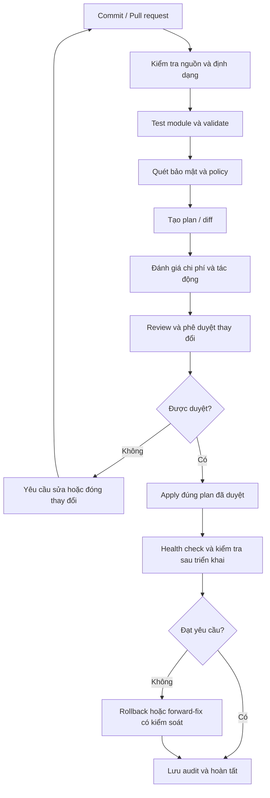

# Tích hợp kiểm tra và phê duyệt thay đổi trong pipeline hạ tầng

Hạ tầng cloud thường được tạo và thay đổi bằng Infrastructure as Code (IaC), image pipeline và công cụ quản lý cấu hình. Một thay đổi nhỏ trong mã có thể tạo thêm máy ảo, thay đổi route, mở cổng mạng, thay volume hoặc xóa tài nguyên đang chứa dữ liệu. Vì vậy, pipeline hạ tầng cần kiểm tra thay đổi trước khi áp dụng và yêu cầu phê duyệt phù hợp với mức độ ảnh hưởng.

Một pipeline tốt đưa ra bằng chứng để người review hiểu **thay đổi nào sẽ xảy ra, ảnh hưởng đến tài nguyên nào, có đáp ứng chính sách không và cách phục hồi ra sao**. Pipeline nên kiểm tra mã nguồn, phân tích bảo mật, tạo plan, đánh giá chi phí, thu thập phê duyệt, áp dụng đúng plan đã được duyệt và xác minh trạng thái sau triển khai.

## 1. Vì sao pipeline hạ tầng cần kiểm tra và phê duyệt?

Thay đổi hạ tầng khác với một số thay đổi ứng dụng vì nó có thể tác động trực tiếp đến tài nguyên dùng chung và trạng thái lâu dài. Ví dụ:

- Thay instance family có thể làm VM reboot, thay đổi CPU architecture hoặc yêu cầu driver khác.
- Thay subnet, route hoặc security group có thể làm gián đoạn kết nối hoặc mở rộng bề mặt tấn công.
- Thay dung lượng, loại hoặc encryption của volume có thể ảnh hưởng dữ liệu, hiệu năng và chi phí.
- Thay IAM role có thể cấp quyền rộng hơn cho workload hoặc người vận hành.
- Xóa một tài nguyên stateful có thể gây mất dữ liệu hoặc làm ứng dụng không thể khôi phục.

Nếu chỉ kiểm tra cú pháp, pipeline có thể chấp nhận một cấu hình hợp lệ về mặt kỹ thuật nhưng sai về chính sách hoặc gây tác động ngoài dự kiến. Nếu chỉ yêu cầu người review nhìn diff mã nguồn, họ có thể không nhận ra provider sẽ thay thế hoặc xóa tài nguyên nào. Plan và các kiểm tra tự động giúp chuyển thay đổi thành thông tin có thể đánh giá.

Các mục tiêu chính của quy trình gồm:

1. Phát hiện lỗi cấu hình sớm trước khi tạo hoặc sửa tài nguyên.
2. Ngăn cấu hình vi phạm bảo mật, tuân thủ và tiêu chuẩn nội bộ.
3. Làm rõ tác động đến tài nguyên, dữ liệu, tính sẵn sàng và chi phí.
4. Gắn phê duyệt với đúng commit, môi trường và kế hoạch triển khai.
5. Lưu lại người thay đổi, người duyệt, kết quả kiểm tra và trạng thái triển khai.
6. Xác minh sau khi áp dụng và có phương án xử lý nếu kết quả không đạt.

## 2. Kiến trúc pipeline thay đổi hạ tầng

Pipeline thường chia thành hai giai đoạn lớn. Giai đoạn kiểm tra chạy khi tạo hoặc cập nhật pull request; giai đoạn triển khai chỉ chạy sau khi thay đổi đã được review và được phép áp dụng vào môi trường tương ứng.



Không phải mọi pipeline đều dùng cùng công cụ hoặc cùng tên stage. Điều quan trọng là mỗi giai đoạn có đầu vào, đầu ra, điều kiện đạt và chủ sở hữu rõ ràng.

## 3. Các lớp kiểm tra trước khi tạo plan

### Kiểm tra định dạng và cú pháp

Các kiểm tra cơ bản giúp loại bỏ lỗi sớm:

- Format mã IaC để diff dễ đọc và nhất quán.
- Kiểm tra cú pháp, schema và kiểu dữ liệu.
- Xác minh module, provider và phiên bản công cụ tương thích.
- Kiểm tra tham chiếu, biến bắt buộc và giá trị đầu vào.
- Kiểm tra cấu trúc thư mục, naming convention và tag bắt buộc.

Với Terraform, các lệnh phổ biến gồm:

```bash
# Kiểm tra định dạng mà không tự sửa file
terraform fmt -check -recursive

# Khởi tạo provider/module trong chế độ không thay đổi backend state
terraform init -backend=false

# Kiểm tra cấu hình và quan hệ giữa các thành phần
terraform validate
```

Trong pipeline thực tế, `terraform init` cần dùng lock file và phiên bản provider đã được pin theo repository. Việc dùng `-backend=false` phù hợp cho một bước validate độc lập; bước tạo plan ở môi trường triển khai cần cấu hình backend và quyền truy cập state đúng cách.

### Kiểm tra chất lượng mã và module

Lint và test module giúp phát hiện lỗi logic, quy ước không nhất quán hoặc module có đầu vào/đầu ra không như mong đợi. Các kiểm tra có thể gồm:

- Lint naming, tag, version constraint và cấu trúc module.
- Kiểm tra module có khai báo output, variable và validation cần thiết.
- Unit test cho hàm, template hoặc logic tạo cấu hình.
- Test module trên tài khoản hoặc project sandbox với dữ liệu thử nghiệm.
- Kiểm tra tính idempotent và khả năng chạy lặp lại.

Không nên coi việc `validate` thành công là bằng chứng tài nguyên sẽ hoạt động đúng. Một cấu hình hợp lệ vẫn có thể chọn sai subnet, thiếu quota hoặc không tương thích với workload. Vì vậy, module quan trọng cần test ở mức tích hợp trên môi trường thử nghiệm.

### Quét bảo mật và secret

Pipeline nên kiểm tra các rủi ro có thể nhận biết từ mã nguồn và plan:

- Security group hoặc firewall mở cổng quản trị ra Internet.
- Disk hoặc snapshot chưa bật encryption theo chính sách.
- Storage bucket hoặc volume có quyền truy cập công khai ngoài dự kiến.
- IAM policy cấp quyền quá rộng hoặc dùng wildcard không phù hợp.
- Logging, backup, monitoring hoặc audit bị tắt.
- Image dùng phiên bản không được hỗ trợ hoặc chứa package có lỗ hổng nghiêm trọng.
- Secret, private key, token hoặc mật khẩu bị commit vào repository.

Các công cụ như Checkov, tfsec, Trivy, Gitleaks hoặc policy engine của nền tảng có thể hỗ trợ một số lớp kiểm tra. Phải chọn rule phù hợp với cloud, phiên bản IaC và chính sách của tổ chức; không nên giả định một scanner bao phủ toàn bộ rủi ro.

Secret scanning nên chạy cả trên thay đổi mới và theo lịch trên repository. Nếu phát hiện secret đã bị commit, xóa khỏi file không làm credential cũ an toàn trở lại; cần thu hồi hoặc rotate credential và kiểm tra lịch sử repository theo quy trình bảo mật.

### Policy as Code

Policy as Code biến tiêu chuẩn hạ tầng thành quy tắc máy có thể kiểm tra trong CI hoặc trước khi apply. Ví dụ:

- Instance production phải dùng image đã được phê duyệt.
- Volume chứa dữ liệu phải bật encryption.
- Workload production phải có backup, monitoring và owner tag.
- Security group không được cho phép SSH/RDP từ mọi địa chỉ nếu không có exception.
- IAM role không được cấp quyền quản trị toàn tài khoản cho ứng dụng thông thường.
- Instance family và region phải nằm trong danh sách được phép.

Policy có thể được thực thi ở nhiều điểm: khi review mã, khi tạo plan, khi triển khai hoặc bằng công cụ kiểm tra cấu hình đang chạy. Kiểm tra sớm giúp phản hồi nhanh; kiểm tra trên plan giúp đánh giá tài nguyên thực tế sắp thay đổi; kiểm tra liên tục giúp phát hiện sai lệch phát sinh sau đó.

## 4. Tạo và đọc plan trước khi apply

Plan là bản mô tả những thay đổi mà công cụ IaC dự kiến thực hiện khi đối chiếu cấu hình với state và hạ tầng thực tế. Đây là tài liệu quan trọng để reviewer đánh giá tác động.

Với Terraform, một quy trình điển hình có thể tạo plan thành artifact:

```bash
# Tạo plan có thể được kiểm tra và áp dụng ở bước sau
terraform plan -out=tfplan

# Hiển thị plan theo dạng dễ đọc để review
terraform show tfplan

# Xuất JSON cho policy engine hoặc báo cáo tự động
terraform show -json tfplan > tfplan.json
```

`tfplan` có thể chứa dữ liệu nhạy cảm, kể cả giá trị secret được đánh dấu sensitive trong cấu hình. Không công khai artifact này, không đưa nội dung thô vào log hoặc comment không giới hạn truy cập. Cần bảo vệ quyền đọc, mã hóa nơi lưu, đặt thời hạn retention và xóa artifact khi hết nhu cầu.

### Phân loại thay đổi trong plan

Reviewer nên xác định mỗi thay đổi thuộc nhóm nào:

| Loại thay đổi | Ý nghĩa | Câu hỏi cần đặt ra |
|---|---|---|
| No-op | Không có thay đổi cần áp dụng | Plan có đang đọc đúng workspace và môi trường không? |
| Create | Tạo tài nguyên mới | Có đúng quota, subnet, IAM, tag và ngân sách không? |
| In-place update | Sửa thuộc tính trên tài nguyên hiện có | Có gây reboot, gián đoạn hoặc thay đổi hành vi không? |
| Replace | Xóa/tạo lại tài nguyên hoặc thay thế resource | Dữ liệu, IP, DNS, dependency và downtime sẽ ra sao? |
| Destroy | Xóa tài nguyên | Có owner, backup, xác nhận và kế hoạch phục hồi không? |

Các công cụ có thể hiển thị ký hiệu khác nhau cho update, replace hoặc destroy. Reviewer cần đọc phần giải thích của công cụ và xác định replacement có kéo theo xóa disk, NIC, IP, database hoặc resource phụ thuộc không.

### Những câu hỏi cần trả lời khi review plan

1. Plan có được tạo từ đúng commit, workspace, account/project, region và environment không?
2. Những tài nguyên nào sẽ được tạo, cập nhật, thay thế hoặc xóa?
3. Có thay đổi nào ảnh hưởng dữ liệu, network, quyền truy cập hoặc tính sẵn sàng không?
4. Có thuộc tính nào được provider tự tính hoặc thay đổi ngoài dự kiến không?
5. Thay đổi có tuân thủ policy, tagging, encryption, backup và monitoring không?
6. Chi phí định kỳ và chi phí một lần sẽ thay đổi bao nhiêu?
7. Có cần migration dữ liệu, drain traffic, maintenance window hoặc rollback không?

Không phê duyệt chỉ dựa trên số lượng dòng diff hoặc việc pipeline báo xanh. Một plan nhỏ vẫn có thể xóa một database quan trọng; một plan lớn có thể chỉ tạo nhiều tài nguyên stateless an toàn.

## 5. Đánh giá chi phí và giới hạn tài nguyên

Thay đổi hạ tầng có thể làm tăng chi phí do tăng số instance, đổi sang dòng máy lớn hơn, thêm GPU, tăng dung lượng volume, tăng lưu lượng mạng hoặc giữ thêm tài nguyên dự phòng.

Cost estimation trong pipeline có thể dùng công cụ như Infracost hoặc chức năng ước tính của nhà cung cấp. Kết quả thường là ước lượng dựa trên cấu hình và bảng giá tại thời điểm tính, không phải hóa đơn chính xác. Một số chi phí phụ thuộc traffic, IOPS, snapshot, data transfer, license, discount, reservation và vùng triển khai.

Khi review, nên xem:

- Chi phí trước và sau thay đổi theo tháng hoặc theo giờ.
- Tài nguyên mới, tài nguyên được giữ lại và tài nguyên bị xóa.
- Chi phí trong giai đoạn rollout khi hai nhóm chạy song song.
- Chi phí backup, snapshot, IP tĩnh, NAT, load balancer và data transfer.
- Quota và capacity của region/zone, đặc biệt với GPU hoặc instance hiếm.
- Tag owner, environment và cost center để phân bổ chi phí sau triển khai.

Với thay đổi lớn, cần xác định ngưỡng ngân sách hoặc phần trăm tăng chi phí yêu cầu phê duyệt bổ sung. Không nên dùng một ngưỡng duy nhất cho mọi môi trường: tăng 20% ở sandbox có thể chấp nhận được, trong khi một thay đổi nhỏ làm tăng chi phí production liên tục có thể cần review kỹ.

## 6. Thiết kế cơ chế phê duyệt

Phê duyệt cần gắn với mức độ rủi ro, phạm vi ảnh hưởng và môi trường. Mọi thay đổi production không nhất thiết cần cùng số người duyệt; nhưng các thay đổi ảnh hưởng dữ liệu, quyền đặc quyền hoặc kết nối mạng cần mức kiểm soát cao hơn.

### Phê duyệt mã nguồn và phê duyệt triển khai

Hai loại phê duyệt giải quyết hai câu hỏi khác nhau:

- **Code review:** thay đổi trong repository có đúng yêu cầu, dễ bảo trì, tuân thủ tiêu chuẩn và được owner của module chấp thuận không?
- **Deployment approval:** plan cụ thể có thể áp dụng vào environment cụ thể ở thời điểm này không, có đủ capacity, backup, maintenance window và người trực không?

Một pull request được review không đồng nghĩa mọi lần apply về sau đều tự động được phép. Plan có thể thay đổi do state hoặc hạ tầng thay đổi; môi trường production có thể có yêu cầu phê duyệt riêng.

### Phân quyền theo rủi ro

| Mức rủi ro | Ví dụ | Kiểm soát gợi ý |
|---|---|---|
| Thấp | Sửa tag, description hoặc metadata không ảnh hưởng runtime | Một reviewer thuộc nhóm sở hữu module; CI bắt buộc đạt |
| Trung bình | Thay instance size, thêm VM stateless hoặc sửa cấu hình monitoring | Reviewer kỹ thuật và owner workload; xem plan, cost và health check |
| Cao | Thay route, firewall, IAM, volume, encryption hoặc autoscaling production | Reviewer hạ tầng và owner dịch vụ/bảo mật phù hợp; deployment approval và rollback plan |
| Rất cao | Xóa database, thay đổi quyền quản trị diện rộng hoặc thao tác có nguy cơ mất dữ liệu | Phê duyệt nhiều bên, maintenance window, backup/restore proof và xác nhận thủ công trước apply |

Đây là mô hình tham khảo. Tổ chức cần điều chỉnh theo phân loại dữ liệu, quy định, SLA và quy trình change management hiện hành.

### Tách nhiệm vụ và quyền tối thiểu

Người tạo thay đổi không nên có quyền tự phê duyệt mọi thay đổi rủi ro cao ở production. Có thể áp dụng CODEOWNERS, required reviewers, branch protection, protected environment và quy tắc phê duyệt độc lập.

Pipeline nên dùng service identity riêng, quyền chỉ đủ cho workspace và môi trường mục tiêu. Ưu tiên credential ngắn hạn qua OIDC hoặc cơ chế workload identity nếu nền tảng hỗ trợ, thay vì lưu access key dài hạn trong biến CI. Tách quyền plan/read khỏi quyền apply/write nếu kiến trúc và công cụ cho phép.

## 7. Gắn phê duyệt với đúng plan và đúng môi trường

Một lỗi nguy hiểm là reviewer duyệt một plan nhưng pipeline lại tạo plan mới hoặc áp dụng commit khác. Khi đó, nội dung được duyệt và nội dung thực thi không còn giống nhau.

Để tránh tình trạng này:

1. Gắn plan với commit SHA, workspace, account/project, region và environment.
2. Lưu plan artifact ở nơi chỉ người và pipeline có quyền mới truy cập được.
3. Hiển thị summary dễ đọc, đồng thời giữ artifact đầy đủ để audit.
4. Phê duyệt đúng artifact/version đã tạo, có thời điểm hết hạn.
5. Trước apply, xác minh commit và môi trường vẫn trùng khớp.
6. Áp dụng chính plan đã duyệt; không tự tạo một plan khác rồi áp dụng mà không review lại.
7. Nếu state hoặc hạ tầng thay đổi khiến plan không còn hợp lệ, tạo plan mới và chạy lại kiểm tra/phê duyệt.

Với Terraform, có thể áp dụng file plan đã lưu bằng `terraform apply tfplan`. Cần bảo vệ file này như artifact nhạy cảm và đảm bảo nó được tạo trong đúng context. Backend state cần bật locking nếu được hỗ trợ để tránh hai pipeline cùng ghi state hoặc apply chồng lấn.

### Khóa môi trường và xử lý chạy đồng thời

Pipeline cần ngăn hai lần triển khai cùng sửa một state hoặc một nhóm tài nguyên trong cùng thời điểm. Có thể dùng state locking của backend, concurrency group của CI hoặc deployment lock. Khóa cần được giải phóng khi job thành công, thất bại hoặc bị hủy; cần quy trình xử lý lock bị treo.

Không nên giữ lock quá lâu trong lúc chờ phê duyệt thủ công nếu nền tảng hoặc backend không thiết kế cho việc đó. Một cách phù hợp là lưu plan có thời hạn, kiểm tra state serial/version trước apply và tạo lại plan nếu state đã thay đổi. Cơ chế chính xác phụ thuộc công cụ IaC và backend.

## 8. Ví dụ pipeline minh họa

Ví dụ dưới đây mô tả luồng CI tổng quát, không phải workflow hoàn chỉnh có thể chạy trực tiếp. Tên stage và trường cấu hình cần được điều chỉnh theo hệ thống CI/CD và cloud đang sử dụng.

```yaml
stages:
  - validate
  - test
  - security
  - plan
  - review
  - apply
  - verify

validate:
  steps:
    - terraform fmt -check -recursive
    - terraform init -backend=false
    - terraform validate

test:
  steps:
    - run_module_tests
    - run_policy_unit_tests

security:
  steps:
    - scan_iac
    - scan_secrets
    - evaluate_policy

plan:
  steps:
    - authenticate_with_short_lived_identity
    - terraform_init_with_locked_provider_versions
    - terraform_plan_saved_artifact
    - publish_protected_plan_summary
    - estimate_cost_delta

review:
  requirements:
    - required_code_owners_approve
    - plan_review_complete
    - environment_approval_if_required

apply:
  conditions:
    - approved_commit_matches_plan
    - target_environment_matches
    - plan_is_still_valid
  steps:
    - apply_approved_plan

verify:
  steps:
    - verify_resource_state
    - run_health_checks
    - run_smoke_tests
    - publish_deployment_record
```

Pipeline thật cần xử lý credential, artifact, lock, timeout, retry, cancellation và lỗi từng phần. Không đưa secret vào YAML mẫu được lưu trong repository; dùng secret manager hoặc identity ngắn hạn của CI.

### Ví dụ Terraform plan và apply

Một quy trình thủ công có kiểm soát có thể dùng các bước sau trong môi trường thử nghiệm:

```bash
# Kiểm tra cấu hình
terraform fmt -check -recursive
terraform validate

# Tạo plan đã lưu
terraform plan -out=tfplan

# Review plan trước khi áp dụng
terraform show tfplan

# Chỉ chạy sau khi đúng plan và môi trường đã được phê duyệt
terraform apply tfplan
```

Trong CI, lệnh apply cần được đặt sau approval gate và chạy bằng identity có quyền ghi phù hợp. Không dùng `-auto-approve` để bỏ qua phê duyệt bên ngoài pipeline; nếu công cụ CI thực thi approval gate, việc apply tự động sau gate phải vẫn bị ràng buộc với đúng plan đã duyệt.

## 9. Kiểm tra sau triển khai

Apply thành công chỉ cho biết công cụ đã thực hiện các thao tác theo plan. Nó không chứng minh ứng dụng hoạt động đúng. Sau khi apply, pipeline nên kiểm tra cả trạng thái tài nguyên lẫn hành vi dịch vụ.

### Kiểm tra hạ tầng

- Instance, disk, NIC, route và security group có trạng thái mong đợi.
- Image, instance family, CPU, RAM và accelerator đúng cấu hình.
- Encryption, backup, IAM, tag và logging vẫn đáp ứng policy.
- Không có tài nguyên thừa hoặc tài nguyên cũ cần được thu hồi theo kế hoạch.

### Kiểm tra dịch vụ

- Health endpoint trả kết quả đúng.
- Ứng dụng kết nối được database, queue, object storage và dependency.
- Error rate, latency, CPU, memory, disk và network không vượt ngưỡng.
- Traffic được chuyển theo kế hoạch; replica và autoscaling hoạt động.
- Log và metric được gửi về hệ thống giám sát.

Với thay đổi có ảnh hưởng lớn, nên triển khai canary hoặc theo từng đợt. Sau mỗi đợt, đánh giá SLO và metric trước khi mở rộng. Nếu điều kiện không đạt, dừng rollout và thực hiện phương án phục hồi đã chuẩn bị.

## 10. Rollback và forward-fix

Không phải thay đổi hạ tầng nào cũng có thể rollback bằng cách chạy lại phiên bản IaC cũ. Một số thay đổi có tính phá hủy hoặc không đảo ngược, ví dụ xóa volume, thay đổi schema, thu hồi IP hoặc chuyển dữ liệu sang định dạng mới.

Trước triển khai, cần phân loại:

- **Reversible:** có thể khôi phục bằng cách áp dụng cấu hình trước đó, ví dụ đổi một tham số không phá hủy.
- **Replaceable:** có thể tạo tài nguyên mới rồi chuyển traffic hoặc dependency, sau đó xóa tài nguyên cũ.
- **Destructive / irreversible:** có thể làm mất dữ liệu hoặc không thể khôi phục trạng thái cũ nếu không có backup/replication.

Rollback plan cần chỉ rõ tài nguyên được khôi phục, dữ liệu nào cần đồng bộ, thời điểm chuyển traffic, điều kiện dừng và người quyết định. Với lỗi cấu hình nhỏ, forward-fix bằng một commit mới đôi khi an toàn hơn rollback toàn bộ hạ tầng.

Không nên xóa tài nguyên mới hoặc chạy `destroy` hàng loạt chỉ vì health check thất bại. Trước hết xác định nguyên nhân, giữ dữ liệu cần thiết và chọn hành động giới hạn đúng phạm vi.

## 11. Audit trail và bằng chứng thay đổi

Mỗi lần thay đổi nên để lại hồ sơ có thể truy vết:

| Bằng chứng | Nội dung cần lưu |
|---|---|
| Change request | Mục tiêu, phạm vi, owner, lý do và mức rủi ro |
| Source revision | Commit SHA, pull request và module version |
| CI result | Kết quả format, validate, test, scan và policy |
| Plan | Plan ID/hash, summary, environment và thời điểm tạo |
| Approval | Người duyệt, vai trò, thời điểm và plan được duyệt |
| Execution | Pipeline run ID, actor/service identity, thời gian apply và kết quả |
| Verification | Health check, smoke test, metric và cảnh báo sau triển khai |
| Recovery | Rollback/forward-fix, người quyết định và kết quả cuối |

Log cần được bảo vệ khỏi chỉnh sửa trái phép và không chứa secret hoặc nội dung nhạy cảm không cần thiết. Lưu giữ theo yêu cầu audit và chính sách dữ liệu của tổ chức.

## 12. Những lỗi thiết kế pipeline thường gặp

| Lỗi | Hậu quả | Cách cải thiện |
|---|---|---|
| Chỉ kiểm tra cú pháp | Cấu hình hợp lệ nhưng không an toàn hoặc sai mục đích | Thêm scan, policy, plan review và test tích hợp |
| Apply ngay sau khi plan | Thay đổi production không được xem xét | Đặt approval gate theo môi trường và rủi ro |
| Duyệt mã nhưng không duyệt plan | Reviewer không thấy tài nguyên sẽ bị replace/destroy | Hiển thị plan summary và gắn approval với plan artifact |
| Tạo plan mới sau khi đã duyệt | Nội dung thực thi khác nội dung đã duyệt | Apply đúng plan; nếu plan stale thì tạo lại và review lại |
| Plan artifact công khai | Có thể lộ dữ liệu nhạy cảm | Bảo vệ artifact, hạn chế quyền và retention |
| Nhiều pipeline apply cùng state | Race condition, lock conflict hoặc state không nhất quán | Bật state locking và concurrency control |
| Dùng credential dài hạn trong CI | Tăng rủi ro lộ quyền truy cập | Dùng workload identity/OIDC và quyền ngắn hạn |
| Không có kiểm tra sau apply | Tài nguyên tạo xong nhưng ứng dụng không khỏe | Thêm health check, smoke test và theo dõi SLO |
| Rollback chỉ là chạy code cũ | Không phục hồi được dữ liệu hoặc tài nguyên đã xóa | Thiết kế backup, replication và recovery theo từng loại tài nguyên |
| Cảnh báo policy quá nhiều | Reviewer bỏ qua cảnh báo | Phân loại severity, xử lý false positive và quản lý exception có hạn |

## 13. Chỉ số đánh giá pipeline

Để cải thiện chất lượng, có thể theo dõi:

- **Change failure rate:** tỷ lệ thay đổi gây rollback, incident hoặc suy giảm dịch vụ.
- **Lead time for change:** thời gian từ khi thay đổi được đề xuất đến khi triển khai.
- **Approval latency:** thời gian chờ phê duyệt theo mức rủi ro và môi trường.
- **Policy violation rate:** số vi phạm bị chặn hoặc cần exception.
- **Plan-to-apply consistency:** tỷ lệ lần apply dùng đúng plan đã được duyệt.
- **Drift after deployment:** số sai lệch xuất hiện sau khi pipeline hoàn tất.
- **Post-deploy verification pass rate:** tỷ lệ triển khai vượt qua health check và smoke test.
- **Rollback / recovery time:** thời gian khôi phục dịch vụ khi thay đổi thất bại.

Không nên tối ưu chỉ số tốc độ bằng cách bỏ qua review hoặc giảm số kiểm tra bắt buộc. Mục tiêu là rút ngắn thời gian chờ không cần thiết trong khi vẫn giữ bằng chứng và kiểm soát phù hợp với rủi ro.

## 14. Checklist trước khi cho phép pipeline triển khai production

**Nguồn và kiểm tra:**

- [ ] Thay đổi gắn với pull request, commit và owner rõ ràng.
- [ ] Format, validate, lint và test module đã đạt.
- [ ] Secret scan, IaC scan và policy check đã đạt hoặc có exception được duyệt.
- [ ] Provider, module và tool version được pin phù hợp.

**Plan và tác động:**

- [ ] Plan được tạo từ đúng commit, workspace, account/project và region.
- [ ] Đã phân loại create, update, replace và destroy.
- [ ] Đã đánh giá tác động dữ liệu, network, IAM, SLA và dependency.
- [ ] Đã xem ước tính chi phí và quota/capacity.
- [ ] Plan artifact được bảo vệ và còn hiệu lực.

**Phê duyệt và thực thi:**

- [ ] Reviewer phù hợp đã duyệt mã và plan.
- [ ] Deployment approval đã gắn với đúng environment và plan.
- [ ] Quyền apply là tối thiểu và dùng identity phù hợp.
- [ ] State locking và concurrency control hoạt động.
- [ ] Pipeline apply đúng plan đã duyệt.

**Sau triển khai:**

- [ ] Tài nguyên thực tế khớp cấu hình mong muốn.
- [ ] Health check và smoke test đạt.
- [ ] Metric, log và cảnh báo không cho thấy suy giảm.
- [ ] Audit record đầy đủ và không chứa secret.
- [ ] Rollback hoặc forward-fix plan sẵn sàng nếu cần.

## Kết luận

Pipeline hạ tầng cần kết hợp kiểm tra mã, test module, quét bảo mật, policy, plan, ước tính chi phí, phê duyệt và xác minh sau triển khai. Code review xác nhận thay đổi trong repository; deployment approval xác nhận plan cụ thể được phép áp dụng vào môi trường cụ thể. Hãy bảo vệ plan artifact, gắn phê duyệt với commit và workspace, ngăn các lần apply chạy đồng thời, dùng quyền ngắn hạn và lưu audit trail. Với thay đổi có rủi ro cao, cần triển khai theo từng đợt và chuẩn bị rollback hoặc forward-fix dựa trên dữ liệu thực tế. Quy trình này giúp thay đổi hạ tầng cloud có thể kiểm tra, truy vết và vận hành an toàn.
