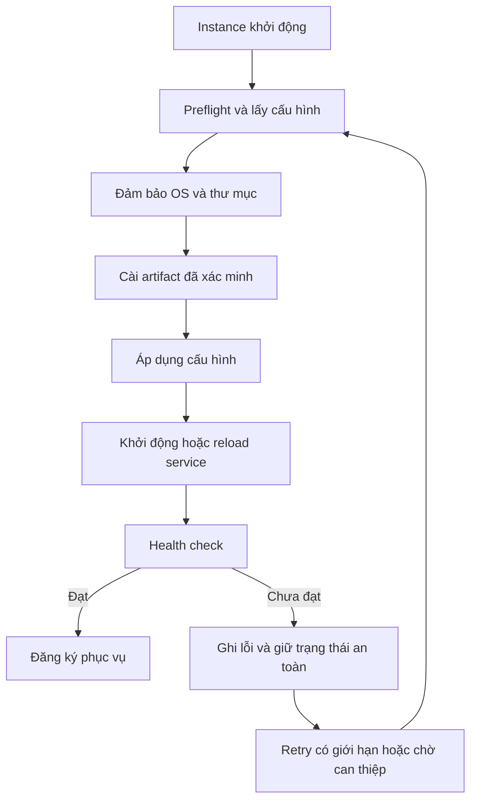
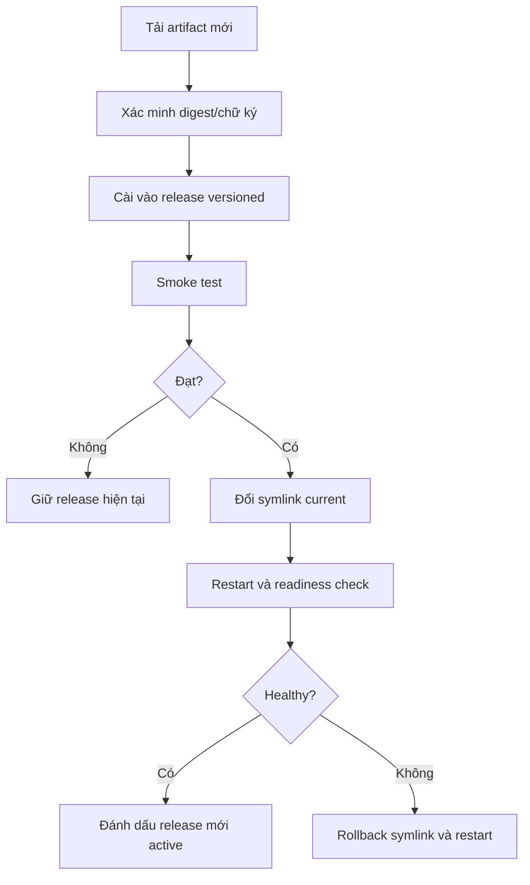

# Thiết kế bootstrap có thể chạy lại và phục hồi sau lỗi

Khi một máy ảo mới được tạo, hệ điều hành có thể đã khởi động nhưng ứng dụng vẫn chưa sẵn sàng phục vụ. Máy còn cần cài hoặc xác minh package, lấy cấu hình, đăng ký agent, tải artifact, tạo thư mục dữ liệu, cấu hình dịch vụ và kiểm tra kết nối tới các phụ thuộc. Chuỗi thao tác này thường được gọi là **bootstrap**.

Bootstrap chạy tự động giúp máy mới có cấu hình nhất quán và giảm thao tác thủ công. Tuy nhiên, quá trình khởi động có thể bị gián đoạn do mạng chập chờn, repository tạm thời không truy cập được, API cloud bị giới hạn tốc độ, máy khởi động lại hoặc một bước cấu hình thất bại giữa chừng. Vì vậy, bootstrap cần được thiết kế để **chạy lại an toàn**, nhận biết phần việc đã hoàn thành, tiếp tục sau lỗi và không làm hỏng trạng thái đang hoạt động.

Đây là một phần quan trọng trong kiến trúc năng lực tính toán trên đám mây: máy ảo, container và dịch vụ triển khai tự động cần có cách khởi tạo đáng tin cậy để bảo đảm tính sẵn sàng, khả năng mở rộng và chi phí vận hành có thể dự đoán.

## 1. Bootstrap là gì và diễn ra khi nào?

Bootstrap là quá trình đưa một môi trường tính toán từ trạng thái mới khởi tạo hoặc chưa sẵn sàng sang trạng thái đáp ứng yêu cầu vận hành. Với máy ảo, bootstrap có thể bao gồm:

- Nhận diện instance, region, zone và loại máy.
- Cấu hình hostname, thời gian, DNS, network và chứng thư cần thiết.
- Cài package hệ thống, runtime và agent giám sát.
- Lấy cấu hình ứng dụng từ config service hoặc hệ thống triển khai.
- Lấy secret bằng danh tính workload được cấp quyền.
- Tải artifact đã được xác minh, cài đặt và cấu hình service.
- Chuẩn bị thư mục, volume, quyền truy cập và schema phụ thuộc.
- Khởi động ứng dụng, kiểm tra health và đăng ký vào load balancer hoặc service discovery.

Bootstrap thường được kích hoạt khi:

1. Tạo instance mới từ machine image.
2. Khởi động lại máy sau sự cố hoặc bảo trì.
3. Tạo instance thay thế trong autoscaling group hoặc instance pool.
4. Triển khai phiên bản ứng dụng mới.
5. Chạy lại một bước cấu hình sau khi phát hiện drift hoặc khắc phục lỗi.

Không phải mọi thao tác đều cần chạy ở mỗi lần boot. Cần phân biệt thao tác khởi tạo một lần cho mỗi instance, thao tác cần thực hiện mỗi lần khởi động và thao tác triển khai phiên bản ứng dụng. Phân loại đúng giúp tránh cài lại package, ghi đè dữ liệu hoặc chạy migration ngoài ý muốn.

## 2. Idempotency: chạy nhiều lần vẫn cho cùng trạng thái mong muốn

Một thao tác được gọi là **idempotent** nếu thực hiện một lần hay nhiều lần đều dẫn tới cùng trạng thái cuối cùng. Ví dụ, yêu cầu bảo đảm thư mục `/opt/myapp` tồn tại là idempotent: chạy lệnh nhiều lần không tạo ra thư mục khác hoặc làm hỏng nội dung hiện có.

Ngược lại, lệnh thêm một dòng vào cuối file mỗi lần chạy mà không kiểm tra trước sẽ tạo ra nội dung trùng lặp. Lệnh tạo một tài khoản mới mà không kiểm tra tài khoản đã tồn tại có thể thất bại ở lần chạy tiếp theo.

| Thao tác | Cách viết dễ gây lỗi khi chạy lại | Cách thiết kế idempotent |
|---|---|---|
| Tạo thư mục | Gọi lệnh tạo thư mục và coi lỗi “đã tồn tại” là thất bại | Dùng thao tác bảo đảm thư mục tồn tại, kiểm tra quyền và owner |
| Cài package | Cài lại bằng script tải và giải nén tùy tiện mỗi lần boot | Dùng package manager và khai báo phiên bản/trạng thái mong muốn |
| Ghi cấu hình | Nối thêm cùng một đoạn cấu hình mỗi lần chạy | Render toàn bộ file từ nguồn chuẩn, so sánh rồi thay thế nguyên tử khi thay đổi |
| Tạo user/group | Luôn tạo mới | Kiểm tra và bảo đảm user/group có mặt với thuộc tính mong muốn |
| Bật service | Khởi chạy nhiều tiến trình bằng lệnh thủ công | Dùng systemd hoặc service manager để enable/start theo trạng thái khai báo |
| Tạo tài nguyên cloud | Mỗi lần chạy đều tạo resource mới | Dùng IaC/state hoặc API hỗ trợ upsert và idempotency key |
| Gửi thông báo hoặc tạo ticket | Gửi lại mỗi lần retry | Dùng idempotency key hoặc lưu kết quả xử lý theo định danh sự kiện |

Idempotency không có nghĩa là bỏ qua mọi thao tác nếu thấy một file marker. Nó có nghĩa là mỗi bước kiểm tra trạng thái hiện tại và điều chỉnh về trạng thái mong muốn mà không tạo tác dụng phụ lặp lại.

## 3. Phân chia bootstrap thành các bước nhỏ

Một script lớn thực hiện mọi công việc liên tiếp sẽ khó xác định bước nào đã thành công khi bị dừng giữa chừng. Nên chia bootstrap thành các bước có đầu vào, đầu ra và điều kiện hoàn thành rõ ràng.

Ví dụ:

| Giai đoạn | Kết quả mong muốn | Cách xác minh |
|---|---|---|
| Preflight | Có quyền truy cập metadata, package repository và artifact registry cần thiết | Kiểm tra endpoint, DNS, IAM và thời gian hệ thống |
| Prepare OS | Package, user, thư mục và quyền hệ thống đúng yêu cầu | Kiểm tra package version, UID/GID, owner và mode |
| Configure | File cấu hình hợp lệ và chứa giá trị đúng môi trường | Validate cú pháp, checksum hoặc so sánh nội dung |
| Install | Artifact đúng phiên bản được cài hoàn chỉnh | Xác minh digest, release directory và binary version |
| Activate | Service được enable và chạy đúng release | Kiểm tra systemd state và symlink/current version |
| Verify | Ứng dụng sẵn sàng phục vụ | Health check, dependency check và smoke test |
| Register | Instance được đưa vào phục vụ | Kiểm tra service discovery hoặc trạng thái target group |

Mỗi bước nên có thể chạy độc lập hoặc chạy lại từ đầu. Nếu bước cài đặt thành công nhưng bước health check thất bại, lần chạy sau có thể kiểm tra artifact đã có, tiếp tục kích hoạt hoặc khắc phục cấu hình mà không tải và cài lại toàn bộ một cách không cần thiết.



## 4. Thiết kế trạng thái và checkpoint

Checkpoint là dấu mốc cho biết một bước đã hoàn thành. Nó có thể là file trạng thái cục bộ, bản ghi trong hệ thống điều phối hoặc trạng thái của công cụ quản lý cấu hình.

Một checkpoint hữu ích nên gắn với:

- Tên bước và phiên bản logic của bước.
- Phiên bản artifact hoặc cấu hình đã áp dụng.
- Thời điểm hoàn thành.
- Kết quả xác minh sau bước đó.
- Thông tin lỗi gần nhất nếu bước chưa hoàn thành.

Không nên chỉ lưu một file `/var/lib/bootstrap-done` chung cho toàn bộ quy trình. Nếu script ghi marker này trước khi ứng dụng cài xong, lần chạy sau có thể bỏ qua những bước còn thiếu. Nên ghi checkpoint sau khi thao tác và xác minh thành công.

### 4.1. Ghi checkpoint nguyên tử

Khi ghi file trạng thái, hãy ghi vào file tạm rồi đổi tên trong cùng filesystem. Cách này giảm nguy cơ để lại file trạng thái bị ghi dở khi máy mất điện hoặc tiến trình bị dừng.

```bash
write_checkpoint() {
  local name="$1"
  local value="$2"
  local dir="/var/lib/myapp-bootstrap"
  local tmp

  install -d -m 0750 "$dir"
  tmp="$(mktemp "$dir/.${name}.XXXXXX")"
  printf '%s\n' "$value" > "$tmp"
  chmod 0640 "$tmp"
  mv -f "$tmp" "$dir/$name"
}

# Chỉ gọi sau khi bước tương ứng đã hoàn tất và được xác minh.
write_checkpoint "runtime-version" "python-3.12"
```

Checkpoint chỉ là tín hiệu tối ưu để tránh làm lại công việc. Trước khi tin checkpoint, có thể kiểm tra trạng thái thực tế: package còn đúng phiên bản không, binary còn tồn tại không, file cấu hình có đúng checksum không và service có đang chạy không. Nếu trạng thái thực tế lệch, bootstrap phải sửa lại.

### 4.2. Không ghi trạng thái hoàn thành quá sớm

Thứ tự an toàn của một bước thường là:

1. Kiểm tra điều kiện đầu vào.
2. Thực hiện thay đổi.
3. Xác minh kết quả.
4. Ghi checkpoint hoàn thành.

Nếu bước 2 thất bại, không ghi checkpoint. Nếu bước 3 thất bại, cần giữ lại log và cho phép bước chạy lại. Nếu một thao tác có tác dụng phụ không thể đảo ngược, cần có cơ chế đối soát hoặc idempotency key riêng.

## 5. Retry, backoff và phân loại lỗi

Không phải lỗi nào cũng nên retry. Lỗi DNS tạm thời, HTTP 429, timeout hoặc dịch vụ phụ thuộc đang khởi động có thể tự phục hồi. Lỗi sai cấu hình, thiếu quyền IAM, artifact không tồn tại hoặc checksum không khớp thường không tự hết nếu lặp lại cùng request.

| Loại lỗi | Ví dụ | Cách xử lý phù hợp |
|---|---|---|
| Tạm thời | Timeout, connection reset, HTTP 503 | Retry có giới hạn với exponential backoff và jitter |
| Giới hạn tốc độ | HTTP 429, API throttling | Tôn trọng `Retry-After` nếu có, giảm tần suất và retry |
| Thiếu phụ thuộc | DNS chưa sẵn sàng, database đang khởi động | Chờ theo backoff trong một deadline hữu hạn |
| Cấu hình | Sai URL, thiếu biến bắt buộc, file cấu hình lỗi cú pháp | Dừng và báo lỗi để sửa cấu hình |
| Quyền | IAM denied, token không có scope cần thiết | Dừng, kiểm tra danh tính và quyền; không retry liên tục |
| Toàn vẹn | Digest không khớp, chữ ký không hợp lệ | Từ chối artifact, ghi sự kiện bảo mật và dừng triển khai |
| Tương thích | Runtime hoặc schema không tương thích | Dừng, chọn artifact/cấu hình tương thích hoặc thực hiện migration có kế hoạch |

**Exponential backoff** tăng khoảng chờ sau mỗi lần thất bại. Jitter thêm một độ lệch ngẫu nhiên để nhiều máy không đồng loạt retry cùng lúc sau khi dịch vụ phục hồi.

Ví dụ Bash đơn giản với số lần thử hữu hạn:

```bash
retry() {
  local max_attempts="$1"
  shift
  local attempt=1
  local delay=2

  until "$@"; do
    if (( attempt >= max_attempts )); then
      echo "command failed after $attempt attempts: $*" >&2
      return 1
    fi

    # Jitter nhỏ để tránh nhiều instance retry cùng thời điểm.
    local jitter=$(( RANDOM % 3 ))
    sleep $(( delay + jitter ))
    delay=$(( delay * 2 ))
    (( attempt += 1 ))
  done
}

# Ví dụ: kiểm tra một endpoint nội bộ trước khi tiếp tục.
retry 5 curl --fail --silent --show-error --max-time 3 \
  http://config.internal/health
```

Trong production, cần giới hạn tổng thời gian retry, mức delay tối đa và số request đồng thời. Với HTTP client, nên xử lý mã lỗi và `Retry-After` theo hợp đồng API. Không retry các thao tác không an toàn như tạo thanh toán hoặc tạo tài nguyên mới nếu chưa có idempotency key.

## 6. Ngăn nhiều tiến trình bootstrap chạy đồng thời

Hai tiến trình bootstrap chạy cùng lúc có thể cùng cập nhật package database, ghi đè cấu hình, thay symlink release hoặc restart service. Cần có khóa đồng bộ phù hợp.

Với một máy Linux, `flock` có thể dùng để khóa cục bộ:

```bash
#!/usr/bin/env bash
set -Eeuo pipefail

install -d -m 0755 /run/lock
exec 9>/run/lock/myapp-bootstrap.lock
flock 9

echo "bootstrap lock acquired"
# Các bước bootstrap chạy tuần tự tại đây.
```

Khóa cục bộ chỉ ngăn tiến trình trên cùng máy. Nếu nhiều máy cùng thay đổi một tài nguyên dùng chung, chẳng hạn schema database hoặc một record trong control plane, cần khóa phân tán hoặc cơ chế điều phối ở cấp dịch vụ. Khóa phân tán phải có lease/timeout và xử lý trường hợp chủ khóa bị mất kết nối; không nên giả định một lock có thể giữ mãi.

## 7. Sử dụng cloud-init đúng mục đích

Cloud-init là công cụ phổ biến để khởi tạo máy Linux trên nhiều nền tảng cloud. Nó có thể đọc metadata/user data, tạo user, ghi file, cài package và chạy lệnh trong các giai đoạn boot.

Một số module cloud-init có tần suất thực thi khác nhau. `bootcmd` chạy sớm trong mỗi lần boot; `runcmd` được chuẩn bị ở giai đoạn cấu hình và thực thi trong giai đoạn cuối của lần khởi tạo instance theo cơ chế per-instance. Không nên đưa một quy trình deploy dài hoặc cần chạy mỗi lần restart vào `bootcmd`.

Ví dụ cloud-config đơn giản:

```yaml
#cloud-config
package_update: true
packages:
  - nginx

write_files:
  - path: /etc/myapp/bootstrap.env
    owner: root:root
    permissions: "0640"
    content: |
      APP_ENV=production
      LOG_LEVEL=info

runcmd:
  - [systemctl, enable, nginx]
  - [systemctl, start, nginx]
```

Ví dụ này minh họa cài package, ghi cấu hình và enable/start service. Với môi trường thực tế, cần kiểm tra cú pháp cloud-config, tránh đặt secret trong user data và chuyển logic phức tạp sang script hoặc công cụ cấu hình có thể kiểm thử. `systemctl enable` và `systemctl start` có thể chạy lại an toàn trong quy trình phù hợp, nhưng nội dung script được gọi vẫn phải tự xử lý idempotency.

### Cloud-init và systemd

Cloud-init phù hợp cho khởi tạo ban đầu. systemd phù hợp quản lý service và tác vụ cần chạy khi boot hoặc theo điều kiện phụ thuộc. Có thể để cloud-init cài file unit và enable service; systemd sẽ quản lý vòng đời tiến trình ứng dụng sau đó.

Không nên dùng cờ “cloud-init đã chạy” như bằng chứng rằng ứng dụng đang khỏe. Cloud-init có thể hoàn tất trong khi service ứng dụng khởi động thất bại sau đó. Cần health check và giám sát riêng cho ứng dụng.

## 8. Ví dụ script bootstrap có thể chạy lại

Ví dụ sau bảo đảm thư mục và file cấu hình tồn tại, cài package nếu thiếu, enable service và chỉ restart khi nội dung cấu hình thay đổi. Script dùng khóa cục bộ và bật chế độ dừng khi có lỗi.

```bash
#!/usr/bin/env bash
set -Eeuo pipefail

APP_DIR="/opt/myapp"
CONFIG_FILE="/etc/myapp/app.conf"
LOCK_FILE="/run/lock/myapp-bootstrap.lock"

log() {
  printf '[bootstrap] %s\n' "$*"
}

on_error() {
  local code=$?
  log "failed at line ${BASH_LINENO[0]} with exit code ${code}"
  exit "$code"
}
trap on_error ERR

install -d -m 0755 /run/lock
exec 9>"$LOCK_FILE"
flock 9

log "ensuring required package is installed"
if ! dpkg-query -W -f='${Status}' nginx 2>/dev/null | grep -q 'install ok installed'; then
  apt-get update
  DEBIAN_FRONTEND=noninteractive apt-get install -y nginx
fi

log "ensuring application directories exist"
install -d -o root -g root -m 0755 "$APP_DIR"
install -d -o root -g root -m 0755 /etc/myapp

desired_config="$(mktemp)"
trap 'rm -f "$desired_config"' EXIT
cat > "$desired_config" <<'EOF'
listen_address=0.0.0.0
listen_port=8080
environment=production
EOF

if ! cmp -s "$desired_config" "$CONFIG_FILE" 2>/dev/null; then
  install -o root -g root -m 0640 "$desired_config" "${CONFIG_FILE}.new"
  mv -f "${CONFIG_FILE}.new" "$CONFIG_FILE"
  log "configuration changed; restarting service"
  systemctl enable myapp.service
  systemctl restart myapp.service
else
  log "configuration unchanged"
  systemctl enable myapp.service
  systemctl start myapp.service
fi

log "bootstrap steps completed"
```

Script trên giả định package `nginx` và unit `myapp.service` đã phù hợp với image hoặc được cung cấp bởi bước cài đặt ứng dụng. Trong triển khai thật, cần xử lý tình huống package repository không truy cập được, xác minh cấu hình trước khi thay file, và kiểm tra service unit tồn tại trước khi enable. Mẫu này cũng cần được điều chỉnh theo hệ điều hành; `dpkg-query` và `apt-get` dành cho họ Debian/Ubuntu.

Điểm quan trọng là script không tạo thư mục trùng, không nối cấu hình nhiều lần và chỉ restart khi file mong muốn khác file hiện tại. Nếu một bước thất bại, lần chạy tiếp theo có thể kiểm tra và tiếp tục.

## 9. Triển khai artifact an toàn bằng release directory

Ghi đè trực tiếp binary đang chạy có thể khiến ứng dụng ở trạng thái nửa cũ nửa mới nếu quá trình tải hoặc giải nén bị gián đoạn. Một mẫu an toàn hơn là cài mỗi phiên bản vào thư mục riêng, xác minh trước khi kích hoạt rồi đổi symlink `current` một cách nguyên tử.

Ví dụ luồng triển khai:

1. Tải artifact vào thư mục tạm.
2. Xác minh checksum hoặc chữ ký theo metadata phát hành đáng tin cậy.
3. Giải nén vào thư mục release mới, không ghi đè release đang chạy.
4. Chạy kiểm tra cấu hình hoặc smoke test trên release mới.
5. Tạo symlink tạm trỏ tới release mới và đổi tên để cập nhật `current`.
6. Restart/reload service và kiểm tra readiness.
7. Nếu kiểm tra thất bại, chuyển `current` về release trước và khôi phục service.
8. Chỉ xóa release cũ khi đã hết thời gian rollback và không còn tiến trình sử dụng.



Đổi symlink trên cùng filesystem thường là thao tác nguyên tử ở mức tên file. Tuy nhiên, việc đổi symlink không tự bảo đảm ứng dụng đã chuyển hoàn toàn; cần quản lý restart, kết nối đang mở, request đang xử lý và health check.

## 10. Phục hồi sau lỗi giữa chừng

Bootstrap có thể lỗi ở bất kỳ bước nào. Cần xác định cách phục hồi cho từng loại trạng thái.

| Điểm lỗi | Trạng thái có thể còn lại | Hành động phục hồi |
|---|---|---|
| Mất mạng khi tải package | Package database có thể chưa thay đổi hoặc chỉ cập nhật một phần metadata | Chạy lại package manager, retry có giới hạn và kiểm tra trạng thái package |
| Tải artifact bị ngắt | File tải dở hoặc file tạm còn tồn tại | Xóa file tạm không hợp lệ, tải lại và xác minh digest |
| Giải nén thất bại | Release directory chưa hoàn chỉnh | Không chuyển `current`; xóa hoặc thay thế thư mục release chưa hợp lệ |
| Ghi cấu hình bị ngắt | File cấu hình có thể bị ghi dở | Ghi file tạm rồi rename nguyên tử; validate trước khi kích hoạt |
| Service không khởi động | Artifact/cấu hình đã cài nhưng service không healthy | Đọc log, sửa nguyên nhân hoặc rollback về release trước |
| Không lấy được secret | Ứng dụng chưa thể tạo kết nối phụ thuộc | Kiểm tra workload identity/IAM, retry nếu lỗi tạm thời; không ghi secret vào disk/log |
| Bootstrap bị kill hoặc VM reboot | Một số bước đã hoàn thành, số khác chưa | Đọc trạng thái thực tế và checkpoint, sau đó chạy lại các bước idempotent |
| Migration database lỗi | Schema có thể ở trạng thái trung gian | Dùng migration có version, khóa điều phối và quy trình sửa/roll-forward được thiết kế trước |

Phục hồi tốt bắt đầu bằng việc giữ trạng thái đang hoạt động an toàn. Không xóa release cũ trước khi release mới vượt qua health check. Không xóa volume dữ liệu chỉ vì bootstrap được chạy lại. Không tự động rollback schema database nếu migration không được thiết kế để đảo ngược.

### 10.1. Retry hay rollback?

Retry phù hợp khi lỗi có khả năng tạm thời và thao tác có thể lặp lại an toàn. Rollback phù hợp khi một thay đổi đã được kích hoạt nhưng làm hệ thống không đáp ứng yêu cầu. Một số lỗi cần dừng và can thiệp, chẳng hạn chữ ký không hợp lệ, quyền bị từ chối hoặc schema không tương thích.

Không nên retry vô hạn một lỗi cấu hình. Điều đó làm máy khởi động lâu, tăng tải dịch vụ phụ thuộc và che giấu nguyên nhân gốc. Hãy đặt deadline, ghi rõ bước thất bại và phát tín hiệu cho hệ thống giám sát.

## 11. Bootstrap và hạ tầng dưới dạng mã (IaC)

Bootstrap thường là một phần của quy trình IaC nhưng hai lớp có trách nhiệm khác nhau:

- **IaC** tạo và quản lý tài nguyên hạ tầng như VM, network, security group, disk, IAM role và load balancer.
- **Configuration management** đưa hệ điều hành và phần mềm trên VM về trạng thái mong muốn.
- **Application deployment** đưa một phiên bản ứng dụng cụ thể vào môi trường và xác minh khả năng phục vụ.

Ví dụ, Terraform có thể tạo VM và gắn role; cloud-init có thể cài agent và chuẩn bị hệ điều hành; Ansible hoặc công cụ tương tự có thể áp dụng cấu hình; pipeline phát hành có thể triển khai artifact và chạy smoke test.

Mỗi công cụ có mô hình state riêng. Không nên để hai công cụ cùng quản lý một thuộc tính mà không có quy ước rõ ràng. Ví dụ, nếu Terraform quản lý một security group thì script bootstrap không nên tự sửa security group qua API cloud; thay đổi đó sẽ tạo drift và có thể bị IaC ghi đè ở lần apply tiếp theo.

Với tài nguyên cloud, ưu tiên API hoặc công cụ IaC có tính idempotent. Khi gọi API tạo resource, hãy kiểm tra resource theo định danh ổn định trước, dùng idempotency token nếu API hỗ trợ và xử lý trường hợp request timeout nhưng resource đã được tạo thành công ở phía server.

## 12. Bootstrap trong autoscaling và môi trường nhiều instance

Khi autoscaling tạo nhiều VM cùng lúc, bootstrap có thể tạo tải đột biến lên package repository, artifact registry, config service, secret manager hoặc database. Nếu mọi instance cùng retry tại một thời điểm, sự cố tạm thời có thể trở nên nghiêm trọng hơn.

Các biện pháp nên cân nhắc:

- Dùng image đã cài sẵn phần mềm nền phổ biến để giảm công việc lúc boot.
- Giữ bootstrap ngắn và chỉ thực hiện các bước phụ thuộc vào instance hoặc môi trường.
- Dùng cache hoặc mirror package/artifact ở vị trí phù hợp.
- Thêm jitter vào retry và giới hạn concurrency của quá trình khởi tạo.
- Dùng health check và readiness gate để instance chỉ nhận traffic sau khi sẵn sàng.
- Dùng lifecycle hook hoặc cơ chế tương đương để điều phối thời điểm instance được đưa vào load balancer.
- Thiết kế config service và secret manager chịu được số request tăng đột biến.
- Kiểm thử cold start khi scale out nhiều instance cùng lúc.

Không nên đưa tất cả công việc vào user data nếu điều đó khiến thời gian boot quá dài. Những phần ổn định có thể được đưa vào machine image đã kiểm tra; phần phụ thuộc môi trường như instance identity, cấu hình triển khai và secret nên được lấy khi khởi tạo hoặc lúc runtime theo yêu cầu.

## 13. Database migration và tác dụng phụ không thể đảo ngược

Một lỗi thường gặp là chạy migration database như một bước thông thường trong script bootstrap của mọi VM. Nếu autoscaling tạo 10 instance, cả 10 có thể cùng chạy migration. Điều này gây tranh chấp khóa, lỗi schema hoặc migration lặp lại.

Nên quản lý migration bằng một job hoặc pipeline có điều phối riêng:

- Mỗi migration có version/ID duy nhất và được ghi nhận khi hoàn thành.
- Chỉ một tiến trình được phép thực hiện migration tại một thời điểm.
- Migration phải được kiểm thử trên dữ liệu đại diện và có kế hoạch backup/restore.
- Dùng chiến lược expand/contract khi cần tương thích giữa phiên bản ứng dụng cũ và mới.
- Tránh xóa cột hoặc đổi kiểu dữ liệu ngay trong cùng đợt triển khai nếu instance cũ vẫn đang chạy.
- Nếu migration thất bại, dừng triển khai tiếp theo và dùng quy trình khắc phục được chuẩn bị trước.

Với tác vụ bên ngoài như gửi email, tạo hóa đơn hoặc cấp tài nguyên, hãy dùng event ID hoặc idempotency key để hệ thống đích nhận ra request lặp. Không thể chỉ dựa vào checkpoint cục bộ nếu tác dụng phụ đã xảy ra ở hệ thống khác nhưng phản hồi bị mất.

## 14. Health check, readiness và quan sát bootstrap

Bootstrap chỉ được coi là hoàn tất khi ứng dụng đạt điều kiện sẵn sàng đã định nghĩa. Service process đang chạy chưa chắc đã có thể xử lý request; nó có thể chưa kết nối được database, chưa nạp model hoặc chưa hoàn tất warm-up.

Phân biệt:

- **Liveness:** tiến trình có còn sống và có khả năng tiếp tục hoạt động không? Lỗi liveness có thể dẫn tới restart.
- **Readiness:** ứng dụng đã sẵn sàng nhận traffic chưa? Nếu chưa, load balancer hoặc orchestrator không nên gửi request tới instance.
- **Startup check:** ứng dụng có đang trong giai đoạn khởi động hợp lệ hay bị treo quá lâu? Kiểm tra này tránh liveness restart một ứng dụng có thời gian khởi động dài.

Các tín hiệu quan sát bootstrap nên có:

- Thời gian tổng và thời gian từng bước.
- Phiên bản image, artifact và cấu hình đã áp dụng.
- Số lần retry và nguyên nhân retry.
- Bước thất bại, mã lỗi và log có correlation ID.
- Trạng thái service, health check và thời điểm instance được đăng ký nhận traffic.
- Số instance bootstrap thất bại trong cùng một đợt scale out.

Không ghi secret, token hoặc toàn bộ user data vào log. Log nên đủ để điều tra nhưng không làm lộ credential hay dữ liệu nhạy cảm.

## 15. Kiểm thử khả năng chạy lại và phục hồi

Không thể xác nhận bootstrap an toàn chỉ bằng cách chạy một lần thành công. Cần thử các tình huống lặp và gián đoạn có kiểm soát:

1. Chạy bootstrap hai lần liên tiếp và xác nhận trạng thái không thay đổi ngoài dự kiến.
2. Dừng tiến trình sau khi package cài xong nhưng trước khi cấu hình hoàn tất; chạy lại và xác nhận có thể tiếp tục.
3. Làm endpoint phụ thuộc trả về timeout/503 trong thời gian ngắn; xác nhận retry có giới hạn.
4. Cố tình cung cấp checksum sai; xác nhận artifact bị từ chối và release hiện tại không bị thay đổi.
5. Làm health check thất bại sau khi kích hoạt release mới; xác nhận rollback hoạt động.
6. Khởi động nhiều tiến trình bootstrap cùng lúc; xác nhận khóa ngăn thay đổi xung đột.
7. Khởi động lại VM trong khi bootstrap đang chạy; xác nhận lần boot tiếp theo phục hồi an toàn.
8. Tạo nhiều instance đồng thời; xác nhận config service, artifact registry và secret manager không bị quá tải.
9. Kiểm tra log và metric; xác nhận có thể xác định bước lỗi mà không lộ secret.

Nên chạy các thử nghiệm này trên môi trường staging hoặc VM dùng để kiểm thử, có snapshot/backup và phương án khôi phục phù hợp. Sau khi thay đổi script, image hoặc công cụ cấu hình, chạy lại các kịch bản có liên quan.

## 16. Checklist thiết kế bootstrap

- [ ] Đã phân loại bước chạy một lần, mỗi lần boot và mỗi lần deploy.
- [ ] Mỗi bước có trạng thái mong muốn và cách xác minh rõ ràng.
- [ ] Các thao tác có thể chạy lại an toàn hoặc có idempotency key.
- [ ] Checkpoint chỉ được ghi sau khi bước hoàn tất và xác minh thành công.
- [ ] File cấu hình và artifact được ghi/cài theo cách tránh trạng thái nửa chừng.
- [ ] Có khóa ngăn nhiều bootstrap process trên cùng máy; tài nguyên dùng chung có điều phối riêng.
- [ ] Retry chỉ áp dụng cho lỗi tạm thời, có backoff, jitter và deadline.
- [ ] Lỗi cấu hình, quyền hoặc toàn vẹn khiến quy trình dừng và báo rõ nguyên nhân.
- [ ] Secret được lấy qua workload identity/secret manager, không đóng gói trong image hoặc user data.
- [ ] Release mới được xác minh trước khi kích hoạt; release cũ còn khả năng rollback.
- [ ] Migration database và tác dụng phụ bên ngoài có cơ chế điều phối/idempotency riêng.
- [ ] Instance chỉ nhận traffic sau readiness check.
- [ ] Có log, metric, correlation ID và cảnh báo cho bootstrap thất bại.
- [ ] Đã thử chạy lặp, gián đoạn, reboot, lỗi phụ thuộc và scale out đồng thời.

## 17. Kết luận

Bootstrap đáng tin cậy cần được chia thành các bước nhỏ, có trạng thái mong muốn và có thể chạy lại. Idempotency giúp thao tác lặp không tạo tác dụng phụ; checkpoint cho biết bước nào đã hoàn tất; retry có backoff xử lý lỗi tạm thời; lock tránh chạy đồng thời; release versioned và health check hỗ trợ rollback khi phiên bản mới không sẵn sàng.

Hãy dùng cloud-init cho khởi tạo phù hợp với vòng đời của nó, systemd để quản lý service, IaC để quản lý tài nguyên hạ tầng và pipeline triển khai để phát hành ứng dụng. Kiểm thử tình huống bị ngắt giữa chừng, reboot và scale out nhiều instance là cách xác nhận quy trình có thể phục hồi trong điều kiện vận hành thực tế.
