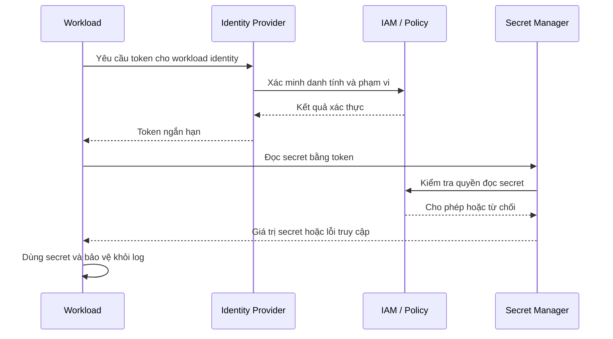

# Lấy secret khi chạy bằng danh tính của workload

## Mục tiêu học tập

Sau bài học, bạn có thể:

- Giải thích workload identity và cách workload nhận danh tính mà không nhúng khóa truy cập dài hạn vào mã nguồn hoặc image.
- Mô tả luồng xác thực từ VM, container hoặc dịch vụ ứng dụng đến secret manager.
- Cấp quyền tối thiểu để một workload chỉ đọc đúng secret cần thiết.
- Lấy secret bằng SDK hoặc cơ chế tích hợp của nền tảng, xử lý cache và xoay vòng secret.
- Chẩn đoán lỗi danh tính, quyền, mạng và secret trong giai đoạn khởi động hoặc khi ứng dụng đang chạy.

## 1. Vì sao workload cần lấy secret khi chạy?

Ứng dụng thường cần thông tin nhạy cảm để kết nối cơ sở dữ liệu, gọi API bên ngoài, ký yêu cầu hoặc truy cập dịch vụ khác. Những thông tin này có thể gồm mật khẩu, API key, token, private key hoặc chứng thư. Chúng được gọi chung là **secret**.

Một cách triển khai đơn giản là đặt secret trong mã nguồn, tệp cấu hình hoặc biến môi trường rồi đóng gói cùng ứng dụng. Cách làm đó tạo ra nhiều rủi ro:

- Secret có thể bị đẩy lên Git, xuất hiện trong log hoặc được lưu trong image container.
- Nhiều môi trường phải dùng chung một giá trị, khiến việc thu hồi và xoay vòng khó kiểm soát.
- Người có quyền đọc image hoặc cấu hình triển khai có thể lấy được secret.
- Khi nhân bản VM hoặc container, secret bị sao chép theo workload.
- Khó xác định ứng dụng hoặc danh tính nào đã đọc secret vào thời điểm cụ thể.

**Workload identity** cho phép một workload chứng minh danh tính của chính nó với nền tảng cloud. Dựa trên danh tính đó, hệ thống cấp một thông tin xác thực ngắn hạn hoặc token có phạm vi giới hạn. Ứng dụng dùng thông tin này để gọi secret manager và lấy secret tại thời điểm chạy.

Mô hình này giúp tách ba việc:

1. Xác định workload nào đang yêu cầu truy cập.
2. Quyết định workload đó được phép đọc secret nào.
3. Cung cấp secret cho ứng dụng trong thời gian cần thiết, đồng thời ghi nhận hoạt động truy cập.

Secret manager là dịch vụ chuyên lưu trữ, kiểm soát phiên bản, phân quyền và ghi log truy cập secret. Workload identity là cơ chế xác định danh tính để ứng dụng được cấp quyền gọi dịch vụ đó.

## 2. Workload identity là gì?

Workload identity là danh tính gắn với một workload đang chạy, chẳng hạn:

- VM hoặc nhóm VM.
- Container task hoặc pod trong Kubernetes.
- Hàm serverless.
- Dịch vụ ứng dụng được quản lý.
- Tác vụ nền hoặc pipeline triển khai khi được cấu hình danh tính riêng.

Danh tính có thể được biểu diễn bằng service account, managed identity, role gắn với workload hoặc một principal được liên kết qua cơ chế liên kết danh tính. Tên gọi thay đổi theo nhà cung cấp, nhưng ý tưởng chung là nền tảng nhận diện workload dựa trên cấu hình và ngữ cảnh thực thi đã được quản lý.

### 2.1. Các thành phần chính

| Thành phần | Vai trò |
|---|---|
| Workload | Ứng dụng chạy trên VM, container hoặc dịch vụ cloud |
| Workload identity | Định danh workload dùng khi yêu cầu truy cập |
| Identity provider / metadata service | Cấp hoặc hỗ trợ lấy token chứng minh danh tính |
| IAM / policy | Quyết định danh tính được phép thực hiện hành động nào trên tài nguyên nào |
| Secret manager | Lưu secret, phiên bản, metadata và lịch sử truy cập |
| SDK / client library | Lấy token, gọi API secret manager và xử lý phản hồi |

Không phải workload nào cũng tự quản lý việc tạo khóa. Với VM, nền tảng có thể cung cấp managed identity hoặc metadata service. Với Kubernetes, service account của pod có thể được liên kết với danh tính cloud thông qua token OIDC và cơ chế federation. Với serverless, danh tính thường được gắn trực tiếp vào cấu hình dịch vụ.

### 2.2. Khác biệt giữa danh tính người dùng và danh tính workload

Danh tính người dùng đại diện cho một người đăng nhập để thực hiện thao tác tương tác, ví dụ quản trị viên mở cloud console. Danh tính workload đại diện cho ứng dụng hoặc tiến trình chạy tự động.

Không nên dùng tài khoản cá nhân của kỹ sư để cấu hình ứng dụng production. Khi nhân sự thay đổi, quyền cá nhân có thể bị thu hồi hoặc thay đổi, khiến ứng dụng bị gián đoạn. Danh tính workload có vòng đời và quyền hạn riêng, dễ kiểm toán và quản lý theo từng dịch vụ.

## 3. Luồng lấy secret khi chạy

Một luồng phổ biến gồm các bước:

1. Quản trị viên tạo hoặc chọn danh tính workload.
2. IAM cấp quyền đọc một secret cụ thể cho danh tính đó.
3. Workload khởi chạy trong môi trường đã gắn danh tính.
4. Ứng dụng yêu cầu token thông qua SDK, metadata service hoặc identity provider của nền tảng.
5. Nền tảng xác thực workload và trả về token ngắn hạn.
6. Ứng dụng gửi token đến secret manager để yêu cầu đọc secret.
7. Secret manager kiểm tra token, policy, phạm vi và phiên bản secret.
8. Nếu được phép, secret manager trả nội dung secret qua kênh TLS.
9. Ứng dụng sử dụng secret cho kết nối hoặc tác vụ cần thiết, đồng thời tránh ghi giá trị đó vào log.

Sơ đồ khái quát:



Sơ đồ mô tả logic tổng quát. Trong một số nền tảng, identity provider và IAM là các phần tích hợp; việc xác minh quyền có thể diễn ra trong cùng một API call. Ứng dụng không nhất thiết nhìn thấy toàn bộ các bước trung gian.

### 3.1. Token ngắn hạn

Token truy cập thường có thời hạn, audience và phạm vi sử dụng. Khi token hết hạn, SDK có thể tự lấy token mới. Điều này giảm nhu cầu lưu khóa dài hạn trong workload.

Cần phân biệt:

- **Identity token:** chứng minh workload là principal nào và có thể được dùng trong bước federation hoặc trao đổi token.
- **Access token:** được dùng để gọi API của dịch vụ đích, ví dụ secret manager.
- **Secret:** dữ liệu nhạy cảm mà ứng dụng muốn đọc sau khi đã được xác thực và cấp quyền.

Một số hệ thống dùng cùng một token cho nhiều vai trò hoặc có bước trao đổi token riêng. Hãy dùng đúng luồng mà SDK và nền tảng hỗ trợ, không tự giả định token cho một audience có thể gọi mọi dịch vụ.

### 3.2. Không đưa credential vào image

Image nên chứa ứng dụng, thư viện, cấu hình không nhạy cảm và thông tin định danh secret cần lấy. Image không nên chứa:

- Access key hoặc service account key dài hạn.
- Mật khẩu database production.
- Private key dùng chung giữa nhiều môi trường.
- Token truy cập có thời hạn dài.
- Tệp cấu hình chứa secret thật.

Có thể đưa tên secret, project hoặc resource identifier vào cấu hình triển khai nếu các giá trị đó không phải bí mật. Ứng dụng dùng workload identity để lấy nội dung secret khi chạy.

## 4. Gắn danh tính cho từng loại workload

### 4.1. VM

Với VM, quản trị viên thường gắn managed identity hoặc service role vào máy khi tạo hoặc cập nhật cấu hình VM. Ứng dụng bên trong VM dùng SDK hoặc metadata endpoint được nền tảng cung cấp để lấy token.

Các điểm cần kiểm tra:

- Danh tính được gắn vào đúng VM hoặc nhóm VM.
- VM có quyền truy cập identity endpoint theo hướng dẫn của nhà cung cấp.
- Token được yêu cầu cho đúng audience/resource của secret manager.
- Ứng dụng chỉ chạy dưới tài khoản hệ điều hành cần thiết.
- Các tiến trình không đáng tin cậy trên cùng VM không thể tùy ý lấy token của workload.

Nếu nhiều ứng dụng không cùng mức tin cậy chạy trên một VM, việc dùng chung một danh tính có thể làm quyền truy cập bị mở rộng. Hãy tách workload hoặc danh tính theo ranh giới tin cậy khi cần.

### 4.2. Container và Kubernetes

Trong Kubernetes, mỗi pod có thể chạy dưới một Kubernetes ServiceAccount. Một số nền tảng hỗ trợ liên kết service account với cloud identity thông qua OIDC federation hoặc cơ chế tương đương.

Luồng tham khảo:

- Tạo service account riêng cho ứng dụng.
- Cấu hình workload chạy với service account đó.
- Thiết lập liên kết giữa issuer, subject và audience của token với danh tính cloud.
- Cấp IAM role cho danh tính cloud để đọc đúng secret.
- Dùng SDK hỗ trợ federation để lấy token và gọi secret manager.

Ví dụ manifest Kubernetes minh họa service account và pod. Các annotation liên kết cloud identity là phần riêng theo nền tảng, do đó cần bổ sung theo tài liệu của nhà cung cấp:

```yaml
apiVersion: v1
kind: ServiceAccount
metadata:
  name: orders-api
  namespace: production
  # Thêm annotation liên kết workload identity theo cloud provider.
---
apiVersion: apps/v1
kind: Deployment
metadata:
  name: orders-api
  namespace: production
spec:
  replicas: 2
  selector:
    matchLabels:
      app: orders-api
  template:
    metadata:
      labels:
        app: orders-api
    spec:
      serviceAccountName: orders-api
      containers:
        - name: app
          image: registry.example/orders-api:1.0.0
          env:
            - name: DB_SECRET_ID
              value: projects/app-prod/secrets/orders-db
```

Trong ví dụ, DB_SECRET_ID chỉ là định danh secret, không phải nội dung bí mật. Cấu hình thực tế cần có IAM binding tương ứng và annotation hoặc cơ chế federation của nền tảng đang sử dụng.

Không nên gắn một service account quyền rộng cho toàn bộ namespace nếu mỗi ứng dụng chỉ cần một tập secret khác nhau. Hãy tách service account theo ứng dụng hoặc ranh giới quyền phù hợp.

### 4.3. Serverless và dịch vụ ứng dụng được quản lý

Với function hoặc dịch vụ ứng dụng được quản lý, danh tính thường được chọn trong cấu hình runtime. Ứng dụng dùng SDK hoặc tích hợp secret reference của nền tảng.

Ưu điểm là không phải tự quản lý metadata endpoint hay token file. Tuy vậy, vẫn cần:

- Gắn đúng danh tính runtime.
- Cấp quyền đọc secret tối thiểu.
- Xác nhận danh tính khi chạy thực tế khác với danh tính dùng lúc deploy.
- Kiểm tra cơ chế cache và cập nhật secret khi nền tảng inject secret vào runtime.
- Phân biệt quyền triển khai tài nguyên với quyền mà ứng dụng dùng trong lúc chạy.

Một pipeline có quyền deploy dịch vụ không có nghĩa tiến trình ứng dụng cần giữ quyền quản trị tương tự.

## 5. Cấp quyền tối thiểu cho secret

Sau khi tạo danh tính, bước tiếp theo là cấp quyền trong IAM hoặc policy của secret manager. Nguyên tắc **least privilege** yêu cầu workload chỉ có quyền cần thiết để hoàn thành chức năng.

Ví dụ, một API xử lý đơn hàng chỉ cần đọc secret kết nối database của chính nó. Nó không cần quyền liệt kê toàn bộ secret, tạo secret mới, xóa secret hoặc đọc secret của dịch vụ thanh toán.

Một policy nên giới hạn theo:

- **Principal:** danh tính workload cụ thể.
- **Resource:** secret hoặc tập secret cần dùng.
- **Action:** chỉ thao tác đọc nội dung hoặc phiên bản cần thiết.
- **Condition:** có thể giới hạn theo project, môi trường, network, tag hoặc điều kiện khác nếu nền tảng hỗ trợ.

Bảng quyền tham khảo:

| Workload | Quyền nên có | Quyền thường không cần |
|---|---|---|
| API đọc thông tin kết nối database | Đọc một secret database cụ thể | Tạo, xóa, sửa secret |
| Worker gửi email | Đọc secret API mail | Đọc secret database của API |
| Job xoay vòng secret | Quyền cập nhật phiên bản theo quy trình riêng | Quyền quản trị toàn bộ project |
| CI/CD triển khai ứng dụng | Quyền triển khai tài nguyên cần thiết | Đọc tất cả secret runtime của production |

Một policy tổng quát có thể biểu diễn như sau. Đây là pseudocode để minh họa ý tưởng, không phải cú pháp policy dùng trực tiếp cho một cloud provider:

```json
{
  "principal": "workload:orders-api",
  "resource": "secret:orders-db",
  "actions": ["secret:read"],
  "effect": "allow"
}
```

Hãy kiểm tra cả quyền kế thừa từ project, folder, organization hoặc role mặc định. Một policy cấp quyền rộng ở tầng cha có thể làm mất ý nghĩa của policy giới hạn ở secret cụ thể.

## 6. Lấy secret bằng SDK khi ứng dụng chạy

SDK của cloud thường hỗ trợ **default credential chain** hoặc **application default credentials**. Trong môi trường cloud, SDK sẽ tìm workload identity phù hợp và tự làm mới token khi cần. Tên API và cách khởi tạo khác nhau giữa nhà cung cấp.

Quy trình ứng dụng nên:

1. Đọc secret identifier từ cấu hình không nhạy cảm.
2. Khởi tạo SDK bằng credential provider của runtime.
3. Gọi secret manager để lấy phiên bản đang được ứng dụng sử dụng.
4. Xác thực phản hồi và xử lý lỗi.
5. Đưa secret vào client kết nối cần thiết.
6. Không in nội dung secret, token hoặc request header nhạy cảm ra log.
7. Đóng hoặc giải phóng tài nguyên khi ứng dụng dừng.

Ví dụ pseudocode Python:

```python
import os

def load_database_secret(secret_client):
    secret_id = os.environ["DB_SECRET_ID"]

    # SDK tự lấy credential từ workload identity của runtime.
    # Không truyền access key hoặc service account key trong mã.
    response = secret_client.access_secret_version(
        name=secret_id
    )

    secret_value = response.payload

    if not secret_value:
        raise RuntimeError("Database secret is empty")

    return secret_value


def create_database_connection(secret_client, db_driver):
    secret = load_database_secret(secret_client)

    # Chỉ truyền secret vào thành phần cần sử dụng.
    connection = db_driver.connect(
        username=secret["username"],
        password=secret["password"],
        host=secret["host"],
        database=secret["database"],
    )

    return connection
```

Đây là pseudocode độc lập với nhà cung cấp. Tên phương thức, kiểu dữ liệu phản hồi và cách parse payload cần thay bằng SDK chính thức. Trong ứng dụng thực tế, nên dùng secret object hoặc cấu trúc dữ liệu được xác thực schema, tránh giả định payload luôn là dictionary.

### 6.1. Lấy secret ở startup hay khi cần?

Có hai cách phổ biến:

- **Lấy khi khởi động:** ứng dụng đọc secret trước khi mở listener hoặc nhận traffic. Cách này giúp phát hiện sớm lỗi quyền hoặc cấu hình, nhưng secret chỉ được làm mới khi ứng dụng khởi động lại hoặc có cơ chế refresh riêng.
- **Lấy khi cần (on demand):** ứng dụng gọi secret manager tại thời điểm cần dùng. Cách này có thể nhận phiên bản mới nhanh hơn, nhưng làm tăng độ trễ và phụ thuộc vào tính sẵn sàng của secret manager.

Một lựa chọn cân bằng là lấy secret khi startup rồi cache trong bộ nhớ có thời hạn, đồng thời có cơ chế refresh trước khi hết hạn hoặc khi nhận tín hiệu xoay vòng. Với secret dùng cho kết nối lâu dài, cần có quy trình tạo kết nối mới và đóng kết nối cũ khi secret thay đổi.

### 6.2. Cache secret

Cache giúp giảm độ trễ, số lần gọi API và chi phí. Tuy nhiên, cache quá lâu khiến ứng dụng tiếp tục dùng secret cũ sau khi secret đã được xoay vòng hoặc thu hồi.

Khi thiết kế cache, hãy xác định:

- TTL phù hợp với tần suất thay đổi secret và yêu cầu bảo mật.
- Cách refresh trước khi TTL hết hạn.
- Cách xử lý khi secret manager tạm thời không truy cập được.
- Cách thay thế connection pool hoặc token phụ thuộc secret cũ.
- Cách xóa secret khỏi bộ nhớ khi workload dừng, trong phạm vi ngôn ngữ và runtime cho phép.

Không ghi secret vào cache dùng chung như Redis hoặc disk cache nếu chưa có yêu cầu và thiết kế bảo vệ riêng. Bộ nhớ tiến trình thường là nơi đơn giản hơn, nhưng vẫn có thể bị đọc qua dump, debugger hoặc quyền quản trị hệ thống.

## 7. Xoay vòng và thu hồi secret

Secret nên được xoay vòng định kỳ hoặc khi có dấu hiệu bị lộ. Secret manager thường hỗ trợ phiên bản secret, cho phép tạo phiên bản mới mà không cần ghi đè trực tiếp giá trị cũ.

Một quy trình xoay vòng an toàn thường gồm:

1. Tạo credential mới ở hệ thống đích, ví dụ tạo mật khẩu database mới hoặc API key mới.
2. Lưu giá trị mới thành phiên bản secret mới.
3. Cấp quyền để workload đọc phiên bản mới.
4. Cập nhật ứng dụng hoặc refresh cache để sử dụng credential mới.
5. Kiểm tra kết nối và hoạt động thực tế.
6. Thu hồi credential cũ sau khi xác nhận không còn workload sử dụng.
7. Ghi nhận phiên bản, thời điểm và người/tiến trình thực hiện thay đổi.

Đối với database, nếu chỉ có một mật khẩu và thay đổi ngay lập tức, các instance đang chạy có thể mất kết nối. Có thể cần cơ chế hai credential cùng tồn tại trong một khoảng chuyển tiếp hoặc quy trình rotation được database hỗ trợ.

Không xóa phiên bản cũ trước khi workload đã chuyển sang phiên bản mới và hệ thống phụ thuộc đã được xác minh. Ngược lại, không giữ credential cũ vô thời hạn vì sẽ làm tăng bề mặt tấn công.

## 8. Bảo vệ đường lấy token và secret

Workload identity giảm nhu cầu lưu credential dài hạn nhưng không làm token và secret trở nên vô hại. Một tiến trình bị xâm nhập vẫn có thể sử dụng danh tính của nó trong phạm vi quyền được cấp.

Các biện pháp quan trọng:

- Dùng TLS để bảo vệ token và secret khi truyền qua mạng.
- Không ghi token, secret hoặc header Authorization vào log, trace hay exception.
- Không đưa token vào command line hoặc biến môi trường toàn cục nếu SDK có credential provider an toàn hơn.
- Giới hạn quyền truy cập metadata endpoint; bảo vệ trước SSRF và tiến trình không đáng tin cậy.
- Giới hạn audience và thời hạn token theo khả năng nền tảng.
- Không chia sẻ một workload identity giữa nhiều ứng dụng có mức tin cậy khác nhau.
- Bảo vệ host, container runtime, service account token và quyền truy cập file trong pod.
- Tắt hoặc thu hồi danh tính khi workload không còn được sử dụng.
- Bật audit log cho thao tác đọc secret và theo dõi truy cập bất thường.

### 8.1. Rủi ro từ metadata service và SSRF

Một số nền tảng cung cấp token thông qua metadata service bên trong VM. Nếu ứng dụng có lỗ hổng Server-Side Request Forgery (SSRF), kẻ tấn công có thể tìm cách khiến ứng dụng gửi request đến endpoint nội bộ và lấy token.

Để giảm rủi ro:

- Dùng phiên bản metadata service có cơ chế bảo vệ request nếu nền tảng hỗ trợ.
- Không cho phép URL do người dùng cung cấp truy cập tùy ý đến địa chỉ link-local hoặc mạng nội bộ.
- Áp dụng egress filtering và kiểm tra URL redirect.
- Không chạy ứng dụng không đáng tin cậy với cùng danh tính có quyền đọc secret nhạy cảm.
- Dùng danh tính riêng và quyền tối thiểu cho từng workload.

Một số nền tảng có endpoint metadata yêu cầu header hoặc token phiên; nền tảng khác dùng cơ chế federation hoặc credential file được mount. Hãy áp dụng đúng hướng dẫn của nền tảng, không tự xây endpoint giả định.

### 8.2. Giới hạn khả năng lộ secret trong ứng dụng

Ngay cả khi secret được lấy an toàn, ứng dụng vẫn có thể làm lộ nó qua:

- Log request/response hoặc exception.
- Trang debug, endpoint health chi tiết hoặc diagnostic dump.
- Crash dump, heap dump và core dump.
- Telemetry, APM hoặc tracing ghi lại tham số.
- File tạm, shell history hoặc công cụ giám sát tiến trình.

Hãy dùng bộ lọc log, che dữ liệu nhạy cảm và kiểm soát quyền đọc các dump. Không đưa secret vào thông báo lỗi cho người dùng hoặc metric label.

## 9. Chẩn đoán lỗi khi lấy secret

| Triệu chứng | Nguyên nhân có thể | Hướng kiểm tra |
|---|---|---|
| Không tìm thấy credential | Workload chưa được gắn identity hoặc SDK không nhận diện runtime | Kiểm tra cấu hình identity, SDK và môi trường thực thi |
| Unauthorized / invalid token | Token hết hạn, sai audience, issuer hoặc clock lệch | Kiểm tra token provider, audience, issuer và đồng bộ thời gian |
| Permission denied | IAM thiếu quyền hoặc policy không áp dụng đúng principal | Kiểm tra principal, resource, action và quyền kế thừa |
| Secret not found | Sai project, secret ID hoặc phiên bản | Kiểm tra tên resource và version |
| Timeout / connection refused | DNS, route, firewall, proxy hoặc endpoint dịch vụ | Kiểm tra network path, TLS và trạng thái secret manager |
| Secret trả về phiên bản cũ | Cache chưa refresh hoặc đang pin version cụ thể | Kiểm tra TTL, refresh logic và alias/version đang dùng |
| Hoạt động ở staging nhưng lỗi ở production | Hai môi trường dùng identity, policy hoặc secret scope khác nhau | So sánh service account, role, resource ID và cấu hình deploy |

### Quy trình chẩn đoán

1. Xác nhận workload đang chạy với danh tính dự kiến. Không suy luận từ danh tính của người triển khai.
2. Kiểm tra SDK có lấy được token hay không; chỉ log loại lỗi và metadata không nhạy cảm.
3. Xác minh audience, issuer, thời hạn và thời gian hệ thống nếu dùng federation.
4. Đọc audit log của secret manager để xem principal nào đã gọi, secret nào được yêu cầu và lý do bị từ chối.
5. Kiểm tra IAM binding ở đúng phạm vi, bao gồm policy cấp trên và điều kiện bổ sung.
6. Xác nhận secret ID, project, version và trạng thái secret.
7. Kiểm tra DNS, route, firewall, proxy và chứng thư TLS.
8. Kiểm tra cache và vòng đời connection pool nếu ứng dụng đang dùng secret cũ.
9. Sau khi sửa, xác minh bằng một lần truy cập có kiểm soát và theo dõi log/audit.

Khi gửi thông tin cho đội hỗ trợ, chỉ cung cấp request ID, error code, principal không nhạy cảm, thời điểm và resource identifier cần thiết. Không gửi token hoặc giá trị secret.

## 10. Ví dụ thực tế: API đọc mật khẩu database

Một dịch vụ orders-api chạy trên Kubernetes cần kết nối đến database production. Nhóm vận hành muốn triển khai nhiều replica và có thể xoay vòng mật khẩu mà không phải build lại image.

Thiết kế tham khảo:

- Mỗi pod chạy với service account riêng tên orders-api.
- Service account được liên kết với workload identity của project production.
- IAM cho phép danh tính đó chỉ đọc secret orders-db.
- Image chỉ chứa ứng dụng và SDK secret manager.
- Deployment truyền resource ID của secret qua cấu hình không nhạy cảm.
- Ứng dụng dùng SDK để lấy secret khi startup, sau đó cache trong bộ nhớ với TTL được xác định.
- Khi có phiên bản secret mới, ứng dụng refresh secret, tạo connection pool mới và kiểm tra truy vấn.
- Sau khi mọi replica dùng credential mới, đội vận hành thu hồi credential cũ.
- Audit log được theo dõi để phát hiện workload khác cố đọc secret orders-db.

Nếu một pod bị xâm nhập, phạm vi truy cập của danh tính này chỉ nên giới hạn trong secret database của orders-api. Pod đó không nên đọc được API key của dịch vụ thanh toán hoặc secret của namespace khác.

## 11. Checklist triển khai

Trước khi đưa workload vào production, hãy kiểm tra:

- [ ] Workload có danh tính riêng và không phụ thuộc tài khoản cá nhân.
- [ ] Không có access key dài hạn trong source code, image hoặc repository.
- [ ] SDK dùng credential provider phù hợp với môi trường runtime.
- [ ] Token có audience và thời hạn phù hợp.
- [ ] IAM chỉ cho phép đọc secret cần thiết.
- [ ] Secret manager được truy cập qua TLS và network path được kiểm soát.
- [ ] Secret không xuất hiện trong log, trace, metric, dump hoặc file tạm.
- [ ] Có chính sách cache, refresh và xử lý khi secret manager tạm thời lỗi.
- [ ] Có quy trình xoay vòng, kiểm thử và thu hồi credential cũ.
- [ ] Audit log được bật và có người/nhóm chịu trách nhiệm theo dõi.
- [ ] Có runbook xử lý lỗi identity, permission, network và secret version.
- [ ] Danh tính được thu hồi khi workload bị xóa hoặc ngừng hoạt động.

## 12. Những nhầm lẫn thường gặp

- **Workload identity là một secret.** Identity xác định workload; token chứng minh identity; secret là dữ liệu mà workload muốn truy cập.
- **Có token là đọc được mọi secret.** Token chỉ chứng minh danh tính trong một phạm vi. IAM vẫn quyết định quyền đọc từng resource.
- **Dùng service account của CI/CD cho ứng dụng runtime.** Pipeline triển khai và ứng dụng đang chạy có mục đích, vòng đời và quyền khác nhau; nên dùng danh tính riêng.
- **Đưa secret vào image để khởi động nhanh hơn.** Image thường được sao chép và lưu lâu dài. Hãy lấy secret khi runtime hoặc dùng tích hợp secret reference được nền tảng hỗ trợ.
- **Cache secret vô thời hạn.** Ứng dụng có thể tiếp tục dùng credential đã bị xoay vòng hoặc thu hồi. Cần TTL và refresh strategy.
- **Secret manager tự xoay vòng mọi credential.** Secret manager có thể quản lý phiên bản, nhưng việc cập nhật credential ở hệ thống đích và chuyển ứng dụng sang giá trị mới cần quy trình phù hợp.
- **Workload identity ngăn mọi hình thức đánh cắp secret.** Nếu tiến trình bị xâm nhập, kẻ tấn công có thể sử dụng quyền của workload. Cần least privilege, bảo vệ runtime và audit.
- **Quyền deploy chính là quyền runtime.** Danh tính triển khai và danh tính ứng dụng nên được tách để giới hạn hậu quả khi một thành phần bị xâm nhập.

## 13. Tự kiểm tra

**Tình huống 1:** Một container cần đọc mật khẩu database. Có nên lưu service account key trong Docker image để mọi replica dùng chung không?

**Gợi ý:** Không. Hãy gắn workload identity riêng cho service account của pod, cấp quyền đọc đúng secret và để SDK lấy token ngắn hạn từ runtime.

**Tình huống 2:** Ứng dụng nhận lỗi Permission denied dù token đã được cấp thành công. Bạn cần kiểm tra điều gì?

**Gợi ý:** Kiểm tra IAM policy của principal trên đúng secret, action đọc, phạm vi resource và điều kiện policy. Token hợp lệ không tự cấp quyền đọc secret.

**Tình huống 3:** Secret đã được xoay vòng nhưng một số replica vẫn kết nối bằng mật khẩu cũ. Nguyên nhân có thể là gì?

**Gợi ý:** Các replica có thể đang cache secret hoặc giữ connection pool được tạo bằng credential cũ. Cần refresh secret, thay pool có kiểm soát và chỉ thu hồi credential cũ sau khi xác nhận chuyển đổi hoàn tất.

**Tình huống 4:** Audit log cho thấy một workload đọc nhiều secret không thuộc chức năng của nó. Bạn nên xử lý thế nào?

**Gợi ý:** Xác minh principal và hoạt động, thu hồi hoặc giới hạn quyền dư thừa, kiểm tra policy kế thừa, đánh giá dấu hiệu xâm nhập và xoay vòng secret có nguy cơ bị lộ.

## Kết luận

Lấy secret bằng workload identity giúp ứng dụng xác thực với cloud bằng danh tính được quản lý và token ngắn hạn, sau đó đọc secret từ secret manager theo quyền IAM. Để triển khai an toàn, cần tách danh tính theo workload, giới hạn quyền đến từng secret, bảo vệ token và secret trong suốt vòng đời ứng dụng, thiết kế cache và xoay vòng có kiểm soát, đồng thời theo dõi audit log. Cách tiếp cận này áp dụng được cho VM, container, Kubernetes và serverless, với cấu hình cụ thể tùy nền tảng cloud.
