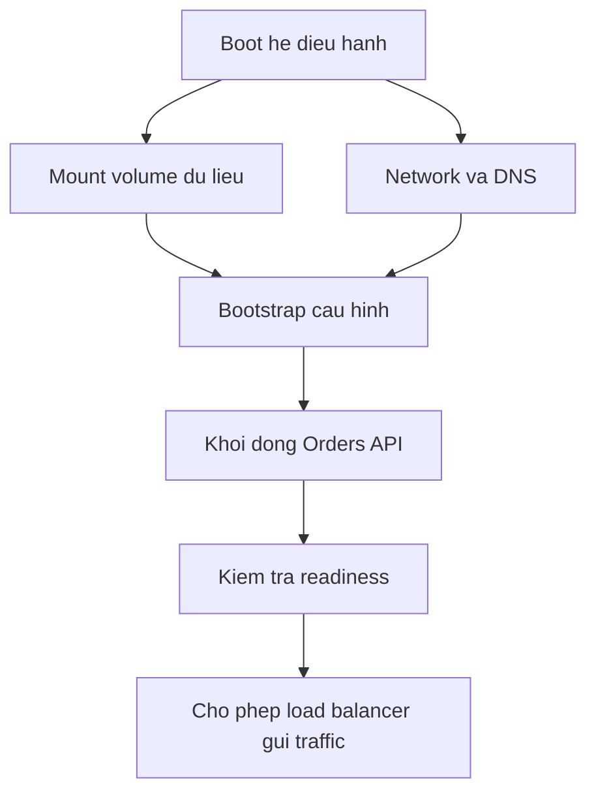

# Quản lý tiến trình, service và thứ tự khởi động ứng dụng

Một máy ảo có thể đã khởi động thành công nhưng ứng dụng vẫn chưa phục vụ được yêu cầu. Hệ điều hành cần khởi chạy nhiều tiến trình nền, gắn volume, thiết lập mạng, nạp cấu hình và khởi động các dịch vụ phụ thuộc. Ứng dụng cũng có thể cần tải dữ liệu, kết nối cơ sở dữ liệu, đăng ký với hệ thống giám sát rồi mới sẵn sàng nhận traffic.

Quản lý tiến trình và service giúp kiểm soát cách ứng dụng bắt đầu, tiếp tục chạy, ghi log, xử lý lỗi và dừng an toàn. Thiết kế thứ tự khởi động đúng giúp tránh tình trạng ứng dụng chạy trước khi tài nguyên cần thiết sẵn sàng, đồng thời giúp máy ảo phục hồi ổn định sau reboot hoặc sự cố.

## 1. Phân biệt chương trình, tiến trình và service

Ba khái niệm này liên quan nhưng không giống nhau:

- **Chương trình (program):** tập hợp mã lệnh và tài nguyên được lưu trên đĩa, ví dụ file thực thi hoặc JAR.
- **Tiến trình (process):** một lần chương trình đang chạy, có PID, không gian bộ nhớ, file descriptor, quyền người dùng và trạng thái thực thi riêng.
- **Service:** một thành phần phần mềm chạy nền để cung cấp chức năng cho hệ thống hoặc ứng dụng khác. Service thường được một service manager giám sát và điều khiển.

Ví dụ, file `orders-api.jar` là chương trình. Khi JVM chạy file này, hệ điều hành tạo một tiến trình Java. Nếu tiến trình được cấu hình để tự khởi động cùng hệ điều hành, được theo dõi và có chính sách restart, nó trở thành một service do hệ thống quản lý.

Một service không nhất thiết chỉ có một tiến trình. Nó có thể tạo tiến trình con, worker hoặc helper. Ngược lại, một tiến trình có thể chạy ở foreground trong một container mà không cần service manager bên trong container. Cách quản lý phụ thuộc mô hình triển khai: máy ảo truyền thống thường dùng systemd hoặc Windows Service Control Manager; container thường để runtime hoặc orchestrator giám sát tiến trình chính.

## 2. Vòng đời của một tiến trình

Khi một chương trình được khởi chạy, hệ điều hành tạo tiến trình và cấp phát những tài nguyên cần thiết. Tiến trình có thể chuyển qua các trạng thái như đang chạy, sẵn sàng được lập lịch, chờ I/O hoặc đã kết thúc. Tên trạng thái cụ thể và cách hiển thị phụ thuộc hệ điều hành.

Một vòng đời đơn giản gồm:

1. **Tạo tiến trình:** service manager hoặc tiến trình cha gọi chương trình thực thi.
2. **Khởi tạo:** chương trình đọc tham số, cấu hình, mở file, tạo thread và chuẩn bị tài nguyên.
3. **Hoạt động:** xử lý request, thực hiện tác vụ nền hoặc chờ sự kiện.
4. **Nhận tín hiệu dừng:** hệ điều hành hoặc service manager yêu cầu tiến trình kết thúc.
5. **Dọn dẹp:** ứng dụng ngừng nhận công việc mới, hoàn tất hoặc hủy công việc đang chạy, đóng kết nối và giải phóng tài nguyên.
6. **Kết thúc:** tiến trình trả mã thoát; hệ thống ghi nhận kết quả và có thể áp dụng chính sách restart.

Tiến trình có thể kết thúc bình thường với mã thoát 0, hoặc kết thúc bất thường do lỗi, signal, thiếu bộ nhớ hay bị hệ điều hành chấm dứt. Mã thoát là một tín hiệu hữu ích nhưng không thay thế health check: tiến trình còn sống chưa chắc ứng dụng đang xử lý request đúng.

Trên Linux, có thể dùng `ps`, `top` hoặc `pgrep` để quan sát tiến trình. Ví dụ:

```bash
ps -eo pid,ppid,user,stat,etime,cmd --sort=pid
pgrep -af orders-api
```

`PID` là mã tiến trình, `PPID` là PID của tiến trình cha, `USER` là tài khoản chạy tiến trình và `STAT` thể hiện trạng thái. Các lệnh này giúp tìm tiến trình đang chạy và mối quan hệ cha-con khi chẩn đoán.

Không nên khởi chạy ứng dụng production bằng một terminal session tạm rồi đóng cửa sổ hoặc ngắt SSH. Tiến trình có thể nhận tín hiệu khi session kết thúc, mất cơ chế tự khởi động sau reboot và không có chính sách phục hồi nhất quán. Hãy để service manager hoặc nền tảng chạy workload chịu trách nhiệm giám sát vòng đời.

## 3. Service manager và vai trò của nó

Service manager là thành phần quản lý việc khởi động, dừng, giám sát và sắp xếp các dịch vụ hệ thống. Nó giúp người vận hành khai báo cách chạy ứng dụng thay vì tự viết script quản lý PID, kiểm tra tiến trình và khởi động lại bằng tay.

Trên Linux hiện đại, `systemd` là service manager phổ biến. Nó quản lý unit như service, target, mount, socket và timer. Một file unit mô tả chương trình cần chạy, tài khoản, thư mục làm việc, điều kiện phụ thuộc, thời gian chờ và chính sách restart.

Trên Windows, **Service Control Manager (SCM)** quản lý Windows services. Service được đăng ký với SCM, khai báo kiểu khởi động, tài khoản chạy, dependency và recovery action. SCM có thể khởi động service khi hệ điều hành boot, theo yêu cầu hoặc theo trigger được cấu hình.

| Nhu cầu | Linux với systemd | Windows |
|---|---|---|
| Khai báo service | Unit file `.service` | Windows service được đăng ký với SCM |
| Khởi động/dừng | `systemctl start` / `systemctl stop` | Services console, `sc.exe` hoặc PowerShell service cmdlets |
| Tự khởi động khi boot | `systemctl enable` | Startup type Automatic hoặc Automatic (Delayed Start) |
| Xem trạng thái | `systemctl status` | `Get-Service` hoặc Services console |
| Xem log | `journalctl` và log ứng dụng | Event Viewer và log ứng dụng |
| Phục hồi sau lỗi | `Restart=` trong unit | Recovery actions của service |

Service manager không thay thế logic phục hồi của ứng dụng. Nó có thể phát hiện tiến trình kết thúc và khởi động lại, nhưng không tự sửa được cấu hình sai, database mất kết nối hoặc lỗi dữ liệu. Ứng dụng cần log, health endpoint và xử lý lỗi phù hợp.

## 4. Thiết kế unit systemd cho ứng dụng

Một unit systemd thường có các phần `[Unit]`, `[Service]` và `[Install]`. Ví dụ dưới đây mô tả service Java cho một API nội bộ:

```ini
[Unit]
Description=Orders API
Wants=network-online.target
After=network-online.target
RequiresMountsFor=/srv/orders

[Service]
Type=simple
User=orders
Group=orders
WorkingDirectory=/srv/orders
ExecStart=/usr/bin/java -jar /srv/orders/orders-api.jar
Restart=on-failure
RestartSec=5s
TimeoutStartSec=90s
TimeoutStopSec=30s
KillSignal=SIGTERM
EnvironmentFile=-/etc/orders/orders.env

[Install]
WantedBy=multi-user.target
```

Đây là cấu hình minh họa. Đường dẫn, tài khoản, runtime và tham số phải khớp với máy thực tế. File môi trường chỉ nên chứa cấu hình không nhạy cảm hoặc giá trị được bảo vệ đúng cách; không đặt password hay token dạng rõ trong unit file hoặc metadata có quyền đọc rộng.

Ý nghĩa một số chỉ thị quan trọng:

- `Description=` mô tả service để người vận hành dễ nhận biết.
- `Wants=` yêu cầu kéo một unit khác vào cùng giao dịch khởi động nhưng mức phụ thuộc tương đối yếu.
- `After=` quy định thứ tự: service này được khởi động sau unit được nêu nếu cả hai cùng được đưa vào giao dịch. Nó không tự kéo unit kia vào.
- `RequiresMountsFor=` yêu cầu các mount cần thiết cho đường dẫn được chuẩn bị trước khi service chạy.
- `User=` và `Group=` chạy ứng dụng bằng tài khoản chuyên dụng có quyền tối thiểu.
- `WorkingDirectory=` đặt thư mục làm việc của tiến trình.
- `ExecStart=` xác định lệnh khởi chạy chính.
- `Restart=on-failure` yêu cầu systemd khởi động lại khi tiến trình kết thúc do lỗi theo định nghĩa của systemd.
- `RestartSec=` đặt khoảng chờ trước lần restart.
- `TimeoutStartSec=` và `TimeoutStopSec=` giới hạn thời gian cho các pha start và stop.
- `KillSignal=SIGTERM` chọn tín hiệu gửi khi yêu cầu dừng tiến trình.
- `WantedBy=multi-user.target` cho phép service được liên kết vào target phù hợp khi enable.

Sau khi tạo hoặc thay đổi unit file, có thể nạp lại cấu hình và quản lý service bằng các lệnh sau:

```bash
sudo systemctl daemon-reload
sudo systemctl enable orders-api.service
sudo systemctl start orders-api.service
sudo systemctl status orders-api.service
```

`daemon-reload` yêu cầu systemd đọc lại unit file. `enable` cấu hình service được kéo vào quá trình boot theo `[Install]`; lệnh này không đồng nghĩa service đang chạy. `start` khởi động service ngay. `status` hiển thị trạng thái hiện tại và một phần log gần nhất.

## 5. Hiểu đúng dependency và thứ tự khởi động

Ứng dụng thường phụ thuộc vào nhiều thành phần: filesystem, volume dữ liệu, mạng, secret provider, agent hoặc dịch vụ nền. Nếu service khởi động trước khi những điều kiện cần thiết sẵn sàng, nó có thể thất bại hoặc chạy trong trạng thái không đầy đủ.

Trong systemd, cần phân biệt hai loại quan hệ:

- **Dependency:** `Wants=`, `Requires=` hoặc các chỉ thị liên quan xác định unit nào được kéo vào hoặc ảnh hưởng đến kết quả của giao dịch.
- **Ordering:** `Before=` và `After=` xác định thứ tự khởi động hoặc dừng giữa các unit.

Ví dụ, `After=network-online.target` chỉ đặt thứ tự khi target đó được đưa vào giao dịch. Để yêu cầu target được kéo vào, thường kết hợp với `Wants=network-online.target`. Tuy nhiên, `network-online.target` chỉ hữu ích khi hệ thống có dịch vụ wait-online phù hợp được bật và cấu hình. Nếu không, target có thể đạt trạng thái active trước khi ứng dụng thực sự truy cập được endpoint cần thiết.

`Requires=` thể hiện phụ thuộc mạnh hơn `Wants=`: nếu unit được yêu cầu không khởi động được, giao dịch có thể thất bại theo quan hệ đã khai báo. Dù vậy, dependency ở cấp systemd không chứng minh dịch vụ phụ thuộc đã sẵn sàng ở cấp ứng dụng. Ví dụ, database service có thể active nhưng vẫn đang phục hồi dữ liệu hoặc chưa chấp nhận kết nối.

Vì vậy, hãy kết hợp thứ tự service với cơ chế retry và health check bên trong ứng dụng. Một API phụ thuộc database nên thử kết nối lại với backoff, giới hạn thời gian và báo readiness chưa đạt cho đến khi có thể phục vụ. Tránh tạo chuỗi phụ thuộc cứng dài giữa mọi dịch vụ nếu ứng dụng có thể tự phục hồi khi dependency tạm thời gián đoạn.

Một đồ thị khởi động đơn giản có thể như sau:



Sơ đồ là trình tự logic ở mức workload. Thứ tự thực tế cần dựa trên unit dependency, cơ chế bootstrap và cách nền tảng cung cấp volume, mạng cùng cấu hình.

## 6. Các kiểu service và cách báo hiệu sẵn sàng

systemd có nhiều `Type=` để xác định cách nhận biết service đã khởi động:

| Type | Cách hoạt động | Trường hợp sử dụng |
|---|---|---|
| `simple` | Tiến trình được khởi chạy; systemd xem service đã bắt đầu sau khi tiến trình được tạo theo quy tắc của loại này | Ứng dụng chạy foreground và không cần handshake readiness với systemd |
| `exec` | systemd chờ thao tác `execve()` thành công trước khi coi lệnh được khởi chạy | Muốn phát hiện sớm lỗi không thể thực thi file hoặc binary |
| `forking` | Chương trình tự fork và tiến trình cha thoát; systemd theo dõi tiến trình nền theo cấu hình PID | Daemon kiểu cũ tự daemonize |
| `oneshot` | Chạy lệnh ngắn rồi kết thúc; có thể giữ trạng thái active theo cấu hình | Tác vụ chuẩn bị hoặc cấu hình hoàn tất một lần |
| `notify` | Ứng dụng gửi tín hiệu readiness cho systemd qua cơ chế notify | Ứng dụng hỗ trợ thông báo rõ khi đã sẵn sàng |

Không nên dùng `forking` cho ứng dụng mới nếu có thể chạy foreground và để systemd quản lý tiến trình. Với `Type=notify`, ứng dụng cần thực sự gửi thông báo như `READY=1`; nếu không, service có thể chờ đến timeout. Chọn `Type=` dựa trên hành vi thực của chương trình, không dựa vào mong muốn rằng service phải “active” thật nhanh.

Trạng thái active của systemd cũng không nhất thiết đồng nghĩa endpoint HTTP đã sẵn sàng. Có thể dùng `Type=notify` nếu ứng dụng hỗ trợ, đồng thời duy trì health check độc lập ở load balancer hoặc hệ thống giám sát để xác nhận khả năng phục vụ thực tế.

## 7. Chính sách restart và tránh vòng lặp lỗi

Service manager có thể tự khởi động lại tiến trình khi gặp lỗi. Chính sách restart cần cân bằng giữa khả năng phục hồi và nguy cơ che giấu lỗi cấu hình hoặc tạo vòng lặp khởi động liên tục.

Một số lựa chọn systemd thường dùng:

- `Restart=no`: không tự khởi động lại.
- `Restart=on-failure`: restart khi tiến trình thất bại theo các điều kiện được systemd xác định.
- `Restart=on-abnormal`: restart khi kết thúc bất thường như signal hoặc timeout.
- `Restart=always`: restart ngay cả khi tiến trình kết thúc bình thường, trừ một số trường hợp dừng theo yêu cầu quản lý.

Với service API dài hạn, `on-failure` thường là điểm bắt đầu hợp lý. `RestartSec=` giúp tránh khởi động lại quá nhanh. Cần xem thêm giới hạn tốc độ restart của systemd và log để nhận ra service đang thất bại liên tục. Không dùng `always` một cách máy móc cho tác vụ chạy một lần vì service có thể lặp vô hạn sau khi hoàn thành.

Restart process không thay thế xử lý dữ liệu an toàn. Nếu ứng dụng bị dừng giữa giao dịch, nó phải có khả năng phục hồi transaction, xử lý message theo cơ chế idempotent hoặc tiếp tục từ checkpoint. Nếu không, restart có thể làm lặp tác vụ hoặc tạo dữ liệu không nhất quán.

Đối với Windows service, có thể cấu hình recovery action để restart service sau lần lỗi đầu hoặc các lần lỗi tiếp theo. Cần đặt khoảng chờ và giới hạn phù hợp, đồng thời theo dõi Event Viewer để tìm nguyên nhân gốc. Cả systemd và SCM chỉ quản lý vòng đời tiến trình; chúng không tự đảm bảo logic nghiệp vụ được phục hồi đúng.

## 8. Dừng service an toàn và xử lý shutdown

Khi máy ảo reboot, scale-in hoặc bị thay thế, service cần có thời gian dừng đúng cách. Nếu bị kill ngay, ứng dụng có thể mất dữ liệu trong bộ đệm, bỏ dở request, không commit giao dịch hoặc để lại trạng thái không nhất quán.

Một quy trình graceful shutdown nên gồm:

1. Ngừng nhận request mới hoặc đánh dấu instance không còn readiness.
2. Chờ load balancer ngừng gửi traffic và drain các kết nối hiện có.
3. Ngừng nhận công việc mới từ queue hoặc scheduler.
4. Hoàn tất request và transaction đang xử lý trong giới hạn thời gian.
5. Flush log, metric và dữ liệu buffer cần thiết.
6. Đóng connection pool, thread pool và tài nguyên ngoài.
7. Kết thúc tiến trình trước deadline; nếu vượt quá giới hạn, service manager có thể gửi tín hiệu mạnh hơn.

Trên Linux, `SIGTERM` thường là tín hiệu yêu cầu ứng dụng kết thúc có kiểm soát; `SIGKILL` buộc tiến trình dừng và không cho ứng dụng thực hiện cleanup. Ứng dụng cần cài signal handler phù hợp hoặc dùng framework/runtime có hỗ trợ graceful shutdown. Không nên bắt và bỏ qua `SIGTERM`.

Với systemd, `TimeoutStopSec=` quy định thời gian chờ trước khi systemd áp dụng hành động tiếp theo theo cấu hình. Giá trị cần lớn hơn thời gian drain tối đa mà ứng dụng được phép sử dụng, nhưng không nên quá dài khiến việc thay thế máy bị treo. Hãy phối hợp timeout của service với thời gian deregister/drain của load balancer và deadline shutdown của nền tảng.

## 9. Quyền chạy, môi trường và giới hạn tài nguyên

Service nên chạy bằng tài khoản chuyên dụng thay vì `root` hoặc Administrator nếu không cần quyền quản trị. Cấp đúng quyền đọc file cấu hình, ghi log, truy cập thư mục dữ liệu và mở cổng cần thiết. Điều này giới hạn tác động khi ứng dụng có lỗ hổng.

Không truyền secret qua command line vì tham số tiến trình có thể hiển thị trong danh sách process hoặc log. Tránh ghi secret vào unit file, image, user data hay file có quyền đọc rộng. Dùng secret manager hoặc cơ chế danh tính workload để cấp bí mật lúc chạy; bảo vệ file cấu hình bằng quyền hệ thống tệp và xoay vòng thông tin xác thực theo chính sách.

Trên Linux, systemd có thể áp dụng giới hạn tài nguyên qua cgroup, ví dụ:

```ini
[Service]
CPUQuota=200%
MemoryMax=2G
TasksMax=256
```

Các giá trị trên chỉ minh họa giới hạn. `CPUQuota=200%` tương ứng tối đa khoảng hai CPU theo cách tính quota của systemd; `MemoryMax=` giới hạn bộ nhớ của service cgroup; `TasksMax=` giới hạn số task (bao gồm thread theo cách kernel/systemd đếm). Cần kiểm thử để tránh giới hạn quá thấp khiến ứng dụng bị throttling hoặc OOM.

Khi đặt giới hạn cho JVM, phải tính cả heap, metaspace, thread stack, direct buffer và native memory. `MemoryMax` áp dụng cho toàn cgroup, vì vậy không đặt heap bằng toàn bộ giới hạn cgroup. Nên theo dõi RSS, heap, garbage collection, CPU throttling và sự kiện OOM sau khi triển khai.

## 10. Quản lý log và quan sát service

Khi service không khởi động, log là một trong những nguồn dữ liệu đầu tiên cần kiểm tra. Cấu hình service nên gửi log ra stdout/stderr hoặc journald theo chuẩn của hệ thống, đồng thời ứng dụng nên ghi log có cấu trúc và kèm correlation ID cho request.

Một số lệnh Linux hữu ích:

```bash
sudo systemctl status orders-api.service
sudo journalctl -u orders-api.service -b
sudo journalctl -u orders-api.service -f
sudo systemctl show orders-api.service
systemd-analyze critical-chain
systemd-analyze blame
```

- `systemctl status` cho biết trạng thái, PID chính và một phần log gần đây.
- `journalctl -u ... -b` xem log của service trong lần boot hiện tại.
- `journalctl -f` theo dõi log mới theo thời gian thực.
- `systemctl show` hiển thị thuộc tính service ở dạng máy có thể đọc.
- `systemd-analyze critical-chain` và `blame` hỗ trợ phân tích thời gian boot và các unit làm chậm quá trình khởi động.

Trên Windows, kiểm tra trạng thái service bằng `Get-Service`, chi tiết cấu hình bằng `Get-CimInstance Win32_Service` và sự kiện lỗi trong Event Viewer, đặc biệt các log liên quan đến Service Control Manager và ứng dụng.

Nên theo dõi cả trạng thái service lẫn tín hiệu ứng dụng:

- Service active/inactive và số lần restart.
- PID, CPU, RSS/memory và số thread.
- Thời gian từ boot đến khi service sẵn sàng.
- Tỷ lệ lỗi, độ trễ p95/p99 và số request đang xử lý.
- Trạng thái kết nối tới database, cache, queue và dịch vụ phụ thuộc.
- Số lần readiness thất bại hoặc instance bị loại khỏi backend pool.

Log nên ghi rõ thời điểm bắt đầu, thời gian hoàn tất bootstrap, lỗi cấu hình và lý do shutdown. Không ghi mật khẩu, token, private key hoặc dữ liệu cá nhân không cần thiết.

## 11. Thứ tự khởi động ở cấp máy ảo và cấp ứng dụng

Thứ tự khởi động có thể được chia thành nhiều tầng. Mỗi tầng có điều kiện hoàn tất riêng:

| Tầng | Công việc | Điều kiện chuyển tiếp |
|---|---|---|
| 1. Hệ điều hành | Boot kernel, mount filesystem nền và khởi chạy init/service manager | Service manager hoạt động |
| 2. Hạ tầng guest | Mount volume dữ liệu, cấu hình network, DNS và time sync | Các tài nguyên nền cần thiết sẵn sàng |
| 3. Bootstrap | Đọc metadata, tạo cấu hình, lấy secret, đăng ký agent | Bootstrap hoàn tất và có thể quan sát |
| 4. Service nền | Khởi chạy logging, monitoring, security agent và runtime | Agent hoạt động hoặc có trạng thái lỗi rõ ràng |
| 5. Ứng dụng | Khởi chạy API, worker và scheduler theo dependency | Tiến trình chạy và readiness đạt |
| 6. Nhận traffic | Đăng ký backend hoặc mở traffic | Health check đạt và chính sách rollout cho phép |

Không phải mọi agent đều cần chặn ứng dụng khởi động. Hãy phân loại dependency bắt buộc và tùy chọn. Ví dụ, volume chứa dữ liệu bắt buộc phải mount trước ứng dụng; agent phân tích tùy chọn có thể khởi động song song và không nên làm gián đoạn API nếu agent gặp sự cố.

Nếu ứng dụng gồm nhiều service, xác định rõ service nào khởi động trước, service nào có thể chạy song song và service nào cần readiness của service khác. Tránh tạo dependency cycle. Một chu trình như API đợi worker, worker đợi API, còn cả hai cùng đợi target chung có thể khiến quá trình boot bị treo hoặc thất bại.

## 12. Ví dụ triển khai và kiểm tra một service

Giả sử máy ảo Linux chạy Orders API từ `/srv/orders/orders-api.jar`. Ứng dụng dùng tài khoản `orders`, ghi log qua stdout/stderr và cung cấp endpoint `/ready`. Quy trình triển khai có thể là:

1. Cài JRE đã được phê duyệt và tạo user/group `orders`.
2. Tạo thư mục ứng dụng, gán quyền đọc file JAR và quyền ghi vào các thư mục dữ liệu cần thiết.
3. Triển khai artifact có version và cấu hình môi trường không chứa secret dạng rõ.
4. Tạo unit file systemd, kiểm tra cú pháp và nạp lại daemon.
5. Enable service nếu cần tự khởi động cùng máy, sau đó start service.
6. Kiểm tra trạng thái service và log.
7. Chờ endpoint readiness đạt rồi mới thêm instance vào load balancer.

Ví dụ các lệnh kiểm tra sau triển khai:

```bash
sudo systemd-analyze verify /etc/systemd/system/orders-api.service
sudo systemctl daemon-reload
sudo systemctl enable --now orders-api.service
sudo systemctl status orders-api.service
sudo journalctl -u orders-api.service -n 100 --no-pager
curl --fail --silent --show-error http://127.0.0.1:8080/ready
```

Lệnh `systemd-analyze verify` giúp phát hiện một số lỗi trong unit file. `enable --now` vừa enable cho các lần boot sau vừa khởi động ngay. Lệnh `curl` chỉ là ví dụ; endpoint, cổng và cách xác thực phải phù hợp với ứng dụng. Trong pipeline, cần kiểm tra mã thoát và nội dung health response theo hợp đồng readiness, không chỉ xác nhận lệnh curl kết nối được.

Nếu service active nhưng readiness trả lỗi, hãy kiểm tra log ứng dụng, cấu hình, secret, quyền thư mục, kết nối database và trạng thái bootstrap. Nếu service liên tục restart, xem `journalctl`, exit code, signal và giới hạn tài nguyên trước khi tăng restart rate.

## 13. Tác động của thứ tự khởi động đến triển khai và phục hồi

Thứ tự khởi động ảnh hưởng đến cả deploy mới lẫn phục hồi sau sự cố. Khi cập nhật phiên bản ứng dụng, quy trình tốt cần chuẩn bị artifact và cấu hình trước, dừng nhận traffic, drain request, dừng service cũ, thay artifact, khởi động phiên bản mới, kiểm tra readiness rồi mới đưa traffic trở lại.

Với triển khai nhiều instance, có thể dùng rolling deployment hoặc blue-green deployment. Dù chọn cách nào, service mới chỉ nên nhận traffic sau khi health check đạt. Nếu instance mới không sẵn sàng, dừng rollout và giữ nhóm máy cũ phục vụ theo chính sách an toàn.

Khi máy reboot ngoài kế hoạch, service manager tự khởi động các service được enable. Tuy nhiên, ứng dụng vẫn phải chịu được dependency chưa sẵn sàng trong một khoảng thời gian. Database, DNS hoặc secret provider có thể phục hồi chậm hơn máy ứng dụng. Retry có backoff, timeout hợp lý và readiness check giúp ứng dụng phục hồi mà không cần reboot liên tục.

Đối với worker xử lý queue, cần đảm bảo shutdown không nhận thêm message mới và hoàn tất hoặc trả message đang xử lý theo semantics của queue. Đối với scheduler, tránh để nhiều instance cùng chạy một job nếu không có distributed lock hoặc cơ chế leader election phù hợp.

## 14. Những lỗi thường gặp

- **Chạy ứng dụng bằng SSH session:** tiến trình phụ thuộc session và không có vòng đời được quản lý. Dùng service manager hoặc workload runtime.
- **Dùng `After=` như một health check:** chỉ thị này quy định thứ tự unit, không chứng minh dịch vụ phụ thuộc đã phục vụ request. Dùng retry và readiness ở cấp ứng dụng.
- **Coi service active là ứng dụng healthy:** service manager có thể thấy tiến trình còn sống trong khi endpoint lỗi. Bổ sung health check phù hợp.
- **Restart quá nhanh:** lỗi cấu hình có thể tạo vòng lặp restart và làm log tăng liên tục. Đặt RestartSec, giới hạn restart và cảnh báo.
- **Chạy bằng quyền root không cần thiết:** lỗi ứng dụng có thể ảnh hưởng toàn máy. Dùng tài khoản chuyên dụng và quyền tối thiểu.
- **Shutdown cưỡng bức:** request hoặc transaction đang chạy có thể bị mất. Thiết kế drain và graceful shutdown với deadline rõ ràng.
- **Nhúng secret vào unit hoặc image:** thông tin xác thực có thể bị đọc hoặc sao chép. Dùng secret manager và danh tính workload.
- **Tạo dependency cycle:** các service chờ lẫn nhau và boot không hoàn tất. Vẽ dependency graph và xác định điều kiện readiness.
- **Không kiểm tra log sau deploy:** lỗi chỉ xuất hiện khi ứng dụng khởi tạo hoặc kết nối dependency. Gắn log và health check vào pipeline.

## 15. Checklist vận hành service

- [ ] Mỗi service có chủ sở hữu, mục đích và dependency rõ ràng.
- [ ] Tiến trình chạy foreground dưới service manager hoặc runtime phù hợp.
- [ ] Service dùng tài khoản riêng và quyền tối thiểu.
- [ ] Unit hoặc service configuration có working directory, command và môi trường rõ ràng.
- [ ] Dependency và thứ tự khởi động được khai báo đúng; không có vòng phụ thuộc.
- [ ] Ứng dụng tự retry dependency tạm thời và có timeout hữu hạn.
- [ ] Chính sách restart có khoảng chờ và cảnh báo khi lặp lỗi.
- [ ] Graceful shutdown có drain, cleanup và deadline.
- [ ] Log, metric và health check đủ để chẩn đoán.
- [ ] Secret được cấp lúc chạy và không nằm trong command line hoặc image.
- [ ] Giới hạn CPU/RAM/task phù hợp với workload và đã được tải thử.
- [ ] Pipeline chỉ đưa instance vào traffic sau khi readiness đạt.

Quản lý tiến trình, service và thứ tự khởi động là nền tảng để ứng dụng trên máy ảo vận hành ổn định. Khi service manager chịu trách nhiệm vòng đời tiến trình, dependency được khai báo đúng và ứng dụng có cơ chế readiness cùng graceful shutdown, máy ảo có thể boot, triển khai, phục hồi và dừng theo một quy trình nhất quán.
