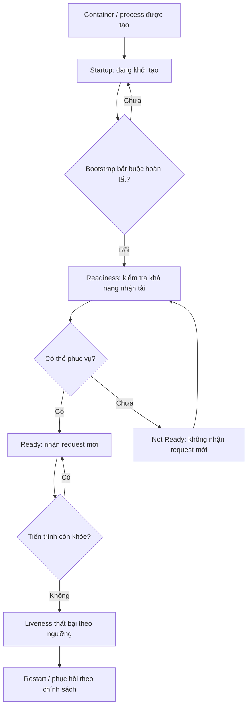
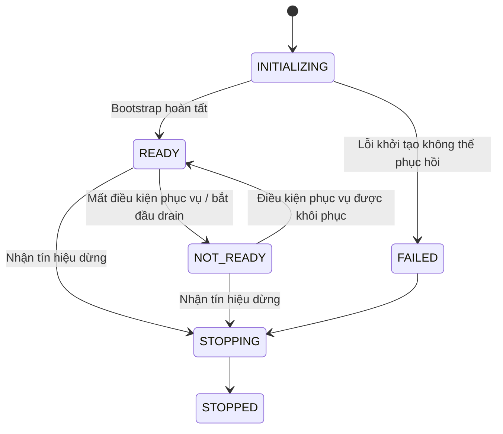
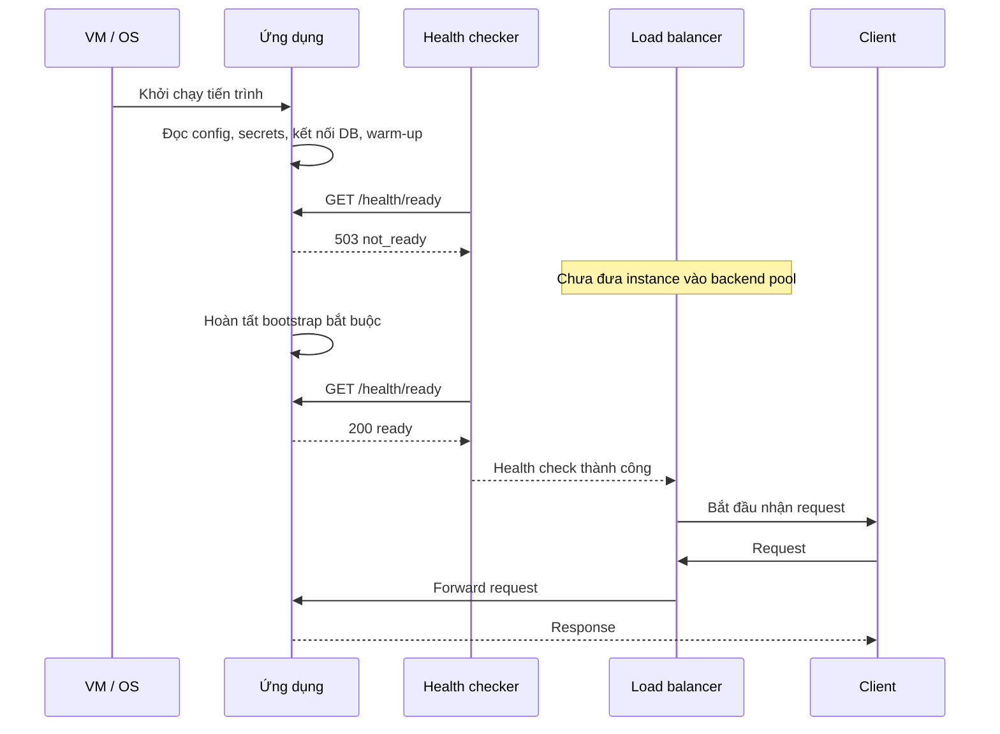
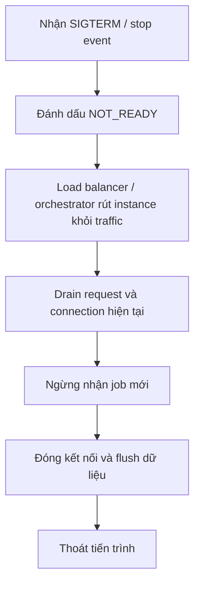

# Truyền tín hiệu readiness sau khi ứng dụng khởi tạo xong

Khi một máy ảo hoặc container vừa khởi động, tiến trình ứng dụng có thể đã tồn tại nhưng chưa chắc đã phục vụ request an toàn. Ứng dụng có thể vẫn đang đọc cấu hình, tải khóa và chứng thư, kết nối cơ sở dữ liệu, chạy migration, nạp model hoặc làm nóng cache. Nếu bộ cân bằng tải gửi lưu lượng quá sớm, người dùng có thể nhận lỗi dù máy chủ đã báo trạng thái running.

**Readiness signal (tín hiệu sẵn sàng)** cho biết ứng dụng đã hoàn tất những bước khởi tạo bắt buộc và hiện có thể nhận loại công việc được giao. Tín hiệu này giúp nền tảng triển khai, bộ cân bằng tải hoặc hệ thống điều phối quyết định khi nào đưa instance vào phục vụ và khi nào tạm rút instance khỏi lưu lượng.

Sau bài học, bạn có thể:

- Phân biệt trạng thái khởi động, readiness và liveness.
- Xác định điều kiện tối thiểu để ứng dụng được coi là sẵn sàng.
- Thiết kế endpoint hoặc cơ chế báo readiness phản ánh trạng thái thực tế.
- Cấu hình probe và tích hợp readiness với load balancer hoặc orchestrator.
- Tránh các lỗi phổ biến như báo ready quá sớm, kiểm tra phụ thuộc quá sâu hoặc restart ứng dụng chỉ vì một dịch vụ bên ngoài tạm thời lỗi.
- Phối hợp readiness với graceful shutdown, drain connection và triển khai rolling update.

## 1. Vì sao cần tín hiệu readiness?

Trạng thái `running` thường chỉ cho biết máy ảo, container hoặc tiến trình đã được khởi chạy. Nó không chứng minh rằng ứng dụng đã sẵn sàng xử lý công việc. Có thể mất thêm vài giây hoặc vài phút để hoàn tất bootstrap.

Ví dụ, một API quản lý đơn hàng khởi động theo trình tự:

1. Hệ điều hành khởi động và cấp mạng.
2. Runtime Java khởi chạy tiến trình ứng dụng.
3. Ứng dụng đọc cấu hình và lấy secret từ secret manager.
4. Connection pool kết nối đến cơ sở dữ liệu.
5. Ứng dụng nạp quy tắc nghiệp vụ và làm nóng cache.
6. Web server bắt đầu lắng nghe cổng HTTP.
7. Các route cần thiết có thể xử lý request hợp lệ.

Nếu load balancer chỉ kiểm tra cổng TCP đã mở, bước 6 có thể làm máy được đưa vào backend pool dù bước 4 hoặc bước 5 chưa hoàn tất. Request đến sớm có thể thất bại hoặc bị xử lý trong trạng thái thiếu dữ liệu.

Readiness tạo một hợp đồng rõ ràng giữa ứng dụng và nền tảng: **chỉ đưa instance vào phục vụ khi ứng dụng tự xác nhận đã đáp ứng các điều kiện phục vụ đã định nghĩa**. Khi điều kiện không còn đúng, ứng dụng có thể báo chưa sẵn sàng để nền tảng ngừng gửi request mới đến instance đó.

## 2. Phân biệt startup, readiness và liveness

Ba loại tín hiệu thường được dùng cùng nhau nhưng có mục đích khác nhau.

| Tín hiệu | Câu hỏi cần trả lời | Phản ứng thường gặp của nền tảng |
|---|---|---|
| Startup | Ứng dụng đã hoàn tất giai đoạn khởi động ban đầu chưa? | Cho phép chuyển sang các bước kiểm tra tiếp theo; trong Kubernetes, startup probe có thể trì hoãn readiness/liveness probe |
| Readiness | Instance có thể nhận request hoặc công việc mới ngay lúc này không? | Đưa vào hoặc rút khỏi endpoint/backend pool; không nhất thiết restart tiến trình |
| Liveness | Tiến trình còn hoạt động và có khả năng tự phục hồi không? | Có thể restart container hoặc tiến trình nếu probe thất bại liên tục theo chính sách |

Một ứng dụng có thể đang sống nhưng chưa sẵn sàng. Ví dụ, tiến trình không bị treo nhưng vẫn đang nạp dữ liệu bắt buộc. Ứng dụng cũng có thể đã sẵn sàng rồi tạm thời mất readiness vì connection pool cạn hoặc đang drain để bảo trì, trong khi liveness vẫn tốt.



Không nên dùng một endpoint duy nhất với cùng một ý nghĩa cho cả ba mục đích nếu hành động của nền tảng khác nhau. Một readiness failure thường nên làm ngừng gửi lưu lượng; liveness failure có thể làm restart. Nếu liveness phụ thuộc vào một cơ sở dữ liệu đang gián đoạn, nhiều instance có thể cùng bị restart liên tục và làm sự cố nặng hơn.

## 3. Xác định thế nào là “đã sẵn sàng”

Readiness cần được định nghĩa theo khả năng thực hiện công việc mà instance được giao. Không phải ứng dụng nào cũng cần cùng một bộ điều kiện.

### Những điều kiện thường phải hoàn tất

- Cấu hình bắt buộc đã được đọc và xác thực; giá trị thiếu hoặc sai đã được phát hiện.
- Secret, certificate hoặc danh tính workload cần thiết đã sẵn sàng và có thể sử dụng.
- Runtime và các thành phần nội bộ quan trọng đã khởi tạo.
- Server đã bind cổng và route cần thiết đã được đăng ký.
- Kết nối đến các phụ thuộc bắt buộc đã đạt trạng thái tối thiểu để xử lý request.
- Schema hoặc dữ liệu tham chiếu cần thiết đã ở phiên bản tương thích.
- Cache hoặc model bắt buộc đã được nạp nếu request không thể hoạt động khi thiếu chúng.
- Instance đã hoàn tất bước đăng ký với service discovery hoặc cơ chế nhận lưu lượng của nền tảng nếu quy trình yêu cầu.

### Phân loại phụ thuộc

Không nên biến mọi dịch vụ bên ngoài thành điều kiện readiness. Hãy phân loại theo mức độ bắt buộc:

| Loại phụ thuộc | Ví dụ | Cách cân nhắc readiness |
|---|---|---|
| Bắt buộc để phục vụ mọi request | Cấu hình xác thực, khóa mã hóa cần thiết, cơ sở dữ liệu giao dịch chính | Chưa ready nếu ứng dụng không thể xử lý an toàn khi thiếu |
| Bắt buộc cho một nhóm chức năng | Dịch vụ tạo báo cáo, hệ thống tìm kiếm, dịch vụ thanh toán riêng | Có thể dùng readiness theo capability hoặc chế độ degraded nếu phần chức năng khác vẫn hoạt động an toàn |
| Tùy chọn hoặc có thể fallback | Analytics, telemetry exporter, hệ thống gợi ý phụ trợ | Thường không nên chặn readiness toàn ứng dụng; ghi nhận trạng thái suy giảm và cảnh báo riêng |
| Chỉ cần lúc khởi động | Tải cấu hình, nạp model, đọc file chứng thư | Kiểm tra trong startup/bootstrap; không nhất thiết kiểm tra lại ở mỗi lần readiness |

Ví dụ, API xem sản phẩm có thể phục vụ nội dung từ cache khi dịch vụ analytics tạm ngừng. Nếu readiness phụ thuộc analytics, toàn bộ API sẽ bị rút khỏi load balancer dù chức năng chính vẫn hoạt động. Ngược lại, API tạo đơn có thể cần cơ sở dữ liệu giao dịch; nếu không ghi được đơn, việc báo ready sẽ gây lỗi cho người dùng.

### Readiness theo capability

Với hệ thống có nhiều chức năng độc lập, một trạng thái ready/not-ready duy nhất đôi khi quá thô. Có thể theo dõi riêng các capability như `orders`, `search` và `reports`, sau đó định tuyến hoặc giới hạn chức năng theo khả năng nền tảng hỗ trợ.

Nếu load balancer chỉ hiểu một health check cho toàn instance, hãy xác định rõ capability nào là tối thiểu để instance tham gia backend pool. Trạng thái của các chức năng không bắt buộc nên được thể hiện qua metric, dashboard hoặc endpoint chẩn đoán riêng.

## 4. Thiết kế readiness endpoint

Một cách phổ biến là cung cấp endpoint HTTP nội bộ, ví dụ:

- `GET /health/ready`
- `GET /readyz`
- `GET /actuator/health/readiness` nếu framework và cấu hình cung cấp endpoint này.

Endpoint nên trả kết quả nhanh, ổn định và không tạo tải đáng kể. Ví dụ quy ước:

| HTTP response | Ý nghĩa đề xuất |
|---|---|
| `200 OK` | Ứng dụng hiện đáp ứng điều kiện readiness |
| `503 Service Unavailable` | Ứng dụng chưa sẵn sàng hoặc đang drain |
| Timeout / không kết nối được | Probe không nhận được phản hồi trong thời gian cho phép; nền tảng xem là probe thất bại theo cấu hình |

Mã HTTP chỉ là quy ước phổ biến; cần xác nhận cách nền tảng diễn giải status code, timeout và redirect. Tránh trả `200` cho mọi trường hợp chỉ để probe luôn xanh.

### Đặc điểm của endpoint tốt

1. **Nhanh:** xử lý trong thời gian ngắn và có timeout rõ ràng.
2. **Không gây tác dụng phụ:** không tạo giao dịch, ghi dữ liệu hay chạy migration.
3. **Phản ánh trạng thái hiện tại:** không chỉ kiểm tra một cờ đã được bật từ lâu nếu ứng dụng có thể mất readiness sau đó.
4. **Không tiết lộ bí mật:** response không chứa password, token, connection string hoặc dữ liệu cá nhân.
5. **Có thể truy cập từ probe:** cổng, route và firewall cho phép đúng nguồn kiểm tra truy cập.
6. **Có ngữ nghĩa nhất quán:** cùng một kết quả phải dẫn đến cùng hành vi điều phối.

Endpoint readiness không nên chạy truy vấn sâu, quét toàn bộ dữ liệu hoặc gọi hàng loạt dịch vụ bên ngoài ở mỗi chu kỳ probe. Việc đó có thể tạo thêm tải và khiến probe tự gây ra sự cố.

### Ví dụ phản hồi

Một phản hồi thành công có thể tối giản:

```http
HTTP/1.1 200 OK
Content-Type: application/json

{"status":"ready"}
```

Khi chưa sẵn sàng:

```http
HTTP/1.1 503 Service Unavailable
Content-Type: application/json

{"status":"not_ready"}
```

Không trả chi tiết lỗi nội bộ ra endpoint công khai. Nếu cần chẩn đoán, dùng endpoint nội bộ có xác thực hoặc dashboard và log được bảo vệ.

## 5. Xây dựng readiness state trong ứng dụng

Ứng dụng nên quản lý trạng thái khởi tạo một cách tường minh. Không nên suy ra readiness chỉ từ việc cổng HTTP đã mở hoặc tiến trình chưa thoát.

Một state machine đơn giản có thể gồm:



Có thể dùng một cờ trạng thái thread-safe được cập nhật sau từng bước bootstrap. Khi tất cả điều kiện bắt buộc hoàn tất, ứng dụng chuyển sang `READY`. Khi bắt đầu graceful shutdown, ứng dụng chuyển sang `NOT_READY` trước khi ngừng nhận request mới.

### Ví dụ Java minh họa

Đoạn mã dưới đây mô tả ý tưởng quản lý readiness bằng một cờ trạng thái. Đây là ví dụ khái niệm; ứng dụng thực tế cần tích hợp với lifecycle của framework, xử lý lỗi và cơ chế đồng bộ phù hợp.

```java
import java.util.concurrent.atomic.AtomicBoolean;

public final class ReadinessState {
    private final AtomicBoolean ready = new AtomicBoolean(false);

    public boolean isReady() {
        return ready.get();
    }

    public void markReady() {
        ready.set(true);
    }

    public void markNotReady() {
        ready.set(false);
    }
}
```

Quy trình bootstrap có thể cập nhật trạng thái sau khi hoàn tất các thành phần bắt buộc:

```java
public void initializeApplication() {
    readiness.markNotReady();
    loadAndValidateConfiguration();
    initializeCredentials();
    connectRequiredDatabase();
    loadRequiredReferenceData();
    warmUpMandatoryCache();
    readiness.markReady();
}
```

Nếu một bước bắt buộc thất bại, ứng dụng cần quyết định có retry, dừng khởi động hay tiếp tục ở trạng thái not-ready. Không đặt `markReady()` trong khối `finally`, vì như vậy ứng dụng có thể báo sẵn sàng ngay cả khi bootstrap thất bại.

Endpoint HTTP chỉ đọc trạng thái:

```java
public HealthResponse readiness() {
    if (readiness.isReady()) {
        return new HealthResponse(200, "ready");
    }
    return new HealthResponse(503, "not_ready");
}
```

Trong ứng dụng đa luồng hoặc nhiều thành phần, trạng thái readiness nên được cập nhật theo một nguồn trạng thái rõ ràng. Tránh nhiều thread thay đổi cờ không có quy tắc, khiến endpoint báo ready trong khi một điều kiện bắt buộc chưa hoàn tất.

## 6. Cấu hình readiness probe trong môi trường container

Orchestrator có thể gọi endpoint hoặc chạy lệnh kiểm tra theo chu kỳ. Với Kubernetes, `readinessProbe` quyết định Pod có được đưa vào Service endpoint để nhận traffic hay không. Probe thất bại thường làm Pod bị đánh dấu not ready, nhưng không tự động restart container chỉ vì readiness failure.

Ví dụ cấu hình:

```yaml
apiVersion: v1
kind: Pod
metadata:
  name: order-api
spec:
  containers:
    - name: app
      image: example/order-api:1.4.0
      ports:
        - name: http
          containerPort: 8080
      startupProbe:
        httpGet:
          path: /health/startup
          port: http
        periodSeconds: 5
        failureThreshold: 30
      readinessProbe:
        httpGet:
          path: /health/ready
          port: http
        periodSeconds: 5
        timeoutSeconds: 2
        failureThreshold: 2
        successThreshold: 1
      livenessProbe:
        httpGet:
          path: /health/live
          port: http
        periodSeconds: 10
        timeoutSeconds: 2
        failureThreshold: 3
```

Các giá trị chỉ minh họa. Cần chọn `periodSeconds`, `timeoutSeconds`, `failureThreshold`, `successThreshold` và thời gian startup theo số đo thực tế. `startupProbe` giúp ứng dụng khởi động chậm có đủ thời gian; khi startup probe chưa thành công, liveness và readiness probe được trì hoãn theo cơ chế của Kubernetes.

Với workload có thời gian khởi tạo dài, đặt ngưỡng quá thấp có thể làm ứng dụng bị restart trước khi hoàn tất. Ngược lại, probe quá thưa hoặc timeout quá dài có thể khiến nền tảng phát hiện trạng thái sai chậm. Cần kiểm thử cả trường hợp khởi động bình thường và khởi động chậm.

### Những điểm cần chú ý khi cấu hình probe

- Probe phải gọi đúng cổng và path của container.
- Endpoint không được yêu cầu xác thực tương tác khiến probe không thể truy cập; nếu cần bảo vệ, giới hạn nguồn truy cập hoặc dùng cơ chế probe phù hợp.
- Tránh phụ thuộc DNS công cộng hoặc route Internet không cần thiết.
- `timeoutSeconds` phải lớn hơn thời gian phản hồi bình thường nhưng đủ ngắn để phát hiện treo.
- `failureThreshold` cần hấp thụ dao động ngắn mà vẫn phát hiện lỗi kéo dài.
- Readiness có thể dùng `successThreshold` lớn hơn 1 để tránh đưa Pod trở lại traffic chỉ sau một lần probe thành công, tùy nhu cầu.
- Không cấu hình readiness và liveness cùng gọi một kiểm tra sâu có thể bị ảnh hưởng bởi sự cố của dịch vụ bên ngoài.

## 7. Tích hợp readiness với máy ảo và load balancer

Với máy ảo, tín hiệu readiness có thể được cung cấp qua HTTP health endpoint, agent hoặc cơ chế đăng ký backend của nền tảng. Load balancer thường gửi health check đến một cổng và đường dẫn đã cấu hình. Instance chỉ nhận lưu lượng khi được đánh dấu healthy theo chính sách của dịch vụ.

Một luồng triển khai điển hình:



Tên trạng thái và số lần health check thành công cần thiết khác nhau giữa nhà cung cấp. Một số load balancer cần nhiều lần probe liên tiếp trước khi đánh dấu healthy; một số có thời gian đăng ký hoặc deregistration delay. Hãy xem tài liệu dịch vụ và thử nghiệm thời gian chuyển trạng thái thực tế.

### Readiness không thay thế kiểm tra end-to-end

Health check từ load balancer thường kiểm tra từng backend. Nó không chứng minh toàn bộ hành trình người dùng hoạt động tốt. Ví dụ, endpoint readiness trả 200 nhưng DNS công khai sai, chứng thư TLS hết hạn hoặc dịch vụ thanh toán bên ngoài lỗi. Cần có synthetic monitoring hoặc kiểm tra end-to-end riêng để đánh giá đường đi hoàn chỉnh.

## 8. Kết hợp readiness với graceful shutdown

Readiness rất quan trọng khi dừng máy hoặc triển khai phiên bản mới. Nếu tiến trình tắt ngay khi nhận tín hiệu dừng, load balancer có thể vẫn đang gửi request đến instance đó.

Một trình tự shutdown an toàn thường gồm:

1. Nhận tín hiệu dừng (ví dụ `SIGTERM` hoặc lifecycle event của nền tảng).
2. Chuyển trạng thái readiness sang `NOT_READY` để ngừng nhận công việc mới.
3. Báo cho service discovery hoặc load balancer biết instance cần được rút khỏi backend pool.
4. Chờ thời gian drain để request và kết nối đang hoạt động hoàn tất trong giới hạn cho phép.
5. Ngừng nhận message mới từ queue; hoàn tất hoặc trả lại công việc đang xử lý theo cơ chế an toàn.
6. Đóng connection pool, flush dữ liệu cần thiết và giải phóng tài nguyên.
7. Thoát tiến trình trước khi hết termination grace period.



Thời gian drain phải phối hợp với deregistration delay, timeout của request, thời gian xử lý job và grace period của container hoặc VM. Nếu thời gian drain dài hơn grace period, nền tảng có thể buộc dừng tiến trình trước khi hoàn tất. Nếu readiness chuyển not-ready quá muộn, request mới vẫn có thể đến trong lúc ứng dụng đang đóng.

Với worker xử lý hàng đợi, readiness có thể phản ánh khả năng nhận message mới. Khi shutdown, worker nên ngừng poll hoặc giảm concurrency, hoàn tất message đang xử lý và ack/nack theo semantics của queue. Không ack message trước khi công việc được lưu bền vững.

## 9. Tránh readiness flapping và kiểm tra quá sâu

**Readiness flapping** là trạng thái liên tục chuyển giữa ready và not-ready trong thời gian ngắn. Điều này có thể khiến backend pool thay đổi liên tục, giảm năng lực và tạo thêm tải lên các instance còn lại.

Nguyên nhân thường gặp:

- Endpoint readiness phụ thuộc vào một dịch vụ bên ngoài có độ trễ dao động.
- Timeout quá ngắn so với thời gian phản hồi bình thường.
- Kiểm tra thực hiện truy vấn nặng hoặc tạo kết nối mới ở mỗi lần probe.
- Cache được làm nóng lại liên tục hoặc bộ nhớ tạm thời tăng cao.
- Một lần lỗi đơn lẻ lập tức chuyển instance sang not-ready.
- Các probe của nhiều instance đồng thời tạo tải đột biến lên dependency.

Biện pháp giảm flapping:

- Dùng connection pool hoặc trạng thái kết nối đã được quản lý thay vì mở kết nối mới mỗi lần probe.
- Chọn timeout và failure threshold dựa trên phân phối độ trễ đo được.
- Chỉ kiểm tra các điều kiện thực sự cần để phục vụ request.
- Có hysteresis hoặc yêu cầu một số lần thất bại/thành công liên tiếp trước khi đổi trạng thái.
- Giãn thời gian probe hoặc thêm jitter nếu nền tảng/công cụ hỗ trợ.
- Theo dõi số lần chuyển trạng thái và nguyên nhân cùng thời điểm.

Không nên giữ readiness luôn xanh để tránh flapping. Nếu ứng dụng thực sự không thể xử lý request, tiếp tục nhận lưu lượng chỉ làm lỗi lan rộng. Cần điều chỉnh tiêu chí và ngưỡng để phản ánh đúng năng lực.

## 10. Readiness và phụ thuộc bên ngoài

Một câu hỏi khó là có nên kiểm tra database, cache, message broker hoặc API bên ngoài trong readiness hay không. Câu trả lời phụ thuộc vai trò của dependency trong request path.

### Khi nào nên kiểm tra dependency?

Nên đưa dependency vào readiness nếu thiếu nó khiến instance không thể xử lý an toàn chức năng cốt lõi. Ví dụ, dịch vụ ghi đơn hàng không thể báo ready nếu không có khả năng ghi vào kho dữ liệu giao dịch.

Tuy nhiên, kiểm tra nên nhẹ và có giới hạn. Có thể dùng trạng thái connection pool, kết nối đã được xác thực gần đây hoặc một truy vấn rất nhẹ được kiểm soát. Không chạy truy vấn quét bảng hoặc thao tác ghi/xóa trong mỗi lần probe.

### Khi nào không nên chặn readiness?

Nếu dependency chỉ phục vụ chức năng phụ hoặc ứng dụng có fallback an toàn, không nên làm toàn bộ instance not-ready khi dependency tạm thời lỗi. Ví dụ, lỗi telemetry exporter không nên khiến API ngừng nhận request. Hãy ghi metric degraded, cảnh báo và giới hạn chức năng liên quan.

### Tránh vòng lặp sự cố

Giả sử database chính gặp sự cố. Nếu tất cả API instance kiểm tra database sâu trong readiness và liveness, readiness có thể chuyển đỏ, liveness có thể restart tất cả container. Khi database phục hồi, các container cùng khởi động, tạo đợt kết nối dồn dập và tiếp tục gây áp lực lên database.

Một thiết kế tốt hơn:

- Readiness phản ánh liệu instance còn có thể phục vụ phần chức năng cốt lõi theo chính sách.
- Liveness chỉ kiểm tra tiến trình có bị treo hoặc rơi vào trạng thái không thể tự phục hồi hay không.
- Connection pool có giới hạn, timeout và circuit breaker.
- Retry có backoff và jitter; tránh retry đồng loạt.
- Dashboard hiển thị riêng trạng thái dependency để người vận hành biết nguyên nhân.

## 11. Đo lường và giám sát readiness

Readiness nên được quan sát như một tín hiệu vận hành, không chỉ là một endpoint dùng cho load balancer.

Các metric hữu ích:

- Thời gian từ process start đến lần đầu chuyển ready.
- Tỷ lệ instance ready theo service, zone và phiên bản.
- Số lần chuyển ready/not-ready trong một khoảng thời gian.
- Thời gian instance ở trạng thái not-ready và nguyên nhân.
- Số lần probe timeout, HTTP 5xx hoặc không kết nối được.
- Tỷ lệ request lỗi trong giai đoạn ngay sau khi instance chuyển ready.
- Thời gian drain và số request/job còn đang xử lý khi shutdown.
- Tỷ lệ rollout thành công, thời gian rollout và số lần rollback.

Đặt cảnh báo nếu một phiên bản mới có thời gian bootstrap tăng bất thường, số instance ready thấp hơn ngưỡng, hoặc readiness flapping vượt mức bình thường. Gắn metric với version/build ID để xác định thay đổi nào gây ra sự cố.

Không đưa ID người dùng, token hoặc dữ liệu nhạy cảm vào label metric. Label có cardinality quá cao như request ID cũng có thể làm hệ thống quan sát tốn kém và khó truy vấn.

## 12. Ví dụ triển khai: API Java khởi động theo nhiều bước

Giả sử một API Java chạy trong container. Ứng dụng cần lấy cấu hình, xác thực với secret manager, tạo connection pool đến database và nạp danh mục sản phẩm bắt buộc.

**Thiết kế trạng thái:** tiến trình bắt đầu ở `INITIALIZING`; endpoint `/health/startup` chỉ báo thành công khi các bước bootstrap hoàn tất hoặc đạt ngưỡng thời gian cho phép. Endpoint `/health/ready` trả 503 khi chưa hoàn tất, khi connection pool không còn đáp ứng điều kiện cốt lõi hoặc khi ứng dụng đang drain. Endpoint `/health/live` chỉ kiểm tra tiến trình và event loop còn phản hồi.

**Cấu hình điều phối:** startup probe cho phép tối đa thời gian khởi động dựa trên đo đạc. Readiness probe kiểm tra thường xuyên hơn nhưng timeout ngắn. Liveness probe ít nhạy hơn readiness và không gọi database.

**Khi nhận traffic:** Service chỉ chọn Pod ready. Load balancer bên ngoài chỉ đăng ký backend sau khi health check đạt ngưỡng thành công. Sau khi ready, API vẫn theo dõi lỗi database và trạng thái cache qua metric riêng.

**Khi deploy phiên bản mới:** Pod mới chỉ nhận traffic khi đã sẵn sàng. Pod cũ nhận SIGTERM, chuyển not-ready, chờ drain request, ngừng nhận job mới rồi đóng connection pool. Rolling update đặt giới hạn số Pod unavailable để giữ đủ năng lực phục vụ.

### Timeline minh họa

```text
Thời gian  Trạng thái ứng dụng             Điều phối lưu lượng
0s         Process bắt đầu                  Chưa nhận traffic
4s         Đọc config và lấy secret         Chưa nhận traffic
9s         Kết nối database                 Chưa nhận traffic
14s        Nạp dữ liệu và warm-up           Chưa nhận traffic
20s        Startup hoàn tất, readiness 200  Bắt đầu health check
25s        Đạt ngưỡng healthy               Được đưa vào backend pool
...        Phục vụ request                  Nhận traffic bình thường
Shutdown   Readiness 503, drain             Ngừng gửi request mới
```

Các mốc chỉ minh họa. Thời gian thực tế cần đo trong điều kiện cold start, tải cao và lúc dependency phản hồi chậm.

## 13. Kiểm thử readiness trước khi triển khai production

Một endpoint trả 200 trong môi trường phát triển chưa đủ để chứng minh readiness hoạt động đúng. Hãy kiểm thử các tình huống:

1. **Khởi động bình thường:** instance chỉ chuyển ready sau khi hoàn tất toàn bộ bước bắt buộc.
2. **Khởi động chậm:** dependency phản hồi chậm nhưng cuối cùng thành công; startup probe không restart quá sớm.
3. **Cấu hình sai hoặc secret không hợp lệ:** ứng dụng không báo ready; log có thông tin chẩn đoán nhưng không lộ secret.
4. **Database tạm thời không truy cập được:** readiness phản ánh đúng chính sách; liveness không tạo restart loop.
5. **Dependency tùy chọn lỗi:** chức năng cốt lõi vẫn nhận traffic nếu có fallback; trạng thái degraded được quan sát.
6. **Readiness flapping:** timeout và threshold hấp thụ dao động ngắn, nhưng vẫn phát hiện lỗi kéo dài.
7. **Graceful shutdown:** instance chuyển not-ready trước khi thoát; request đang xử lý được drain trong giới hạn.
8. **Rolling update:** đủ số instance sẵn sàng trong suốt quá trình; Pod mới không nhận traffic quá sớm.
9. **Mất một instance hoặc zone:** các instance còn lại đủ năng lực và không bị quá tải do chuyển lưu lượng.

Khi kiểm thử, ghi lại thời điểm process start, startup success, readiness success, thời điểm backend healthy và request đầu tiên thành công. Những mốc này giúp tìm ra khoảng trễ hoặc bước bootstrap gây lỗi.

## 14. Những sai lầm thường gặp

**Báo ready ngay khi cổng HTTP mở.** Web server có thể lắng nghe trước khi database, cache hoặc dữ liệu bắt buộc sẵn sàng. Hãy gắn readiness với điều kiện phục vụ thực tế.

**Dùng readiness thay cho liveness.** Readiness failure thường chỉ nên rút instance khỏi traffic. Restart cần dành cho tiến trình không còn khả năng tự phục hồi.

**Đưa mọi dependency vào readiness.** Một dịch vụ phụ trợ lỗi có thể khiến toàn bộ ứng dụng bị rút khỏi traffic. Phân loại dependency và thiết kế fallback.

**Probe thực hiện truy vấn nặng.** Probe có thể làm tăng tải, gây timeout và tạo vòng lặp not-ready. Giữ endpoint nhẹ, nhanh và có giới hạn.

**Không chuyển not-ready khi shutdown.** Load balancer có thể gửi request mới đến tiến trình đang đóng. Chuyển trạng thái trước và phối hợp drain delay.

**Đặt threshold mà không đo thời gian khởi động.** Giá trị quá thấp gây restart sớm; quá cao làm phát hiện lỗi chậm. Dùng số liệu startup và kiểm thử lỗi.

**Không giám sát thời gian từ start đến ready.** Một thay đổi có thể làm bootstrap tăng từ vài giây lên vài phút mà không làm probe thất bại. Theo dõi metric và cảnh báo xu hướng.

## 15. Checklist readiness trước khi phát hành

- [ ] Đã định nghĩa rõ điều kiện tối thiểu để instance nhận request hoặc job.
- [ ] Đã phân biệt startup, readiness và liveness; mỗi tín hiệu có hành động phù hợp.
- [ ] Endpoint readiness phản ánh trạng thái hiện tại và không chỉ dựa vào process đang chạy.
- [ ] Các dependency được phân loại thành bắt buộc, theo capability và tùy chọn.
- [ ] Probe nhẹ, nhanh, có timeout và không tiết lộ dữ liệu nhạy cảm.
- [ ] Startup probe hoặc cơ chế tương đương có đủ thời gian cho cold start.
- [ ] Readiness được tích hợp với Service, load balancer hoặc service discovery.
- [ ] Graceful shutdown chuyển not-ready trước khi drain và dừng tiến trình.
- [ ] Timeout, failure threshold, success threshold và grace period đã được kiểm thử.
- [ ] Có metric về thời gian bootstrap, tỷ lệ ready, flapping và lỗi probe.
- [ ] Đã kiểm thử dependency outage, startup chậm, rolling update và mất instance.
- [ ] Có ngưỡng rollout, phương án rollback và đủ năng lực phục vụ trong khi triển khai.

## 16. Tự kiểm tra

1. Một container ở trạng thái Running nhưng API trả lỗi vì chưa kết nối database. Vì sao Running chưa đồng nghĩa với Ready?
2. Readiness và liveness khác nhau ở hành động mà orchestrator thực hiện như thế nào?
3. Khi nào database nên là điều kiện readiness? Vì sao telemetry exporter thường không nên chặn readiness của API?
4. Những bước bootstrap nào nên hoàn tất trước khi ứng dụng báo ready?
5. Vì sao endpoint readiness cần nhanh và tránh truy vấn sâu mỗi lần probe?
6. Khi shutdown, vì sao phải chuyển not-ready trước khi đóng server và connection pool?
7. Một ứng dụng bị restart liên tục khi database tạm thời lỗi. Cần xem lại thiết kế startup, readiness và liveness ra sao?
8. Cần đo những mốc thời gian nào để đánh giá readiness trong một đợt rolling update?

Readiness là cam kết vận hành giữa ứng dụng và nền tảng: instance chỉ nhận công việc mới khi đã sẵn sàng thực hiện nó. Khi tín hiệu được thiết kế đúng, tích hợp với điều phối lưu lượng và phối hợp cùng graceful shutdown, quá trình bootstrap và triển khai có thể diễn ra ổn định hơn, giảm lỗi trong thời gian khởi động và bảo vệ trải nghiệm người dùng.
