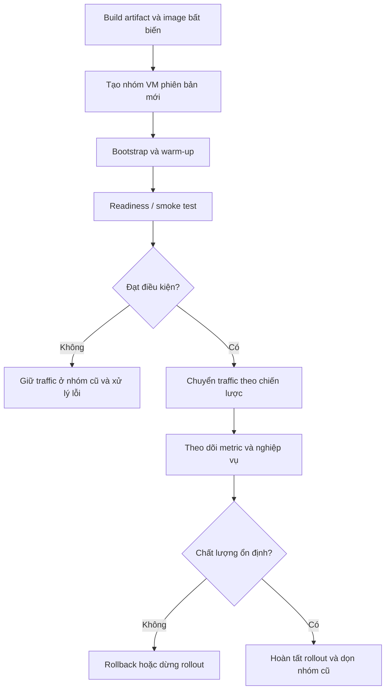
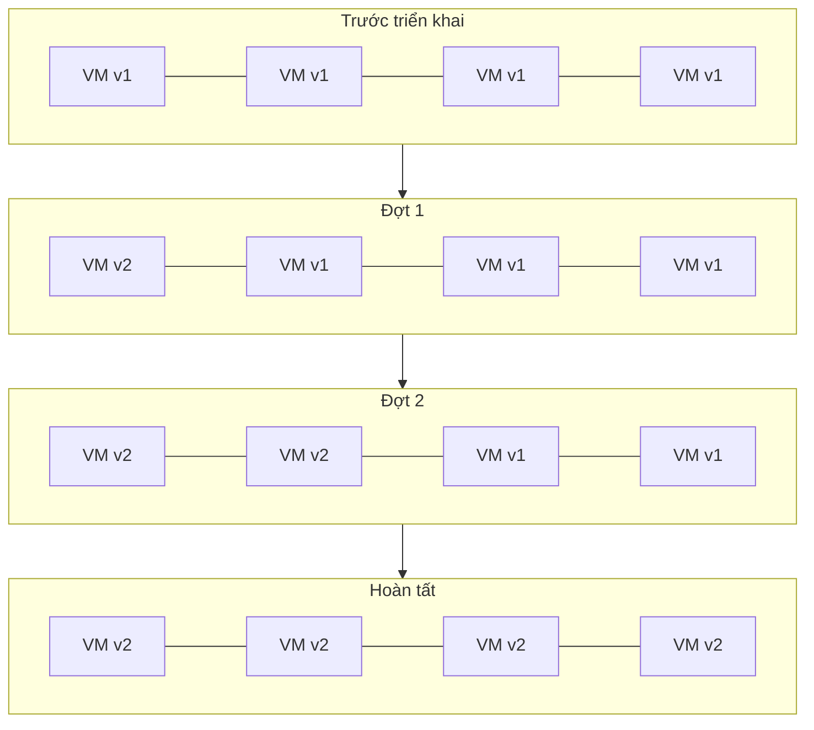
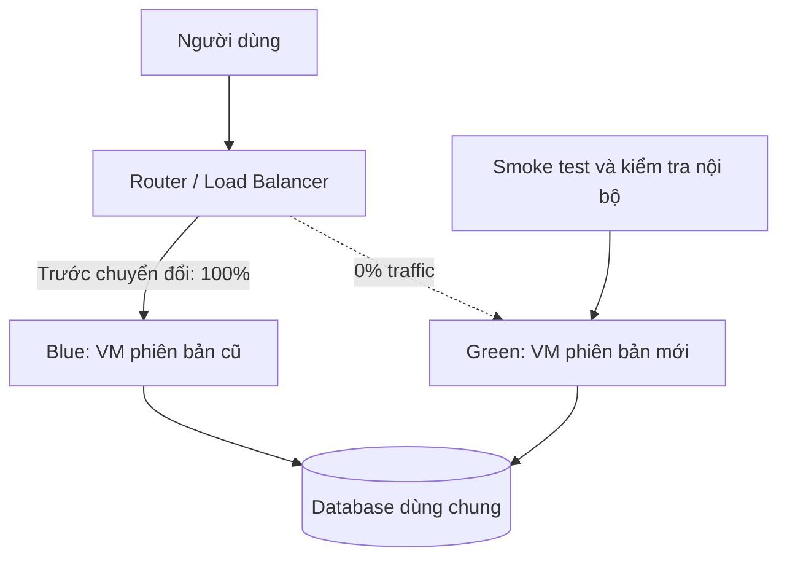
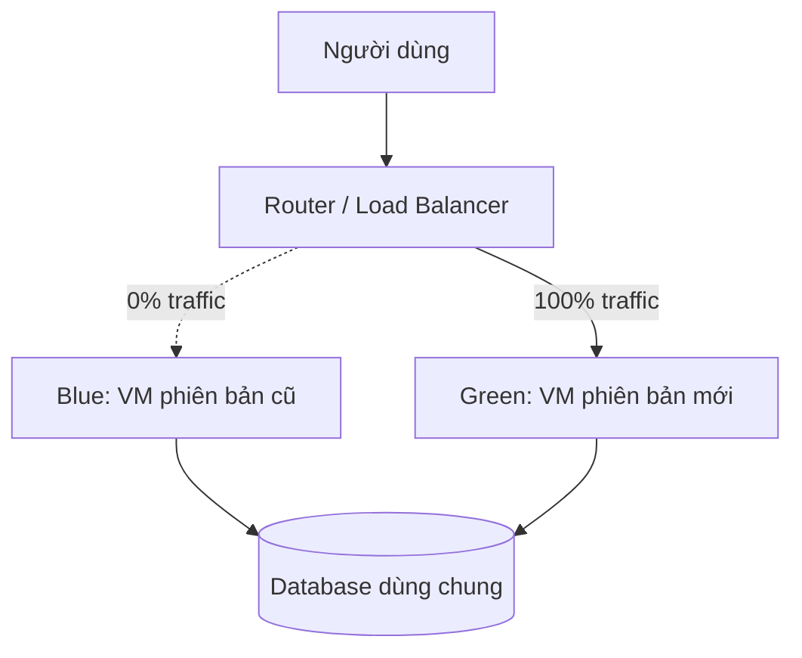
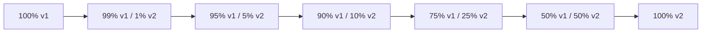
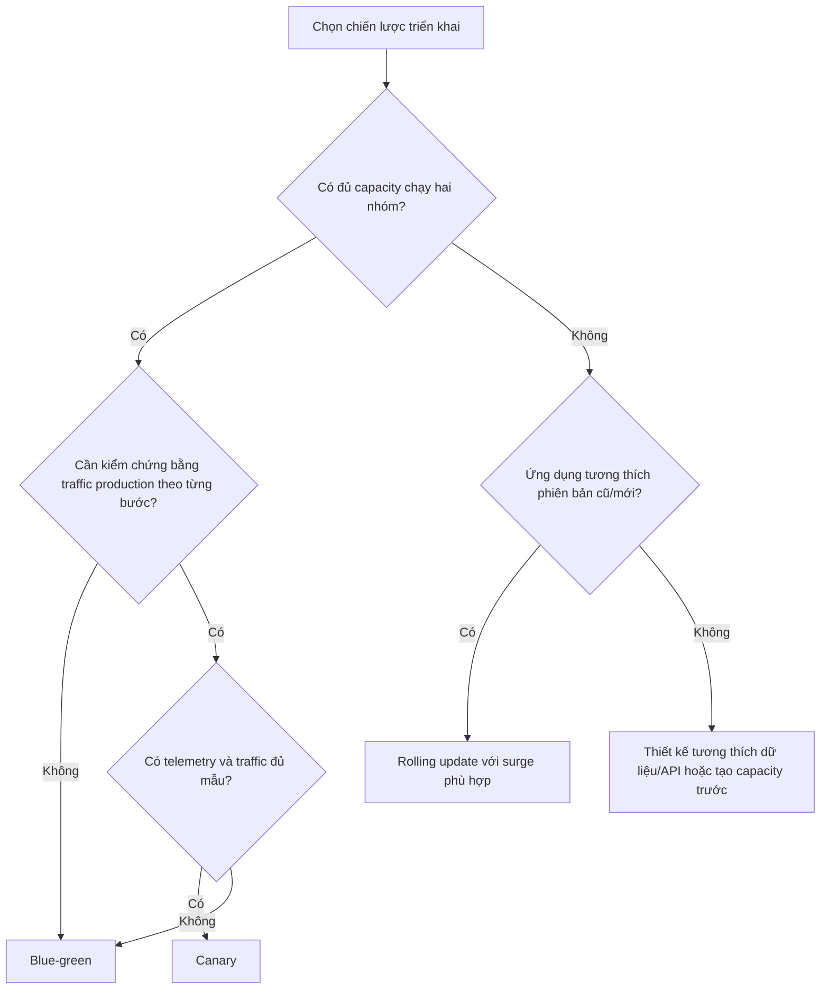
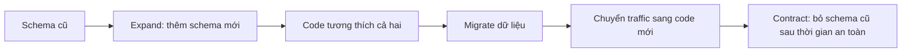
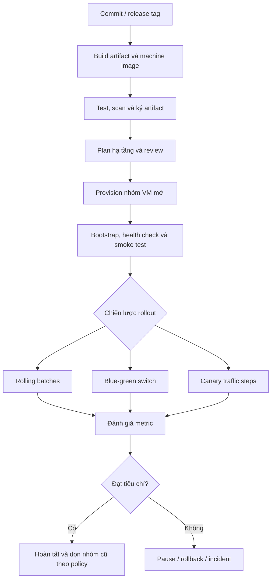

# Rolling update, blue-green và canary trên nhóm máy ảo

Khi triển khai phiên bản mới của ứng dụng trên một nhóm máy ảo (VM), mục tiêu không chỉ là khởi động được máy mới. Hệ thống phải tiếp tục phục vụ người dùng trong lúc thay instance, đưa traffic đến đúng phiên bản, phát hiện lỗi sớm và có cách quay lại khi chất lượng suy giảm. Ba chiến lược thường dùng là **rolling update**, **blue-green deployment** và **canary release**. Chúng khác nhau ở cách cấp phát nhóm VM, chuyển lưu lượng, kiểm soát rủi ro và lượng tài nguyên cần dự phòng.

Trong module **CLOUD_CORE_SERVICES_COMPUTE**, các chiến lược này gắn trực tiếp với việc chọn loại VM, CPU, bộ nhớ, mạng, load balancer, autoscaling, health check, bảo mật và chi phí. Một kế hoạch triển khai tốt cần tính cả thời gian khởi động ứng dụng, dung lượng dự phòng, kết nối database, session, tác vụ nền, khả năng tương thích dữ liệu và tín hiệu quan sát. Việc thay image hoặc launch template chỉ là một phần của quá trình; phiên bản mới chỉ nên nhận traffic khi đã sẵn sàng và đạt các tiêu chí sức khỏe đã định.

## Mục tiêu học tập

Sau bài này, bạn có thể:

- Giải thích rolling update, blue-green và canary trên nhóm VM.
- Chọn chiến lược triển khai theo yêu cầu downtime, dung lượng, rủi ro và khả năng rollback.
- Thiết kế load balancer, health check, connection draining và warm-up để chuyển traffic an toàn.
- Tính toán surge capacity, max unavailable và mức dự phòng compute trong thời gian triển khai.
- Quản lý cấu hình, image, launch template, phiên bản ứng dụng và hạ tầng bằng IaC/automation.
- Xử lý session, worker, database migration và tác động của thay đổi stateful.
- Xây dựng quy trình canary có metric, ngưỡng dừng và rollback rõ ràng.
- Đánh giá kết quả bằng availability, latency, error rate, throughput và chi phí triển khai.

## 1. Vì sao cần chiến lược triển khai theo nhóm?

Một ứng dụng chạy trên nhiều VM thường được đặt sau load balancer. Load balancer phân phối request đến các instance đủ điều kiện phục vụ. Khi phát hành phiên bản mới, đội vận hành phải thay đổi một phần hoặc toàn bộ nhóm instance mà không làm hệ thống mất khả năng đáp ứng tải.

Nếu dừng tất cả VM cũ rồi mới tạo VM mới, ứng dụng có thể ngừng hoạt động trong thời gian bootstrap, nạp cấu hình, kết nối database và kiểm tra sức khỏe. Nếu khởi động tất cả VM mới cùng lúc, hệ thống có thể vượt quota, thiếu IP, thiếu capacity hoặc tạo tải khởi động lớn lên database. Nếu chuyển traffic quá sớm, request sẽ đến instance chưa sẵn sàng. Nếu không giữ được phiên bản cũ hoặc không tương thích schema dữ liệu, rollback có thể không khôi phục được dịch vụ.

Vì vậy triển khai theo nhóm cần kiểm soát đồng thời ba luồng:

1. **Compute lifecycle:** tạo, khởi động, kiểm tra, đưa vào phục vụ, drain và kết thúc VM.
2. **Traffic lifecycle:** đăng ký target, health check, chuyển tỷ lệ traffic, ngừng nhận request mới và hoàn tất kết nối đang chạy.
3. **Application/data lifecycle:** nạp phiên bản, tương thích cấu hình, migration dữ liệu, session, job nền và side effect.



Một chiến lược triển khai cần định nghĩa trước thế nào là “sẵn sàng”, thế nào là “thành công” và điều kiện nào buộc phải dừng. Không nên chờ người dùng báo lỗi mới quyết định rollback.

## 2. Ba chiến lược triển khai

### 2.1. Rolling update

Rolling update thay thế các VM cũ theo từng đợt. Tại mỗi thời điểm, chỉ một phần nhóm được thay thế; các instance còn lại tiếp tục phục vụ. Khi batch mới khởi động và đạt health check, bộ điều phối chuyển sang batch kế tiếp.



Trong ví dụ bốn VM, nhóm mới được đưa vào từng chiếc. Với hệ thống lớn, có thể thay theo batch nhiều instance, nhưng phải bảo đảm số instance khỏe mạnh còn lại đủ tải.

**Ưu điểm:**

- Không cần duy trì toàn bộ nhóm mới song song với toàn bộ nhóm cũ trong suốt quá trình.
- Phù hợp với nhóm VM có autoscaling hoặc instance group hỗ trợ refresh/rolling replacement.
- Có thể điều chỉnh tốc độ triển khai và số instance thay thế mỗi đợt.
- Tài nguyên tăng thêm thường thấp hơn blue-green nếu cho phép thay dần và có capacity phù hợp.

**Hạn chế:**

- Trong một khoảng thời gian, phiên bản cũ và mới cùng hoạt động; API và schema cần tương thích.
- Rollback có thể chậm vì phải thay lại từng batch.
- Nếu cấu hình batch hoặc health check sai, rollout có thể làm giảm capacity của cả nhóm.
- Một lỗi chỉ xuất hiện dưới tải lớn có thể không được phát hiện ở batch đầu nhỏ.

Rolling update phù hợp với ứng dụng stateless hoặc có cơ chế lưu trạng thái dùng chung, hỗ trợ tương thích phiên bản và cần triển khai thường xuyên với mức tăng tài nguyên vừa phải.

### 2.2. Blue-green deployment

Blue-green duy trì hai môi trường độc lập có khả năng phục vụ cùng một ứng dụng:

- **Blue** là nhóm đang nhận traffic production.
- **Green** là nhóm mới được dựng song song, kiểm tra trước khi nhận traffic.

Khi Green đạt điều kiện, hệ thống chuyển traffic từ Blue sang Green qua load balancer, listener, DNS hoặc cơ chế định tuyến khác. Nếu phiên bản mới gặp lỗi và dữ liệu vẫn tương thích, traffic có thể được chuyển lại Blue.



Sau khi Green được xác nhận:



**Ưu điểm:**

- Có thể kiểm thử toàn bộ nhóm mới trước khi chuyển traffic production.
- Chuyển đổi traffic nhanh nếu router và health check được chuẩn bị tốt.
- Có đường rollback rõ bằng cách chuyển traffic về nhóm cũ.
- Cho phép so sánh hai môi trường hoặc chạy smoke test trên Green.

**Hạn chế:**

- Cần đủ capacity để duy trì cả hai nhóm cùng lúc; chi phí compute, IP, disk và network có thể tăng đáng kể.
- Database hoặc dịch vụ dùng chung vẫn là điểm rủi ro nếu phiên bản mới thay đổi schema hoặc ghi dữ liệu không tương thích.
- Nếu giữ Blue quá lâu, hai nhóm có thể lệch cấu hình hoặc tiêu tốn chi phí không cần thiết.
- Chuyển traffic không tự di chuyển session, cache hoặc job đang chạy.

Blue-green phù hợp với hệ thống cần chuyển phiên bản nhanh, có capacity dự phòng và có thể duy trì hai nhóm độc lập trong thời gian kiểm thử/chuyển đổi.

### 2.3. Canary release

Canary triển khai phiên bản mới cho một phần nhỏ traffic hoặc một nhóm người dùng trước. Đội vận hành quan sát metric và hành vi nghiệp vụ, sau đó tăng dần tỷ lệ nếu kết quả đạt tiêu chí. Nếu chất lượng giảm, dừng rollout hoặc chuyển traffic về phiên bản ổn định.

Ví dụ lộ trình traffic:



Các tỷ lệ chỉ là ví dụ. Tỷ lệ thực tế cần dựa trên lưu lượng, mức độ rủi ro, số mẫu tối thiểu và khả năng quan sát. Với traffic thấp, 1% có thể chỉ tương ứng vài request và không đủ dữ liệu để kết luận. Với một hệ thống có request rất lớn, 1% có thể đã là tải đáng kể.

**Ưu điểm:**

- Giới hạn phạm vi ảnh hưởng ban đầu của lỗi.
- Có thể phát hiện vấn đề chỉ xuất hiện với traffic hoặc dữ liệu thực tế.
- Cho phép tăng dần mức độ tin cậy trước khi chuyển toàn bộ người dùng.
- Có thể kết hợp feature flag, phân nhóm tenant hoặc định tuyến theo header.

**Hạn chế:**

- Cần định tuyến chính xác và metric có thể phân biệt phiên bản.
- Cần đủ mẫu và thời gian quan sát; canary quá ngắn dễ bỏ sót lỗi hiếm.
- Hai phiên bản cùng ghi dữ liệu có thể gây xung đột hoặc tạo kết quả khác nhau.
- Sticky session, cache và sự khác biệt nhóm người dùng có thể làm sai lệch phép so sánh.
- Quy trình tự động dừng/rollback cần được kiểm tra để tránh phản ứng sai trước nhiễu metric.

Canary phù hợp với thay đổi có rủi ro đáng kể, hệ thống có telemetry tốt và traffic đủ lớn để đánh giá phiên bản mới theo từng bước.

## 3. So sánh và chọn chiến lược

| Tiêu chí | Rolling update | Blue-green | Canary |
|---|---|---|---|
| Cách thay VM | Thay từng batch trong cùng nhóm hoặc instance group | Dựng nhóm mới song song, sau đó chuyển traffic | Dựng nhóm mới nhỏ, nhận một phần traffic rồi mở rộng |
| Cách chuyển traffic | Load balancer cập nhật target khi từng VM healthy | Chuyển phần lớn hoặc toàn bộ traffic sang nhóm mới | Chuyển traffic theo tỷ lệ/nhóm người dùng |
| Tài nguyên tăng thêm | Thấp đến trung bình, tùy surge | Thường cao nhất vì hai nhóm cùng tồn tại | Tăng theo quy mô canary và giai đoạn rollout |
| Tốc độ chuyển toàn bộ | Theo từng batch | Có thể nhanh tại thời điểm switch | Tăng dần theo từng bước quan sát |
| Rollback | Thay lại batch hoặc phục hồi launch template cũ | Chuyển router về nhóm cũ | Đưa tỷ lệ traffic phiên bản mới về 0% hoặc mức an toàn |
| Rủi ro phiên bản cùng tồn tại | Có | Có thể có trong lúc Blue/Green cùng chạy | Có trong thời gian thử nghiệm và mở rộng |
| Yêu cầu quan sát | Health và metric theo batch | Health của Green và toàn hệ thống sau switch | Metric tách theo version, đủ mẫu và tiêu chí tự động |
| Phù hợp | Phát hành đều, ứng dụng tương thích phiên bản | Cần chuyển đổi nhanh, có capacity dự phòng | Thay đổi rủi ro, muốn kiểm chứng với traffic thực |

Không có chiến lược nào tự bảo đảm zero downtime. Kết quả phụ thuộc vào cách ứng dụng khởi động, health check, capacity, load balancer, database, session và quy trình xử lý sự cố.

### 3.1. Cây quyết định



Nếu không có capacity dự phòng và ứng dụng không tương thích giữa các phiên bản, cần xử lý ràng buộc đó trước khi triển khai. Không nên ép chọn một chiến lược rồi hy vọng hệ thống tự chịu được.

## 4. Chuẩn bị nhóm VM và artifact

Chiến lược triển khai chỉ đáng tin khi mọi VM trong cùng một phiên bản được tạo từ cùng một artifact và cấu hình đã kiểm tra.

### 4.1. Build một lần, triển khai nhiều môi trường

Quy trình nên tạo artifact hoặc machine image có phiên bản bất biến:

1. Build ứng dụng từ commit đã xác định.
2. Chạy unit test, integration test, scan dependency và kiểm tra bảo mật.
3. Đóng gói ứng dụng vào image hoặc artifact.
4. Gắn version/commit ID và checksum; lưu trong registry hoặc artifact repository.
5. Tạo machine image hoặc launch template tham chiếu artifact đó.
6. Promote cùng artifact qua staging và production, không build lại nội dung khác giữa các môi trường.

Ví dụ version có thể gồm `orders-api-2026.11.22.3` hoặc commit SHA. Nếu dùng machine image, cần ghi image ID, build ID, phiên bản OS, runtime và cấu hình bootstrap. Tránh dùng tag có thể thay đổi như `latest` trong rollout production vì rollback sẽ khó xác định chính xác nội dung.

### 4.2. Launch template và nhóm VM

Launch template hoặc machine template nên cố định:

- Machine image hoặc image ID.
- Loại VM và kiến trúc CPU phù hợp.
- vCPU, RAM, accelerator nếu workload cần.
- Subnet, security group và network interface.
- IAM instance profile hoặc workload identity.
- Disk, encryption, mount và bootstrap.
- User data/cloud-init hoặc script khởi động có version.
- Tag, log agent, monitoring agent và cấu hình shutdown.

Với autoscaling group hoặc managed instance group, cần quản lý desired/min/max capacity, health check, cooldown/warm-up, placement và chính sách refresh. Mỗi lần rollout nên tạo revision mới có thể truy vết thay vì sửa thủ công từng VM.

### 4.3. Bootstrap phải có thể lặp lại

Bootstrap cần hoàn tất trước khi VM được đưa vào target phục vụ. Script khởi động nên:

- Cài hoặc lấy artifact theo version cố định.
- Kiểm tra checksum hoặc chữ ký nếu quy trình yêu cầu.
- Tải cấu hình và secret từ nguồn được kiểm soát bằng workload identity.
- Khởi chạy dịch vụ, thiết lập log và monitoring.
- Báo trạng thái bootstrap thành công/thất bại.
- Thoát với mã lỗi rõ ràng nếu không thể đưa máy vào trạng thái phục vụ.

Bootstrap nên idempotent để có thể chạy lại an toàn khi VM khởi động lại hoặc quá trình khởi tạo được thử lại. Không ghi secret vào user data, image công khai hoặc log bootstrap.

## 5. Health check, readiness và traffic draining

Một VM có trạng thái `running` chưa chắc ứng dụng đã sẵn sàng. Có thể OS đã khởi động nhưng package chưa cài xong, ứng dụng chưa nạp model, cache chưa warm, kết nối database chưa thiết lập hoặc dependency đang lỗi.

### 5.1. Phân biệt các lớp kiểm tra

| Kiểm tra | Câu hỏi | Ví dụ |
|---|---|---|
| Instance/VM health | Máy có hoạt động ở mức hạ tầng không? | System check, instance check, trạng thái agent |
| Process/liveness | Tiến trình ứng dụng có còn chạy không? | Process check hoặc endpoint liveness |
| Readiness | Ứng dụng có thể nhận request mới không? | Endpoint kiểm tra dependency bắt buộc và trạng thái khởi tạo |
| Synthetic/smoke test | Luồng nghiệp vụ cơ bản có hoạt động không? | Gọi endpoint đăng nhập hoặc đọc dữ liệu kiểm thử |
| SLO/metric | Phiên bản có phục vụ đúng chất lượng không? | Error rate, latency, throughput, saturation |

Liveness và readiness có mục đích khác nhau. Một instance chưa sẵn sàng không nên nhận traffic; nhưng không phải mọi lỗi dependency tạm thời đều nên khiến process bị restart liên tục. Thiết kế health check cần tránh vòng lặp restart làm tăng tải khi hệ thống đang gặp sự cố phụ thuộc.

### 5.2. Health check cho load balancer

Health check cần cấu hình:

- Endpoint và port phù hợp với ứng dụng.
- Interval, timeout và số lần thất bại/thành công liên tiếp.
- Response code hoặc nội dung xác nhận.
- Thời gian grace period cho VM đang bootstrap.
- Cách xử lý target unhealthy và thời điểm đăng ký target mới.

Health endpoint không nên trả thành công chỉ vì process tồn tại nếu ứng dụng chưa thể phục vụ request. Ngược lại, nếu endpoint kiểm tra mọi dependency không quan trọng, một sự cố phụ trợ nhỏ có thể loại toàn bộ VM khỏi load balancer. Chọn dependency nào là bắt buộc theo luồng phục vụ chính.

### 5.3. Connection draining và deregistration delay

Khi loại VM cũ khỏi load balancer, có thể vẫn còn request hoặc kết nối đang chạy. Connection draining (hay deregistration delay/connection termination theo nền tảng) cho phép hoàn tất request đang xử lý trong khoảng thời gian cấu hình.

Trình tự graceful shutdown thường là:

1. Đánh dấu instance không nhận request mới hoặc bắt đầu deregister target.
2. Chờ load balancer ngừng gửi traffic mới.
3. Cho request đang chạy hoàn tất trong giới hạn timeout.
4. Dừng nhận job mới từ queue hoặc scheduler.
5. Hoàn tất, checkpoint hoặc chuyển giao job đang xử lý.
6. Đóng kết nối, flush log/metric và dừng process.
7. Terminate VM sau khi hết thời gian drain.

Thời gian drain phải tương thích với request timeout, thời gian xử lý dài nhất và giới hạn shutdown của nền tảng. Nếu drain quá ngắn, request đang chạy có thể bị ngắt; nếu quá dài, rollout kéo dài và giữ tài nguyên cũ lâu hơn.

### 5.4. Warm-up và slow start

Ứng dụng mới có thể cần thời gian nạp cache, JIT compile, khởi tạo connection pool hoặc nạp model. Nếu đưa toàn bộ traffic vào ngay khi health check vừa thành công, instance có thể bị quá tải trong giai đoạn đầu.

Có thể dùng warm-up period, slow-start của load balancer hoặc tăng traffic theo bước. Health check xác nhận khả năng nhận request; warm-up xác nhận khả năng chịu tải ổn định. Hai khái niệm cần được cấu hình riêng khi ứng dụng có thời gian khởi tạo đáng kể.

## 6. Tính toán capacity trong rollout

Trong lúc triển khai, một phần VM có thể đang khởi động hoặc đã bị drain. Số VM healthy còn lại phải đủ phục vụ tải đỉnh trong khi không vượt giới hạn tài khoản và ngân sách.

### 6.1. Rolling update: max surge và max unavailable

- **Max surge:** số VM mới được phép tạo vượt quá desired capacity trong quá trình rollout.
- **Max unavailable:** số VM tối đa có thể tạm thời không phục vụ trong rollout.

Ví dụ nhóm có 10 VM:

| Cấu hình | Số VM tối đa trong rollout | Số VM có thể unavailable | Nhận xét |
|---|---:|---:|---|
| Surge 0, unavailable 1 | 10 | 1 | Thay từng máy sau khi dừng một máy; capacity giảm tạm thời |
| Surge 2, unavailable 0 | 12 | 0 | Tạo tối đa 2 máy mới trước khi thay máy cũ; cần thêm quota/capacity |
| Surge 2, unavailable 1 | 12 | 1 | Cho phép thay đổi linh hoạt hơn nhưng vẫn cần tính tải dự phòng |

Đây là cách diễn giải khái niệm; tên tham số và cách triển khai khác nhau giữa Auto Scaling Group, Managed Instance Group và công cụ orchestration. Cần đọc chính sách cụ thể của dịch vụ.

Một phép tính sơ bộ:

```text
Healthy capacity trong rollout
  = số VM healthy còn lại × năng lực an toàn của mỗi VM

Điều kiện tối thiểu:
  Healthy capacity >= tải dự kiến trong giai đoạn rollout

Số VM cần thêm do surge
  = max(0, số VM mới được tạo đồng thời)
```

Không nên dùng công suất lý thuyết 100% của mỗi VM để tính capacity. Hãy dựa trên benchmark và ngưỡng sử dụng an toàn để giữ headroom cho burst, lỗi một zone hoặc một instance.

### 6.2. Blue-green: capacity gần gấp đôi

Nếu Blue có 10 VM và Green cũng cần 10 VM, trong thời gian chạy song song có thể cần 20 VM, chưa kể load balancer, disk, IP và tài nguyên hỗ trợ. Nếu quota chỉ đủ 12 VM, blue-green toàn phần không khả thi nếu không tăng quota, giảm kích thước nhóm hoặc dùng một chiến lược khác.

Capacity của Green cần được benchmark và warm-up trước khi switch. Không nên giảm Blue ngay khi traffic đã chuyển nếu cần thời gian quan sát và rollback.

### 6.3. Canary: nhóm nhỏ nhưng phải đủ năng lực

Canary 1 VM trong nhóm 20 VM không đồng nghĩa nó chỉ nhận 5% traffic. Load balancer có thể phân phối không đều, một VM có thể nhận nhiều request hơn dự kiến hoặc session affinity có thể làm lệch phân bổ. Cần dùng weighted routing hoặc cơ chế định tuyến có kiểm soát và xác minh tỷ lệ thực tế theo metric.

Canary cần đủ CPU/RAM và số worker để chịu được traffic được gán. Nếu nhóm canary quá nhỏ, bản thân cấu hình nhỏ có thể tạo lỗi mà nhóm production lớn không gặp. Khi so sánh, giữ cấu hình compute tương đương hoặc hiểu rõ sự khác biệt.

### 6.4. Quota, zone và capacity reservation

Trước rollout, kiểm tra quota vCPU, số instance theo family, địa chỉ IP, disk, load balancer target và khả năng cấp phát loại VM trong từng zone. GPU hoặc loại máy chuyên dụng có thể có quota và nguồn cung hạn chế.

Nếu kế hoạch cần surge hoặc hai nhóm song song, cần xác minh capacity trước thời điểm triển khai. Với workload quan trọng, có thể cân nhắc capacity reservation hoặc chiến lược dự phòng zone/instance type theo chính sách của nhà cung cấp. Không thay đổi instance type tùy tiện nếu khác biệt CPU architecture, network throughput hoặc local storage làm thay đổi hành vi ứng dụng.

## 7. Quản lý session, cache và tác vụ nền

Triển khai theo nhóm thường khiến phiên bản cũ và mới cùng hoạt động. Điều này ảnh hưởng đến dữ liệu tạm, session và job đang chạy.

### 7.1. Session và trạng thái người dùng

Nếu session chỉ lưu trong RAM của VM, người dùng có thể mất session khi load balancer chuyển request sang VM khác hoặc VM cũ bị thay thế. Có thể:

- Lưu session ở kho dùng chung như Redis hoặc database.
- Dùng token/stateless session nếu phù hợp với mô hình bảo mật.
- Dùng sticky session trong thời gian chuyển đổi khi thật sự cần, nhưng không coi đó là giải pháp thay thế cho lưu trạng thái bền vững.
- Đảm bảo phiên bản mới đọc được session được tạo bởi phiên bản cũ trong thời gian rollout.

Sticky session có thể làm traffic phân phối không đều và làm canary kém đại diện. Nếu dùng, phải đo phân bổ request và có kế hoạch xử lý khi VM bị loại khỏi nhóm.

### 7.2. Cache

Cache cục bộ trên VM mới thường lạnh. Khi chuyển traffic, cache miss tăng có thể làm database hoặc dịch vụ phụ trợ chịu tải đột biến. Hãy cân nhắc warm cache, giới hạn tốc độ, prefetch hoặc chuyển đổi traffic theo bước. Với cache dùng chung, thay đổi key format hoặc serialization cần tương thích giữa phiên bản cũ và mới.

### 7.3. Worker và job dài hạn

Worker xử lý queue hoặc job định kỳ cần quy trình drain riêng:

- Ngừng nhận job mới trước khi terminate VM.
- Cho job đang chạy hoàn tất nếu thời gian cho phép.
- Nếu job dài, checkpoint hoặc trả message về queue an toàn.
- Dùng visibility timeout/lease phù hợp và idempotency để job được xử lý lại không gây tác động trùng.
- Ngăn hai phiên bản cùng chạy một lịch job có side effect nếu chưa có cơ chế leader/lock.

Triển khai API và worker có thể cần nhịp riêng. Một worker mới có thể yêu cầu message schema khác; phải bảo đảm producer và consumer tương thích trong giai đoạn chuyển đổi.

## 8. Database migration và tương thích phiên bản

Rollback ứng dụng chỉ an toàn nếu phiên bản cũ vẫn có thể làm việc với dữ liệu đã được phiên bản mới ghi. Đây là một trong những nguyên nhân khiến rollback thất bại dù VM cũ vẫn còn nguyên.

### 8.1. Chiến lược expand-contract

Một cách triển khai schema an toàn thường chia thành các giai đoạn:

1. **Expand:** thêm cột, bảng hoặc trường mới theo cách không phá vỡ phiên bản hiện tại.
2. **Dual compatibility:** triển khai code có thể đọc định dạng cũ và mới; nếu cần, ghi đồng thời theo quy trình có kiểm soát.
3. **Migrate:** chuyển dữ liệu theo batch, có thể theo dõi tiến độ và chạy lại an toàn.
4. **Switch:** chuyển workload sang phiên bản mới sau khi dữ liệu và ứng dụng sẵn sàng.
5. **Contract:** chỉ xóa trường/cấu trúc cũ sau khi không còn phiên bản cũ hoặc consumer cũ sử dụng.



Không nên gộp bước xóa cột cũ vào cùng lần triển khai đầu tiên nếu vẫn cần khả năng quay lại phiên bản trước. Migration phá hủy dữ liệu cần backup, kiểm thử restore và phê duyệt riêng.

### 8.2. Rollback ứng dụng và rollback dữ liệu là hai việc khác nhau

Đổi traffic về VM cũ không tự đảo ngược migration. Nếu phiên bản mới đã ghi dữ liệu theo định dạng mà code cũ không hiểu, rollback code có thể làm lỗi nặng hơn. Cần xác định trước:

- Schema cũ và mới có tương thích hai chiều không?
- Có ghi dữ liệu mới mà phiên bản cũ không đọc được không?
- Migration có thể chạy lại hoặc đảo ngược không?
- Có cần forward-fix thay vì rollback không?
- Backup và point-in-time recovery có đáp ứng RPO/RTO không?

Trong nhiều trường hợp, phương án an toàn là giữ schema tương thích và rollback code/traffic; nếu dữ liệu đã thay đổi không thể đảo ngược, cần sửa phiên bản mới theo hướng tiến lên (forward fix) thay vì quay lại code cũ.

## 9. Thiết kế rolling update chi tiết

Một quy trình rolling update trên nhóm VM có thể triển khai theo các bước:

1. Xác nhận artifact/image, launch template revision, quota và capacity.
2. Kiểm tra health của toàn nhóm, tải hiện tại và headroom.
3. Chọn batch size, max surge, max unavailable và thời gian warm-up.
4. Tạo một batch VM mới từ image/launch template mới.
5. Chờ bootstrap, readiness và smoke test thành công.
6. Đăng ký target mới vào load balancer; chờ target healthy và warm-up.
7. Drain một batch VM cũ, hoàn tất request/job và deregister target.
8. Theo dõi error rate, latency, CPU, memory và metric nghiệp vụ.
9. Nếu đạt ngưỡng, tiếp tục batch kế tiếp; nếu không, pause hoặc rollback.
10. Sau khi toàn bộ nhóm mới healthy và ổn định, xác nhận phiên bản thực tế rồi kết thúc VM cũ.

### 9.1. Ví dụ cấu hình chính sách rollout

Ví dụ YAML khái niệm:

```yaml
deployment:
  strategy: rolling
  target_group: orders-api
  artifact_version: "2026.11.22-3"
  capacity:
    desired: 10
    max_surge: 2
    max_unavailable: 1
  health:
    path: /ready
    interval_seconds: 10
    healthy_threshold: 3
    unhealthy_threshold: 3
    warmup_seconds: 90
  draining:
    deregistration_delay_seconds: 60
    shutdown_grace_seconds: 75
  rollout:
    batch_size: 2
    pause_after_batch_seconds: 120
```

Đây là cấu hình minh họa cho một bộ triển khai giả định, không phải schema chung của cloud provider. Giá trị cần được chọn theo thời gian bootstrap, request timeout, thời gian xử lý dài nhất, tải và health check của ứng dụng. Trong ví dụ, shutdown grace nên lớn hơn hoặc tương thích với thời gian drain; cần tránh đặt timeout của các lớp không nhất quán.

### 9.2. Điều kiện dừng rollout

Nên dừng tự động hoặc yêu cầu người vận hành xem xét nếu:

- Tỷ lệ target unhealthy vượt ngưỡng.
- Error rate tăng so với baseline hoặc vượt SLO.
- p95/p99 latency tăng kéo dài.
- CPU/RAM hoặc connection pool của database đạt ngưỡng bão hòa.
- Queue depth hoặc thời gian xử lý job tăng nhanh.
- Có lỗi bootstrap, crash loop hoặc migration thất bại.
- Số VM healthy còn lại thấp hơn capacity tối thiểu.

Đặt ngưỡng tuyệt đối và ngưỡng so sánh với baseline. Một error rate 1% có thể chấp nhận trong hệ thống thử nghiệm nhưng không phù hợp với API thanh toán; ngưỡng phải theo SLO và mức độ quan trọng nghiệp vụ.

## 10. Thiết kế blue-green chi tiết

Blue-green tách nhóm compute và điểm chuyển traffic. Có thể triển khai bằng hai autoscaling group, hai managed instance group hoặc hai pool VM độc lập.

### 10.1. Quy trình chuyển đổi

1. Blue tiếp tục phục vụ 100% traffic.
2. Tạo Green từ image/launch template revision mới.
3. Chờ tất cả VM Green hoàn tất bootstrap và health check.
4. Chạy smoke test nội bộ qua endpoint riêng hoặc test target.
5. Kiểm tra kết nối database, secret, cache, queue và quyền workload.
6. Warm-up Green bằng synthetic traffic hoặc traffic nội bộ được giới hạn.
7. Chuyển listener/router sang Green.
8. Theo dõi metric và nghiệp vụ trong thời gian bake.
9. Nếu đạt tiêu chí, giữ Green và kết thúc Blue sau thời gian rollback đã định.
10. Nếu không đạt, chuyển traffic về Blue và điều tra Green.

### 10.2. Thời gian giữ Blue

Giữ Blue đủ lâu để quan sát lỗi có độ trễ, nhưng không quá lâu đến mức chi phí và drift tăng không cần thiết. Thời gian giữ cần xét:

- Chu kỳ tải cao/thấp trong ngày.
- Thời gian hoàn tất job và request dài.
- Độ trễ xuất hiện lỗi dữ liệu hoặc batch processing.
- Thời gian rollback và khả năng giữ dữ liệu tương thích.
- Chi phí VM, disk, IP và tài nguyên đi kèm.

Trước khi xóa Blue, cần xác nhận không còn traffic, session, job, DNS hoặc consumer nào phụ thuộc vào nhóm cũ. Nếu Blue đã bị terminate, rollback có thể yêu cầu cấp phát lại VM và mất thời gian bootstrap.

### 10.3. Chuyển traffic bằng load balancer

Một load balancer có thể định tuyến đến target group Blue hoặc Green. Quy trình cần bảo đảm target group mới healthy trước khi chuyển. Với DNS-based switch, TTL và cache DNS của client có thể khiến traffic tiếp tục đến nhóm cũ trong một khoảng thời gian; chuyển listener trực tiếp thường dễ kiểm soát hơn khi kiến trúc hỗ trợ.

Không nên chỉ thay DNS rồi terminate Blue ngay lập tức. Hãy tính TTL, connection keep-alive, resolver cache và thời gian drain. Duy trì Blue trong giai đoạn chuyển tiếp giúp xử lý client còn truy cập endpoint cũ.

## 11. Thiết kế canary chi tiết

Canary cần phân nhóm traffic ổn định, đo được và có thể tăng/giảm tỷ lệ an toàn.

### 11.1. Cách phân phối canary

Có thể định tuyến theo:

- Trọng số trên listener hoặc target group.
- Tỷ lệ request tại API gateway/proxy.
- Tenant hoặc nhóm người dùng được chọn.
- Header/cookie hoặc feature flag.
- Một nhóm VM chuyên nhận traffic kiểm thử nội bộ.

Định tuyến theo user/tenant có thể giúp một người dùng luôn ở cùng phiên bản trong thời gian thử nghiệm. Tuy nhiên, nhóm người dùng canary cần đại diện cho tải và hành vi thực tế; nếu chỉ chọn nội bộ hoặc một loại khách hàng, kết quả có thể thiên lệch.

### 11.2. Chọn tỷ lệ và thời gian quan sát

Một lộ trình mẫu:

| Giai đoạn | Traffic phiên bản mới | Điều kiện chuyển bước |
|---|---:|---|
| Smoke/canary nội bộ | Chỉ traffic kiểm thử | Health, auth và luồng nghiệp vụ cơ bản đạt |
| Bước 1 | 1–5% | Đủ mẫu tối thiểu, không tăng lỗi nghiêm trọng |
| Bước 2 | 10–25% | Latency và error rate nằm trong ngưỡng |
| Bước 3 | 50% | Không có suy giảm nghiệp vụ hoặc saturation |
| Bước 4 | 100% | Metric ổn định trong thời gian bake đã định |

Không tăng tỷ lệ chỉ vì đã hết một khoảng thời gian cố định. Phải bảo đảm có đủ request, đủ loại user và đủ thời gian để thấy các tác vụ không diễn ra liên tục như thanh toán, batch hoặc báo cáo.

### 11.3. Metric và tự động đánh giá canary

Theo dõi tối thiểu:

- Request rate và số request thực tế vào từng phiên bản.
- Error rate theo mã HTTP và loại lỗi ứng dụng.
- p50/p95/p99 latency theo endpoint và phiên bản.
- CPU, RAM, network, connection pool và queue depth của nhóm canary.
- Tỷ lệ thành công của nghiệp vụ: thanh toán, tạo đơn, đăng nhập hoặc hoàn tất job.
- Các chỉ số bảo mật như lỗi xác thực, truy cập bị từ chối bất thường và audit event.

So sánh canary với baseline cùng thời điểm và cùng loại request. Nếu chỉ so sánh tổng error rate, một thay đổi lưu lượng có thể che giấu lỗi. Cần gắn label `version`, `deployment_id`, `target_group` hoặc `instance_group` vào metric/log.

Một chính sách đánh giá nên có ba trạng thái:

- **Pass:** đủ mẫu và tất cả metric quan trọng nằm trong ngưỡng.
- **Fail:** có lỗi nghiêm trọng hoặc vượt ngưỡng dừng; chuyển traffic mới về 0% và mở sự cố.
- **Inconclusive:** chưa đủ mẫu hoặc metric không đáng tin; giữ nguyên tỷ lệ, kéo dài quan sát hoặc bổ sung kiểm thử.

Tự động rollback không nên chỉ dựa trên một spike ngắn. Dùng cửa sổ đánh giá, ngưỡng kéo dài, minimum sample size và ngoại lệ cho lỗi nghiêm trọng. Với lỗi bảo mật hoặc mất dữ liệu, có thể cần dừng ngay dù số mẫu còn thấp.

## 12. Rollback và phục hồi sau triển khai

Rollback là một phần của kế hoạch triển khai, cần chuẩn bị trước khi bắt đầu. Cần biết có thể quay lại artifact nào, traffic được điều khiển ở đâu và dữ liệu có tương thích không.

### 12.1. Rollback theo chiến lược

| Chiến lược | Hành động rollback điển hình | Rủi ro cần xử lý |
|---|---|---|
| Rolling | Dừng batch tiếp theo; đưa launch template/image cũ về trạng thái mong muốn và thay VM mới đã rollout | Phải thay lại instance; rollback có thể kéo dài và vẫn có hai phiên bản trong nhóm |
| Blue-green | Chuyển traffic về Blue; giữ Green để điều tra | Blue có thể đã cũ hoặc schema/data đã thay đổi |
| Canary | Đưa weight phiên bản mới về 0% hoặc tắt cohort canary | Request đã xử lý trên phiên bản mới vẫn có side effect; cần kiểm tra dữ liệu |

### 12.2. Runbook rollback

Một runbook có thể gồm:

1. Xác định deployment ID, version lỗi và phạm vi người dùng bị ảnh hưởng.
2. Dừng rollout hoặc đóng băng pipeline triển khai.
3. Chuyển traffic về phiên bản ổn định theo cơ chế đã chọn.
4. Giữ lại log, metric, trace và VM lỗi để điều tra nếu an toàn.
5. Kiểm tra database, queue, cache và side effect của request đã xử lý.
6. Xác nhận health, latency, error rate và metric nghiệp vụ phục hồi.
7. Thông báo trạng thái, ghi lại timeline và nguyên nhân.
8. Chỉ tiếp tục rollout sau khi có bản sửa và phê duyệt mới.

Không xóa ngay nhóm lỗi trước khi thu thập dữ liệu điều tra, trừ khi có rủi ro bảo mật hoặc chi phí cần xử lý khẩn cấp. Nếu giữ VM để điều tra, cần cô lập khỏi traffic và bảo vệ dữ liệu trên máy.

### 12.3. Rollback không phải luôn là lựa chọn đúng

Nếu phiên bản mới đã thay đổi schema không tương thích, gửi thông báo ra hệ thống bên ngoài hoặc thực hiện giao dịch không thể đảo ngược, quay về code cũ có thể làm tình hình xấu hơn. Khi đó cần forward-fix, migration bù (compensating action) hoặc quy trình phục hồi dữ liệu. Runbook phải phân biệt rollback code, rollback traffic và rollback data.

## 13. Tự động hóa rollout bằng IaC và pipeline

IaC giúp mô tả launch template, autoscaling group, target group, listener, health check, scaling policy và quyền triển khai. Pipeline điều phối thứ tự tạo VM, kiểm tra, chuyển traffic và dọn tài nguyên cũ.

### 13.1. Những gì nên được quản lý bằng mã

- Image ID hoặc artifact version.
- Launch template revision và loại VM.
- Desired/min/max capacity, max surge và batch size.
- Subnet, security group, instance profile và disk encryption.
- Target group, health check, listener rule và traffic weight.
- Warm-up, deregistration delay và shutdown grace period.
- Metric, alarm, log retention và deployment tag.
- Chính sách rollback và thời gian giữ nhóm cũ.

Không nên nhúng mọi bước runtime vào một lần `apply` không có điểm kiểm tra. Việc cấp phát hạ tầng và việc điều phối traffic có thể là hai bước riêng trong pipeline để có thể dừng sau khi nhóm mới đã sẵn sàng nhưng chưa nhận traffic production.

### 13.2. Pipeline triển khai mẫu



### 13.3. Giả mã điều phối rollout

```python
def deploy_group(release, strategy, policy):
    candidate = provision_vm_group(release, policy.capacity)

    wait_for_bootstrap(candidate, timeout=policy.bootstrap_timeout)
    wait_for_readiness(candidate, timeout=policy.readiness_timeout)
    run_smoke_tests(candidate)

    if strategy == "rolling":
        for batch in plan_batches(candidate, policy.batch_size):
            add_targets(batch)
            wait_until_healthy(batch)
            warm_up(batch)
            drain_old_batch(batch)
            if not evaluate_health(policy.metrics):
                pause_rollout()
                rollback_to_previous_release()
                return "ROLLED_BACK"

    elif strategy == "blue-green":
        switch_traffic(candidate, weight=100)
        if not evaluate_during_bake(policy.metrics, policy.bake_time):
            switch_traffic(previous_group(), weight=100)
            return "ROLLED_BACK"

    elif strategy == "canary":
        for weight in policy.canary_weights:
            switch_traffic(candidate, weight=weight)
            result = evaluate_canary(policy.metrics, policy.min_samples)
            if result == "FAIL":
                switch_traffic(candidate, weight=0)
                return "ROLLED_BACK"
            if result == "INCONCLUSIVE":
                pause_for_more_samples()

    verify_full_release(candidate)
    retain_previous_group(policy.rollback_window)
    return "COMPLETED"
```

Đây là giả mã minh họa, không phải script production. Hàm `switch_traffic`, `evaluate_health` và `drain_old_batch` phải triển khai theo API của nền tảng, có timeout, retry an toàn, idempotency, logging và quyền phù hợp. Trong triển khai thực tế, cần xử lý cả lỗi giữa chừng, pipeline bị hủy và người vận hành khởi động lại quy trình.

### 13.4. Idempotency và trạng thái pipeline

Pipeline có thể bị retry do runner mất kết nối hoặc bước apply timeout. Mỗi bước nên có deployment ID và biết trạng thái tài nguyên hiện tại trước khi hành động. Ví dụ, nếu VM mới đã được tạo nhưng pipeline chưa ghi nhận kết quả, lần chạy lại không nên tạo thêm một nhóm VM trùng lặp.

Lưu lại các giá trị như release ID, launch template version, target group, tỷ lệ traffic, bước cuối đã hoàn tất và thời điểm bắt đầu. Chỉ cho phép một rollout đồng thời trên cùng workload hoặc có cơ chế khóa/serialization để tránh hai phiên bản cùng điều khiển traffic.

## 14. Ví dụ thực tế: cập nhật API trên nhóm 12 VM

Một API đặt hàng chạy trên 12 VM phía sau Application Load Balancer. Mỗi VM có 2 vCPU và 4 GiB RAM. Nhóm đang phục vụ tải cao điểm khoảng 900 request/giây; benchmark cho thấy một VM nên xử lý tối đa 100 request/giây ở ngưỡng latency mục tiêu. Như vậy 12 VM có tổng năng lực benchmark 1.200 request/giây, nhưng không nên vận hành sát mức đó vì cần dự phòng khi một VM hoặc zone gặp lỗi.

Phiên bản mới thay đổi thư viện xác thực và tối ưu truy vấn. Đội ngũ muốn giới hạn rủi ro và có thể quay lại phiên bản cũ.

### 14.1. Chuẩn bị

- Build artifact `orders-api-2026.11.22-3` và machine image mới.
- Chạy test xác thực, API contract, database compatibility và security scan.
- Kiểm tra schema mới vẫn tương thích với code cũ.
- Xác minh quota cho tối đa 14 VM nếu dùng rolling với surge 2.
- Cấu hình `/ready` chỉ trả thành công sau khi app khởi tạo và kết nối các dependency bắt buộc.
- Đặt deregistration delay 60 giây và shutdown grace 75 giây sau khi kiểm tra request timeout.
- Gắn `release_id` vào metric, log và tag VM.

### 14.2. Thực hiện rolling update

Nhóm có 12 VM. Đội vận hành chọn `max_surge=2`, `max_unavailable=1`, batch size 2. Quy trình tạo tối đa hai VM mới, chờ readiness, đăng ký target và warm-up. Sau đó drain hai VM cũ và tiếp tục batch kế tiếp.

Trong mỗi batch, pipeline theo dõi:

- Target healthy và số VM còn phục vụ.
- Error rate và p95/p99 latency theo release ID.
- CPU/RAM, số kết nối database và queue depth.
- Tỷ lệ tạo đơn thành công và lỗi xác thực.

Nếu error rate vượt ngưỡng trong hai cửa sổ liên tiếp hoặc có lỗi nghiệp vụ nghiêm trọng, pipeline dừng batch kế tiếp. Nếu schema còn tương thích, nhóm có thể thay VM mới bằng image cũ theo rollout ngược. Nếu lỗi do dữ liệu đã ghi, cần xử lý theo runbook dữ liệu thay vì chỉ thay image.

### 14.3. Thử nghiệm canary thay thế

Nếu đội ngũ muốn kiểm tra phiên bản mới trên traffic thật, có thể tạo nhóm canary 2 VM và bắt đầu với 5% traffic. Sau khi có đủ mẫu và metric ổn định, tăng lên 10%, 25%, 50% rồi 100%. Cần bảo đảm 2 VM canary đủ capacity cho tỷ lệ traffic được gán; theo dõi phân phối request thực tế thay vì chỉ tin vào weight cấu hình.

Nếu traffic ở một thời điểm quá thấp để đạt minimum sample size, giữ canary ở tỷ lệ hiện tại hoặc chạy synthetic test bổ sung. Không tăng traffic chỉ để hoàn tất tiến độ khi chưa đủ bằng chứng.

## 15. Các lỗi thường gặp và cách phòng tránh

| Lỗi | Hậu quả | Cách phòng tránh |
|---|---|---|
| Đưa VM vào target ngay khi OS vừa boot | Request đến ứng dụng chưa sẵn sàng | Dùng readiness check, bootstrap status và warm-up |
| Health check chỉ kiểm tra process | VM healthy nhưng API không phục vụ được | Kiểm tra endpoint readiness và smoke test |
| Rollout quá nhiều VM cùng lúc | Capacity giảm, quota hoặc database bị quá tải | Batch nhỏ, surge giới hạn và kiểm tra headroom |
| Không có connection draining | Request dài bị ngắt khi terminate VM | Deregister target, drain và graceful shutdown |
| Hai phiên bản không tương thích schema | Rollback code gây lỗi đọc/ghi dữ liệu | Expand-contract và kiểm thử tương thích |
| Canary quá nhỏ hoặc quá ngắn | Không đủ mẫu để phát hiện lỗi | Minimum sample size và thời gian bake theo tải |
| Chỉ xem metric tổng | Lỗi phiên bản mới bị che bởi nhóm cũ | Gắn version/deployment ID vào metric và log |
| Sticky session làm lệch phân phối | Canary không nhận đúng tỷ lệ hoặc nhóm mẫu thiên lệch | Đo traffic thực tế, quản lý session dùng chung |
| Xóa nhóm cũ ngay sau switch | Mất đường rollback và dữ liệu điều tra | Giữ nhóm cũ trong rollback window |
| Dùng image tag có thể thay đổi | Không tái tạo được phiên bản cũ | Dùng artifact/version/digest bất biến |
| Hai pipeline rollout chạy đồng thời | Traffic weight và nhóm VM bị điều khiển xung đột | Khóa theo workload và lưu deployment state |
| Không kiểm tra quota/zone | Không tạo được VM thay thế đúng lúc | Preflight capacity, quota và phương án fallback |
| Tự động rollback theo một spike ngắn | Rollback giả do nhiễu metric | Cửa sổ đánh giá, ngưỡng kéo dài và minimum sample |

## 16. Checklist triển khai production

**Trước triển khai**

- [ ] Artifact và machine image có version bất biến, checksum hoặc nguồn gốc rõ ràng.
- [ ] Test ứng dụng, API contract, security và database compatibility đã đạt.
- [ ] Đã chọn chiến lược, batch size, surge/unavailable và thời gian bake.
- [ ] Đã kiểm tra quota, capacity, zone, IP, disk và load balancer target.
- [ ] Đã xác định rollback version, rollback owner và điều kiện dừng.
- [ ] Có dashboard baseline và metric gắn release/deployment ID.

**Trong khi triển khai**

- [ ] VM mới hoàn tất bootstrap trước khi nhận traffic.
- [ ] Readiness và smoke test đạt; warm-up đủ lâu.
- [ ] Load balancer chỉ gửi traffic đến target healthy.
- [ ] Connection draining và graceful shutdown được áp dụng.
- [ ] Số VM healthy còn lại đủ capacity theo tải.
- [ ] Error rate, p95/p99 latency, CPU/RAM, database và metric nghiệp vụ nằm trong ngưỡng.
- [ ] Pipeline có thể pause, retry an toàn và không chạy rollout trùng lặp.

**Sau triển khai**

- [ ] 100% traffic đã vào phiên bản mới và metric ổn định qua thời gian bake.
- [ ] Không còn session, job hoặc target phụ thuộc vào nhóm cũ.
- [ ] Database migration và dữ liệu được xác minh.
- [ ] Nhóm cũ được giữ hoặc dọn theo rollback window đã phê duyệt.
- [ ] Chi phí VM, disk, IP và tài nguyên tạm thời được kiểm tra.
- [ ] Ghi lại release ID, thời gian, metric, sự cố và kết quả rollout.

## 17. Kết luận

Rolling update thay VM theo từng batch, blue-green duy trì hai nhóm song song rồi chuyển traffic, còn canary đưa phiên bản mới đến một phần traffic để kiểm chứng trước khi mở rộng. Lựa chọn phụ thuộc vào capacity, yêu cầu chuyển đổi, khả năng tương thích phiên bản, mức độ rủi ro và chất lượng telemetry.

Triển khai an toàn cần phối hợp vòng đời VM, health check, load balancer, warm-up, connection draining, session, worker và database migration. Cần cố định artifact, tính trước quota và surge capacity, đặt tiêu chí dừng, giữ đường rollback và xác minh metric sau mỗi bước. Một lần deploy hoàn tất chỉ được coi là thành công khi phiên bản mới phục vụ đúng chất lượng nghiệp vụ trong điều kiện tải thực tế.

## Thuật ngữ cần nhớ

| Thuật ngữ | Ý nghĩa |
|---|---|
| Rolling update | Thay thế VM theo từng batch trong khi phần còn lại tiếp tục phục vụ. |
| Blue-green deployment | Duy trì nhóm cũ và nhóm mới song song rồi chuyển traffic giữa hai nhóm. |
| Canary release | Đưa phiên bản mới đến một phần nhỏ traffic trước khi mở rộng. |
| Load balancer | Thành phần phân phối traffic đến các target đủ điều kiện. |
| Readiness check | Kiểm tra ứng dụng đã sẵn sàng nhận request mới hay chưa. |
| Liveness check | Kiểm tra tiến trình/ứng dụng còn hoạt động hay không. |
| Connection draining | Ngừng gửi request mới và cho kết nối/request đang chạy hoàn tất trước khi loại target. |
| Warm-up | Khoảng thời gian ứng dụng khởi tạo cache, connection hoặc tài nguyên trước khi chịu tải đầy đủ. |
| Max surge | Số instance được phép tạo vượt desired capacity trong rollout. |
| Max unavailable | Số instance tối đa có thể tạm thời không phục vụ trong rollout. |
| Bake time | Thời gian quan sát phiên bản mới ở một mức traffic trước khi chuyển bước. |
| Expand-contract | Chiến lược thay đổi schema theo các giai đoạn tương thích trước khi xóa cấu trúc cũ. |
| Forward fix | Sửa phiên bản hiện tại theo hướng tiến lên khi rollback không an toàn. |
| Rollback window | Khoảng thời gian giữ phiên bản cũ hoặc khả năng quay lại sau khi phát hành. |
| Deployment ID | Mã định danh một lần triển khai để liên kết artifact, metric, log và sự kiện. |
