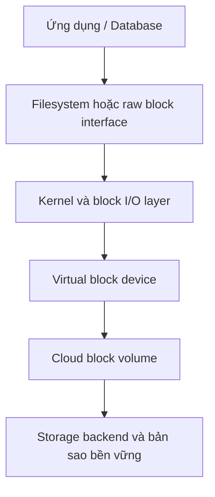
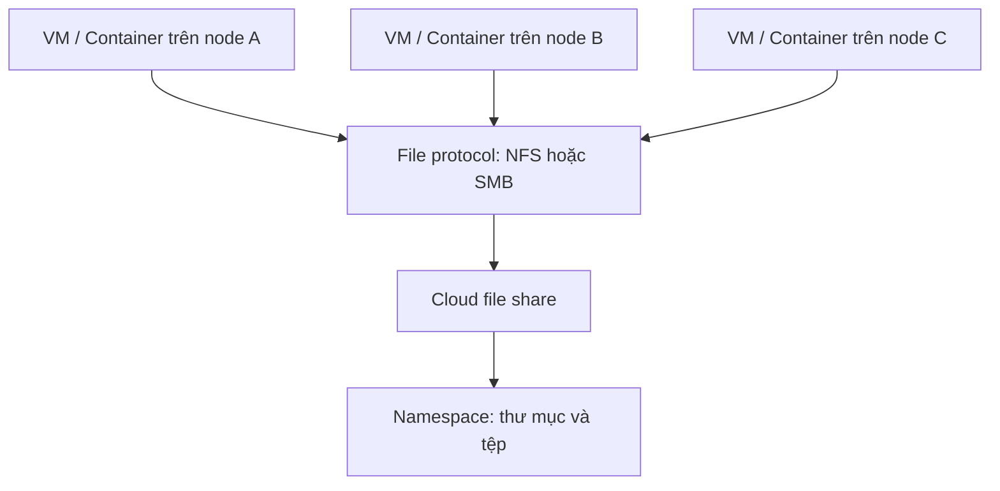
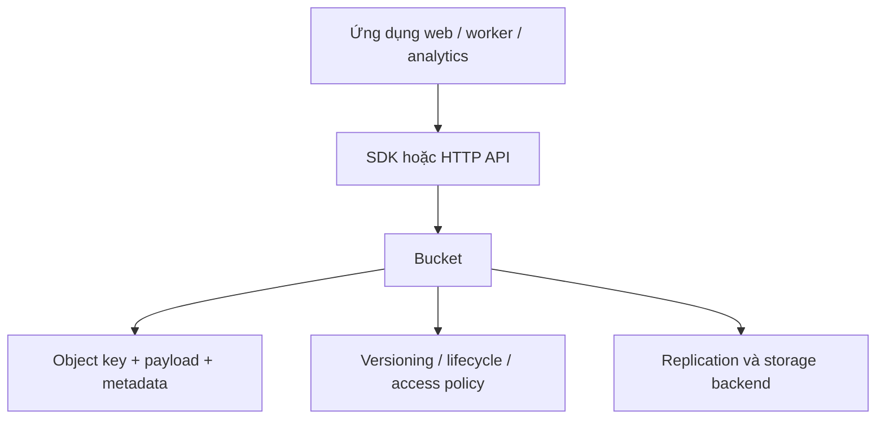
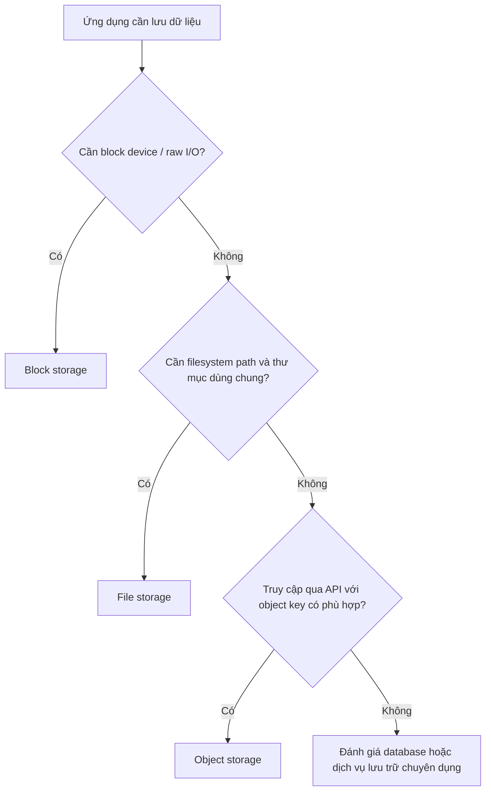
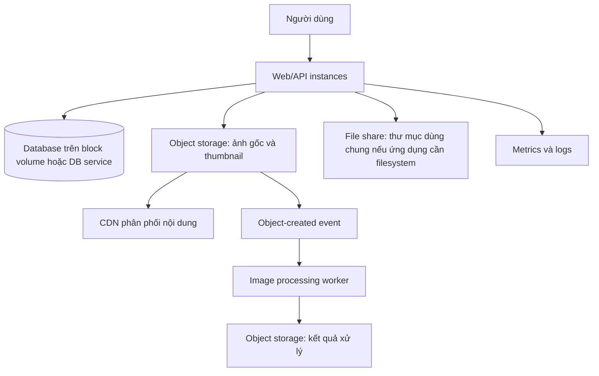

# Block storage, file storage và object storage dưới góc nhìn ứng dụng

## Bối cảnh: ứng dụng nhìn thấy dữ liệu theo cách nào?

Một ứng dụng cloud có thể cần lưu hệ điều hành, cơ sở dữ liệu, tệp người dùng, ảnh, video, bản sao lưu hoặc dữ liệu phân tích. Những loại dữ liệu này có cách truy cập khác nhau. Cơ sở dữ liệu thường cần đọc ghi các khối dữ liệu nhỏ với độ trễ thấp; nhiều máy chủ có thể cần cùng đọc một thư mục; ứng dụng web có thể lưu hàng triệu ảnh và tải chúng qua HTTP.

Cloud cung cấp ba mô hình lưu trữ phổ biến:

- **Block storage (lưu trữ khối):** cung cấp thiết bị dạng block để máy chủ hoặc VM định dạng thành filesystem hoặc dùng trực tiếp cho cơ sở dữ liệu.
- **File storage (lưu trữ tệp):** cung cấp hệ thống tệp phân cấp gồm thư mục và tệp, thường truy cập qua giao thức như NFS hoặc SMB.
- **Object storage (lưu trữ đối tượng):** lưu dữ liệu thành các object trong bucket/container, được truy cập qua API hoặc HTTP thay vì mount như một ổ đĩa thông thường.

Khác biệt cốt lõi nằm ở **giao diện mà ứng dụng sử dụng và semantics của thao tác đọc ghi**. Lựa chọn đúng ảnh hưởng đến cách ứng dụng tổ chức dữ liệu, mức chia sẻ giữa nhiều VM, hiệu năng, khả năng mở rộng, bảo mật, độ bền và chi phí.

Trong module **CLOUD_CORE_SERVICES_COMPUTE**, hiểu ba mô hình này giúp thiết kế VM, container và dịch vụ compute có nơi lưu dữ liệu phù hợp, đồng thời tránh nhầm lẫn giữa năng lực CPU/RAM với đặc tính I/O của storage.

## 1. Ba mô hình nhìn từ ứng dụng

| Đặc điểm | Block storage | File storage | Object storage |
|---|---|---|---|
| Đơn vị dữ liệu | Block/sector trên thiết bị | File và directory | Object gồm dữ liệu, key và metadata |
| Giao diện điển hình | Thiết bị block; filesystem hoặc raw block API | NFS, SMB hoặc giao thức file tương đương | REST/HTTP API, SDK, CLI |
| Cách định danh | Offset/block trong volume; sau khi format là đường dẫn file | Đường dẫn phân cấp như `/shared/report.csv` | Bucket và object key như `media/2026/photo.jpg` |
| Truy cập đồng thời | Thường gắn cho một host; multi-attach cần hỗ trợ và cơ chế cluster phù hợp | Nhiều client có thể truy cập cùng cây thư mục | Nhiều client gọi API cùng object hoặc các object khác nhau |
| Thay đổi dữ liệu | Đọc/ghi theo block; filesystem quản lý file và metadata | Tạo, đọc, ghi, đổi tên, xóa file/thư mục | PUT/GET/LIST/DELETE object và metadata |
| Đặc tính thường ưu tiên | IOPS, độ trễ, throughput và điều khiển filesystem | Chia sẻ tệp, namespace và quyền truy cập | Quy mô lớn, độ bền, truy cập qua API và chi phí trên dung lượng |
| Use case thường gặp | Boot disk, database, transactional workload | Shared home, nội dung dùng chung, thư mục làm việc | Ảnh/video, log, backup, data lake, artifact |

Không có mô hình nào tốt nhất cho mọi workload. Cùng một ứng dụng có thể kết hợp cả ba: block volume cho database, file share cho dữ liệu cần nhiều máy cùng đọc, và object storage cho ảnh hoặc backup.

## 2. Block storage: ứng dụng nhìn thấy một thiết bị khối

### 2.1. Cách hoạt động

Block storage cung cấp cho VM hoặc host một thiết bị lưu trữ dạng block, tương tự một ổ đĩa được kết nối với máy tính. Hệ điều hành có thể tạo partition, filesystem như ext4/XFS/NTFS rồi mount vào một thư mục. Cơ sở dữ liệu hoặc ứng dụng chuyên dụng cũng có thể truy cập thiết bị block trực tiếp nếu được thiết kế cho cách dùng đó.

Ứng dụng thường thao tác với file thông qua filesystem. Filesystem chuyển thao tác đọc/ghi thành các yêu cầu block đến thiết bị; dịch vụ block storage xử lý các yêu cầu đó ở tầng lưu trữ. Vì vậy, block storage không tự cung cấp cấu trúc thư mục, tên file hay quyền POSIX. Những chức năng đó do filesystem hoặc phần mềm ở phía host đảm nhiệm.



### 2.2. Gắn volume vào VM

Một volume thường được tạo trong một region hoặc availability zone rồi gắn vào VM tương thích. Sau khi attach, hệ điều hành nhận diện thiết bị, người vận hành có thể partition/format nếu volume mới, rồi mount vào điểm truy cập.

Ví dụ minh họa trên Linux, giả sử thiết bị mới được hệ điều hành nhận diện là `/dev/vdb`:

```bash
# Xem thiết bị và filesystem hiện có
lsblk -f

# Chỉ format khi xác nhận đây là volume mới, chưa có dữ liệu cần giữ
sudo mkfs.ext4 /dev/vdb

# Tạo điểm mount và gắn volume
sudo mkdir -p /data
sudo mount /dev/vdb /data

# Kiểm tra dung lượng và mount
df -h /data
```

Tên thiết bị trong VM có thể thay đổi theo driver, loại instance và thứ tự attach. Trước khi format, cần xác minh đúng volume và chắc chắn không có dữ liệu cần bảo toàn. Với môi trường production, cấu hình mount bền vững qua reboot bằng UUID hoặc cơ chế quản lý thiết bị phù hợp; không dựa vào tên `/dev/...` có thể thay đổi.

### 2.3. Điểm mạnh và giới hạn

Block storage phù hợp khi ứng dụng cần thao tác I/O chi tiết, filesystem quen thuộc và hiệu năng có thể cấu hình theo volume. Nhiều dịch vụ cho phép chọn loại volume theo mục tiêu IOPS, throughput, độ trễ và độ bền. Có thể tăng dung lượng hoặc thay đổi hiệu năng tùy dịch vụ, đôi khi cần thao tác mở rộng partition/filesystem ở guest OS sau đó.

Thông thường một filesystem thông thường chỉ nên được mount và ghi bởi một host tại một thời điểm. Một số dịch vụ hỗ trợ multi-attach, nhưng việc gắn cùng block device cho nhiều VM không tự động làm filesystem an toàn. Cần filesystem cluster-aware, distributed lock hoặc ứng dụng/cluster database có cơ chế điều phối ghi phù hợp. Nếu nhiều host cùng ghi lên filesystem không hỗ trợ truy cập đồng thời, metadata và dữ liệu có thể hỏng.

Block volume cũng thường có phạm vi gắn kết theo zone hoặc loại instance cụ thể. Việc chuyển volume sang VM khác có thể cần detach/attach, dừng workload hoặc chờ đồng bộ. Vì vậy, thiết kế HA cần xem xét cách failover volume, replication, snapshot và thời gian phục hồi.

### 2.4. Workload phù hợp

- Boot volume chứa hệ điều hành của VM.
- Database cần random I/O, transaction và kiểm soát filesystem.
- Ứng dụng doanh nghiệp lưu trạng thái trên filesystem cục bộ của một VM.
- Queue, index hoặc workload cần độ trễ và IOPS có thể dự đoán.
- Volume dữ liệu cần snapshot/backup và vòng đời độc lập với VM.

Với database, cần chọn loại volume theo pattern đọc/ghi, block size, queue depth, IOPS và throughput. Chỉ tăng dung lượng volume không nhất thiết làm tăng hiệu năng; một số dịch vụ gắn hiệu năng với loại volume hoặc cấu hình provisioned IOPS.

## 3. File storage: ứng dụng làm việc với cây thư mục dùng chung

### 3.1. Cách hoạt động

File storage cung cấp một namespace phân cấp gồm thư mục và tệp. Ứng dụng dùng thao tác quen thuộc như mở, đọc, ghi, đổi tên, tạo thư mục và xóa tệp. Một file share có thể được mount từ nhiều VM hoặc host qua mạng bằng NFS (phổ biến trong Linux/Unix) hoặc SMB (phổ biến trong Windows), tùy dịch vụ.



Điểm quan trọng là nhiều client có thể nhìn thấy cùng một cây thư mục. Khi một máy tạo hoặc cập nhật file, các máy khác có thể truy cập dữ liệu đó theo semantics của giao thức và dịch vụ. File storage thường xử lý metadata, locking và quyền truy cập ở tầng dịch vụ; ứng dụng vẫn cần tuân thủ cách chia sẻ và khóa file phù hợp.

### 3.2. Mount file share

Ví dụ khái niệm trên Linux với NFS:

```bash
sudo mkdir -p /mnt/shared
sudo mount -t nfs nfs.example.internal:/exports/team /mnt/shared
```

Ví dụ trên Windows có thể ánh xạ SMB share thành ổ đĩa mạng:

```powershell
New-PSDrive -Name Z -PSProvider FileSystem `
  -Root "\\fileserver.example.internal\team" -Persist
```

Đây là ví dụ giao thức, tên server/export/share và tùy chọn mount phải lấy từ dịch vụ thực tế. Trong cloud, cần cấu hình route, DNS, firewall và quyền truy cập để client kết nối được file service. Không nên mở NFS/SMB rộng ra Internet; ưu tiên mạng riêng và danh tính phù hợp.

### 3.3. Chia sẻ đồng thời, locking và quyền

File storage hữu ích khi nhiều VM cần cùng đọc/ghi tài liệu, thư mục người dùng hoặc dữ liệu làm việc. Tuy nhiên, khả năng nhiều client cùng mount không có nghĩa mọi thao tác ứng dụng đều tự động an toàn khi chạy đồng thời.

Ví dụ, hai tiến trình cùng cập nhật một file cấu hình có thể ghi đè thay đổi của nhau. Ứng dụng cần dùng file lock, atomic rename, cơ chế lease hoặc một dịch vụ điều phối nếu nhiều writer có thể thao tác cùng dữ liệu. Hành vi locking và cache consistency phụ thuộc giao thức, phiên bản và cấu hình dịch vụ.

Quyền truy cập có thể kết hợp quyền ở cấp share/export, danh tính người dùng, UID/GID, ACL hoặc quyền Windows. Khi chạy container, cần đảm bảo UID/GID và quyền thư mục khớp với tiến trình trong container. Nếu mount share vào nhiều workload, nên phân tách thư mục hoặc quyền theo tenant để tránh truy cập chéo.

### 3.4. Điểm mạnh và giới hạn

File storage thuận tiện khi ứng dụng đã được thiết kế quanh đường dẫn và thao tác filesystem. Nhiều máy có thể dùng chung dữ liệu mà không phải tự xây dựng đồng bộ file. Đây là lựa chọn phù hợp cho home directory, thư mục chia sẻ nhóm, CMS, nội dung web cần filesystem, pipeline xử lý file hoặc ứng dụng cũ cần NFS/SMB.

Đổi lại, file storage phụ thuộc mạng. Độ trễ của thao tác metadata như `stat`, `lookup`, `open`, `rename` có thể ảnh hưởng workload tạo nhiều file nhỏ hoặc duyệt thư mục lớn. Thông lượng và IOPS thường có giới hạn theo share, dung lượng, cấu hình hoặc mức dịch vụ. Khi nhiều client truy cập cùng một file hoặc thư mục nóng, locking và contention có thể trở thành nút thắt.

File storage không phải lúc nào cũng là lựa chọn tối ưu cho data lake rất lớn, nội dung tĩnh phân phối toàn cầu hoặc database cần I/O khối có độ trễ thấp. Cần benchmark theo pattern thực tế, đặc biệt là tỷ lệ file nhỏ/lớn, số client, số metadata operation và concurrency.

## 4. Object storage: ứng dụng thao tác qua API

### 4.1. Cách hoạt động

Object storage lưu mỗi đơn vị dữ liệu thành một object trong bucket hoặc container. Object thường gồm payload, key định danh và metadata. Ứng dụng đọc/ghi object qua API HTTP/SDK; ví dụ thao tác phổ biến là PUT (tải lên), GET (tải xuống), HEAD (đọc metadata), LIST (liệt kê) và DELETE.

Object key thường có dạng chuỗi như `images/2026/11/photo-001.jpg`. Dấu `/` thường chỉ là quy ước đặt tên để tạo cảm giác phân cấp; nhiều hệ thống object storage không có thư mục vật lý như filesystem. Vì vậy, thao tác đổi tên object có thể thực chất là copy sang key mới rồi xóa key cũ, tùy API và công cụ.



### 4.2. Truy cập bằng API thay vì mount filesystem

Ví dụ tải object lên và lấy object về bằng AWS CLI tương thích S3:

```bash
aws s3 cp ./report.csv s3://analytics-data/reports/report.csv
aws s3 cp s3://analytics-data/reports/report.csv ./report-copy.csv
```

Lệnh minh họa giao diện S3; endpoint, credential và quyền bucket cần được cấu hình cho nhà cung cấp đang dùng. Trong ứng dụng, nên dùng SDK chính thức hoặc API tương thích, danh tính workload và credential ngắn hạn. Tránh nhúng access key dài hạn vào source code hoặc image.

Object storage thường truy cập tốt qua HTTP, dễ tích hợp với ứng dụng web, worker, hệ thống phân tích và CDN. Một object có thể được tải trực tiếp từ trình duyệt bằng URL có chữ ký thời hạn ngắn hoặc qua backend có xác thực, tùy mô hình bảo mật.

### 4.3. Metadata, versioning và lifecycle

Metadata giúp lưu thuộc tính như content type, checksum, thời điểm, tag hoặc thông tin ứng dụng. Nên chọn key có quy ước nhất quán và metadata cần thiết ngay từ lúc upload; không dựa vào việc đổi tên thư mục như trên filesystem.

Các tính năng thường có ở object storage:

- **Versioning:** giữ nhiều phiên bản của cùng object key để khôi phục khi bị ghi đè hoặc xóa, tùy cấu hình.
- **Lifecycle policy:** tự chuyển object sang lớp lưu trữ rẻ hơn hoặc xóa sau thời hạn.
- **Replication:** sao chép object sang vùng hoặc tài khoản khác theo chính sách.
- **Multipart upload:** chia object lớn thành nhiều phần để tải song song và tiếp tục khi một phần thất bại.
- **Retention/Object Lock:** giữ object theo thời hạn hoặc chế độ chống sửa/xóa nếu dịch vụ hỗ trợ.
- **Event notification:** phát sự kiện khi object được tạo/xóa để kích hoạt worker hoặc pipeline.

Versioning và replication có thể làm tăng dung lượng tính phí. Lifecycle cần được thiết kế theo nhu cầu truy cập và yêu cầu lưu giữ; không xóa object chỉ dựa trên tuổi nếu dữ liệu còn nghĩa vụ pháp lý hoặc vận hành.

### 4.4. Semantics và giới hạn

Object storage không cung cấp đầy đủ semantics của filesystem POSIX. Ứng dụng thường không thể mở file rồi ghi ngẫu nhiên vào một offset như block device; nhiều API cập nhật object bằng cách ghi object mới hoặc thay thế object hiện tại. Việc đổi tên, khóa file, append và transaction nhiều object không tương đương filesystem/database.

Nhiều dịch vụ object storage hiện đại cung cấp consistency mạnh cho các thao tác đọc sau ghi đối với object, nhưng không nên mặc định mọi nhà cung cấp, API liệt kê, cache trung gian hoặc hệ thống tích hợp đều có cùng semantics. Cần kiểm tra cam kết consistency cụ thể, đặc biệt khi ứng dụng cập nhật object rồi ngay lập tức dựa vào kết quả LIST hoặc event.

Object storage phù hợp với object lớn, số lượng object rất lớn, dữ liệu ít cập nhật từng phần và truy cập qua API. Với workload cần cập nhật ngẫu nhiên liên tục, locking file hoặc transaction nhiều record, nên dùng database hoặc block/file storage phù hợp hơn.

## 5. Hiệu năng: đo đúng loại I/O của ứng dụng

Không thể so sánh storage chỉ bằng một con số GB/s. Ứng dụng có thể bị giới hạn bởi độ trễ, số thao tác mỗi giây, thông lượng, kích thước request, concurrency hoặc chi phí metadata/API.

### 5.1. Các chỉ số quan trọng

| Chỉ số | Ý nghĩa | Khi nào quan trọng |
|---|---|---|
| Latency | Thời gian hoàn tất một thao tác I/O | Database transaction, request nhỏ, thao tác metadata |
| IOPS | Số thao tác đọc/ghi mỗi giây | Random I/O, database, nhiều file nhỏ |
| Throughput | Dung lượng dữ liệu truyền mỗi giây | Streaming, backup, file lớn, media |
| Queue depth | Số yêu cầu I/O đang chờ hoặc được xử lý đồng thời | Tối ưu mức song song và phát hiện hàng đợi |
| Request size | Kích thước mỗi lần đọc/ghi | Ảnh hưởng IOPS và throughput đạt được |
| Metadata rate | Tốc độ thao tác tạo/list/stat/open/rename | File share và ứng dụng có nhiều file nhỏ |
| Error/retry rate | Tỷ lệ lỗi, timeout và yêu cầu phải thử lại | Ổn định ứng dụng và hiệu năng dưới tải |

Một workload tuần tự đọc file video lớn thường quan tâm throughput. Database thực hiện nhiều lần đọc/ghi block nhỏ thường quan tâm latency và IOPS. Một pipeline mở hàng triệu file nhỏ có thể bị giới hạn bởi metadata operations ngay cả khi dung lượng truyền thấp.

### 5.2. Kích thước request và giới hạn I/O

Thông lượng gần đúng có thể hình dung bằng:

```text
Throughput ~= IOPS x Average request size
```

Ví dụ, 5.000 IOPS với request trung bình 16 KiB tương ứng khoảng 78 MiB/s theo phép nhân lý thuyết. Con số thực tế còn phụ thuộc overhead, tỷ lệ đọc/ghi, queue depth, giới hạn dịch vụ, cache và cách đo. Nếu request size tăng, cùng số IOPS có thể tạo throughput cao hơn; ngược lại, workload nhiều request nhỏ có thể đạt IOPS cao nhưng throughput không lớn.

### 5.3. Độ trễ và hàng đợi

Khi storage bị quá tải, yêu cầu phải chờ trong hàng đợi và latency tăng. Tăng queue depth có thể giúp tận dụng thiết bị và đạt throughput cao hơn đến một điểm, nhưng queue quá dài làm tăng thời gian chờ và tail latency. Với ứng dụng tương tác, p95/p99 latency có thể quan trọng hơn throughput trung bình.

Đo hiệu năng trong điều kiện gần production: cùng kích thước file, tỷ lệ đọc/ghi, số client, concurrency, cache state và thời gian chạy. Benchmark tuần tự một file lớn không đại diện cho database random I/O; benchmark một VM đơn lẻ cũng không đại diện cho hàng chục client cùng mount file share.

## 6. Độ bền, tính sẵn sàng và consistency

Storage có thể quảng bá độ bền cao, nhưng ứng dụng vẫn cần hiểu cách dữ liệu được bảo vệ và khôi phục. Ba khái niệm cần phân biệt:

- **Durability (độ bền dữ liệu):** xác suất dữ liệu đã ghi không bị mất trong thời gian lưu giữ.
- **Availability (tính sẵn sàng):** khả năng truy cập dịch vụ và dữ liệu tại thời điểm cần.
- **Consistency (tính nhất quán):** những gì client quan sát được sau các thao tác đọc/ghi và khi nhiều client cập nhật cùng dữ liệu.

Một dịch vụ có thể có độ bền cao nhưng tạm thời không truy cập được khi xảy ra sự cố mạng hoặc vùng. Replication giúp tăng khả năng chịu lỗi, nhưng không thay thế backup: lỗi ứng dụng, xóa nhầm hoặc mã độc có thể được sao chép sang bản replica.

### 6.1. Snapshot, backup và replication

Snapshot thường ghi lại trạng thái volume hoặc dữ liệu tại một thời điểm logic. Backup có thể bao gồm nhiều volume, cấu hình ứng dụng, database và chính sách lưu giữ. Replication duy trì bản sao ở vị trí khác để tăng khả năng sẵn sàng hoặc phục hồi sau lỗi vùng.

Đối với database, snapshot crash-consistent có thể tương đương trạng thái sau khi hệ thống dừng đột ngột. Để đạt application-consistent, cần phối hợp với database hoặc filesystem để flush dữ liệu và ghi nhận trạng thái nhất quán. Hãy kiểm tra cách dịch vụ tạo snapshot và yêu cầu quiesce ứng dụng nếu cần.

Backup chỉ có giá trị khi có thể restore. Cần thử khôi phục vào môi trường riêng, xác minh dữ liệu, thời gian phục hồi và quyền truy cập. Đặt mục tiêu RPO (mức mất dữ liệu có thể chấp nhận) và RTO (thời gian khôi phục mục tiêu) để chọn lịch backup, replication và phương án failover.

### 6.2. Consistency và cập nhật đồng thời

Với block storage, filesystem và database quản lý thứ tự ghi, cache, journal và transaction. Với file storage, semantics phụ thuộc NFS/SMB và cấu hình cache/locking. Với object storage, semantics đọc sau ghi, versioning, conditional request và listing phụ thuộc API cụ thể.

Khi nhiều worker cùng cập nhật một đối tượng dữ liệu, hãy dùng khóa, version/ETag, conditional write, transaction hoặc cơ chế điều phối phù hợp. Không nên giả định hai client ghi cùng lúc sẽ tự động được hợp nhất an toàn.

## 7. Bảo mật dữ liệu trên từng mô hình

Storage thường chứa dữ liệu quan trọng và có thể tồn tại lâu hơn VM. Cần bảo vệ cả đường truyền, dữ liệu lưu trữ, danh tính truy cập và vòng đời xóa.

| Lớp bảo vệ | Block storage | File storage | Object storage |
|---|---|---|---|
| Mã hóa at rest | Mã hóa volume/snapshot bằng key phù hợp | Mã hóa share hoặc backend theo dịch vụ | Mã hóa object bằng key do dịch vụ hoặc khách hàng quản lý |
| Mã hóa in transit | Kênh kết nối block hoặc mã hóa ở tầng host nếu cần | TLS/SMB encryption hoặc mạng riêng theo dịch vụ | HTTPS/TLS cho API |
| Kiểm soát truy cập | Quyền attach volume, IAM và quyền filesystem trong guest | Quyền export/share, identity, UID/GID, ACL | IAM/bucket policy, access point, signed URL |
| Phân tách | Volume và project/account | Share, export, directory và ACL | Bucket, prefix, account và policy |
| Audit | Thao tác tạo/gắn/tháo volume và truy cập guest | Thay đổi share/ACL và log client nếu có | API access log, object-level audit nếu dịch vụ hỗ trợ |
| Xóa an toàn | Xóa volume, snapshot, key và bản sao theo chính sách | Xóa file/share và bản sao/backup | Delete marker/version, lifecycle, retention và object lock |

Nguyên tắc thực hành:

- Cấp quyền tối thiểu cho VM, container, người dùng và service account.
- Mã hóa dữ liệu nhạy cảm khi lưu trữ và khi truyền qua mạng.
- Tránh public access mặc định; chỉ mở truy cập công khai cho object được thiết kế để phân phối.
- Quản lý key và secret riêng, theo dõi rotation và quyền giải mã.
- Bật audit phù hợp và theo dõi truy cập bất thường.
- Xác định retention, legal hold và quy trình xóa trước khi triển khai lifecycle tự động.

## 8. Chọn storage theo yêu cầu ứng dụng

Hãy bắt đầu từ cách ứng dụng đọc/ghi và chia sẻ dữ liệu, sau đó mới chọn dịch vụ. Bảng sau là hướng dẫn định hướng, không thay thế benchmark và kiểm tra semantics của nhà cung cấp.

| Nhu cầu ứng dụng | Lựa chọn thường phù hợp | Lý do |
|---|---|---|
| Boot disk cho VM | Block | Hệ điều hành cần thiết bị block có thể boot |
| Database transactional trên VM | Block hoặc dịch vụ database chuyên dụng | Cần latency, IOPS và semantics ghi phù hợp |
| Nhiều VM cùng truy cập thư mục chung | File | Namespace và giao thức chia sẻ file |
| CMS hoặc ứng dụng cũ cần đường dẫn filesystem dùng chung | File | Tương thích với thao tác file/directory |
| Ảnh/video người dùng và nội dung tĩnh | Object | Quy mô lớn, API/HTTP và tích hợp CDN |
| Backup, archive và log lâu dài | Object hoặc dịch vụ backup | Lifecycle, versioning và lớp lưu trữ chi phí thấp |
| Data lake và dữ liệu phân tích | Object | Lưu object quy mô lớn, tích hợp công cụ phân tích |
| Scratch data tốc độ cao, có thể tái tạo | Local ephemeral SSD hoặc block hiệu năng cao | Ưu tiên tốc độ; dữ liệu cần được tái tạo hoặc lưu bền ở nơi khác |

### 8.1. Cây quyết định nhanh



Nếu ứng dụng có nhiều kiểu dữ liệu, hãy chọn theo từng nhóm thay vì ép mọi dữ liệu vào một loại storage. Ví dụ, database metadata có thể nằm trên block volume; file người dùng đang chỉnh sửa có thể ở file share; ảnh đã tải lên và bản backup có thể được lưu thành object.

## 9. Tích hợp storage với VM, container và serverless

### 9.1. VM

VM thường sử dụng block volume làm boot disk và có thể gắn thêm volume dữ liệu. File share được mount qua mạng khi cần nhiều VM truy cập cùng thư mục. Object storage được truy cập qua SDK/API từ ứng dụng hoặc agent chạy trong VM.

Khi thiết kế VM, cần xác định dữ liệu nào phải tồn tại sau khi VM bị thay thế. Dữ liệu tạm có thể nằm trên ephemeral disk hoặc local SSD; dữ liệu bền vững cần ở volume hoặc dịch vụ storage có chính sách giữ lại. Không nên lưu dữ liệu duy nhất trên boot disk nếu quy trình rebuild hoặc terminate có thể xóa đĩa.

### 9.2. Container và Kubernetes

Container image nên chứa mã và dependency cần thiết, không nên dùng image layer làm nơi lưu dữ liệu ứng dụng cần tồn tại lâu dài. Filesystem ghi trong writable layer của container thường gắn với vòng đời container; khi pod bị thay thế, dữ liệu có thể mất.

Kubernetes cung cấp các abstraction để gắn storage:

- **emptyDir:** vùng tạm tồn tại trong vòng đời Pod; phù hợp cache hoặc scratch data có thể tạo lại.
- **PersistentVolume (PV):** đại diện tài nguyên lưu trữ bền vững được cung cấp cho cluster.
- **PersistentVolumeClaim (PVC):** yêu cầu dung lượng và chế độ truy cập của workload.
- **StorageClass:** mô tả loại storage và cách provision volume động.
- **CSI driver:** kết nối Kubernetes với dịch vụ block/file storage của nền tảng.

Ví dụ PVC yêu cầu một volume 20 GiB:

```yaml
apiVersion: v1
kind: PersistentVolumeClaim
metadata:
  name: database-data
spec:
  accessModes:
    - ReadWriteOnce
  storageClassName: fast-block
  resources:
    requests:
      storage: 20Gi
```

Pod có thể mount claim vào container:

```yaml
apiVersion: v1
kind: Pod
metadata:
  name: database
spec:
  containers:
    - name: db
      image: example.invalid/database:stable
      volumeMounts:
        - name: data
          mountPath: /var/lib/database
  volumes:
    - name: data
      persistentVolumeClaim:
        claimName: database-data
```

`ReadWriteOnce` thường thể hiện volume có thể được mount read-write bởi một node tại một thời điểm theo semantics Kubernetes/CSI; không nên hiểu đơn giản là chỉ một Pod được sử dụng trong mọi trường hợp. `ReadWriteMany` thường cần backend file storage hỗ trợ nhiều node. Các access mode và khả năng attach thực tế phụ thuộc CSI driver và dịch vụ cloud.

Object storage thường được truy cập trực tiếp từ ứng dụng qua SDK/API. Có thể dùng CSI/FUSE gateway để trình bày object như filesystem, nhưng lớp tương thích này không biến object storage thành POSIX filesystem đầy đủ. Cần kiểm tra semantics về rename, locking, random write và cache trước khi dùng với ứng dụng cũ.

### 9.3. Serverless

Hàm serverless thường có filesystem tạm trong môi trường thực thi, nhưng vòng đời của môi trường có thể ngắn hoặc thay đổi. Không nên coi thư mục tạm là nơi lưu dữ liệu bền vững. Với dữ liệu cần giữ, hàm có thể gọi object API, database hoặc dịch vụ file/block được nền tảng hỗ trợ.

Object storage thường phù hợp với workflow hướng sự kiện: khi object mới được tải lên, event kích hoạt function để xử lý, tạo thumbnail hoặc trích xuất metadata rồi ghi kết quả thành object khác. Với workload cần mount file share hoặc block device, phải xác minh runtime serverless có hỗ trợ kết nối đó và giới hạn về thời gian, mạng, concurrency.

## 10. Thiết kế ứng dụng dùng storage hiệu quả

### 10.1. Chọn kích thước và cách chia dữ liệu

Với block storage, chọn block size, filesystem và queue depth phù hợp ứng dụng. Với file storage, tránh tạo quá nhiều thao tác metadata không cần thiết; gom file nhỏ hoặc cache kết quả nếu phù hợp. Với object storage, dùng multipart upload cho object lớn và thiết kế key giúp truy xuất, phân vùng và lifecycle dễ quản lý.

### 10.2. Cache ở đúng tầng

Cache có thể giảm số lần truy cập storage và cải thiện latency. Cache có thể nằm trong bộ nhớ ứng dụng, local SSD, CDN hoặc cache service. Tuy nhiên, cache tạo thêm bài toán invalidation và consistency: cần xác định TTL, version key, chiến lược cập nhật và cách xử lý dữ liệu cũ.

Với nội dung tĩnh lưu ở object storage, CDN có thể giảm tải origin và đưa nội dung gần người dùng. Với file share, cache client cần được cấu hình theo semantics của ứng dụng. Với database trên block storage, cache ở tầng database/OS cần được kiểm soát để tránh hiểu sai số liệu I/O thực tế.

### 10.3. Retry, timeout và tính lặp an toàn

Ứng dụng phải xử lý timeout và lỗi tạm thời khi truy cập storage. Retry cần có exponential backoff và giới hạn số lần thử để tránh khuếch đại sự cố. Với thao tác ghi, cần biết request có thể đã hoàn tất ở storage dù client không nhận được phản hồi hay chưa.

Đối với object storage, có thể dùng key duy nhất, conditional request, checksum hoặc version để tránh ghi đè ngoài ý muốn. Với file storage, dùng atomic rename hoặc lock khi cần cập nhật file chia sẻ. Với block/database, dùng transaction và cơ chế recovery của hệ quản trị dữ liệu.

### 10.4. Theo dõi và cảnh báo

Giám sát storage cần kết hợp metric của dịch vụ với metric từ ứng dụng:

- Latency đọc/ghi p50, p95 và p99.
- IOPS, throughput, queue depth và tỷ lệ throttling.
- Dung lượng đã dùng, tốc độ tăng và dung lượng còn lại.
- Lỗi, timeout, retry, request bị giới hạn và kết nối bị ngắt.
- File metadata operations, số client và mức tranh chấp nếu dịch vụ cung cấp.
- Object request rate, số object, dung lượng theo lớp lưu trữ và chi phí truy xuất.
- Tỷ lệ backup thành công, thời gian restore và độ trễ replication.

Một volume đầy có thể khiến ứng dụng ngừng ghi dù CPU/RAM còn dư. Một file share bị quá tải metadata có thể làm ứng dụng chậm dù throughput thấp. Object storage có thể phát sinh chi phí lớn từ request hoặc egress dù dung lượng lưu trữ không tăng nhiều. Vì vậy, dashboard nên thể hiện cả góc nhìn hạ tầng và góc nhìn ứng dụng.

## 11. Chi phí và vòng đời dữ liệu

Chi phí storage không chỉ là giá trên mỗi GiB-tháng. Tùy mô hình và nhà cung cấp, chi phí có thể gồm dung lượng provisioned, IOPS/throughput, request API, snapshot, replication, retrieval, egress, dung lượng tối thiểu theo lớp và chi phí backup.

| Mô hình | Yếu tố chi phí cần xem | Biện pháp tối ưu |
|---|---|---|
| Block | Dung lượng volume, loại hiệu năng, provisioned IOPS, snapshot và bản sao | Right-size volume, điều chỉnh IOPS theo workload, xóa snapshot hết hạn sau khi kiểm tra retention |
| File | Dung lượng share, throughput/provisioned capacity, số client hoặc mức dịch vụ | Tách workload, dọn file tạm, chọn tier phù hợp và tránh metadata operation dư thừa |
| Object | Dung lượng theo storage class, request PUT/GET/LIST, retrieval, replication và egress | Lifecycle, compression, CDN/cache, multipart và giảm request không cần thiết |

Lifecycle policy giúp chuyển dữ liệu ít truy cập sang lớp lưu trữ rẻ hơn hoặc xóa theo thời hạn. Cần cân nhắc thời gian truy xuất, phí retrieval, minimum storage duration và yêu cầu pháp lý. Một lớp archive rẻ có thể không phù hợp nếu ứng dụng cần đọc ngay lập tức.

Nên phân loại dữ liệu theo vòng đời:

1. **Hot:** truy cập thường xuyên, cần độ trễ thấp.
2. **Warm:** truy cập không liên tục nhưng vẫn cần lấy tương đối nhanh.
3. **Cold/archive:** ít truy cập, ưu tiên chi phí lưu trữ thấp và chấp nhận thời gian phục hồi dài hơn.
4. **Ephemeral:** dữ liệu tạm có thể tạo lại, có thể đặt trên local disk hoặc vùng tạm.

Không nên xóa dữ liệu chỉ dựa trên việc nó ít được truy cập. Cần xác định owner, retention, backup, legal hold và quy trình phê duyệt xóa.

## 12. Ví dụ thiết kế storage cho ứng dụng web

Giả sử một ứng dụng web có API, database, chức năng tải ảnh và worker xử lý ảnh. Một kiến trúc có thể phân chia như sau:



Trong thiết kế này:

- Database lưu metadata như owner, tên object, quyền truy cập và trạng thái xử lý. Dữ liệu transaction cần storage có semantics phù hợp database.
- Ảnh gốc và thumbnail được lưu thành object; API cấp URL có chữ ký hoặc phục vụ qua CDN theo chính sách truy cập.
- Worker nhận event, đọc object, xử lý và ghi object kết quả. Công việc có thể retry nên cần idempotency để không tạo kết quả trùng hoặc ghi đè sai.
- File share chỉ cần thiết nếu ứng dụng hoặc công cụ hiện hữu thực sự cần một filesystem chung; không cần thêm tầng file storage nếu object API đáp ứng tốt.
- Log, metric và backup được quản lý theo retention và chính sách riêng.

Thiết kế này tránh việc lưu ảnh lớn trong database hoặc phụ thuộc vào filesystem cục bộ của một VM. Khi API instance bị thay thế, object vẫn tồn tại và worker khác có thể tiếp tục xử lý.

## 13. Di chuyển dữ liệu giữa các mô hình storage

Di chuyển từ block sang file hoặc object không chỉ là sao chép byte. Ứng dụng có thể đang phụ thuộc vào filesystem semantics, đường dẫn, quyền, locking, timestamp, atomic rename hoặc cách cập nhật từng phần. Trước khi chuyển, cần lập danh sách các phụ thuộc đó.

Quy trình di chuyển thường gồm:

1. **Khảo sát workload:** đo dung lượng, số lượng file/object, kích thước trung bình, tỷ lệ đọc/ghi, latency, IOPS, throughput và concurrency.
2. **Xác định semantics cần giữ:** quyền, ownership, locking, versioning, consistency, metadata, atomic update và khả năng truy cập đồng thời.
3. **Thiết kế mapping:** ánh xạ volume/path sang share hoặc bucket/key; quy định tên, metadata, checksum và cấu trúc phân vùng.
4. **Sao chép thử nghiệm:** dùng tập dữ liệu đại diện, so sánh checksum, quyền và thời gian truy cập.
5. **Đồng bộ phần thay đổi:** trong khi hệ thống nguồn vẫn hoạt động, sao chép phần chênh lệch bằng cơ chế phù hợp.
6. **Chuyển hướng ứng dụng:** dừng ghi hoặc dùng dual-write có kiểm soát, chuyển endpoint/mount/config và xác minh truy cập.
7. **Theo dõi và rollback:** giám sát lỗi, latency, dữ liệu thiếu/trùng; giữ nguồn cũ theo thời hạn an toàn trước khi thu hồi.

Khi chuyển từ filesystem sang object storage, có thể cần thay đổi mã để dùng SDK/API, xử lý upload/download, metadata và URL. Một lớp FUSE hoặc gateway có thể giúp ứng dụng cũ tương thích ở mức đường dẫn, nhưng cần benchmark và kiểm tra semantics trước khi dùng production.

## 14. Những nhầm lẫn thường gặp

**Block storage và file storage giống nhau vì đều có thể chứa file.** Block storage cung cấp thiết bị; filesystem trên host mới tạo ra file và thư mục. File storage cung cấp namespace file dùng chung qua giao thức mạng.

**Gắn cùng block volume cho nhiều VM luôn an toàn.** Multi-attach chỉ an toàn khi dịch vụ, filesystem và ứng dụng hỗ trợ phối hợp ghi đồng thời. Nếu không, filesystem có thể hỏng.

**File storage là object storage có thư mục.** File storage cung cấp thao tác filesystem và semantics giao thức; object storage cung cấp API object. Prefix trong object key thường chỉ là quy ước đặt tên.

**Object storage có thể thay thế mọi filesystem.** Object API không tự cung cấp đầy đủ POSIX semantics như random write, locking và atomic rename. Ứng dụng có thể cần thay đổi cách truy cập dữ liệu.

**Dung lượng lớn hơn đồng nghĩa hiệu năng cao hơn.** Hiệu năng còn phụ thuộc IOPS, throughput, latency, queue depth, loại volume, request size và giới hạn dịch vụ.

**Replication thay thế backup.** Replication có thể sao chép cả thao tác xóa nhầm hoặc dữ liệu bị hỏng. Cần backup có retention và kiểm thử restore.

**Mount object storage bằng FUSE khiến nó tương đương file share.** FUSE chỉ cung cấp lớp tương thích; semantics và hiệu năng vẫn phụ thuộc API object phía dưới.

## 15. Checklist chọn storage cho ứng dụng

Trước khi chọn dịch vụ, hãy trả lời các câu hỏi sau:

- [ ] Ứng dụng cần raw block I/O, filesystem path hay API object?
- [ ] Dữ liệu được cập nhật theo block, file hay toàn object?
- [ ] Một hay nhiều VM/container cần đọc và ghi cùng dữ liệu?
- [ ] Có cần POSIX permissions, ACL, locking, atomic rename hoặc transaction không?
- [ ] Workload thiên về random I/O, tuần tự, file nhỏ, object lớn hay metadata operations?
- [ ] Mục tiêu latency, IOPS, throughput và concurrency là bao nhiêu?
- [ ] Dữ liệu có thể tái tạo hay cần tồn tại qua thay thế VM/pod?
- [ ] RPO, RTO, snapshot, backup, replication và restore đã được xác định chưa?
- [ ] Quyền IAM, encryption, network path, audit và retention có phù hợp không?
- [ ] Chi phí dung lượng, request, IOPS, retrieval, egress và bản sao đã được tính chưa?
- [ ] Đã benchmark bằng pattern gần workload thật và kiểm thử lỗi/khôi phục chưa?

## Kết luận

Block storage cung cấp thiết bị khối để VM hoặc host quản lý filesystem và I/O; file storage cung cấp cây thư mục có thể chia sẻ qua giao thức như NFS/SMB; object storage lưu dữ liệu theo object key và truy cập qua API/HTTP. Ứng dụng cần chọn dựa trên semantics đọc ghi, cách chia sẻ dữ liệu, latency, IOPS, throughput, độ bền, khả năng phục hồi và chi phí. Nhiều hệ thống dùng kết hợp cả ba mô hình: block cho database hoặc boot disk, file cho thư mục dùng chung và object cho nội dung lớn, backup hoặc dữ liệu phân tích. Thiết kế tốt bắt đầu từ pattern truy cập của ứng dụng, sau đó xác minh bằng benchmark, kiểm tra bảo mật và thử nghiệm khôi phục.
