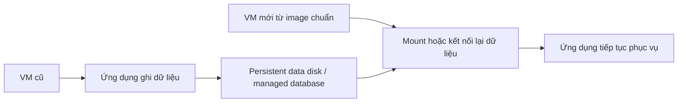

# Quản lý dữ liệu bền vững khi máy bị thay thế hoặc xóa

Máy ảo có thể được tạo mới, thay thế, resize hoặc xóa trong quá trình vận hành. Nếu dữ liệu ứng dụng chỉ nằm trên ổ đĩa tạm gắn với vòng đời của máy, việc thay VM có thể làm mất dữ liệu. Để hệ thống tiếp tục hoạt động sau khi máy hỏng hoặc cần triển khai lại, cần thiết kế nơi lưu dữ liệu độc lập với vòng đời compute, xác định rõ chính sách giữ/xóa disk và kiểm thử khả năng khôi phục.

Trong kiến trúc tính toán đám mây, **tính bền vững của dữ liệu** không chỉ phụ thuộc vào loại ổ đĩa. Nó còn phụ thuộc vào cách ứng dụng ghi dữ liệu, cơ chế snapshot và backup, chính sách xóa tài nguyên, mã hóa, sao chép giữa vùng lỗi và quy trình restore. Bài học này trình bày cách quản lý dữ liệu để có thể thay hoặc xóa máy ảo mà vẫn giữ được dữ liệu cần thiết, đồng thời tránh giữ lại dữ liệu ngoài ý muốn và phát sinh chi phí không kiểm soát.

## 1. Tách vòng đời dữ liệu khỏi vòng đời máy ảo

Một VM gồm compute và các tài nguyên đi kèm như boot disk, data disk, network interface, địa chỉ IP và identity. Các tài nguyên này có thể có vòng đời khác nhau. Khi xóa VM, nền tảng có thể xóa boot disk, giữ lại data disk hoặc áp dụng chính sách do người tạo cấu hình.

Điều quan trọng là xác định **dữ liệu nào phải tồn tại sau khi VM biến mất**. Ví dụ:

- Hệ điều hành và file tạm có thể được tạo lại từ image chuẩn.
- Log tạm hoặc cache có thể mất mà không ảnh hưởng tính đúng đắn của hệ thống, nếu có nguồn dữ liệu khác.
- File người dùng, database, queue state hoặc dữ liệu nghiệp vụ phải được lưu trên storage bền vững và có cơ chế backup phù hợp.
- Secret và credential nên được lưu trong secret manager, không nằm trong disk image hoặc data disk dùng chung.

Một cách thiết kế phổ biến là giữ compute có thể thay thế: tạo VM mới từ image chuẩn, gắn lại volume dữ liệu hoặc kết nối tới dịch vụ lưu trữ độc lập. Khi đó, hỏng hóc của một VM không đồng nghĩa với mất dữ liệu nghiệp vụ.



Sơ đồ chỉ thể hiện ý tưởng tách compute khỏi dữ liệu. Việc gắn volume lại, chuyển quyền sở hữu, đồng bộ dữ liệu và khởi động ứng dụng phải tuân theo khả năng của nền tảng và loại filesystem/database.

## 2. Phân biệt các loại lưu trữ gắn với compute

Các dịch vụ cloud cung cấp nhiều loại storage với độ bền, hiệu năng, khả năng chia sẻ và chi phí khác nhau.

| Loại lưu trữ | Đặc điểm | Dùng cho | Điều cần lưu ý |
|---|---|---|---|
| Local/ephemeral disk | Gắn với host hoặc vòng đời instance; hiệu năng thường cao | Cache, scratch space, dữ liệu tạm, buffer có thể tạo lại | Có thể mất khi VM bị stop, terminate, host lỗi hoặc bị thay thế tùy loại dịch vụ |
| Persistent block volume | Volume độc lập tương đối với VM, có thể detach/attach theo chính sách | Database, file hệ thống ứng dụng, dữ liệu cần truy cập dạng block | Cần quản lý attachment, filesystem, snapshot và chính sách xóa |
| File storage | Cung cấp filesystem dùng chung qua mạng | File chia sẻ, home directory, nội dung cần nhiều VM truy cập | Cần hiểu locking, throughput, latency, quota và quyền truy cập |
| Object storage | Lưu object qua API, có khả năng mở rộng và độ bền cao | Backup, media, log, artifact, dữ liệu phi cấu trúc | Ứng dụng cần dùng API/object semantics; không phải block device để mount tùy ý |
| Managed database/storage service | Nhà cung cấp quản lý một phần backup, replication và failover | Dữ liệu có cấu trúc hoặc dịch vụ stateful | Cần kiểm tra RPO/RTO, retention, export và trách nhiệm vận hành còn lại |

Không nên xem mọi ổ đĩa được nhìn thấy trong guest OS là bền vững. Một disk có thể xuất hiện như thiết bị block nhưng vẫn là local ephemeral storage. Cần xác nhận loại volume trong control plane và tài liệu dịch vụ.

### 2.1. Ephemeral storage

Ephemeral storage thích hợp với dữ liệu có thể tạo lại. Ví dụ, ứng dụng có thể lưu cache, file tải xuống tạm, dữ liệu trung gian của batch job hoặc thư mục scratch trên local SSD. Việc dùng local disk có thể đem lại hiệu năng và chi phí phù hợp, nhưng không được coi đây là bản lưu duy nhất của dữ liệu cần giữ.

Hành vi khi stop, restart, terminate hoặc host failure tùy thuộc từng loại local disk và nền tảng. Có loại mất dữ liệu khi VM bị terminate; có loại giữ dữ liệu qua reboot nhưng không qua stop/host replacement. Hãy đọc chính xác vòng đời của loại disk đã chọn.

### 2.2. Persistent block volume

Persistent block volume được quản lý như tài nguyên storage riêng. VM sử dụng volume bằng cách attach nó, sau đó hệ điều hành nhận thiết bị block, tạo hoặc nhận diện filesystem và mount vào thư mục ứng dụng.

Volume thường có thể tồn tại sau khi VM bị xóa nếu chính sách delete-on-termination hoặc tương đương được cấu hình để giữ lại. Tuy nhiên, khả năng detach/attach có giới hạn: một số volume chỉ gắn được với một VM tại một thời điểm; một số dịch vụ hỗ trợ multi-attach nhưng yêu cầu filesystem hoặc ứng dụng có cơ chế đồng thời phù hợp.

### 2.3. File và object storage

File storage hữu ích khi nhiều VM cần truy cập cùng một cây thư mục. Object storage phù hợp với dữ liệu phi cấu trúc, backup và artifact cần truy cập qua API. Nếu ứng dụng được thiết kế để dùng object storage hoặc managed database, dữ liệu có thể tồn tại độc lập với VM mà không cần quản lý attach/mount volume.

Việc chọn storage cần dựa trên access pattern, latency, throughput, IOPS, kích thước object/file, mức chia sẻ, yêu cầu consistency, chi phí truyền dữ liệu và khả năng khôi phục.

## 3. Xác định chính sách vòng đời của disk

Khi tạo VM hoặc volume, cần xác định điều gì xảy ra khi máy bị xóa. Các nền tảng thường có lựa chọn giữ hoặc xóa disk, nhưng tên trường và giá trị mặc định có thể khác nhau.

| Tình huống | Chính sách thường phù hợp | Kiểm tra trước khi thực hiện |
|---|---|---|
| Xóa VM stateless dùng boot disk có thể tạo lại | Có thể xóa boot disk cùng VM | Image chuẩn đã sẵn sàng; không có dữ liệu duy nhất trên boot disk |
| Thay VM có data disk chứa dữ liệu nghiệp vụ | Giữ data disk, detach có kiểm soát rồi attach vào VM mới | Ứng dụng đã dừng ghi; filesystem sạch; đúng zone/region và quyền truy cập |
| Xóa VM thử nghiệm | Xóa cả disk nếu đã xác nhận không cần giữ dữ liệu | Không còn dữ liệu cần điều tra, lưu trữ hoặc tuân thủ |
| Xóa VM phục vụ điều tra sự cố | Cô lập và giữ disk/snapshot theo quy trình evidence | Bảo toàn log, chain of custody và quyền truy cập |
| Xóa máy thuộc hệ thống có yêu cầu retention | Giữ bản backup theo thời hạn chính sách, sau đó xóa theo quy trình | Thời hạn lưu, legal hold và bằng chứng xóa |

Đừng dựa vào tên VM hoặc tên disk để suy luận dữ liệu có thể xóa. Hãy dùng tag/label, inventory và quan hệ tài nguyên được quản lý để xác định chủ sở hữu, môi trường, phân loại dữ liệu và chính sách retention.

### 3.1. Delete-on-termination và các tùy chọn tương đương

Một số nền tảng có thuộc tính quyết định boot volume hoặc attached volume có bị xóa khi instance bị terminate hay không. Với AWS EC2, hành vi này thường được điều khiển bằng thuộc tính `DeleteOnTermination` của block device mapping. Các dịch vụ Azure và Google Cloud có các tùy chọn tương ứng trong cấu hình disk/VM và quy trình xóa tài nguyên.

Trước khi xóa VM, cần kiểm tra:

- Disk nào là boot disk, disk nào chứa dữ liệu ứng dụng.
- Chính sách xóa của từng disk.
- Disk có được giữ lại độc lập hay phụ thuộc vào resource group/instance lifecycle.
- Snapshot hoặc backup đã hoàn tất và có thể restore hay chưa.
- Volume có đang được mount hoặc được một VM khác sử dụng không.
- Có yêu cầu retention, legal hold hoặc điều tra bảo mật không.

Không nên coi việc giữ disk là backup. Nếu disk bị xóa nhầm, hỏng logic, mã độc mã hóa dữ liệu hoặc lỗi ứng dụng ghi đè dữ liệu, bản disk đang hoạt động có thể không giúp khôi phục trạng thái cũ.

## 4. Gắn data volume vào VM mới

Kịch bản phổ biến là thay VM bị lỗi bằng một VM mới từ image chuẩn rồi gắn lại data volume. Quy trình cần bảo đảm volume được tháo an toàn và filesystem không bị ghi đồng thời từ hai máy.

Một quy trình tổng quát:

1. Xác định VM, volume và dữ liệu cần giữ bằng inventory.
2. Dừng ứng dụng hoặc chuyển workload sang chế độ read-only để ngừng ghi.
3. Flush dữ liệu xuống disk và unmount filesystem trên VM cũ.
4. Detach volume theo API của nền tảng và xác nhận attachment đã kết thúc.
5. Tạo hoặc chọn VM mới từ image đã phê duyệt.
6. Attach volume vào VM mới ở vị trí topology được hỗ trợ.
7. Xác minh thiết bị, filesystem, UUID, quyền sở hữu và mount point.
8. Kiểm tra dữ liệu và quyền truy cập trước khi khởi động ứng dụng.
9. Khởi động ứng dụng, xác minh health check và theo dõi log.
10. Giữ VM cũ ở trạng thái cô lập cho tới khi quá trình chuyển đổi được xác nhận và hoàn tất chính sách xử lý.

### 4.1. Ví dụ trên Linux

Tên thiết bị trong guest OS có thể thay đổi sau khi attach. Không nên giả định volume luôn xuất hiện dưới cùng một tên như `/dev/sdf`. Có thể dùng UUID hoặc filesystem label để mount ổn định hơn.

Kiểm tra thiết bị và filesystem:

```bash
lsblk -f
blkid
```

Tạo mount point và mount volume đã có filesystem:

```bash
sudo mkdir -p /srv/app-data
sudo mount UUID=<filesystem-uuid> /srv/app-data
```

Để mount tự động sau reboot, có thể khai báo UUID trong `/etc/fstab` sau khi đã xác minh đúng filesystem và tùy chọn mount:

```text
UUID=<filesystem-uuid>  /srv/app-data  ext4  defaults,nofail  0  2
```

`nofail` có thể giúp VM tiếp tục boot khi volume không có mặt, nhưng không phù hợp với mọi workload. Nếu ứng dụng bắt buộc phải có dữ liệu này, cấu hình khởi động nên kiểm tra mount point và dừng dịch vụ khi volume thiếu, thay vì chạy nhầm trên thư mục rỗng của boot disk.

Không tạo filesystem mới bằng `mkfs` trên một volume đang chứa dữ liệu cần giữ. Lệnh tạo filesystem có thể ghi đè metadata hiện có và làm mất khả năng truy cập dữ liệu.

### 4.2. Tránh gắn đồng thời một filesystem không hỗ trợ chia sẻ

Một filesystem thông thường như ext4 hoặc XFS không nên được mount read-write đồng thời trên nhiều VM chỉ vì nền tảng cho phép multi-attach volume. Nếu nhiều máy cần truy cập cùng dữ liệu, hãy dùng filesystem cluster có hỗ trợ locking, file storage hoặc cơ chế ứng dụng được thiết kế cho truy cập đồng thời.

Gắn một volume read-write vào hai VM không có cơ chế phối hợp có thể làm hỏng filesystem và dữ liệu. Luôn xác minh giới hạn multi-attach, loại filesystem, chế độ read-only/read-write và hỗ trợ của ứng dụng.

## 5. Snapshot, backup và replication

Các cơ chế này đều giúp bảo vệ dữ liệu nhưng giải quyết các mục tiêu khác nhau.

| Cơ chế | Mục tiêu | Có thể khôi phục điều gì? | Giới hạn |
|---|---|---|---|
| Snapshot | Chụp trạng thái volume tại một thời điểm | Nội dung block volume tại điểm chụp | Có thể không nhất quán ở cấp ứng dụng nếu đang ghi |
| Backup | Tạo bản sao phục hồi theo chính sách và retention | Dữ liệu hoặc hệ thống theo phạm vi backup | Cần kiểm tra lịch chạy, tính bất biến, nơi lưu và khả năng restore |
| Replication | Duy trì bản sao dữ liệu ở volume/node/zone/region khác | Có thể tiếp tục phục vụ khi một bản sao hoặc miền lỗi gặp sự cố | Lỗi xóa nhầm, mã hóa dữ liệu hoặc corruption có thể được nhân bản |
| Archive | Lưu dữ liệu dài hạn với chi phí lưu thấp hơn | Dữ liệu lịch sử hoặc bản lưu tuân thủ | Thời gian truy xuất và phí restore có thể cao |

Snapshot có thể là một thành phần của chiến lược backup, nhưng một snapshot duy nhất trong cùng account và region chưa đủ bảo vệ trước mọi sự cố. Cần xét quyền xóa, phạm vi lỗi chung, retention, khả năng sao chép và khả năng phục hồi.

### 5.1. Crash-consistent và application-consistent snapshot

Nếu snapshot được tạo khi VM hoặc ứng dụng đang ghi dữ liệu, trạng thái chụp có thể tương đương với việc máy mất điện đột ngột. Filesystem hoặc database có thể cần chạy recovery khi khởi động lại. Đây thường được gọi là **crash-consistent**.

**Application-consistent** snapshot phối hợp với ứng dụng để dữ liệu được flush hoặc tạm dừng ghi trước khi chụp. Cơ chế có thể dùng guest agent, database backup API, filesystem freeze hoặc công cụ của nhà cung cấp. Với database, nên dùng cơ chế backup/replication được database hỗ trợ thay vì giả định snapshot volume đơn lẻ luôn nhất quán giao dịch.

Nếu database dùng nhiều volume, ví dụ data, log và journal, cần snapshot theo nhóm nhất quán hoặc dùng backup tool có khả năng phối hợp các volume. Snapshot từng volume ở các thời điểm khác nhau có thể tạo trạng thái không thể khôi phục đúng.

### 5.2. Replication không thay thế backup

Replication giúp tăng khả năng sẵn sàng khi volume hoặc zone gặp sự cố. Tuy nhiên, nếu người dùng xóa nhầm bảng, ứng dụng ghi dữ liệu sai hoặc ransomware mã hóa file, thay đổi đó có thể được replicate sang bản sao còn lại.

Backup theo thời điểm, retention đủ dài và bản sao có quyền xóa tách biệt giúp khôi phục về trước thời điểm sự cố. Với dữ liệu quan trọng, nên kết hợp replication để duy trì dịch vụ và backup để khôi phục dữ liệu lịch sử.

## 6. Thiết kế backup theo RPO và RTO

Hai mục tiêu phổ biến khi thiết kế bảo vệ dữ liệu là:

- **RPO (Recovery Point Objective):** lượng dữ liệu tối đa có thể chấp nhận mất, thường biểu diễn bằng khoảng thời gian giữa lần backup/replication và thời điểm sự cố.
- **RTO (Recovery Time Objective):** thời gian tối đa có thể chấp nhận để khôi phục dịch vụ sau sự cố.

Ví dụ, hệ thống có RPO 15 phút và RTO 2 giờ cần có cơ chế sao lưu hoặc replication với khoảng mất dữ liệu mục tiêu không vượt quá 15 phút, cùng quy trình restore có thể hoàn thành trong 2 giờ. Snapshot hằng ngày sẽ không đáp ứng RPO này nếu không có thêm log backup hoặc replication.

Thiết kế backup cần trả lời:

1. Dữ liệu nào cần bảo vệ và mức độ quan trọng của từng nhóm?
2. RPO/RTO cho từng dịch vụ là bao nhiêu?
3. Backup chạy theo lịch nào và có giám sát thành công/thất bại không?
4. Bản backup được lưu ở account, project, subscription, region hoặc hệ thống nào?
5. Ai có quyền đọc, sửa, xóa hoặc rút ngắn retention?
6. Dữ liệu có được mã hóa khi truyền và khi lưu không?
7. Có kiểm thử restore định kỳ và đo thời gian phục hồi thực tế không?

Không nên chỉ đo tỷ lệ job backup thành công. Chỉ số quan trọng là có thể khôi phục đúng dữ liệu, đúng thời điểm và trong thời gian mục tiêu.

## 7. Bảo vệ backup khỏi xóa nhầm và ransomware

Backup có giá trị khi kẻ tấn công hoặc lỗi vận hành không thể dễ dàng xóa mọi bản sao cùng lúc với dữ liệu gốc.

Các biện pháp thường dùng:

- Lưu một bản backup trong account/project hoặc security boundary riêng.
- Dùng quyền IAM riêng cho backup service; giới hạn quyền xóa và sửa retention.
- Bật immutable backup hoặc retention lock khi nền tảng hỗ trợ.
- Dùng object versioning hoặc object lock cho dữ liệu phù hợp.
- Sao chép bản backup sang region khác nếu yêu cầu khôi phục thảm họa.
- Mã hóa backup và quản lý khóa độc lập; bảo đảm khóa còn khả dụng trong thời gian retention.
- Ghi log thao tác tạo, xóa, thay đổi retention và restore.
- Kiểm thử tài khoản khôi phục khẩn cấp và quy trình truy cập khi IAM chính gặp sự cố.

Immutable không có nghĩa là không cần quản trị. Cần chọn retention hợp lý, hiểu điều kiện legal hold và chi phí lưu giữ, đồng thời xác minh rằng quy trình hết hạn/xóa sau retention tuân thủ chính sách dữ liệu.

## 8. Mã hóa và quản lý khóa cho dữ liệu bền vững

Persistent volume, snapshot và backup có thể chứa dữ liệu nhạy cảm. Cần mã hóa dữ liệu khi lưu (encryption at rest) và bảo vệ dữ liệu khi truyền giữa VM với storage service.

Các lựa chọn thường gặp:

- Mã hóa do nền tảng quản lý bằng khóa mặc định của dịch vụ.
- Mã hóa bằng customer-managed key trong KMS hoặc dịch vụ quản lý khóa.
- Mã hóa ở cấp hệ điều hành hoặc ứng dụng khi có yêu cầu riêng.

Customer-managed key giúp tổ chức kiểm soát quyền sử dụng, xoay vòng và thu hồi khóa, nhưng cũng tạo ra trách nhiệm vận hành. Nếu khóa bị disable, xóa hoặc mất quyền truy cập, volume và backup có thể không giải mã được. Cần bảo vệ key policy, phân tách quyền quản trị khóa với quyền quản trị VM, ghi log sử dụng và thiết kế quy trình khôi phục khóa.

Snapshot thường kế thừa hoặc yêu cầu chọn cấu hình mã hóa theo dịch vụ. Khi copy snapshot giữa region hoặc account, hãy xác minh key ở đích, quyền sử dụng khóa và chính sách mã hóa. Không giả định bản sao sẽ tự động dùng cùng khóa hoặc có thể restore trong account khác.

## 9. Quy trình thay thế VM mà vẫn giữ dữ liệu

Một quy trình thay VM có kiểm soát có thể chia thành các giai đoạn:

### Trước khi thay thế

- Xác định VM, boot disk, data disk, file storage và database mà ứng dụng sử dụng.
- Kiểm tra snapshot/backup gần nhất và trạng thái thành công.
- Xác nhận RPO/RTO và phương án rollback.
- Xác định volume có thể detach, multi-attach hay bị ràng buộc với zone cụ thể.
- Thông báo maintenance hoặc chuyển traffic sang instance khác nếu cần.

### Trong quá trình chuyển đổi

- Dừng ghi hoặc đưa ứng dụng vào chế độ bảo trì.
- Flush dữ liệu, dừng database theo quy trình của engine và unmount volume nếu phù hợp.
- Detach volume an toàn; không ép detach khi máy cũ vẫn đang ghi trừ khi xử lý sự cố theo quy trình đã đánh giá.
- Tạo VM mới từ image chuẩn và cấu hình identity/network.
- Attach volume hoặc khôi phục dữ liệu từ snapshot/backup.
- Kiểm tra filesystem, quyền truy cập, cấu hình mount và dữ liệu.
- Chạy kiểm tra ứng dụng trước khi nhận traffic.

### Sau khi chuyển đổi

- Theo dõi lỗi ứng dụng, latency, I/O, filesystem và database recovery.
- Xác minh dữ liệu mới có được ghi vào đúng volume.
- Kiểm tra backup job tiếp tục chạy trên tài nguyên mới.
- Giữ bản cũ theo thời hạn rollback hoặc xóa theo chính sách đã phê duyệt.
- Cập nhật inventory và mapping giữa ứng dụng với volume.

## 10. Quy trình xóa VM an toàn

Xóa VM có thể kéo theo xóa disk, network interface, snapshot hoặc tài nguyên liên quan tùy cấu hình. Trước khi thực hiện, cần có một quy trình xác nhận rõ ràng.

1. Xác định chủ sở hữu, môi trường và phân loại dữ liệu của VM.
2. Kiểm tra ứng dụng đã được chuyển traffic hoặc dừng đúng quy trình.
3. Xác định disk nào có dữ liệu duy nhất và disk nào có thể tạo lại.
4. Xác minh backup và khả năng restore đối với dữ liệu phải giữ.
5. Kiểm tra retention, legal hold, điều tra bảo mật và yêu cầu tuân thủ.
6. Xác định chính sách xóa/giữ cho từng disk, NIC, snapshot và tài nguyên liên quan.
7. Thực hiện xóa theo change record hoặc quy trình được ủy quyền.
8. Xác minh trạng thái tài nguyên sau xóa và cập nhật inventory.
9. Thu hồi identity, credential và quyền truy cập không còn cần thiết.
10. Theo dõi chi phí của volume/snapshot còn được giữ lại và đặt chủ sở hữu cùng ngày xem xét.

Với VM bị xâm nhập, không nên xóa ngay trước khi bảo toàn bằng chứng. Có thể cần cô lập mạng, giữ snapshot/disk theo hướng dẫn điều tra và ghi nhận người thao tác. Sau khi hoàn tất điều tra và retention, mới xử lý dữ liệu theo quy trình xóa.

## 11. Ví dụ trên các nền tảng cloud

Tên dịch vụ và chi tiết vòng đời có thể thay đổi theo SKU, region và loại disk. Các ví dụ dưới đây chỉ mô tả cách phân loại tài nguyên; cần kiểm tra tài liệu hiện hành của đúng dịch vụ trước khi tự động hóa thao tác xóa.

| Nền tảng | Persistent block storage | Local/ephemeral storage | Khả năng bảo vệ dữ liệu thường dùng |
|---|---|---|---|
| AWS | Amazon EBS volumes | EC2 instance store trên các loại instance hỗ trợ | EBS snapshots, AWS Backup, copy snapshot, lifecycle và retention policy |
| Azure | Azure Managed Disks | Temporary disk trên VM hỗ trợ | Disk snapshots, Azure Backup, Recovery Services vault và chính sách retention |
| Google Cloud | Persistent Disk và Hyperdisk theo loại máy hỗ trợ | Local SSD trên loại máy hỗ trợ | Disk snapshots, backup plans và bản sao theo region khi dịch vụ hỗ trợ |

Với cả ba nền tảng, cần phân biệt boot disk và data disk, kiểm tra chính sách xóa khi VM bị xóa, và xác minh snapshot/backup nằm trong phạm vi lỗi độc lập phù hợp. Tên dịch vụ không tự bảo đảm dữ liệu sẽ tồn tại nếu cấu hình lifecycle hoặc quyền xóa không đúng.

## 12. Tự động hóa vòng đời storage bằng Infrastructure as Code

Khi tạo VM và volume bằng Terraform, Bicep, CloudFormation hoặc công cụ tương tự, chính sách vòng đời nên được thể hiện rõ trong mã cấu hình và được review như một phần của thay đổi hạ tầng.

Những thuộc tính cần quản lý:

- Disk được tạo cùng VM hay độc lập.
- Delete policy khi xóa VM.
- Encryption key và quyền sử dụng khóa.
- Snapshot/backup policy, retention và copy target.
- Tags/labels cho owner, application, environment, data classification và cost center.
- Bảo vệ tài nguyên quan trọng khỏi thao tác destroy ngoài ý muốn.
- Dependency giữa VM, volume, mount configuration và ứng dụng.

Một số công cụ IaC có thuộc tính như `prevent_destroy`, retain policy hoặc deletion protection. Chúng giúp giảm thao tác xóa nhầm nhưng không thay thế backup. Khi cần xóa có chủ đích, quy trình thay đổi phải review tác động và có cách tháo bỏ bảo vệ được kiểm soát.

Ví dụ HCL minh họa một volume được quản lý độc lập và có bảo vệ khỏi destroy ngoài ý muốn:

```hcl
resource "aws_ebs_volume" "application_data" {
  availability_zone = var.availability_zone
  size              = 200
  type              = "gp3"
  encrypted         = true

  tags = {
    Name        = "application-data"
    Environment = var.environment
    Owner       = "platform-team"
  }

  lifecycle {
    prevent_destroy = true
  }
}
```

Ví dụ chỉ minh họa ý tưởng quản lý volume độc lập và bảo vệ thao tác destroy. Trong triển khai thật, cần khai báo key, throughput/IOPS, attachment, backup policy và tag theo chuẩn tổ chức. `prevent_destroy` có thể chặn một số kế hoạch Terraform phá hủy tài nguyên, nhưng không ngăn được người có quyền xóa trực tiếp trên cloud console/API.

## 13. Giám sát và kiểm thử khả năng khôi phục

Storage bền vững cần được giám sát cả về kỹ thuật lẫn chính sách:

- Dung lượng đã dùng và tốc độ tăng trưởng.
- IOPS, throughput, latency và queue depth.
- Trạng thái volume attachment và lỗi filesystem.
- Trạng thái snapshot/backup, thời điểm bản backup gần nhất và tuổi bản backup.
- Thời gian restore thực tế và dung lượng dữ liệu phục hồi.
- Trạng thái replication, lag và lỗi đồng bộ.
- Quyền truy cập, thay đổi retention, xóa snapshot và thao tác KMS.
- Chi phí volume, snapshot, backup, archive và dữ liệu truyền liên vùng.

Kiểm thử restore định kỳ nên gồm:

1. Chọn một bản backup theo chính sách và ghi lại thời điểm dữ liệu.
2. Khôi phục vào môi trường cô lập, không ghi đè dữ liệu production.
3. Kiểm tra filesystem, checksum, database consistency và dữ liệu nghiệp vụ.
4. Đo thời gian khôi phục và so sánh với RTO.
5. Xác định điểm dữ liệu gần nhất có thể phục hồi và so sánh với RPO.
6. Ghi lại lỗi, điều chỉnh quy trình và kiểm thử lại.

Backup job xanh chỉ cho biết job hoàn tất theo trạng thái của công cụ. Chỉ một lần restore thành công mới chứng minh được đường khôi phục đã hoạt động trong điều kiện kiểm thử.

## 14. Lỗi thiết kế thường gặp

**Lưu dữ liệu duy nhất trên local disk.** Khi VM hoặc host bị thay thế, dữ liệu có thể mất. Hãy dùng persistent storage hoặc dịch vụ dữ liệu phù hợp cho dữ liệu cần giữ.

**Cho rằng mọi disk đều tồn tại sau khi xóa VM.** Boot disk và data disk có thể có chính sách xóa khác nhau. Kiểm tra thuộc tính lifecycle của từng disk trước khi xóa.

**Coi snapshot là backup đầy đủ.** Snapshot có thể cùng account, region hoặc quyền xóa với dữ liệu gốc. Hãy có retention, bản sao độc lập và restore test.

**Chụp snapshot khi database đang ghi mà không phối hợp.** Snapshot crash-consistent có thể cần recovery và không nhất thiết nhất quán giao dịch giữa nhiều volume. Dùng database backup API hoặc cơ chế quiesce phù hợp.

**Gắn cùng filesystem read-write vào nhiều VM.** Filesystem không hỗ trợ cluster có thể bị corruption. Dùng shared filesystem hoặc cơ chế locking được hỗ trợ.

**Xóa VM trước khi xác minh backup.** Có thể không còn bản sao dữ liệu để khôi phục. Xác minh backup và thử restore trước khi xóa dữ liệu duy nhất.

**Không kiểm tra khóa mã hóa.** Volume hoặc snapshot có thể còn nhưng không giải mã được nếu khóa bị xóa hoặc mất quyền. Bảo vệ vòng đời khóa cùng vòng đời dữ liệu.

**Không cập nhật inventory sau khi thay VM.** Nhóm vận hành có thể xóa nhầm volume đang được VM mới sử dụng hoặc bỏ sót disk mồ côi. Duy trì mapping giữa workload và storage.

## 15. Checklist trước khi thay hoặc xóa VM

- [ ] Đã phân loại dữ liệu cần giữ, dữ liệu có thể tạo lại và dữ liệu tạm.
- [ ] Đã xác định local disk, boot disk, data disk, file/object storage và database liên quan.
- [ ] Đã kiểm tra chính sách delete-on-termination hoặc tùy chọn xóa tương đương cho từng disk.
- [ ] Đã xác minh backup/snapshot gần nhất và khả năng restore.
- [ ] RPO/RTO của workload đã được xác định và đáp ứng bởi phương án hiện tại.
- [ ] Ứng dụng đã dừng ghi hoặc được chuyển sang chế độ nhất quán trước khi detach/snapshot.
- [ ] Đã xác minh volume có thể detach/attach ở VM và zone đích.
- [ ] Đã kiểm tra filesystem, UUID, quyền truy cập và mount point trên VM mới.
- [ ] Không có hai VM ghi đồng thời lên filesystem không hỗ trợ multi-attach.
- [ ] Volume, snapshot và backup được mã hóa; khóa vẫn khả dụng trong thời gian retention.
- [ ] Đã kiểm tra legal hold, retention và yêu cầu điều tra trước khi xóa.
- [ ] Đã cập nhật inventory, owner, tags và mapping ứng dụng-volume.
- [ ] Đã có giám sát backup, replication, dung lượng, I/O và chi phí.
- [ ] Đã kiểm thử restore và ghi nhận thời gian phục hồi thực tế.

## 16. Kết luận

Để dữ liệu tồn tại qua việc thay thế hoặc xóa VM, cần tách dữ liệu nghiệp vụ khỏi vòng đời compute. Local/ephemeral disk phù hợp với dữ liệu tạm có thể tạo lại; persistent volume, file/object storage hoặc managed database phù hợp với dữ liệu cần giữ tùy access pattern. Chính sách xóa từng disk phải được xác định rõ, đặc biệt với boot disk và data disk.

Snapshot, backup và replication có vai trò khác nhau: snapshot ghi lại trạng thái tại một thời điểm, backup tạo khả năng phục hồi theo retention, còn replication giúp duy trì bản sao khi có sự cố. Kết hợp các cơ chế này với RPO/RTO, mã hóa, quản lý khóa, kiểm thử restore và quy trình detach/attach an toàn giúp hệ thống có thể thay máy mà không đánh mất dữ liệu cần thiết, đồng thời xóa tài nguyên theo đúng chính sách và kiểm soát chi phí.
