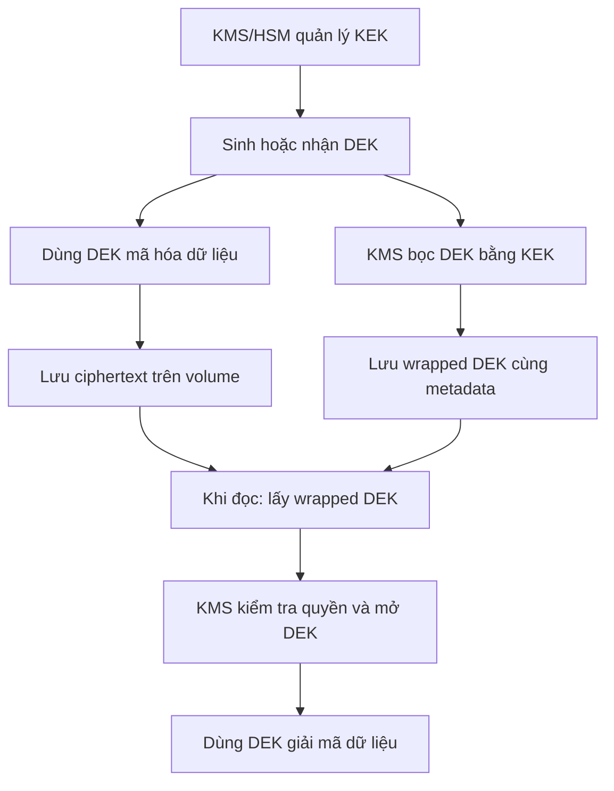
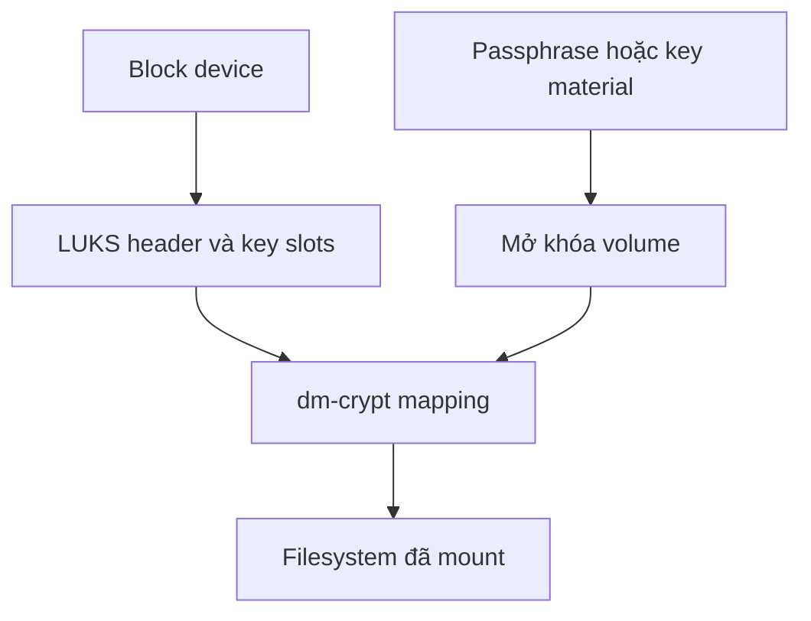

# Mã hóa đĩa và quản lý quyền sử dụng khóa

## Mục tiêu học tập

Sau bài học, bạn có thể:

- Giải thích mục tiêu và phạm vi của mã hóa đĩa trong môi trường máy tính đám mây.
- Phân biệt mã hóa do nhà cung cấp quản lý, khóa do khách hàng quản lý và mã hóa bên trong hệ điều hành.
- Mô tả cách mã hóa envelope sử dụng khóa dữ liệu (DEK) và khóa mã hóa khóa (KEK).
- Thiết kế quyền truy cập KMS theo nguyên tắc đặc quyền tối thiểu cho VM, dịch vụ và người vận hành.
- Lập kế hoạch xoay vòng, thu hồi, sao lưu và khôi phục khóa mà không làm mất khả năng đọc dữ liệu.
- Kiểm tra phạm vi mã hóa của đĩa, snapshot, image và bản sao lưu trong vòng đời VM.

## 1. Vì sao phải mã hóa đĩa?

Đĩa của máy ảo (VM) có thể chứa hệ điều hành, dữ liệu nghiệp vụ, cơ sở dữ liệu, log, tệp tạm và thông tin cấu hình. Khi đĩa được lưu trên hạ tầng cloud, dữ liệu có thể tồn tại trong nhiều bản sao hoặc trạng thái khác nhau: volume đang gắn vào VM, snapshot, image, bản sao lưu, bản sao ở region khác hoặc bản sao nội bộ do nhà cung cấp quản lý.

Mã hóa đĩa (disk encryption) biến dữ liệu rõ thành dữ liệu mã hóa bằng thuật toán mật mã và khóa. Người không có quyền sử dụng khóa phù hợp sẽ không thể đọc nội dung dữ liệu theo cách thông thường, ngay cả khi có được bản sao của các khối dữ liệu đã mã hóa.

Mã hóa giúp giảm rủi ro khi:

- Thiết bị lưu trữ vật lý bị thất lạc hoặc xử lý không đúng quy trình.
- Snapshot, bản sao lưu hoặc image bị sao chép ngoài phạm vi dự kiến.
- Một người có thể truy cập dữ liệu lưu trữ nhưng không được phép sử dụng khóa giải mã.
- Tổ chức cần đáp ứng chính sách bảo vệ dữ liệu, yêu cầu kiểm toán hoặc quy định ngành.

Mã hóa đĩa không tự giải quyết mọi vấn đề bảo mật. Khi VM đang chạy và volume đã được mở khóa, hệ điều hành và ứng dụng được cấp quyền vẫn có thể đọc dữ liệu rõ. Nếu tài khoản quản trị VM bị chiếm quyền, kẻ tấn công có thể truy cập dữ liệu qua hệ điều hành dù volume đã mã hóa. Vì vậy, mã hóa phải đi cùng IAM, bảo vệ workload identity, kiểm soát truy cập hệ điều hành, sao lưu và giám sát.

### Phân biệt các trạng thái dữ liệu

| Trạng thái | Ví dụ | Biện pháp thường dùng |
|---|---|---|
| Data at rest (dữ liệu lưu trữ) | Block volume, boot disk, snapshot, backup | Mã hóa đĩa, mã hóa object/backup, quản lý khóa |
| Data in transit (dữ liệu truyền) | VM trao đổi dữ liệu qua mạng, ứng dụng truy cập database | TLS, VPN hoặc kênh truyền được bảo vệ |
| Data in use (dữ liệu đang xử lý) | Dữ liệu trong RAM, thanh ghi CPU, bộ nhớ ứng dụng | Kiểm soát tiến trình, bảo vệ bộ nhớ, confidential computing khi phù hợp |

Mã hóa đĩa chủ yếu bảo vệ data at rest. Nó không thay thế TLS cho kết nối mạng và cũng không tự mã hóa mọi dữ liệu đang nằm trong RAM.

## 2. Các lớp mã hóa đĩa trong cloud

Một dịch vụ compute có thể hỗ trợ nhiều lớp mã hóa. Tên tính năng và cách triển khai tùy nhà cung cấp, nhưng có thể phân loại theo vị trí thực hiện mã hóa.

### 2.1. Mã hóa ở lớp lưu trữ của nhà cung cấp

Nhà cung cấp cloud mã hóa dữ liệu khi ghi xuống thiết bị lưu trữ vật lý và giải mã khi phục vụ yêu cầu đọc hợp lệ. Ứng dụng và hệ điều hành thường không phải thay đổi cách đọc/ghi dữ liệu.

Đặc điểm:

- Thường được tích hợp với block storage hoặc dịch vụ quản lý đĩa.
- Có thể được bật mặc định hoặc tự động theo chính sách của tài khoản/tổ chức.
- Có thể dùng khóa do nhà cung cấp quản lý hoặc khóa do khách hàng chỉ định.
- Giúp bảo vệ dữ liệu trên hạ tầng lưu trữ và bản sao được dịch vụ quản lý theo phạm vi hỗ trợ.

Cần đọc tài liệu để xác định chính xác những thành phần nào được mã hóa: dữ liệu volume, cache, snapshot, bản sao, metadata hay chỉ các khối dữ liệu chính. Không nên suy luận rằng bật mã hóa cho volume sẽ tự động mã hóa mọi bản xuất hoặc bản sao ở một dịch vụ khác.

### 2.2. Mã hóa do hệ điều hành hoặc ứng dụng quản lý

Mã hóa có thể diễn ra bên trong guest OS trước khi dữ liệu được ghi xuống volume. Ví dụ:

- Linux dùng LUKS/dm-crypt để mã hóa phân vùng hoặc volume.
- Windows dùng BitLocker để mã hóa volume.
- Ứng dụng hoặc cơ sở dữ liệu có thể mã hóa tệp, bảng hoặc trường dữ liệu ở lớp ứng dụng.

Lớp mã hóa này giúp tổ chức kiểm soát thêm cách dữ liệu được mã hóa và khóa được sử dụng. Tuy nhiên, nó làm tăng trách nhiệm vận hành: phải quản lý khóa mở volume, xử lý khởi động tự động, khôi phục khi mất khóa, giám sát lỗi mount và lập kế hoạch phục hồi.

Nếu VM phải tự mở khóa volume khi khởi động, khóa không nên được lưu dạng rõ trong image hoặc script khởi động. Hãy sử dụng cơ chế tích hợp với KMS, TPM/vTPM hoặc dịch vụ secret phù hợp, đồng thời giới hạn quyền lấy khóa cho đúng workload identity.

### 2.3. Mã hóa kết hợp

Một số kiến trúc dùng đồng thời mã hóa ở lớp cloud storage và mã hóa trong guest OS. Hai lớp có thể phục vụ mục tiêu kiểm soát khác nhau:

- Lớp storage bảo vệ bản sao dữ liệu ở hạ tầng lưu trữ.
- Lớp guest OS cho phép tổ chức kiểm soát khóa và chính sách mở volume bên trong VM.

Mã hóa nhiều lớp làm tăng độ phức tạp, thời gian xử lý và yêu cầu khôi phục. Chỉ nên dùng khi có yêu cầu rõ ràng về phân tách trách nhiệm, quyền kiểm soát hoặc tuân thủ. Cần kiểm thử ảnh hưởng đến hiệu năng, boot, snapshot, backup và quy trình phục hồi.

## 3. Khóa do nhà cung cấp quản lý và khóa do khách hàng quản lý

Khi bật mã hóa volume, cần xác định ai kiểm soát khóa và ai chịu trách nhiệm vận hành vòng đời khóa.

| Mô hình | Ai quản lý khóa | Quyền kiểm soát của khách hàng | Trách nhiệm chính |
|---|---|---|---|
| Provider-managed key | Nhà cung cấp cloud | Thường ít tùy chỉnh hơn; sử dụng khóa theo chính sách dịch vụ | Nhà cung cấp quản lý bảo vệ, lưu trữ và nhiều thao tác vòng đời |
| Customer-managed key (CMK) | Khách hàng quản lý chính sách và quyền; dịch vụ KMS/HSM lưu giữ, thực hiện thao tác mật mã | Kiểm soát quyền sử dụng, chính sách, lịch xoay vòng và trạng thái khóa trong phạm vi nền tảng | Khách hàng quản lý IAM, quyền, giám sát, xoay vòng và khả năng khôi phục |
| Customer-provided key (CPK) hoặc khóa cung cấp khi yêu cầu | Khách hàng cung cấp khóa theo cơ chế của dịch vụ | Có thể kiểm soát cao hơn đối với vật liệu khóa nhưng phải tuân thủ yêu cầu lưu giữ và gửi khóa | Bảo vệ, phân phối, luân chuyển và khả năng sẵn sàng của khóa |
| External key management (EKM/HYOK) | Khách hàng hoặc hệ thống KMS/HSM bên ngoài | Khóa có thể được giữ ngoài hệ thống cloud theo kiến trúc hỗ trợ | Vận hành kết nối, tính sẵn sàng, độ trễ, audit và phục hồi của hệ thống khóa ngoài |

Các thuật ngữ CMK, CPK, BYOK (Bring Your Own Key) và HYOK (Hold Your Own Key) không có ý nghĩa hoàn toàn giống nhau giữa các nhà cung cấp. Hãy xem tài liệu của đúng dịch vụ. Chẳng hạn, BYOK có thể chỉ việc nhập vật liệu khóa vào KMS của cloud; sau khi nhập, vật liệu đó vẫn có thể được lưu giữ và xử lý trong KMS của nhà cung cấp. HYOK thường nhấn mạnh việc giữ quyền kiểm soát vật liệu khóa bên ngoài cloud, nhưng không phải dịch vụ nào cũng hỗ trợ.

### Khi nào chọn khóa do nhà cung cấp quản lý?

Mô hình này phù hợp khi tổ chức cần mã hóa mặc định, muốn giảm công việc vận hành khóa và không có yêu cầu phải tự quản lý chính sách khóa riêng. Đây có thể là lựa chọn tốt cho môi trường phát triển, thử nghiệm hoặc workload có yêu cầu kiểm soát tiêu chuẩn.

### Khi nào chọn khóa do khách hàng quản lý?

CMK phù hợp khi tổ chức cần:

- Tách quyền quản lý dữ liệu khỏi quyền quản trị workload.
- Cấp hoặc thu hồi quyền sử dụng khóa theo workload identity.
- Ghi nhận hoạt động sử dụng khóa trong audit log.
- Chủ động xoay vòng, vô hiệu hóa hoặc lên lịch xóa khóa.
- Áp dụng chính sách khóa theo nhóm dữ liệu, môi trường hoặc đơn vị nghiệp vụ.

Quyền kiểm soát cao hơn cũng tạo thêm rủi ro vận hành. Nếu khóa bị vô hiệu hóa, xóa hoặc quyền truy cập bị thu hồi nhầm, VM có thể không đọc được volume hoặc snapshot. Vì vậy, CMK cần quy trình thay đổi, giám sát và khôi phục rõ ràng.

## 4. Cách mã hóa envelope hoạt động

Các dịch vụ KMS thường dùng mô hình mã hóa envelope (envelope encryption) để tránh phải dùng một khóa gốc duy nhất mã hóa trực tiếp toàn bộ dữ liệu lớn.

Hai loại khóa chính:

- **DEK (Data Encryption Key):** khóa dữ liệu, dùng để mã hóa các khối dữ liệu hoặc dữ liệu thực tế.
- **KEK (Key Encryption Key):** khóa dùng để mã hóa/bọc DEK. Trong KMS, khóa này thường được gọi là key-encryption key hoặc customer-managed key.

Luồng khái niệm:



Quy trình thường diễn ra như sau:

1. Dịch vụ lưu trữ yêu cầu KMS tạo hoặc bảo vệ một DEK.
2. DEK được dùng để mã hóa dữ liệu bằng thuật toán phù hợp, thường là mã hóa đối xứng có xác thực.
3. KMS dùng KEK để bọc DEK thành wrapped key.
4. Dịch vụ lưu trữ giữ ciphertext, wrapped DEK và metadata cần thiết.
5. Khi cần đọc, dịch vụ yêu cầu KMS mở wrapped DEK.
6. KMS kiểm tra danh tính, quyền và chính sách trước khi trả DEK hoặc cho phép thao tác giải mã.
7. Dịch vụ dùng DEK để giải mã dữ liệu và phục vụ VM.

Vật liệu KEK thường được bảo vệ trong KMS hoặc HSM và không được xuất ra dưới dạng rõ. DEK có thể được xử lý trong bộ nhớ của dịch vụ trong thời gian cần thiết; cách lưu giữ và phạm vi lộ khóa phụ thuộc kiến trúc của nhà cung cấp.

### Vì sao không mã hóa toàn bộ đĩa trực tiếp bằng KEK?

Đĩa có thể rất lớn và cần đọc/ghi liên tục. KMS thường tối ưu cho thao tác khóa, không phải mã hóa từng block lưu trữ ở tốc độ I/O của volume. Envelope encryption cho phép dùng DEK ở lớp dữ liệu và chỉ cần KEK để bảo vệ DEK. Nhờ đó, KMS không phải xử lý mọi byte đọc/ghi của đĩa.

### Ví dụ minh họa

Một volume cơ sở dữ liệu có 2 TiB dữ liệu. Dịch vụ storage dùng một hoặc nhiều DEK để mã hóa dữ liệu theo thiết kế của dịch vụ. Mỗi DEK được bọc bằng CMK trong KMS. Khi quản trị viên thu hồi quyền sử dụng CMK, dịch vụ có thể không mở được DEK để đọc dữ liệu. Ciphertext vẫn còn trên volume, nhưng khả năng sử dụng dữ liệu bị gián đoạn.

Điều này cho thấy quyền sử dụng khóa là một phần của tính sẵn sàng dữ liệu, không chỉ là một thiết lập bảo mật.

## 5. KMS, HSM và các thao tác khóa

**KMS (Key Management Service)** là dịch vụ quản lý khóa cung cấp API để tạo, lưu trữ, sử dụng, xoay vòng và kiểm soát quyền đối với khóa. KMS thường tích hợp với block storage, database, object storage, backup và các dịch vụ khác.

**HSM (Hardware Security Module)** là thiết bị hoặc môi trường phần cứng chuyên dụng để bảo vệ vật liệu khóa và thực hiện thao tác mật mã. Một số KMS dùng HSM phía sau; một số cung cấp tùy chọn HSM chuyên biệt hoặc external HSM.

Các thao tác thường gặp:

- Tạo khóa hoặc nhập vật liệu khóa.
- Đọc metadata và trạng thái khóa.
- Cấp quyền mã hóa/giải mã hoặc tạo grant cho dịch vụ.
- Xoay vòng hoặc tạo phiên bản khóa mới.
- Vô hiệu hóa, kích hoạt lại hoặc lên lịch xóa.
- Xem audit log và lịch sử sử dụng khóa.
- Sao lưu hoặc khôi phục vật liệu khóa nếu nền tảng hỗ trợ.

Không phải mọi khóa đều có thể xuất hoặc sao lưu. Một số loại khóa được tạo và giữ bên trong HSM; khả năng phục hồi phụ thuộc loại KMS, loại khóa và quy trình của nhà cung cấp.

### Các thuộc tính cần quản lý

| Thuộc tính | Ý nghĩa vận hành |
|---|---|
| Key ID / Key ARN / resource name | Định danh khóa được workload tham chiếu |
| Key state | Trạng thái enabled, disabled, pending deletion hoặc trạng thái tương tự |
| Key policy / IAM policy | Ai được quản lý khóa và ai được sử dụng khóa |
| Key version | Phiên bản vật liệu khóa được dùng cho thao tác mật mã |
| Rotation setting | Lịch hoặc cơ chế tạo phiên bản mới |
| Region / location | Vị trí khóa và phạm vi dịch vụ có thể sử dụng |
| Audit events | Lịch sử thao tác quản trị và sử dụng khóa |

Tên thuộc tính khác nhau giữa các nền tảng. Cần phân biệt quyền **quản lý khóa** với quyền **sử dụng khóa**. Người có quyền bật/tắt hoặc xóa khóa không nhất thiết cần quyền giải mã dữ liệu; workload chỉ cần quyền sử dụng khóa theo giao thức của dịch vụ.

## 6. Thiết kế quyền truy cập khóa theo đặc quyền tối thiểu

Quyền KMS cần được cấp cho đúng danh tính và đúng thao tác. Tránh cấp quyền giải mã cho toàn bộ project hoặc cho mọi người dùng chỉ vì một VM cần đọc volume.

### 6.1. Dùng workload identity

Mỗi ứng dụng hoặc VM nên sử dụng danh tính dịch vụ riêng, chẳng hạn managed identity, instance profile hoặc service account tùy nền tảng. Dịch vụ storage có thể được ủy quyền dùng khóa thông qua service identity hoặc grant.

Lợi ích:

- Không phải nhúng access key hoặc secret dài hạn vào image.
- Có thể thu hồi quyền cho một workload mà không ảnh hưởng workload khác.
- Audit log có thể gắn thao tác sử dụng khóa với danh tính cụ thể.
- Dễ áp dụng quyền khác nhau cho production, staging và development.

### 6.2. Tách quyền quản trị và quyền sử dụng

Một mô hình phân quyền tham khảo:

| Vai trò | Quyền phù hợp | Không nên mặc định cấp |
|---|---|---|
| Key administrator | Tạo, cấu hình, xoay vòng, vô hiệu hóa khóa theo quy trình | Đọc dữ liệu ứng dụng hoặc sử dụng khóa giải mã tùy tiện |
| Security auditor | Xem policy, metadata và audit log | Thay đổi khóa hoặc giải mã dữ liệu |
| Storage service identity | Sử dụng khóa theo thao tác cần thiết để mã hóa/giải mã DEK | Xóa khóa, thay đổi policy hoặc quản trị KMS |
| VM/application identity | Quyền truy cập dữ liệu theo thiết kế; chỉ gọi KMS nếu kiến trúc guest encryption yêu cầu | Quyền quản trị khóa hoặc quyền giải mã mọi dữ liệu |
| Backup/restore service identity | Sử dụng khóa cần thiết để tạo và phục hồi bản sao | Quyền quản trị không giới hạn trên tất cả khóa |

Đây là mô hình tham khảo. Với mã hóa do dịch vụ storage quản lý, VM thường không trực tiếp gọi KMS để giải mã từng lần đọc; dịch vụ storage thực hiện thao tác theo quyền được cấp. Với LUKS hoặc BitLocker trong guest OS, workload hoặc cơ chế khởi động có thể cần truy cập KMS/secret service để lấy khóa mở volume.

### 6.3. Cấp quyền đúng phạm vi

Khi thiết kế policy, cần xác định:

- Principal nào được phép sử dụng khóa.
- Thao tác nào cần thiết: encrypt, decrypt, generate data key, re-encrypt hoặc create grant.
- Khóa nào được tham chiếu.
- Tài nguyên hoặc dịch vụ nào được phép sử dụng khóa.
- Điều kiện nào phải thỏa: project, account, region, encryption context, resource tag hoặc network endpoint nếu nền tảng hỗ trợ.
- Ai được sửa policy, thu hồi grant hoặc xóa khóa.

Không cấp quyền rộng chỉ để làm cho thao tác tạo VM thành công. Nếu dịch vụ báo thiếu quyền KMS, hãy đọc error details để xác định principal và thao tác bị từ chối, sau đó cấp đúng quyền tối thiểu.

### 6.4. Tránh lưu khóa trong image và cấu hình

Không đưa khóa rõ, mật khẩu volume hoặc secret dài hạn vào:

- Golden image hoặc template VM.
- User data, startup script hoặc cloud-init.
- Repository mã nguồn, file cấu hình dùng chung.
- Log, ticket hỗ trợ hoặc output pipeline.
- Biến môi trường tồn tại lâu hơn thời gian cần thiết.

Thay vào đó, workload nên xác thực bằng identity được cấp từ nền tảng và lấy quyền sử dụng khóa theo chính sách. Nếu guest OS cần passphrase để mở LUKS, hãy thiết kế cơ chế lấy secret an toàn và kiểm thử khả năng boot/restore khi dịch vụ KMS không khả dụng.

## 7. Xoay vòng khóa và phiên bản khóa

Xoay vòng khóa (key rotation) là việc thay vật liệu khóa theo lịch hoặc theo sự kiện bảo mật. Mục tiêu là giới hạn thời gian sử dụng của một khóa và giảm ảnh hưởng nếu khóa bị lộ.

Cần phân biệt:

- **Tạo phiên bản khóa mới:** KMS sinh hoặc nhập vật liệu mới dưới cùng logical key hoặc một key ID khác.
- **Xoay vòng khóa mã hóa khóa (KEK rotation):** cập nhật khóa dùng để bọc DEK.
- **Mã hóa lại dữ liệu (data re-encryption):** đọc dữ liệu cũ, giải mã và mã hóa lại bằng DEK mới.
- **Re-wrap DEK:** dùng KEK mới bọc lại DEK hiện có mà không phải mã hóa lại toàn bộ dữ liệu.

Một số dịch vụ tự động dùng phiên bản KEK mới cho dữ liệu mới và vẫn giữ phiên bản cũ để giải mã dữ liệu đã mã hóa trước đó. Việc xoay vòng CMK không nhất thiết đồng nghĩa toàn bộ block dữ liệu trên volume được mã hóa lại. Cần đọc tài liệu dịch vụ để hiểu chính xác cách xử lý ciphertext cũ.

### Quy trình xoay vòng tham khảo

1. Xác định khóa đang được volume, snapshot, backup và image tham chiếu.
2. Kiểm tra chính sách retention và khả năng giải mã dữ liệu cũ.
3. Tạo hoặc kích hoạt phiên bản khóa mới theo quy trình được hỗ trợ.
4. Cập nhật chính sách hoặc cấu hình để dữ liệu mới sử dụng phiên bản mới.
5. Thực hiện re-wrap hoặc re-encryption nếu yêu cầu bảo mật quy định.
6. Kiểm thử đọc volume, tạo snapshot và khôi phục backup bằng phiên bản mới.
7. Theo dõi lỗi KMS và audit log trong giai đoạn chuyển đổi.
8. Chỉ ngừng sử dụng phiên bản cũ khi chắc chắn không còn dữ liệu hoặc bản sao nào cần nó.

Không xóa phiên bản khóa cũ chỉ vì đã bật automatic rotation. Snapshot cũ hoặc bản sao lưu dài hạn có thể vẫn cần phiên bản đó để giải mã.

## 8. Vô hiệu hóa, thu hồi và xóa khóa

Các thao tác này có tác động khác nhau:

- **Disable:** tạm thời ngăn sử dụng khóa. Dữ liệu đã mã hóa vẫn tồn tại nhưng có thể không đọc được trong thời gian khóa bị vô hiệu hóa.
- **Revoke grant hoặc quyền:** ngăn một principal hoặc dịch vụ tiếp tục sử dụng khóa theo quyền đã cấp.
- **Schedule deletion:** lên lịch xóa khóa sau một khoảng chờ theo quy định của KMS. Trong thời gian chờ có thể hủy lịch xóa nếu nền tảng cho phép.
- **Delete/destroy key material:** loại bỏ vật liệu khóa. Nếu không còn bản sao có thể khôi phục, dữ liệu được mã hóa bằng khóa đó có thể mất khả năng giải mã vĩnh viễn.

Trước khi vô hiệu hóa hoặc xóa khóa, cần lập danh sách mọi phụ thuộc:

- Boot disk và data disk đang gắn vào VM.
- Snapshot và backup còn trong thời hạn lưu giữ.
- Image được tạo từ volume mã hóa.
- Bản sao ở region khác hoặc tài khoản khác.
- Volume đã detach nhưng vẫn cần lưu trữ.
- Hệ thống khôi phục thảm họa và bản sao lưu offline.

Một khóa bị xóa có thể làm VM không khởi động hoặc không thể gắn volume. Với boot disk, hậu quả có thể là toàn bộ VM không thể khởi động. Với data disk, ứng dụng có thể lỗi khi mở database hoặc đọc dữ liệu.

### Thu hồi khẩn cấp khi nghi khóa bị lộ

Nếu nghi ngờ khóa hoặc quyền sử dụng khóa bị xâm phạm:

1. Xác định khóa, workload, dữ liệu và phạm vi tài khoản bị ảnh hưởng.
2. Dùng audit log để tìm principal và thời điểm thao tác bất thường.
3. Thu hồi grant hoặc quyền của principal bị xâm phạm; cân nhắc disable khóa theo kế hoạch ứng cứu.
4. Đánh giá tác động tới VM đang chạy, volume, snapshot và backup.
5. Tạo khóa mới và chuyển workload sang khóa mới theo quy trình được hỗ trợ.
6. Re-wrap hoặc mã hóa lại dữ liệu khi cần.
7. Kiểm tra khả năng khôi phục và ghi nhận sự kiện theo quy trình incident response.

Không xóa khóa ngay khi phát hiện nghi vấn. Xóa khóa có thể biến sự cố bảo mật thành sự cố mất dữ liệu không thể phục hồi.

## 9. Mã hóa boot disk, data disk, snapshot và backup

Mã hóa phải được đánh giá theo toàn bộ vòng đời dữ liệu, không chỉ theo volume ban đầu.

| Thành phần | Điều cần xác minh |
|---|---|
| Boot disk | Có được mã hóa mặc định không; VM có khởi động được khi dùng CMK không; dịch vụ nào cần quyền KMS |
| Data disk | Khóa nào được dùng; có hỗ trợ thay khóa hoặc mã hóa lại không; cách gắn vào VM khác |
| Snapshot | Snapshot kế thừa khóa nguồn hay dùng khóa mới; quyền chia sẻ và khôi phục |
| Machine image | Image có chứa dữ liệu đã mã hóa; người dùng đích có quyền dùng khóa không |
| Backup | Dữ liệu backup được mã hóa ở lớp nào; khóa có còn tồn tại trong suốt thời gian lưu giữ không |
| Cross-region copy | Region đích có KMS key tương thích; có cần re-encrypt bằng khóa tại region đích không |
| Export/download | Dữ liệu xuất ra có còn mã hóa; ai có quyền giải mã sau khi tải xuống |

Các hành vi này phụ thuộc dịch vụ. Một số nền tảng cho phép snapshot mã hóa bằng cùng khóa nguồn; một số yêu cầu chỉ định khóa đích khi sao chép qua region hoặc account. Không giả định snapshot luôn độc lập với khóa gốc.

### Kịch bản khôi phục cần thử

- Tạo snapshot từ volume đang mã hóa và khôi phục thành volume mới.
- Gắn volume đã khôi phục vào VM khác có quyền phù hợp.
- Khôi phục backup ở region khác bằng khóa đích.
- Khởi động VM từ boot disk được tạo từ image mã hóa.
- Khôi phục khi khóa cũ đã xoay vòng nhưng vẫn còn phiên bản cũ.
- Khôi phục khi workload identity thay đổi hoặc grant cần được tạo lại.

Một bản backup được đánh dấu thành công nhưng không thể giải mã vẫn không phải bản backup có thể sử dụng. Hãy kiểm thử restore định kỳ và ghi nhận thời gian khôi phục, quyền cần thiết, phiên bản khóa và kết quả xác minh dữ liệu.

## 10. Mã hóa volume bên trong Linux và Windows

Mã hóa ở guest OS có thể bổ sung quyền kiểm soát cho tổ chức, nhưng cần được thiết kế từ lúc tạo image.

### 10.1. Linux với LUKS/dm-crypt

LUKS (Linux Unified Key Setup) là định dạng quản lý khóa cho các volume mã hóa dựa trên dm-crypt. Một thiết bị được mã hóa có thể được mở thành thiết bị ánh xạ đã giải mã để filesystem sử dụng.

Luồng khái niệm:



Các lệnh dưới đây chỉ minh họa thao tác trên thiết bị thử nghiệm. Chúng có thể phá hủy dữ liệu trên thiết bị đích; cần sao lưu và xác định đúng thiết bị trước khi thực hiện.

```bash
# Xem thiết bị và filesystem
lsblk -f

# Khởi tạo LUKS trên thiết bị thử nghiệm (xóa dữ liệu cũ trên thiết bị)
sudo cryptsetup luksFormat /dev/sdX

# Mở volume đã mã hóa
sudo cryptsetup open /dev/sdX secure-data

# Tạo filesystem trên thiết bị ánh xạ
sudo mkfs.ext4 /dev/mapper/secure-data

# Gắn filesystem
sudo mkdir -p /mnt/secure-data
sudo mount /dev/mapper/secure-data /mnt/secure-data

# Khi kết thúc sử dụng, tháo mount và đóng mapping
sudo umount /mnt/secure-data
sudo cryptsetup close secure-data
```

Trong ví dụ, /dev/sdX là tên giả định. Không chạy lệnh trên thiết bị thật nếu chưa xác định chính xác volume. LUKS header chứa metadata cần thiết để mở khóa; mất hoặc hỏng header có thể khiến dữ liệu không thể truy cập. Cần sao lưu header theo quy trình bảo mật và bảo vệ bản sao đó như thông tin nhạy cảm.

Với boot volume, cần tích hợp mở khóa vào initramfs và quy trình khởi động. Nếu dùng TPM hoặc KMS để mở khóa tự động, hãy kiểm tra cách khôi phục khi VM đổi host, thay firmware, thay PCR hoặc mất kết nối tới KMS.

### 10.2. Windows với BitLocker

BitLocker mã hóa volume và có thể sử dụng TPM để bảo vệ khóa mở volume. Trong VM cloud, khả năng TPM/vTPM, Secure Boot và bảo vệ boot phụ thuộc loại VM và hệ điều hành.

Khi thiết kế BitLocker:

- Xác nhận VM hỗ trợ vTPM nếu dùng TPM protector.
- Lưu recovery key ở nơi được kiểm soát và kiểm thử khả năng truy xuất.
- Phân quyền đọc recovery key theo vai trò và ghi audit log.
- Kiểm thử khởi động lại, thay đổi cấu hình VM và phục hồi từ snapshot.
- Không lưu recovery key trong image, script hoặc ticket hỗ trợ.

BitLocker trong guest OS và mã hóa đĩa do cloud provider thực hiện là hai lớp khác nhau. Cần xác định tổ chức muốn dùng một lớp hay kết hợp cả hai, ai quản lý khóa và cách phục hồi khi mất quyền truy cập.

## 11. Kiểm tra trạng thái mã hóa và quyền khóa

Tên lệnh và API cụ thể tùy cloud provider. Một quy trình kiểm tra tổng quát nên bao gồm:

1. Xem thuộc tính volume để xác nhận encryption enabled và key reference.
2. Xem metadata của khóa để xác nhận key state, region và chính sách.
3. Kiểm tra principal mà dịch vụ storage hoặc VM dùng để truy cập khóa.
4. Xem policy/grant có đúng thao tác và phạm vi không.
5. Đọc audit log để xác nhận thao tác encrypt/decrypt hoặc generate data key thành công.
6. Tạo snapshot thử nghiệm và restore vào một VM kiểm thử.
7. Xác nhận dữ liệu sau restore bằng checksum hoặc kiểm tra ứng dụng.

Ví dụ lệnh Linux để kiểm tra trạng thái volume bên trong guest:

```bash
# Xem các thiết bị block và filesystem
lsblk -f

# Xem các thiết bị mã hóa đang được mở
sudo cryptsetup status secure-data

# Xem thông tin LUKS (chỉ metadata, không hiển thị passphrase)
sudo cryptsetup luksDump /dev/sdX
```

Các lệnh này chỉ kiểm tra lớp guest OS. Nếu volume được mã hóa trong hạ tầng storage của cloud, hãy kiểm tra encryption status, key ID và audit log trong console/API của nhà cung cấp.

## 12. Xử lý sự cố thường gặp

| Triệu chứng | Nguyên nhân có thể | Hướng điều tra |
|---|---|---|
| VM không khởi động sau khi bật mã hóa boot disk | Thiếu quyền KMS, cấu hình mở khóa guest OS sai hoặc boot chain không tương thích | Xem boot diagnostics, KMS audit log và cấu hình boot |
| Không gắn được data disk mã hóa | Principal của dịch vụ không có quyền dùng khóa, key bị disable hoặc region không khớp | Kiểm tra key state, policy, grant và phạm vi region |
| Snapshot tạo được nhưng restore thất bại | Thiếu quyền với khóa nguồn/đích hoặc khóa đã bị xóa | Xác minh key reference và quyền của restore service |
| Ứng dụng không đọc được volume sau khi xoay vòng | Phiên bản khóa cũ không còn khả dụng hoặc DEK chưa được re-wrap đúng | Kiểm tra key version và quy trình rotation |
| KMS báo AccessDenied | Sai principal, thiếu thao tác, policy hoặc điều kiện context không thỏa | Đọc audit event, xác định principal và API operation bị từ chối |
| VM khởi động chậm hoặc lỗi khi KMS không sẵn sàng | Guest encryption phụ thuộc KMS trong giai đoạn boot | Kiểm tra network path, endpoint, timeout và phương án recovery |
| Dữ liệu backup không khôi phục được ở region khác | Khóa chỉ khả dụng ở region nguồn hoặc chưa có khóa đích | Chuẩn bị khóa tại region đích và kiểm thử copy/restore |

### Quy trình xử lý

1. Xác định lớp mã hóa gây lỗi: storage encryption, guest OS encryption hay application-level encryption.
2. Xác định tài nguyên và khóa liên quan bằng volume ID, snapshot ID và key reference.
3. Kiểm tra key state, policy, grant, principal và audit log.
4. Kiểm tra region, account và điều kiện encryption context.
5. Nếu quyền bị thiếu, cấp đúng quyền tối thiểu theo quy trình quản trị.
6. Nếu khóa bị disable, đánh giá tác động và chỉ kích hoạt lại sau khi xác minh nguyên nhân, người phê duyệt và phạm vi.
7. Nếu cần khôi phục, dùng snapshot/backup và khóa đã xác minh trong môi trường thử nghiệm.
8. Sau khi dịch vụ hoạt động, kiểm tra lại quyền, audit log và khả năng restore.

Không tạo khóa mới rồi thay key reference ngay khi volume không mở được. Khóa mới không thể tự giải mã ciphertext đã được mã hóa bằng khóa cũ. Trước tiên phải xác định khóa gốc, trạng thái và khả năng phục hồi của nó.

## 13. Ví dụ thực tế: mã hóa boot disk và database disk

Một hệ thống nội bộ có hai loại volume:

- Boot disk chứa Linux và công cụ vận hành.
- Data disk chứa dữ liệu database, cần giữ lại trong thời gian dài và có snapshot hằng ngày.

Nhóm bảo mật yêu cầu dùng CMK để tách quyền quản lý khóa khỏi quyền quản trị VM. Kiến trúc tham khảo:

- Tạo một CMK dành cho production data trong KMS.
- Chỉ định key administrator quản lý policy và rotation.
- Cấp quyền sử dụng khóa cho storage service identity theo đúng tài khoản và region.
- Tạo boot disk và data disk với cấu hình mã hóa được nền tảng hỗ trợ.
- Dùng identity riêng cho VM để truy cập ứng dụng và dữ liệu theo IAM.
- Thiết lập audit log cho thao tác quản trị và sử dụng khóa.
- Tạo snapshot thử nghiệm, sau đó restore volume bằng cùng policy.
- Sao chép backup sang region dự phòng với khóa đích đã được chuẩn bị.
- Diễn tập tình huống key bị disable, mất quyền grant và cần khôi phục.

Khi vận hành, nhóm không cấp quyền xóa CMK cho người quản trị VM. Việc xoay vòng hoặc thay đổi trạng thái khóa cần có phê duyệt, đánh giá phụ thuộc và kiểm thử restore. Nhờ vậy, quyền sử dụng khóa được quản lý độc lập với quyền vận hành máy.

## 14. Những nhầm lẫn thường gặp

- **Volume có biểu tượng mã hóa nghĩa là mọi bản sao đều đã được bảo vệ.** Cần kiểm tra snapshot, backup, image, export và bản sao cross-region theo từng dịch vụ.
- **CMK đồng nghĩa khách hàng giữ vật liệu khóa bên ngoài cloud.** CMK thường được lưu và sử dụng trong KMS của nhà cung cấp; BYOK/HYOK có ý nghĩa riêng.
- **Xoay vòng khóa tự động mã hóa lại toàn bộ đĩa.** Rotation có thể chỉ tạo phiên bản KEK mới; dữ liệu cũ và DEK cũ vẫn cần được giải mã theo cơ chế dịch vụ.
- **VM có quyền quản trị thì cần quyền KMS quản trị.** Workload thường chỉ cần quyền sử dụng khóa ở phạm vi hẹp; quyền quản trị nên tách riêng.
- **Disable khóa chỉ ảnh hưởng dữ liệu mới.** Khóa bị vô hiệu hóa có thể khiến cả dữ liệu cũ không thể đọc.
- **Xóa khóa giống xóa volume.** Volume ciphertext có thể vẫn tồn tại nhưng mất khóa có thể khiến dữ liệu không thể khôi phục.
- **Mã hóa đĩa bảo vệ dữ liệu khi VM đang chạy khỏi mọi quản trị viên.** Khi volume đã mở, hệ điều hành và tiến trình có quyền vẫn đọc được dữ liệu rõ.
- **Backup mã hóa là đủ, không cần thử restore.** Cần xác minh quyền và khóa thực sự cho phép khôi phục dữ liệu.

## 15. Tự kiểm tra

**Tình huống 1:** Một volume được mã hóa bằng CMK. Nhóm vận hành vô hiệu hóa khóa để kiểm tra chính sách, sau đó ứng dụng không đọc được volume. Vì sao?

**Gợi ý:** Storage service cần sử dụng khóa để mở DEK hoặc thực hiện thao tác mật mã. Khi CMK bị disable, việc sử dụng khóa bị chặn và volume có thể không truy cập được. Hãy đánh giá tác động trước khi thay đổi key state.

**Tình huống 2:** Tổ chức bật automatic rotation cho CMK. Có thể xóa ngay phiên bản khóa cũ không?

**Gợi ý:** Không. Snapshot, backup hoặc ciphertext cũ có thể vẫn cần phiên bản cũ để giải mã. Cần xác định mọi phụ thuộc và kiểm thử restore trước khi loại bỏ.

**Tình huống 3:** Một VM cần mount volume LUKS khi boot. Có nên ghi passphrase vào cloud-init không?

**Gợi ý:** Không nên lưu secret dài hạn trong user data hoặc startup script. Hãy dùng workload identity và cơ chế lấy khóa/secret an toàn; đồng thời kiểm thử khả năng boot khi KMS không sẵn sàng.

**Tình huống 4:** Snapshot mã hóa ở region A cần được khôi phục tại region B. Cần kiểm tra những gì?

**Gợi ý:** Xác minh dịch vụ hỗ trợ sao chép snapshot mã hóa, khóa đích tại region B, quyền của restore identity và cách re-encrypt. Thực hiện một lần restore thử trước khi phụ thuộc vào bản sao dự phòng.

**Tình huống 5:** Một người dùng có quyền đọc snapshot nhưng không có quyền sử dụng CMK. Người đó có thể đọc dữ liệu rõ không?

**Gợi ý:** Với mô hình CMK và envelope encryption, quyền đọc ciphertext không tự cấp quyền mở DEK. Tuy nhiên, cần kiểm tra chính xác cách dịch vụ chia sẻ snapshot và xử lý quyền khóa.

## Kết luận

Mã hóa đĩa bảo vệ dữ liệu lưu trữ bằng cách kết hợp ciphertext với khóa được quản lý theo chính sách. Trong cloud, cần hiểu lớp mã hóa, mô hình khóa và cách KMS cấp quyền cho storage service hoặc workload identity. Envelope encryption tách khóa dữ liệu khỏi khóa quản lý; CMK tăng khả năng kiểm soát nhưng cũng làm quyền sử dụng khóa trở thành một phần của tính sẵn sàng. Hãy quản lý quyền theo đặc quyền tối thiểu, xoay vòng có kế hoạch, bảo vệ phiên bản khóa cũ và kiểm thử restore cho volume, snapshot, image và backup trước khi đưa hệ thống vào production.
