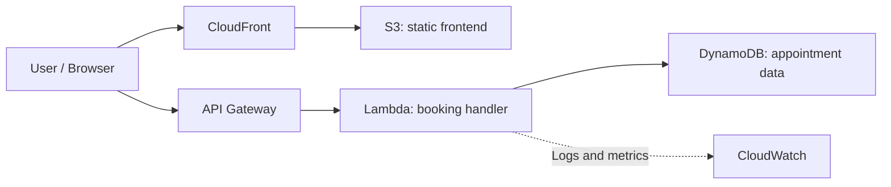

# What Is AWS and the Cloud Computing Model

Cloud computing enables organizations to use IT resources on demand, over the network and through management interfaces, instead of having to purchase and operate all physical infrastructure themselves. **Amazon Web Services (AWS)** is Amazon's cloud computing platform, providing compute, storage, database, networking, security, integration, and operations services.

This opening lesson of the **CLOUD_PROVIDERS_AWS** module builds the foundation for learners to explore Regions/Availability Zones, IAM, VPC, compute services, storage, databases, integration, and serverless; from there, you can select services and design systems that are secure, observable, resilient, and cost-controlled.

## Learning Objectives

After this lesson, you will be able to:

1. Explain what cloud computing is, how it operates, and how it differs from self-managed infrastructure.
2. Distinguish between **IaaS, PaaS, SaaS** and understand where **serverless/FaaS** fits.
3. Compare **public cloud, private cloud, hybrid cloud** deployment models and the concept of multi-cloud.
4. Recognize the **Region – Availability Zone (AZ)** structure and common AWS service categories.
5. Apply the **Shared Responsibility Model**, availability design principles, security, and cost management to real-world scenarios.

## 1. What Is Cloud Computing Really?

Imagine a development team wanting to run a booking application. In the traditional approach, the team might have to buy servers, place equipment in a data center, configure networking, supply power, provide cooling, replace failed hardware, and provision capacity for peak traffic. With the cloud, the team can create virtual servers, databases, or an event-processing function using management tools or APIs; the provider operates the underlying infrastructure beneath those services.

Cloud computing typically has **five core characteristics**:

| Characteristic | Meaning | Example on AWS |
|---|---|---|
| On-demand self-service | Proactively provision resources when authorized, without ordering physical equipment | Launch an EC2 instance via Console, CLI, or API |
| Broad network access | Use and manage services over standard network interfaces | Send requests to API Gateway over HTTPS |
| Resource pooling | The provider allocates physical infrastructure to multiple customers, with appropriate isolation mechanisms | Multiple accounts using services on the same AWS platform |
| Rapid elasticity | Can scale resources up or down based on load and service mechanisms | Scale out EC2 via Auto Scaling or let Lambda automatically scale execution within configured limits |
| Measured service | Consumption is recorded for management and billing | Track usage hours, storage volume, API requests, or data transfer |

**Key takeaway:** the cloud is not simply "servers located somewhere else." The difference lies in software-driven provisioning, automation, elasticity, and consumption measurement. Applications running on the cloud still require architecture design, access control, data security, and monitoring.

### 1.1. Easily Confused Terms

- **Scalability:** the system can handle larger loads by increasing capacity. *Vertical scaling* increases CPU/RAM for a single machine; *horizontal scaling* increases the number of machines or processing instances.
- **Elasticity:** capacity scales up and down flexibly with demand, ideally tracking actual load closely to avoid waste.
- **Availability:** the degree to which a service can serve requests when users need it. Two machines sharing a single point of failure do not necessarily provide high availability.
- **Durability:** the probability that data remains intact and is not lost. Storing an object durably does not mean the application can always access it.
- **Disaster recovery:** plans and measures to bring a service back into operation after a major incident; requires defining **RTO** (Recovery Time Objective) and **RPO** (Recovery Point Objective — maximum acceptable data loss, measured in time).

## 2. Why Do Organizations Use the Cloud?

| Criterion | Self-managed infrastructure (*on-premises*) | Using cloud services |
|---|---|---|
| Provisioning | Procurement, shipping, rack installation, and device configuration | Provisioned via Console, API, or Infrastructure as Code tools |
| Reserve capacity | Usually purchased upfront based on forecasts | Can scale out or scale in depending on the service and quotas |
| Cost | Investment in equipment, space, power, staff; ongoing operational costs still apply | Usually pay-as-you-go or commitment-based; operational and data transfer fees still apply |
| Physical operations | The owning organization is responsible | The provider is responsible for the physical cloud infrastructure |
| Control | Deep control over hardware and on-site environment | Layered control depending on the configuration capabilities of the chosen service |
| Experimentation speed | Can be slow if additional hardware must be acquired | Usually faster because resources and services are readily available |

For example, a ticketing application that only experiences campaign-based peaks can benefit from expanding capacity for short periods. Conversely, very steady workloads, specialized hardware requirements, or high data transfer costs need careful calculation before migrating to the cloud.

### 2.1. Benefits and Trade-offs

**Common benefits:** faster time to market; access to infrastructure across multiple geographic regions; deployment automation; reduced physical maintenance work; more options for availability, redundancy, and observability.

**Trade-offs to manage:** variable costs if unmonitored; misconfigurations can create security vulnerabilities; latency depends on user and infrastructure locations; reliance on certain provider interfaces/services (*vendor lock-in*); data, compliance, and operational skill requirements do not disappear automatically.

There is no rule that "cloud is always cheaper" or "moving to the cloud is automatically secure." Both statements depend on design and how the system is operated.

## 3. Three Service Models: IaaS, PaaS, SaaS

Service models answer the question: **up to which layer does the provider manage, and what does the development team still have to manage?**

| Model | What the customer typically manages | What the provider manages | Examples and suitable use cases |
|---|---|---|---|
| **IaaS** – *Infrastructure as a Service* | Operating system, patches, middleware, applications, data, and access configuration | Hardware, data centers, virtualization layer, and underlying infrastructure | **Amazon EC2**: need OS customization or running legacy applications |
| **PaaS** – *Platform as a Service* | Application code, data, and application configuration | Much of the deployment platform, runtime environment, and underlying resources | **AWS Elastic Beanstalk**: want to deploy applications with less effort building the environment |
| **SaaS** – *Software as a Service* | Accounts/users, usage permissions, input data, and product-level business settings | Complete application along with most of the operational platform | Web-based email or CRM software: need to **use** functionality rather than build the application |

These models describe levels of abstraction, **not three strictly separate types of infrastructure**. AWS offers services managed at varying levels. For example, **Amazon RDS** is a managed database: AWS handles many tasks related to the underlying infrastructure and database engine, while the customer still manages the data, access permissions, appropriate configuration, and how the application uses the data.

### 3.1. What Are Serverless and FaaS?

**Serverless** is a way of consuming services where developers do not have to provision and manage servers as a primary operational unit. Physical servers still exist and are managed by the provider. **Function as a Service (FaaS)** is a form of serverless that lets you run code in response to events.

Example with **AWS Lambda**:

1. An HTTPS request arrives at Amazon API Gateway.
2. API Gateway triggers a Lambda function.
3. Lambda executes business logic and reads/writes data.
4. The development team pays according to the pricing model for compute resources and invocation count/execution duration, plus the cost of related services.

Advantages: minimal server management, well-suited for event-driven tasks and variable traffic. Trade-offs: execution time/resource limits, cold-start latency in certain situations, connection management, distributed observability, and cost risks at large scale.

**Distinction:** IaaS/PaaS/SaaS describe the level of service delivered; serverless describes how server operations are abstracted away. A single system can combine EC2, managed databases, and Lambda.

### 3.2. Choosing a Model by Scenario

- Need specific system library configurations, OS-level software installation, or control over long-running processes: consider **EC2/IaaS**.
- Have a standard web application and want the platform to assist with deployment and operations: consider **PaaS** or a managed container service.
- Have a task to send an email after an order is created: consider **Lambda** with a queue/event service.
- Simply need an off-the-shelf customer management tool: consider **SaaS** instead of building everything from scratch.

## 4. Cloud Deployment Models

Deployment models answer the question: **how is cloud infrastructure organized, owned, and connected?**

| Model | Description | Typical scenario |
|---|---|---|
| **Public cloud** | Cloud resources offered by a provider to multiple customers, with isolation and access-control mechanisms | Building applications on AWS; dedicated AWS accounts consuming AWS services |
| **Private cloud** | A cloud environment dedicated to a single organization, hosted on-premises or operated by another party | An organization that wants dedicated control over its own cloud environment |
| **Hybrid cloud** | Combining distinct environments, such as on-premises infrastructure and public cloud, with integration/portability of data or applications | Keeping core systems in a data center while deploying web services on AWS |
| **Multi-cloud** | Using services from two or more cloud providers; this is an operational strategy choice, not mutually exclusive with the three models above | Application A runs on AWS, while Application B runs on another cloud platform |

**AWS Outposts** is an example product that supports hybrid models by bringing select AWS infrastructure and services to a customer's premises. Using multiple **AZs**, multiple **Regions**, multiple **VPCs**, or multiple **AWS accounts** still uses a single cloud provider; by itself, that is not multi-cloud.

You should not choose hybrid or multi-cloud just because it sounds "safer": the benefits must outweigh the added complexity of networking, identity, data synchronization, deployment, and incident support.

## 5. How Does AWS Organize Its Infrastructure?

AWS deploys services across many locations worldwide. Three foundational concepts to distinguish:

- **Region:** a geographic area where AWS provides a set of services (for example, `ap-southeast-1` in Singapore). When creating most resources, you choose a Region; pricing, latency, service availability, and data residency requirements can vary between Regions.
- **Availability Zone (AZ):** one or more data centers with independent power, networking, and connectivity, engineered for significant fault isolation from other AZs within the same Region. Many architectures use **at least two AZs** to avoid depending on a single AZ.
- **Edge location:** points of presence closer to end users, serving certain services such as the Amazon CloudFront content delivery network, helping reduce latency when delivering content.

```text
AWS
├── Region A
│   ├── AZ A1
│   ├── AZ A2
│   └── AZ A3
└── Region B
    ├── AZ B1
    └── AZ B2
```

*This diagram is conceptual; the actual number of AZs varies by Region and over time.*

An **AWS account** is an important boundary for resource management, permissions, and billing. **Amazon VPC** is a logical network within a Region; a **subnet** is bound to a single AZ. Therefore, placing two EC2 instances in two subnets across two AZs can help reduce the risk of downtime from losing one AZ, provided the application, load balancing, database, and other dependencies are also designed for fault tolerance.

Notes:

- A single EC2 instance in a single AZ still has a single point of failure.
- Multiple AZs improve fault tolerance within a Region, but do not replace a Region-wide disaster response plan.
- Backups, recovery, accidental-deletion protection, and Multi-AZ deployment address **different types of risk**.
- AWS services can have *global*, *regional*, or *zonal* scope; check each service's specific scope rather than assuming every resource belongs to a single AZ.

## 6. Quick Map of the AWS Ecosystem

AWS offers many services; at the introductory stage, remember the **problem domains** before memorizing product names:

| Problem domain | Representative services | Usage cue |
|---|---|---|
| Identity and access | **IAM**, **IAM Identity Center** | Who is allowed to perform which actions on which resources? |
| Multi-account governance | **AWS Organizations** | Separate environments, govern accounts, and apply organization-wide policies |
| Networking and delivery | **VPC**, **Elastic Load Balancing**, **CloudFront**, **Route 53** | Partition networks, receive, and distribute traffic |
| Compute | **EC2**, **ECS**, **EKS**, **Lambda** | Run applications on VMs, containers, or event-driven functions |
| Storage | **S3**, **EBS**, **EFS** | Object storage; block volumes for instances; shared file systems |
| Databases | **RDS**, **DynamoDB** | Managed relational databases or NoSQL key-value and document databases |
| Asynchronous integration | **SQS**, **EventBridge**, **SNS** | Decouple components using queues, events, or notifications |
| Monitoring and auditing | **CloudWatch**, **CloudTrail**, **AWS Config** | View metrics/logs/alarms, API activity, and resource configuration state |
| Data protection | **KMS**, encryption and access-control features | Key management, encryption, and related permissions |
| Cost management | **AWS Budgets**, **Cost Explorer**, **Cost and Usage Report** | Budget alerts, usage analysis, and billing reports |

Not every application needs all of these services. A simple static website might only need S3 and CloudFront; a complex transactional system might need a private network, multiple compute tiers, redundant databases, queues, security controls, and monitoring.

## 7. Shared Responsibility: Who Secures What?

AWS operates under the **Shared Responsibility Model**.

- **AWS is responsible for security *of* the cloud:** protecting data centers, hardware, and the underlying infrastructure layers operated by AWS for its services.
- **The customer is responsible for security *in* the cloud:** data, identities, access permissions, service configuration, applications, and any software layers managed by the customer.

The exact boundary varies by service type:

| Service | AWS primarily manages | Customer needs to manage |
|---|---|---|
| **EC2** | Physical infrastructure, hardware, and virtualization | OS patches, software, network configuration, IAM, data, and monitoring |
| **RDS** | Much of the infrastructure and DB engine operations depending on service/configuration | DB accounts, data, schema design, network access, appropriate backups/recovery |
| **S3** | Underlying storage systems and operational infrastructure | Bucket/object policies, access permissions, data classification, lifecycle, and accidental-deletion protection |
| **Lambda** | Execution infrastructure and managed runtime environment per service | Function code, dependencies, IAM permissions, secrets, configuration, and data handling |

For example, if you accidentally configure an S3 bucket to allow public access to sensitive data, that remains a failure within the customer's responsibility. Conversely, you do not have to repair the physical servers underlying the S3 service yourself.

**Security habits from day one:**

1. Protect the *root* user, enable MFA, and avoid using root for day-to-day work; prefer granting appropriate permissions through IAM Identity Center/roles.
2. Apply **least privilege**: each person and application only receives the permissions they need.
3. Never store access keys, passwords, or secrets in source code; use appropriate identity/secrets management mechanisms.
4. Only open required network ports and data access; encrypt data in transit and at rest as required.
5. Enable and review logging, alerting, backups, and test restores. **Backups are only useful if they can be restored.**

## 8. Architecture Example: A Small Booking App on AWS

Suppose a team builds a booking system consisting of a web frontend, an API for recording appointments, and a data store. An initial architecture might look like this:



Processing flow:

1. Users load HTML/CSS/JavaScript via CloudFront, with the origin content stored in S3.
2. The frontend calls API Gateway over HTTPS to create or view appointments.
3. API Gateway forwards the request to Lambda; the function validates input, enforces authentication/authorization by design, and processes business rules.
4. Lambda accesses DynamoDB using an **IAM role with scoped permissions**.
5. The operations team monitors logs, metrics, and alarms via CloudWatch, while configuring appropriate auditing and data protection controls.

**Why choose this approach?** The team reduces server administration overhead, components scale according to their own models, and it is easy to test an initial version. However, you must still design user authentication, rate limiting, idempotency against duplicate requests, access control, data backup/recovery, and budgeting.

Alternative implementations also make sense:

- If the application is legacy software requiring long-running processes and specialized OS libraries, **EC2** may be more suitable than Lambda.
- If the data has complex relationships, strict transactional constraints, and SQL queries, you might consider **RDS** instead of DynamoDB.
- If processing jobs take a long time or you need to prevent losing requests during temporary overload, you can add **SQS** between the request receiver and the processor.

There is no single "best AWS service" for every situation. Decisions must be based on load, data, cost, resilience, security requirements, and team skills.

### 8.1. Thinking About Reliability

For an application serving real users, ask yourself:

- **Where is the single point of failure?** A single EC2 instance, a non-redundant database, or a single network configuration can bring down the entire system.
- **What if an AZ fails?** Consider load balancing across multiple AZs, multiple instances, and the Multi-AZ option for an appropriate database service.
- **What if data is accidentally deleted?** You need backups, versioning, recovery points, or appropriate protections; deploying across multiple AZs alone does not fix logic bugs or accidental deletions.
- **What if recovery from a large-scale disaster is needed?** Define RTO/RPO, then consider cross-Region architecture, replication, or recovery along with the associated costs.

## 9. Billing and Cost Control

The cloud typically uses a **pay-as-you-go** model, though some resources also offer reservation/commitment options to optimize costs. The total bill depends not only on instance count, but also on runtime duration, storage capacity, requests, data retrieval, outbound bandwidth, and supporting resources.

You can build a simple estimation model:

```text
Total period cost ≈
    compute cost
  + storage and data retrieval cost
  + database cost
  + data transfer / networking cost
  + monitoring, security, and supporting services cost
  - eligible discounts or credits
```

This is a **categorization for budgeting**, not a fixed pricing formula. Units, tiers, and rates depend on the service, Region, configuration, pricing plan, and timing; check official pricing or the **AWS Pricing Calculator** before finalizing decisions.

Commonly overlooked charges include: instances left running overnight with no users; volumes and snapshots retained after terminating instances; data transferred out to the Internet or between components; NAT Gateway services; logs retained for too long; and databases running continuously.

A minimal cost-control workflow:

1. Choose a **Region**, service type, and sizing suited to actual needs.
2. Attach **tags** such as `project`, `environment`, and `owner` to support cost allocation (with cost allocation tags activated per AWS mechanisms).
3. Set up **AWS Budgets** and notifications, track spending with Cost Explorer, and review bills periodically.
4. Remove unused resources, optimize schedules, storage capacity, and log retention.
5. For steady workloads, evaluate commitment options versus On-Demand; for variable workloads, evaluate auto scaling capabilities.

**Important note:** AWS Budgets alerts **are not by default hard limits** that block all new charges. Free Tier/credit programs, free-usage conditions, and promotions can vary by account, service, and time. Do not treat creating an account or setting a budget as a guarantee against incurring charges.

## 10. Introductory Practice Exercises

### Exercise A — Choosing Services from Requirements

A company has three requirements:

| Requirement | Reasonable starting choice | Reason |
|---|---|---|
| Store product images and documents accessible via API | **S3** | Object storage, decoupled from server lifecycle |
| Run a legacy accounting application requiring OS customization | **EC2** | Full control over VM and OS configuration |
| Process an "order created" event to send notifications | **EventBridge/SQS combined with Lambda** | Decouples processing flow, event-driven execution |

These are preliminary choices. In a real design, you must also clarify load, access permissions, data durability, event loss/duplication handling, service quotas, and cost.

### Exercise B — Inspecting an Account with AWS CLI (Optional)

If you have a learning account with appropriate permissions, you can use **AWS CLI v2** with IAM Identity Center to verify your current identity and list AZs in the Singapore Region. The following commands are **read-only and do not create resources**:

```bash
# Configure a single sign-on profile per your organization's instructions
aws configure sso --profile aws-learning

# Log in and verify the granted identity
aws sso login --profile aws-learning
aws sts get-caller-identity --profile aws-learning

# Inspect AZs in the selected Region
aws ec2 describe-availability-zones \
  --region ap-southeast-1 \
  --profile aws-learning \
  --query 'AvailabilityZones[].ZoneName' \
  --output table
```

The last command requires the EC2 DescribeAvailabilityZones permission. AZ names like `ap-southeast-1a` may map to different physical AZs across different accounts; do not rely on the letter suffix to assume two accounts share the exact same physical AZ. If you do not have an account yet, you can still complete Exercise A and the self-assessment questions below at no cost.

### Exercise C — Self-Assessment

1. Why does "renting a server from another company" not necessarily satisfy all characteristics of cloud computing?
2. For a self-managed EC2 instance, who is responsible for applying operating system patches?
3. Are two applications running in two AZs within the same Region considered multi-cloud?
4. Why do data backups and Multi-AZ deployments not replace each other?
5. A team wants to run a short-lived API with very low traffic at night. Why might Lambda be a candidate, and what other factors still need to be checked?
6. Why does setting an AWS Budgets budget not guarantee the bill will stay below that amount?

**Answer hints:** (1) Cloud also requires on-demand provisioning, automation, elasticity, measured service, etc.; (2) the customer; (3) no; (4) they mitigate different types of failures; (5) reduces server management and scales on demand, but you must check quotas/limits, latency, load, dependencies, security, and pricing; (6) Budgets primarily monitors/alerts and does not automatically block all types of charges.

## 11. Key Takeaways Before Moving to the Next Lesson

- **AWS** is a cloud service ecosystem; cloud computing is a model for delivering resources on demand with elasticity and measured usage.
- **IaaS/PaaS/SaaS** differ in management boundaries; **serverless** further reduces server operations overhead for certain workload patterns.
- **Public/private/hybrid** describe deployment models; **multi-cloud** refers to using multiple providers.
- **Region, AZ, VPC, IAM** are foundational concepts for designing resource placement, connectivity, and access control.
- **Shared responsibility** and **cost management** start when selecting services, not only after an application is deployed.
- A reliable system requires designing **monitoring, fault tolerance, backups, and recovery** aligned with business objectives.

### Official References

- [AWS — What is Cloud Computing?](https://aws.amazon.com/what-is-cloud-computing/)
- [AWS — Cloud Computing Types](https://aws.amazon.com/types-of-cloud-computing/)
- [AWS — Global Infrastructure](https://aws.amazon.com/about-aws/global-infrastructure/)
- [AWS — Shared Responsibility Model](https://aws.amazon.com/compliance/shared-responsibility-model/)
- [AWS — Pricing](https://aws.amazon.com/pricing/)
- [AWS Well-Architected Framework](https://docs.aws.amazon.com/wellarchitected/latest/framework/welcome.html)
