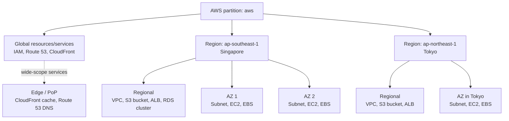
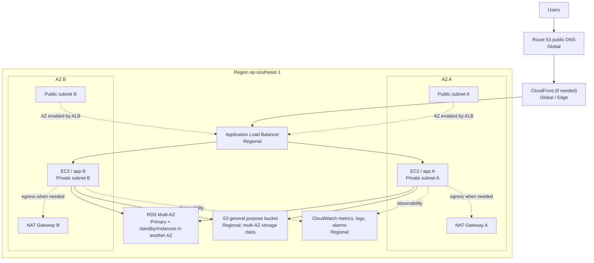

# Global, Regional, and Zonal Resource Scopes on AWS

## 1. Why Must We Distinguish Resource Scopes?

When deploying an application on Amazon Web Services (AWS), picking the right service is only part of the design. You need to know **at what scope a resource exists**, **a failure in which location can affect it**, **where data is stored**, and **whether you must create additional copies elsewhere**.

For example:

- Creating an **IAM role** so an application can access S3: this role has global scope within the account in an AWS partition; you do not need to recreate it simply because the application runs in another Region.
- Creating a **VPC** in Singapore (`ap-southeast-1`): that VPC is a resource in the Singapore Region and does not automatically appear in Tokyo (`ap-northeast-1`).
- Creating a **subnet** inside a VPC: a subnet resides in **only one Availability Zone (AZ)**.
- Creating an **EC2 instance** or **EBS volume**: they are placed in a specific AZ; to attach an EBS volume directly to an EC2 instance, both must be in the same AZ.
- Creating an **S3 general purpose bucket**: the bucket has a specific storage Region, even though the bucket name by default must be unique within the shared namespace of the entire AWS partition.

Distinguishing the three scopes **Global – Regional – Zonal** helps you choose deployment locations, design redundancy, limit incident impact (*blast radius*), and control latency, cost, and data residency requirements.

## 2. AWS Geographic and Partition Model

### 2.1. AWS Partition, Region, AZ, and Edge Location

| Concept | Meaning | Design impact |
|---|---|---|
| **AWS partition** | A major boundary separating a group of Regions and identity systems, such as `aws`, `aws-cn`, `aws-us-gov` | IAM and resources are not shared across partitions by default; ARNs include the partition component |
| **Global** | Scope of certain services or resources shared across multiple Regions within the same service/partition scope | You do not create per-Region copies for that entity; you must still account for control plane dependencies and failure points |
| **Region** | A geographic area where AWS operates infrastructure, such as `ap-southeast-1` (Singapore) | Primary boundary for choosing data location, deploying systems, pricing, and regional-level recovery |
| **Availability Zone (AZ)** | One or more data centers engineered for fault isolation within a Region | Where zonal resources live; spreading an application across multiple AZs helps tolerate a single-AZ failure |
| **Edge location / Point of Presence (PoP)** | A network point of presence close to users to provide capabilities such as content delivery or DNS | Helps reduce latency, but does not mean the application and database are deployed multi-Region |

Conceptual diagram (illustrative components, not depicting exact physical locations):



AZs within a Region have high-bandwidth, low-latency network links and are engineered to reduce the risk of being affected together by a single infrastructure event. However, **multiple AZs still belong to the same Region**. If the entire Region suffers a large-scale outage, spreading resources across multiple AZs alone is not enough to keep the service running.

### 2.2. How to Read Region and AZ Names

- `ap-southeast-1`: code for the Singapore Region.
- `ap-southeast-1a`: name of an AZ within that Region.
- `ap-southeast-1b`: name of another AZ within the same Region.
- `apse1-az1`: example of an **AZ ID** format, a consistent identifier for matching AZ locations across accounts.

**Multi-account note:** in some Regions, for accounts created before November 2025, the same AZ name like `ap-southeast-1a` may correspond to different physical locations between two accounts. AWS uses more consistent mapping for newer accounts; when coordinating subnets, sharing resources, or comparing AZs across accounts, **always compare the AZ ID**, rather than inferring solely from the `a`/`b` suffix.

An account can only see and use Regions/AZs that are supported, accessible under permissions, and opted into when required. Availability of specific instance types or services can also vary by Region and AZ.

### 2.3. Three Separate Questions

Separate three questions that are often conflated into one:

1. **Resource scope:** is an entity created and managed at Global, Regional, or Zonal (AZ) scope?
2. **Data placement:** where do the actual data and its replicas reside? A *regional* resource may replicate data across multiple AZs or store it under a special storage class.
3. **Endpoint/control plane:** which endpoint receives API calls, and where does the control plane live? A global endpoint or a Region-named endpoint does not by itself determine where data is stored.

For example, an S3 bucket has a specific storage Region; a general purpose bucket name by default belongs to a partition-wide global namespace. These two facts do not conflict because **naming scope** differs from **data storage scope**.

## 3. Global Resources: Shared Does Not Mean Failure-Proof

**Global resource/service** here means it is not normally identified or created separately per Region. Exact scope always depends on the service, account, and AWS partition.

| Service or resource | Scope to remember | Practical example |
|---|---|---|
| **AWS IAM** (user, group, role, managed policy) | Global within an account in a partition | Role `AppRole` can be used by applications in Singapore and Tokyo if policies, trust policies, and access allow it |
| **AWS Organizations** | Organization and account governance at broad scope, without creating a separate organization per Region | Apply Service Control Policies (SCPs) across accounts; an SCP sets permission guardrails and does not grant permissions itself |
| **Amazon Route 53 public hosted zone** | Public DNS management at global scope | DNS records direct users to endpoints in different Regions |
| **Amazon CloudFront distribution** | Content delivery service with a global edge network | Caches content close to users; the origin can still be an ALB/S3 in one Region |
| **AWS Global Accelerator** | Provides global entry points and routes traffic to endpoints in configured Regions | Improves availability and optimizes routing to multi-Region applications |

**Common pitfalls:**

- An IAM role usable across multiple Regions does **not** mean that role has every permission. IAM policies, resource policies, Region conditions, and other guardrail layers still govern which actions are allowed.
- Route 53 is a service name, but **not every Route 53 object is global**: Route 53 Resolver endpoints attach to a VPC within a Region.
- CloudFront serves traffic through the edge network, yet an origin or database failure in one Region can still break the application. Failover requires configuring backup origins and proper recovery procedures.
- Global services also have a **control plane** (where create/modify/delete configuration operations occur). A control plane disruption can make administrative operations unavailable even while existing data-plane serving continues. Therefore, do not design recovery plans that rely on creating new global resources during an incident.

**API exception:** an AWS WAF web ACL protecting CloudFront has scope `CLOUDFRONT` and uses API operations in `us-east-1`; a web ACL protecting an ALB or regional API Gateway has scope `REGIONAL` in the resource's Region. Where you call the API should not be confused with all of CloudFront running only in `us-east-1`.

## 4. Regional Resources: Scoped to One Region, Potentially Spanning Multiple AZs

A **regional** resource is created within a specific Region. To have an equivalent resource in another Region, you normally need to deploy, configure, or replicate it in that Region.

| Resource/service | Scope | Architectural notes |
|---|---|---|
| **VPC** | Region | A VPC can contain subnets in multiple AZs within the same Region; it cannot span across Regions |
| **Route tables, Network ACLs, Security Groups** in a VPC | Region/VPC | Rules and associations can apply to resources across multiple AZs in the VPC; they do not automatically appear in a VPC in another Region |
| **Application Load Balancer (ALB)** | Region | Enables AZs via subnets; routes traffic to healthy targets per configuration |
| **EC2 Auto Scaling group** | Region | Can place EC2 instances across multiple AZs by selecting multiple subnets/AZs |
| **AWS Lambda function** | Region | Functions are created per Region; with VPC configuration, choose appropriate subnets/AZs; users do not pin a typical Lambda invocation to a fixed EC2/AZ |
| **Amazon S3 general purpose bucket** | Region for bucket/data placement | By default, names must be unique in the partition's shared namespace; storage class determines how data is placed and replicated |
| **Amazon DynamoDB table** | Region | Global Tables is a configuration that creates and synchronizes table replicas across Regions; it does not turn a single standalone table into a global resource |
| **AWS KMS key** | Region | Multi-Region keys consist of related keys in different Regions, where each key remains a regional resource |
| **Amazon CloudWatch metrics/alarms** | Region | Multi-Region observability requires collecting/aggregating data accordingly; do not look for an alarm in the wrong Region |
| **Amazon RDS DB cluster** (e.g., Aurora) | Region | Cluster instances reside in AZs; replica and failover configuration determine fault tolerance |
| **Amazon EBS snapshot** | Region | Snapshots are not tied to the source volume's AZ; they can be used to create volumes in another AZ within the same Region |
| **Amazon EFS Regional file system** | Region | Regional data is stored redundantly across multiple AZs; mount targets, however, are zonal objects |

### 4.1. VPC and Subnets: The Most Important Relationship

A VPC is a network boundary **within a Region**. Each subnet in a VPC belongs to **exactly one AZ**. For example:

```text
Region ap-southeast-1
└── VPC 10.20.0.0/16
    ├── AZ a (per account)
    │   ├── public-subnet-a   10.20.0.0/24
    │   └── private-subnet-a  10.20.10.0/24
    ├── AZ b
    │   ├── public-subnet-b   10.20.1.0/24
    │   └── private-subnet-b  10.20.11.0/24
    └── AZ c
        ├── public-subnet-c   10.20.2.0/24
        └── private-subnet-c  10.20.12.0/24
```

Networking within a VPC allows resources in different subnets/AZs to communicate according to route tables, security groups, network ACLs, and related network settings. **Public/private subnet** is a convention based on routing design, especially having a route to an Internet Gateway; a subnet's custom name does not determine whether it has Internet access.

If you create a VPC with the same CIDR in Tokyo, it is still a **separate VPC** with its own ID, subnets, routes, security groups, and connections. Two VPCs in different Regions need an appropriate connectivity mechanism such as inter-Region VPC peering or AWS Transit Gateway peering, depending on requirements.

### 4.2. Services with a Regional Interface but Zonal Components

ALB is an example: the **load balancer object** belongs to the Region, but when deploying it you select subnets in different AZs. Auto Scaling groups are similar: the group belongs to the Region, while the EC2 instances it manages reside in specific AZs.

Amazon RDS also spans multiple levels: APIs and many settings are Regional; a **DB instance** runs in an AZ; **Multi-AZ** deployments place standby components in another AZ depending on the deployment mode. Simply placing one DB instance inside a Region that has multiple AZs does not automatically create cross-AZ redundancy.

## 5. Zonal Resources: Bound to a Single Availability Zone

| Resource | Scope | Implication |
|---|---|---|
| **EC2 instance** | One AZ | When that AZ is impacted, instances there may stop serving; you must run replicas or auto-recovery mechanisms in another AZ |
| **Subnet** | One AZ | Cannot stretch one subnet across two AZs; Multi-AZ requires multiple subnets |
| **EBS volume** | One AZ | Volumes attach directly only to compatible EC2 instances in the same AZ; moving AZs requires snapshots/restores or appropriate replication mechanisms |
| **NAT Gateway** (zonal type) | One AZ | Deploy NAT Gateways per AZ and configure corresponding subnet routes to avoid cross-AZ dependencies in fault-tolerant designs |
| **RDS DB instance** | One AZ | Multi-AZ creates standby components in another AZ per configuration; a standalone instance has no automatic standby |
| **EFS mount target** | One AZ | For EFS Regional, you can create per-AZ mount targets for local client access; One Zone has only one mount target in the file system's AZ |
| **S3 Express One Zone directory bucket** | One AZ | Storage configuration optimized for low-latency access within a single AZ; distinct from standard general purpose buckets |

Important consequence: **assigning an EC2 instance to a subnet chooses the AZ for that EC2 instance**. If your web server, NAT Gateway, and database all depend on the same AZ, the risk of an outage from an AZ failure remains high even though the Region has multiple AZs.

A Region may offer features or instance types unevenly across AZs. Always verify service availability, quotas, and actual AZs before finalizing a deployment diagram.

## 6. Cases Combining Multiple Scopes

### 6.1. S3: Global Namespace, Regional Bucket, Storage Class Determines Redundancy

For an **S3 general purpose bucket**:

1. A bucket is created in **one Region**. You cannot directly change its Region after creation.
2. Bucket names in the **shared global namespace** by default must be unique across the **AWS partition**, not just within the Region. AWS also offers an **account regional namespace** option with its own rules; therefore, when checking uniqueness you must know which namespace type is used.
3. Common storage classes such as **S3 Standard** distribute data redundantly across multiple AZs within a Region.
4. **S3 One Zone-IA** stores data in a single AZ, giving it a different fault-tolerance profile from multi-AZ classes. **S3 Express One Zone** uses directory buckets and has AZ scope.
5. If replicas are needed in another Region, configure mechanisms such as **S3 Cross-Region Replication** (and handle existing objects if needed). A bucket belonging to a Region does not automatically mean a replica exists in a second Region.

Thus, saying "S3 is global" is only accurate when referring to *the namespace or certain interfaces*, and **incorrect** if used to claim every object is replicated globally.

### 6.2. IAM: Broad Scope, Yet Permissions Remain Constrained

IAM users/roles do not need to be created once per Region within the same account/partition. However, permissions for actions like `ec2:RunInstances` or `s3:GetObject` still must be granted appropriately; policies can restrict access by ARN, conditions, Organizations SCPs, and related control mechanisms.

For example, an application using the same IAM role to read a bucket in Singapore and another bucket in Tokyo will succeed only if identity policies, bucket policies, encryption permissions, and network connectivity all allow it. **Global identity does not equal global access.**

### 6.3. EBS, Snapshots, and Cross-AZ Recovery

EBS volumes are **zonal**, whereas EBS snapshots are **regional**. If an EC2 instance in AZ A fails and a suitable snapshot exists:

1. Select AZ B in the same Region.
2. Create a new EBS volume from the snapshot in AZ B.
3. Launch an EC2 instance in AZ B, attach the new volume, and recover the application.

In practice, this process also requires application configuration, access permissions, encryption keys, networking, and handling data written after the snapshot. Snapshots do not mean EC2 automatically moves AZs; **RPO** depends on when and how often data backups are taken.

### 6.4. RDS/Aurora and Multi-AZ

- **Single-AZ:** the primary instance operates in one AZ; do not treat this as an architecture with automatic cross-AZ failover.
- **RDS Multi-AZ:** AWS places standby components according to the deployment mode; provides failover capability within the Region for qualifying incidents. Read/write behavior and instance counts differ by Multi-AZ type.
- **Aurora:** clusters are Regional, with storage distributed across multiple AZs by service design; placing reader instances in different AZs improves availability and failover readiness.
- **Recovery from a full-Region outage:** requires an independent cross-Region strategy, such as copying snapshots, cross-Region replicas, or engine-appropriate replication features.

Do not confuse **Multi-AZ** (increasing availability during a single-AZ failure) with **Multi-Region** (preparing for when an entire Region becomes unavailable).

### 6.5. Global Endpoints Do Not Guarantee Multi-Region Data

A domain managed with Route 53 or a CDN using CloudFront can serve users worldwide while still pointing to **one origin** or **one database** in Singapore. A global access layer does not replace deploying additional workloads and data in a backup Region.

## 7. Identifying Scope via ARNs and AWS CLI

### 7.1. Reading an ARN to Identify the Region

An ARN typically has the structure:

```text
arn:partition:service:region:account-id:resource
```

Illustrative examples (IDs/names do not correspond to real resources):

```text
arn:aws:iam::123456789012:role/AppRole
arn:aws:ec2:ap-southeast-1:123456789012:instance/i-0123456789abcdef0
arn:aws:elasticloadbalancing:ap-southeast-1:123456789012:loadbalancer/app/app-alb/1234567890abcdef
arn:aws:s3:::example-bucket-name
```

- The IAM role ARN has an empty Region field because roles are not uniquely scoped by Region.
- The EC2 and ALB ARNs include `ap-southeast-1`, indicating the Region.
- An S3 general purpose bucket ARN omits the Region, **yet the bucket is still created in a specific Region**.
- An EC2 instance ARN does not directly encode the AZ name. To find an instance's AZ, inspect its `Placement.AvailabilityZone` attribute.

**Do not use ARN structure as the sole rule to determine scope.** Each service has its own ARN formats and conventions; combine service documentation with resource-describing APIs.

### 7.2. Read-Only Inspection Commands (No Resources Created)

Prerequisites: AWS CLI v2 installed, profile/credentials configured, and read permissions for the resources. The examples use the Singapore Region; adjust the Region for your actual account. The commands below only perform queries.

**List Regions and opt-in status for the account:**

```bash
aws ec2 describe-regions \
  --all-regions \
  --region ap-southeast-1 \
  --query "Regions[].[RegionName,OptInStatus]" \
  --output table
```

**List AZ names, AZ IDs, and states in a Region:**

```bash
aws ec2 describe-availability-zones \
  --region ap-southeast-1 \
  --filters Name=zone-type,Values=availability-zone \
  --query "AvailabilityZones[].[ZoneName,ZoneId,State]" \
  --output table
```

**List VPCs, subnets, and corresponding AZs:**

```bash
aws ec2 describe-vpcs \
  --region ap-southeast-1 \
  --query "Vpcs[].[VpcId,CidrBlock]" \
  --output table

aws ec2 describe-subnets \
  --region ap-southeast-1 \
  --query "Subnets[].[SubnetId,VpcId,AvailabilityZone,AvailabilityZoneId]" \
  --output table
```

**Inspect EC2 instance and EBS volume placement:**

```bash
aws ec2 describe-instances \
  --region ap-southeast-1 \
  --query "Reservations[].Instances[].[InstanceId,Placement.AvailabilityZone,State.Name]" \
  --output table

aws ec2 describe-volumes \
  --region ap-southeast-1 \
  --query "Volumes[].[VolumeId,AvailabilityZone,State]" \
  --output table
```

**Check the Region of a known S3 general purpose bucket:**

```bash
aws s3api get-bucket-location \
  --bucket your-bucket-name \
  --query LocationConstraint \
  --output text
```

In some cases, an empty/`None` result corresponds to `us-east-1`; interpret it according to S3 API conventions. The command may fail if you lack access permissions to the bucket.

**Self-verify your hypothesis:** compare `describe-vpcs` output between `ap-southeast-1` and `ap-northeast-1`. The VPC lists differ because VPCs are regional; conversely, listing account IAM roles does not belong to a specific VPC or AZ.

## 8. Sample Design: A Web Application Tolerant to One AZ Failure

Suppose an e-commerce application requires login, APIs, file storage, and a database. The requirement is to operate in Singapore and continue serving traffic if one AZ fails.

**Single-Region design:**



In an actual deployment, the ALB attaches to public subnets in the enabled AZs; application EC2 instances can live in private subnets managed by an Auto Scaling group. NAT Gateways are optional depending on outbound access needs and should have explicit per-AZ routing. Some AWS service access can use VPC endpoints instead of traversing NAT.

### 8.1. When AZ A Fails

- The ALB can continue sending requests to healthy targets in AZ B if health checks, target groups, and routing are configured properly.
- The Auto Scaling group can launch replacement capacity in available AZs, subject to quotas, available capacity, and configuration.
- RDS Multi-AZ can fail over according to its deployment type; the application must handle connection errors, implement bounded retries, and reconnect.
- S3 buckets using a multi-AZ storage class continue providing data protection against a single-AZ failure according to the storage class's characteristics.
- The software can still suffer an outage if sessions are stored only on one EC2 instance, an internal queue has only one node, or configuration locks/NAT are concentrated in the failed AZ.

**Multi-AZ is a property of the entire dependency chain**, not merely launching two EC2 instances.

### 8.2. When the Entire Singapore Region Fails

The design above **does not guarantee** the application stays up. For a multi-Region plan, you need:

1. A deployment of all required components in a second Region (such as Tokyo), including networking, compute, permissions, and monitoring.
2. Appropriate data replication/recovery mechanisms: S3 replication, database replicas, cross-Region backups, or multi-Region-capable services.
3. A traffic redirection plan using Route 53/Global Accelerator/CloudFront within each service's capabilities and health-check setup.
4. Tested procedures for failover, failback, data consistency, and operating the system in the standby Region.
5. **RTO** (Recovery Time Objective) and **RPO** (Recovery Point Objective) defined by business requirements.

For example, if the system can tolerate at most **30 minutes of downtime** and at most **5 minutes of data loss**, those are **targets of RTO = 30 minutes, RPO = 5 minutes**, not guarantees automatically granted by creating resources in two Regions. You must select replication technologies, failover triggers, and test and measure to prove those targets.

## 9. Scope Implications for Security, Monitoring, and Cost

| Aspect | What must be decided |
|---|---|
| **Security/IAM** | IAM roles work broadly within a partition, yet resource policies, VPCs, KMS keys, and permission conditions still have their own scopes; do not assume "global role means global access" |
| **Data placement** | Choose Regions based on users, legal requirements, and service availability; review replication features and specific storage classes |
| **Availability** | Zonal resources need cross-AZ redundancy; Region-outage resilience requires a multi-Region strategy |
| **Monitoring** | CloudWatch metrics, log groups, and alarms generally operate per Region; design appropriate dashboards/aggregation when running multi-Region |
| **Latency** | Place compute near data and users; cross-AZ/cross-Region access adds network hops and can increase latency |
| **Cost** | Account for directional and per-service data transfer fees, especially cross-AZ/cross-Region traffic; multiple NAT Gateways, DB replicas, and standby Regions add cost |
| **Service availability** | Instance types, quotas, storage classes, pricing, and features can vary by Region/AZ; verify before adopting a reference diagram |

A design with the lowest initial cost can introduce a single point of failure by placing all resources in one AZ. Conversely, duplicating the entire application across two Regions from day one can be unnecessarily expensive if actual requirements only demand single-AZ fault tolerance. **Start from availability, data, and cost requirements**, then select the right scopes.

## 10. Common Misconceptions

| Statement | Assessment and correct understanding |
|---|---|
| "Create a VPC once and use it in every Region." | **False.** A VPC belongs to one Region; each Region needing a VPC must deploy its own. |
| "A subnet spans across multiple AZs." | **False.** Each subnet belongs to exactly one AZ. |
| "S3 bucket names are global, so objects automatically have copies in every Region." | **False.** Naming namespace and data storage location are separate concepts; an S3 bucket belongs to a Region. |
| "If EC2 and EBS are in the same Region, the volume can be attached directly." | **Insufficient.** They must be in the same AZ and meet compatibility requirements. |
| "Choosing a Region with multiple AZs makes one EC2 instance Multi-AZ automatically." | **False.** You must deploy replicas along with corresponding routing, failover, and data mechanisms. |
| "IAM roles are global, so they can access every resource by default." | **False.** Access depends on policies and applicable guardrails. |
| "CloudFront is global, so an origin in one Region survives a Region outage." | **False.** You must configure backup origins and a data strategy if Region-outage resilience is required. |
| "If two accounts use AZ `us-east-1a`, it is always the same physical AZ." | **Not always true.** Check the AZ ID when matching physical locations across accounts. |
| "Every resource of a service shares the exact same scope." | **False.** For instance, EFS Regional file systems vs. zonal mount targets; S3 Standard vs. S3 Express One Zone have different data placement models. |

## 11. Self-Check Scenarios

**Scenario 1 — Moving an application between AZs.** An EC2 instance and EBS volume are in AZ A, and you want to run a replacement instance in AZ B using the stored data. Can you directly attach the existing EBS volume from A to an instance in B?

**Hint:** No. Volumes are zonal. You can take a snapshot, then create a new volume in B; evaluate data changes since the latest snapshot and application recovery readiness.

**Scenario 2 — Two Regions sharing an IAM role.** A Lambda function running in Singapore and a Lambda function running in Tokyo both need to read the same S3 bucket in Singapore. Must you create the same IAM role twice per Region?

**Hint:** No, IAM roles have global scope within the account/partition; each Lambda can reference the appropriate role provided trust relationships, identity policies, bucket policies, and other conditions allow it. The two Lambda functions themselves remain separate regional resources.

**Scenario 3 — "Multi-AZ" app still goes down when one AZ fails.** A system has two EC2 instances in two AZs, yet both rely on one NAT Gateway in AZ A and a Single-AZ database also in A. Why can it still experience an outage?

**Hint:** The dependency path is still concentrated in AZ A. Consider per-AZ NAT/routes or appropriate VPC endpoints, a Multi-AZ database, storing session/state outside a single instance, and testing the entire business flow when AZ A is unavailable.

## 12. Key Principles to Remember When Designing on AWS

1. **Global:** ask "how widely is this service/resource shared, and what limits do its control plane and partition impose?"
2. **Regional:** ask "in which Region is this resource created, and does another Region need its own copy?"
3. **Zonal:** ask "if this AZ fails, do this resource and all critical dependencies have replacements in another AZ?"
4. **Data:** check the storage class, replica placement, replication, and recovery—never infer them solely from the service name.
5. **Resilience:** clearly distinguish instance failure, AZ failure, and full-Region failure; design, operate, and test for each tier.
6. **Cost:** evaluate cross-AZ/cross-Region traffic and the cost of maintaining standby capacity; do not ignore cost when picking scopes.

Mastering these boundaries establishes the foundation for studying **IAM, VPC, EC2, EBS, S3, RDS, Lambda, and CloudWatch**, as well as selecting services and deploying applications that are secure, observable, resilient, and cost-controlled.

### AWS Reference Documentation

- [AWS Regions and Availability Zones — AWS Global Infrastructure](https://docs.aws.amazon.com/global-infrastructure/latest/regions/aws-availability-zones.html)
- [Availability Zone IDs](https://docs.aws.amazon.com/global-infrastructure/latest/regions/az-ids.html)
- [AWS service endpoints — AWS General Reference](https://docs.aws.amazon.com/general/latest/gr/rande.html)
- [General purpose bucket naming rules — Amazon S3](https://docs.aws.amazon.com/AmazonS3/latest/userguide/bucketnamingrules.html)
- [Amazon S3 general purpose buckets overview](https://docs.aws.amazon.com/AmazonS3/latest/userguide/UsingBucket.html)
- [Creating EFS file systems — Regional and One Zone](https://docs.aws.amazon.com/efs/latest/ug/creating-using-create-fs.html)
- [Global services — AWS Fault Isolation Boundaries](https://docs.aws.amazon.com/whitepapers/latest/aws-fault-isolation-boundaries/global-services.html)
- [AWS WAF and CloudFront/Regional protection scopes](https://docs.aws.amazon.com/waf/latest/developerguide/how-aws-waf-works-resources.html)
