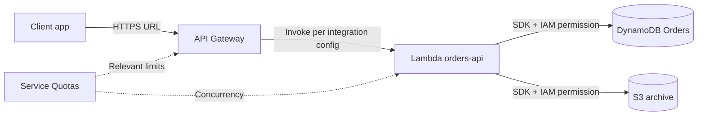

# ARNs, Resource IDs, Endpoints, and Service Quotas in AWS

> **Chapter:** AWS Overview  
> **Scope:** Foundational concepts used across IAM, VPC, EC2, S3, RDS, DynamoDB, Lambda, API Gateway, and other AWS services.

## Learning Objectives

After this lesson, you will be able to:

1. Distinguish **ARN**, **resource ID**, **endpoint**, and **service quota**; choose the right concept for each task.
2. Read ARN structure, recognize `partition`, service, Region, AWS Account, and resource name/ID; explain when fields are omitted.
3. Determine the scope of resource identifiers, endpoints, and quotas in multi-account, multi-Region architectures.
4. Use the AWS CLI to look up ARNs, resource IDs, endpoints, and quotas without creating resources.
5. Diagnose common errors: wrong ARN in IAM, calling the wrong endpoint, inability to reach a service, and exceeding resource or request-rate limits.

## 1. Four Concepts Answering Four Different Questions

When deploying applications on AWS, a resource can have a **name**, **ID**, **ARN**, and **connection address**, while also being governed by **quotas**. These pieces of information are related, yet not interchangeable.

| Concept | Question answered | Illustrative example | Where commonly used |
|---|---|---|---|
| **Resource ID** | "Which specific resource?" | `i-0123456789abcdef0`, `vpc-0123456789abcdef0` | API/CLI, infrastructure configuration, lookups, and operations |
| **ARN (Amazon Resource Name)** | "Which resource in AWS context to reference or grant permissions to?" | `arn:aws:lambda:ap-southeast-1:123456789012:function:orders-api` | IAM policies, cross-service integrations, event configurations |
| **Endpoint** | "To which network address do we send requests?" | `https://lambda.ap-southeast-1.amazonaws.com` | AWS SDK/CLI, DNS, API clients, database connections |
| **Service quota** | "How many resources or requests are permitted within the applicable scope?" | Limits on VPCs, EC2 vCPUs, concurrent Lambda executions | Capacity planning, scaling, monitoring, and quota increase requests |

**Quick mental model:** an ID or ARN identifies *the target object*; an endpoint specifies *the path to call the service*; a quota defines *allowed usage*. Having a valid endpoint does not mean you have permission to access it; having a valid ARN does not mean the resource still exists or is active.

For example, an application accessing a DynamoDB table `Orders` must target the table in the right Account and Region, call DynamoDB at the right endpoint, hold appropriate IAM permissions, and stay within request/throughput limits.

## 2. ARNs: Identifying Resources Across the AWS Ecosystem

### 2.1 General Structure

An ARN typically follows this format:

```text
arn:partition:service:region:account-id:resource
```

Meaning of each component:

| Component | Meaning |
|---|---|
| `arn` | Prefix identifying this string as an Amazon Resource Name |
| `partition` | AWS partition, such as `aws` (commercial AWS), `aws-us-gov`, `aws-cn` |
| `service` | Service namespace code, such as `ec2`, `s3`, `iam`, `lambda`, `dynamodb` |
| `region` | Resource Region if the service defines ARNs per Region, such as `ap-southeast-1` |
| `account-id` | AWS Account ID, usually a 12-digit string, if required by that ARN type |
| `resource` | Resource identifier segment following the service's syntax |

The final segment has no single universal form. AWS may use:

```text
resource-id
resource-type/resource-id
resource-type:resource-id
```

Do not construct ARNs by guessing syntax across every service. Whenever possible, retrieve ARNs returned by AWS via the API, CLI, CloudFormation/Terraform outputs, or Console.

### 2.2 Breaking Down Common ARNs

The values below are for learning purposes only; `123456789012` is a dummy Account ID.

**EC2 instance**, including Region, Account, and instance ID:

```text
arn:aws:ec2:ap-southeast-1:123456789012:instance/i-0123456789abcdef0
```

**Lambda function**, using the function name:

```text
arn:aws:lambda:ap-southeast-1:123456789012:function:orders-api
```

The ARN of a **Lambda version or alias** includes an extra trailing segment, such as:

```text
arn:aws:lambda:ap-southeast-1:123456789012:function:orders-api:prod
```

**DynamoDB table**:

```text
arn:aws:dynamodb:ap-southeast-1:123456789012:table/Orders
```

An **IAM role** is an account-scoped resource; the Region field is left blank:

```text
arn:aws:iam::123456789012:role/AppReadOnlyRole
```

**S3 buckets** and **S3 objects** use specialized syntax that omits both Account and Region in the standard ARN positions:

```text
arn:aws:s3:::example-orders-archive
arn:aws:s3:::example-orders-archive/2026/11/order-001.json
```

Here `example-orders-archive` is the bucket name and `2026/11/order-001.json` is the object key. Do not infer from the missing Region in the ARN that Region does not matter: the bucket is still created in a specific Region, and API requests must use an appropriate Region configuration.

**Important rule:** Not every ARN includes both Region and Account ID. Each service determines the syntax and scope of its own ARN types.

### 2.3 How Are ARNs Used in IAM?

The `Resource` field of an IAM policy typically uses ARNs to specify which resources are affected. For example, the policy below allows reading objects under the `production/` prefix of a hypothetical S3 bucket:

```json
{
  "Version": "2012-10-17",
  "Statement": [
    {
      "Sid": "ReadProductionObjects",
      "Effect": "Allow",
      "Action": "s3:GetObject",
      "Resource": "arn:aws:s3:::example-orders-archive/production/*"
    }
  ]
}
```

Note two distinct S3 resource levels:

- `s3:GetObject` applies to an **object ARN**, such as `arn:aws:s3:::bucket-name/path/*`.
- `s3:ListBucket` applies to a **bucket ARN**, such as `arn:aws:s3:::bucket-name`; to restrict listing to a single prefix, add an appropriate condition such as `s3:prefix`.

Granting `s3:GetObject` **does not automatically grant** `s3:ListBucket`. The illustrative policy above also does not account for other control layers such as bucket policies, AWS Organizations SCPs, permissions boundaries, KMS key policies, or explicit denies. Effective permissions are determined by the full authorization evaluation chain.

In IAM policies, the wildcard `*` can represent a group of resources when supported by the action and service. Broaden scope only when genuinely necessary and when you understand which objects match. Some IAM actions do not support resource-level permissions, requiring `Resource: "*"` paired with appropriate conditions; verify in the **Service Authorization Reference** for each service.

### 2.4 ARNs vs. Account IDs and Principal ARNs

Account ID `123456789012` identifies an AWS account; by itself, it is not an EC2, Lambda, or S3 ARN. An IAM role has its own ARN; when an application uses AWS STS to **assume a role**, the session's identity ARN may look like `arn:aws:sts::123456789012:assumed-role/AppReadOnlyRole/session-name`. Thus, the ARN returned by `sts get-caller-identity` does not necessarily match the underlying IAM role ARN verbatim.

This distinction is very useful when investigating logs, configuring trust policies, or troubleshooting `AccessDenied` errors in multi-account environments.

## 3. Resource IDs: How Services Refer to Specific Objects

AWS commonly generates IDs when creating resources. Examples:

| Service / resource | Common ID or name | Scope notes |
|---|---|---|
| EC2 instance | `i-0123456789abcdef0` | Look up in the right Account and Region |
| VPC | `vpc-0123456789abcdef0` | Regional VPC resource |
| Subnet | `subnet-0123456789abcdef0` | Subnet resides in one Availability Zone of one VPC |
| Security group | `sg-0123456789abcdef0` | Associated with a VPC |
| EBS volume | `vol-0123456789abcdef0` | Regional resource bound to one AZ |
| Lambda function | `orders-api` | Commonly referenced by name or ARN; supports aliases/versions |
| DynamoDB table | `Orders` | Table name must be interpreted within an Account and Region |
| S3 object | `2026/11/order-001.json` | Object key has meaning within a specific bucket |

These strings are illustrative. An ID usually **does not contain enough information by itself** to identify the account, Region, access permissions, or network address. For instance, `i-0123456789abcdef0` is not a URL, nor can you paste a bare ID into every IAM `Resource` field.

Each service accepts different input forms. For example, an EC2 command typically accepts `--instance-ids`, whereas many integration APIs or IAM policies require ARNs; Lambda has APIs that accept either a function name or an ARN. Read the API contract rather than assuming every field accepts both.

**Resource names are not always AWS-generated IDs.** S3 buckets use bucket names, DynamoDB uses table names, and EC2 uses instance IDs. Standard S3 bucket names must be unique within the applicable namespace/partition, yet you should never generalize S3 naming rules to other services.

## 4. Endpoints: Network Addresses for Connecting

### 4.1 An Endpoint Is Not an ARN

An endpoint is the DNS name or URL that a client connects to in order to use an API or service. Examples of public Regional AWS endpoints:

```text
https://ec2.ap-southeast-1.amazonaws.com
https://lambda.ap-southeast-1.amazonaws.com
https://dynamodb.ap-southeast-1.amazonaws.com
```

An application using an AWS SDK normally only needs to specify the Region; the SDK selects the appropriate endpoint and signs requests with AWS credentials. You never put an ARN where a URL belongs.

AWS offers multiple endpoint patterns depending on the service: Regional, global, dual-stack, FIPS, resource-specific endpoints, or customer-created endpoints. Never assume a single universal DNS formula across all services, especially in partitions such as `aws-cn` or `aws-us-gov`. Consult the **AWS General Reference – Service endpoints and quotas** when configuring specific integrations.

### 4.2 Service Endpoints, Application Endpoints, and Database Endpoints

Three common categories:

| Case | Example | How it is used |
|---|---|---|
| **AWS service API endpoint** | `https://dynamodb.ap-southeast-1.amazonaws.com` | SDK/CLI sends API requests to the service |
| **Application/API endpoint** | `https://a1b2c3d4e5.execute-api.ap-southeast-1.amazonaws.com/prod/orders` | Clients call a deployed API Gateway REST API |
| **Database endpoint** | `mydb.abc123.ap-southeast-1.rds.amazonaws.com` on port `5432` | Application PostgreSQL client connects to the DB if network and auth permit |

The API Gateway URL above only illustrates REST API syntax using stage `prod`. HTTP APIs may use different stage or mapping formats. An RDS endpoint is the database connection address, not the DB instance ARN. Databases usually require engine authentication or IAM DB authentication if configured.

### 4.3 Regions, Availability Zones, and Routing

A Region like `ap-southeast-1` determines where a Regional service deploys resources and where clients should send requests. An AZ like `ap-southeast-1a` is an infrastructure unit inside a Region and **is usually not** part of a standard API endpoint hostname.

Notes:

- Select the right Region when creating/querying resources; the wrong Region can cause an API to report a resource not found even if the ID or ARN is valid in another Region.
- S3 buckets have a specific Region; using the wrong Region can result in redirects or endpoint/signature errors depending on the API and client.
- The fact that an endpoint exists and resolves in DNS **does not mean** the request has IAM permissions, valid network routing, or that the service is healthy.
- Public endpoints may require HTTPS/TLS and AWS SigV4 signing; network reachability and authorization to perform an operation are two separate concerns.

### 4.4 VPC Endpoints: Private Network Access to Services

Inside a VPC, a workload running in a private subnet may need to access AWS services without sending traffic over the public Internet. A **VPC endpoint** provides a solution depending on the service type:

- **Gateway endpoint:** applies to Amazon S3 and DynamoDB, associating with appropriate route tables; it does not create an interface-style elastic network interface in a subnet.
- **Interface endpoint (AWS PrivateLink):** creates dedicated network interfaces in selected subnets; typically supports private DNS if the service and configuration allow it.
- Other endpoint types such as Gateway Load Balancer endpoints serve specialized purposes; the types above are not arbitrarily interchangeable.

Example: a Lambda function configured to run inside a VPC private subnet needs to read DynamoDB. You can configure a DynamoDB gateway endpoint and an appropriate route table. If calling service APIs through an interface endpoint, you must also examine security groups, DNS, and endpoint policies. Creating an endpoint **does not automatically grant** DynamoDB permissions to Lambda; the execution role must still be authorized.

Not every Lambda function needs a VPC. When not attached to a customer VPC, Lambda can already call supported AWS service APIs through service-managed connectivity. When Lambda **is** attached to a private subnet, you must design proper network paths (NAT or appropriate endpoints) for destinations outside the VPC.

## 5. Service Quotas: Limits on Capacity and Usage

A **service quota** is a limit enforced by AWS on resource counts, capacity, throughput, or other dimensions of usage. A quota is a property of **service + quota type + applicable scope**, not a general attribute of an ARN.

Important examples:

| Service | Quota type to inspect | Practical impact |
|---|---|---|
| Amazon EC2 | Running On-Demand instance vCPUs by instance family per Region | Can block launching additional instances |
| Amazon VPC | VPCs per Region; limits on subnets, route tables, or endpoints | Affects multi-environment network design |
| AWS Lambda | Concurrent executions in the Region and related limits | Traffic spikes can trigger throttling |
| Amazon API Gateway | Request rate, burst, and API configuration limits | API can return throttling responses when limits are exceeded |
| Amazon DynamoDB | Throughput, resource limits, and table/index or API limits | Affects scale and throttling behavior |
| Amazon S3 | Bucket count, request/API limits, or configuration-specific limits | Affects data partitioning and operational planning |

### 5.1 Scope and Quota Increases

Each quota may apply per **Account and Region**, per resource, or across a broader scope. Some quotas apply globally per account; some per Region; others per AZ, API, or specific resource. Never assume every quota is Regional.

Some quotas can be requested for increase via **Service Quotas** or AWS Support, while others are fixed and non-adjustable. In AWS Service Quotas, distinguish:

- **AWS default quota:** the published default value for the quota.
- **Applied quota:** the actual value enforced for your account in the inspected scope.
- **Adjustable:** whether the quota supports increase requests. "Adjustable" does not guarantee an increase request will always be approved.

Values can vary by service, Region, account, or time. Therefore, this lesson does not hardcode default vCPU, VPC, or concurrency numbers. Always check the **current applied quota in your actual account/Region** before deploying.

### 5.2 Resource Quotas vs. API Rate Limits

Distinguish two types of limits:

1. **Resource count/capacity limits**, such as VPC count, Lambda concurrent executions, or EC2 vCPUs.
2. **Request rate limits (rate limit/throttling)**, such as requests per second and burst limits for an API.

Increasing a resource quota does not necessarily increase an API rate limit, and vice versa. An API can still be throttled even when resource counts remain below quota. Handling throttling typically requires exponential backoff with jitter, bounded retries, client-side rate limiting, and queuing or load-leveling architectures.

Errors may appear as `ThrottlingException`, `TooManyRequestsException`, `ServiceQuotaExceededException`, or service-specific error codes. Read the **actual error code**, associated quota, and usage graphs instead of concluding every 4xx error is a quota issue.

### 5.3 Monitoring and Requesting Quota Increases

Recommended operational workflow:

1. Identify the service, Region, Account, and specific quota involved.
2. Look up the **applied quota** in the Service Quotas console/API; if not surfaced there, check documentation and AWS Support.
3. Measure current usage and projected growth. For quotas with usage metrics, monitor via Service Quotas integration with CloudWatch; not all quotas expose identical metrics.
4. Set alarms before hitting the limit. For instance, use an internal threshold of 70–80% for a measurable quota; this is a **recommended operational threshold**, not an AWS default.
5. Request quota increases early when adjustable, then track request status and the resulting applied value.
6. When an increase cannot be granted, consider distributing workloads, optimizing consumption, throttling traffic, or adjusting the architecture.

**Quotas are not cost limits.** Receiving a quota increase can increase potential spending. Use AWS Budgets, Cost Explorer, cost allocation tags, and billing alerts to govern spend; even a budget alert does not automatically block all new charges.

## 6. Integrated Example: An Order API Running on AWS

Suppose an order-processing application in Region `ap-southeast-1`, Account `123456789012`, consists of API Gateway → Lambda → DynamoDB, while storing archive files in S3.



In this model:

| Component | ARN / ID used to identify | Endpoint used to connect | Quotas to check |
|---|---|---|---|
| API Gateway | API ID `a1b2c3d4e5`; API/stage have API Gateway ARNs when needed | `https://a1b2c3d4e5.execute-api.ap-southeast-1.amazonaws.com/prod/orders` | Request rate, burst, API/stage counts as needed |
| Lambda | `arn:aws:lambda:ap-southeast-1:123456789012:function:orders-api` | API Gateway invokes Lambda via integration; SDK manages service endpoint | Concurrent executions, per-function/Region limits |
| DynamoDB | `arn:aws:dynamodb:ap-southeast-1:123456789012:table/Orders` | `https://dynamodb.ap-southeast-1.amazonaws.com` | Throughput, table/index, and API limits |
| S3 bucket | `arn:aws:s3:::example-orders-archive` | S3 endpoint matching Region and access pattern | Bucket count, request/configuration-specific limits |

**A client request traverses distinct layers:**

1. The client calls the API Gateway **URL endpoint**; the API ID sits in the hostname, yet the URL is not an ARN.
2. API Gateway uses its configured integration to invoke Lambda; Lambda invoke permissions and client authentication must be designed separately.
3. Lambda executes using its **execution role**. The role's IAM policy uses the **DynamoDB table ARN** and **S3 bucket/object ARN** to define permitted resources.
4. The AWS SDK picks the appropriate **service endpoint** so Lambda can call DynamoDB or S3.
5. As traffic grows, **Lambda concurrency quotas** and **request/throughput limits** of downstream services must be monitored.

Reading the architecture this way prevents confusing "having an endpoint means having access" or "having an ARN means knowing the URL to call."

### 6.1 Multi-Account and Multi-Region Variations

If `dev` and `prod` accounts are separated, ARNs for resources like Lambda or DynamoDB differ by Account even if names are identical. IAM policies and trust/integration relationships must be updated accordingly. If deploying a standby in another Region, service endpoints, ARNs of Regional resources, and many Regional quotas also change.

For S3, a bucket ARN does not display the Region in its standard structure, yet the bucket's Region and client configuration still matter. For IAM roles, the ARN omits the Region because IAM has partition-wide/global resources within an account. Never mechanically force a single rule onto every service.

## 7. AWS CLI Practice: Read-Only Lookups Without Creating Resources

**Prerequisites:** AWS CLI v2 configured with a profile/credentials holding appropriate read-only permissions. The commands below use the configured or explicitly passed Account and Region without creating infrastructure. Never share access keys, secret keys, or session tokens.

### 7.1 Check Current Identity

```bash
aws sts get-caller-identity
```

The output typically includes `Account`, `Arn`, and `UserId`. Verify `Account` before reading/modifying multi-account environments; note that `Arn` may be an assumed-role session ARN.

### 7.2 Inspect EC2 Resource IDs and Attributes

```bash
aws ec2 describe-instances \
  --region ap-southeast-1 \
  --query 'Reservations[].Instances[].{Id:InstanceId,RegionAZ:Placement.AvailabilityZone,VpcId:VpcId,State:State.Name}' \
  --output table
```

This command returns instance IDs, AZs, VPC IDs, and states if you have permissions and resources in that Region. It does not prove those instances exist in any other Region.

### 7.3 View the ARN of a Lambda Function or IAM Role

```bash
aws lambda get-function \
  --function-name orders-api \
  --region ap-southeast-1 \
  --query 'Configuration.FunctionArn' \
  --output text
```

```bash
aws iam get-role \
  --role-name AppReadOnlyRole \
  --query 'Role.Arn' \
  --output text
```

Both commands succeed only if the example resource name actually exists and the caller has permission. Compare the Region segment in the Lambda ARN with the empty Region segment in the IAM role ARN.

### 7.4 Check Applied Quotas and Default Quotas

List Lambda quotas in the target Region:

```bash
aws service-quotas list-service-quotas \
  --service-code lambda \
  --region ap-southeast-1 \
  --query 'Quotas[].[QuotaName,QuotaCode,Value,Adjustable]' \
  --output table
```

Once you locate the exact `QuotaCode` of the quota you want to inspect, run:

```bash
aws service-quotas get-service-quota \
  --service-code lambda \
  --quota-code QUOTA_CODE \
  --region ap-southeast-1
```

To inspect the **AWS default** if supported by the API for that quota:

```bash
aws service-quotas get-aws-default-service-quota \
  --service-code lambda \
  --quota-code QUOTA_CODE \
  --region ap-southeast-1
```

Replace `QUOTA_CODE` with an actual code rather than pasting the placeholder literally in production. Not every service limit is exposed via the Service Quotas API; individual service documentation remains an essential reference.

### 7.5 Inspect Existing VPC Endpoints

```bash
aws ec2 describe-vpc-endpoints \
  --region ap-southeast-1 \
  --query 'VpcEndpoints[].{Id:VpcEndpointId,Type:VpcEndpointType,Service:ServiceName,State:State}' \
  --output table
```

The output shows the endpoint ID, endpoint type, target service, and state. When diagnosing networking, continue checking route tables, subnets, security groups, and DNS according to the endpoint type.

## 8. Diagnosing Errors with the Right Concepts

| Symptom | Causes to check first | Resolution direction |
|---|---|---|
| `AccessDenied` when reading S3 | IAM policy uses bucket ARN for `GetObject`, missing object ARN; explicit deny or other policies | Check action, Resource ARN, principal, conditions, and all policy layers |
| `ResourceNotFound`, `InvalidInstanceID.NotFound` | Wrong ID/name, Account, or Region; resource deleted | Check `sts get-caller-identity`, `--region`, and resource state |
| DNS resolution failure / connection timeout | Wrong endpoint; missing NAT/VPC endpoint; DNS, routes, security groups, or firewalls | Isolate DNS, routing, TLS, and network checks before concluding an IAM issue |
| `403` or invalid signature when calling API | Insufficient credentials/permissions; request signed for wrong Region, service, timestamp, or endpoint | Check SDK/CLI Region, SigV4, system clock, and policies |
| Lambda hits `TooManyRequestsException` | Likely hitting concurrency or configured throttling limits | Cross-check CloudWatch, reserved concurrency, and applied quotas; apply retries/backoff |
| Cannot launch more EC2 instances | Likely hitting vCPU quota or insufficient capacity/other constraints | Read exact error code; check EC2 quotas, instance types, and capacity availability |
| API slow or throttled despite spare overall quota | Rate limit, burst limit, or per-resource/API-specific limits | Analyze per-API metrics, smooth load, and optimize retries and request patterns |

**Useful investigation order:** Identify the **target object** (ID/ARN) → confirm **Account and Region** → verify **endpoint/network path** → check **permissions** → cross-check **quotas, rate limits, and metrics**. This is a suggested order and can adapt to the actual error code.

## 9. Applied Exercises

**Exercise 1 — Parsing an ARN.** Given:

```text
arn:aws:dynamodb:ap-southeast-1:123456789012:table/Invoices
```

Identify the partition, service, Region, Account ID, and resource. Does the ARN contain a network address where an application can send requests?

**Exercise 2 — Reviewing a Policy.** A policy allows `s3:GetObject` but sets `Resource` to `arn:aws:s3:::example-orders-archive`. Does the policy point to the right ARN type? How would you fix it to allow reading objects under `invoices/`?

**Exercise 3 — Choosing an Endpoint.** An application in a private subnet needs to access DynamoDB without traversing NAT. Which VPC endpoint type would you consider? After creating the endpoint, does the Lambda execution role automatically gain `dynamodb:GetItem` permission?

**Exercise 4 — Scaling Load.** A Lambda function in `ap-southeast-1` is throttled as traffic rises. What should you measure and check before requesting a quota increase? If you increase concurrency and DynamoDB then starts throttling, what is a reasonable conclusion?

**Exercise 5 — Multiple Regions.** Two accounts deploy Lambda functions with the same name `orders-api` in two different Regions. Are their ARNs identical? Are the AWS Lambda API endpoints identical? Can you assume Region A's quotas apply by default to Region B?

<details>
<summary>Answer hints</summary>

1. `aws` / `dynamodb` / `ap-southeast-1` / `123456789012` / `table/Invoices`. An ARN identifies the table, not a URL.
2. Not right for `GetObject`; it requires an object ARN such as `arn:aws:s3:::example-orders-archive/invoices/*`, along with checking all related permission layers.
3. You can use a DynamoDB gateway endpoint with an appropriate route table. You must still configure IAM permissions; endpoints do not grant permissions on their own.
4. Inspect CloudWatch concurrency, throttles, reserved concurrency, applied quotas, and request patterns; also check DynamoDB throughput and errors. Raising one quota can shift the bottleneck downstream.
5. Lambda ARNs differ when Account or Region differs. Regional API endpoints also differ; verify quotas for each service's applicable scope rather than inferring from another Region.

</details>

## 10. Pre-Production Deployment Checklist

- [ ] Confirmed target **AWS Account**, partition, and **Region**.
- [ ] Distinguished **resource name/ID** from **ARN**; verified exact ARN format in service documentation.
- [ ] IAM policies use exact **Actions**, **Resources**, and conditions; reviewed least privilege and deny layers.
- [ ] AWS SDK/CLI or application uses the proper **endpoint** and **Region**.
- [ ] If workloads run in private subnets, verified **DNS, routes, NAT/VPC endpoints, security groups**, and permissions.
- [ ] Checked **applied quotas** for resources and API **rate limits**, with metrics/alarms for scaling.
- [ ] Prepared **retry/backoff**, recovery, quota increase, or architectural adjustment plans.
- [ ] Assessed cost impact of raising quotas or scaling infrastructure; configured appropriate budget alerts.

## Official Reference Documentation

- [AWS IAM — IAM ARNs](https://docs.aws.amazon.com/IAM/latest/UserGuide/reference_arns.html)
- [AWS General Reference — AWS service endpoints and quotas](https://docs.aws.amazon.com/general/latest/gr/rande.html)
- [AWS Service Quotas — What is Service Quotas?](https://docs.aws.amazon.com/servicequotas/latest/userguide/intro.html)
- [AWS PrivateLink — VPC endpoints](https://docs.aws.amazon.com/vpc/latest/privatelink/what-is-privatelink.html)
- [AWS CLI — Service Quotas commands](https://docs.aws.amazon.com/cli/latest/reference/service-quotas/index.html)

Accurately reading ARNs/IDs, selecting the right endpoints, and forecasting quotas form the foundation for designing AWS applications that are secure, scalable, observable, resilient, and cost-controlled.
