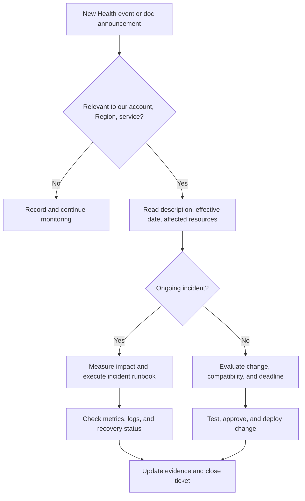
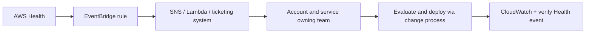

# Documentation Lookup, AWS Health, and Service Lifecycle Changes

## 1. Why Track Both Documentation and AWS Service Status?

AWS is a continuously evolving ecosystem: an Amazon EC2 feature may be added, Amazon RDS may end support for a database version, AWS Lambda may deprecate a runtime, or an Availability Zone may experience a temporary disruption. Cloud engineers cannot rely solely on knowledge learned at one point in time. They need to **consult official sources**, **identify changes affecting their own accounts**, and **turn that information into controlled engineering actions**.

Within the **CLOUD_PROVIDERS_AWS** module, this skill spans selecting and operating Regions/AZs, IAM, VPC, compute, storage, databases, integration, and serverless. For example, before taking an application on Amazon EKS into production, the team must know the Kubernetes version support policy; when a service alert arrives, they must identify affected clusters, assess outage risk, schedule upgrades, test, monitor, and estimate cost impacts.

After this lesson, you will be able to:

1. Select the right AWS documentation source for questions about architecture, APIs, features, pricing, and Regional support.
2. Distinguish public service events from AWS Health events specific to your account or organization.
3. Read key fields in an AWS Health event and determine required actions.
4. Track service, version, and runtime lifecycles; plan migrations before end-of-support milestones.
5. Design an alerting, triage assignment, and post-change verification workflow grounded in security, observability, and cost control.

## 2. Map of AWS Information Sources

No single page answers every question well. Understand **which source answers which type of question**.

| Source | When to use? | Example questions |
| --- | --- | --- |
| [AWS Documentation](https://docs.aws.amazon.com/) | Find User Guides, Developer Guides, configuration instructions, API References, CLI/SDK examples, quotas, and service limits. | Which permissions does an IAM policy need? How does AWS Lambda access resources in a VPC? |
| [AWS What's New](https://aws.amazon.com/new/) | Identify a newly announced feature, Region, or product change. | Does the new feature apply to the Region we use? |
| Per-service **Release notes / Version history / Runtime support** pages | Check changes that affect compatibility, patches, and support windows. | How much longer is this Amazon EKS version or Lambda runtime supported? |
| [AWS Health Dashboard – Service health](https://health.aws.amazon.com/health/status) | View **public** operational events by service and Region without signing in. | Has AWS published an Amazon S3 issue in our Region? |
| [AWS Health Dashboard – Account health](https://health.aws.amazon.com/health/home) | View events affecting the signed-in account, resources, or organization. | Which instance, cluster, or database requires action? |
| [AWS Well-Architected](https://docs.aws.amazon.com/wellarchitected/) | Review system design principles for operations, security, reliability, performance, cost, and sustainability. | Does this architecture meet recovery and cost-control goals? |
| Service **Pricing**, **Service Quotas**, and **Regional Services** pages | Verify deployment constraints and real costs before making decisions. | Is the feature available in the target Region, what is the current quota, and what does scaling cost? |

**Reliability and freshness:** Prioritize official documentation for service behavior; check last-updated dates, Regions, versions, applicability conditions, and preview/generally available notes. Blog posts or community answers can suggest investigation directions, but always cross-check against current official documentation. Never treat an example written for one Region, SDK, or older version as accurate for every environment.

### 2.1. A Repeatable Lookup Process

1. **Write a scoped question.** Example: "A Java application on AWS Lambda needs to access Amazon RDS inside a VPC in `ap-southeast-1`; what are the networking and IAM requirements?"
2. **Identify foundational docs.** Locate the Lambda VPC networking guide, RDS connection guide, Security Groups, IAM execution roles, and secrets handling.
3. **Check scope.** Compare Region, runtime, account architecture, versions, availability, quotas, security requirements, and costs.
4. **Read limits and caveats too.** For example: effects on Internet access, DNS, timeouts, database connections, permissions to create network interfaces, and credential access permissions.
5. **Test in a recoverable environment.** Save configurations, verify connectivity, record metrics/logs, and prepare rollback before changing production.
6. **Record evidence.** Save source URLs, check timestamps, applicability conditions, decisions, owners, and test results in engineering docs or change tickets.

A solid lookup result does not stop at "the service supports feature X"—it answers "**under what conditions does X work for our workload, what are the risks, and how do we verify it?**"

### 2.2. When Documentation Appears Contradictory

Suppose an older post suggests an EKS version will be supported longer, while the current Kubernetes release calendar lists an earlier end-of-support date. Use the **current official support table** as your planning baseline, verify the effective date's time zone, and then check AWS Health to see whether your resources are impacted. Avoid assuming a "Service is operating normally" status means an older runtime remains supported.

## 3. Understanding AWS Health

**AWS Health** provides information about operational events, scheduled changes, and notifications relevant to AWS services and accounts. It helps answer three questions: *what has happened or is about to happen; which resources are affected; what do we need to do?*

AWS Health differs from **Amazon CloudWatch**: CloudWatch primarily collects metrics, logs, traces, and alarms from your running systems; AWS Health communicates events and changes originating from AWS. During incident investigation, combine **Health events + workload metrics/logs + internal deployment history** to avoid misidentifying root causes.

### 3.1. Public Service Health vs. Account Health

| View | Primary data | Target audience | Limits to remember |
| --- | --- | --- | --- |
| **Service health (public)** | Published AWS service incidents by Region. | Anyone, even without an AWS account. | Does not tell you whether your specific resources are affected. |
| **Your account health** | Account-relevant events, scheduled changes, notifications, and lists of affected resources (when provided by AWS). | Signed-in users with appropriate permissions. | Does not replace application monitoring or manual verification. |
| **Your organization health** | Aggregated view of events across accounts in AWS Organizations. | Multi-account operations teams, once organizational view and permissions are configured. | Must identify **account owner** and **resource owner** to route remediation properly. |

Common sections in the account health UI:

- **Open and recent issues:** Ongoing or recent incidents.
- **Scheduled changes:** Upcoming maintenance and changes, including lifecycle milestones requiring action.
- **Other notifications:** Operational, security, billing, and other account-level notices.
- **Event log:** Historical lookup filtered by service, Region, time, status, and event type.

For each event, read the **description and timeline**, service, Region/AZ, start/end time, category, status, affected resource count, and **Affected resources** list (resource IDs or ARNs). The list may not be complete immediately; always cross-check against your real inventory.

### 3.2. Event Categories and Actionability Levels

| Event category | Meaning | Appropriate response |
| --- | --- | --- |
| `issue` | Unplanned incident affecting a service or resource. | Assess current impact, inspect CloudWatch signals, and execute mitigation/recovery plans if needed. |
| `scheduledChange` | Planned change or maintenance, potentially including end of support and automated upgrades. | Note deadlines, list affected resources, test, and apply changes before the impact date. |
| `accountNotification` | Administrative, security, billing, or account-level attention notices. | Verify details, assign an owner, and complete any required actions. |

**Actionability** helps prioritize events: `ACTION_REQUIRED` means action is required; `ACTION_MAY_BE_REQUIRED` requires checking your specific architecture; `INFORMATIONAL` is primarily for awareness. Events in the `issue` category may omit this field because recovery actions depend on application design. **Event status** (`open`, `upcoming`, `closed`) reflects event lifecycle and **differs from per-resource status** such as `PENDING` or `RESOLVED` in Planned Lifecycle Events.

Example: Public Service Health reports elevated EC2 API errors in a Region. The team should check error rates and Auto Scaling Group instance-launch health in that Region. If the system is unaffected, keep monitoring; if affected, execute recovery runbooks. An AWS public event notice does not automatically prove a specific application is failing.

### 3.3. Operating Across Multiple AWS Accounts

Enterprises typically separate development, staging, and production accounts. You can enable **organizational view** to aggregate AWS Health events from AWS Organizations into one place. Once configured, triage by account ID, OU, service, Region, and affected resources. Never leave critical events isolated inside the original deployer's account. Organizational view in the Health console is provided by AWS for eligible AWS Support plans; **access to the AWS Health API has separate Support-plan requirements**.

Example workflow diagram:



## 4. Service Lifecycle Changes: Reading Milestones and Consequences Correctly

**Lifecycles** can apply at many levels: entire services, APIs, features, database engine versions, Kubernetes minor versions, runtimes, AMIs, instance types, or certificates. Each service has its own policy. Never assume "deprecated," "end of standard support," "end of extended support," "end of life," or "service retirement" always leads to the exact same behavior.

A typical progression:

1. **Supported:** Documentation states current versions and usage conditions.
2. **Change notice:** AWS announces an upcoming upgrade, maintenance, or behavior change; a `scheduledChange` event may appear in AWS Health.
3. **End of standard support:** Some services allow continued execution under extended support, potentially at additional cost. Other services may stop patching or restrict creating/updating resources.
4. **End of extended support / retirement:** You may need to migrate versions, switch services, or accept automatic upgrades per service policy; exact dates and behavior must be verified in official documentation.

### 4.1. Planned Lifecycle Events in AWS Health

AWS Health supports **Planned Lifecycle Events** for changes that may require customer coordination, such as Amazon RDS or Amazon EKS version end-of-support, or RDS CA certificate rotations. These are typically `scheduledChange` events with event type codes formatted like:

```text
AWS_{SERVICE}_PLANNED_LIFECYCLE_EVENT
```

Carefully read four fields:

- **Event start time:** the earliest time the change can begin affecting resources. Treat this as **the deadline to be ready**, rather than waiting for the end time.
- **Event end time:** when the change finishes across AWS resources; this may not always be provided.
- **Affected resources / ARN:** specific resources or resource groups affected; use this to assign work to the right owner.
- **Resource status:** for events that track per-resource state, `PENDING` means the resource still needs attention; `RESOLVED` means AWS recorded the required action or the resource no longer exists. Status updates asynchronously and can lag up to 72 hours in some cases; inspect the resource directly to confirm.

AWS states that Planned Lifecycle Events aim to provide advance notice of **at least 180 days for major changes/versions and 90 days for minor changes/versions when possible**. This is an early-notification goal, **not a guarantee for every event**. Therefore, do not wait for a notification to start version management. If an event passes its impact date while resources remain unaddressed, the event may remain open; never assume after that date that upgrading is no longer needed.

### 4.2. Two Different Lifecycle Examples

**Example A — Amazon EKS:** A Kubernetes minor version has a standard support phase and may transition to extended support at increased cost. Under EKS policy at the time of writing, standard support lasts 14 months, followed by 12 months of extended support. Operations teams must review the [EKS Kubernetes release calendar](https://docs.aws.amazon.com/eks/latest/userguide/kubernetes-versions.html), audit cluster versions, node groups, add-ons, and workload compatibility, and prepare upgrades before standard support ends to avoid unexpected charges. Specific milestones can change and must be re-checked before scheduling.

**Example B — AWS Lambda:** When a runtime reaches deprecation, post-milestone behavior differs from EKS. The runtime no longer receives updates or support from AWS as before; stages restricting function creation and updates have distinct dates. Operations teams must consult the [Lambda runtime support policy](https://docs.aws.amazon.com/lambda/latest/dg/runtime-support-policy.html), locate functions using affected runtimes, update dependencies, test, and migrate to a supported runtime. A function that continues executing after deprecation **does not mean** it remains secure or patched by AWS.

**Rule:** After seeing a lifecycle notice, always open **that service's official version/runtime documentation**. AWS Health tells you the impact on your resources; service documentation explains exact behavior and upgrade paths.

## 5. From Notification to Safe Production Change

An AWS Health notice must be turned into a tracked task with a **deadline, owner, evidence, and completion criteria**.

| Step | Questions to answer | Expected output |
| --- | --- | --- |
| **Intake** | What is the source? Event ARN, service, Region, event code, date/time, and time zone? | Event record with official source link. |
| **Scoping** | Which Account, VPC, AZ, cluster, DB, Lambda function, or ARN is affected? | Resource and owner list; cross-checked against inventory. |
| **Analysis** | Impact on security, downtime, compatibility, cost, data, and dependencies? | Priority assessment and remediation plan. |
| **Preparation** | Do we have a test environment, backups, IaC configuration, and a rollback or failover plan? | Reviewed change plan, maintenance window, and success criteria. |
| **Execution** | Order of changes across application, IAM, networking, compute, storage, databases, serverless? | Deployment log, executor, timestamps, and outcomes. |
| **Verification** | Does the app still meet SLOs? Have the Health event and resource status updated? | Smoke test evidence, metrics/logs, remediated resources; close task. |

### 5.1. Prioritizing by Risk

You do not necessarily upgrade every resource simultaneously. Prioritize resources with **imminent impact dates**, **mandatory actions**, production traffic, high security exposure, or low resilience. Changes carrying data risk (databases, storage), connectivity risk (VPC, IAM, certificates), or runtime risk (Lambda, containers) must have appropriate testing and recovery plans. When AWS deprecates a feature or changes Region/AZ behavior, evaluate Multi-AZ/Multi-Region strategies against real reliability targets and costs rather than blindly duplicating every resource.

### 5.2. Scenario Example: EKS Approaching End of Standard Support

Suppose production runs an Amazon EKS cluster on a Kubernetes version nearing the end of standard support; Health sends a notice. The team can proceed as follows:

1. Go to **AWS Health → Your account health → Scheduled changes**; record the event, Region, effective date, and affected cluster ARN.
2. Check the [Amazon EKS Kubernetes release calendar](https://docs.aws.amazon.com/eks/latest/userguide/kubernetes-versions.html) to confirm standard/extended support end dates and upgrade policies.
3. Use the CLI with an appropriately scoped read-only identity to inspect the current cluster:

   ```bash
   aws eks describe-cluster \
     --name my-production-cluster \
     --region ap-southeast-1 \
     --query 'cluster.{Name:name,Version:version,Status:status}' \
     --output table
   ```

   The cluster name and Region in this example are illustrative; replace them with real resources in practice.
4. Inventory cluster add-ons, node groups, ingress/controllers, applications, and potentially incompatible Kubernetes APIs. Prepare backups/recovery configs and a matching staging environment.
5. Test-upgrade following **the EKS upgrade guide for your source and target versions**. Verify deployments, scheduling, networking, secret access, database connections, alerting, and traffic before touching production.
6. Schedule production, announce the maintenance window, and monitor error rates, latency, and node/pod health. If issues occur, execute a recovery plan **aligned with rollback constraints of the current EKS version**.
7. Verify version, support costs, Health event state, and any remaining `PENDING` resources; archive verification results. If AWS Health does not update immediately, do not treat that alone as proof the change failed.

**Cost lesson:** Keeping a cluster running in extended support can increase operating expenses. Upgrade deadlines therefore affect security, resilience, and budgets alike; bring platform, application, and FinOps teams into the same plan.

## 6. Automating Event Delivery via Amazon EventBridge

In practice, you cannot expect an engineer to keep the Health Dashboard open continuously. **Amazon EventBridge** can receive events with `source` set to `aws.health`, filter by category/event type, and route them to targets such as Amazon SNS, AWS Lambda, or a ticketing system. This enables timely notifications tied directly to operational workflows.

Example **event pattern** filtering account or scheduled change events flagged by AWS as requiring action (following AWS's official pattern):

```json
{
  "source": ["aws.health"],
  "detail-type": ["AWS Health Event"],
  "detail": {
    "eventTypeCategory": ["accountNotification", "scheduledChange"],
    "actionability": ["ACTION_REQUIRED"]
  }
}
```

This pattern suits a queue of changes **requiring action**. It **does not catch all `issue` incidents** and does not cover events marked `ACTION_MAY_BE_REQUIRED` or events without an actionability label. In production, consider adding a rule for `issue` events for incident response, plus a rule/filter group for notifications needing human review. Test patterns against sample AWS Health events in EventBridge before relying on them.

A practical handling flow:



To avoid missed or duplicate alerts, pay attention to:

- Verify the **Region where the EventBridge rule lives**, rule/target permissions, public notices, and account-specific notices. AWS has fallback delivery to backup Regions in certain situations; if your system ingests from multiple sources, **deduplicate** using `eventARN` together with `communicationId` per AWS guidance.
- Never treat an EventBridge event as an automatic command to delete, restart, or upgrade production without impact verification. Filter alerts and route to human responders first; automated remediation requires strict safety guards, monitoring, and rollback design.
- Protect account/resource information inside payloads; apply IAM least privilege and never send secrets over email or chat.
- Monitor target delivery failures and retries; account for EventBridge, SNS, Lambda, and event-history retention costs per organizational needs.

### 6.1. AWS User Notifications and the AWS Health API

**AWS User Notifications** helps manage AWS Health notifications and choose delivery channels such as email, chat, or mobile push. However, **public service events do not flow through default AWS-managed notifications**; to receive public alerts, configure an EventBridge rule or user-configured notification appropriately. When full details on ARNs, affected resources, and status updates are needed, open the Health Dashboard or inspect the full event payload.

The **AWS Health API** is useful for reading events, event details, affected entities, or aggregating multi-account reports. This API requires an **eligible AWS Support plan** (at the time of writing, including Business Support+, Enterprise Support, or Unified Operations; some regions/accounts not yet migrated have equivalent eligibility per AWS documentation). Without an eligible plan, API calls may return `SubscriptionRequiredException`; the Health Console and EventBridge remain notification channels to evaluate based on your configuration.

Example **read-only** command listing events via AWS CLI when the account meets API eligibility and holds appropriate IAM permissions:

```bash
aws health describe-events --region us-east-1
```

The AWS Health API uses its own endpoint and signing Region; `us-east-1` here is the API call Region in the example, **not a Region filter for the resources under inspection**. To scope a specific event, use appropriate API filters and inspect `affectedEntities`/`eventScopeCode`; do not confuse where the API is called with where resources reside. See [AWS Health API](https://docs.aws.amazon.com/health/latest/ug/health-api.html) to verify current Support plan requirements and endpoints.

## 7. Lookup and Response Runbook: An Actionable Template

Upon receiving a notice, the team can create a record following this template (illustrative content only):

```yaml
health_event:
  source: "AWS Health / Scheduled changes"
  event_arn: "<event ARN from dashboard>"
  service: "EKS"
  region: "ap-southeast-1"
  account_id: "<account id>"
  affected_resources:
    - "<cluster ARN>"
  event_start_utc: "<date-time copied from AWS Health>"
  actionability: "ACTION_REQUIRED"
  owner: "platform-team"
  impact: "Kubernetes version support deadline; possible extra cost"
  actions:
    - "Read official EKS version calendar and upgrade guide"
    - "Test version upgrade and dependencies in staging"
    - "Schedule production change and monitor SLOs"
  evidence:
    - "<URL to official AWS documentation>"
    - "<change ticket / test result>"
  verification: "<resource version, metrics and Health status>"
```

The template above is an **operational record**, not an AWS Health schema, and should never contain credentials. Its goal is to clearly link *AWS notice → affected resources → decision → owner → verification*. Update IaC docs and runbooks if lessons from the event alter Region/AZ, IAM, VPC, compute, storage, or database designs.

## 8. Practice Exercises

### Exercise 1 — Evidence-Based Documentation Lookup

You need to deploy a Java application using AWS Lambda, Amazon RDS, and Amazon S3. Locate official documentation for: (a) least-privilege IAM permissions, (b) VPC connectivity to RDS, (c) S3 data encryption and access control, (d) availability in the target Region, (e) cost components, and (f) Lambda runtime policy. For each item, record the URL, applicability conditions, and how to test it. No billable resources need to be deployed to complete this exercise.

### Exercise 2 — Classifying AWS Health Events

Given three scenarios: (1) AWS reports unusually elevated EC2 API latency; (2) an RDS engine version is nearing end of support; (3) AWS sends a notice requiring an account security configuration update. Identify the closest category, where to look up details, who should receive the alert, which data to verify, and ticket closure criteria. Then explain why checking public Service Health alone is insufficient for (2) and (3).

### Exercise 3 — Designing Lifecycle Alerting

Draw the flow **AWS Health → EventBridge → notification/ticket → owner → testing → change → verification**. Write an event pattern for `scheduledChange` with `ACTION_REQUIRED`, then explain which events that pattern might miss. Describe how to deduplicate notifications and name at least three metrics used to verify production changes.

### Self-Check Questions

1. Why is an event's end time not necessarily a safe deadline for upgrading?
2. What is the difference between an AWS Health event being `closed` and a resource being `RESOLVED`?
3. If a Lambda function still executes after its runtime deprecation date, does that prove it is secure and supported?
4. When lacking permissions or eligibility to use the AWS Health API, what ways remain to monitor Health events?
5. Beyond security and reliability, why does tracking end-of-support dates also matter for **cost**?

## 9. Official Reference Documentation to Follow

- [AWS Documentation — Home](https://docs.aws.amazon.com/)
- [AWS What's New](https://aws.amazon.com/new/)
- [AWS Health — Concepts and terms](https://docs.aws.amazon.com/health/latest/ug/aws-health-concepts-and-terms.html)
- [AWS Health — Viewing account events](https://docs.aws.amazon.com/health/latest/ug/aws-health-account-views.html)
- [AWS Health — Planned lifecycle events](https://docs.aws.amazon.com/health/latest/ug/aws-health-planned-lifecycle-events.html)
- [AWS Health — EventBridge rules and event patterns](https://docs.aws.amazon.com/health/latest/ug/creating-event-bridge-events-rule-for-aws-health.html)
- [AWS Health — Monitoring public and account-specific events](https://docs.aws.amazon.com/health/latest/ug/about-public-events.html)
- [AWS Health — AWS User Notifications](https://docs.aws.amazon.com/health/latest/ug/manage-user-notifications.html)
- [AWS Health — API access and endpoints](https://docs.aws.amazon.com/health/latest/ug/health-api.html)
- [Amazon EKS — Kubernetes version lifecycle](https://docs.aws.amazon.com/eks/latest/userguide/kubernetes-versions.html)
- [AWS Lambda — Runtime deprecation](https://docs.aws.amazon.com/lambda/latest/dg/runtime-support-policy.html)

**Takeaway:** Official documentation confirms *how a service behaves*; AWS Health reports *what is affecting or will affect your environment*; operational processes turn those two sources into *changes with clear ownership, testing, monitoring, and cost control*.
