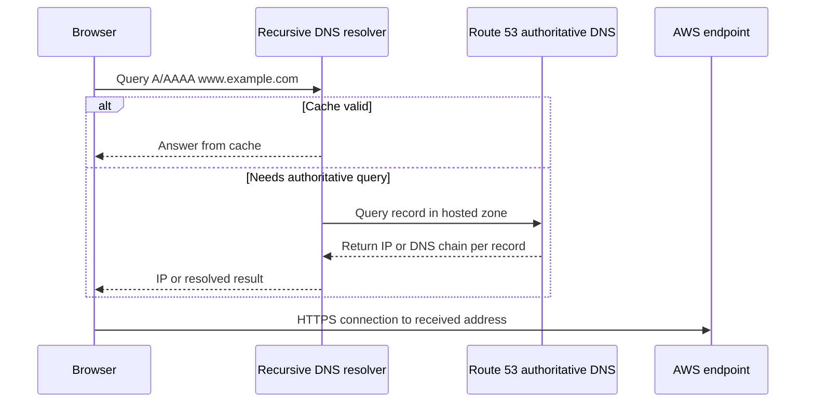
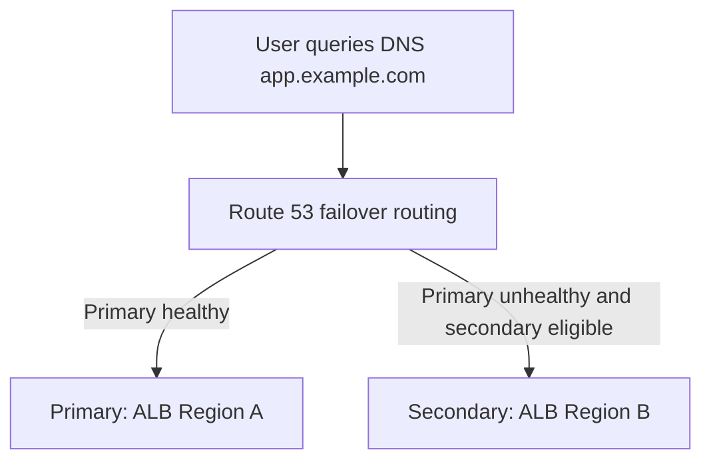
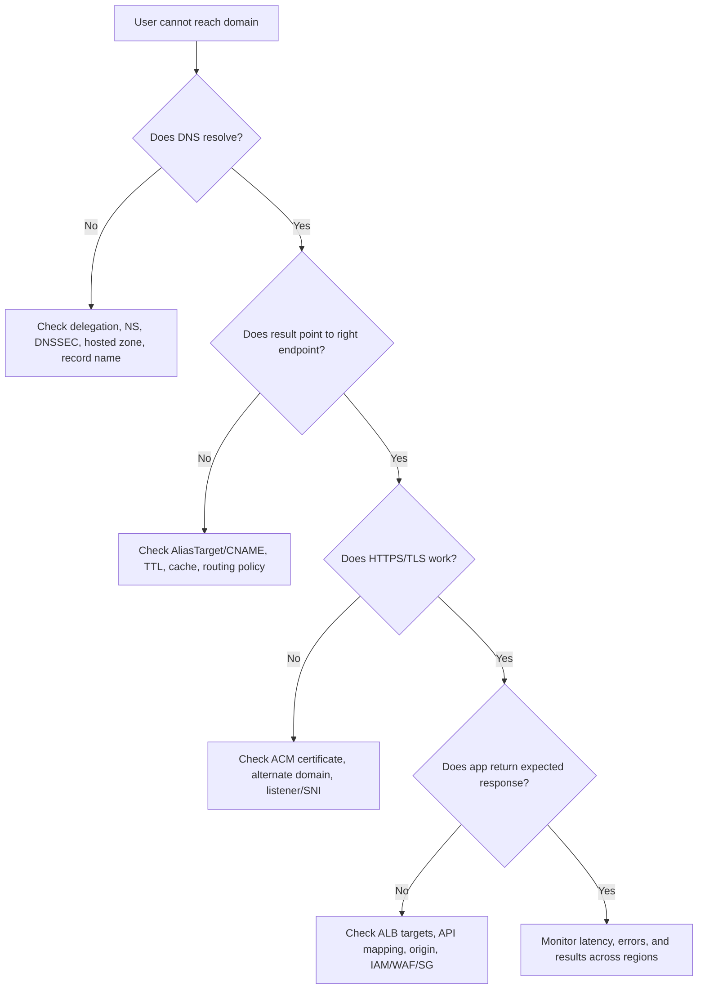

# Alias Records, CNAMEs, and Routing to AWS Resources

## 1. Scenario and Learning Objectives

An enterprise is moving its e-commerce system to AWS. The application runs behind an **Application Load Balancer (ALB)**, product images are delivered via **Amazon CloudFront**, and APIs are served by **Amazon API Gateway**. The company wants customers to access services using memorable names:

```text
example.com          → Storefront
www.example.com      → Storefront or CloudFront
api.example.com      → API Gateway
static.example.com   → CloudFront serving images/CSS/JS
```

AWS resources have AWS-assigned domain names, but the underlying IP addresses can change. Hardcoding IP addresses in DNS can break the website when AWS adjusts infrastructure. Meanwhile, a **CNAME** record cannot be used at the DNS zone root (*zone apex*), which already holds required records such as `SOA` and `NS`.

**Amazon Route 53 Alias records** solve many of these scenarios by allowing DNS to point a domain name to supported AWS resources or to other records in the same hosted zone—even at the zone apex when the appropriate record type is chosen.

This lesson belongs to the **DNS and Content Delivery** chapter of the **CLOUD_PROVIDERS_AWS** track. Routing traffic to CloudFront, ELB, API Gateway, or S3 must align with Region/AZ architecture, IAM, VPC, compute/serverless, TLS security, monitoring, recovery, and cost.

After this lesson, you will be able to:

- Explain DNS resolution, hosted zones, `A`, `AAAA`, `CNAME`, and **Route 53 Alias** records.
- Distinguish how to point `example.com` (*apex*) and `www.example.com` (*subdomain*) to AWS resources.
- Create and verify Alias/CNAME records using the AWS CLI, identifying the target's correct `DNSName` and `HostedZoneId`.
- Choose the appropriate routing policy: Simple, Weighted, Latency, Failover, Geolocation/Geoproximity, and Multivalue Answer.
- Understand DNS failover limits, TTL/caching, health checks, HTTPS certificates, S3 website hosting, and private DNS.
- Design observable, secure configurations with recovery plans when changing DNS.

## 2. How Does DNS Work in an AWS Application?

The **Domain Name System (DNS)** maps domain names and DNS record types to the records applications need to connect. When accessing `https://www.example.com`, the browser must determine the destination IP to open a TCP/TLS connection or appropriate protocol. DNS handles the **name → connection info** step, but **does not determine whether the application accepts the request or whether the certificate is valid**.



The actual resolution path may involve root DNS, TLD, and authoritative name servers; the diagram focuses on the step where **Route 53 answers for the enterprise's hosted zone**. Recursive resolvers can cache results according to TTL, so DNS changes **do not immediately** reach every client.

### 2.1. Public Hosted Zone vs. Private Hosted Zone

| Attribute | Public hosted zone | Private hosted zone |
| --- | --- | --- |
| Purpose | Public DNS answers for a domain | Internal DNS answers within associated VPCs and configured resolution paths |
| Typical clients | Internet users | EC2/ECS/EKS, systems routing via Route 53 Resolver and corporate networks |
| Example | `www.example.com` → internet-facing ALB | `db.internal.example.com` → internal endpoint |
| Key requirement | Domain is **delegated** to the hosted zone's exact NS | VPC association, DNS resolution, Route 53 Resolver, and appropriate forwarding rules |

Creating a public hosted zone in Route 53 **is not enough** for the domain to work. The registrar or authoritative parent zone must point delegation (`NS`, and `DS` if using DNSSEC) to the right name server system. Likewise, a public hosted zone can return a name pointing to an **internal ALB**, but that does not make the ALB reachable from the Internet; networking and security groups still govern reachability.

### 2.2. A DNS Record Is Not an HTTP Redirect

An `A`, `AAAA`, `CNAME`, or Alias record **does not automatically change** `http://` to `https://`, does not rewrite `/old` to `/new`, and does not redirect the browser from `example.com` to `www.example.com`. Those actions require an **HTTP redirect** at CloudFront, ALB, a web server, API Gateway, or an appropriate application mechanism.

For example, if both `example.com` and `www.example.com` resolve to an ALB, the browser still sends the corresponding `Host` header value. The TLS certificate and listener/application must handle both names or return a proper redirect.

## 3. Essential Record Types

| Record Type | Returned DNS Data | Use Case |
| --- | --- | --- |
| **A** | One or more **IPv4** addresses | `api.example.com → 203.0.113.10` (example IP) |
| **AAAA** | One or more **IPv6** addresses | Used when the endpoint actually supports IPv6 |
| **CNAME** | Target domain name (*canonical name*) | `www.example.com → dxxxx.cloudfront.net` |
| **NS** | Authoritative name servers | Delegates a zone to a DNS provider |
| **SOA** | Start of authority and zone administration info | Mandatory record of a DNS zone |
| **MX** | Mail exchanger server | `example.com` receiving email for the domain |
| **TXT** | Multi-purpose text strings | Domain verification, SPF, and related mechanisms |
| **CAA** | CAs authorized to issue certificates | Restricts approved certificate authorities |

Addresses from documentation ranges such as `203.0.113.10` are examples only, not real ALB or CloudFront IPs. When an AWS endpoint is managed and its IPs can change, point to the **service-published DNS endpoint** instead of creating a static A record from a one-time IP lookup.

## 4. CNAME: Pointing One Name to Another

**CNAME (Canonical Name)** specifies that one DNS name is a DNS-protocol alias for **another name**. For example:

```dns
www.example.com.  300  IN  CNAME  d111111abcdef8.cloudfront.net.
```

When a client needs the address of `www.example.com`, the resolver follows the CNAME to the CloudFront name and then fetches the A/AAAA address of that endpoint. **A CNAME does not directly contain an IPv4 or IPv6 address**, and it is not a website redirect command. The number `300` in the example is the CNAME's **TTL in seconds**, not how long CloudFront keeps an IP fixed.

### 4.1. Why Can't a CNAME Be Placed at the Zone Apex?

The **zone apex** is the root name of a DNS zone, e.g., `example.com` for the `example.com` hosted zone. That name must carry **SOA** and **NS** records. Per DNS rules, a name with a **CNAME cannot simultaneously hold other data records** at the same name. Therefore, a standard CNAME cannot be placed right at `example.com` when it is the apex.

```text
Hosted zone: example.com

example.com.       NS      ns-xxxx.awsdns-...
example.com.       SOA     ...

Invalid at apex:
example.com.       CNAME   d111111abcdef8.cloudfront.net.

Valid by name placement (if no conflicting records at the same name):
www.example.com.   CNAME   d111111abcdef8.cloudfront.net.
```

This is not an arbitrary AWS limitation. The rule against CNAME coexisting with other records at the same name comes from DNS standards. Some other providers offer proprietary solutions like **ANAME/ALIAS/CNAME flattening** at the apex; their implementations and behavior depend on the provider. In Route 53, the corresponding mechanism is the **Route 53 Alias record**.

### 4.2. Limitations When Using CNAME

- A CNAME points to a **hostname** (such as a CloudFront DNS name), not directly to a URL like `https://example.com/shop`, and not with a port or path.
- Do not create a `CNAME` at the same name as `TXT`, `MX`, `A`, or other records where that violates CNAME rules. This especially affects names needed for domain verification or email.
- A CNAME for a subdomain can point to a name **outside AWS** when the target is a valid hostname. For the zone apex, use an appropriate Alias or a mechanism supported by your DNS provider.
- A CNAME record's TTL is configurable. When clients see a new endpoint also depends on the target's and resolver's TTL/cache.
- A CNAME does not issue a TLS certificate or automatically add a name to CloudFront alternate domain names or API Gateway custom domains.

## 5. What Is a Route 53 Alias Record?

**Alias** is a special capability of **Amazon Route 53**, not a distinct record type in the public DNS protocol. On the management side, you create an `A`/`AAAA` record (and in some cases an alias to a record of the same type in the hosted zone), paired with an **AliasTarget** so Route 53 knows which AWS target or record to answer with.

For example:

```text
Name to point:     example.com
Type:              A (Alias = Yes)
Alias target:      AWS-managed ALB
DNS result:        IPv4 address of the AWS-managed ALB
```

External resolvers receive a standard A/AAAA DNS response; they **do not need to understand** Route 53's internal Alias concept. That is why Alias can be used at the **zone apex**, where a regular CNAME is not allowed.

### 5.1. Supported Alias Targets

Route 53 supports creating Alias records to many AWS resource types, depending on record type and architecture. Common targets include:

| AWS target | Scenario | Key Requirements |
| --- | --- | --- |
| **Elastic Load Balancing**: ALB/NLB/Classic LB | Web/API distributing requests across targets | Use the load balancer's exact DNS name and **canonical hosted zone ID** |
| **Amazon CloudFront distribution** | CDN, static site, caching, and edge delivery | Domain must be an **alternate domain name** on the distribution; valid TLS certificate |
| **API Gateway custom domain** | `api.example.com` calling REST/HTTP API | Must configure a **custom domain** and API/base path mapping |
| **Amazon S3 website endpoint** | Static website hosting (in supported cases) | Website bucket/endpoint must be configured properly; **S3 website endpoints only support HTTP** |
| **Elastic Beanstalk environment** | Pointing to an AWS-managed application environment | Alias eligibility depends on supported environment/endpoint; not every CNAME is a valid target resource |
| **AWS Global Accelerator** | Stable IP endpoints / global routing to application endpoints | Configure accelerator/listener/endpoint groups and matching IP types |
| **VPC interface endpoint** | Private service access in suitable architectures | Route 53 private DNS/networking, exact endpoint/DNS/zone ID |
| **Record in the same hosted zone** | Reusing an already configured DNS record | Target must be a valid record **in the same hosted zone** and matching type per Route 53 rules |

**Not every hostname can become a Route 53 AliasTarget.** If you want to point `app.example.com` to a third-party SaaS DNS name not in the supported target list, typically use a **CNAME at a subdomain**. If the zone apex must point to a third party, check whether that provider supports static IPs, DNS flattening, or an equivalent setup; Route 53 Alias does not universally cover arbitrary external targets.

### 5.2. Comparing CNAME and Alias

| Criterion | CNAME | Route 53 Alias |
| --- | --- | --- |
| DNS standard | Standard DNS record | Route 53-specific management feature, responds with standard DNS record types |
| Usable at `example.com` (apex)? | **No** | **Yes**, with a valid Alias A/AAAA |
| Usable at subdomain? | Yes | Yes |
| Target | Any DNS hostname per DNS rules | Supported AWS resource or eligible record in the same hosted zone |
| Response style | CNAME telling resolver to follow another name | Returns target address/value directly; client needs no awareness of Alias |
| TTL | You configure TTL on the CNAME | **Cannot set a custom TTL** when aliasing an AWS resource; uses the target resource's TTL or inherits target record's behavior |
| Health evaluation | No Alias `EvaluateTargetHealth` | Optional per target/routing policy **when supported by the service** |
| Query cost | Billed per Route 53 DNS query rules | Many Alias queries to eligible AWS resources **have no Alias query charge**; not every query/target type is automatically free |
| When AWS updates IPs | Resolver continues following DNS target | Route 53 continues answering for the AWS-managed target |

Actual costs also include hosted zones, health checks, routing policies/Resolver, and the target resources themselves. Always consult the **Amazon Route 53** pricing table at design time; Alias does not mean the entire DNS/CDN setup is free.

## 6. Choosing Records for Each AWS Resource Type

### 6.1. ALB and Network Load Balancer

Suppose you need to route `example.com` to an **internet-facing ALB**. The ALB provides a DNS name such as:

```text
shop-prod-alb-123456789.ap-southeast-1.elb.amazonaws.com
```

This DNS name is managed by ELB; do not take the ALB's current IP address and write a static A record. In Route 53, create an **Alias A** record at `example.com`; if the ALB is configured for IPv6/dualstack, consider a matching **Alias AAAA** record for IPv6 users.

An alias record can point to an ALB in a different Region from where you administer DNS, provided the target and hosted zone/record type are supported. Route 53 is a global DNS service; load balancers and application resources still belong to specific Regions/AZs.

**`EvaluateTargetHealth`** can be enabled on an Alias to ELB where supported. When using failover routing, Route 53 can inspect the ELB's target/target group state per AWS's documented behavior. Do not rely solely on DNS health: an ALB may appear healthy at the listener layer while the underlying application or dependency fails in ways the health check does not detect.

### 6.2. CloudFront and HTTPS Websites

CloudFront provides a distribution domain like `d111111abcdef8.cloudfront.net`. To let users access `www.example.com`:

1. Add `www.example.com` to the CloudFront distribution's **Alternate domain names (CNAMEs)**.
2. Attach a TLS certificate from **AWS Certificate Manager (ACM)** or an appropriate certificate per CloudFront requirements. For ACM certificates used with CloudFront, the certificate must be in **`us-east-1`**.
3. In Route 53, create an **Alias A** record to the distribution (or a CNAME at a subdomain if choosing that model). For IPv6, add AAAA if the distribution supports and has IPv6 enabled.
4. Verify the origin, cache behavior, HTTPS viewer protocol policy, content access controls, WAF if needed, and end-to-end TLS.

**DNS alone is not enough.** If you point `www.example.com` to a CloudFront distribution but forget the alternate domain name or certificate, DNS will resolve fine while HTTPS still fails. For S3-hosted websites, use **CloudFront with an S3 origin and Origin Access Control (OAC)** in a private-bucket architecture where appropriate, rather than making the S3 bucket public just to serve a website.

**An Alias to CloudFront does not support `EvaluateTargetHealth=true`.** If you need DNS failover for an application behind CloudFront, design health/routing at the appropriate layer—such as external health checks, CloudFront origin failover in supported scenarios, or application-level failover.

### 6.3. API Gateway Custom Domain

For `api.example.com` to call API Gateway, do not arbitrarily point DNS to an **execute-api endpoint** and expect a custom host to work automatically. You must create a **custom domain name** in API Gateway, select the endpoint type, provision a certificate, and configure API mappings so the hostname routes to the right API/stage.

For a **Regional custom domain**, the ACM certificate generally needs to be in the same Region as the API Gateway endpoint. For an **edge-optimized custom domain**, the CloudFront infrastructure used by API Gateway requires the certificate in `us-east-1` within supported limits. Then create an Alias A record in Route 53 pointing to the **API Gateway domain name target** returned by AWS, using the target's exact hosted zone ID.

Example:

```text
https://api.example.com/v1/orders
   |
   +-- DNS Alias A -> API Gateway custom domain target
   +-- TLS certificate -> valid for api.example.com
   +-- API mapping -> appropriate API/stage
   +-- IAM/JWT/Lambda authorizer or app security -> authorizes request
```

DNS only helps locate the endpoint. API mapping and authorization remain separate responsibilities. A valid Alias record **does not create** the custom domain in API Gateway.

### 6.4. S3 Static Website Endpoint

An S3 **website endpoint** can be used as an Alias target when the bucket and website hosting are configured appropriately. With a custom domain, the bucket name must normally **match the hostname** served by the website. However, S3 website endpoints **only support HTTP**, not direct HTTPS like CloudFront.

Therefore, if an application needs `https://example.com`, you should usually place **CloudFront in front of S3**. Using an S3 **REST endpoint** as the origin lets CloudFront OAC keep the bucket private. If you insist on using an S3 **website endpoint** as a custom origin, OAC does not apply the way it does for an S3 REST origin; understand the access policies and security constraints before choosing it.

### 6.5. RDS and Endpoints Not in the Alias Resource List

Amazon RDS provides managed DNS endpoints, such as a DB instance or cluster endpoint. When you want a friendly name like `db.internal.example.com`, you can use a **subdomain CNAME** pointing to the DB endpoint within your private network architecture. Do not assume every AWS endpoint is in the Route 53 Alias target list like ALB.

For databases, beyond DNS you must verify VPC/private connectivity, security groups, authentication, TLS hostname verification, failover, and how clients manage connection pools. **Custom domain names can complicate TLS hostname verification** if the client library validates the certificate against the original RDS endpoint; test TLS configuration before using a CNAME in production.

## 7. AWS CLI Example: Alias A to ALB

Suppose the company manages the `example.com` public hosted zone in Route 53, has an ALB `shop-prod-alb` in Singapore, and wants to use the **apex** `example.com`.

### 7.1. Read Actual Data Before Making Changes

First verify the current account, hosted zone, and target load balancer:

```bash
# Check current AWS account/role
aws sts get-caller-identity

# Find hosted zone named example.com (verify the right public zone)
aws route53 list-hosted-zones-by-name \
  --dns-name example.com \
  --max-items 10

# Get DNSName and CanonicalHostedZoneId of the ALB
aws elbv2 describe-load-balancers \
  --names shop-prod-alb \
  --region ap-southeast-1 \
  --query 'LoadBalancers[0].[DNSName,CanonicalHostedZoneId,Scheme,Type]' \
  --output table
```

**Distinguish between the two hosted zone IDs:**

1. `HostedZoneId` of the **Route 53 hosted zone `example.com`**: passed to `--hosted-zone-id` when updating records.
2. `CanonicalHostedZoneId` of the **ALB**: used as `AliasTarget.HostedZoneId` in the JSON. **These two IDs are not the same**, even though both appear in configuration commands.

For CloudFront, API Gateway, or S3 website endpoints, retrieve the **exact target hosted zone ID** from the service's API/documentation. Never copy an ALB's ID to another target.

### 7.2. Create the DNS Change JSON

After collecting real values, create `alias-alb-change.json` with this structure:

```json
{
  "Comment": "Route apex domain to production ALB",
  "Changes": [
    {
      "Action": "UPSERT",
      "ResourceRecordSet": {
        "Name": "example.com.",
        "Type": "A",
        "AliasTarget": {
          "HostedZoneId": "ZREPLACE_WITH_ALB_CANONICAL_ZONE_ID",
          "DNSName": "dualstack.shop-prod-alb-123456789.ap-southeast-1.elb.amazonaws.com.",
          "EvaluateTargetHealth": true
        }
      }
    }
  ]
}
```

Where:

- `Name` is the record name to create, with a trailing dot per FQDN convention.
- `Type: "A"` creates a record returning IPv4 results for the apex; if IPv6 is needed and supported by the ALB, add an `AAAA` record with the matching target.
- `AliasTarget.DNSName` must point to the **DNS name returned by ELB**; it may include a `dualstack.` prefix in suitable configurations. Do not invent hostnames.
- `AliasTarget.HostedZoneId` uses the **ALB's canonical hosted zone ID**, not the `example.com` hosted zone ID.
- `EvaluateTargetHealth` indicates whether Route 53 should factor in ELB health under supported routing policies.
- `UPSERT` creates or replaces a record matching name/type/identifier; **do not run it before checking existing records and traffic impact**.

Note: the IDs/hostnames in the JSON are **placeholders**; commands will fail or misroute if used verbatim. Retrieve real values from an authorized account before deploying.

### 7.3. Submit the Change and Verify

```bash
aws route53 change-resource-record-sets \
  --hosted-zone-id ZREPLACE_WITH_PUBLIC_ZONE_ID \
  --change-batch file://alias-alb-change.json

# After the API returns ChangeInfo.Id, check application status
aws route53 get-change \
  --id /change/REPLACE_WITH_CHANGE_ID

# Re-read the record in the hosted zone
aws route53 list-resource-record-sets \
  --hosted-zone-id ZREPLACE_WITH_PUBLIC_ZONE_ID \
  --query "ResourceRecordSets[?Name=='example.com.']"
```

When `get-change` reports `INSYNC`, the change has been deployed across Route 53's authoritative DNS servers. **This does not flush caches at recursive resolvers**: users may still receive old answers until TTL/caches expire. Before production changes, export and save existing record configurations, define a rollback plan, and verify the target's certificate/listener are ready.

## 8. Subdomain CNAME and CloudFront Alias Examples

### 8.1. CNAME for `www.example.com`

If you already configured the CloudFront alternate domain name `www.example.com` with a valid certificate, you can create a CNAME record from `www.example.com` to the distribution domain:

```json
{
  "Comment": "Map www to CloudFront distribution",
  "Changes": [
    {
      "Action": "UPSERT",
      "ResourceRecordSet": {
        "Name": "www.example.com.",
        "Type": "CNAME",
        "TTL": 300,
        "ResourceRecords": [
          { "Value": "d111111abcdef8.cloudfront.net." }
        ]
      }
    }
  ]
}
```

Save as `cname-www-change.json` and run `aws route53 change-resource-record-sets` against the right hosted zone ID as shown earlier. **Do not use this template at `example.com`** because it is the zone apex. Before `UPSERT`, verify `www.example.com` has no conflicting records under CNAME rules.

### 8.2. Alias A for CloudFront

With Route 53, `www.example.com` can also use **Alias A** instead of CNAME. In particular, when you want the CDN to serve **`example.com` right at the apex**, Alias A is a natural choice:

```json
{
  "Comment": "Route apex domain to CloudFront distribution",
  "Changes": [
    {
      "Action": "UPSERT",
      "ResourceRecordSet": {
        "Name": "example.com.",
        "Type": "A",
        "AliasTarget": {
          "HostedZoneId": "Z2FDTNDATAQYW2",
          "DNSName": "d111111abcdef8.cloudfront.net.",
          "EvaluateTargetHealth": false
        }
      }
    }
  ]
}
```

In this example, `Z2FDTNDATAQYW2` is the hosted zone ID AWS uses for CloudFront distributions in Alias configurations. **Always verify AWS documentation at deployment time**. `EvaluateTargetHealth` must be `false` for a CloudFront target. The domain and distribution must exist and have the alternate domain and valid certificate attached; the DNS name in the template is illustrative only.

### 8.3. When to Choose Alias Over CNAME?

For Route 53-supported targets, Alias is generally preferred because it works at the apex, avoids exposing a public DNS CNAME indirection, and benefits from how AWS manages targets. However, **do not switch a CNAME to an Alias solely for appealing pricing or latency** without checking the target, HTTPS, TTL, rollback capability, routing policy, and which DNS provider is authoritative.

If the domain's authoritative DNS is hosted at **another provider** rather than Route 53, you cannot add a Route 53 Alias to an undelegated hosted zone and expect the Internet to see it. Make changes on the currently authoritative DNS provider or execute a controlled delegation migration plan.

## 9. TTL, DNS Caching, and Change Propagation Time

**TTL (Time to Live)** is the duration a record may be cached in a DNS resolver per the specified value. It is not how long CloudFront caches web content, nor does it control user cookies/sessions.

Example:

```text
09:00  Recursive resolver receives www.example.com CNAME TTL 300 seconds
09:01  Administrator changes CNAME to a new target
09:02  Clients using that resolver may still see the old target
09:05  Cache TTL expires; resolver queries authoritative DNS again
```

In practice, multiple cache layers (resolver, OS, application, proxy) behave differently. **A low TTL only shrinks the intended cache window; it does not guarantee every user switches instantaneously.**

### 9.1. CNAME vs. Alias TTL

| Type | Who controls TTL? | Operational Impact |
| --- | --- | --- |
| Standard CNAME | Record owner sets TTL in DNS | Can lower TTL prior to switching targets to assist migration |
| Alias to AWS resource | Route 53 uses the TTL provided by the **target resource**; no custom TTL on the Alias record | Do not include a `TTL` field when creating an AliasTarget to an AWS resource |
| Alias to another record in the same hosted zone | Inherits the target record's TTL behavior per Route 53 rules | To control TTL, inspect the target record and how the Alias is evaluated |

During production changes, lowering the **old CNAME's** TTL prior to cutover can help, but must be done **at least one old TTL cycle in advance** so caches do not hold the long value. With an Alias to an AWS resource, you cannot set `TTL: 30` on the Alias record the way you do with a CNAME.

### 9.2. DNS Caching Is Not CDN Caching

CloudFront caches HTML, CSS, JavaScript, images, and responses according to **cache policies** and HTTP headers. Route 53/recursive DNS caches **DNS records**. If a site points an Alias to a new distribution yet users still see stale content, the cause may be **CloudFront cache**, browser cache, CDN invalidation, or origin behavior—not necessarily Route 53 DNS.

## 10. Routing Policies: How Route 53 Chooses an Answer

A **routing policy** determines how Route 53 answers when multiple records serve the same role. Routing policies can be combined with **Alias** depending on supported target types and scenarios. A DNS response can vary by weight, AWS Region closest in latency, geographic location, or endpoint health.

| Routing Policy | Goal | Example |
| --- | --- | --- |
| **Simple** | Answer with a single configuration requiring no complex traffic control | `example.com` → one ALB |
| **Weighted** | Distribute answers by relative weight | 90% to ALB v1, 10% to ALB v2 at the DNS response level |
| **Latency-based** | Choose the Region with lower measured network latency per AWS telemetry | Clients near Singapore → Singapore endpoint |
| **Failover** | Choose primary/secondary based on health | Primary ALB in Region A, secondary ALB in Region B |
| **Geolocation** | Choose based on identified geographic location of the query source | Users in specific countries → corresponding site/endpoint |
| **Geoproximity** | Route by geographic distance with optional bias in supported setups | Split service coverage between two Regions |
| **Multivalue answer** | Return multiple selected values with optional per-record health checking | Multiple endpoints with static IPs |
| **IP-based routing** | Choose answer based on identified query source CIDR | Specific corporate network or ISP → designated endpoint |

**Not every routing policy supports every record type or target.** For example, Multivalue Answer has specific restrictions on Alias records; verify Route 53 documentation and your actual use case. Also, a record pointing to a load balancer **does not replace** the ALB/NLB's request-level load balancing algorithm.

### 10.1. Weighted Routing: Gradual Rollout

Suppose `api.example.com` points to **two ALBs** representing old/new application versions. Create two **weighted Alias A records** with the same name/type but different `SetIdentifier` and `Weight`.

```json
{
  "Comment": "Example weighted Alias records for two ALBs",
  "Changes": [
    {
      "Action": "UPSERT",
      "ResourceRecordSet": {
        "Name": "api.example.com.",
        "Type": "A",
        "SetIdentifier": "stable-v1",
        "Weight": 90,
        "AliasTarget": {
          "HostedZoneId": "ZREPLACE_WITH_ALB_V1_ZONE_ID",
          "DNSName": "dualstack.stable-alb-111111.ap-southeast-1.elb.amazonaws.com.",
          "EvaluateTargetHealth": true
        }
      }
    },
    {
      "Action": "UPSERT",
      "ResourceRecordSet": {
        "Name": "api.example.com.",
        "Type": "A",
        "SetIdentifier": "canary-v2",
        "Weight": 10,
        "AliasTarget": {
          "HostedZoneId": "ZREPLACE_WITH_ALB_V2_ZONE_ID",
          "DNSName": "dualstack.canary-alb-222222.ap-southeast-1.elb.amazonaws.com.",
          "EvaluateTargetHealth": true
        }
      }
    }
  ]
}
```

The hostnames and IDs are placeholders. `SetIdentifier` distinguishes records sharing the same name/type, while `Weight` sets the **relative weight for choosing eligible DNS answers**—it **does not guarantee an exact 90%/10% split of actual HTTP requests**. Recursive resolver caching, uneven traffic, and connection reuse can skew request proportions significantly.

For safe canary deployments, combine weighted routing with health checks, application monitoring, rapid rollback, and deployment/session strategies. If you need tighter per-request split control, look at ALB/CloudFront routing or your deployment platform rather than relying solely on DNS.

### 10.2. Latency-Based Routing: Choosing a Region by Measured Latency

When a system has endpoints in Singapore and Sydney, latency-based routing can direct users to the Region endpoint Route 53 predicts has better latency. This **does not guarantee** clients always reach the geographically closest Region, nor does it guarantee the lowest application-level latency, since resolver location, network paths, and service load also matter.

Note: **DNS routing to another Region does not replicate data, database sessions, or user state.** Multi-Region applications require appropriate data, authentication, and failover architecture.

### 10.3. Failover Routing: Primary and Secondary

Failover routing lets you configure **primary** and **secondary** records. Route 53 uses health checks or `EvaluateTargetHealth` (where supported) to determine which endpoint is eligible to receive DNS answers.



**Limits of DNS failover:** it does not migrate existing TCP/TLS connections, does not guarantee clients clear DNS caches immediately, does not replicate data, and does not catch backend logic bugs that a health check fails to detect. Real RTO must account for TTL/caching, health detection time, target Region startup readiness, and data recovery.

### 10.4. Geolocation and Geoproximity Do Not Equal Data Compliance

Geolocation routing selects based on location inferred from the DNS query; resolvers and geolocation detection can cause results to differ from the end user's true location. Geoproximity uses distance and bias logic in supported configurations.

If an organization has **data residency** requirements, changing DNS by country alone is insufficient: clients might use VPNs, backend data might still cross Regions, or services might store data in non-compliant locations. Storage, application, IAM, network, logging, and operational controls must all be enforced together.

## 11. Health Checks and `EvaluateTargetHealth`

Two concepts must be distinguished:

1. **Route 53 health check resource**: checks a public HTTP/HTTPS/TCP endpoint or uses a supported CloudWatch alarm/calculated health check mechanism. Route 53's health checker **cannot directly call private VPC IPs** like an EC2 instance unreachable from the Internet; checking private services requires appropriate observability and alarms.
2. **`EvaluateTargetHealth` on an Alias**: Route 53 evaluates the health of the Alias target as supported by the target service or target record. This **is not** available for every AWS target.

### 11.1. When to Enable `EvaluateTargetHealth`?

| Alias target | Usage Guidance | Notes |
| --- | --- | --- |
| ELB (ALB/NLB/Classic LB) | Can be enabled when you want Route 53 to evaluate ELB health in compatible routing policies | Health depends on LB target group mechanisms; test multiple target groups |
| CloudFront distribution | **Set to `false`** | Does not support Evaluate Target Health like ELB |
| S3 website endpoint | **Set to `false`** | Do not expect Route 53 to health-check an S3 website via Alias target |
| Alias to another record in hosted zone | Can be used to evaluate the referenced record in supported models | Verify health checks and Alias chains to avoid false conditions |
| API Gateway custom domain | Do not assume automatic ALB-like health support | Choose mechanism per docs and real application telemetry |

**Health checks must measure what users actually need.** If `/health` returns 200 while the database is down or a downstream queue is backed up, DNS may continue routing to an unusable Region/ALB. Use synthetic transactions, application metrics, and health endpoints reflecting critical dependencies.

### 11.2. Failover When Primary Reports Healthy Incorrectly

A primary ALB's target group is marked healthy because it returns HTTP 200 on a static path, yet the checkout API keeps returning 500. Route 53 `EvaluateTargetHealth` will not necessarily catch that business failure. Mitigations include:

- Tuning the ALB target group health check appropriately without creating unnecessary dependency loops.
- Using a separate Route 53 health check against a public synthetic endpoint or a CloudWatch alarm driven by metrics reflecting true health.
- Running canary/synthetic monitors against critical APIs to inform failover operations.
- Testing Region failover under controlled fault injection, measuring elapsed time and data loss.

Do not create a health check targeting an internal IP with a public Route 53 checker expecting it to reach inside the VPC. Design observability compatible with the endpoint's network scope.

## 12. Private DNS and Corporate Network Connectivity

When an application uses an **internal ALB**, RDS, internal services via VPC endpoints, or private APIs, you usually do not want public DNS exposing topology or misleading clients into thinking they are reachable from the Internet. Route 53 **private hosted zones** and Route 53 Resolver support name resolution for associated VPCs.

Example:

```text
Public hosted zone: example.com
  www.example.com -> Public CloudFront/ALB

Private hosted zone: internal.example.com
  api.internal.example.com -> Alias A to internal ALB
  db.internal.example.com  -> CNAME to RDS endpoint

On-premises DNS server
  -> Route 53 Resolver inbound endpoint via VPN/Direct Connect
  -> Resolves names in the private hosted zone per appropriate rules
```

Details to watch:

- The VPC must have required DNS options enabled and be **associated** with the private hosted zone or corresponding resolution architecture.
- For on-premises access, you need a network path (Site-to-Site VPN/Direct Connect), a **Route 53 Resolver inbound endpoint**, DNS forwarding, and security groups allowing UDP/TCP 53.
- Both DNS queries and application traffic need proper routes and firewall rules. DNS returning a private IP **does not magically establish a VPN**.
- You can use **split-horizon DNS**, where the same name returns different answers to internal clients vs. the Internet. Verify hosted zone precedence/resolver rules to avoid unexpected `NXDOMAIN` responses.

## 13. TLS, IAM, WAF, and Domain Security

DNS locates the target, but **does not replace TLS, authentication, or authorization**. Layers to verify before taking a custom domain to production:

| Layer | Questions to Answer |
| --- | --- |
| **Domain ownership and delegation** | Do the registrar and NS/DS point to the right authoritative DNS? Who can edit records? |
| **TLS certificate** | Does the certificate include SANs for `example.com`, `www.example.com`, `api.example.com` as needed? Is it in the right Region? |
| **Application routing** | Are ALB host/path rules, CloudFront behaviors, or API Gateway mappings configured? |
| **Network access** | Is the ALB public or internal? Are VPC SGs/NACLs/firewalls and private connectivity right? |
| **Identity/authorization** | Are IAM, JWT, API keys, app auth, and backend resource permissions properly set? |
| **Edge protection** | Should AWS WAF, Shield, rate limits, logging, and monitoring be enabled? |
| **DNS security** | Are Route 53 `ChangeResourceRecordSets` permissions, account MFA, auditing, and DNSSEC (where appropriate) controlled? |

### 13.1. ACM Certificates by Endpoint

- **ALB**: the TLS certificate used for an HTTPS listener must be provisioned/stored in the **ALB's Region** per Elastic Load Balancing requirements.
- **CloudFront**: an ACM certificate linked to an alternate domain name generally needs to be in **`us-east-1`**.
- **API Gateway**: certificate location depends on whether the custom domain is Regional or edge-optimized; choose the Region and requirements supported by the service.

Route 53 Alias **does not provision, renew, or attach certificates** to these services. When a client accesses `https://api.example.com`, the certificate must be valid for the name the client sends, not merely for the underlying AWS-assigned DNS hostname.

### 13.2. Risks of Uncontrolled DNS Edits

An erroneous `UPSERT` at the apex can divert all customers to a non-HTTPS endpoint or an attacker-controlled destination. You should:

- Restrict hosted zone write permissions via IAM and approval workflows, especially for apex, login, or payment records.
- Use reviewed Infrastructure as Code or change batches, saving pre-change state.
- Monitor CloudTrail for DNS-modifying APIs and alert on unexpected changes to critical records.
- Protect domain registration, renewal, and delegation. If using DNSSEC, establish procedures to safeguard keys and `DS` records at the registrar.
- Never leave domains pointing to deleted or unowned resources. **Dangling DNS records** create subdomain takeover risks if an attacker can claim the underlying service endpoint.

## 14. Safe DNS Deployment and Verification Workflow

### Step 1 — Map Out Domain Names

List hostnames, exposure level, and desired targets:

| Hostname | Purpose | Record Suggestion |
| --- | --- | --- |
| `example.com` | Main website | Alias A to CloudFront or ALB |
| `www.example.com` | Main website or redirect | Alias A or subdomain CNAME; HTTP redirect if needed |
| `static.example.com` | CDN | Alias A/AAAA or CNAME to CloudFront |
| `api.example.com` | API | Alias A to API Gateway custom domain or ALB |
| `db.internal.example.com` | Internal database | CNAME in private hosted zone to RDS endpoint if TLS-compatible |

### Step 2 — Verify the Target

Confirm the target is ready: the ALB has healthy listeners/target groups, CloudFront has valid alternate domains/certificates, API Gateway has custom domains/API mappings, and S3 websites have a secure HTTPS front end. For private targets, verify VPC/network/security connectivity.

### Step 3 — Choose Alias or CNAME

- **Zone apex:** prefer Alias A/AAAA when the target is Route 53-supported.
- **Subdomain pointing to a supported AWS resource:** Alias is often suitable; CNAME is also an option depending on goals.
- **Subdomain pointing to a third-party hostname:** CNAME if there are no record conflicts; follow the recipient's instructions.
- **Self-managed static IP:** A/AAAA works when the address is truly stable and has an update process.

### Step 4 — Choose Routing Policy, Health, and TTL

A single endpoint can use Simple routing. Canary rollouts use Weighted; multi-Region setups can consider Latency or Failover. Configure health checks per service support and application characteristics. With CNAME you set TTL explicitly; with an AWS resource Alias, the target determines TTL.

### Step 5 — Deploy Changes and Observe

Use reviewed ChangeBatches/Infrastructure as Code and retain version/rollback data. Verify Route 53 `get-change`, query authoritative and public recursive resolvers, and run real HTTPS tests from multiple networks. Monitor API latency, status codes, CloudFront error rates, or ALB target health after cutover.

### Step 6 — Test Recovery

Simulate target failures in a controlled environment to verify DNS failover, cache durations, health evaluation, target endpoints, data, and failback to primary. Measure application RTO/RPO, not just the `INSYNC` status of a DNS change.

## 15. Using `dig` and AWS CLI for Diagnostics

After configuring records, use read-only commands to verify the **DNS layer first**, then check the **HTTPS/application layer**:

```bash
# Check A/AAAA returned for the apex
dig +noall +answer example.com A
dig +noall +answer example.com AAAA

# Check CNAME for www if configured with CNAME
dig +noall +answer www.example.com CNAME

# Check NS of the domain
dig +noall +answer example.com NS

# Inspect DNS records via Route 53 API
aws route53 list-resource-record-sets \
  --hosted-zone-id ZREPLACE_WITH_PUBLIC_ZONE_ID \
  --query "ResourceRecordSets[?Name=='example.com.' || Name=='www.example.com.']"

# Test answer from the Route 53 hosted zone (does not replace real public queries)
aws route53 test-dns-answer \
  --hosted-zone-id ZREPLACE_WITH_PUBLIC_ZONE_ID \
  --record-name example.com \
  --record-type A
```

`dig` is not preinstalled on every OS; if unavailable, use `nslookup`, `Resolve-DnsName` in PowerShell, or an equivalent DNS diagnostic tool. With `dig`, querying a public recursive resolver only reflects that resolver's view at that moment—it does not prove everyone worldwide sees the change.

**When an Alias is configured properly**, `dig example.com A` normally returns **A answers**, not a DNS record type named `ALIAS`. That is expected because Alias is a Route 53 management feature; recursive resolvers do not see `AliasTarget` in standard DNS responses.

### 15.1. Layered Troubleshooting Flowchart



### 15.2. Common Symptoms and Causes

| Symptom | Primary Suspect | Approach |
| --- | --- | --- |
| `example.com` rejects CNAME creation | Zone apex has SOA/NS | Use Alias A/AAAA to a supported target |
| Alias created successfully but public DNS unchanged | Hosted zone not delegated, or resolver cache | Check registrar NS/DS, authoritative NS, TTL/cache |
| `www` resolves to CloudFront but TLS fails | Missing/invalid alternate domain or certificate | Check CloudFront distribution, `us-east-1` ACM, hostname/SAN |
| `api.example.com` DNS right but returns 403/404 | API Gateway mapping, auth, stage, or WAF | Check custom domain/API mapping and application logs |
| DNS returns private IP but Internet access times out | Internal ALB/private endpoint | Check public/private separation, VPN/Resolver, SG/routes |
| DNS failover is slow | TTL/caching, health check interval, endpoint not yet healthy | Measure detection time, cache expiry, and target Region readiness |
| Weighted 90/10 yields 70/30 actual traffic | Resolver caching, client distribution, session reuse | Measure at the application layer; do not treat DNS weights as exact request splits |
| Alias to ELB errors on target | Wrong `CanonicalHostedZoneId`, DNSName, account/Region | Fetch target info from ELB API instead of guessing IDs |
| DNS changed yet content stays stale | CloudFront/browser cache, origin behavior | Distinguish DNS TTL from HTTP/CDN caching |

## 16. Comprehensive Scenario: Multi-Region E-Commerce Website

A Southeast Asian e-commerce company runs its frontend on CloudFront and its API on a Singapore ALB. For higher resilience, it prepares a standby API in Sydney. The company manages `example.com` through Route 53, requires HTTPS, and must deploy changes without downtime.

**Recommended design:**

1. **Frontend:** create a CloudFront distribution with alternate domain names `example.com` and `www.example.com`; attach a valid ACM certificate in `us-east-1`. Use Alias A at the apex, and Alias A/AAAA or a valid CNAME at `www` depending on IPv6 needs.
2. **Primary API:** `api.example.com` points via Alias A to the Singapore ALB, with an ACM certificate in that Region and health checks reflecting real app health.
3. **Standby API:** deploy the Sydney ALB and application stack, with database/data/secrets/networking configured so it can genuinely serve requests. Do not create a DNS record alone and call it disaster recovery.
4. **DNS failover:** use primary/secondary failover routing for `api.example.com` or another suitable mechanism; verify `EvaluateTargetHealth`/health checks and behavior when primary degrades.
5. **Security:** enforce HTTPS, manage ACM renewals, scope Route 53 permissions, ALB security groups, IAM roles, WAF, logging, and auditing.
6. **Operations:** store Infrastructure as Code and pre-change record snapshots; drill failover, watch CloudWatch, and account for cache duration and rollback.
7. **Cost:** budget for hosted zones, billable DNS queries, health checks, ALBs in two Regions, CloudFront/WAF, data transfer, and database replication—not just the DNS records.

If both frontend and API run active-active across Regions, you can consider latency routing or routing at the CDN/application layer. However, data consistency, sessions, and idempotency of writes must be addressed. **Route 53 does not synchronize databases or state between two Regions.**

## 17. Self-Check Questions

**Question 1.** Why can't `example.com` in the `example.com` hosted zone have a standard CNAME record pointing to CloudFront?

**Hint:** `example.com` is the zone apex, which requires NS and SOA; CNAME cannot coexist with those records. Use a Route 53-supported Alias A/AAAA instead.

**Question 2.** Can `www.example.com` use a CNAME pointing to a non-AWS SaaS hostname? Can it be converted to a Route 53 Alias pointing to any arbitrary SaaS hostname?

**Hint:** A subdomain CNAME is generally allowed if there are no conflicting records. Route 53 Alias cannot point arbitrarily to external hostnames; the target must be a supported type.

**Question 3.** You create an Alias A to an ALB but put `example.com`'s HostedZoneId inside `AliasTarget`. Why is that wrong?

**Hint:** `AliasTarget.HostedZoneId` for an ALB must use the `CanonicalHostedZoneId` provided by ELB; `example.com`'s hosted zone ID only identifies the zone being updated in Route 53.

**Question 4.** `dig www.example.com A` returns a CloudFront IP, yet the browser reports a certificate mismatch. Should you fix DNS first?

**Hint:** Check CloudFront alternate domain names and a valid ACM certificate for `www.example.com` in the Region required by CloudFront. DNS may already be completely correct.

**Question 5.** Can `EvaluateTargetHealth=true` be used with a CloudFront Alias?

**Hint:** No. CloudFront Alias requires `false`; if failover is needed, design health/routing using another supported mechanism.

**Question 6.** Does 90/10 weighted DNS guarantee that exactly 90% of HTTP requests reach application A?

**Hint:** No. Weights govern DNS answer selection, while resolver caching, session persistence, and connection reuse shape actual traffic.

**Question 7.** An API fails over to the healthy Sydney ALB, but users get errors reading orders. Is Route 53 definitely broken?

**Hint:** No. DNS only selects the endpoint; database/data, IAM, secrets, networking, API mapping, TLS, or business logic in Region B might not be ready.

**Question 8.** You have a private hosted zone `internal.example.com`; why can't office employees resolve `api.internal.example.com` even though the VPN is UP?

**Hint:** You need DNS forwarding / a Route 53 Resolver inbound endpoint, port 53 security groups, proper routes, and VPC association. A VPN provides network routing only, not automatic private DNS resolution.

## 18. Key Takeaways

A **CNAME** is a standard DNS record pointing one **hostname** to another; it works on subdomains but is **invalid at the zone apex** because it conflicts with mandatory records. **Route 53 Alias** lets an `A`/`AAAA` record point to **supported AWS resources** or compatible records in the hosted zone, even at the apex, and responds to resolvers with standard DNS data.

When routing to **ALB, CloudFront, API Gateway, or an S3 website endpoint**, always verify the target's DNS name/hosted zone ID, TLS certificate, custom domain, HTTPS, VPC networking, and application permissions. Route 53 **routing policies** support strategies like Weighted, Latency, and Failover, but **do not replace** request-level load balancing, data replication, or multi-Region recovery plans. Production DNS changes require monitoring, cost estimation, TTL/cache testing, and a rollback plan.

### AWS Reference Documentation

- [Amazon Route 53 — Choosing between alias and non-alias records](https://docs.aws.amazon.com/Route53/latest/DeveloperGuide/resource-record-sets-choosing-alias-non-alias.html)
- [Amazon Route 53 — Alias records](https://docs.aws.amazon.com/Route53/latest/DeveloperGuide/resource-record-sets-values-alias-common.html)
- [Amazon Route 53 — Values specific for alias records](https://docs.aws.amazon.com/Route53/latest/DeveloperGuide/resource-record-sets-values-alias.html)
- [Amazon Route 53 — Supported DNS record types](https://docs.aws.amazon.com/Route53/latest/DeveloperGuide/ResourceRecordTypes.html)
- [Amazon Route 53 — Routing policy](https://docs.aws.amazon.com/Route53/latest/DeveloperGuide/routing-policy.html)
- [Amazon Route 53 — Configuring DNS failover](https://docs.aws.amazon.com/Route53/latest/DeveloperGuide/dns-failover-configuring.html)
- [Amazon Route 53 — Checking the health of resources](https://docs.aws.amazon.com/Route53/latest/DeveloperGuide/dns-failover.html)
- [Route 53 — Routing traffic to an ELB load balancer](https://docs.aws.amazon.com/Route53/latest/DeveloperGuide/routing-to-elb-load-balancer.html)
- [Route 53 — Routing traffic to a CloudFront distribution](https://docs.aws.amazon.com/Route53/latest/DeveloperGuide/routing-to-cloudfront-distribution.html)
- [Route 53 — Routing traffic to an API Gateway API](https://docs.aws.amazon.com/Route53/latest/DeveloperGuide/routing-to-api-gateway.html)
- [Route 53 — Routing traffic to an S3 bucket website endpoint](https://docs.aws.amazon.com/Route53/latest/DeveloperGuide/RoutingToS3Bucket.html)
- [CloudFront — Use custom URLs with CNAMEs](https://docs.aws.amazon.com/AmazonCloudFront/latest/DeveloperGuide/CNAMEs.html)
- [Route 53 Resolver — Forwarding inbound DNS queries](https://docs.aws.amazon.com/Route53/latest/DeveloperGuide/resolver-forwarding-inbound-queries.html)
- [Amazon Route 53 pricing](https://aws.amazon.com/route53/pricing/)
