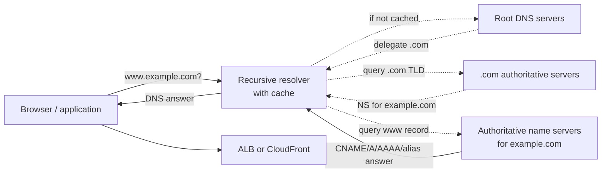
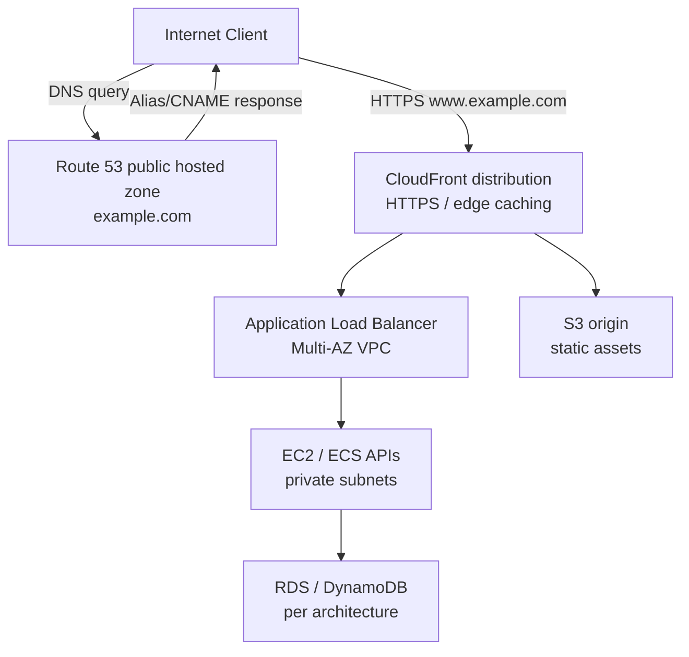
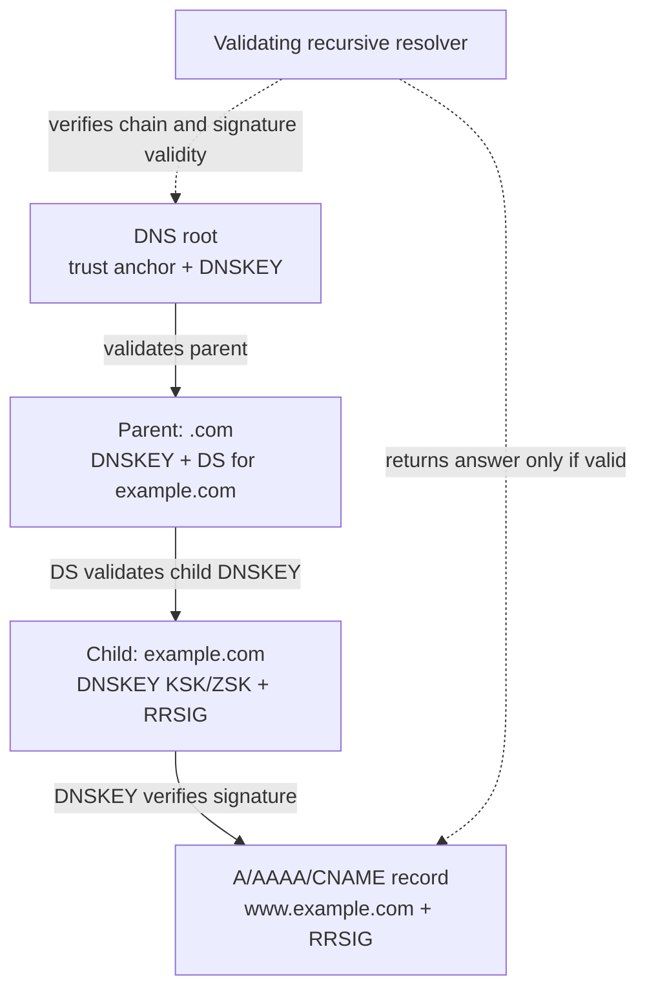
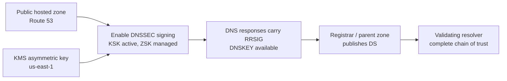

# Domain Registration and DNSSEC Configuration on Amazon Route 53

> **Chapter:** DNS and Content Delivery  
> **Module:** CLOUD_PROVIDERS_AWS  
> **Goal:** understand the domain registration and management lifecycle, set up authoritative DNS, enable DNSSEC in the right sequence, and maintain availability for AWS applications. Connects with IAM, VPC, ALB, CloudFront, monitoring, recovery, and cost control.

## 1. Real-World Problem: Owning a Domain Does Not Guarantee Secure DNS

An enterprise deploys an e-commerce website on AWS:

- Public domains: `example.com` and `www.example.com`.
- The website is delivered via **Amazon CloudFront**, with origins on S3 or an Application Load Balancer (ALB).
- APIs run on EC2/ECS inside a VPC behind an ALB.
- Corporate email uses an email service with MX, SPF, DKIM, and DMARC records.
- The security team wants to reduce the risk of attackers spoofing DNS answers to send users to a fake website.

The enterprise must solve **four independent questions**:

1. **Who registers and maintains ownership rights to the domain name?** That is the **domain registrar** problem.
2. **Which name servers hold the authoritative DNS records?** That is **DNS hosting** with authoritative name servers.
3. **How is the domain pointed to CloudFront, ALB, or the application?** That is **DNS resource record** configuration.
4. **Can resolvers verify that DNS answers have not been tampered with?** That is **DNSSEC**, combining zone signing with a **chain of trust from the parent zone**.

Amazon Route 53 can provide both **domain registration** and **authoritative DNS**, though those two roles do not have to reside with the same provider.

> **Example Convention:** `example.com` is reserved for documentation by Internet standards—**never try to register it**. Server names, hosted zone IDs, and cryptographic data in this lesson are illustrative only.

### 1.1. Expected Learning Outcomes

Learners will be able to:

- Distinguish **registrar, registry, authoritative DNS, hosted zone, resolver, NS, and DS**.
- Register a domain via Route 53 and know which configurations are created automatically.
- Configure DNS records for ALB/CloudFront without mixing up DNS and TLS certificate responsibilities.
- Explain **RRSIG, DNSKEY, DS, KSK, ZSK**, and the **chain of trust** in DNSSEC.
- Set up DNSSEC signing on a **Route 53 public hosted zone**, then publish the DS record in the right place.
- Use the AWS CLI and `dig` to inspect configurations without altering production.
- Plan key rotation, DNS provider migration, rollback, monitoring, and costs.

## 2. Foundational Concepts of the DNS System

### 2.1. Registrar, Registry, DNS Provider, and Resolver

| Component | Role | Example |
|---|---|---|
| **Domain name** | Name an organization registers to use for a specific term | `example.com` |
| **TLD** (top-level domain) | Domain suffix | `.com`, `.org`, `.net` |
| **Registry** | Organization operating the registration database for a TLD | Registry managing `.com` |
| **Registrar** | Entity handling registration/renewal/domain management for customers | Amazon Route 53 Domains, other registrars |
| **Authoritative DNS provider** | System holding and answering official DNS records for a zone | Amazon Route 53 hosted zone or another DNS provider |
| **Recursive resolver** | Server receiving client queries, resolving, and caching DNS answers | ISP, corporate, or public resolver |
| **Parent zone** | Upper-level DNS zone governing delegation and DS for a child zone | `com.` is the parent of `example.com.` |
| **Hosted zone** | Collection of authoritative DNS records for a domain or subdomain | Public hosted zone `example.com` |

**Managing domain registration at a registrar** does not mean **that registrar stores the website's A/CNAME/MX records**. Conversely, using Route 53 for DNS hosting does not force you to transfer domain registration to Route 53 Registrar.

### 2.2. DNS Resolution Flow



The diagram simplifies **recursive resolution**. When cached data exists, the resolver may skip querying the entire hierarchy.

Points to distinguish:

- **NS record at parent:** states which authoritative name servers the child domain is delegated to.
- **NS record inside the child hosted zone:** publishes that zone's own name servers.
- **TTL (Time To Live):** how long a resolver may keep an answer in cache before re-querying; changing TTL does not immediately clear every cache on the Internet.

### 2.3. Public Hosted Zone vs. Private Hosted Zone

A **public hosted zone** serves DNS queried publicly from the Internet. This is the zone type where Route 53 **DNSSEC signing** can be enabled.

A **private hosted zone** works with Amazon VPC to resolve internal names across associated VPCs. **Route 53 does not support DNSSEC signing for private hosted zones.** If the requirement is **validating DNSSEC when a VPC resolver queries public domains**, that is **Route 53 Resolver DNSSEC validation**, separate from signing a public hosted zone.

An organization can run both in parallel:

- `example.com` in a public hosted zone for the public website.
- `internal.example.com` in a private hosted zone for internal apps.

Never infer from enabling signing on a public zone that private records are automatically signed too.

## 3. Registering a Domain with Route 53

### 3.1. Before Clicking Register Domain

Check:

1. **Name and TLD to purchase:** spelling, brand, collision risk, legal requirements, and market scope.
2. **Whether Route 53 supports the TLD:** not every TLD is sold by every registrar; terms and prices vary by TLD.
3. **TLD rules:** some require business/residency verification or extra contact details.
4. **Owning account:** use an organization-managed AWS account with IAM access controls and strong authentication.
5. **Registrant/admin/technical contact info:** active email addresses to receive verification requests and renewal notices.
6. **Domain lifecycle protection:** auto-renew, registrar lock where supported, tracking expiration dates and costs.
7. **Domain used for root account email:** avoid circular dependency on a domain inside that same AWS account, which could be suspended if the account faces issues.

**Do not register real domains just for practice.** Registration incurs charges and usually cannot be renamed or refunded for typos.

### 3.2. Registration Flow in the Route 53 Console

Conceptually:

1. Go to **Amazon Route 53 → Registered domains → Register domains**.
2. Search for the domain name and check availability.
3. Choose registration years, renewal options, and TLD-specific settings.
4. Enter accurate contact info; enable privacy protection where supported and allowed by policy.
5. Review name, fees, and contacts, then submit the registration request.
6. Watch for registrant verification emails or registry requirements if applicable.
7. Wait for registration completion, then verify Name Servers and the hosted zone.

**Important behavior:** when registering a **new domain through Route 53**, AWS usually **automatically creates a public hosted zone of the same name**, assigns four name servers to it, and updates the domain registration's NS delegation to use those name servers. Hosted zones and domain registration are **two resources billed under different pricing models**.

If you create **another hosted zone** with the same domain name, the new zone's NS set will likely differ. The domain will not automatically resolve via the new zone until **parent/registrar delegation** is updated accurately.

### 3.3. Registration ≠ Maintaining DNS Records

| Action | Where Performed | Outcome |
|---|---|---|
| Buy/renew domain | **Registered domains / registrar** | Organization retains registration rights for the paid term |
| Edit contacts, auto-renew, registrar lock | **Registrar** | Governs domain lifecycle and security |
| Create A/AAAA/CNAME/MX/TXT/alias | **Authoritative DNS hosted zone** | Determines where requests are routed |
| Change NS delegation | **Registrar / parent zone** | Selects the authoritative DNS provider for the domain |
| Enable DNSSEC signing | **DNS provider / hosted zone** | Signs DNS responses in the zone |
| Publish DS/public key to parent | **Registrar / parent-zone owner** | Links the signed zone into the chain of trust |

**Common mistake:** editing the NS record inside the new hosted zone without updating delegation at the registrar. Public resolvers will keep going to the old name servers configured at the parent.

### 3.4. When the Domain Is Registered at Another Provider

If a domain is already registered at Registrar X, you can still use Route 53 authoritative DNS:

1. Create a **Route 53 public hosted zone** for the domain.
2. Copy/configure all web, API, email, and verification TXT records.
3. Verify records directly against Route 53's authoritative NS before switching delegation.
4. Update **NS at Registrar X** to the four NS of the Route 53 hosted zone.
5. Monitor resolution and caching across the NS TTL.

You do not have to **transfer domain registration** to Route 53 to use a hosted zone. If the domain already uses DNSSEC at the old provider, changing NS requires a dedicated **DS/rollover plan**—otherwise validating resolvers may return `SERVFAIL`.

## 4. Configuring DNS Records for AWS Applications

### 4.1. Key Records to Know

| Record | Role | Example |
|---|---|---|
| **A** | Maps hostname to IPv4 | `api.example.com → 203.0.113.10` |
| **AAAA** | Maps hostname to IPv6 | `api.example.com → 2001:db8::10` |
| **CNAME** | Maps one hostname to another hostname | `www.example.com → d111111abcdef8.cloudfront.net` |
| **Alias (Route 53)** | Route 53-specific record pointing to supported AWS resources | `example.com → CloudFront distribution/ALB` |
| **NS** | Identifies authoritative name servers | `example.com → ns-...awsdns-...` |
| **SOA** | Zone administration metadata; affects negative response caching | SOA managed by hosted zone |
| **MX** | Mail exchanger | `example.com → mail provider` |
| **TXT** | Text data for verification and email policies | SPF, DKIM, DMARC |
| **CAA** | Restricts CAs permitted to issue certificates for the domain | `example.com CAA ...` |
| **DS** | Record in parent zone referencing child zone's DNSKEY | `example.com DS ...` |
| **DNSKEY / RRSIG / NSEC** | DNSSEC components | Public key, signature, authenticated denial of existence |

**Alias** is a Route 53 feature, not a standard DNS resource record type like A/CNAME. Route 53 responds with appropriate A/AAAA records for supported AWS resources—even at the **zone apex** `example.com`, where a traditional CNAME cannot be used as a regular record.

### 4.2. Website Example with CloudFront, ALB, and VPC



Illustrative record set:

| Name | Record | Target |
|---|---|---|
| `example.com` | A Alias | CloudFront or ALB per architecture |
| `www.example.com` | A/AAAA Alias | CloudFront distribution |
| `api.example.com` | A/AAAA Alias | Internet-facing ALB |
| `example.com` | MX/TXT | Email service and verification policies |
| `_dmarc.example.com` | TXT | Appropriate DMARC policy |

When using CloudFront with a custom domain, configure the **alternate domain name** and a valid TLS certificate, typically in **ACM us-east-1** per CloudFront requirements. HTTPS certificates and DNSSEC are two separate mechanisms; the site still needs HTTPS even when DNSSEC is enabled.

## 5. What Problem Does DNSSEC Solve?

**DNS Security Extensions (DNSSEC)** use digital signatures to help validating DNS resolvers verify the **origin authenticity and integrity of DNS answers**.

Attack scenario without validation: an attacker spoofs a `www.example.com A` record so the browser receives a phishing server IP instead of the official address.

With DNSSEC properly configured with a **valid chain of trust**, a validating resolver detects invalid signatures and rejects spoofed responses instead of returning the fake IP.

### 5.1. What DNSSEC Can and Cannot Do

| Capability | DNSSEC |
|---|---|
| Helps verify DNS responses were not tampered with | **Yes**, when validating resolvers and a valid chain of trust are used |
| Protects against certain forms of DNS spoofing/cache poisoning | **Yes**, within DNS authentication scope |
| Encrypts DNS queries and responses | **No** — that is the goal of DoT/DoH or other protocols |
| Replaces website HTTPS/TLS certificates | **No** |
| Proves users are viewing authentic app content | **Not completely**; app, TLS, IAM, and backends still need protection |
| Blocks domain takeover or lookalike phishing | **No** |
| Speeds up DNS or caching | **No**, DNSSEC can actually increase response sizes |
| Forces every resolver on the Internet to validate DNSSEC | **No**, only validating resolvers check signatures |

**Conclusion:** DNSSEC provides **DNS authenticity/integrity**, not transport encryption or whole-website security.

### 5.2. Essential Records and Keys

| Component | Meaning |
|---|---|
| **DNSKEY** | Public key published in a signed zone |
| **RRSIG** | Digital signature over a DNS record set (RRset) |
| **DS (Delegation Signer)** | Record in the **parent zone** referencing the **child zone's** DNSKEY; typically contains key tag, algorithm, digest type, and digest |
| **KSK (Key-Signing Key)** | Key used to sign the DNSKEY RRset, linking to the parent DS |
| **ZSK (Zone-Signing Key)** | Key signing other record sets in the zone |
| **NSEC / NSEC3** | Mechanism providing authenticated proof that a name or record does not exist; details/format vary by DNS provider |
| **Trust anchor** | Starting trust point for a validating resolver, typically derived from the DNS root |

**DS is not a private key.** DS holds information to authenticate DNSKEY, usually as a digest. Private keys are **never** published in DNS records or registrar consoles.

### 5.3. Chain of Trust from Root to Website



Conceptual flow:

1. The resolver holds the root trust anchor.
2. The resolver verifies signatures and delegation leading to **`.com`**.
3. The parent `.com` publishes a **DS record** for `example.com`.
4. The resolver uses DS to verify **DNSKEY** in the child `example.com`.
5. The validated DNSKEY verifies the **RRSIG** on returned records such as A/AAAA.
6. If any link declared secure fails verification, a validating resolver typically returns **`SERVFAIL`** instead of untrusted data.

**Crucial point:** a zone with RRSIGs whose **parent lacks a DS record** is only a **signed island**—it does not yet establish DNSSEC validation from the root. Conversely, if the parent has a DS record while the child zone is not signed properly or lacks the matching key, the domain can stop resolving at validating resolvers.

## 6. How Route 53 Implements DNSSEC Signing

### 6.1. DNSSEC Signing Lives at the Authoritative Hosted Zone

Route 53 supports DNSSEC signing for **public hosted zones**. When enabled:

- Route 53 signs DNS responses from the zone using appropriate keys.
- The system uses a **KSK** backed by an **asymmetric customer managed KMS key** owned by your account.
- **ZSK** management and rotation are handled automatically by Route 53.
- You still must **configure DS at the parent** to complete the chain of trust.
- Route 53 caps **record TTLs in a signed hosted zone at one week**; if configured higher, Route 53 enforces this limit in responses.

This operates at the authoritative DNS layer. It does not mean private hosted zones, VPC Route 53 Resolver, or arbitrary other DNS domains are automatically signed.

### 6.2. What Requirements Apply to the KMS Key for KSK?

Per current AWS Route 53 guidance, a DNSSEC KMS key must satisfy:

- Must be an **asymmetric AWS KMS customer managed key**.
- Key spec **`ECC_NIST_P256`**, key usage for sign and verify.
- Must reside in **Region `us-east-1` (US East / N. Virginia)**, regardless of which Region runs the app's EC2/ALB/CloudFront origins.
- Key policy must permit Route 53 to perform the required KMS operations per AWS documentation.
- You can pick an **existing qualifying key** or let Route 53 create an eligible customer managed key when enabling signing.
- The key incurs AWS KMS charges; changing key state, permissions, or deleting the key can break signing.

**Never use a symmetric KMS key meant for EBS/S3 encryption** as a KSK. DNSSEC requires the exact asymmetric key type—not just any resource named "KMS key."

### 6.3. KSK and ZSK in Route 53

- **KSK:** operators are responsible for managing, monitoring status, and rotating when needed. Route 53 supports **up to two KSKs per hosted zone** under current limits.
- **ZSK:** managed by Route 53 to sign RRsets inside the hosted zone.
- In Route 53's model, signatures use **ECDSAP256SHA256 (algorithm 13)**; when exporting standard DS records, the digest type is **SHA-256 (type 2)**.
- If a KSK reports **`ACTION_NEEDED`**, investigate immediately—especially KMS key access permissions, key state, and key policy.

**Do not delete or disable the KMS key right after registering DS.** The parent zone continues requiring a matching valid DNSKEY while resolvers may keep DS cached.

### 6.4. Why Does `us-east-1` Appear Even When Workloads Run in Singapore?

Example:

| Component | Scope/Location | Explanation |
|---|---|---|
| Domain registration | Global domain registration service | Not an EC2 instance in an AZ |
| Public hosted zone | Route 53 authoritative DNS, global service scope | Answers DNS via authoritative name servers |
| **KMS key for DNSSEC KSK** | **`us-east-1`** | Specific requirement of Route 53 DNSSEC |
| Application Load Balancer | Single **Region**, multi-AZ per config | E.g., `ap-southeast-1` |
| CloudFront distribution | Global edge delivery | Origins can reside in any Region |
| Route 53 Resolver DNSSEC validation | Configured on Resolver/VPC | Distinct from authoritative zone signing |

If security teams insist **every KMS key must reside in the same Region as the application**, clarify Route 53's service requirement: the DNSSEC KSK KMS key is still mandatory in **`us-east-1`**. That does not mean Singapore application data is moved to Virginia.

## 7. Two Independent Steps: Signing the Zone and Publishing DS

Remember this operational model:



**Step A: Zone signing.** The DNS provider generates and serves signatures/DNSKEY.  
**Step B: DS delegation.** The parent zone publishes a DS matching the child's key so resolvers know to validate signatures.

You must sign the zone and verify it works **before** publishing DS. Publishing DS too early causes validating resolvers to treat the child zone as **bogus** and return `SERVFAIL`.

When disabling DNSSEC, follow the **reverse order**: remove DS at the parent, wait for TTL/caches to settle, **then** disable signing at the child.

## 8. DNSSEC Deployment Workflow When Both Registration and DNS Are on Route 53

Suppose a domain is registered via Route 53 and authoritative DNS is also Route 53. The steps below are a **controlled operational guide**—never run them directly on a production domain without authorization and a recovery plan.

### 8.1. Step 0 — Pre-Change Checks

Verify:

1. Domain is registered and active; contact email is verified.
2. Correct public hosted zone; **NS at the registrar match the NS of the hosted zone actually serving the domain**.
3. Existing A/AAAA/Alias/CNAME/MX/TXT records resolve properly.
4. **The TLD supports DNSSEC**; Route 53 Registrar supports adding DNSSEC keys for that TLD.
5. No conflicting DS remains from a previous DNSSEC setup.
6. IAM permissions exist to enable signing, manage KMS, and view/edit DS at the registrar.
7. On-call personnel, monitoring, and a rollback plan are ready.
8. Record TTLs and resolver caching windows are noted to plan wait times.

**Do not proceed if the domain already has DNS errors before enabling signing.** DNSSEC will not fix wrong NS, missing records, broken routing, or an unhealthy app.

### 8.2. Step 1 — Prepare TTLs and Monitoring

Per AWS guidance, to shorten rollback time:

- Monitor DNS availability across multiple recursive resolvers and locations.
- Identify the **maximum TTL** among records in the zone.
- Consider lowering the maximum record TTL to **around 1 hour** before enabling signing (per AWS guidance), if caching and operations allow.
- Check **SOA TTL** and **SOA minimum** used for negative caching.
- Wait for TTL/`GetChange` propagation per procedure before treating changes as live.

Do not equate A/AAAA record TTL with **NS delegation TTL** or parent **DS TTL**. They sit at different links in the chain and may need different wait windows.

### 8.3. Step 2 — Choose or Create KMS Key and Enable Signing

In the **Route 53 Console**:

1. Open **Hosted zones → select the public hosted zone**.
2. Open the **DNSSEC signing tab → Enable DNSSEC signing**.
3. Enter a unique **KSK name** per naming conventions.
4. Select a qualifying customer managed KMS key or let Route 53 create one.
5. Verify the KMS key is in **`us-east-1`**, asymmetric `ECC_NIST_P256`, with the right key policy.
6. Enable DNSSEC signing and monitor KSK/hosted zone status.

Via API/CLI, the key operations are:

- `CreateKeySigningKey` — creates a KSK referencing a customer managed KMS key.
- `EnableHostedZoneDNSSEC` — enables signing for a public hosted zone.
- `GetChange` — checks whether the change is `INSYNC`.
- `GetDNSSEC` — inspects signing status/KSK/DS information.

Mutating operations **should only run via approved change workflows**; the CLI practice section below intentionally uses read-only commands.

### 8.4. Step 3 — Verify the Zone Is Signed

Before publishing DS:

- Confirm Route 53 `DNSSEC signing` is active.
- Confirm KSK is **ACTIVE** with no action-needed warnings.
- Query DNSKEY and an RRSIG-signed record directly from an authoritative name server.
- Use `GetChange` to ensure changes are synced per AWS.
- **Wait at least one old maximum TTL** per AWS recommendations to minimize stale unsigned cached records.

While DS is absent at the parent, validating resolvers still treat the zone as **insecure** rather than enforcing validation; that is the normal transitional state before linking the chain.

### 8.5. Step 4 — Publish DS at the Parent via Route 53 Registrar

Inside the public hosted zone, open **DNSSEC signing → View information to create DS record** to retrieve values such as:

- Key type: KSK.
- Signing algorithm: **ECDSAP256SHA256 / 13**.
- Public key (base64).
- DS record (key tag, algorithm, digest type, digest) for cases requiring direct DS entry.

When **Route 53 is the registrar**:

1. Go to **Registered domains → domain name → DNSSEC keys → Add key**.
2. Select key type and algorithm matching the zone signing details.
3. **Enter the base64 public key** exactly as instructed by the Route 53 Registrar UI.
4. Confirm; the registrar forwards the info to the **TLD registry**, which publishes **DS** in the **parent zone**.

**Common pitfall:** in the **Route 53 Registrar** UI, you typically provide the **public key**, **not** the DS digest string pasted into the public key box. Route 53 Registrar generates/updates DS at the TLD from that public key. At other registrars, the UI may ask for the **DS record directly**.

**The DS for `example.com` belongs in `.com`**, not as a DS record added inside the `example.com` hosted zone itself. Adding DS inside the child zone does not build a chain of trust from the TLD.

### 8.6. Step 5 — Verify the Chain of Trust and Monitor

After the parent publishes DS:

1. Query the parent zone to confirm the right DS exists.
2. Query authoritative DNS to confirm DNSKEY/RRSIG.
3. Use a **validating resolver** or `delv` to validate results.
4. Test A/AAAA/alias, CNAME, MX, and key TXT records across multiple resolvers.
5. Watch `SERVFAIL`, DNSSEC alarms, user error rates, and CloudWatch.
6. Keep support and rollback procedures ready throughout monitoring.

DS updates at the registry can experience TLD/registrar propagation delay. Never assume clicking "Add key" means every resolver sees the new DS immediately.

## 9. Important Deployment Variations

### 9.1. External Registrar, Route 53 Authoritative DNS

Suppose a domain was bought at Registrar X while records are managed in a Route 53 public hosted zone:

1. Verify NS delegation at Registrar X points to the Route 53 hosted zone.
2. Enable signing in Route 53 and create a KSK backed by a qualifying KMS key.
3. Wait for signing/DNSKEY/RRSIG to become active and TTL/caches to stabilize.
4. Copy the **DS record value** provided by Route 53.
5. Log in to Registrar X and submit DS per registrar/registry requirements (key tag, algorithm, digest type, digest, or corresponding public key).
6. Verify DS directly at the parent and resolver validation.

Never assume every registrar accepts the same format or algorithm. If Registrar X or the TLD does not support parent-level DNSSEC, child signing alone cannot establish a chain from root.

### 9.2. Route 53 Registrar, Authoritative DNS Elsewhere

A domain managed by Route 53 Registrar whose authoritative records live at DNS Provider Y:

1. DNS Provider Y must support **DNSSEC signing** and export signing/public key details.
2. Enable signing per Provider Y's workflow.
3. Confirm **parent NS** actually point to Provider Y, not an unused Route 53 hosted zone.
4. Open **Route 53 Registered domains → DNSSEC keys** to add Provider Y's **public key/algorithm**.
5. Verify parent DS and DNSSEC validation.

**Route 53 Registrar supporting DNSSEC does not force you to use Route 53 DNS.** Zone signing is always performed by whichever DNS provider is authoritative.

### 9.3. Signed Subdomain: `app.example.com`

If delegating `app.example.com` to an independent hosted zone:

- **Parent `example.com`** holds the NS delegation for `app.example.com`.
- **Child `app.example.com`** has DNSKEY/RRSIG after signing.
- **The DS for `app.example.com`** is **added in parent `example.com`**.
- If the parent is also signed, validating resolvers can follow root → TLD → `example.com` → `app.example.com`.

In multi-account AWS setups: a central DNS account owns the parent zone while an app account owns the child zone. Both teams must coordinate DS/KSK/NS and IAM change control. Never grant full write access on the parent hosted zone to every app team just to add one DS record.

### 9.4. TLD or DNS Provider Does Not Support DNSSEC

If a TLD does not support DS/DNSSEC, a standard chain of trust from the DNS root to that domain cannot exist under common models. Check supported TLD lists and choose providers accordingly.

If a DNS provider does not support zone signing, adding DS at the registrar without valid DNSKEY/RRSIG is **dangerous**. Migrate DNS hosting to a DNSSEC-capable provider in proper sequence first.

## 10. Managing KSK/DS Lifecycle and DNSSEC Changes

### 10.1. Changing a KSK Is Not Just Swapping a KMS Key

A KSK rollover must ensure validating resolvers always have **at least one valid trust chain** throughout the transition.

Safe mindset:

1. Check current signing/KSK status, metrics, and TTLs.
2. Provision the **new KMS key** meeting all prerequisites and permissions.
3. Create a **new KSK** alongside the old KSK without exceeding Route 53's two-KSK quota.
4. Wait for DNSKEY/RRSIG updates to propagate.
5. Add the **new DS/public key** at the parent/registrar while keeping the old DS during transition where feasible.
6. Wait for DS/NS TTLs and verify validation across multiple resolvers.
7. Only after the new chain is stable, remove the old DS and deactivate/delete the old KSK per procedure.
8. Never destroy the old KMS key before dependencies and cache lifetimes have cleared.

**Never copy an unverified rollover procedure straight into production.** Exact steps and overlap durations depend on DNS provider, TLD/registrar, TTLs, and key limits.

### 10.2. Disabling DNSSEC in the Right Order

Disabling DNSSEC **does not start by clicking Disable signing** if the parent still holds a DS record.

General safe order:

1. Identify all relevant **child/parent DS records** if the zone has signed child zones.
2. Delete or update DS at the **parent zones** per AWS procedures, including child DS records if tearing down the chain.
3. Confirm DS has disappeared at the parent and **wait out DS TTL/caches**.
4. **Only then disable hosted zone DNSSEC signing**.
5. Deactivate/delete KSK and KMS keys once unused, following key management and cost controls.
6. Monitor DNS resolution afterward.

**Disabling signing first while leaving an old DS at the parent** causes validating resolvers to mark the child bogus and return `SERVFAIL`. Adding a new A record will not fix a broken trust chain.

### 10.3. Changing Name Servers on a DNSSEC-Enabled Domain

Migrating authoritative DNS from Provider A to Provider B carries different risks from changing an A record:

- Parent NS may point to A or B across caches during transition.
- Parent DS may still match A's DNSKEY while B uses different keys.
- Old and new DNS providers may serve different records/signatures.

The migration plan must address **DNS data sync, DS/key strategy, NS TTLs, and transition windows** per both providers' documentation. When seamless validation cannot be maintained, you may consider **removing DS, waiting out caches, switching delegation, and then re-signing/re-establishing the chain** under an approved plan—accepting a temporary window without a full DNSSEC trust chain. Security leadership must approve that risk trade-off.

Never just swap NS and expect DNSSEC to follow automatically.

## 11. Inspecting with AWS CLI — Read-Only, Without Modifying Domains

The examples below are **read-only**. They require AWS CLI v2, credentials/profiles authorized to view Route 53, Route 53 Domains, and KMS where needed, plus DNS tools like `dig` or `delv` on a test host.

**Service region:** Route 53 hosted zones are global; the CLI can use `--region us-east-1` for Route 53/Domains APIs in examples. Specifically, **DNSSEC KMS keys must be in `us-east-1`**. Domains and IDs are illustrative; do not run against nonexistent resources.

### 11.1. List Domains Registered with Route 53 Registrar

```bash
aws route53domains list-domains \
  --region us-east-1 \
  --query "Domains[].[DomainName,AutoRenew,Expiry]" \
  --output table
```

If a domain is registered at another registrar, this command **will not list it**, even if its authoritative DNS runs on Route 53.

### 11.2. View Domain Details and Registrar NS Delegation

```bash
aws route53domains get-domain-detail \
  --region us-east-1 \
  --domain-name example.com \
  --query "{Domain:DomainName,Status:StatusList,AutoRenew:AutoRenew,Nameservers:Nameservers}" \
  --output json
```

Check the nameservers stored at the registrar and compare them with the authoritative name servers of the active hosted zone. Domain contact info can be sensitive, so avoid logging/sharing full JSON unnecessarily.

### 11.3. List Hosted Zones Sharing a Name

```bash
aws route53 list-hosted-zones-by-name \
  --dns-name example.com \
  --query "HostedZones[].[Id,Name,Config.PrivateZone]" \
  --output table
```

**Note:** multiple hosted zones with the same name may exist across accounts or even within one account. Always choose the **hosted zone ID whose authoritative NS are delegated by the parent**, not merely the first matching name.

### 11.4. View Name Servers of a Hosted Zone

```bash
aws route53 get-hosted-zone \
  --id Z0123456789EXAMPLE \
  --query "{Zone:HostedZone.Name,Private:HostedZone.Config.PrivateZone,NameServers:DelegationSet.NameServers}" \
  --output json
```

For a public hosted zone, `DelegationSet.NameServers` lets you cross-check against registrar nameservers. `Z0123456789EXAMPLE` is a sample ID only.

### 11.5. View Records in a Hosted Zone

```bash
aws route53 list-resource-record-sets \
  --hosted-zone-id Z0123456789EXAMPLE \
  --query "ResourceRecordSets[].[Name,Type,TTL,AliasTarget.DNSName]" \
  --output table
```

This example displays name/type/TTL and alias targets. To inspect full `ResourceRecords`/values, omit `--query` or adjust the JSON query. Never assume the lack of a standard A record means a domain points nowhere: **AliasTarget** may be used instead.

### 11.6. Inspect DNSSEC Signing and KSK

```bash
aws route53 get-dnssec \
  --hosted-zone-id Z0123456789EXAMPLE \
  --output json
```

Output shows **Status.ServeSignature**, **KeySigningKeys**, KSK states/attributes, and DS record values for parent setup. If signing/key status is unexpected, do not publish DS until the cause is resolved.

### 11.7. Check DNSSEC KMS Key Status

Run only with a real KMS key ARN/ID:

```bash
aws kms describe-key \
  --region us-east-1 \
  --key-id arn:aws:kms:us-east-1:111122223333:key/00000000-1111-2222-3333-444444444444 \
  --query "KeyMetadata.{Arn:Arn,State:KeyState,Spec:KeySpec,Usage:KeyUsage}" \
  --output json
```

Expect **`ECC_NIST_P256`**, usage **`SIGN_VERIFY`**, and a state permitting Route 53 use. `DescribeKey` alone **does not prove** the key policy is right; audit KMS permissions through approved IAM review.

### 11.8. Check DNS from Resolvers and Authoritative Servers

Examples for systems with `dig`:

```bash
# Does the parent have a DS record?
dig example.com DS +dnssec

# Does the child publish DNSKEY and RRSIG?
dig example.com DNSKEY +dnssec

# Does www have an A record/RRSIG?
dig www.example.com A +dnssec

# Public name servers
dig example.com NS

# Query via validating public resolvers
dig @1.1.1.1 www.example.com A +dnssec
dig @8.8.8.8 www.example.com A +dnssec

# Trace DNS delegation chain
dig +trace example.com NS
```

**Correct interpretation:**

- `+dnssec` mainly sets the **DO bit** requesting DNSSEC records; `dig` itself **does not cryptographically validate the full signature** merely because this flag is passed.
- The **AD (Authenticated Data)** flag from a **trusted validating resolver** indicates validated data; understand resolver configuration, caching, and query setup.
- **`delv`** performs full local DNSSEC validation when given an appropriate trust anchor/resolver.
- `SERVFAIL` from a validating resolver while authoritative or non-validating resolvers return data is a strong clue to investigate the **DNSSEC chain**, though network/DNS issues can also cause it.
- **DS queries should be checked at the parent zone**; recursive resolvers can also serve cached DS answers. When suspecting stale records, query the TLD's authoritative servers directly.

Direct query to a Route 53 authoritative name server (**substitute real NS name**):

```bash
dig @ns-123.awsdns-45.net example.com DNSKEY +dnssec
dig @ns-123.awsdns-45.net www.example.com A +dnssec
```

Never use a fake `ns-...` name from documentation to claim signing succeeded.

### 11.9. Distinguish "Record Exists" from "Trusted"

| Observation | Possible Meaning |
|---|---|
| A record returns expected IP | DNS config or cache exists; does not prove DNSSEC is valid |
| Child has DNSKEY and RRSIG | Zone publishes signed data; does not prove parent has DS |
| Parent has matching DS | Chain link exists; signatures/keys still must validate |
| Validating resolver sets AD or `delv` validation succeeds | Stronger evidence of a valid chain of trust for that query |
| Validating resolver returns `SERVFAIL` | Possible DNSSEC, DNS network, or authoritative server fault; investigate further |
| IP/website works yet `https` reports certificate mismatch | TLS/hostname issue, not directly DNSSEC |

## 12. Troubleshooting DNSSEC and DNS After Deployment

### 12.1. Diagnostic Table

| Symptom | Likely Cause to Check | Safe Investigation Action |
|---|---|---|
| Domain registered yet website does not load | Missing A/Alias/CNAME, missing TLS/origin config | Check hosted zone, NS delegation, CloudFront/ALB, and HTTPS |
| DNS record edited yet users still get old IP | TTL and resolver caches | Query authoritative NS and multiple recursive resolvers; check TTL |
| Parent NS still points to old provider | Edited NS record inside child zone without updating registrar delegation | Compare `get-domain-detail` with `get-hosted-zone` and parent NS |
| DNSKEY/RRSIG present yet DNSSEC does not validate | DS not published at parent or incomplete chain | `dig DS` at parent, `GetDNSSEC`, `delv` |
| Domain returns `SERVFAIL` right after adding DS | DS mismatches KSK/DNSKEY; zone signing not yet settled | Compare key tag/algorithm/digest, authoritative DNSKEY/RRSIG, TTL |
| Some resolvers work, others fail | Varying NS/DS caches, DNSSEC packet size/network issue | Compare validating resolvers and test EDNS/UDP fragmentation |
| KSK shows `ACTION_NEEDED` | KMS key disabled, deleted, or key policy altered | Inspect KMS state, Route 53 permissions, and CloudWatch alarms |
| Website has valid TLS cert yet DNS returns `SERVFAIL` | Broken DNSSEC chain or DNS resolution fault | Do not touch the TLS cert; inspect resolver and parent DS |
| Corporate email suddenly stops arriving | Broken MX/TXT or DNSSEC validation failure on mail records | Query MX/TXT via validating resolver; check mail provider |
| Site loses access after changing DNS provider | Old/new provider NS and DS out of sync | Check parent delegation, DS, and DNSKEY/RRSIG at each provider |
| DNSSEC signing disabled while DS still exists | Parent mandates validation while child lacks signatures | Execute recovery/re-signing runbook or remove DS per plan |
| Website works by IP yet domain fails to resolve | DNS outage, NS/DS/record fault | Separate app IP/TLS testing from DNS resolution |

### 12.2. Two States to Distinguish: Insecure vs. Bogus

- **Insecure:** the resolver has no mandatory DS chain to the zone, so it does not require DNSSEC trust-chain validation for that zone. The zone resolves, but without full-chain DNSSEC guarantees.
- **Bogus:** the parent publishes a DS for the child, yet child data fails validation (e.g., bad signature, mismatched key, expired signature). Validating resolvers typically return `SERVFAIL`.

This explains why **a signed zone without DS remains reachable**, whereas **adding a wrong DS can take the domain down**.

### 12.3. DNSSEC Response Size Risks

DNSSEC adds DNSKEY/RRSIG/NSEC records and enlarges DNS responses. Some legacy network gear, middleboxes, or resolvers mishandle EDNS/UDP fragmentation, causing queries to fail.

When some user networks fail while others succeed:

1. Check DNS response sizes and EDNS0 support.
2. Check UDP/TCP port 53 traffic between recursive resolvers and authoritative servers.
3. Check whether middleboxes strip DNSSEC records.
4. Review AWS guidance on DNS reply sizes.
5. Never rush to **disable DNSSEC** without first evaluating safe parent DS removal order.

## 13. Monitoring, IAM, and Safe Domain Operations

### 13.1. CloudWatch Alarms for DNSSEC

AWS recommends alarming on metrics/conditions such as:

- **`DNSSECInternalFailure`** — internal DNSSEC signing error.
- **`DNSSECKeySigningKeysNeedingAction`** — KSK requires intervention.

Verify namespace, dimensions, CloudWatch metric Region, and Route 53 metric documentation before creating alarms. Never assume the absence of console alarms proves zero errors at external validating resolvers.

Combine with:

- Health checks/availability probes across multiple resolvers and locations.
- HTTPS response monitoring for websites, APIs, and email routing where relevant.
- **Route 53 query logging** when enabled, per supported logging destination.
- **CloudTrail** for DNS/registrar/KMS control-plane APIs.
- AWS Health/notifications regarding registrar or underlying infrastructure.

### 13.2. IAM and Account Security

Separate duties:

| Role | Recommended Permissions | Guardrails to Keep |
|---|---|---|
| **Domain owner** | Manage registration, renewals, contacts, locks, and registrar DNSSEC keys | Never grant to runtime applications |
| **DNS administrator** | Read/edit hosted zones, records, and DNSSEC signing as needed | Require separate approval for NS/SOA/DS/KSK edits |
| **Security/KMS owner** | Manage customer managed keys, key policies, and rotation | Prevent arbitrary key deletion/disabling |
| **Application team** | Update records within delegated scope | Restrict to specific domains/subdomains |
| **Audit/monitoring** | Read-only Route 53/Domains/KMS/CloudTrail metrics | No registration or DNS write permissions |

Tightly controlled APIs may include:

- `route53:ChangeResourceRecordSets`, `route53:CreateHostedZone`, `route53:DeleteHostedZone`.
- `route53:EnableHostedZoneDNSSEC`, `route53:DisableHostedZoneDNSSEC`, `route53:CreateKeySigningKey`.
- `route53domains:UpdateDomainNameservers`, `route53domains:UpdateDomainContact`, and DNSSEC key/transfer management APIs.
- `kms:DisableKey`, `kms:ScheduleKeyDeletion`, `kms:PutKeyPolicy`, `kms:Sign` within required scope.

Combine **least privilege**, IAM MFA/SSO, Organizations SCPs where applicable, CloudTrail, and two-person approval for actions that can break domain resolution.

### 13.3. Registrar Lock, Auto-Renew, and Contact Email

A DNSSEC-enabled website will still go down if the **domain expires** or contacts miss verification emails.

Best practices:

- Enable **auto-renew** where policy and budget allow, and track actual expiration dates.
- Keep payment methods and contact emails active.
- Use registrar lock/transfer protection where supported.
- Monitor registry/registrar contact verification notices.
- Hold domains in a long-lived AWS account with durable ownership, not disposable sandbox accounts.
- Maintain emergency break-glass access for domain and KMS administrators.

### 13.4. Backing Up DNS Config and Recovery Plan

A hosted zone does not replace a **versioned backup of DNS configuration**. Maintain controlled backups of:

- Key A/AAAA/CNAME/Alias/MX/TXT/CAA records.
- Current NS delegation at both registrar and authoritative provider.
- KSK identifiers, KMS key ARNs, and DS metadata (never store private keys).
- DNSSEC status, change timestamps, and prior TTL/NS/DS values.
- IaC/CloudFormation/Terraform definitions under change control if used.

During recovery, do not assume recreating a hosted zone restores the domain automatically: a new zone may receive **different name servers**, and an **old DS** may not match the new DNSKEY.

## 14. Costs to Budget For

Costs go beyond domain purchase price:

| Item | Cost Driver |
|---|---|
| **Domain registration/renewal** | Registration and renewal fees by TLD/term and optional services |
| **Public hosted zone** | Monthly hosted zone fee per Route 53 pricing |
| **DNS queries** | Query volume and routing/record types can affect charges |
| **DNSSEC KMS key** | Customer managed KMS key and cryptographic operations per KMS pricing |
| **Route 53 health checks/query logs** | Monitoring and log storage charges by configuration |
| **Application delivery** | CloudFront, ALB, public IPv4, data transfer, WAF, ACM Private CA (if used) |
| **Operations** | Change governance, key rotation, rollback drills, and incident response |

**Registering a domain through Route 53 typically auto-creates a public hosted zone**, so billing may include both domain and hosted zone charges. Deleting a hosted zone does not cancel domain registration; conversely, holding a domain registration does not mean the website has active authoritative DNS.

Do not hardcode fixed USD amounts, since pricing varies by TLD, Region, query volume, KMS usage, date, and record type. Consult **Route 53 Pricing**, **AWS KMS Pricing**, **Cost Explorer**, and **AWS Budgets**.

## 15. Scenario Exercises and Answers

### Exercise 1 — Does Buying a Domain Immediately Configure DNS?

A dev team registers `shop-demo.example` via Route 53 and assumes an A record already points to their ALB.

**Answer:** A new Route 53 registration typically **auto-creates a public hosted zone and sets NS**, but **does not automatically know which ALB the app wants**. You must add the appropriate A Alias/CNAME or records.

### Exercise 2 — Two Hosted Zones with the Same Name

An account has two public hosted zones both named `example.com`. The team edits the A Alias in zone B, yet resolvers still return zone A's value.

**Answer:** Compare NS delegation at the parent/registrar against each hosted zone's name servers. Only the zone whose authoritative NS are delegated by the parent is queried by Internet DNS, absent special setups.

### Exercise 3 — Signed Zone Without DS

The Route 53 public hosted zone publishes DNSKEY/RRSIG, yet `.com` has no DS for the domain.

**Answer:** The zone is signed, but **the chain of trust from root is incomplete**. Publish the correct DS via the registrar/parent after verifying zone signing.

### Exercise 4 — Adding DS Before Signing

A team submits DS to the parent but forgets to enable DNSSEC signing on the child zone.

**Answer:** Validating resolvers can return `SERVFAIL` because the parent requires validation while the child provides no valid signatures/keys. Recover via controlled DS/signing restoration.

### Exercise 5 — Choosing the Wrong KMS Key Type

A team has a symmetric KMS key encrypting EBS in Singapore and wants to use it as the Route 53 KSK.

**Answer:** Invalid. Route 53 DNSSEC requires an **asymmetric customer managed key `ECC_NIST_P256` in `us-east-1`** with an appropriate key policy.

### Exercise 6 — Disabling DNSSEC in a Hurry

An engineer disables signing in Route 53 without deleting the existing DS at the parent.

**Answer:** That is the dangerous order. Fix the chain of trust: remove DS at the parent, wait out TTL/caches, **and only then disable signing**. If an outage is underway, follow the prepared recovery runbook.

### Exercise 7 — Registrar Differs from DNS Provider

The domain is registered at an external registrar, while the DNS hosted zone is on Route 53. Who creates DS?

**Answer:** Route 53 **signs the zone** and provides DS details; the **registrar/parent zone** publishes DS. There is no requirement to transfer registration to Route 53.

### Exercise 8 — Route 53 Registrar with External DNS Provider

The domain is registered via Route 53, while NS point to DNS Provider X. What is needed for DNSSEC?

**Answer:** Enable DNSSEC signing at Provider X, obtain the right public key/algorithm, add the DNSSEC key under **Route 53 Registered domains**, and verify DS published by the TLD registry. Do not sign an unused non-authoritative Route 53 hosted zone and assume it is complete.

### Exercise 9 — Does DNSSEC Replace HTTPS?

A website has valid DNSSEC, yet its HTTPS certificate has expired.

**Answer:** No. DNSSEC only authenticates DNS data; the website still needs a valid TLS certificate and proper HTTPS/ACM configuration.

### Exercise 10 — Some Networks Return SERVFAIL

After enabling signing, users on a few older networks cannot reach the domain while other resolvers work fine.

**Answer:** Investigate DS/DNSKEY/signatures and EDNS/UDP response size handling on resolvers/middleboxes; do not jump to blaming the ALB. Compare responses across multiple validating resolvers.

### Exercise 11 — DNSSEC for a Private Hosted Zone

A team wants to enable DNSSEC signing for `internal.example.com` in a private hosted zone.

**Answer:** Route 53 **does not support signing private hosted zones**. DNSSEC validation in Resolver for public queries is a separate feature. Evaluate internal DNS security through other mechanisms.

### Exercise 12 — Rotating KSK and Immediately Deleting the Old Key

A team adds a new KSK and updates the registrar, then disables the old KMS key right away.

**Answer:** Resolvers may still cache the old DS/DNSKEY. Follow a rollover process with an **overlap window and TTL wait**, verify validation, and only then retire the old key.

### Exercise 13 — Subdomain Delegation

Parent `example.com` is signed, and child `payments.example.com` is also signed with its own keys and name servers.

**Answer:** The parent needs NS delegation to the child plus a **DS for the child**. Putting DS inside the child hosted zone alone does not create a chain of trust.

### Exercise 14 — Outage After Changing DNS Providers

A domain was signed at Provider A. The enterprise switches NS to Provider B, which uses a different DNSKEY, without updating DS.

**Answer:** Parent DS only matches Provider A's key; validating resolvers will reject Provider B's zone. Plan DNSSEC/NS migration and TTL transitions in proper sequence.

### Exercise 15 — Cost Question

An enterprise has three domains, three hosted zones, and a dedicated DNSSEC KSK per zone. What should it budget for?

**Answer:** TLD registration/renewal fees, hosted zones, DNS queries/routing, AWS KMS customer managed keys, monitoring/logs/health checks, and accompanying web/mail infrastructure. Never assume DNSSEC signing has zero system cost.

## 16. Pre-Production Checklist

1. **Ownership:** registrar, registry, AWS account, contact email, and expiration date are clear.
2. **Authoritative DNS:** verify which exact hosted zone is delegated by the parent; back up current records and NS.
3. **Application records:** A/AAAA/Alias/CNAME/MX/TXT/CAA tested; CloudFront/ALB/ACM verified.
4. **DNSSEC prerequisites:** TLD and DNS provider support it, **public hosted zone**, no stale/wrong DS.
5. **KMS:** asymmetric `ECC_NIST_P256` customer managed key in `us-east-1` with correct key policy.
6. **Signing:** KSK ACTIVE, DNSKEY/RRSIG published, changes synced.
7. **Rollout order:** **sign zone first**, wait appropriate cache/TTL, **publish DS second**.
8. **Validation:** inspect parent DS, DNSKEY, RRSIG, validating resolvers, and critical records.
9. **Monitoring:** CloudWatch DNSSEC alarms, multi-resolver availability checks, CloudTrail, registrar alerts.
10. **Rollback:** know how to remove parent DS and wait out TTL before disabling signing; document ownership in runbooks.
11. **Rotation/migration:** plans for KSK rollover, DNS provider switches, NS/DS, and transition caches.
12. **Admin security:** IAM least privilege, MFA/SSO, approvals, registrar lock, auto-renew, and contact verification.
13. **Cost:** domains, hosted zones, queries, KMS, logs, health checks, CloudFront/ALB, and add-on services.
14. **Rehearsal:** test in non-production, simulating key policy errors and validation failures without disrupting real users.

**Key Takeaway:** **domain registration** establishes name ownership; a **Route 53 public hosted zone** serves records; **DNSSEC signing** provides DNSKEY/RRSIG; **DS at the parent zone** completes the chain of trust. These four steps carry distinct responsibilities, lifecycles, and risks. Configuring them in order ensures AWS applications remain reachable via trustworthy, monitored, recoverable DNS.

## Official AWS Documentation

- [Registering a new domain — Amazon Route 53](https://docs.aws.amazon.com/Route53/latest/DeveloperGuide/domain-register.html)
- [Adding or changing name servers and glue records](https://docs.aws.amazon.com/Route53/latest/DeveloperGuide/domain-name-servers-glue-records.html)
- [Configuring DNSSEC for a domain — Route 53 Registrar](https://docs.aws.amazon.com/Route53/latest/DeveloperGuide/domain-configure-dnssec.html)
- [Configuring DNSSEC signing in Amazon Route 53](https://docs.aws.amazon.com/Route53/latest/DeveloperGuide/dns-configuring-dnssec.html)
- [Enabling DNSSEC signing and establishing a chain of trust](https://docs.aws.amazon.com/Route53/latest/DeveloperGuide/dns-configuring-dnssec-enable-signing.html)
- [Working with customer managed keys for DNSSEC](https://docs.aws.amazon.com/Route53/latest/DeveloperGuide/dns-configuring-dnssec-cmk-requirements.html)
- [Working with key-signing keys (KSKs)](https://docs.aws.amazon.com/Route53/latest/DeveloperGuide/dns-configuring-dnssec-ksk.html)
- [Disabling DNSSEC signing](https://docs.aws.amazon.com/Route53/latest/DeveloperGuide/dns-configuring-dnssec-disable.html)
- [Troubleshooting DNSSEC signing](https://docs.aws.amazon.com/Route53/latest/DeveloperGuide/dns-configuring-dnssec-troubleshoot.html)
- [Enabling DNSSEC validation in Amazon Route 53 Resolver](https://docs.aws.amazon.com/Route53/latest/DeveloperGuide/resolver-dnssec-validation.html)
- [Route 53 routing records and alias records](https://docs.aws.amazon.com/Route53/latest/DeveloperGuide/rrsets-working-with.html)
- [Amazon Route 53 pricing](https://aws.amazon.com/route53/pricing/)
- [AWS Key Management Service pricing](https://aws.amazon.com/kms/pricing/)
