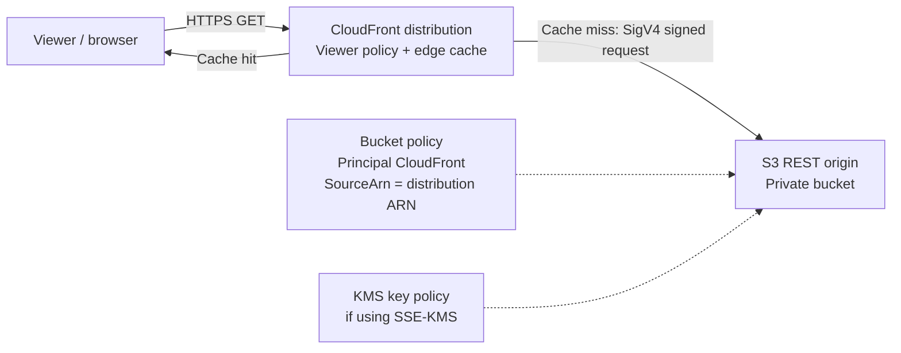
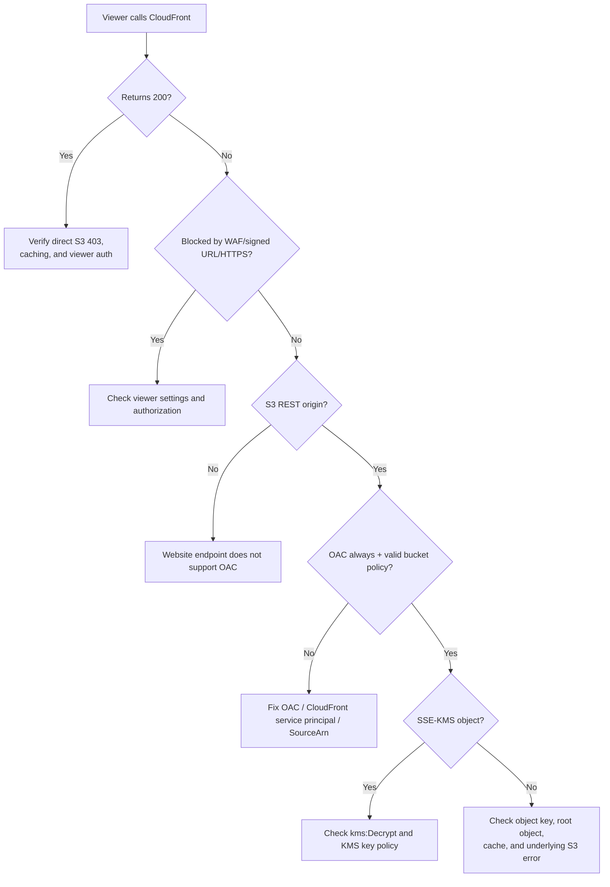

# Origin Access Control and Protecting S3 Origins

## Learning Objectives

After this lesson, you will be able to:

1. Explain why **Amazon CloudFront Origin Access Control (OAC)** is used to access S3 while keeping the bucket private.
2. Distinguish **viewer → CloudFront** from **CloudFront → S3**, how SigV4 works, and why OAC does not authenticate end users by itself.
3. Configure an **S3 bucket policy** restricting `cloudfront.amazonaws.com` via `AWS:SourceArn` to the exact CloudFront distribution.
4. Identify differences between an **S3 REST origin** and an **S3 website endpoint**, and between OAC and **Origin Access Identity (OAI)**.
5. Explain how to protect objects using **SSE-KMS**, and the additional permissions required for PUT/DELETE via CloudFront.
6. Deploy a private S3 origin model via CloudFormation, verify it with the AWS CLI and HTTP, and troubleshoot 403, 404, cache, and DNS errors.
7. Apply least privilege, Block Public Access, CloudFront signed URLs/cookies, logging, backups, and cost controls.

## 1. Problem: Delivering Content via CDN Without Making S3 Public

A company stores product images, CSS, JavaScript, and documents in Amazon S3. Users across many countries need to download objects over HTTPS with low latency. Granting `Principal: "*"` with `s3:GetObject` so browsers fetch directly from S3 exposes content outside the delivery channels the company wants to manage.

Recommended model:

- **S3 general purpose bucket** stores objects; keep **Block Public Access** enabled.
- **CloudFront distribution** serves viewers at edge locations with caching, HTTPS, DNS, and access policies as needed.
- **Origin Access Control (OAC)** lets CloudFront sign origin requests sent to S3 using **AWS Signature Version 4 (SigV4)**.
- **S3 bucket policy** grants conditional permissions to the CloudFront service principal, only when the origin request comes from an **authorized distribution**.
- If content is private to viewers, the application must add authentication/authorization and **CloudFront signed URLs/cookies**.



While an object remains cached, CloudFront serves it immediately without **calling S3**. When fetching fresh data, CloudFront signs the request via OAC; S3 verifies the signature and permissions.

**OAC only protects the CloudFront → S3 hop.** OAC does not turn CloudFront into a login page, does not replace WAF, does not provide backups/versioning, and cannot make objects readable if the bucket policy or KMS key policy is wrong.

## 2. Components and Scope of Responsibility

| Component | Purpose | Things to Remember |
| --- | --- | --- |
| **S3 bucket** | Stores objects, metadata, versioning, lifecycle, and encryption. | Bucket must have proper policies/permissions and should block public access. |
| **S3 origin** | Endpoint CloudFront uses to call S3. | Must be a **REST bucket endpoint** to use OAC in this model. |
| **CloudFront distribution** | Receives viewer requests; routes cache behaviors to origins. | Has a distribution ID and ARN used in the bucket policy. |
| **OAC** | Configures origin type and request-signing behavior. | `SigningBehavior=always` is recommended. |
| **S3 bucket policy** | Grants GetObject (or other needed actions) to the CloudFront service. | Scope `AWS:SourceArn` to a specific distribution. |
| **S3 Block Public Access** | Blocks accidental public access paths. | Never disable it just to work around an OAC 403 error. |
| **AWS KMS key policy** | Lets CloudFront use the key when origin objects use SSE-KMS. | Missing `kms:Decrypt` causes 403 even when S3 GetObject is allowed. |
| **Signed URL/cookie** | Restricts which **viewers** can access CloudFront. | Distinct from the SigV4 signature OAC uses with the origin. |

### 2.1. Distinguishing S3 REST Endpoint vs. S3 Website Endpoint

Example REST endpoint:

```text
storefront-assets-demo.s3.ap-southeast-1.amazonaws.com
```

Example Website endpoint:

```text
storefront-assets-demo.s3-website-ap-southeast-1.amazonaws.com
```

**A website endpoint is treated as a custom origin in CloudFront; OAC and OAI do not support this endpoint type.** If you want a private bucket via OAC, use the S3 REST endpoint and handle default root objects, redirects, or SPA routing in CloudFront.

Website endpoints serve S3 static websites with specific index/error/redirect behaviors. You cannot switch the origin to a website endpoint and expect OAC signing to keep working.

### 2.2. OAC vs. Origin Access Identity (OAI)

OAI is the legacy mechanism using an origin access identity to grant CloudFront access to S3. AWS now **recommends OAC** for new deployments.

| Criterion | OAC | OAI (legacy) |
| --- | --- | --- |
| Origin authentication | SigV4, CloudFront service principal, and policy scoped by distribution. | Grants permissions to OAI via S3 policy. |
| S3 in newer/opt-in Regions | Supported per current AWS scope. | Limited in Regions launched after 2022. |
| SSE-KMS | **Supported** when key policy allows. | Not fully supported in the standard way. |
| Dynamic PUT/DELETE | Usable when CloudFront, bucket/KMS, and viewer permissions align. | Many limitations requiring workarounds. |
| New deployments | **Preferred.** | Retain only for legacy compatibility. |

OAI does not automatically stop working simply because OAC exists. During migration, transition bucket policies and distributions carefully to avoid 403 errors on edge nodes that have not yet updated.

## 3. Request Flow and Two Authentication Boundaries

Suppose a viewer opens `https://d123example.cloudfront.net/images/p-42.webp`:

1. The viewer connects to **CloudFront** over HTTP/HTTPS per viewer protocol policy; CloudFront may check signed URLs/cookies, WAF, and cache behavior.
2. On a **cache hit**, CloudFront returns the object without making a new request to S3.
3. On a **cache miss**, CloudFront sends a request to the **S3 REST origin**. With `SigningBehavior=always`, CloudFront signs the request using **SigV4**.
4. S3 verifies the signature and evaluates the **bucket policy**. The statement for `cloudfront.amazonaws.com` applies only if `AWS:SourceArn` matches the specified CloudFront distribution.
5. If the object uses **SSE-KMS**, the KMS key policy must also grant appropriate permissions.
6. CloudFront returns the data to the viewer and may cache it depending on TTL/cache policy.

| Request | Caller | OAC Role | Typical Outcome |
| --- | --- | --- | --- |
| GET to CloudFront URL | Viewer without AWS credentials. | OAC signs the request when CDN fetches the object from S3. | `200` if object exists and viewer is permitted. |
| Direct GET to S3 REST URL, unauthenticated | Internet user. | Not involved. | **`403 AccessDenied`** when bucket is private. |
| `aws s3api get-object` with an authorized admin IAM role | AWS-authenticated principal. | Not needed. | Succeeds if IAM, bucket policy, KMS, and conditions allow. |

**Note on phrasing "only through CloudFront":** the goal is preventing **anonymous viewers** from going directly to the bucket. OAC does not revoke legitimate IAM permissions that operational systems still need for uploads, backups, or data reads.

### 3.1. Two Signatures Are Not the Same

- **OAC SigV4 signature** proves **CloudFront** is authorized to call **S3** on behalf of a distribution.
- **CloudFront signed URL/cookie** proves a **viewer** is authorized to receive content from the distribution within a time window/conditions set by the application.

If an object is a private invoice, configuring OAC alone still lets any viewer download the invoice via the CloudFront URL unless viewer access is restricted. You need an application layer that authenticates customers and issues appropriate signed URLs/cookies.

## 4. OAC SigningBehavior and the SigV4 Mechanism

An OAC for S3 typically has:

```yaml
OriginAccessControlOriginType: s3
SigningBehavior: always
SigningProtocol: sigv4
```

| SigningBehavior | Meaning | Recommendation |
| --- | --- | --- |
| **`always`** | CloudFront always signs origin requests with SigV4. | **Recommended** for private S3 origins. |
| `no-override` | CloudFront preserves an existing viewer `Authorization` header if forwarded; otherwise signs itself. | Specialized case requiring proper `Authorization` forwarding in cache policy. |
| `never` | CloudFront does not sign origin requests. | Unsuitable if S3 relies on OAC permissions. |

With `always`, the **CloudFront → S3** hop uses HTTPS per OAC requirements. Never set `never` as an "optimization" for a private bucket, and never edit a shared OAC without checking every distribution referencing it.

CloudFront uses temporary/managed credentials to sign requests, unlike embedding static IAM user access keys in origin configuration.

## 5. S3 Bucket Policy Scoped to the Exact CloudFront Distribution

Example:

- AWS account owning the distribution: `111122223333`.
- CloudFront distribution ID: `E1ABC2DEF34567`.
- Bucket: `storefront-prod-assets-ap-southeast-1-a1b2c3d4`.
- Goal: grant CloudFront read-only access to objects, no PUT/DELETE.

```json
{
  "Version": "2012-10-17",
  "Statement": [
    {
      "Sid": "AllowReadFromThisCloudFrontDistribution",
      "Effect": "Allow",
      "Principal": {
        "Service": "cloudfront.amazonaws.com"
      },
      "Action": "s3:GetObject",
      "Resource": "arn:aws:s3:::storefront-prod-assets-ap-southeast-1-a1b2c3d4/*",
      "Condition": {
        "StringEquals": {
          "AWS:SourceArn": "arn:aws:cloudfront::111122223333:distribution/E1ABC2DEF34567"
        }
      }
    }
  ]
}
```

Explanation:

1. `Principal.Service` is the CloudFront service principal, not account root and not viewers.
2. `s3:GetObject` applies to **object ARNs** `arn:aws:s3:::bucket/*`, not merely the bucket ARN.
3. `AWS:SourceArn` checks the **distribution ARN**. In CloudFront ARNs, the Region segment is blank, e.g., `arn:aws:cloudfront::111122223333:distribution/...`.
4. `AWS:SourceArn` is **not** the OAC ID/ARN. An OAC can be reused across distributions while S3 permissions stay scoped to a specific distribution.
5. There is no `s3:PutObject`, `s3:DeleteObject`, or `s3:ListBucket`: this minimizes privileges when only serving static assets.

**Why require SourceArn?** Granting `s3:GetObject` to `cloudfront.amazonaws.com` without scoping to a distribution leaves the trust boundary overly broad; `AWS:SourceArn` mitigates the **confused deputy** risk.

### 5.1. Public Access Block and Object Ownership

For a general purpose bucket:

```text
BlockPublicAcls       = true
IgnorePublicAcls      = true
BlockPublicPolicy     = true
RestrictPublicBuckets = true
ObjectOwnership       = BucketOwnerEnforced
```

`Bucket owner enforced` (default for new buckets) disables ACLs so permissions are controlled purely by IAM and bucket policies. If a legacy workload strictly requires ACLs, AWS provides `Bucket owner preferred`; never enable ACLs just to troubleshoot a 403 error.

**Keep Block Public Access enabled.** A statement scoped to the CloudFront service principal and a specific distribution ARN is distinct from a public-access policy; you do not need `Principal: "*"` for OAC to work.

### 5.2. Prefix-Scoped Permissions

When one bucket stores multiple datasets, you can scope `Resource` to:

```text
arn:aws:s3:::example-bucket/public-assets/*
```

Instead of `bucket/*`. However, ensure the CloudFront origin path, cache behaviors, and application routing match that prefix. If CloudFront actually requests `/images/a.webp` while the bucket policy allows only `public-assets/*`, S3 will return 403.

## 6. Objects Using SSE-KMS: Grant Separate KMS Permissions

S3 encrypts objects at rest by default. When using **SSE-KMS**, objects additionally depend on a KMS key. OAC supports SSE-KMS, but CloudFront needs permission to use the key.

For a **customer managed KMS key**, add a statement per AWS guidance to the **existing key policy**—do not overwrite the entire key policy:

```json
{
  "Sid": "AllowCloudFrontSpecificDistributionSSEKMS",
  "Effect": "Allow",
  "Principal": {
    "Service": "cloudfront.amazonaws.com"
  },
  "Action": [
    "kms:Decrypt",
    "kms:Encrypt",
    "kms:GenerateDataKey*"
  ],
  "Resource": "*",
  "Condition": {
    "StringEquals": {
      "AWS:SourceArn": "arn:aws:cloudfront::111122223333:distribution/E1ABC2DEF34567"
    }
  }
}
```

For read-only flows, `kms:Decrypt` is the primary permission; `kms:Encrypt` and `kms:GenerateDataKey*` are for encryption/write operations. Grant the minimum required by actual usage. **Do not confuse KMS key policies with S3 bucket policies**: permission for `s3:GetObject` does not grant permission to decrypt the object.

AWS managed keys like `aws/s3` do not let you edit the key policy the way customer managed keys do. If OAC needs to read SSE-KMS objects, plan for a **customer managed KMS key** with appropriate permissions, or choose SSE-S3 if it meets your data protection requirements.

To avoid locking yourself out of key administration, never replace the entire key policy with an example containing only the CloudFront principal: retain key owner/administrator permissions and recovery paths per organizational policy.

## 7. Protecting Viewers Is a Separate Requirement

| Content Type | Authorized Viewers? | Additional CloudFront Controls |
| --- | --- | --- |
| Public CSS/JavaScript/product images | Anyone may view via CDN. | HTTPS, cache policy, WAF as needed; S3 stays private. |
| Course videos restricted to enrolled students | Authenticated and entitled viewers. | CloudFront **signed URLs or signed cookies**, application-issued authorization. |
| Personal invoices | Only invoice owner or authorized roles. | Business auth/authz, short URL expirations, safe cache policies. |
| Document uploads | Only users authorized to upload to specific keys. | Viewer auth, allowed methods, S3/KMS write permissions, and input validation. |

Never rely on object keys containing `private`, hard-to-guess URLs, or an OAC bucket policy as proof that viewers are authenticated. If caching per-user content, design cache keys, TTLs, headers/cookies, and access controls strictly enough to prevent cross-user leaks.

**CloudFront signed URLs/cookies restrict viewers at the edge; OAC authenticates CloudFront to the origin.** Both can be combined for private content.

## 8. Setting Up a Private S3 Origin in the AWS Console

### Step 1 — Prepare the Bucket

Create an S3 **general purpose bucket** with a unique name in the desired Region. Keep **Block Public Access** enabled and choose **Object Ownership: Bucket owner enforced**. Upload `index.html`, `images/p-42.webp`, or test objects using an authorized IAM principal; do not attach a public-read ACL.

### Step 2 — Choose the Right Origin

In **CloudFront → Distributions**, create or open a distribution and choose the **S3 bucket REST endpoint** as the origin. Do not use `s3-website-...`. For a static website:

- **Viewer protocol policy:** `Redirect HTTP to HTTPS` or `HTTPS only`.
- **Allowed methods:** `GET`/`HEAD` for read-only content.
- **Default root object:** `index.html` if serving `/`.
- **Cache policy:** choose based on static vs. dynamic content.
- **Alternate domain name:** if using a custom domain, provision a certificate in **AWS Certificate Manager (ACM) in `us-east-1`**.

### Step 3 — Create and Attach OAC

In the CloudFront console, open **Origin access control** and create an OAC with:

```text
Origin type: S3
Signing behavior: Sign requests (recommended)
Signing protocol: SigV4
```

In distribution → **Origins** → select the origin → **Edit**, choose **Origin access control settings**, and attach the OAC. Note the **distribution ID** and ARN.

### Step 4 — Update the Bucket Policy

Open the S3 bucket → **Permissions → Bucket policy** and add the statement from Section 5 with the real bucket name, account ID, and **actual distribution ARN**. Some CloudFront console screens provide a **Copy policy** helper, but always double-check the bucket ARN, actions, and conditions.

If migrating from OAI, add the OAC permission while **keeping the OAI permission temporarily** until CloudFront deploys across all edge locations and verification passes.

### Step 5 — Wait for Deployment and Test

CloudFront takes time to propagate changes. Once the distribution reaches **Deployed**:

1. Access the object over HTTPS at the CloudFront domain; expect `200` if viewer and origin permit.
2. Send an unauthenticated HTTP request directly to the S3 REST URL; expect `403`.
3. Verify the bucket policy grants no unintended public read and Block Public Access remains enabled.
4. Check OAC status, `always` signing behavior, object existence, Region, and KMS if applicable.
5. Inspect cache headers and CloudFront metrics if results differ from expectations.

## 9. Infrastructure Practice with AWS CloudFormation

The following example creates **one private S3 bucket**, an OAC, a CloudFront distribution, and a read-only bucket policy scoped to that distribution. Viewers of the sample site can read **public content via CloudFront**, while the bucket remains private. This is not a template for confidential files or apps requiring signed URLs.

Save the template as `secure-site-oac.yml`. Every resource created by the template may incur usage-based charges.

```yaml
AWSTemplateFormatVersion: '2010-09-09'
Description: Private S3 origin behind CloudFront OAC

Resources:
  SiteBucket:
    Type: AWS::S3::Bucket
    Properties:
      PublicAccessBlockConfiguration:
        BlockPublicAcls: true
        IgnorePublicAcls: true
        BlockPublicPolicy: true
        RestrictPublicBuckets: true
      OwnershipControls:
        Rules:
          - ObjectOwnership: BucketOwnerEnforced

  SiteOAC:
    Type: AWS::CloudFront::OriginAccessControl
    Properties:
      OriginAccessControlConfig:
        Name: !Sub '${AWS::StackName}-oac'
        Description: Sign requests from CloudFront to private S3
        OriginAccessControlOriginType: s3
        SigningBehavior: always
        SigningProtocol: sigv4

  SiteDistribution:
    Type: AWS::CloudFront::Distribution
    Properties:
      DistributionConfig:
        Enabled: true
        DefaultRootObject: index.html
        Comment: CloudFront OAC example for static assets
        Origins:
          - Id: PrivateS3Origin
            DomainName: !GetAtt SiteBucket.RegionalDomainName
            OriginAccessControlId: !Ref SiteOAC
            S3OriginConfig:
              OriginAccessIdentity: ''
        DefaultCacheBehavior:
          TargetOriginId: PrivateS3Origin
          ViewerProtocolPolicy: redirect-to-https
          AllowedMethods: [GET, HEAD]
          CachedMethods: [GET, HEAD]
          Compress: true
          # Managed policy: CachingOptimized
          CachePolicyId: 658327ea-f89d-4fab-a63d-7e88639e58f6

  SiteBucketPolicy:
    Type: AWS::S3::BucketPolicy
    Properties:
      Bucket: !Ref SiteBucket
      PolicyDocument:
        Version: '2012-10-17'
        Statement:
          - Sid: AllowGetObjectOnlyFromThisDistribution
            Effect: Allow
            Principal:
              Service: cloudfront.amazonaws.com
            Action: s3:GetObject
            Resource: !Sub '${SiteBucket.Arn}/*'
            Condition:
              StringEquals:
                AWS:SourceArn: !Sub
                  'arn:${AWS::Partition}:cloudfront::${AWS::AccountId}:distribution/${SiteDistribution}'

Outputs:
  BucketName:
    Value: !Ref SiteBucket
  DistributionId:
    Value: !Ref SiteDistribution
  DistributionDomainName:
    Value: !GetAtt SiteDistribution.DomainName
```

### Why Does This Template Protect the Origin?

- The bucket has all four Block Public Access settings enabled and **no public ACLs**.
- `!GetAtt SiteBucket.RegionalDomainName` is an **S3 REST origin**.
- `SiteOAC` uses `SigningProtocol=sigv4` and `SigningBehavior=always`.
- The distribution attaches OAC via `OriginAccessControlId`; `S3OriginConfig.OriginAccessIdentity: ''` is empty when not using OAI.
- The bucket policy allows only `s3:GetObject`, with `Principal.Service=cloudfront.amazonaws.com` and `AWS:SourceArn` built from the **distribution ID**, not the OAC ID.
- `CachingOptimized` is a **managed CloudFront cache policy**; serving personalized data requires separate viewer authorization and custom cache policies.
- The template does not create a KMS key or viewer signed URLs. Objects use default S3 encryption; do not assume this template satisfies every security requirement.

**Note:** CloudFormation may create the CloudFront distribution before finishing the bucket policy, so during initial deployment there may be a brief window returning `403` if traffic hits too early. Expose the domain to users only after the stack finishes and passes verification.

### Deploying and Testing

Run from an authorized lab account/directory with the AWS CLI:

```bash
aws sts get-caller-identity

aws cloudformation deploy \
  --template-file secure-site-oac.yml \
  --stack-name secure-site-oac-lab \
  --region ap-southeast-1

aws cloudformation describe-stacks \
  --stack-name secure-site-oac-lab \
  --region ap-southeast-1 \
  --query 'Stacks[0].Outputs' \
  --output table
```

Copy **BucketName**, **DistributionId**, and **DistributionDomainName** from Outputs and populate the shell variables:

```bash
# Replace illustrative values with Outputs from your own stack
BUCKET="bucket-name-created-by-stack"
DIST="E1ABC2DEF34567"
DOMAIN="d123example.cloudfront.net"
REGION="ap-southeast-1"

printf '<h1>CloudFront OAC lab</h1>\n' > index.html

aws s3 cp ./index.html "s3://${BUCKET}/index.html" \
  --content-type text/html \
  --region "$REGION"

# Wait for CloudFront Status=Deployed
aws cloudfront get-distribution \
  --id "$DIST" \
  --query 'Distribution.Status'

# Via CDN: HTTP 200 if object exists and configuration is valid
curl -I "https://${DOMAIN}/index.html"

# Direct S3 REST URL without AWS credentials: typically 403
curl -I "https://${BUCKET}.s3.${REGION}.amazonaws.com/index.html"
```

HTTP `403` on the direct S3 URL and `200` on the CloudFront URL are the **expected outcomes** of this lab. If `curl -I` returns anything else, check the uploaded object key, CloudFront status, permissions, and cache.

To inspect policies:

```bash
aws s3api get-public-access-block --bucket "$BUCKET" --region "$REGION"
aws s3api get-bucket-policy --bucket "$BUCKET" --region "$REGION"
aws cloudfront get-distribution --id "$DIST"
```

**Never use `aws s3api get-object` with an IAM administrator to prove a bucket is public/private.** A command carrying valid AWS credentials can read S3 directly; testing anonymous viewer access requires an **unauthenticated** request such as `curl`.

### Lab Cleanup

Only after confirming the bucket belongs to your **dedicated lab** with no real data:

1. Delete `index.html` and all lab objects, including versions/delete markers if versioning is enabled.
2. Delete the CloudFormation stack; a **non-empty** S3 bucket causes stack deletion to fail.
3. Wait for CloudFront disable/delete to complete and verify the bucket, distribution, OAC, and policy are removed.

```bash
aws s3 rm "s3://${BUCKET}/index.html" --region "$REGION"

aws cloudformation delete-stack \
  --stack-name secure-site-oac-lab \
  --region ap-southeast-1
```

Never delete existing production buckets or stacks with test cleanup commands. CloudFront takes time to deploy/delete, and S3/CloudFront bill separately across components.

## 10. Creating an OAC via AWS CLI for an Existing Distribution

When you already have a CloudFront distribution and an S3 bucket REST origin, you can create an OAC via CLI:

```bash
aws cloudfront create-origin-access-control \
  --origin-access-control-config \
    Name=storefront-assets-oac,Description="OAC for private S3",SigningProtocol=sigv4,SigningBehavior=always,OriginAccessControlOriginType=s3
```

Save the returned `Id`, then **update the distribution origin** to attach `OriginAccessControlId` and ensure `S3OriginConfig.OriginAccessIdentity` is empty. In production, prefer CloudFormation/Terraform or the CloudFront console to avoid accidentally modifying other fields.

**Be careful with `aws cloudfront update-distribution`:** the API requires the **entire `DistributionConfig`** and an `IfMatch` ETag from the current version. Never pass a partial JSON containing only `OriginAccessControlId`; read the current config, edit only the target origin, review the diff, and then update.

The bucket policy must grant appropriate permissions **before or simultaneously with** switching traffic to OAC. If an old OAI exists, keep the OAI policy statement while CloudFront propagates the new config.

## 11. Uploads, SSE-KMS, and Controlling HTTP Methods

OAC is not limited to `GET`. CloudFront can sign supported **dynamic methods**, including `PUT` and `DELETE`, though safe design requires:

1. **CloudFront cache behavior** enabling the corresponding `AllowedMethods`.
2. **Viewer authorization** verifying upload/delete permissions; never allow arbitrary viewers to write to S3 just because CloudFront has OAC.
3. **S3 bucket policy** adding `s3:PutObject` and `s3:DeleteObject` scoped strictly to the needed prefix.
4. **KMS policy** granting `kms:Encrypt` and `kms:GenerateDataKey*` if using SSE-KMS.
5. Application validation of keys, file sizes, file types, quotas, malware/content checks, and upload/retry behavior.

The `s3:GetObject` bucket policy in Section 5 **does not** allow PUT or DELETE. That is the right restriction for read-only static assets.

### When to Use an S3 Presigned URL?

An application can authenticate a user and issue an **S3 presigned PUT/POST URL** so the user uploads directly to S3. This is a separate IAM/S3 mechanism: the request to S3 uses the signing principal's permissions and **does not pass through OAC**. It fits many browser upload workflows and avoids routing large files through CloudFront, while still requiring controls on keys, size, content, CORS, and URL expiration.

Never confuse the three signature types: **CloudFront viewer signed URL**, **OAC SigV4 between CloudFront and S3**, and **S3 presigned URL** granting direct S3 request access.

## 12. DNS, HTTPS, Caching, and Website Behavior

### 12.1. Custom Domain via Route 53

To point `assets.example.com` to CloudFront:

1. Provision an **ACM certificate in `us-east-1`** for the domain used with CloudFront.
2. In the distribution, configure the alternate domain name and certificate.
3. In **Amazon Route 53**, create **Alias A** (and **AAAA** if applicable) records pointing the domain to CloudFront.
4. Set the viewer protocol policy to `Redirect HTTP to HTTPS` or `HTTPS only` and verify TLS.

CloudFront is a global service, while the S3 origin remains in the Region where the bucket was created. OAC protects origin requests; viewer DNS and TLS are separate configuration layers.

### 12.2. Caching Reduces Origin Requests

When CloudFront already holds an object in cache, changing the S3 bucket policy **does not immediately evict cached content** across every edge. To update objects cleanly:

- Use immutable versioned/hashed filenames, e.g., `main.9f42c8.js`.
- Set appropriate `Cache-Control` headers and cache policies.
- Use CloudFront invalidation only when you truly need to refresh an existing URL.

```bash
aws cloudfront create-invalidation \
  --distribution-id "$DIST" \
  --paths "/index.html"
```

Invalidations incur fees past published free limits. For private data or permission revocations, besides invalidation you must evaluate viewer authorization and the possibility that users already downloaded the file earlier.

### 12.3. SPA Routing and 403 Errors from Nonexistent Keys

`DefaultRootObject=index.html` handles the root path `/`. When a Single-Page Application navigates to `/dashboard`, CloudFront looks up S3 key `dashboard`. When that key does not exist, S3 may return **403** because CloudFront has `GetObject` without `ListBucket`.

You can use **CloudFront Functions** to rewrite needed routes to `/index.html` or configure controlled custom error responses. **Never blindly map every `403` to `200`**, as that can mask genuine access-denied errors.

## 13. Layered Troubleshooting

| Symptom | Common Cause | What to Check |
| --- | --- | --- |
| CloudFront returns `403` for uploaded object | OAC not attached, wrong `SigningBehavior`, missing or wrong `SourceArn` in bucket policy. | Distribution origin, OAC, bucket policy, deployment status. |
| Only SSE-KMS objects return `403` | KMS key policy lacks `Decrypt`, or using AWS managed key whose policy cannot be edited. | Encryption metadata, customer managed key policy. |
| `/` returns 403 | Missing `index.html`/default root object or wrong object permissions. | Key, `DefaultRootObject`, policy, and cache. |
| SPA route `/dashboard` returns 403 | S3 REST origin treats path as object key; key does not exist. | Rewrite/custom error; do not grant broad `ListBucket`. |
| Direct S3 URL still returns 200 anonymously | Bucket/object remains public via policy/ACL or legacy config. | Account/bucket Block Public Access, policy, Object Ownership. |
| CloudFront still returns stale content | Cache TTL unexpired or invalidation still in progress. | Cache behavior, `Age`, `x-cache`, versioned filenames. |
| Origin points to `s3-website-*` | That is a custom origin and does not support OAC. | Switch to S3 REST origin for a private bucket. |
| PUT via CloudFront returns 403 | `AllowedMethods`, viewer auth, or S3/KMS write permissions missing. | Behavior, policy, and key permissions. |
| `no-override` fails to forward Authorization | `Authorization` not included in cache policy per OAC docs. | Signing behavior and cache policy. |
| Direct S3 403, CloudFront 200 | **Expected behavior** in read-only OAC model. | Only investigate if unauthorized viewers can still download. |

### 13.1. Troubleshooting Flow for 403 and 404



S3 can return **`403` instead of `404` for nonexistent objects** when the principal lacks `s3:ListBucket`. That is not a reason to grant broad `ListBucket` permissions to CloudFront.

If CloudFront returns 403, **never disable Block Public Access** and never add `Principal: "*"` just to "get it working first." Pinpoint the failing layer first.

## 14. Monitoring, Operational Security, and Cost Control

### 14.1. Signals Worth Monitoring

| Source | Useful Signals | Purpose |
| --- | --- | --- |
| **CloudFront metrics** | `Requests`, `4xxErrorRate`, `5xxErrorRate`, `CacheHitRate`, `BytesDownloaded`. | Track errors/availability and cache efficiency. |
| **CloudFront logs** | URI, status, cache result, viewer details per config. | Investigate origin/cache/viewer access. |
| **S3 request metrics/server access logs** | GET/PUT, 4xx, object requests, storage. | Understand origin traffic and auditing. |
| **CloudTrail data events** | S3 object API calls if enabled. | Detailed access auditing within appropriate scope and budget. |
| **AWS KMS / CloudTrail** | KMS key usage requests, `AccessDenied`. | Diagnose SSE-KMS failures. |
| **AWS Config/Security Hub** | Public bucket checks and CloudFront OAC controls. | Detect misconfigurations and drift. |
| **Synthetic tests** | CDN 200 when valid, anonymous direct S3 403. | Continuously verify origin protection. |

Logged URLs can contain query strings, paths, tokens, or private data. Scrub/control sensitive data in logs, restrict log read access, set retention, and encrypt logs.

### 14.2. Costs to Account For

- **S3 storage** by storage class, GET/PUT/LIST requests, versioning, replication, and lifecycle rules.
- **CloudFront data transfer**, requests, and add-on features per pricing schedule.
- **CloudFront invalidations** beyond free allowances, real-time logs, CloudFront Functions/Lambda@Edge, and AWS WAF if used.
- **KMS keys and KMS requests** when using customer managed SSE-KMS.
- **CloudWatch alarms, logs, CloudTrail data events**, Route 53, and related resources.

**Caching reduces origin requests and latency**, yet workloads with low cache hit ratios still incur request/transfer costs. Use CloudWatch and Cost Explorer to measure actual spend rather than assuming fixed USD numbers across Regions.

### 14.3. Additional Protective Controls

1. Enforce HTTPS between viewers and CloudFront; `always` enforces HTTPS from CloudFront → S3 origin.
2. Apply IAM least privilege to deploy/admin roles, enforce MFA/IAM Identity Center, and audit via CloudTrail.
3. Avoid placing secrets, customer emails, or tokens in object keys/URLs whenever possible.
4. Attach AWS WAF to CloudFront to mitigate HTTP-layer attacks; OAC does not provide WAF functionality.
5. Configure S3 versioning and backups/replication aligned with RPO/RTO; **edge cache is not a backup**.
6. Set CloudFront alarms on `4xxErrorRate`/`5xxErrorRate` and run anonymous direct S3 URL tests after every policy change.

## 15. Migrating from OAI to OAC

For an existing distribution using **Origin Access Identity**:

1. Record distribution ID, S3 origin domain, OAI identity, bucket policy, SSE-KMS settings, and cache behaviors.
2. Create an `always` OAC for the S3 origin.
3. **Add OAC permissions** to the bucket policy using the CloudFront service principal and distribution `AWS:SourceArn`. Temporarily keep the existing OAI statement.
4. Update the distribution origin to use OAC and clear `OriginAccessIdentity` per procedure; wait for **Deployed**.
5. Test CloudFront GET on key objects, SSE-KMS objects, cache behaviors, direct S3 URLs, logs, and error metrics.
6. **After verifying success**, remove the legacy OAI statement. Retain config/logs for rollback if needed.

Allowing **both OAI and OAC during the transition window** prevents 403 errors on edge nodes that have not yet rolled over. Removing the OAI policy too early can disrupt live users.

## 16. Design Scenario: Public Assets and Private Invoices

**Context:** an e-commerce platform running in Singapore stores product images and invoices in S3, delivered via CloudFront. Invoices contain customer data and some use SSE-KMS. Requirements: zero direct Internet access to S3, logging/auditing, resilience, and cost control.

### Recommended Architecture

1. **Separate buckets/prefixes and CloudFront behaviors** for public assets vs. private invoices, since cache and retention policies differ.
2. On each S3 REST origin, attach OAC and a `GetObject` bucket policy scoped precisely to the distribution ARN and needed prefix; enable Block Public Access/`BucketOwnerEnforced`.
3. For public images, viewers can access CloudFront over HTTPS directly; use immutable filenames and appropriate cache TTLs.
4. For invoices, the backend authenticates the **invoice owner** and issues short-lived CloudFront signed URLs/cookies; never rely solely on hard-to-guess keys.
5. For SSE-KMS, use a customer managed key policy granting `kms:Decrypt` to the CloudFront distribution alongside admin and recovery permissions.
6. Log CloudFront 4xx/5xx, S3/KMS access events, and permission tests; never log secrets from URLs.
7. Plan versioning/backup/restore for invoices, viewer access revocation procedures, and cache validity checks when policies change.
8. Use Cost Explorer and metrics to track S3 requests, CloudFront transfer, hit ratio, invalidations, KMS, and logging spend.

### Mandatory Verification Tests

| Test Case | Expected Result |
| --- | --- |
| Anonymous viewer fetches image via CloudFront | `200` when object exists. |
| Anonymous viewer fetches same image via S3 REST URL | `403`. |
| Viewer without signed URL fetches invoice via CloudFront | Denied per viewer policy. |
| Authorized viewer with valid URL fetches invoice | `200` when S3/KMS permissions are right. |
| Break KMS key policy in lab environment | CloudFront fails reading SSE-KMS object; proves KMS permission requirement. |
| Update object version/key | CloudFront serves the right version per TTL/invalidation or versioned URL. |

## 17. Common Pitfalls

**Pitfall 1: "Creating CloudFront automatically makes the S3 bucket private."** False. You need Block Public Access, OAC, and a proper bucket policy; audit any existing S3 permissions.

**Pitfall 2: "OAC forces viewers to log in."** False. OAC authenticates CloudFront to S3; use signed URLs/cookies and application auth to restrict viewers.

**Pitfall 3: "S3 website endpoints support OAC."** False. Choose an S3 REST origin when keeping the bucket private via OAC.

**Pitfall 4: "Using OAC requires disabling Block Public Access."** False. A properly scoped CloudFront condition does not require public access.

**Pitfall 5: "Specifying principal `cloudfront.amazonaws.com` alone is enough."** Insufficient for least privilege; restrict with `AWS:SourceArn` for the exact distribution.

**Pitfall 6: "`AWS:SourceArn` is the OAC ID."** False. It must be the **CloudFront distribution ARN**.

**Pitfall 7: "SSE-KMS always works with just a `GetObject` bucket policy."** False. Appropriate KMS key permissions are also required.

**Pitfall 8: "`SigningBehavior=never` still signs requests."** False. `never` means CloudFront does not sign origin requests.

**Pitfall 9: "Direct S3 returning 403 while CDN returns 200 is an error."** False. That is the intended origin-protection state.

**Pitfall 10: "CloudFront cache replaces backups or viewer authorization."** False. Caching and backup/authorization are completely separate mechanisms.

**Pitfall 11: "Remove the OAI policy immediately before OAC finishes deploying."** False. Maintain an overlap window and verify first.

## 18. Self-Check Questions

**Question 1.** Which request does OAC sign?

**Answer:** CloudFront **origin requests** to S3; it does not directly authenticate viewers.

**Question 2.** Which attribute should an OAC bucket policy use to restrict CloudFront?

**Answer:** `AWS:SourceArn` equal to the **CloudFront distribution ARN**, paired with specific actions and resources.

**Question 3.** An unauthenticated viewer can load CloudFront `index.html`, while accessing the S3 URL without credentials returns 403. Is that right?

**Answer:** Yes, when content is public through the CDN and the bucket is private.

**Question 4.** Which OAC signing behavior is recommended and why?

**Answer:** `always`; CloudFront signs with SigV4 and uses HTTPS to the S3 origin.

**Question 5.** Can OAC be attached to `bucket.s3-website-region.amazonaws.com`?

**Answer:** No. A website endpoint is a custom origin and does not support OAC.

**Question 6.** An SSE-KMS object returns 403 through the CDN despite a valid bucket policy; what should you check?

**Answer:** KMS key policy, `kms:Decrypt` permission, customer managed key usage, and distribution `SourceArn`.

**Question 7.** An invoice must only be downloadable by the buyer for 5 minutes. Is OAC enough?

**Answer:** No. The backend must authenticate/authorize and issue an appropriate CloudFront signed URL/cookie; caching must also be safe.

**Question 8.** Why does the CDN still serve the old version after updating `index.html`?

**Answer:** Cache TTL; wait for expiry, use versioned filenames, or run a controlled invalidation.

**Question 9.** When migrating from OAI, why keep the OAI statement in the bucket policy temporarily?

**Answer:** CloudFront rolls out configuration across edge locations gradually; removing old permissions too early can cause 403s at edges not yet updated.

**Question 10.** Beyond OAC, what else is needed to allow uploads through CloudFront?

**Answer:** Viewer authorization, allowed methods, `s3:PutObject` scoped by key/prefix, KMS write permissions if needed, and application-side file validation.

## Official AWS References

- [CloudFront — Restrict access to an Amazon S3 origin](https://docs.aws.amazon.com/AmazonCloudFront/latest/DeveloperGuide/private-content-restricting-access-to-s3.html)
- [CloudFront — Serving private content with signed URLs and signed cookies](https://docs.aws.amazon.com/AmazonCloudFront/latest/DeveloperGuide/PrivateContent.html)
- [CloudFront — Origin settings](https://docs.aws.amazon.com/AmazonCloudFront/latest/DeveloperGuide/DownloadDistS3AndCustomOrigins.html)
- [CloudFormation — AWS::CloudFront::OriginAccessControl](https://docs.aws.amazon.com/AWSCloudFormation/latest/TemplateReference/aws-resource-cloudfront-originaccesscontrol.html)
- [CloudFormation — AWS::CloudFront::Distribution](https://docs.aws.amazon.com/AWSCloudFormation/latest/TemplateReference/aws-resource-cloudfront-distribution.html)
- [CloudFront — Cache policies](https://docs.aws.amazon.com/AmazonCloudFront/latest/DeveloperGuide/controlling-the-cache-key.html)
- [CloudFront — Custom error responses](https://docs.aws.amazon.com/AmazonCloudFront/latest/DeveloperGuide/GeneratingCustomErrorResponses.html)
- [Amazon S3 — Block Public Access](https://docs.aws.amazon.com/AmazonS3/latest/userguide/access-control-block-public-access.html)
- [Amazon S3 — Object Ownership](https://docs.aws.amazon.com/AmazonS3/latest/userguide/about-object-ownership.html)
- [Amazon S3 — Troubleshooting AccessDenied 403](https://docs.aws.amazon.com/AmazonS3/latest/userguide/troubleshoot-403-errors.html)
- [AWS Security Hub — CloudFront controls](https://docs.aws.amazon.com/securityhub/latest/userguide/cloudfront-controls.html)
- [CloudFront — Standard logs](https://docs.aws.amazon.com/AmazonCloudFront/latest/DeveloperGuide/AccessLogs.html)
- [CloudFront pricing](https://aws.amazon.com/cloudfront/pricing/)

> **Key Takeaway:** **S3 REST origin + SigV4-signed CloudFront OAC + distribution-ARN-scoped bucket policy** delivers content while keeping the S3 bucket private. Keep Block Public Access enabled; when using SSE-KMS, grant separate KMS permissions. **Viewer authorization, HTTPS, caching, WAF, backups, logging, and cost** are additional layers that must be designed explicitly.
