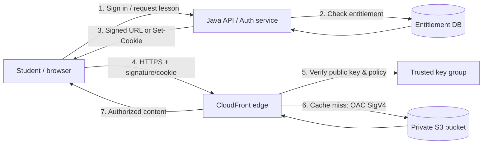
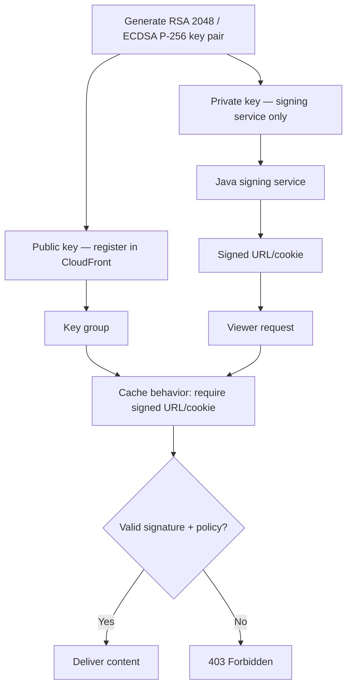

# Signed URLs, Signed Cookies, and Content Protection

An online learning platform stores lecture videos and PDF documents on **Amazon S3**, then delivers them via **Amazon CloudFront**. Users must sign in and hold entitlements for the respective course, yet simply sending the browser `https://media.example.com/private/lesson-01.mp4` lets anyone copy the URL and continue downloading if the cache behavior or origin permits public access.

**CloudFront signed URLs** and **CloudFront signed cookies** solve **time-bounded access control at the content delivery layer**: the application verifies user entitlement and issues a signed credential; CloudFront validates the signature and conditions before returning content from edge cache or origin. To prevent bypassing CloudFront, **the origin must also be locked down**, such as via **Origin Access Control (OAC)** on a private S3 bucket.

This lesson belongs to the **DNS and Content Delivery** chapter of the **CLOUD_PROVIDERS_AWS** module. It connects **IAM, S3, Route 53, VPC, EC2/Java, Lambda, CloudFront, monitoring, recovery, and cost control** into a secure content delivery architecture.

## 1. Learning Outcomes

After this lesson, you will be able to:

1. Distinguish **signed URLs**, **signed cookies**, **S3 presigned URLs**, and IAM-based access.
2. Explain the end-to-end flow: **user auth → entitlement check → signing → CloudFront verification → content delivery**.
3. Architect **trusted key groups**, **public keys**, **signature-enforcing cache behaviors**, and **S3 OAC**.
4. Choose between a **canned policy** and a **custom policy** based on expiration, path patterns, start times, and source IP.
5. Generate signed URLs/signed cookies using the **AWS SDK for Java v2** and understand private key protection.
6. Design signed cookies for **multiple files**, such as HLS playlists and segments, with proper cookie attributes.
7. Troubleshoot **403 errors, signature mismatches, expired URLs, missing cookies, CORS, and origin access**.
8. Plan logging, monitoring, access revocation, caching, and CDN costs.

## 2. What Needs to Be Protected?

There are three distinct authorization layers in a content delivery system:

| Layer | Question | Primary Components |
|---|---|---|
| **User/application** | Who is signed in? Who owns the course, subscription, or document? | Java app/API, Cognito/IdP, entitlement database |
| **Viewer → CloudFront** | Does this request carry a valid signature for the right resource and time window? | CloudFront trusted key groups, signed URLs/cookies, cache behaviors |
| **CloudFront → origin** | Can CloudFront read private files from S3/ALB? Can anyone else access the origin directly? | S3 OAC + bucket/KMS policy or custom origin protection |

**A valid CloudFront signature only proves the request satisfies the signed policy**—it does not re-query your student database on every request. Therefore, the application must verify entitlement **before signing**, choose sensible TTLs, and plan for access revocation.

**Transport encryption** via HTTPS is a separate layer. HTTPS does not restrict who can download a file, and signed URLs/cookies do not encrypt the file at rest or prevent copying. For stronger anti-piracy requirements, also evaluate DRM, watermarking, or specialized content protection technologies.

### 2.1. Typical Architecture



- Browsers **do not need AWS access keys** to download content from CloudFront.
- The **private key** lives solely on the signing service; CloudFront holds only the **public key** inside a key group.
- Content already sitting in the edge cache still undergoes **viewer signature verification** when the cache behavior requires it.
- On a **cache miss**, CloudFront fetches the object from the origin through authorized mechanisms.

## 3. How Do Signed URLs and Signed Cookies Differ?

| Criterion | **CloudFront signed URL** | **CloudFront signed cookie** |
|---|---|---|
| Natural authorization unit | A single specific URL/resource, or a pattern with a custom policy | One or many resources matching a policy |
| How credentials travel | Query parameters in the URL | Name/value pairs in the `Cookie` header |
| Best suited for | PDF downloads, installers, expiring email links, clients without cookies | Member areas, pages with many images, HLS/DASH multi-segment streaming |
| Must modify existing URLs? | Yes, appends query parameters | Media URLs can remain unchanged |
| Common risks | URLs leaked in logs, browser history, sharing, or `Referer` | Wrong cookie scope/Domain/Path/SameSite, or stolen cookies |
| Revocation | TTL and key rotation; no built-in instant single-URL revocation | TTL and key rotation; clearing browser cookies does not revoke copied values |
| Testing approach | Call URL with/without signature, tamper URL, wait for expiry | Call URL with/without all three cookies, inspect headers and policy |

**Quick rule of thumb:** to authorize **one file**, prefer a signed URL; to let a browser load **many files across a path prefix** without rewriting every URL, signed cookies are usually much cleaner.

### 3.1. When Both URL Parameters and Cookies Are Present

**Signed URLs take precedence over signed cookies.** If a request to a protected resource carries query parameters CloudFront recognizes as a signed URL, CloudFront evaluates the **signed URL** and will not fall back to signed cookies to rescue an expired or invalid URL signature.

Reserved query parameter names: `Expires`, `Policy`, `Signature`, `Key-Pair-Id`, and `Hash-Algorithm`. Never use these names as application query parameters on protected URLs, or CloudFront may treat them as signed URL components.

[Source: AWS — Decide to use signed URLs or signed cookies](https://docs.aws.amazon.com/AmazonCloudFront/latest/DeveloperGuide/private-content-choosing-signed-urls-cookies.html).

## 4. Trusted Key Groups: How Does CloudFront Trust a Signature?

CloudFront uses **asymmetric digital signatures**:

1. The platform team generates a **private/public key pair** using a CloudFront-supported algorithm.
2. Upload the **public key** to CloudFront and add it to a **trusted key group**.
3. Attach the key group to the **cache behavior** requiring restricted viewer access.
4. The application signs policies using the matching **private key**.
5. CloudFront uses the public key in the trusted key group to verify signatures when viewers request content.



### 4.1. Why Use Trusted Key Groups?

CloudFront has a legacy **AWS account-based trusted signers** feature. AWS recommends **trusted key groups** because public keys and key groups can be managed via APIs and IAM, enabling automated key rotation without signing in as the AWS root user.

**CloudFront supports 2048-bit RSA or 256-bit ECDSA signatures** per current documentation. Pick the algorithm supported by your signing library; never grab an IAM access key ID or AWS KMS key ID and assume it is a CloudFront `Key-Pair-Id`.

### 4.2. Private Key Governance

- **Never** embed the private key in frontend JavaScript, mobile apps, URLs, Git repos, or public Docker images.
- Restrict private key read access strictly to the **signing service**, using an organization-approved secrets manager.
- Never log private keys, full signed URLs/cookies, or headers containing bearer credentials.
- Keep an application-side audit log of **who was granted access, to which resource, and for what duration**, avoiding raw token logging where unnecessary.
- Periodically **rotate keys**: add the new public key, roll out the new signer, let old links expire, and only then remove the old key.
- Maintain a compromise runbook: deactivate the exposed public key to invalidate corresponding signatures while assessing impact on legitimate users.

**A signed URL/cookie acts as a bearer credential**: anyone holding a valid token can use it within policy bounds. Short TTLs limit the abuse window, but do not bind requests to the originally authenticated user.

Source: [Specify signers and rotate keys](https://docs.aws.amazon.com/AmazonCloudFront/latest/DeveloperGuide/private-content-trusted-signers.html).

## 5. Configuring a Signature-Enforcing Cache Behavior

A single CloudFront distribution can serve both public and private content using **separate cache behaviors**.

Example:

| Path Pattern | Purpose | Requires Signed URL/Cookie? | Origin |
|---|---|---|---|
| `/public/*` | Public images/JS/CSS | No | `S3 public-assets` or suitable origin |
| `/premium/*` | Licensed videos, HLS segments, PDFs | **Yes** | `S3 private-content` |
| `/login/*` | Login page / user session APIs | Not via CloudFront signing, though API enforces its own auth | ALB/API origin |
| Default behavior | Everything else | Define policy explicitly to avoid unintended public fallback | Chosen origin |

**Path pattern precedence matters.** If an unprotected behavior matches a private URL before the protected behavior, viewers can bypass signing via the public path. Test **every URL pattern that might be requested**, especially closely named prefixes, URL rewrites, or multi-origin setups.

### 5.1. What Must Be Configured

- Distribution and **alternate domain name** if using `media.example.com`.
- **Viewer protocol policy**: typically HTTPS Only or Redirect HTTP to HTTPS.
- **Trusted key groups** on the target behavior; enable restricting viewer access with signed URLs/cookies.
- **Allowed HTTP methods** and appropriate cache/origin request policies; content downloads typically need only `GET`, `HEAD`, and occasionally `OPTIONS`.
- Protected origin (private S3 bucket with OAC, or custom origin with direct-access restrictions).
- Cache policy/TTL matching content characteristics; update objects via versioned keys or invalidation only when truly needed.
- Logging, WAF, and alerting per policy.

**Never add a public key alone and assume resources are private.** Signed access is enforced per **cache behavior**, and the origin must also block direct bypass.

## 6. Preventing CloudFront Bypass: S3 Origin Access Control

If the S3 bucket remains public, users can open the **direct S3 URL** and skip CloudFront's signed URL/cookie checks entirely. Recommended setup for standard S3 bucket origins:

1. Keep the **S3 bucket private** with **Block Public Access** enabled per requirements.
2. Set **S3 Object Ownership: Bucket owner enforced** unless legacy ACL exceptions apply.
3. Create a **CloudFront OAC** for the S3 origin, typically with **Sign requests (recommended)**.
4. Set the bucket policy so only the **CloudFront service principal** can read objects **when the request originates from your specific distribution** via `AWS:SourceArn`.
5. If using **SSE-KMS**, grant matching KMS key permissions to CloudFront OAC.
6. Verify **direct S3 URLs deny anonymous users**, while valid CloudFront signed requests return content.

### 6.1. Example Bucket Policy for CloudFront

Illustrative policy granting read access solely to objects under `premium/*`:

```json
{
  "Version": "2012-10-17",
  "Statement": [
    {
      "Sid": "AllowSpecificCloudFrontDistributionReadPremium",
      "Effect": "Allow",
      "Principal": {
        "Service": "cloudfront.amazonaws.com"
      },
      "Action": "s3:GetObject",
      "Resource": "arn:aws:s3:::private-course-example/premium/*",
      "Condition": {
        "StringEquals": {
          "AWS:SourceArn": "arn:aws:cloudfront::111122223333:distribution/E1EXAMPLECF"
        }
      }
    }
  ]
}
```

Bucket names, account IDs, and distribution IDs are **illustrative values**. In production, audit existing policies, KMS keys, prefixes, content-upload roles, and CI/CD pipeline permissions. If another app also needs read access, grant it separately under least privilege.

**OAC uses SigV4 signatures for CloudFront to access the S3 origin.** That is completely distinct from **CloudFront signed URL/cookie** signatures on the viewer side. Never confuse the two signatures or key pairs.

### 6.2. Notes on S3 Website Endpoints and Custom Origins

CloudFront treats an **S3 website endpoint** as a **custom origin**, which does not support S3-bucket-style OAC/OAI. For S3 OAC, always use the **S3 REST endpoint**, not public website hosting endpoints.

For **ALB, EC2, or other HTTP server origins**, restrict direct access using CloudFront VPC origins where supported, security groups/prefix lists, or secret custom headers with network policies. **CloudFront signed URLs alone do not protect content if the custom origin remains publicly accessible.**

Source: [Restrict access to an Amazon S3 origin](https://docs.aws.amazon.com/AmazonCloudFront/latest/DeveloperGuide/private-content-restricting-access-to-s3.html).

## 7. How Do CloudFront Signed URLs Work?

Suppose a student has purchased a PDF document:

```text
Content URL:
https://media.example.com/premium/course-42/slides.pdf

Signed URL (abbreviated, illustrative placeholders):
https://media.example.com/premium/course-42/slides.pdf
  ?Expires=EXPIRY_UNIX_SECONDS
  &Signature=ENCODED_SIGNATURE
  &Key-Pair-Id=CLOUDFRONT_PUBLIC_KEY_ID
```

`Expires` is **Unix epoch time in seconds**. `Signature` is generated by your application using the private key; `Key-Pair-Id` identifies the matching public key CloudFront uses to verify. With a custom policy, the URL carries `Policy` instead of `Expires`; newer hash algorithms may also include `Hash-Algorithm` where applicable.

### 7.1. URL Issuance Flow

1. The application authenticates the student via session/token and verifies entitlement to `slides.pdf`.
2. The backend constructs the **canonical resource URL** and chooses an expiration (e.g., 5 minutes).
3. The backend builds and signs the policy with the private key, returning the signed URL to the client.
4. The client issues a `GET` to CloudFront, typically over HTTPS.
5. CloudFront validates the signature and any resource/time/IP conditions.
6. If valid, CloudFront serves from cache or origin; otherwise it rejects the request.

**Never accept an arbitrary URL from the browser and blindly sign it.** The signing API must resolve the object key from server-verified entitlement/tenant state; otherwise users could ask for signed URLs to unpurchased courses.

### 7.2. Avoid Modifying the URL After Signing

CloudFront compares the incoming URL against the signed resource. If the base URL includes business query parameters, include them when signing. **Adding or altering query parameters after signing** invalidates the signature and returns 403.

For example, if you sign `/premium/report.pdf?version=3` and the client changes it to `?version=4`, the old signature is **invalid** for the new query.

### 7.3. When Does Expiration Apply?

CloudFront **checks expiration at the moment each HTTP request begins**. If a large download starts just before expiration, it can usually finish; however, if the connection drops and the client sends a new request after expiration, the new request fails.

With **Range GETs** or players fetching individual video segments, every request starting after expiration needs a fresh valid credential. Choose TTLs based on how clients actually fetch content; for long videos, consider signed cookies with a refresh flow.

Source: [Use signed URLs](https://docs.aws.amazon.com/AmazonCloudFront/latest/DeveloperGuide/private-content-signed-urls.html).

## 8. Signed Cookies for Multiple Resources

An HLS course has a `master.m3u8` playlist, child playlists, and numerous `.ts`/`.m4s` segments. If you issue a signed URL for the playlist alone while segment URLs inside are **unsigned**, the viewer downloads the playlist and gets 403s on every segment.

**Signed cookies with a custom policy** fit much better:

- The user logs into the application.
- The backend verifies course entitlement.
- The backend issues **three cookies** for the appropriate domain/path, with a policy authorizing `https://media.example.com/premium/course-42/*`.
- The player fetches playlists, key files, and segments under that prefix; the browser attaches cookies automatically.
- CloudFront validates every request against the signed scope and timestamps.

### 8.1. Three Required Cookies

**Canned policy:**

- `CloudFront-Expires`
- `CloudFront-Signature`
- `CloudFront-Key-Pair-Id`

**Custom policy:**

- `CloudFront-Policy`
- `CloudFront-Signature`
- `CloudFront-Key-Pair-Id`

Depending on signature capabilities, SHA-256 signing may also require a `CloudFront-Hash-Algorithm=SHA256` cookie; if omitted, some signing flows default to SHA-1. Use a supported SDK version and follow its hash algorithm guidance—**never mix parameters across incompatible algorithms**.

**Each cookie requires its own `Set-Cookie` header.** Concatenating all three into a single arbitrary `Set-Cookie` string violates HTTP cookie semantics.

### 8.2. Illustrative Headers for a Custom Policy

```http
HTTP/1.1 200 OK
Set-Cookie: CloudFront-Policy=BASE64_POLICY; Domain=example.com; Path=/premium/; Secure; HttpOnly; SameSite=Lax
Set-Cookie: CloudFront-Signature=ENCODED_SIGNATURE; Domain=example.com; Path=/premium/; Secure; HttpOnly; SameSite=Lax
Set-Cookie: CloudFront-Key-Pair-Id=KEXAMPLEPUBLICKEY; Domain=example.com; Path=/premium/; Secure; HttpOnly; SameSite=Lax
Cache-Control: no-store
```

This assumes a response from `app.example.com` or `api.example.com`: they may set cookies for `Domain=example.com`, which browsers then send to `media.example.com`. **`app.example.com` cannot** set cookies for `d123.cloudfront.net`, because that is not a parent domain of the application.

Important notes:

- `Path=/premium/` controls where the browser sends cookies—it is **not an authorization substitute for the policy `Resource`**. Scope the custom policy `Resource` strictly to the entitled course.
- `Secure` requires HTTPS; `HttpOnly` reduces risk of JavaScript reading cookies.
- `SameSite=Lax` fits same-site apps; genuinely cross-site flows may require `SameSite=None; Secure` with proper CORS/credentials settings.
- Setting `Domain=example.com` lets browsers send cookies to sibling subdomains beyond `media`; evaluate trust boundaries across all subdomains.
- Responses issuing cookies/tokens must include `Cache-Control: no-store` or equivalent so CDNs/proxies never cache and replay credentials between users.
- Browsers enforce cookie count and size limits per domain; overly large custom policies can cause header issues.

### 8.3. Canned Cookies vs. Custom Cookies

Canned cookies suit simple expiration on a single specified resource; **custom cookies** support multi-file wildcard patterns, start times, and IP restrictions when justified. For multi-segment HLS/DASH, a custom policy with a wildcard `Resource` is usually the practical choice.

Source: [Use signed cookies](https://docs.aws.amazon.com/AmazonCloudFront/latest/DeveloperGuide/private-content-signed-cookies.html), [Canned signed cookies](https://docs.aws.amazon.com/AmazonCloudFront/latest/DeveloperGuide/private-content-setting-signed-cookie-canned-policy.html).

## 9. Canned Policy vs. Custom Policy

| Condition | **Canned** | **Custom** |
|---|---|---|
| Expiration timestamp | Yes | Yes |
| Valid start timestamp | No | Optional |
| Viewer source IP restriction | No | Optional |
| Wildcard pattern for multiple URLs | No | Yes |
| Policy JSON sent in URL/cookie | No | Yes |
| Token complexity/length | Typically small | Larger, can be long |

### 9.1. Canned Policy

Ideal for a PDF that simply expires in 5 minutes. The signing utility constructs a policy with the URL and `DateLessThan` internally without embedding policy JSON in the viewer's query string or cookie.

### 9.2. Custom Policy JSON

Conceptual example for a content prefix, with start and expiration times in Unix epoch seconds:

```json
{
  "Statement": [
    {
      "Resource": "https://media.example.com/premium/course-42/*",
      "Condition": {
        "DateLessThan": {
          "AWS:EpochTime": 1924992000
        },
        "DateGreaterThan": {
          "AWS:EpochTime": 1795000000
        }
      }
    }
  ]
}
```

Timestamps are **illustrative numbers**; when issuing real tokens, the backend computes start/expiration from a trusted clock and business rules. Never copy multi-year lifetimes for sensitive content links.

To restrict source IP, custom policies support `IpAddress` via `AWS:SourceIp` in **IPv4/CIDR** format, e.g.:

```json
"IpAddress": {
  "AWS:SourceIp": "203.0.113.0/24"
}
```

**Important limitation:** CloudFront custom policy `IpAddress` conditions do not support IPv6. AWS advises keeping IPv6 disabled on distributions using this IP condition; if you need both IPv4-only restricted content and IPv6 content, consider separate distributions. IP restrictions also break for mobile users, VPNs, or multi-NAT corporate networks when client IPs change.

**Never treat an IP allowlist as user authentication.** It only constrains where requests may originate within the policy.

### 9.3. Resource Wildcards Are Not Unbounded Permissions

`Resource: "https://media.example.com/premium/course-42/*"` covers **every object matching that pattern**. Avoid distribution-wide `*` wildcards when a student owns only one course. If one bucket serves multiple tenants, verify canonical URLs, key normalization, and prefix/wildcard expansion so one tenant can never access another tenant's files.

[Source: Set signed cookies using a custom policy](https://docs.aws.amazon.com/AmazonCloudFront/latest/DeveloperGuide/private-content-setting-signed-cookie-custom-policy.html).

## 10. Java SDK v2: Generating Signed URLs

The AWS SDK for Java v2 provides **`CloudFrontUtilities`** to generate CloudFront signed URLs and cookies. Signing happens locally in your application using the private key; no browser AWS credentials are needed in the URL.

### 10.1. Java Signed URL Example Using a Canned Policy

```java
import java.nio.file.Path;
import java.time.Duration;
import java.time.Instant;

import software.amazon.awssdk.services.cloudfront.CloudFrontUtilities;
import software.amazon.awssdk.services.cloudfront.model.CannedSignerRequest;
import software.amazon.awssdk.services.cloudfront.url.SignedUrl;

public final class PrivateDownloadLink {
    // Must only be called AFTER authenticating the user and verifying download entitlement.
    public static String issueForAuthorizedReport(
            Path privateKeyFile, String cloudFrontPublicKeyId) {

        String resourceUrl =
                "https://media.example.com/premium/course-42/slides.pdf";

        CannedSignerRequest request = CannedSignerRequest.builder()
                .resourceUrl(resourceUrl)
                .privateKey(privateKeyFile)
                .keyPairId(cloudFrontPublicKeyId)
                .expirationDate(Instant.now().plus(Duration.ofMinutes(5)))
                .build();

        SignedUrl signed = CloudFrontUtilities.create()
                .getSignedUrlWithCannedPolicy(request);

        return signed.url();
    }
}
```

**Prerequisites:** a maintained version of `software.amazon.awssdk:cloudfront`, a key in an SDK-supported format, and the public key registered in a trusted key group attached to the behavior. This snippet does not check user entitlements, upload public keys to CloudFront, or replace exception handling, secret management, URL input validation, and tests.

The example hardcodes `resourceUrl` so arbitrary URL signing is not exposed. In production apps, construct URLs from **backend-validated object keys**; block path traversal and invalid special characters, and verify course/tenant entitlement before signing.

### 10.2. Security Note for the Java SDK

For resource values influenced by user input, always validate and normalize inputs before passing them to signing utilities. **AWS SDK for Java v2 version 2.41.30+ includes hardening fixes for special-character handling** (versions 2.18.33–2.41.29 were affected by a 2026 security advisory). Use a newer maintained SDK version and test URLs containing quotes, backslashes, percent-encoding, and question marks where applicable.

References: [CloudFrontUtilities Java API](https://docs.aws.amazon.com/java/api/latest/software/amazon/awssdk/services/cloudfront/CloudFrontUtilities.html); [AWS SDK Java v2 security advisory GHSA-443w-3rq3-5m5h](https://github.com/aws/aws-sdk-java-v2/security/advisories/GHSA-443w-3rq3-5m5h).

## 11. Java SDK v2: Issuing Signed Cookies

To grant access to **multiple objects** under `/premium/course-42/`, use `CustomSignerRequest`.

### 11.1. Example Generating Three Cookie Headers

```java
import java.nio.file.Path;
import java.time.Duration;
import java.time.Instant;

import software.amazon.awssdk.services.cloudfront.CloudFrontUtilities;
import software.amazon.awssdk.services.cloudfront.cookie.CookiesForCustomPolicy;
import software.amazon.awssdk.services.cloudfront.model.CustomSignerRequest;

public final class CourseCookies {
    public static String[] createHeaders(
            Path privateKey, String publicKeyId) {

        String resourceUrl =
                "https://media.example.com/premium/course-42/master.m3u8";
        String resourcePattern =
                "https://media.example.com/premium/course-42/*";

        CustomSignerRequest request = CustomSignerRequest.builder()
                .resourceUrl(resourceUrl)
                .resourceUrlPattern(resourcePattern)
                .privateKey(privateKey)
                .keyPairId(publicKeyId)
                .expirationDate(Instant.now().plus(Duration.ofMinutes(30)))
                .build();

        CookiesForCustomPolicy signed = CloudFrontUtilities.create()
                .getCookiesForCustomPolicy(request);

        String attributes =
                "; Domain=example.com; Path=/premium/; Secure; HttpOnly; SameSite=Lax";

        return new String[] {
                signed.policyHeaderValue() + attributes,
                signed.signatureHeaderValue() + attributes,
                signed.keyPairIdHeaderValue() + attributes
        };
    }
}
```

Each returned string must be emitted as a **separate HTTP `Set-Cookie` header**, e.g., via `HttpServletResponse.addHeader("Set-Cookie", value)`. This method does not send HTTP responses, authenticate users, or generate secrets. Call it only **after verifying course entitlement**, with server-controlled path/tenant values.

**Deployment note:** `CloudFrontUtilities` generates the cookie names/values and policy signature, while your HTTP layer sets `Domain`, `Path`, `Secure`, `HttpOnly`, and `SameSite`. In production, scope domains per tenant and avoid setting `Domain=example.com` more broadly than needed.

### 11.2. Even After Issuing Cookies, Define a Refresh Strategy

For a 90-minute video, a 30-minute cookie causes the player to receive 403s on new segments once expired. The application can:

1. Maintain a separate **login session**, refreshed per policy.
2. While course entitlement remains valid, re-issue signed cookies with a fresh expiration.
3. If entitlement is revoked, stop issuing new cookies; note old cookies remain usable until expiry.
4. Monitor rejected requests and handle viewer expiration gracefully in the UX.

Never allow unbounded auto-renewal to bypass user authentication or course expiration dates.

Source: [CloudFront SDK code examples — Java 2.x](https://docs.aws.amazon.com/sdk-for-java/latest/developer-guide/java_cloudfront_code_examples.html).

## 12. Browsers, Cookie Scope, and Video Streaming

### 12.1. Domain Design

Suppose:
- `app.example.com`: web frontend and login session.
- `api.example.com`: backend checking entitlements and issuing cookies.
- `media.example.com`: CloudFront CNAME serving media.

The backend at `api.example.com` can issue cookies for `Domain=example.com` if browser policies permit. The browser will attach those cookies to `media.example.com` under the matching `Path`. If using CloudFront's default `d123.cloudfront.net` domain instead, an API on `example.com` **cannot set cookies for a domain outside its own**; adjust domain design or use signed URLs.

### 12.2. When the Frontend Calls a Cross-Origin API

If the frontend calls an API via `fetch` to receive `Set-Cookie`, browsers require proper **credentials** and CORS configuration for cross-origin requests:

```javascript
// Illustrative browser flow only; does not generate signatures itself.
const response = await fetch(
  "https://api.example.com/session/course-42/cdn-access",
  { method: "POST", credentials: "include" }
);

if (!response.ok) {
  throw new Error("Failed to grant content access");
}

// Once the browser receives cookies, the player can load the media URL normally.
videoPlayer.load("https://media.example.com/premium/course-42/master.m3u8");
```

Different players and browsers handle credentials on segment requests differently. Check the DevTools Network tab to verify cookies accompany **both playlists and every segment**. XHR/fetch-based HLS libraries may need explicit `credentials`/`crossOrigin` settings; never assume success just because the first request worked.

### 12.3. Very Common Sources of 403 Errors

- Cookie `Domain` does not match the CloudFront hostname.
- Cookie `Path` is too narrow, so the browser omits cookies on segment paths.
- `SameSite` or third-party cookie restrictions block attaching cookies.
- Missing one of the three cookies, or mixing values from **two different signing calls**.
- HLS manifest contains absolute URLs pointing to a hostname outside the signed `Resource` pattern.
- Playlist and segment cache behaviors differ in signed-access configuration.
- Token expired mid-playback.
- Using business query parameters named `Expires` or `Signature` in the URL, causing signed URL precedence over cookies.

### 12.4. HLS/DASH Involve Multiple File Types

For HLS video, protect **playlists, segments, subtitles, audio tracks, and encryption key endpoints** as appropriate to your architecture. Protecting only the playlist while leaving segments public allows anyone with a segment link to fetch video. Protecting segments while leaving decryption keys public creates inconsistent security.

**Signed cookies are not DRM.** Authorized clients can still download and save decrypted bytes delivered to them. For stronger anti-copy protection, evaluate DRM, forensic watermarking, and concurrent stream limits per product policy.

## 13. Expiration, Revocation, and Signature Limitations

### 13.1. Time-Limited Signatures Are Not Single-Use

CloudFront signed URLs/cookies can be reused **multiple times within their validity window** per policy. They are not single-use tokens by default, are not cryptographically bound to the original browser, and are not automatically revoked on user logout.

Risk-reduction practices:

- Keep TTLs short and proportional to download needs.
- Scope to the narrowest possible resource/prefix; never sign `/premium/*` when a user owns one course.
- Never leak signed URLs into analytics, app access logs, share links, `Referer` headers, or bug reports.
- Return `Cache-Control: no-store` on responses issuing signed URLs/cookies.
- For highly sensitive documents, consider application-layer session checks or dynamic access controls.
- Maintain a key rotation/revocation runbook for compromised keys, weighing impact on active tokens sharing that key.

### 13.2. Instant Revocation Is Harder Than Issuance

If a student's access is revoked after receiving a 30-minute cookie, **CloudFront does not query your entitlement DB to invalidate that cookie**. The user can continue downloading during the remaining window unless you add another check or rotate/disable keys with broader impact.

**Clearing cookies in the browser** affects only that browser/device. Anyone who copied the cookie earlier can still use it until expiration.

### 13.3. The Cache Does Not Store User Identity

CloudFront can share **cached static content** across multiple valid viewers. CloudFront verifies signed URLs/cookies **before serving protected content**, even from cache; authorization lives in the signature/policy, so you do not need separate file copies per student.

However, if the origin returns **personalized content** per user or cookie and CloudFront caches a shared response, data can leak between users. In that case, design the cache key properly or disable caching for personalized responses alongside proper origin authentication. Signed cookies alone do not isolate user-varying cached responses.

### 13.4. IP Ranges Do Not Fit Every Scenario

Custom policies can restrict source IPv4 addresses, yet mobile IPs roam, VPNs/proxies complicate routing, and IPv6 is unsupported in `IpAddress` conditions under this model. Add IP conditions only for tested use cases where UX trade-offs are acceptable.

## 14. CloudFront Signed URLs vs. S3 Presigned URLs

This is a critical distinction:

| Characteristic | **CloudFront signed URL/cookie** | **S3 presigned URL** |
|---|---|---|
| Request target | CloudFront distribution/CNAME | S3 bucket/object endpoint |
| Who verifies signature? | CloudFront on viewer requests | S3 via AWS Signature Version 4 and signing principal |
| Signing key | Private key paired with public key in trusted key group | AWS credentials of the IAM principal signing the S3 request |
| CDN/edge caching | Delivered via CloudFront edge cache | Direct S3 access; no CloudFront CDN |
| Typical scope | Time-bounded URL/cookie with optional custom Resource/IP | Specific S3 action (`GET`, `PUT`, etc.) with expiration |
| Multi-file access | Custom policies and signed cookies excel | Typically one presigned URL per object/action |
| Origin bypass risk | Must lock origin via OAC/policies | Designed for direct S3 access |

**S3 presigned URLs** are signed with AWS credentials, and their effective lifetime is also bounded by those credentials' expiration. With temporary IAM role credentials, a presigned URL can expire sooner than `expiresIn`.

**Never replace a CloudFront signed URL with an S3 presigned URL** when you need CloudFront CDN, custom domains, WAF, and edge verification—unless direct S3 access is an intentional architectural choice.

Source: [S3 presigned URLs](https://docs.aws.amazon.com/AmazonS3/latest/userguide/using-presigned-url.html).

## 15. Defense in Depth: Do Not Rely Solely on Signatures

A paid content delivery platform needs complementary layers:

| Layer | Control | Why Needed |
|---|---|---|
| **Viewer HTTPS** | TLS/ACM certificate, HTTPS only, HSTS where appropriate | Prevents token and content interception in transit |
| **Auth/entitlement** | Secure sessions, subscription/course checks, least privilege | Never sign URLs for unentitled users |
| **CloudFront signer** | Trusted key groups, narrow Resource/TTL, key rotation | Limits grant duration and scope |
| **Origin protection** | S3 OAC, private bucket/BPA, bucket/KMS policies | Prevents direct S3 downloads bypassing CDN |
| **API security** | IAM roles, Secrets Manager, input validation, rate limiting | Prevents arbitrary URL signing and key theft |
| **Application/network** | VPC, SGs, WAF, Shield, throttling, internal TLS as needed | Protects APIs/origins from abuse and attacks |
| **Logging** | CloudFront standard/real-time logs, WAF, CloudTrail, app audits | Investigates 403s and anomalous token issuance |
| **Resilience** | Multi-AZ APIs, key backup/rotation, appropriate origin failover | Reduces outages in signing or delivery |
| **Data protection** | S3 encryption, versioning, backup/restore, lifecycle | Protects data at rest from accidental deletion/loss |
| **Cost governance** | Budgets, Cost Explorer, CDN traffic/cache hit ratio | Detects traffic spikes, abuse, and cost overruns |

**Watch CORS `OPTIONS`:** per current AWS documentation, CloudFront **does not require signed URLs/cookies for `OPTIONS`** so browsers can perform CORS preflight checks. If a behavior allows OPTIONS, the origin must **never return private data in OPTIONS responses**; or restrict allowed methods to GET/HEAD if preflight is unnecessary.

## 16. Phased Implementation Workflow

### Phase A — Content Classification and URI Design

1. Classify which content is public vs. requiring login or subscription.
2. Structure prefixes by entitlement, e.g., `/premium/course-42/*` and `/premium/course-43/*`.
3. Choose **signed URLs** for single files or **signed cookies** for file groups.
4. Define TTLs, renewal rules, logout handling, and revocation strategy.
5. Plan domains and cookie boundaries; use `media.example.com` rather than a cross-site CloudFront domain when sharing cookies with the browser app.

### Phase B — Lock Down the Origin

1. Use a private S3 general purpose bucket with Block Public Access enabled.
2. Enforce bucket owner ownership and avoid legacy ACL dependencies.
3. Configure CloudFront S3 origin and OAC with `always` signing behavior where appropriate.
4. Update the bucket policy for the CloudFront service principal and exact distribution ARN.
5. If using SSE-KMS, grant matching KMS key permissions to CloudFront.
6. Test that unauthenticated direct S3 URLs fail while CloudFront origin fetches succeed.

### Phase C — Configure CloudFront Signed Access

1. Generate a key pair using a supported algorithm, keeping the private key inside the signing service.
2. Register the public key and trusted key group.
3. Attach the key group to protected cache behaviors; verify path precedence.
4. Enable HTTPS/certificates for custom domains.
5. Configure caching, allowed methods, CORS, logging, and WAF.
6. Verify unsigned requests to protected behaviors are rejected.

### Phase D — Integrate the Signing Service

1. API authenticates users and checks entitlement in the database.
2. Resolve the allowed object key/resource pattern and compute expiration.
3. Issue a signed URL or three signed cookies; never return the private key.
4. Browser/client uses credentials to download files; HLS players attach cookies to segment requests.
5. Emit audit events for access grants without logging sensitive raw tokens.
6. Run integration tests against real accounts, domains, and behaviors in an approved environment.

### Phase E — Operations

- Monitor 403/4xx, 5xx, cache hit ratio, bytes served, origin fetches, and app logs.
- Track HTTPS certificate expirations, signing keys, IAM roles, and policy drift.
- Rehearse **key rotation** keeping old keys active until old tokens expire.
- Verify no public S3 access or origin bypass is introduced after IaC changes.
- Review CDN costs, request volume, data transfer, logging, WAF, and S3 spend.

## 17. Controlled Testing

### 17.1. Signed URL Test Matrix

| Scenario | Expected Outcome |
|---|---|
| `GET` to protected URL **without signature** | `403` from CloudFront |
| Valid signed URL, matching domain/path, unexpired | `200` or valid origin response |
| Swap `/course-42/` to `/course-43/` keeping old signature | `403` due to resource mismatch |
| Modify/omit `Signature` or use invalid `Key-Pair-Id` | `403` |
| After `Expires` or `DateLessThan` passes | `403` for **new requests** |
| Custom policy with future `DateGreaterThan` | Denied prior to start time |
| Direct S3 object URL without AWS credentials | Denied if OAC/bucket policy locks origin properly |
| Valid signed URL for nonexistent object | `403` or `404` depending on origin/config; inspect logs |
| Valid signed URL, valid signature, but origin/KMS denies | `403` from origin; viewer signature cannot override origin |

### 17.2. Signed Cookie Test Matrix

| Scenario | Outcome |
|---|---|
| Request without cookies to protected path | Denied |
| All three valid cookies matching resource pattern | Access granted |
| Missing `CloudFront-Policy`/`CloudFront-Expires` | Denied |
| All cookies valid yet browser omits them due to `Domain`/`Path` | Denied; inspect browser Network tab |
| Cookies valid for course 42, accessing course 43 | Denied if Resource covers only course 42 |
| **Invalid** signed URL alongside **valid** cookies | Signed URL takes precedence; request denied |
| Cookies expire mid-playback | Subsequent segment requests receive 403 |
| User logs out after copying cookies | Copied cookies still work until expiry; understand revocation limits |

### 17.3. Read-Only Test Commands

```bash
# Protected URL without token: typically 403 when behavior is configured properly.
curl -I https://media.example.com/premium/course-42/slides.pdf

# Signed URL: pass verbatim, preserving exact query and encoding.
# Substitute a real signed URL issued by your app in an authorized environment.
curl -i 'https://media.example.com/premium/course-42/slides.pdf?Expires=...&Signature=...&Key-Pair-Id=...'

# Test cookies: paste only test values issued by the system; avoid saving real tokens in shell history.
curl -i https://media.example.com/premium/course-42/master.m3u8 \
  -H 'Cookie: CloudFront-Policy=...; CloudFront-Signature=...; CloudFront-Key-Pair-Id=...'
```

These URLs/values are **placeholders** and cannot return 200 because `...` is not a valid signature. In real tests, obtain tokens from a test environment and avoid pasting live tokens into terminal logs, shell history, or tickets. When testing large downloads, `HEAD` via `curl -I` may not expose `GET`/Range GET issues; test the real request method too.

### 17.4. Read-Only AWS CLI Configuration Checks

```bash
# List CloudFront distributions
aws cloudfront list-distributions \
  --query "DistributionList.Items[].{Id:Id,DomainName:DomainName,Status:Status}"

# Inspect a specific distribution config (illustrative ID)
aws cloudfront get-distribution-config \
  --id E1EXAMPLECF

# List key groups/public keys; requires matching CloudFront permissions
aws cloudfront list-key-groups
aws cloudfront list-public-keys

# Inspect S3 origin bucket policy if authorized
aws s3api get-bucket-policy \
  --bucket private-course-example
```

`list/get` commands are read-only and create no resources or tokens. In distribution config, inspect **`TrustedKeyGroups`** on the relevant cache behavior, `Origins`, OAC settings, `ViewerProtocolPolicy`, and path patterns. `list-public-keys` never exposes private keys; CloudFront does not store private keys for retrieval.

## 18. Diagnosing 403 Errors and Content Loading Issues

| Symptom | Likely Causes | How to Verify |
|---|---|---|
| All protected requests return `403` | Behavior requires signature, signer misconfigured or not issuing tokens | Check trusted key groups, behavior, and actual tokens |
| Token works on one path, 403 on another | Resource/path wildcard mismatch or different behavior matched | Compare full URL, cache behavior, and custom policy |
| `SignatureDoesNotMatch` or equivalent | Wrong key, encoding bug, URL modified, hash algorithm mismatch | Check signing library/SDK version, key ID, and canonical URL |
| Plays for a few minutes then 403 | Token expired; player keeps issuing GET/Range requests | Compare expiration against segment request timestamps |
| Browser gets 403, `curl` with test cookies succeeds | `Domain`/`Path`/`SameSite`/credentials/CORS issue | Inspect cookie storage and request headers in DevTools |
| CloudFront signer passes yet origin returns 403 | OAC/bucket policy/KMS/object ownership error | Inspect S3 policy, KMS, and CloudFront origin logs |
| Someone downloads directly from S3 without CloudFront | S3 bucket is public or another policy grants access | Check BPA/OAC, S3 Access Analyzer, and direct principals |
| After key rotation, old URLs immediately return 403 | Old public key removed before existing tokens expired | Check key group and rotation schedule |
| Valid signed URL fails with 403 when `?download=1` is appended | Query string altered after signing | Sign the exact final resource URL |
| Login enabled yet `/premium/*` remains public | Behavior lacks trusted key group or wrong path precedence | Check distribution config and rule matching |
| CORS preflight `OPTIONS` succeeds yet `GET` fails | `OPTIONS` does not require signature while `GET` does | Inspect browser requests and token presence on `GET` |

### 18.1. Separating Faults by Stage

1. **Request entering CloudFront:** are hostname, TLS, path, method, and query right?
2. **Edge authorization:** which behavior matched? Are all token fields present? Is the public key in the trusted key group?
3. **Policy:** do Resource, expiration, start time, and IPv4 conditions match?
4. **Browser:** are cookies actually sent? Do HLS segment requests match domain/path?
5. **Origin:** do OAC, bucket policy, S3 object key, SSE-KMS, or custom origin allow the request?
6. **Cache/logging:** did the response come from edge or origin? Is there a cache config bug or personalized content issue?
7. **Application:** did the signing API verify entitlement and log the right resource/user?

Layered diagnosis avoids **opening a public bucket** just because CloudFront returned 403. A 403 is often proof that the system is rightly blocking an unauthorized request.

## 19. Monitoring and Operational Costs

### 19.1. Observability Sources

| Signal | Purpose | Limitations |
|---|---|---|
| **CloudFront standard access logs** | Host, URI, HTTP status, request metadata, edge outcome | Must be enabled and protected; avoid over-logging raw tokens/cookies |
| **CloudFront real-time logs** | Faster analysis when needed, per configured sampling | Additional cost; requires log ingestion pipeline |
| **CloudWatch metrics** | Requests, bytes, 4xx/5xx rates, cache hit ratio | Aggregate 403 counts do not pinpoint the failing layer |
| **S3 access logs/CloudTrail data events** | Origin queries and S3 behavior where enabled | S3 data events are not on by default for every bucket and incur fees |
| **Application audit** | Which user received a token, for which resource and TTL | Never log raw tokens or private keys |
| **AWS WAF logs** | Requests blocked by network/rate/bot rules | WAF 403 differs from signed-policy 403 |

### 19.2. Cost Model

```text
Period content delivery cost ≈
    CloudFront data transfer out to viewers
  + CloudFront request/feature charges
  + S3 storage + origin GET/PUT + related data/replication charges
  + AWS WAF and additional edge protections
  + real-time logs / CloudWatch / S3 logs
  + API/Java signing service, entitlement DB, and secrets costs
  + networking and operational overhead (if applicable)
```

This is an **estimation framework**, not a quote. CloudFront pricing varies by geography, traffic volume, and pricing tier/plan; S3 bills separately for storage and requests. Signed URL/cookie verification is part of delivery, while total system cost includes APIs, logging, WAF, and origins.

Controlled cost optimizations:

- Maximize cache hit ratio for **identical static files** shared across authorized viewers.
- Use **versioned paths** instead of broad invalidations for new releases where suitable.
- Avoid overly short TTLs that force excessive API re-signing if unnecessary.
- Avoid overly long TTLs that widen token-leakage windows.
- Keep S3 origins private and block hotlinking/abuse with WAF/rate limits as needed.
- Watch top paths, traffic geographies, 4xx spikes, and cost anomalies.

## 20. Design Scenario: Paid Courses on Java + S3 + CloudFront

**Context:** a Spring Boot application serves students across multiple Regions. Each course has exercise PDFs, multi-segment HLS videos, and public thumbnail images. Content is stored on S3. Requirements:

- Only students who purchased a course may download its documents/videos.
- Buyers of course A cannot access course B content.
- Static content loads fast via CDN.
- Objects cannot be fetched directly via anonymous S3 URLs.
- Support entitlement revocation handling, logging, and cost control.

### 20.1. URI and Permission Design

| Resource | Example Path | Mechanism |
|---|---|---|
| Public thumbnail | `/public/course-42/cover.jpg` | Separate public behavior |
| Individual PDF | `/premium/course-42/worksheet.pdf` | 5-minute **Signed URL** |
| HLS master playlist | `/premium/course-42/master.m3u8` | 30-minute custom-policy **Signed cookie** |
| HLS media segments | `/premium/course-42/720p/seg-0001.ts` | Same signed cookie with Resource `/premium/course-42/*` |
| Entitlement API | `/api/courses/42/cdn-access` | Spring Boot session/JWT + entitlement check, `no-store` |
| S3 origin | `s3://private-course-example/premium/...` | Private S3, OAC/SourceArn; no public ACLs |

### 20.2. PDF Download Flow

1. Authenticated client calls `POST /api/courses/42/download-link`.
2. Spring Boot verifies entitlement and generates a 5-minute signed URL for `worksheet.pdf`.
3. Browser downloads the PDF through CloudFront and may save it locally.
4. If the URL is shared, others can use it for 5 minutes—the inherent **limit of bearer URLs**.
5. If downloads must be bound to a specific user, add dynamic application authorization/identification instead of relying solely on signed URLs.

### 20.3. Video Streaming Flow

1. API verifies the student is entitled to course 42.
2. API issues **three signed cookies** scoped to Resource pattern `course-42/*` only.
3. Player fetches playlist and segments over the same domain/path; browser attaches cookies automatically.
4. Before cookies expire, the app re-checks entitlement and issues refreshed cookies if still valid.
5. If revoked, the API stops issuing renewals; existing credentials work until expiry. If instant cutoff is required, choose dynamic auth/DRM or a scoped revocation architecture.
6. CloudFront still caches shared immutable segments; S3 only accepts reads from CloudFront via OAC.

### 20.4. Acceptance Criteria

- No anonymous request can download `/premium/*` through CloudFront.
- No course 42 user can view `course-43/*` using issued tokens.
- Expired links and tampered tokens return 403.
- Direct anonymous S3 access is denied.
- Player works across playlists and segments, including after token refresh.
- Auth API survives single-AZ failure or recovers within SLO.
- Logs never accidentally record full tokens or private keys.
- Metrics and budgets reflect real CDN traffic, 403s, and egress.

## 21. Self-Assessment Exercises

### Exercise A — Choosing Signed URL vs. Signed Cookie

Given these requirements:

| Requirement | Initial Choice | Why? |
|---|---|---|
| Download link for one PDF invoice expiring in 2 minutes | Signed URL | Single object with its own URL |
| Access a playlist and 400 video segments | Custom-policy signed cookie | Avoids signing every segment URL |
| CLI tool downloading one file without cookie storage | Signed URL | Simple client |
| Member portal with many images/docs under fixed URLs | Signed cookie | Reuses grant across a group of URLs |
| Upload files to S3 from external devices | S3 presigned `PUT` (if appropriate) | CloudFront signed URLs/cookies focus on content distribution |

### Exercise B — Finding an Origin Bypass Vulnerability

A distribution requires signed URLs for `/premium/*`, yet the S3 bucket has `public-read` enabled on the same objects.

**Question:** is the content protected?

**Answer:** no. Users can bypass CloudFront via the direct S3 URL. Use a private bucket, OAC, and a bucket policy scoped to the CloudFront distribution; also enable Block Public Access and consider KMS.

### Exercise C — Why Did HLS Play for Only 30 Minutes?

A player uses signed cookies expiring in 30 minutes for a 90-minute video. The viewer watches the first part, then new segments return 403.

**Answer:** CloudFront checks expiration on **every request**, including segment requests. Refresh signed cookies after re-verifying entitlement, or adjust TTL and expiration UX handling appropriately.

### Exercise D — Signed URL vs. Cookie Conflict

The browser holds valid signed cookies for `course-42/*`, yet the request URL contains `?Expires=...&Signature=EXPIRED&Key-Pair-Id=...`.

**Answer:** CloudFront gives precedence to the signed URL; the request fails even though cookies are valid. Never attach signed-URL query parameters to URLs in a signed-cookie flow.

### Exercise E — User Obtains a URL for Another Course

A client sends `courseId=43` to the URL-signing API despite owning only course 42. The backend takes `courseId` directly from the request and signs `/premium/course-43/*`.

**Answer:** an **application authorization bug**, not a cryptographic flaw. The backend must verify entitlement for course 43, normalize object keys, and sign only authorized scopes.

### Exercise F — Custom Policy IP Condition

The security team wants to restrict viewers to IPv4 `203.0.113.0/24`, while the site has IPv6 and mobile users.

**Answer:** `IpAddress` in CloudFront custom policies supports IPv4 only, conflicting with IPv6/distribution settings and roaming mobile IPs. Evaluate carefully before enabling; if an IPv4-only scope is required, separate distributions accordingly.

### Review Questions

1. Do signed URLs and signed cookies differ mainly in credential transport or in requiring completely different cryptographic algorithms?
2. Why is locking down the cache behavior without locking down the S3 origin insufficient?
3. Where must CloudFront's private key and public key be stored?
4. At what level is a key group attached to a distribution?
5. How many core cookie names exist in canned vs. custom policies?
6. Name two conditions available in a custom policy that canned policies lack.
7. Does CloudFront check expiration when a request starts or when a download finishes?
8. Why is signing only the HLS playlist usually insufficient?
9. Do cookie `Path` and signed policy `Resource` serve the same role?
10. When both a signed URL and signed cookies are present, which takes precedence?
11. Do CloudFront signed URLs use AWS SigV4 credentials like S3 presigned URLs?
12. Does logging out immediately invalidate copied signed URLs/cookies?
13. Which distribution attribute must an OAC bucket policy restrict on?
14. If the signing service loses its private key, can viewers holding valid tokens still access content?
15. Why does CloudFront not require signatures on `OPTIONS`, and how does that affect origins?

**Quick answers:** (1) credential transport/scope—both use CloudFront signature verification; (2) viewers can bypass CloudFront directly to S3; (3) private on the signing server, public in the CloudFront key group; (4) cache behavior; (5) 3 core cookies; (6) start time, IPv4 range, wildcard Resource; (7) when the request begins; (8) segments and keys/subtitles also need protection; (9) no—one controls browser transmission scope, the other enforces CloudFront authorization; (10) signed URL; (11) no, they use CloudFront's private/public key signatures; (12) not by default; (13) `AWS:SourceArn` matching the exact distribution; (14) yes, until expiration if the public key remains trusted; (15) so CORS preflight works—origins must never return private data in OPTIONS responses.

## 22. Production Deployment Checklist

- [ ] Content classified as **public/private** with URIs structured by tenant/course.
- [ ] API verifies **authentication and entitlement** before any signing operation.
- [ ] Signing service rejects arbitrary resource URLs without authorization checks.
- [ ] Trusted key group and public keys verified; private key stored in a secure secrets system.
- [ ] Cache behaviors protect all private prefixes with tested ordering and path matching.
- [ ] No direct origin access paths bypass CloudFront.
- [ ] S3 bucket is private with OAC and distribution-scoped bucket policy; SSE-KMS permissions granted if encrypted.
- [ ] Viewer HTTPS and custom domain/certificate verified; cookies use `Secure`/`HttpOnly` as needed.
- [ ] Single-file signed URLs properly distinguished from multi-file signed cookies.
- [ ] Policy `Resource`, expiration, active date, and IP conditions verified.
- [ ] Browser attaches cookies to both playlists and segments; CORS/credentials/SameSite verified.
- [ ] Signed URLs cover all final query parameters and cannot be altered by clients post-signing.
- [ ] Tokens and private keys never appear in logs, analytics, source code, or cached API responses.
- [ ] Credential renewal defined for long sessions, with revocation limits documented.
- [ ] Key rotation keeps old keys during token overlap; key-compromise runbook ready.
- [ ] Tested missing signatures, invalid signatures, wrong paths, expired tokens, rotated keys, and origin denies.
- [ ] CloudFront/WAF/S3/application logging and CloudWatch alerts active per SLO.
- [ ] Transfer, request, cache miss, logging, WAF, and auth service costs evaluated.
- [ ] Storage encryption, backups, recovery, and object lifecycle protections in place.

## 23. Summary

**CloudFront signed URLs** are ideal for granting temporary access to a single URL or object. **CloudFront signed cookies** fit when users need access to multiple files across a content scope, such as HLS segments or member portals. Both rely on **private-key signatures verified by CloudFront using a public key in a trusted key group**, constrained by URL, time window, and optionally IPv4 address.

**S3 OAC**, IAM/bucket policies, TLS, application authentication, key management, logging, and WAF protect the remaining layers. Privacy fails if the bucket stays public or the signing API signs any client-requested resource. Likewise, TTL does not provide instant revocation and signed cookies do not replace DRM.

A solid design tests **both authorized flows and bypass paths**, measures playback/download UX, and tracks 403s and costs. That enables AWS content platforms to scale globally via CDN while preserving access control, availability, and budget discipline.

### Official AWS Documentation for Further Reading

1. [CloudFront — Serve private content with signed URLs and signed cookies](https://docs.aws.amazon.com/AmazonCloudFront/latest/DeveloperGuide/PrivateContent.html)
2. [Decide to use signed URLs or signed cookies](https://docs.aws.amazon.com/AmazonCloudFront/latest/DeveloperGuide/private-content-choosing-signed-urls-cookies.html)
3. [Use signed URLs](https://docs.aws.amazon.com/AmazonCloudFront/latest/DeveloperGuide/private-content-signed-urls.html)
4. [Use signed cookies](https://docs.aws.amazon.com/AmazonCloudFront/latest/DeveloperGuide/private-content-signed-cookies.html)
5. [Create a signed URL using a canned policy](https://docs.aws.amazon.com/AmazonCloudFront/latest/DeveloperGuide/private-content-creating-signed-url-canned-policy.html)
6. [Create a signed URL using a custom policy](https://docs.aws.amazon.com/AmazonCloudFront/latest/DeveloperGuide/private-content-creating-signed-url-custom-policy.html)
7. [Set signed cookies using a custom policy](https://docs.aws.amazon.com/AmazonCloudFront/latest/DeveloperGuide/private-content-setting-signed-cookie-custom-policy.html)
8. [Specify signers and rotate key pairs](https://docs.aws.amazon.com/AmazonCloudFront/latest/DeveloperGuide/private-content-trusted-signers.html)
9. [Restrict access to an Amazon S3 origin with OAC](https://docs.aws.amazon.com/AmazonCloudFront/latest/DeveloperGuide/private-content-restricting-access-to-s3.html)
10. [AWS SDK for Java 2.x — CloudFront examples](https://docs.aws.amazon.com/sdk-for-java/latest/developer-guide/java_cloudfront_code_examples.html)
11. [CloudFrontUtilities API](https://docs.aws.amazon.com/java/api/latest/software/amazon/awssdk/services/cloudfront/CloudFrontUtilities.html)
12. [Amazon S3 presigned URLs](https://docs.aws.amazon.com/AmazonS3/latest/userguide/using-presigned-url.html)
13. [CloudFront — Restrict access and protect content](https://docs.aws.amazon.com/AmazonCloudFront/latest/DeveloperGuide/SecurityAndPrivateContent.html)
14. [Amazon CloudFront Pricing](https://aws.amazon.com/cloudfront/pricing/)
