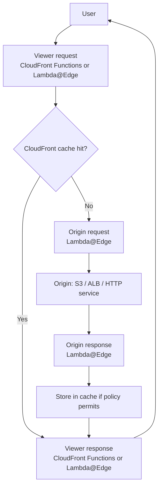
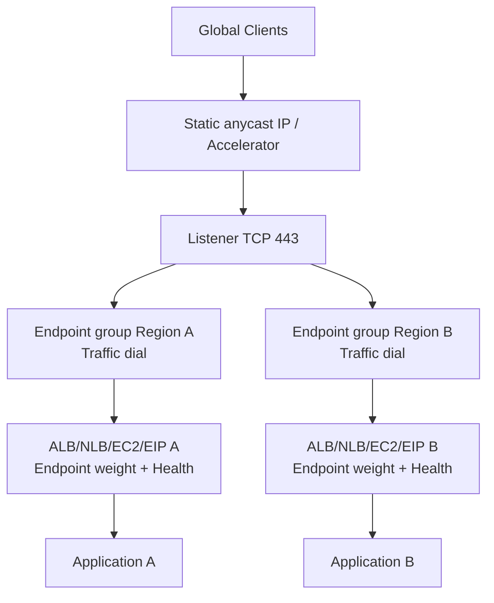
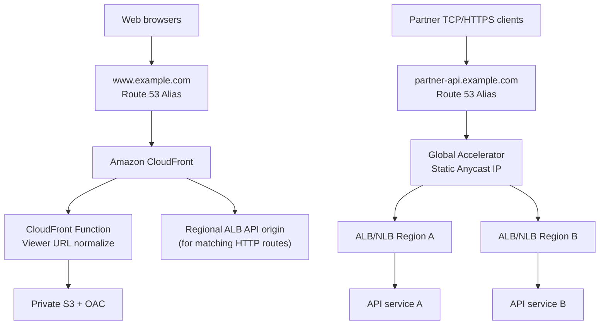

# CloudFront Functions, Lambda@Edge, and Global Accelerator

In applications serving users across multiple countries, simply exposing an EC2 instance or Application Load Balancer (ALB) to the Internet solves **reachability**, not low latency, resilience, or global request control. AWS offers two complementary approaches: **Amazon CloudFront** for content delivery and HTTP processing near users, and **AWS Global Accelerator** to route TCP/UDP traffic onto the AWS global network toward optimal endpoints.

Inside CloudFront, **CloudFront Functions** and **Lambda@Edge** run code at specific stages of request/response processing. Both belong to *edge computing*, yet differ in triggers, capabilities, and pricing. Global Accelerator is a network acceleration/routing layer—**not a type of CloudFront edge function**.

This lesson belongs to the **DNS and Content Delivery** chapter of the **CLOUD_PROVIDERS_AWS** module, connecting AWS Regions/AZs, IAM, VPC, EC2, ALB/NLB, S3, Route 53, Lambda, monitoring, resilience, and cost control. By the end, you will know how to choose the right service, deploy edge logic safely, and design global entry points for applications.

## 1. Learning Outcomes

After this lesson, you will be able to:

1. Trace the **viewer → CloudFront edge → cache → origin** flow and where edge functions execute.
2. Distinguish **CloudFront Functions** from **Lambda@Edge** by events, languages, network access, body access, execution limits, and deployment lifecycle.
3. Write a JavaScript CloudFront Function for viewer requests to normalize URLs prior to cache lookup.
4. Explain the four Lambda@Edge events and configure a published Lambda version from `us-east-1`.
5. Describe Global Accelerator standard accelerators, anycast IPs, listeners, endpoint groups, endpoints, health checks, and traffic dials.
6. Choose CloudFront, Lambda@Edge, Global Accelerator, or the right combination for web/API/TCP/UDP workloads.
7. Inspect configurations via the AWS Console/CLI; identify HTTP, routing, cache key, IAM, and endpoint health errors.
8. Design monitoring, incident response, failover, TLS/WAF security, and cost estimates.

## 2. Concepts to Distinguish First

| Concept | Function | Example |
| --- | --- | --- |
| **DNS / Route 53** | Resolves domain names to services or addresses | `www.example.com` |
| **CloudFront distribution** | CDN with caching, TLS, request/response policies, and origins | CloudFront serving S3 images or ALB APIs |
| **Edge location** | AWS network point of presence near users | Where CloudFront processes/caches content |
| **Origin** | Content source on cache miss or pass-through | S3, ALB, custom HTTP origin |
| **Cache behavior** | Rules for path patterns, cache policies, and edge associations | `/assets/*`, `/api/*` |
| **CloudFront Functions** | Lightweight JavaScript running at viewer request/response | URI normalization, redirects |
| **Lambda@Edge** | Lambda code running at edges/Regional Edge Caches on CloudFront events | Origin request/response logic |
| **Global Accelerator** | Anycast IP entry point selecting regional endpoints for TCP/UDP | Routing TCP 443 to the best healthy ALB |
| **ALB / NLB** | Regional load balancing across targets | ALB for HTTP(S), NLB for TCP/UDP |
| **AWS WAF** | Filters HTTP(S) traffic via security rules | Rate-based rules, managed rules |

**DNS is not a CDN, a CDN is not a load balancer, and Global Accelerator does not replace CloudFront caching.** Each layer handles a distinct segment of the request journey.

For example: a Java app in private subnets behind an ALB, with images in S3. Putting CloudFront in front of S3/ALB caches content, applies WAF, and transforms HTTP at the edge. If another system uses a custom TCP protocol or UDP, Global Accelerator fits better to steer clients to an NLB/EC2 in a healthy Region.

## 3. CloudFront Processing Flow and Events

When a client requests `https://www.example.com/docs/guide.html`:

1. DNS returns the CloudFront distribution's name/IP, and the client completes TLS with CloudFront.
2. The **Viewer request** event fires when CloudFront receives the request, before cache lookup.
3. CloudFront uses the cache key/policy to look for a valid cached entry.
4. On a **cache hit**, CloudFront skips calling the origin and does not invoke **origin request/response** for that request.
5. On a **cache miss**, CloudFront runs **origin request** before contacting the origin, then **origin response** upon receiving the origin's reply.
6. **Viewer response** may run before returning the result to the client, subject to event rules and restrictions.



The diagram shows the standard flow; real traffic also involves AWS WAF, intermediate cache layers, origin failover, error caching, and conditions that skip edge functions. **CloudFront does not invoke viewer-response edge functions when the origin returns HTTP status 400 or higher**; Lambda@Edge at origin-response can still process origin error responses within supported bounds.

### 3.1. Which Events Run Every Request vs. Only on Cache Miss?

| Event | When It Runs | CloudFront Functions | Lambda@Edge |
| --- | --- | --- | --- |
| **Viewer request** | Before cache lookup | Yes | Yes |
| **Origin request** | When forwarding a request to the origin | Not supported | Yes |
| **Origin response** | After the origin replies when called | Not supported | Yes |
| **Viewer response** | Before returning response to viewer, per event limits | Yes | Yes |

**Performance/cost implication:** viewer request runs on virtually every request matching the behavior, whereas origin request runs only on cache misses. If a transformation is needed only on cache miss, Lambda@Edge origin-request reduces execution count compared to running viewer logic on every request. Conversely, if you must normalize a URI **before** cache lookup, viewer-request is the right hook.

### 3.2. Constraints When Combining Edge Functions

On the **same cache behavior**:

- At most **one** edge function per event trigger.
- **Do not** mix CloudFront Functions and Lambda@Edge across the two **viewer events** of the same behavior.
- You can combine **CloudFront Functions on viewer request/response** with **Lambda@Edge on origin request/response** when configured properly.
- Edge functions and the target CloudFront distribution must belong to the **same AWS account**.
- Rewriting a URI does not automatically switch the **cache behavior** already selected from the original request path.

Map out triggers per cache behavior before attaching functions; never try attaching a CloudFront Function to viewer response when viewer request on that behavior already uses Lambda@Edge.

## 4. CloudFront Functions: When to Use Them?

**CloudFront Functions** lets you write lightweight JavaScript to manipulate CloudFront requests/responses at viewer events. Ideal for fast, ultra-high-scale, low-latency tasks such as:

- Redirecting `/old` to `/new`.
- Lowercasing paths, appending `index.html` to directory URLs, or normalizing query strings for caching.
- Adding/modifying valid HTTP headers.
- Lightweight token/header validation using safely designed mechanisms.
- Reading feature flags/redirect maps via **CloudFront KeyValueStore**.
- Selecting/modifying origins via **viewer request** helpers on supported runtimes.

### 4.1. Capabilities and Current Limits

| Attribute | CloudFront Functions |
| --- | --- |
| Language | JavaScript on CloudFront-supported runtimes, including **JavaScript runtime 2.0** |
| Triggers | `viewer-request` and `viewer-response` |
| Request body access | **Cannot read** viewer request body |
| Duration & resources | Sub-millisecond execution; strict memory/code-size quotas; unsuitable for heavy compute |
| CloudFront KeyValueStore | Yes, requires **runtime 2.0** |
| Filesystem / environment variables | No |
| Network calls | Current runtime supports **up to one network call per invocation** to a configured origin in the **same distribution**, with quotas |
| Origin modification | Runtime 2.0 provides `cf.updateRequestOrigin()`, `cf.selectRequestOriginById()`, or origin groups at **viewer request** |
| Deployment | Create → test in `DEVELOPMENT` → Publish → associate `LIVE` with CloudFront behavior |

**Update note:** Some older docs/tutorials state CloudFront Functions "cannot make network calls or change origins." AWS now supports one bounded network call and origin-modification helpers in runtime 2.0. That **does not** turn Functions into Lambda@Edge: there are still no origin-request/origin-response triggers, no viewer body access, no full Node.js runtime, and no arbitrary external network API calls like standard Lambda.

Code size, compute utilization, and network call quotas may be adjusted by AWS; before production use, consult [CloudFront Functions quotas](https://docs.aws.amazon.com/AmazonCloudFront/latest/DeveloperGuide/cloudfront-limits.html) and [Restrictions on CloudFront Functions](https://docs.aws.amazon.com/AmazonCloudFront/latest/DeveloperGuide/cloudfront-function-restrictions.html).

### 4.2. Example 1: Rewriting Directory URLs to `index.html`

Requirement: for `/docs/`, the origin stores `/docs/index.html`. Use a viewer-request function:

```javascript
// CloudFront Functions JavaScript runtime 2.0.
// Attach to viewer-request of the appropriate cache behavior.
function handler(event) {
  var request = event.request;
  var uri = request.uri;

  if (uri === "/" || uri.endsWith("/")) {
    request.uri = uri + "index.html";
  }

  return request;
}
```

Examples:

| Request URI | URI Forwarded Downstream |
| --- | --- |
| `/` | `/index.html` |
| `/docs/` | `/docs/index.html` |
| `/docs/guide.html` | Unchanged |
| `/api/orders` | Unchanged |

This is an **internal rewrite**—no HTTP 301/302 is sent to the browser. The URL shown in the address bar stays unchanged. Query strings reside on another request property and are untouched by this code.

**Check caching:** rewriting `uri` affects the cache key, yet does not switch cache behaviors. If `/docs/*` and `/api/*` have different origins, auth, or cache policies, test every route and never use rewrites to cross security boundaries.

### 4.3. Example 2: Redirecting Legacy URLs

A viewer-request function can return an HTTP response directly:

```javascript
function handler(event) {
  var request = event.request;

  if (request.uri === "/legacy") {
    return {
      statusCode: 301,
      statusDescription: "Moved Permanently",
      headers: {
        "location": { value: "/new-home" },
        "cache-control": { value: "public, max-age=300" }
      }
    };
  }

  return request;
}
```

Unlike a rewrite, the browser receives **301** and navigates to `/new-home`. Never build redirect targets from unvalidated query parameters like `?next=https://attacker.example`, which creates an **open redirect** vulnerability.

To enforce HTTP-to-HTTPS, check CloudFront's **Viewer protocol policy** first; do not write a function for something CloudFront handles natively.

### 4.4. CloudFront KeyValueStore and Feature Flags

**CloudFront KeyValueStore (KVS)** is a global key-value store that CloudFront Functions runtime 2.0 reads quickly at the edge. It lets you update mappings without re-publishing function code every time.

Logical data example:

```json
{
  "redirect:/help": "/support",
  "feature:checkout-v2": "enabled",
  "maintenance:region-ap": "false"
}
```

This illustrates the data structure, not the exact KVS import API schema. Real code calls KVS helpers via the `cloudfront` module with appropriate permissions and KVS association.

**Where do secrets go?** Never use KVS to replace a secrets manager. For edge auth, store only public/low-sensitivity config or keys per AWS-supported patterns with proper signature verification and rotation policies. Never hardcode private keys, API tokens, or PII inside function code.

### 4.5. Dynamic Origin Selection at Viewer Request

CloudFront Functions **runtime 2.0** supports changing origins via `cloudfront` module helpers, such as picking a configured origin:

```javascript
import cf from "cloudfront";

// Illustrative sample only.
// The distribution must define an origin with ID "origin-maintenance".
function handler(event) {
  var request = event.request;

  if (request.uri.startsWith("/maintenance/")) {
    cf.selectRequestOriginById("origin-maintenance");
  }

  return request;
}
```

Production deployments must verify **origin IDs, cache behaviors, `Host` headers, TLS certificates, Origin Access Control (OAC), S3/ALB permissions, and cache policies**. `updateRequestOrigin()` also has specific limitations—for example, it cannot update a VPC origin; use `selectRequestOriginById()` to pick a preconfigured VPC origin where supported.

Origin switching at **viewer request** differs from Lambda@Edge **origin request**: viewer request fires much more often, while origin request fires only when CloudFront must contact an origin. Choose based on cacheability and logic complexity.

## 5. Testing and Deploying CloudFront Functions

### 5.1. Console Steps

1. Open the [CloudFront Console](https://console.aws.amazon.com/cloudfront/) and go to **Functions → Create function**.
2. Give it a meaningful name such as `normalize-docs-url`; select the right JavaScript runtime (e.g., **2.0**).
3. Paste reviewed code into the **DEVELOPMENT stage**.
4. Use **Test** with simulated viewer-request events covering diverse URIs, headers, and query strings.
5. Verify the returned `request.uri` or `response.statusCode` as well as **compute utilization**.
6. Click **Publish function** to promote to **LIVE** once tests pass.
7. Under **Distributions → Behaviors → Edit**, choose the target behavior and attach the LIVE function to **Viewer request** or **Viewer response**.
8. Wait for the distribution to deploy, test live URLs over HTTPS, and monitor error rates and latency.

**Never edit a production behavior directly to test an unverified idea.** If an origin serves personal data or authenticated APIs, verify the entire cache key and access control before publishing.

### 5.2. Testing with a Sample Event

A simulated viewer-request payload includes these core fields; adapt to the format required by the AWS test UI/CLI:

```json
{
  "version": "1.0",
  "context": {
    "eventType": "viewer-request"
  },
  "viewer": {
    "ip": "203.0.113.10"
  },
  "request": {
    "method": "GET",
    "uri": "/docs/",
    "headers": {
      "host": {
        "value": "www.example.com"
      }
    },
    "querystring": {},
    "cookies": {}
  }
}
```

This is an **illustrative structure**; when invoking `TestFunction`, follow the exact [CloudFront Functions event structure](https://docs.aws.amazon.com/AmazonCloudFront/latest/DeveloperGuide/functions-event-structure.html) and API version. Expected output for Example 4.2: `request.uri` becomes `/docs/index.html`.

### 5.3. More Thorough Test Cases

| Case | Expectation |
| --- | --- |
| `/` | Rewrites to `/index.html` |
| `/docs/` | Rewrites to `/docs/index.html` |
| `/docs/example.html` | Unchanged |
| `/api/orders` | Not accidentally altered |
| Request with query string | Preserves query string unless intentionally changed |
| Unicode/URL-encoded path | Confirmed not to break encoding |
| Function error | Alerts and rollback plan ready |
| Origin unready | Function does not create redirect loops or broken paths |

## 6. Lambda@Edge: Capabilities and Differences from Regional Lambda

**Lambda@Edge** extends AWS Lambda into CloudFront. You write **Node.js** or **Python** in a supported runtime, publish the function from **US East (N. Virginia), Region `us-east-1`**, and associate a **numbered function version** with a distribution. CloudFront replicates the code to AWS locations to execute closer to users.

Lambda@Edge fits when logic is more complex:

- Needs to run on **origin request** or **origin response**.
- Needs application libraries, complex auth/transformations, or external AWS service calls (within latency/quota limits).
- Needs to inspect the request body via **Include body**, subject to size/truncation limits.
- Needs multiple network calls or longer execution than CloudFront Functions allow.
- Needs to alter requests before calling the origin or transform origin responses before returning/caching.

### 6.1. Four Lambda@Edge Events

| Trigger | When It Fires | Typical Use Cases |
| --- | --- | --- |
| **Viewer request** | Every viewer request matching the behavior, before cache lookup | Complex request auth required before cache |
| **Origin request** | On cache miss right before calling the origin | Injecting origin headers, origin routing, backend checks |
| **Origin response** | When the origin responds to an origin fetch | Transforming origin responses, handling certain origin errors |
| **Viewer response** | Before returning to the viewer, per support rules | Adding headers with custom logic |

If your goal is simply static HTTP security response headers, check **CloudFront Response Headers Policy** before writing Lambda@Edge. Managed policies require zero code and are easier to operate.

### 6.2. Node.js Example for Origin Request

Example injecting an environment label header into requests forwarded to the origin:

```javascript
// Lambda@Edge origin-request handler.
// Publish a function version in us-east-1, then associate with CloudFront.
exports.handler = async (event) => {
  const request = event.Records[0].cf.request;

  request.headers["x-edge-environment"] = [
    {
      key: "X-Edge-Environment",
      value: "production"
    }
  ];

  return request;
};
```

Differences from CloudFront Functions:

- Lambda@Edge events use `event.Records[0].cf.request`, not `event.request`.
- Headers in Lambda@Edge are **arrays of objects** with `key`/`value`.
- Because the trigger is **origin request**, it runs only when CloudFront forwards to the origin, **not on cache hits**.
- This header is an illustrative label only; **never use it for access control** unless the origin verifies a trusted anti-spoofing mechanism.

### 6.3. Critical Deployment Restrictions

| Restriction | Practical Impact |
| --- | --- |
| Create and publish Lambda@Edge functions in **`us-east-1`** | A Lambda function created only in an app Region like `ap-southeast-1` cannot be attached directly to Lambda@Edge |
| Associate a **numbered version** | Cannot associate `$LATEST` or an alias with CloudFront |
| IAM trust policy | Execution role must trust both `lambda.amazonaws.com` and `edgelambda.amazonaws.com` |
| Cannot attach function to a VPC | Cannot access private VPC resources like normal VPC-attached Lambda; requires another connectivity design |
| No Lambda Layers, container images, or provisioned concurrency per Lambda@Edge limits | Package dependencies into the deployment artifact |
| No custom environment variables (except reserved ones) | Provide config via supported patterns; never hardcode secrets |
| Body size limits | Viewer request body truncated at **40 KB**, origin request at **1 MB** with include-body enabled |
| Viewer response | Cannot modify HTTP status code in Lambda@Edge viewer-response |
| Replication | Updating/deleting versions affects replicas; cannot delete a version still attached to a distribution |

Before deploying, check which Node.js/Python runtimes AWS currently supports. **Never pin an obsolete Node.js runtime** just because a sample tutorial used it. Consult [Restrictions on Lambda@Edge](https://docs.aws.amazon.com/AmazonCloudFront/latest/DeveloperGuide/lambda-at-edge-function-restrictions.html).

### 6.4. Release Workflow

1. Create the Lambda function in **`us-east-1`** using a Lambda@Edge-supported runtime.
2. Create an execution role with both required trust principals; scope IAM permissions narrowly.
3. Write code, run unit tests, and verify structured logging with mock data—never log Authorization/Cookies/tokens.
4. Choose **Publish new version** to get a versioned ARN like `arn:aws:lambda:us-east-1:123456789012:function:edge-origin-header:1`.
5. Open the CloudFront distribution and attach the **versioned ARN** to the target cache behavior and event.
6. Wait for distribution deployment; test from multiple locations and check logs in the Regions where Lambda@Edge actually executes.
7. For updates, publish a **new version**, update the association, verify propagation, and keep a rollback path to the prior working version.

**Never expect editing `$LATEST` to update live edge code.** CloudFront executes the **published numbered version** and manages replication across deployments.

## 7. Choosing CloudFront Functions vs. Lambda@Edge

| Criterion | CloudFront Functions | Lambda@Edge |
| --- | --- | --- |
| Triggers | Viewer request/response | Viewer + origin request/response |
| Languages | CloudFront JavaScript runtime | Node.js/Python |
| Best suited for | Rewrites, redirects, headers, short logic; bounded KVS/origin helpers | Complex logic, body inspection, multiple network calls, origin events |
| Request body | No | Yes, with Include body and size limits |
| Network | One call to a configured origin within quotas; not arbitrary | Network access per runtime/permissions and limits |
| Filesystem | No | Yes, within Lambda@Edge runtime limits |
| Configuration data | KeyValueStore runtime 2.0 | Requires supported config source; no custom env vars |
| Deployment | Published `LIVE` inside CloudFront | Lambda function version in `us-east-1`, replicated |
| Primary cost | Function invocations and related usage | Invocations + compute duration and related usage |
| Debugging | TestFunction / compute utilization / logs | Lambda logs/CloudWatch in execution Regions |
| Risks | Buggy code on high request volume; breaking cache keys/redirects | Cold starts, dependencies, duration, IAM, and replication |

### 7.1. Decision Rules

- Just appending `index.html` or redirecting `/old`: use **CloudFront Functions**.
- Static policy-driven headers: prefer **CloudFront Response Headers Policy** if sufficient.
- Lightweight feature flags/mappings updated independently of code: **CloudFront Functions + KVS**.
- Switching origins at viewer request with supported helpers: evaluate **CloudFront Functions runtime 2.0**.
- Running on **origin response** and transforming payloads/metadata via code: **Lambda@Edge**.
- Requiring SDKs/libraries and bounded request body access: **Lambda@Edge**, factoring in cost and latency.
- Service handles non-HTTP TCP/UDP traffic: evaluate **Global Accelerator**—never try to use CloudFront Functions as a TCP proxy.

## 8. Global Accelerator: Network-Layer Acceleration

**AWS Global Accelerator** is a global service providing stable entry points via **anycast IP addresses**. Clients connect to announced IPs at AWS edge locations, and traffic traverses the **AWS global network** to optimal endpoints in one or more Regions.

A **standard accelerator** routes traffic based on:

- Client network location and path conditions over the AWS global network.
- **Health** status of regional endpoints.
- Policies such as endpoint group **traffic dials** and **endpoint weights**.
- Listener protocols/ports and service limits.

Global Accelerator **does not cache objects**, does not run JavaScript edge code, and **does not terminate HTTP/TLS the way CloudFront/ALB do**. For HTTPS/TCP, TLS termination usually stays at the application's ALB/NLB or backend.

### 8.1. What Is a Static Anycast IP?

An **anycast** address is an IP advertised simultaneously from multiple network locations. Client packets to that IP enter the nearest/optimal point on the global network.

Global Accelerator standard accelerator:

- **IPv4** type receives **two static IPv4 anycast addresses** by default.
- **Dual-stack** type receives **two static IPv4 and two static IPv6 addresses**; dual-stack endpoints must meet corresponding requirements.
- **BYOIP** is supported for eligible IPv4 ranges.
- IPs remain fixed for the lifetime of the accelerator, even while **disabled**; **deleting the accelerator** releases those default addresses.
- Includes a Global Accelerator-assigned DNS name, e.g., `a1234567890abcdef.awsglobalaccelerator.com`.

This is ideal when enterprises or partners require **static IP allowlisting**, even as underlying regional load balancers or EC2 instances scale or fail over.

### 8.2. Components of a Standard Accelerator



| Component | Meaning |
| --- | --- |
| **Accelerator** | Global resource owning the anycast IPs and listeners |
| **Listener** | Accepts **TCP or UDP** on one or more ports/port ranges |
| **Endpoint group** | Group of endpoints in **one AWS Region**, attached to a listener |
| **Endpoint** | Resource receiving traffic: **ALB, NLB, EC2 instance, or Elastic IP** in a standard accelerator |
| **Traffic dial** | Adjusts the share of traffic directed to a **Region endpoint group** |
| **Endpoint weight** | Distributes traffic across multiple endpoints within a group |
| **Health check** | Evaluates endpoint health to steer traffic appropriately |

**A 50% traffic dial does not mean global traffic splits exactly 50:50 between two Regions.** It caps/scales traffic already headed to that endpoint group; Region selection still depends on client location, endpoint health, and other policies. Measure actual connections/bytes to verify load distribution.

### 8.3. Standard vs. Custom Routing Accelerator

| Type | Target Selection | Scope |
| --- | --- | --- |
| **Standard accelerator** | Global Accelerator picks healthy/optimal endpoints per policy | Web/API, TCP/UDP services needing HA and fixed entry IPs |
| **Custom routing accelerator** | Clients use provided **IP + port** mappings to reach a deterministic EC2 instance in configured VPC subnets | Apps requiring clients to pin to specific servers, e.g., certain gaming/session workloads |

Custom routing uses a different routing/health-check/endpoint model from standard; the labs below focus on **standard accelerators**.

### 8.4. Health Checks and Failover

When a standard accelerator has endpoints in two Regions:

1. Global Accelerator monitors endpoint health per configuration.
2. If an endpoint becomes unhealthy, traffic shifts to remaining healthy endpoints per policy.
3. For ALB/NLB endpoints, health checks come from the **load balancer**; for EC2/EIP endpoints, configure health checks on the Global Accelerator endpoint group.
4. Endpoint groups and traffic dials/weights shape distribution while endpoints are healthy.
5. **If no endpoints remain healthy**, Global Accelerator may route traffic to **all endpoints** under AWS's fail-open behavior; never treat this as an absolute traffic shutoff.

**Health checks are not data backups.** If Region A loses its database or data has not replicated to Region B, Global Accelerator cannot sync data for you. Application failover also requires **RPO/RTO** planning, consistency, database replication, and independent readiness at the target.

### 8.5. Client IP and Network Security

Some endpoint types support **client IP preservation** under specific conditions; never assume every endpoint type sees the original client source IP identically. Check endpoint type, security groups, and AWS docs before relying on client IP as a security signal.

An **internal ALB** can serve as a Global Accelerator endpoint in supported architectures. Still verify VPC IGW/routing requirements, security groups, and how AWS delivers traffic to that endpoint. **Never assume any arbitrary private IP in a VPC automatically works as a supported endpoint.**

WAF protects HTTP(S) at supported layers like CloudFront or ALB; Global Accelerator itself is a TCP/UDP entry layer and does not replace HTTP application filtering.

## 9. Route 53 and Global Accelerator: Coordinating DNS

Global Accelerator provides a **DNS name** and static IPs. If an organization uses `api.example.com`:

1. Create the accelerator with listeners and endpoints.
2. In **Amazon Route 53**, create an **Alias A** record pointing to Global Accelerator for IPv4.
3. If dual-stack and IPv6 is needed, configure a matching **AAAA/alias** record.
4. With external DNS providers, configure records per that provider's DNS docs.
5. Wait for DNS propagation and verify resolution using `dig`/`nslookup`.

**Important note:** DNS only locates the **fixed entry point**. Global Accelerator then steers connections across endpoints; you do not need to change DNS records when shifting traffic between Regions. Changing accelerator IPs by **deleting or replacing the accelerator** is disruptive and must be tightly governed.

### 9.1. How Does Global Accelerator Differ from Route 53 Routing Policies?

| Aspect | Route 53 DNS Routing | Global Accelerator |
| --- | --- | --- |
| Control point | DNS query answers | TCP/UDP traffic entering static anycast IPs |
| Steering mechanism | Returns different IP/alias per policy/health | Routes over AWS network to optimal endpoint |
| Cache impact | Subject to DNS TTL and resolver/browser/client caches | Entry IP stays fixed; endpoint mapping updates |
| Scope | Domain names | TCP/UDP connections |
| Features | Weighted, latency, failover, geolocation DNS, etc. | Health, network routing, regional traffic dials/weights |
| Application data | Does not cache HTTP bodies | Does not cache HTTP bodies |

**Never promise instant failover for open TCP sessions.** Health checks and mapping updates take time; existing connections can drop and clients must reconnect. Apps need safe retries and idempotency to avoid duplicate writes on reconnect.

## 10. CloudFront vs. Global Accelerator: Which Should You Choose?

| Question | **CloudFront (+ edge functions)** | **Global Accelerator** |
| --- | --- | --- |
| Need to cache images, CSS, JS, video, or HTTP responses? | **Yes** | No |
| Need to rewrite URLs/headers or run auth near viewers? | **Yes** | No HTTP edge functions |
| Need fixed anycast IPs for partner allowlisting? | Not its primary model | **Yes** |
| App uses UDP or non-HTTP TCP protocols? | Unsuitable as standard CDN | **Yes**, via supported listeners/endpoints |
| Automatically pick healthy endpoints across AWS Regions? | HTTP origin failover when configured | Health-aware routing across endpoints and policies |
| Need to offload origins via edge caching? | **Yes** | No |
| Need a Route 53 custom domain? | Alias to CloudFront distribution | Alias to Global Accelerator |
| Protect HTTP with AWS WAF? | Native WAF integration | WAF normally sits on ALB, not directly inside GA |
| Typical billing | Requests, data transfer, edge invocations/compute | Hourly accelerator fee + data transfer premium + network fees |

### 10.1. Three Service-Selection Scenarios

**Scenario A — E-commerce site with images on S3 and APIs on ALB.** CloudFront acts as CDN and static cache; CloudFront Functions rewrite paths or redirect; Lambda@Edge is needed only for complex HTTP logic on origin events. Protect the S3 origin with **Origin Access Control (OAC)** and manage API caching carefully.

**Scenario B — Multi-Region HTTPS API where enterprise partners require fixed IP allowlisting.** A Global Accelerator standard accelerator with ALB/NLB endpoints fits well; still design database failover, SSL/TLS, health checks, and IAM. If GET responses also need caching, evaluate CloudFront separately per architecture.

**Scenario C — Gaming app using TCP/UDP needing a stable connection entry point.** Global Accelerator steering traffic to NLB/EC2 endpoints fits far better than CloudFront Functions; pay attention to **session state** and reconnects on failover.

**You cannot directly attach a CloudFront distribution as a standard accelerator endpoint**: supported endpoints are ALB, NLB, EC2, or Elastic IP. When combining them, design **two separate traffic paths** or explicit origins rather than drawing an invalid arrow `GA endpoint → CloudFront distribution`.

## 11. Global Reference Pattern: Two Access Paths

Suppose an application has static web content plus a partner API requiring static IPs:



Simplified diagram for service selection. In reality, CloudFront Functions run **before or after cache** depending on trigger; they are not an independent intermediate server. Both domains can share or separate backends, but keep cache policies, authentication, CORS, TLS, and traffic paths distinct to avoid loops.

## 12. Console: Creating a Standard Global Accelerator

> **Cost warning:** Creating a Global Accelerator can incur hourly charges even with zero traffic, and even when disabled. These steps are for authorized sandboxes with budget; the simulated exercise in Section 17 does not require creating live paid resources.

1. Sign in to the [Global Accelerator Console](https://console.aws.amazon.com/globalaccelerator/) in an authorized account.
2. Choose **Create accelerator → Standard**, name it e.g. `partner-api-global`.
3. Pick **IPv4** or **Dual-stack** per endpoint and client needs.
4. Record the **two static IPv4 addresses** (and IPv6 if dual-stack) plus the DNS name after creation.
5. Add a **listener** on `TCP 443` (or required UDP/TCP ports).
6. Create **endpoint groups** for target Regions, e.g., `ap-southeast-1` and `us-east-1`.
7. In each Region, attach existing valid **ALB/NLB/EC2/EIP** endpoints, verifying listener targets and health checks.
8. Set **traffic dial** at the Region level and **endpoint weights** if needed.
9. Wait for the accelerator/endpoints to become ready; test from authorized clients.
10. In Route 53, create an alias record to the accelerator for a custom hostname.

**Pre-traffic checks:** TLS certificates on ALB/backends, health check paths/ports, Security Groups/NACLs, target groups, database replication, and client retry behavior.

### 12.1. About Traffic Dial Levels

Example policy-driven setup:

| Endpoint group | Traffic dial | Goal |
| --- | ---: | --- |
| Region A | 100% | Serve eligible traffic |
| Region B | 100% | Eligible to serve traffic |
| Region B during canary | 10% | Throttle traffic otherwise directed to group B |

Lowering a traffic dial helps limit traffic during tests or incidents, but it is **not an absolute global percentage splitter across Regions**. Compare actual distribution using CloudWatch metrics and tracing.

## 13. AWS CLI: Inspecting CloudFront, Lambda@Edge, and Global Accelerator

Use AWS CLI v2 with an authorized IAM Identity Center/role profile. Commands here are **read-only**; replace names, ARNs, and Regions with values from your real account.

### 13.1. CloudFront and CloudFront Functions

```bash
# Verify identity.
aws sts get-caller-identity --profile training

# List CloudFront distributions.
aws cloudfront list-distributions \
  --profile training

# List CloudFront Functions in LIVE stage.
aws cloudfront list-functions \
  --stage LIVE \
  --profile training

# Inspect an existing Function's configuration.
aws cloudfront describe-function \
  --name normalize-docs-url \
  --stage LIVE \
  --profile training
```

CloudFront is global; AWS CLI uses your default Region configuration. In real diagnostics, focus on **distribution ID, behaviors, viewer event associations, function stage, and deployment status**.

### 13.2. Lambda@Edge

```bash
# Lambda@Edge functions are published from us-east-1.
aws lambda list-functions \
  --region us-east-1 \
  --profile training

# View numbered published versions.
aws lambda list-versions-by-function \
  --function-name edge-origin-header \
  --region us-east-1 \
  --profile training
```

If a function exists in `ap-southeast-1` and not `us-east-1`, it is a standard Regional Lambda, not a version eligible for Lambda@Edge association.

### 13.3. Global Accelerator

**Global Accelerator is a global service, yet AWS CLI/API accelerator management calls use Region `us-west-2`.** That is the control-plane Region—**it does not mean endpoints must live in Oregon**.

```bash
# List accelerators.
aws globalaccelerator list-accelerators \
  --region us-west-2 \
  --profile training

# List listeners on an accelerator.
aws globalaccelerator list-listeners \
  --accelerator-arn "arn:aws:globalaccelerator::123456789012:accelerator/EXAMPLE-ID" \
  --region us-west-2 \
  --profile training

# List endpoint groups using a real Listener ARN.
aws globalaccelerator list-endpoint-groups \
  --listener-arn "arn:aws:globalaccelerator::123456789012:accelerator/EXAMPLE-ID/listener/EXAMPLE-LISTENER" \
  --region us-west-2 \
  --profile training
```

ARNs are placeholders. If you get `ResourceNotFound`, verify account/ARN, read permissions, and the control-plane Region before assuming the accelerator does not exist.

### 13.4. Sample Create Accelerator Command (Billable)

Syntax illustration to understand the API; **do not run** without budget and approved endpoint design:

```bash
# WRITES RESOURCES; MAY INCUR IMMEDIATE CHARGES.
aws globalaccelerator create-accelerator \
  --name partner-api-global \
  --ip-address-type IPV4 \
  --enabled \
  --region us-west-2 \
  --profile training
```

This creates only the accelerator—**no listeners, endpoint groups, or endpoints yet**. Creating an accelerator alone does not make an app work. Deleting it later releases its assigned static IPs; never use a production accelerator for lab experiments.

## 14. Security Controls for Edge Processing

### 14.1. TLS, WAF, and Origin Permissions

- CloudFront custom domains require a valid TLS certificate per CloudFront rules (typically an ACM certificate in **`us-east-1`**).
- For **private S3 bucket origins**, use **Origin Access Control (OAC)** and a least-privilege bucket policy scoped to the CloudFront distribution.
- For custom/ALB origins, enforce HTTPS to the origin and block direct CDN bypass when required by architecture.
- Attach **AWS WAF** on CloudFront or ALB where supported; never try to build a full DDoS filter inside a JavaScript function.
- With Global Accelerator, endpoints still need TLS/health checks, SGs/NACLs, and authorization; GA does not replace Certificate Manager, WAF, IAM, or app security.

### 14.2. Cache Policies and Sensitive Data

**Biggest CDN API risk:** caching User A's response and serving it to User B because the cache key omits user identity.

For example, `GET /api/profile` returns private user data. If the response sends `Cache-Control: public` or CloudFront's cache policy allows caching without isolating identity in the key, users can receive someone else's data.

Mitigation:

1. Classify endpoints: static/public, dynamic/public, private/personalized.
2. Assign matching cache/origin request policies to each behavior.
3. For personalized responses, configure **no caching** or guarantee safe cache keys and authorization across all layers; disabling caching is the safe default.
4. Never put raw tokens, `Authorization`, Cookies/PII into cache keys, logs, or unnecessary response headers.
5. Test with **two distinct users** to catch cache leaks.
6. Whenever changing cache policies or edge logic, run security tests and prepare rollback/invalidation plans.

### 14.3. Deployment Least Privilege

- Scope developer IAM roles to publish only their project's CloudFront Functions in the assigned account.
- Have operations review distribution associations and function versions.
- Grant Lambda@Edge execution roles only the AWS APIs truly needed; never attach `AdministratorAccess` for convenience.
- Protect Global Accelerator against unauthorized endpoint/traffic dial changes using IAM policies, CloudTrail, and approvals.
- Tag resources with Owner/Environment/CostCenter where supported for auditing.
- Never log credentials, JWTs, session cookies, or personal data in Function/Lambda logs.

## 15. Observability, Monitoring, and Costs

### 15.1. CloudFront Functions

| Signal | Meaning |
| --- | --- |
| **Invocations** | How many times the function runs with traffic |
| **Function execution errors** | Runtime or validation errors |
| **Compute utilization** | Execution time relative to the Function's compute budget |
| **CloudFront 4XX/5XX** | May indicate origin, WAF, edge function, or viewer errors |
| **CacheHitRate** | Evaluates caching effectiveness after URI rewrites/cache key tweaks |
| **Logs** | Debugging aid; per-invocation log size limits apply |

Costs include **CloudFront Functions invocations**, KVS usage if enabled, network calls if used, CloudFront requests/data transfer, and logs/monitoring. Check [CloudFront pricing](https://aws.amazon.com/cloudfront/pricing/) by Region and usage.

### 15.2. Lambda@Edge

Monitor:

- Invocations, errors, duration/throttles, and CloudWatch logs.
- Lambda@Edge billing by invocations and compute duration/GB-seconds per pricing schedule.
- Latency from code logic, downstream APIs/DNS, timeouts, and cold starts.
- Each Region where code executes creates its own CloudWatch log group; check the right Region and set log retention policies.

Lambda@Edge executes in regional AWS locations and logs are distributed across Regions; do not look only in `us-east-1` just because the function was published there.

### 15.3. Global Accelerator

Monitor:

- Accelerator status and endpoint group/endpoint health.
- **CloudWatch metrics** for processed traffic, connections, and network performance provided by AWS.
- **Flow logs** where supported for traffic diagnostics.
- **CloudTrail** for create/modify events on accelerators, listeners, endpoint groups, traffic dials, and endpoints.
- Health of underlying **ALB/NLB/EC2** targets and client retry patterns.
- Costs for accelerator hours, data transfer premium, public IPv4 addresses, and downstream endpoints.

**Easily overlooked cost:** Global Accelerator charges an **hourly fee for every provisioned accelerator, even while disabled**, plus data transfer fees and applicable **public IPv4 address charges**, on top of ALB/NLB/EC2 and transfer costs. Never leave test accelerators sitting around assuming "disabled" means free. Consult [Global Accelerator pricing](https://aws.amazon.com/global-accelerator/pricing/).

### 15.4. Optimization Triage Table

| Symptom | Data to Inspect | Action |
| --- | --- | --- |
| Low cache hit rate | Cache policy, URL/query normalization, origin headers | Tune cache keys/TTLs with security testing |
| 5XX spike after deploying Function | Function errors, CloudFront logs, version/stage | Roll back LIVE association per runbook |
| High Lambda@Edge latency | Duration, downstream calls, cold starts, logs | Optimize code, cut network calls, use Functions if sufficient |
| Global Accelerator routes to unexpected Region | Health, endpoint weights, traffic dial, client location | Verify routing policy, endpoint health, and dials |
| Failover still returns errors | All endpoints unhealthy, DB/data unready, client retries | Inspect dependencies, fail-open behavior, RPO/RTO |
| Bill spikes | Edge invocations, data transfer, GA hourly fees | Correlate Cost Explorer/Budgets with real traffic |

## 16. Troubleshooting: Common Issues

| Symptom | Possible Cause | Priority Check |
| --- | --- | --- |
| New CloudFront Function does not run | Not published to **LIVE** or not attached to right behavior/event | Check stage, association, distribution deployment |
| Function returns HTTP 502 | Runtime error, invalid return schema, modified restricted header | `TestFunction`, CloudFront function logs, event restrictions |
| Rewritten URL misses intended origin | Rewriting `uri` does not change selected cache behavior | Check behavior path pattern, origin ID, and cache policy |
| Viewer-response function skips 4XX/5XX origin errors | Event restriction for origin status >= 400 | Check origin response status and trigger behavior |
| KVS fails | Function not on runtime 2.0 or KVS not associated | Check runtime, association, KVS permissions/quotas |
| Functions network call fails | Destination is not a configured origin or exceeds quota | Check one-call limit, timeout, and origin config |
| Lambda@Edge fails to associate | Function in wrong Region, `$LATEST`/alias used, wrong IAM role | Verify `us-east-1`, numbered version, trust principals |
| Lambda@Edge cannot reach private VPC resource | Lambda@Edge cannot attach to a VPC like Regional Lambda | Design a secured public endpoint or different architecture |
| Lambda@Edge origin-request skipped on cache hit | Origin events fire only when contacting origin | Check cache hit/miss, behavior, and trigger |
| Global Accelerator receives no traffic | Missing listener, endpoint group/endpoint, or wrong port | Check TCP/UDP listener, endpoint health, SG/NACL |
| Traffic not split exactly 50:50 across Regions | Traffic dial is not a fixed global traffic split | Check client locations, health, dials/weights |
| Clients error even though GA IP responds | Endpoint unhealthy or all endpoints unhealthy; app/DB down | Check health checks, fail-open, and app logs |
| Global Accelerator CLI cannot find accelerator | Wrong AWS account or control-plane Region | Pass `--region us-west-2` |
| Domain resolves wrongly | Wrong Route 53 alias or DNS cache | `dig`/`nslookup`, hosted zone, alias target |
| HTTPS certificate error | Wrong CloudFront custom-domain cert or ALB/backend TLS | Check ACM Region, host, SNI, and cert chain |

### Layered Troubleshooting Procedure

1. **DNS:** does the client resolve the right host and entrypoint address?
2. **TLS:** does the certificate match the host, chain, and protocol?
3. **Edge/accelerator:** right CloudFront distribution or GA accelerator, listener/event?
4. **Function:** which stage/version is live, is the trigger attached, are there errors?
5. **Cache:** cache hit/miss, cache policy, origin request policy, URI rewrite?
6. **Regional endpoint:** are ALB/NLB/EC2 healthy, with valid listeners/target groups/SGs/NACLs?
7. **Application:** are APIs/DB/downstream ready, with state replication and safe retries?
8. **Monitoring/cost:** do metrics, CloudTrail, logs, or billing show recent changes?

**Never raise TTLs blindly, disable WAF, or open S3 public access as a "quick fix" before identifying the root cause.** That worsens security exposure and hides the real bug.

## 17. Guided Practice (No Billable Resources Required)

**Context:** a team runs a static JavaScript frontend and a Java API. Frontend assets live in S3; the API runs behind an ALB in `ap-southeast-1`. The team plans to expand to a second Region and has a partner requiring static IP allowlisting.

### Task A — Select the Service

Choose a solution for each requirement:

| Requirement | Reference Solution | Explanation |
| --- | --- | --- |
| Cache images/CSS/JS globally | CloudFront + private S3 origin | Cuts S3/origin requests |
| Rewrite `/docs/` → `/docs/index.html` | CloudFront Function viewer-request | Rewrites URI before cache lookup |
| Read request body or run on origin response | Lambda@Edge on matching event | Functions lack viewer body access and origin events |
| Add static security response headers | CloudFront Response Headers Policy | Zero code needed |
| Use KVS to update redirect mappings | CloudFront Functions runtime 2.0 + KVS | Updates data outside code |
| TCP service needing fixed IP allowlist and Region failover | Global Accelerator standard | Anycast IPs + healthy endpoints |
| API returning per-user data | Uncached behavior or isolated auth policy | Prevents cache leaks |

### Task B — Predict Event Execution

A CloudFront behavior has:

- Viewer-request CloudFront Function rewriting `/docs/`.
- Origin-request Lambda@Edge adding `X-Edge-Environment`.
- Caching TTL for `/docs/index.html`.

Answer:

1. When the first viewer requests `/docs/` and hits a cache miss, **which functions run**?
2. When a second viewer requests the same path and gets a cache hit, **does origin-request Lambda@Edge run**?
3. If the origin returns HTTP 404, is a viewer-response edge function guaranteed to run?
4. Can you attach a Lambda@Edge viewer-response function to the same behavior already using a CloudFront Functions viewer-request function?
5. Why does rewriting the URI not switch to another cache behavior?

### Task C — Predict Global Accelerator Behavior

A standard accelerator has two endpoint groups:

- Region A: ALB A healthy, traffic dial 100%.
- Region B: ALB B healthy, traffic dial 100%.

Answer:

1. Which component does the client's TCP 443 connection hit first?
2. Can you conclude A and B will each receive exactly 50% of connections?
3. When ALB A becomes unhealthy, what must be verified before declaring failover successful?
4. If both ALB A and ALB B become unhealthy, does Global Accelerator block all connections by default?
5. Why can an unreplicated database in Region B cause app errors even after routing fails over?

### Task D — Read-Only Checks If You Have an AWS Account

If given an account with existing CloudFront/GA resources:

1. Run `aws sts get-caller-identity` to confirm the account.
2. Run `aws cloudfront list-distributions` to inspect distribution IDs/behaviors.
3. Run `aws cloudfront list-functions --stage LIVE` to verify published Functions.
4. Run `aws lambda list-versions-by-function --region us-east-1` to inspect Lambda@Edge numbered versions if any.
5. Run `aws globalaccelerator list-accelerators --region us-west-2` to inspect accelerators and static IPs.
6. Do not run commands creating accelerators, attaching functions, or deleting endpoints in this read-only lab.

### Report Template

```text
AWS Account: ...
Application domains: ...
CloudFront distribution ID: ...
Cache behaviors checked: ...
Viewer request function / stage: ...
Lambda@Edge trigger / function version / us-east-1: ...
Cache policy and auth review: ...
Global Accelerator ARN (redacted): ...
IP address type: IPV4 / DUAL_STACK
Listener protocol/ports: ...
Endpoint groups / Regions: ...
Endpoint health / routing policy: ...
WAF/TLS/Origin access review: ...
Failover RPO/RTO design: ...
Estimated cost and owner: ...
Reviewer / Date: ...
```

**Completion criteria:** learners accurately explain the request/cache lifecycle, pick the right service among CloudFront Functions/Lambda@Edge/Global Accelerator for each task, verify stages/versions, and distinguish DNS/anycast/health from caching/origins. This simulated, read-only lab requires no paid resource creation.

## 18. Self-Check Questions

1. Why do a CloudFront Function viewer-request and a Lambda@Edge origin-request execute at different frequencies?
2. Does a cache hit cause CloudFront to invoke an origin-response Lambda@Edge?
3. When a Function rewrites `request.uri`, does the browser's address bar URL change? What happens to the cache behavior?
4. Under runtime 2.0, are network calls completely forbidden in CloudFront Functions? What is the core restriction?
5. When should CloudFront KeyValueStore be used, and why does it require runtime 2.0?
6. Why must Lambda@Edge publish a numbered version in `us-east-1`?
7. Which Regional Lambda features are unsupported in Lambda@Edge?
8. Should you edit `$LATEST` expecting immediate updates to production Lambda@Edge?
9. Why can CloudFront Response Headers Policy be preferable to code for adding static headers?
10. How does Global Accelerator differ from CloudFront regarding object caching and UDP support?
11. How many static IPv4 addresses does a default IPv4 standard accelerator receive? What does dual-stack add?
12. Does a 50% traffic dial guarantee exactly 50% of global traffic goes to that Region?
13. Which components are required after creating an accelerator for TCP 443 to reach an application?
14. Why might all endpoints being unhealthy not cause Global Accelerator to block all traffic?
15. When managing accelerators with the AWS CLI, why pass `--region us-west-2` even if endpoints are in Singapore?
16. Which scenarios show that Global Accelerator does not synchronize data between two Regions?
17. If an API returns personal data, what risk arises if the cache key fails to isolate users?
18. List the primary cost drivers for CloudFront Functions, Lambda@Edge, and Global Accelerator.

## 19. Official AWS Documentation

- [CloudFront: Customize at the edge with functions](https://docs.aws.amazon.com/AmazonCloudFront/latest/DeveloperGuide/edge-functions.html).
- [Differences between CloudFront Functions and Lambda@Edge](https://docs.aws.amazon.com/AmazonCloudFront/latest/DeveloperGuide/edge-functions-choosing.html).
- [CloudFront Functions JavaScript runtime 2.0](https://docs.aws.amazon.com/AmazonCloudFront/latest/DeveloperGuide/functions-javascript-runtime-20.html).
- [CloudFront Functions event structure](https://docs.aws.amazon.com/AmazonCloudFront/latest/DeveloperGuide/functions-event-structure.html).
- [Restrictions on CloudFront Functions](https://docs.aws.amazon.com/AmazonCloudFront/latest/DeveloperGuide/cloudfront-function-restrictions.html).
- [CloudFront Functions origin modification helpers](https://docs.aws.amazon.com/AmazonCloudFront/latest/DeveloperGuide/helper-functions-origin-modification.html).
- [CloudFront KeyValueStore](https://docs.aws.amazon.com/AmazonCloudFront/latest/DeveloperGuide/kvs-with-functions.html).
- [Restrictions on all edge functions](https://docs.aws.amazon.com/AmazonCloudFront/latest/DeveloperGuide/edge-function-restrictions-all.html).
- [Lambda@Edge request and response events](https://docs.aws.amazon.com/AmazonCloudFront/latest/DeveloperGuide/lambda-edge-event-request-response.html).
- [Lambda@Edge restrictions](https://docs.aws.amazon.com/AmazonCloudFront/latest/DeveloperGuide/lambda-at-edge-function-restrictions.html).
- [AWS Global Accelerator overview](https://docs.aws.amazon.com/global-accelerator/latest/dg/introduction-how-it-works.html).
- [AWS Global Accelerator components and IP address types](https://docs.aws.amazon.com/global-accelerator/latest/dg/introduction-components.html).
- [Standard accelerators](https://docs.aws.amazon.com/global-accelerator/latest/dg/about-accelerators.html).
- [Standard accelerator endpoint groups](https://docs.aws.amazon.com/global-accelerator/latest/dg/about-endpoint-groups.html).
- [Global Accelerator custom domain with Route 53 alias](https://docs.aws.amazon.com/global-accelerator/latest/dg/dns-addressing-custom-domains.mapping-your-custom-domain.html).
- [Global Accelerator pricing](https://docs.aws.amazon.com/global-accelerator/latest/dg/introduction-pricing.html).
- [Global Accelerator AWS CLI](https://docs.aws.amazon.com/cli/latest/reference/globalaccelerator/).

> **Key Takeaway:** **CloudFront Functions** handles brief HTTP logic at viewer events; **Lambda@Edge** runs richer logic and supports origin events; **Global Accelerator** provides anycast IPs and optimal TCP/UDP routing to regional endpoints. Choose tools by **protocol, event, caching, access control, multi-Region recovery, and cost**, then verify end-to-end with metrics and testing.
