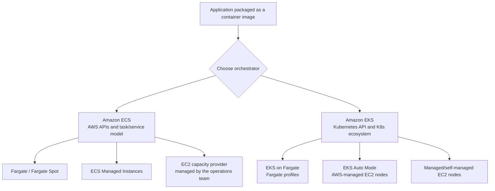
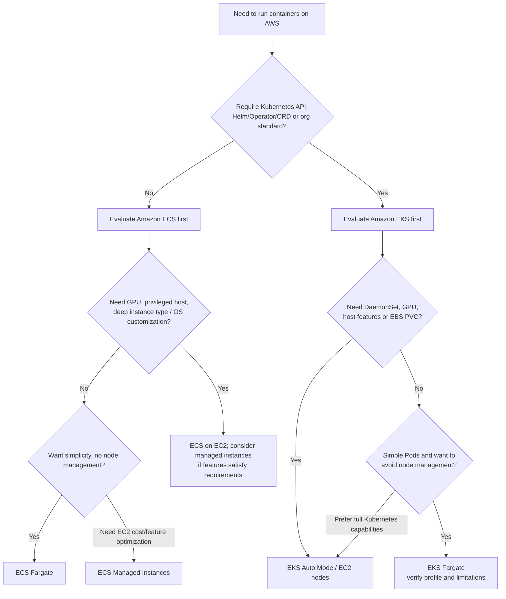
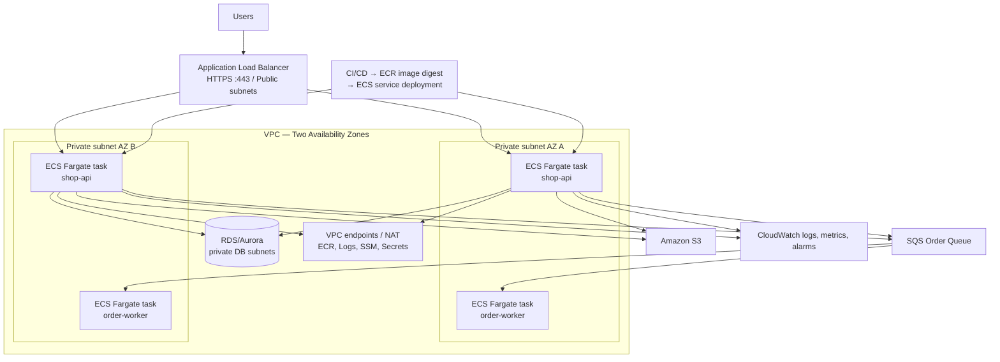
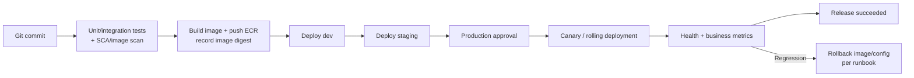
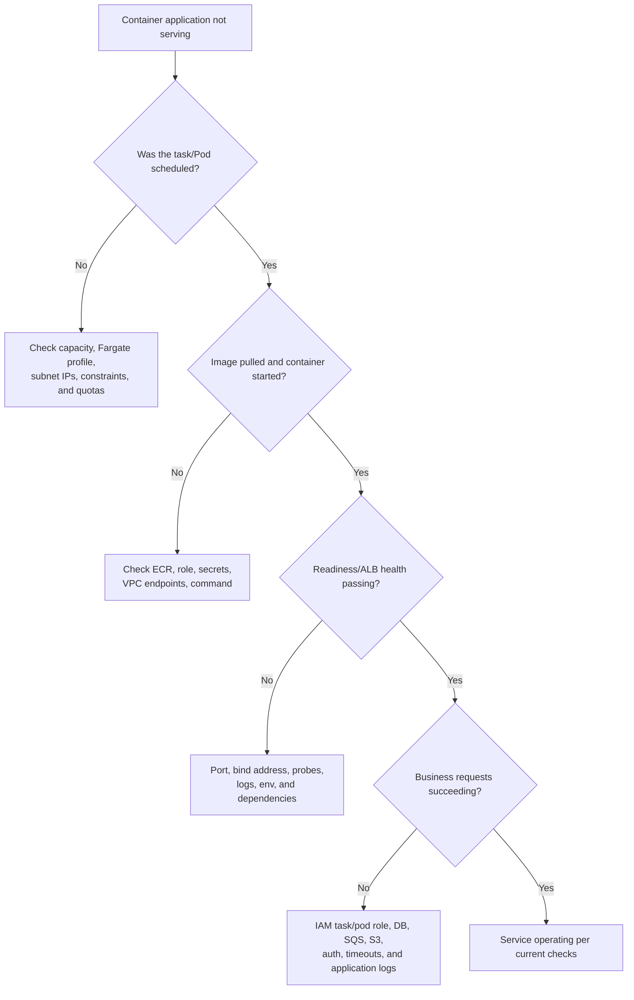

# Choosing ECS, EKS, and Fargate for Container Applications on AWS

When migrating an application from traditional servers to containers, development teams often encounter three service names: **Amazon Elastic Container Service (Amazon ECS)**, **Amazon Elastic Kubernetes Service (Amazon EKS)**, and **AWS Fargate**. All three relate to running containers, but they **do not sit at the same level of choice**. ECS and EKS are **container orchestration** platforms; Fargate is a **serverless compute** provisioning model that both ECS and EKS can use.

This lesson belongs to the **Containers with ECS** chapter of the **CLOUD_PROVIDERS_AWS** module. Within the AWS ecosystem—covering Region/Availability Zone, IAM, VPC, EC2, S3/EBS/EFS storage, databases, SQS/EventBridge integration, and serverless—choosing a container platform requires balancing **complexity, compute requirements, infrastructure control, security, monitoring, resilience, and cost**. The focus here is a methodology for **choosing ECS, EKS, and Fargate** based on real application context, rather than choosing based on technology popularity.

## 1. Learning Outcomes

After this lesson, learners will be able to:

1. Explain the difference between an **orchestrator (ECS/EKS)** and **compute capacity (Fargate/EC2/managed compute)**.
2. Choose between ECS and EKS based on operational experience, Kubernetes API/CRD/Helm requirements, tooling ecosystem, and deployment needs.
3. Choose Fargate, EC2, ECS Managed Instances, or EKS Auto Mode suited to the workload and host-control requirements.
4. Understand the concepts of **ECS cluster, task definition, task, service, capacity provider** and their counterparts **EKS cluster, Deployment, Pod, Service, node**.
5. Design secure containers in a VPC with IAM roles, security groups, private subnets, ALB, ECR, secrets, and logs.
6. Plan resources, autoscaling, update schedules, rollout strategies, resilience, and cost.
7. Analyze specific limitations such as Fargate not supporting GPUs or privileged workloads, and additional requirements when using Kubernetes.

## 2. Distinguishing Three Layers: Application, Orchestrator, and Compute Resources

Look at the problem through three questions:

| Decision Layer | Question | Example Choices |
|---|---|---|
| **Application** | Which image/container to run, how many replicas, and what resources/data are needed? | Java web API, Node.js worker, Python batch |
| **Orchestration** | Who decides where to place containers, maintain replicas, deploy, and handle service discovery? | **Amazon ECS** or **Amazon EKS** |
| **Compute** | How are CPU/RAM/nodes provisioned and managed? | **AWS Fargate**, **EC2**, **ECS Managed Instances**, **EKS Auto Mode** |

Therefore:

- **ECS + Fargate** is a complete architecture for running containers.
- **ECS + EC2** is also a complete architecture, where the operations team manages the EC2 machines.
- **EKS + Fargate** uses Kubernetes to orchestrate Pods on Fargate.
- **EKS + EC2 managed node groups**, or **EKS Auto Mode**, runs Pods on EC2 nodes with different levels of management.

There is no standalone architecture called "Fargate-only" without a corresponding orchestrator or supporting AWS service.

### 2.1. Two-Dimensional Decision Diagram



**Modern note:** alongside the two long-standing choices of Fargate and self-managed EC2, AWS has added **ECS Managed Instances** and **EKS Auto Mode**. They reduce node operations overhead, though they are not identical to Fargate. When a project requires Kubernetes or specialized hardware, evaluate these options rather than comparing only ECS Fargate and EKS EC2.

## 3. Amazon ECS: Container Orchestration the AWS Way

**Amazon ECS** is AWS's container orchestration service. Operators define a **task definition** (image, CPU, memory, ports, IAM, logs), and ECS maintains a **service** with the desired number of tasks or runs one-off tasks. ECS integrates with Elastic Load Balancing, AWS IAM, CloudWatch, ECR, EventBridge, and Auto Scaling.

### 3.1. Components of ECS

| Component | Meaning | Example |
|---|---|---|
| **Cluster** | Logical grouping of tasks/services and the capacity types used | `shop-prod-cluster` |
| **Task definition** | Versioned declaration of containers, images, resources, roles, and logs | `shop-api:14` |
| **Task** | A single execution of a task definition; can contain multiple containers in the same task | 1 API container + sidecar |
| **Service** | Maintains desired count, deploys new versions, and recovers failed tasks | `shop-api-service` running 3 tasks |
| **Capacity provider** | How ECS provisions/manages resources to run tasks | `FARGATE`, `FARGATE_SPOT`, EC2 ASG, managed instances |
| **Service Auto Scaling** | Adjusts desired count based on metrics or schedules | Scale from 3 to 8 tasks on high CPU |
| **Amazon ECR** | Registry storing container images | Image `shop-api:1.4.2` |

**An ECS task is not synonymous with an EC2 instance.** One EC2 instance can run multiple tasks in the EC2 model; a Fargate task receives managed compute resources without the user logging into the underlying host.

### 3.2. Why Is ECS Often Simpler for AWS-Only Teams?

ECS has a streamlined deployment model focused on AWS:

- Task definitions and ECS services replace Kubernetes manifests/controllers.
- An IAM **task role** lets the workload call S3/SQS/Secrets Manager; an IAM **task execution role** lets the ECS agent/runtime pull images, send logs, and fetch secrets needed at startup.
- Services can register targets with an **Application Load Balancer (ALB)**.
- CloudWatch Logs, EventBridge, and Service Auto Scaling integrate with ECS.
- Deployments can use the AWS CLI, AWS CDK/CloudFormation/Terraform, and CI/CD pipelines.

ECS fits well when an organization prioritizes **fewer orchestration components to design themselves**, the team is already familiar with AWS IAM/VPC, and there is no strong need for Kubernetes CRDs, Operators, or standard Kubernetes operational tooling.

### 3.3. ECS Compute Options

| ECS capacity | What AWS manages | What your team manages | When to consider |
|---|---|---|---|
| **ECS on Fargate** | Servers and underlying compute running tasks | Image, task definition, network config, IAM, security, app | Standard workloads, variable traffic, preference for lean operations |
| **ECS Fargate Spot** | Spot compute capacity for supported tasks | Interruption/restart-tolerant design, capacity strategy | Retryable batch/workers that do not need to run continuously |
| **ECS Managed Instances** | Provisioning, selection, scaling, patching, and lifecycle of service-managed EC2 instances by capability | Tasks, resource requirements, network/role config, application, cost | Want EC2 flexibility with less node administration overhead |
| **ECS on EC2 (ASG capacity provider)** | ECS service control plane; EC2 and Auto Scaling provided by AWS | AMI/OS, ECS agent, capacity scaling, patching, instance selection | GPUs, specific hardware, custom AMIs, privileged workloads |

When using ECS, **capacity providers** are usually a more flexible way to configure compute than setting only a launch type. An ECS cluster can have multiple capacity types, but a **capacity provider strategy** must follow the capacity provider combination rules supported by ECS; do not assume you can arbitrarily mix Fargate and EC2 groups in the same strategy.

## 4. Amazon EKS: Managed Kubernetes on AWS

**Amazon EKS** provides a Kubernetes control plane operated by AWS. Users interact via the Kubernetes API, `kubectl`, Helm, controllers, Deployment/Service/Ingress, and components of the Kubernetes ecosystem.

### 4.1. Kubernetes/EKS Concepts

| Component | Meaning | Approximate Comparison to ECS |
|---|---|---|
| **EKS cluster** | Kubernetes control plane, API, and cluster configuration components | ECS cluster (different orchestration model) |
| **Pod** | Smallest deployable unit in Kubernetes; can contain multiple containers | ECS task (similar only at the container-grouping level) |
| **Deployment** | Defines replicas, rolling rollouts, and desired Pod state | ECS service |
| **Kubernetes Service** | Stable network address to reach a set of Pods | Service discovery/load balancer integration |
| **Namespace** | Scope for resource names and many Kubernetes policies | No 1:1 counterpart in ECS |
| **Node** | Machine running Pods; can be EC2 or managed compute | EC2 container instance or abstracted compute infrastructure |
| **DaemonSet / Operator / CRD** | Operational and Kubernetes system extensions | No standard ECS counterpart |
| **Kubernetes RBAC** | Access control for the Kubernetes API | ECS IAM permissions differ in mechanism |

EKS is suitable when the application or organization already relies on the Kubernetes API: Helm charts, GitOps controllers, Custom Resource Definitions (CRDs), Operators, service meshes, policies, or a unified Kubernetes platform operated across multiple environments.

### 4.2. Which Parts of EKS Does AWS Manage?

AWS operates the EKS **Kubernetes control plane**. Users must still choose how to run **worker Pods**, and manage networking, IAM, images, applications, security configurations, and various add-ons/cluster components depending on the chosen compute model.

| Compute for EKS | Node/compute | Characteristics |
|---|---|---|
| **Managed node groups on EC2** | AWS assists in creating and updating node groups; workloads run on EC2 | You still manage configuration/versions, capacity, add-ons, and upgrade schedules per shared responsibility |
| **Self-managed EC2 nodes** | You manage node lifecycle more deeply | Flexible, higher operational effort |
| **EKS Auto Mode** | AWS manages EC2 nodes and many cluster infrastructure components via Auto Mode | Still uses Kubernetes; has restrictions on operations on AWS-managed nodes |
| **EKS on Fargate** | AWS provisions compute for Pods matching a Fargate profile | No EC2 host management, but subject to Fargate/Kubernetes limitations |

**EKS Auto Mode is not another name for Fargate.** Auto Mode uses **AWS-managed EC2 instances**, supporting many common node capabilities such as Spot/GPU options within AWS-supported bounds. EKS on Fargate runs Pods on the Fargate model, which has a different set of limitations. When fuller compatibility with Kubernetes primitives/agents is required, compare Auto Mode or EC2 nodes against EKS Fargate.

### 4.3. Trade-offs of EKS

Kubernetes has a large ecosystem and standardized configuration model, but EKS requires understanding additional areas:

- Kubernetes API/RBAC, Namespaces, and Service Accounts.
- CNI, DNS, CoreDNS, Services, Ingress/Gateway, and ALB/NLB integration.
- Add-ons, Controllers, version compatibility, and Kubernetes upgrade cycles.
- CSI storage, PersistentVolume/Claim, and volume limitations.
- Pod scheduling, requests/limits, HPA, and node provisioning.
- Pod/Node/control plane observability, admission policies, and runtime security standards.

**Do not choose EKS just because an application has many microservices.** ECS can also run many microservices. Only choose EKS when the benefits of the Kubernetes API/ecosystem or organizational standards outweigh the operational cost and complexity.

## 5. AWS Fargate: A Compute Model Used with Either ECS or EKS

**AWS Fargate** lets you run containers without the development team provisioning, patching, or logging into EC2 worker hosts. Users declare requested resources (CPU, memory, and certain storage attributes depending on the platform), VPC/subnets/security groups, and the image; AWS manages the underlying infrastructure.

That **does not mean the application requires zero operations**. The development team must still update container images, patch libraries/runtimes, restrict IAM permissions, protect data, configure autoscaling, set up health checks, and monitor costs.

### 5.1. Fargate in ECS vs. Fargate in EKS

| Criterion | ECS Fargate | EKS Fargate |
|---|---|---|
| Deployment unit | **ECS task** | **Kubernetes Pod** |
| Resource declaration | Task definition CPU/memory and container settings | Kubernetes Pod resources and Fargate sizing rules |
| Run selection | ECS service/task with Fargate capacity provider | Pod matches a **Fargate profile** by namespace/labels |
| Workload AWS permissions | IAM **task role** | Typically **IAM Roles for Service Accounts (IRSA)** for Fargate Pods |
| Service routing | ECS service + ALB/NLB/Cloud Map as appropriate | Kubernetes Service/Ingress and AWS integration |
| Host OS/daemon | No host SSH; no privileged/host access | No DaemonSet/privileged/HostNetwork on Fargate |
| Spot compute | **ECS Fargate Spot** available when requirements are met | **EKS Fargate Spot is not supported** |
| GPU | Do not use Fargate for GPU workloads | EKS Fargate also does not support GPUs |

Fargate enforces runtime isolation and does not grant customers host access. For workloads requiring privileged Docker-in-Docker, kernel modules, host/GPU devices, or agents requiring a DaemonSet, evaluate EC2-based compute instead of trying to hack manifests to run on Fargate.

### 5.2. Specific Limitations of EKS Fargate

- A Pod must match a **Fargate profile** at scheduling time; unmatched Pods can remain `Pending` if no other suitable node exists.
- Fargate runs only in appropriately configured **private subnets**; it needs network paths to AWS APIs, ECR, logs, and repositories according to the architecture.
- **DaemonSets, privileged containers, HostPort, HostNetwork, and GPUs** are not supported as they are on EC2 nodes.
- **Amazon EBS volumes cannot be attached directly to Fargate Pods**; Amazon EFS can be used within the limits and configuration patterns supported by EKS Fargate.
- **EKS Pod Identity** is currently not supported for Pods on Fargate because its agent component requires supported node types; **IRSA** is typically the mechanism for attaching IAM roles to Fargate Pods.
- There is no **Fargate Spot** for EKS; do not design EKS Fargate as a Spot replacement for EC2 Spot.

Limitations depend on version/Region and may evolve on AWS; always verify against the EKS Fargate documentation for the actual Region and use case.

### 5.3. When Fargate Is a Sensible Choice

Fargate is typically advantageous when:

1. A small team wants to deploy APIs/workers quickly without administering AMIs, kernels, or EC2 Auto Scaling Groups.
2. Traffic is uneven, making it preferable to pay for actual task/Pod resources rather than keeping idle EC2 capacity.
3. Workloads do not require host privileges, GPUs, or storage types unsupported by Fargate.
4. The organization accepts trading some host-level control for reduced maintenance overhead.

Do not treat Fargate as an absolute rule for every workload. **Large steady loads**, kernel configuration requirements, bin-packing optimization opportunities, or using EC2 Reserved Instances/Savings Plans/Spot can make EC2 or managed EC2 compute more economical and suitable.

## 6. Decision Matrix for ECS, EKS, Fargate, and EC2

### 6.1. Choose the Orchestrator First

| Criterion | ECS | EKS |
|---|---|---|
| Declaration style | ECS task definitions, services, AWS APIs | Kubernetes manifests, Deployment, Pod, Service, Helm |
| Learning curve | Usually fewer concepts if using AWS only | Requires understanding Kubernetes control plane, API, networking, add-ons |
| Ecosystem | Deep integration with AWS and ECS tooling | CRDs, Operators, Helm, GitOps, Kubernetes ecosystem |
| Portability across Kubernetes platforms | Must convert the ECS model when leaving AWS | Kubernetes API is standardized, though manifests may still depend on cloud services |
| Authorization | IAM roles/identity policies attached to ECS workloads and service APIs | IAM + Kubernetes RBAC, service accounts, IRSA/Pod Identity |
| Control plane operations | AWS operates ECS | AWS operates the EKS control plane; users administer many Kubernetes configurations |
| Orchestration cost | ECS has no separate orchestration fee under standard ECS usage; compute and supporting services are billed | EKS has a **cluster fee** per pricing/version lifecycle policies, in addition to compute and add-ons |
| When to choose | AWS-native APIs, workers, scheduled tasks; small teams or reducing operational overhead | Already using Kubernetes, Operators/CRDs, GitOps/Helm, or a multi-team platform standard |

**Scope of Kubernetes "portability":** using Kubernetes lets you reuse many concepts and manifests, but you can still depend on **AWS Load Balancer Controller, IAM, EBS/EFS CSI, VPC CNI, S3, and Secrets Manager**. Do not promise that moving EKS to another cloud only requires changing an endpoint.

### 6.2. Choose Compute Within the Orchestrator

| Requirement | ECS Fargate | ECS Managed Instances | ECS Self-Managed EC2 | EKS Fargate | EKS Auto Mode / EC2 |
|---|---|---|---|---|---|
| Zero server management | Very well suited | AWS manages instance lifecycle | No | Very well suited | Auto Mode has AWS node management; self-managed EC2 requires operations |
| Kubernetes API | No | No | No | Yes | Yes |
| GPU / host privileged | Not suitable | Verify supported instance types/features | Can be suitable | No | EC2/Auto Mode suitable within feature limits |
| DaemonSet / Operator | Does not use Kubernetes | Does not use Kubernetes | Does not use Kubernetes | DaemonSet not supported | More Kubernetes options available |
| Variable traffic | Good | Good with auto capacity | Must scale EC2 capacity | Good | Good with properly configured node autoscaling |
| Idle node cost | No dedicated app EC2 nodes kept running | Depends on compute management and workload | May pay for idle EC2 | No dedicated app EC2 nodes kept running | Depends on nodes/Auto Mode choices |
| Spot | ECS Fargate Spot | Per current options/policies | EC2 Spot | No EKS Fargate Spot | EC2 Spot/Auto Mode where supported |
| OS/AMI customization | Limited | AWS manages OS/AMI with customization limits | Flexible | Limited | Self-managed EC2 is more flexible; Auto Mode has limits |

Use the matrix to **eliminate options that fail hard requirements** before comparing costs. For example, a GPU workload cannot choose Fargate and "configure it later" for GPU; you must move to a compute option that actually supports that hardware and driver.

### 6.3. Practical Decision Tree



The tree above is a starting point, not an automated decision. After selecting a candidate, verify **service availability by Region, CPU architecture (x86/ARM), security restrictions, storage, concurrency, observability, and total cost of ownership (TCO)**.

## 7. Example ECS Fargate Architecture for an E-Commerce Application

Suppose a system has a REST API `shop-api` and an order-processing worker `order-worker`. The API communicates with RDS, S3, and SQS. An ECS Fargate design looks like this:



**Deployment and operational flow:**

1. CI builds a tested container image, scans dependencies, and pushes it to **Amazon ECR**.
2. CI updates the ECS task definition revision referencing the image by **digest** or a controlled immutable tag.
3. The ECS service runs the desired number of tasks and registers task IPs/ports into the ALB target group.
4. When a task fails or a container exits, the ECS service attempts to bring the task count back to the desired count per policy.
5. Service Auto Scaling scales tasks up/down from CloudWatch metrics or SQS signals as configured.
6. The app accesses S3/SQS/Secrets Manager via the **task role** with least privilege; startup image pulls and logging are handled by the **execution role**.

### 7.1. Why Do Private Subnets Still Need Outbound Connectivity?

An ECS Fargate task in a private subnet still needs to pull images from ECR, write logs, and read secrets. In a VPC without NAT, you must configure **appropriate VPC endpoints** (such as ECR API, ECR Docker Registry, S3, CloudWatch Logs, Secrets Manager/SSM when used) with proper routes, SGs, private DNS, and IAM permissions.

Do not conclude that "private subnet" means no outbound network is needed. Each task needs a path to its required dependencies and endpoints; missing outbound paths can cause tasks to stall in `PENDING` or transition to `STOPPED` before the application even starts.

### 7.2. Fargate Tasks Have Their Own Network Identity

With ECS Fargate, tasks use the `awsvpc` network mode and receive an ENI/IP in the selected subnet. The task's security group can enforce:

| Security group | Ingress | Egress |
|---|---|---|
| `sg-alb` | TCP 443 from Internet/allowed sources | TCP 8080 to `sg-shop-api` |
| `sg-shop-api` | TCP 8080 from `sg-alb` | DB port to `sg-db`, HTTPS to required AWS services |
| `sg-db` | DB port from `sg-shop-api` | Per DB service/valid requirements |

The `order-worker` does not need an inbound port opened from the ALB; it polls messages from SQS using IAM permissions. For systems with many tasks, plan enough **IP addresses in subnets**; running out of free IPs can cap scale-out even when CPU quotas remain available.

## 8. Networking Comparison Between ECS and EKS

| Aspect | ECS (especially Fargate) | EKS |
|---|---|---|
| Network resource attachment | Task ENI in `awsvpc` mode, SG per task | Pod IP via CNI, node networking; Fargate Pods have their own network model |
| Service discovery | ECS Service Connect, Cloud Map, ALB/NLB when needed | Kubernetes Service/CoreDNS/Ingress; integrates with ALB/NLB |
| HTTP Ingress | ECS service + ALB target group | Kubernetes Ingress/Gateway + appropriate controller, or Service of type LoadBalancer |
| Network policy | SG/VPC/NACL and related ECS mechanisms | Kubernetes NetworkPolicy if supported by the CNI/engine; plus SG/VPC |
| Control plane access | IAM permissions on ECS APIs | IAM/EKS access entries and Kubernetes RBAC |
| DNS | VPC DNS + AWS Cloud Map/Service Connect | CoreDNS for `*.svc.cluster.local` + VPC DNS |

**Do not assume Kubernetes NetworkPolicy is enforced automatically** on every EKS cluster. This capability depends on Amazon VPC CNI configuration or a deployed network policy engine, version, and support scope. Likewise, using namespaces does not automatically create a hard network boundary between tenants.

### 8.1. Choosing Private vs. Public Subnets

- **Internet-facing ALBs** typically reside in public subnets with proper routes to an Internet Gateway.
- **Application/container tasks or worker Pods** typically reside in private subnets unless they must receive direct Internet traffic.
- **Databases** reside in isolated subnets with restricted access paths and permissions.
- **NAT/VPC endpoints** provide egress as needed, balancing cost and network exposure.
- **Multi-AZ** reduces the risk of a single AZ failure; deploy enough replicas and configure corresponding scheduling/placement constraints.

With EKS, a Pod created in a namespace can be placed on any matching node/subnet if the scheduler and node configuration allow it. You must understand **Pod placement, topology spread constraints, taints/tolerations, and node selectors** when HA or compliance requirements apply.

## 9. IAM and Workload Security

### 9.1. ECS: Task Execution Role vs. Task Role

| Role | Who uses it? | Example permissions |
|---|---|---|
| **Task execution role** | ECS agent/runtime during task preparation/execution | Pull ECR images, send CloudWatch logs, read startup-referenced secrets when applicable |
| **Task role** | Application code inside the container | `s3:GetObject` on a specific prefix, `sqs:ReceiveMessage` on a specific queue, read needed secrets |
| **CI/CD deploy role** | Pipeline registering task definitions, updating ECS services | `ecs:RegisterTaskDefinition`, `ecs:UpdateService`, scoped `iam:PassRole` for relevant roles |

Do not confuse the role used to **pull images/send logs** with the role the application uses to call AWS APIs. If a task role has `AdministratorAccess`, an RCE vulnerability in the application can turn into broad AWS access, even though Fargate isolates the host.

### 9.2. EKS: IAM for AWS APIs and RBAC for the Kubernetes API

EKS has two control paths:

1. **Users/CI accessing the Kubernetes API**: authenticated via IAM/EKS access configuration and authorized via Kubernetes RBAC/access policies per cluster configuration.
2. **Applications inside Pods calling AWS services**: use a workload IAM role, typically **EKS Pod Identity** on supported nodes or **IRSA** when OIDC federation is needed.

For example, an API in a Pod needs to read a secret from Secrets Manager. A Kubernetes Service Account only identifies the workload inside Kubernetes; to call AWS APIs, you must configure the mechanism that issues temporary AWS credentials and attach a policy allowing only that secret.

**Important limitation:** EKS Pod Identity does not support Fargate Pods; if running Fargate Pods, check **IRSA** and the **Fargate pod execution role** permissions used for infrastructure operations. Never use the pod execution role for application business permissions.

### 9.3. Image and Secret Controls

- Push images to ECR from CI using short-lived roles and scan images/dependencies according to policy.
- Prefer **image digests** over untraceable `latest` tags; never manually patch images running in production.
- Never embed AWS access keys, DB passwords, or private keys in Dockerfiles, image layers, or unprotected environment variables.
- Use Secrets Manager or SSM Parameter Store appropriately; on Kubernetes, CSI/External Secrets can be used where permissions and features are supported.
- Encrypt EBS/EFS/S3 and stateful resources as required; scope KMS key policies to the actual principals using the data.
- Run containers as a non-root user whenever possible, drop Linux capabilities, use a read-only root filesystem where the application allows, and minimize unnecessary runtime packages.
- Enforce security groups, least-privilege IAM, CloudTrail auditing, and review `iam:PassRole` and deployment role permissions.

**Fargate reduces host management, not image patching for images you supply.** If your image contains a Java, OpenSSL, or Node.js library with a CVE, the application team must rebuild, test, and redeploy a new image.

## 10. Declaring an Application with an ECS Task Definition

Suppose a Java REST API listens on TCP 8080 and needs 0.5 vCPU and 1 GiB RAM per replica. With **ECS Fargate**, a sample task definition could be:

```json
{
  "family": "shop-api",
  "networkMode": "awsvpc",
  "requiresCompatibilities": ["FARGATE"],
  "cpu": "512",
  "memory": "1024",
  "executionRoleArn": "arn:aws:iam::111122223333:role/shop-task-execution",
  "taskRoleArn": "arn:aws:iam::111122223333:role/shop-api-task-role",
  "containerDefinitions": [
    {
      "name": "shop-api",
      "image": "111122223333.dkr.ecr.ap-southeast-1.amazonaws.com/shop-api@sha256:<IMAGE_DIGEST>",
      "essential": true,
      "portMappings": [
        {
          "containerPort": 8080,
          "protocol": "tcp"
        }
      ],
      "environment": [
        {
          "name": "APP_ENV",
          "value": "production"
        }
      ],
      "logConfiguration": {
        "logDriver": "awslogs",
        "options": {
          "awslogs-group": "/ecs/shop-api",
          "awslogs-region": "ap-southeast-1",
          "awslogs-stream-prefix": "api"
        }
      }
    }
  ]
}
```

**This is a teaching example:** replace the Account ID, role ARNs, ECR repository, and `<IMAGE_DIGEST>` with real values; the log group must already exist or be permitted for creation by policy; the image must match the corresponding CPU architecture and OS. Total CPU/memory in the definition must be a Fargate-supported combination. When an application has a sidecar, containers in the same task share task resources and can communicate over `localhost`.

### 10.1. A Task Definition Is Not Yet an ECS Service

A task definition is only a **blueprint**. To keep an API continuously available, you must create an **ECS service** pointing to a task definition revision:

- Cluster `shop-prod-cluster`.
- Service `shop-api` with `desiredCount=3`.
- Capacity provider `FARGATE` or the corresponding strategy.
- VPC subnets across at least two AZs and security group `sg-shop-api`.
- An ALB target group with the target type appropriate for Fargate task IPs.
- Deployment health checks/circuit breaker suited to requirements.

If you only run a task via `RunTask` without an ECS service, the task can finish or stop without automatically recovering to a desired count like a service. Conversely, **batch workers** or scheduled jobs can intentionally use `RunTask` via EventBridge Scheduler instead of keeping a service running continuously.

### 10.2. Inspecting Deployment Status via AWS CLI

Example **read-only** commands:

```bash
aws ecs describe-services \
  --cluster shop-prod-cluster \
  --services shop-api \
  --region ap-southeast-1

aws ecs list-tasks \
  --cluster shop-prod-cluster \
  --service-name shop-api \
  --region ap-southeast-1

aws ecs describe-tasks \
  --cluster shop-prod-cluster \
  --tasks "<TASK_ARN>" \
  --region ap-southeast-1
```

When debugging deployments, check `desiredCount`, `runningCount`, `pendingCount`, service events, task `stoppedReason`, container exit codes, and ALB target health. A task status of `RUNNING` **does not guarantee the business endpoint is working properly**; application readiness/health checks are still required.

## 11. Declaring the Equivalent Application on EKS

With EKS, the same application can be described using a Kubernetes **Deployment** and **Service**:

```yaml
apiVersion: apps/v1
kind: Deployment
metadata:
  name: shop-api
  namespace: shop
spec:
  replicas: 3
  selector:
    matchLabels:
      app: shop-api
  template:
    metadata:
      labels:
        app: shop-api
    spec:
      serviceAccountName: shop-api
      containers:
        - name: shop-api
          image: 111122223333.dkr.ecr.ap-southeast-1.amazonaws.com/shop-api@sha256:<IMAGE_DIGEST>
          ports:
            - containerPort: 8080
          resources:
            requests:
              cpu: "500m"
              memory: "1Gi"
            limits:
              memory: "1Gi"
          readinessProbe:
            httpGet:
              path: /ready
              port: 8080
            initialDelaySeconds: 5
            periodSeconds: 10
          livenessProbe:
            httpGet:
              path: /health
              port: 8080
            initialDelaySeconds: 20
            periodSeconds: 15
---
apiVersion: v1
kind: Service
metadata:
  name: shop-api
  namespace: shop
spec:
  selector:
    app: shop-api
  ports:
    - name: http
      port: 80
      targetPort: 8080
  type: ClusterIP
```

This is an **example illustrating Kubernetes mechanics**, not a standalone manifest bundle deployable into every cluster. You must create namespace `shop`, ServiceAccount `shop-api` with appropriate IAM permissions, image pull permissions, and networking/ingress infrastructure. To expose the API publicly, configure the appropriate controller and ingress/load balancer.

**If running on EKS Fargate**, the Pod must also match namespace/label selectors in a **Fargate profile**. Pod sizing on Fargate has specific CPU/memory rules and overhead; the `requests/limits` in this YAML illustrate Kubernetes concepts and do not guarantee Fargate will allocate exactly 0.5 vCPU and 1 GiB for any arbitrary combination.

### 11.1. EKS Inspection Commands

```bash
kubectl get deployments,pods,services -n shop
kubectl describe deployment shop-api -n shop
kubectl get pods -n shop -o wide
kubectl logs deployment/shop-api -n shop --tail=100
```

Run these on a machine with `kubectl`, kubeconfig, and valid Kubernetes API permissions. When a Pod is Pending, inspect `kubectl describe pod`, scheduling events, node capacity, or Fargate profiles; when a Pod is Running but not Ready, check the readiness probe, dependencies, and application logs.

### 11.2. Why Do the Two Manifests Differ?

ECS defines resources in terms of **tasks/services and AWS APIs**. EKS follows the **Kubernetes object model**, where controllers reconcile desired state. There is no automated translation that preserves all behaviors between an ECS task definition and a Kubernetes Deployment—especially role mapping, networking, service discovery, scheduling, and storage.

## 12. Autoscaling and Availability

### 12.1. Scaling Layers to Distinguish

| Layer | ECS | EKS |
|---|---|---|
| Scale application replicas | ECS Service Auto Scaling adjusts desired task count | Horizontal Pod Autoscaler (HPA) adjusts replicas |
| Scale host capacity | Fargate provisions compute via AWS; EC2 ASG capacity provider or managed instances | EKS Fargate provisions per Pod; managed node groups with autoscaler/Karpenter or EKS Auto Mode |
| Event-driven scaling | SQS queue depth, CloudWatch metrics, custom metrics | HPA metrics, KEDA, or appropriate controllers |
| Version rollout | ECS deployment circuit breaker, rolling update/blue-green per solution | Kubernetes rolling update, readiness probes, progressive delivery with tooling |

**Application autoscaling is different from node autoscaling.** On ECS EC2 or EKS EC2, even if the service/HPA asks for more tasks/Pods, if the cluster lacks EC2 capacity, workloads can stay Pending. Design both scaling loops to coordinate and account for EC2 boot/warmup time.

### 12.2. Choosing the Right Metric for the Problem

- **Web API:** CPU, memory, request count per target, latency, connection count, or business metrics.
- **SQS worker:** queue backlog per worker, age of oldest message, processing time per message, and retry behavior.
- **Scheduled batch:** job count, deadline, required vCPU/RAM, startup time, and parallelism limits.
- **WebSocket/long requests:** connection count, drain time, and graceful shutdown—not just CPU.

For example, suppose a queue has 20,000 messages and each worker processes 100 messages/minute on average. To clear the queue in 10 minutes with no new messages arriving, ideally at least 20 workers are needed (20,000 / 100 / 10). In practice, allow margin for retries, variable job sizes, startup time, and downstream API rate limits.

### 12.3. Multi-AZ Is Not Enough with Only One Replica

An ECS service configured with subnets in two AZs but `desiredCount = 1` still runs only one task at a time. Similarly, an EKS Deployment with `replicas = 1` has no application HA if that Pod or AZ fails. To improve availability:

1. Run enough replicas to tolerate losing a task/Pod/node.
2. Spread tasks/Pods across AZs according to scheduling/placement capabilities and actual capacity.
3. Use health checks/readiness probes so the load balancer sends traffic only to healthy instances.
4. Configure graceful shutdown/draining to finish in-flight requests.
5. Avoid single points of failure in databases, queue consumer checkpoints, secrets/DNS, or third-party integrations.

ECS and EKS maintain **desired state**; they do not promise zero downtime if too few replicas are deployed, probes are misconfigured, or backend dependencies fail.

## 13. Stateful Workloads, Storage, and Special Requirements

Web apps are usually easy to containerize because they are stateless; databases, machine learning, and systems needing host access often require additional design.

| Workload | Option to Consider | Reason |
|---|---|---|
| Stateless REST API | ECS Fargate or EKS per organizational standard | Easy to replicate, ALB, autoscaling |
| Retryable SQS worker | ECS Fargate, Fargate Spot, or EKS with suitable nodes/Spot | Scales by backlog, idempotent design |
| Short scheduled job | ECS RunTask/Fargate or Kubernetes Job/CronJob | No need to keep a continuously listening service |
| GPU inference/training | ECS EC2 or EKS EC2/Auto Mode with supported GPU types | Fargate does not have GPUs |
| Log/monitoring daemon on every node | ECS EC2 agent if host access is truly needed; EKS EC2/Auto Mode with DaemonSet as supported | EKS Fargate does not suit DaemonSets |
| Database needing persistent block volumes | Usually prefer managed services like RDS/DynamoDB; if self-managed is mandatory, consider EC2/EKS EC2 + storage | Stateful operations require backups, availability, CSI, and lifecycle management |
| Shared files across multiple replicas | S3 for objects; EFS when shared POSIX filesystem is required and supported | Never store critical data only in container ephemeral filesystems |
| Apps needing custom kernel/privileged runtime | Appropriate ECS EC2 or EKS nodes | Fargate restricts host privileges |

### 13.1. What Storage Types Does Fargate Have?

- **Ephemeral storage** is for working files/caches within Fargate limits/options; it disappears with the task/Pod lifecycle and should not hold durable business data.
- **Amazon EFS** can satisfy certain shared filesystem needs using each platform's supported integration; verify IAM, EFS Access Points, mount/network SGs, and cost.
- **Amazon S3** fits objects such as images, documents, and exported reports; S3 is not a POSIX filesystem equivalent to a mounted disk inside a container.
- **Amazon EBS** typically fits EC2/EKS EC2 applications with specific volume mechanisms; **EKS Fargate Pods cannot attach EBS directly**.

If consistency and transactions are primary requirements, consider moving state to **RDS/Aurora/DynamoDB** rather than forcing containers to carry persistent disks through their lifecycle.

### 13.2. CPU Architecture and Image Compatibility

EC2 and Fargate support different architecture/OS combinations depending on service/Region/platform version. If an image is built only for `linux/amd64`, you cannot arbitrarily move the workload to `arm64` Graviton nodes. Pipelines should build multi-arch images when needed, specify platforms explicitly, and test native/JNI libraries.

Windows containers also have platform, version, and pricing limitations that differ from Linux containers. Verify feasibility against AWS documentation for each orchestrator/compute mode.

### 13.3. Do Not Put a Production Database into an Ad-Hoc Task

Placing PostgreSQL in a single ECS task/Pod with temporary storage ties data durability and availability to the container lifecycle. If you choose to self-manage a database, you must handle replication, backup/restore, persistent storage, security, service discovery, and failure recovery. For most business applications on AWS, managed database services are the sensible starting point.

## 14. Cost and Total Cost of Ownership (TCO)

When comparing ECS, EKS, and Fargate, calculate the **total cost of the complete architecture**, not just vCPU/hour rates. Two workloads using the same 2 vCPU and 4 GiB RAM can differ significantly due to:

- Actual running tasks/Pods and average CPU/memory utilization.
- Extra compute headroom reserved for AZ failures, rolling deployments, or traffic spikes.
- EKS cluster/control plane fees, node management, compute mode, and version lifecycle policies.
- Density of packing multiple tasks/Pods onto one EC2 instance (bin packing).
- Additional EBS/EFS/ephemeral storage, CloudWatch logs, NAT/VPC endpoints, and data transfer.
- Platform team operational effort for nodes/clusters, security, upgrades, and incident response.

### 14.1. Cost Structure by Model

| Option | Main Billable Components | Characteristics to Understand |
|---|---|---|
| **ECS Fargate** | vCPU + memory for task runtime, ephemeral storage above included allowance per pricing; network/logs separate | No EC2 capacity kept running when tasks are not running |
| **ECS Fargate Spot** | Spot task resources at current pricing and terms | Can be interrupted; optimal for retryable workloads |
| **ECS on EC2** | EC2 instance hours/usage, EBS, data transfer, logging | Can optimize with Reserved/Spot/placement, but pays for idle node capacity |
| **ECS Managed Instances** | EC2 compute and associated managed compute charges per applicable pricing, plus storage/network | AWS helps manage nodes; compare total cost and capabilities |
| **EKS Fargate** | EKS cluster fee + Fargate Pod compute and supporting services | No Fargate Spot for EKS |
| **EKS managed/self-managed nodes** | EKS cluster fee + EC2/EBS + add-ons/network/logs | Involves operational effort for node upgrades, Kubernetes add-ons, and security |
| **EKS Auto Mode** | EKS cluster fee + EC2 compute + Auto Mode/managed capability fees and supporting resources | Trades some node control for automated management |

**Do not plug a fixed unit price from a lesson into production estimates.** Prices and fee types vary by Region, configuration, time, usage, and service. Check the AWS Pricing Calculator, Cost Explorer, and current pricing pages for the exact architecture.

### 14.2. Illustrative Calculation Model

Suppose an API needs **6 continuously running tasks**, each requiring **0.5 vCPU / 1 GiB**:

```text
Logical demand when 6 tasks run:
  Total vCPU required   = 6 × 0.5 = 3 vCPU
  Total memory required = 6 × 1   = 6 GiB
  Task-hours in 30 days = 6 × 24 × 30 = 4,320 hours
```

With ECS Fargate, compute cost is approximated from the **actual provisioned resources per task** and runtime duration per billing rules. With ECS EC2, you must pick enough EC2 instances to schedule 6 tasks, accounting for OS/agent overhead and headroom if an AZ/node fails. For example, a single EC2 instance with barely 3 usable vCPUs will not meet HA goals even if it looks cheaper on a spreadsheet.

To make a decision, model at least three scenarios:

1. **Average:** 6 continuous replicas.
2. **Peak:** 18 replicas for 2 hours/day.
3. **Failure:** losing one AZ while still meeting the SLO.

Add costs for ALB, ECR, logs, NAT/endpoints, databases, and operations staff. If traffic is variable, Fargate often wins by eliminating idle compute; if traffic is very steady, EC2 or managed EC2 capacity can optimize well once bin packing and actual pricing discounts are factored in.

### 14.3. Hidden Risks in Cost Optimization

| Measure | Benefit | Risk if Applied Blindly |
|---|---|---|
| Use Spot for workers | Reduces compute cost per current availability | Workers must be idempotent and tolerate termination/interruption |
| Reduce production min replicas | Reduces idle resources | Loss of HA, cold starts, or insufficient capacity during spikes |
| Pick large EC2 instances | Savings per unit of compute purchased | Creates a large blast radius if one node fails |
| Increase Pod/task density per node | Fewer nodes | Increases contention, hurting latency and failure domains |
| Share one NAT Gateway across AZs | Can reduce component cost | Single point of failure/cross-AZ risk and data transfer charges to evaluate |
| Share one EKS cluster across environments | Fewer cluster fees | Wider blast radius for misconfigurations, incidents, and permissions |

Cost is one pillar of the **AWS Well-Architected Framework**, and should always be evaluated alongside Reliability, Security, Performance Efficiency, and Operational Excellence.

## 15. Observability, Auditing, and Operations

### 15.1. Data Sources to Monitor

| Objective | ECS | EKS |
|---|---|---|
| Workload status | ECS service events, task states/exit codes | Pod events, Deployment conditions, node conditions |
| Application logs | CloudWatch Logs via `awslogs`/FireLens as configured | Fluent Bit/OpenTelemetry/CloudWatch or suitable log stack |
| Application metrics | CloudWatch/Application Signals/OpenTelemetry | Prometheus/CloudWatch/OpenTelemetry, metrics-server/HPA |
| Ingress | ALB/NLB 4xx/5xx, target health, latency | ALB/NLB + controller/Ingress metrics and Kubernetes events |
| Compute | Fargate task CPU/memory; EC2 host when using nodes | Pod/container requests/limits, node CPU/memory, scheduling |
| AWS API audit | CloudTrail for ECS/IAM/ALB/ECR changes | CloudTrail for EKS/AWS APIs + Kubernetes audit logs if configured |
| Security | ECR/Inspector findings, IAM, image scans | Image scanning, Kubernetes audit, RBAC/admission, node controls |
| Cost allocation | Cost Explorer/CUR, ECS tags, and accounts | Cost Explorer/CUR, cluster/node/workload labels, and proper allocation |

**CloudTrail does not store container stdout.** It records AWS API events by type/scope. ECS task logs and Kubernetes Pod logs need their own collection pipeline, retention rules, and access controls.

### 15.2. Sample Operational Metrics and Alerts

For Shop API, a dashboard can include:

- **Request success rate**, HTTP 5xx, and p95/p99 latency.
- **Healthy tasks/Pods** compared to desired replicas.
- CPU/memory usage, OutOfMemory/exit codes/restarts.
- ECS deployment failures or EKS Pending/CrashLoopBackOff.
- ALB target health by AZ and new target registration time.
- SQS queue backlog, age of oldest message, and worker errors.
- RDS connections/errors and downstream dependency latency.
- Compute, log ingestion, NAT/data transfer costs, and anomaly alerts.

A single "CPU > 80%" alert is not enough to diagnose failures. Combine **application SLOs**, runtime metrics, and dependency health to decide whether to scale, roll back, or fix configuration.

### 15.3. Incident Logs and Emergency Access

ECS supports mechanisms like **ECS Exec** in appropriate scenarios to inspect containers, requiring explicit opt-in/permissions and logging management. EKS uses `kubectl logs/describe/exec` governed by RBAC and organizational policy. Both require:

1. Strict production admin permissions, preferring short-lived access.
2. Logging actions and sessions where supported, understanding each audit mechanism's limits.
3. Avoiding live edits inside production containers that vanish when tasks/Pods are replaced.
4. Having runbooks defining who may restart, scale, redeploy, and roll back.

**Manual edits inside a container are never a durable deployment method.** New containers must be built from reviewed/IaC-managed images and configurations.

## 16. Safe Deployment and Recovery Design

### 16.1. Build Once, Promote Across Environments



**The exact same image digest** should be promoted across dev, staging, and production; each environment uses its own secrets, endpoints, and resource limits. Rebuilding the image per environment risks running a production binary that differs from what was tested in staging.

### 16.2. Essential Rollout Steps

| Step | ECS | EKS |
|---|---|---|
| Version declaration | Task definition revision | Deployment manifest/Helm release version |
| Concurrency limits | ECS deployment configuration, min/max healthy percentages per mechanism | RollingUpdate `maxUnavailable`/`maxSurge`, PDB where appropriate |
| Readiness | ALB target health, container health check | Readiness probe, Service endpoints, ALB where present |
| Canaries | Service/traffic routing per solution | Deployment/controller/Ingress progressive rollout |
| Rollback | Select prior task definition revision/image, revert service config | `kubectl rollout undo` or Helm/GitOps rollback per policy |
| Data protection | Backward-compatible migrations and backups | Same; rolling back the app does not roll back schemas |

**Passing health checks does not guarantee catching all regressions.** Verify end-to-end business flows such as "create order → simulated payment → enqueue SQS → update status" and monitor the error budget after release.

### 16.3. Risks When an AZ or Region Fails

- Replicas must be distributed across **AZs that actually have capacity**.
- The ALB must retain active healthy targets and network routes to the DB/queue.
- For EC2-based compute, node autoscaling needs sufficient quotas and fallback instance types.
- For Fargate, design subnets with sufficient IPs and account for regional/AZ capacity and limits.
- For applications requiring full Region recovery, design **multi-Region** ECR, clusters/services, DNS, data, and backups; ECS/EKS do not provide cross-Region DR automatically.

Do not equate "AWS manages the control plane" with AWS designing application SLOs/backups. The operations team must still define RTO/RPO and test restores and failover.

## 17. Enterprise Architecture Decision Examples

### 17.1. Small Team Deploying a REST API and SQS Worker

**Context:** five developers, an AWS-native system, no existing Kubernetes assets. The app consists of a Java REST API and an SQS consumer worker, storing data in RDS/S3. Traffic fluctuates hourly and the team does not want to maintain EC2 OS instances.

**Reasonable starting choice:** ECS Fargate for both API and worker; run multiple tasks across two AZs with service auto scaling driven by ALB request count/CPU and SQS queue age. Authorize with ECS task roles, place containers in private subnets, and use ECR, ALB, CloudWatch, and Secrets Manager.

Why not default to EKS? The system does not yet need Kubernetes operators/Helm/CRDs; the learning curve and EKS operational overhead do not yet bring clear value. Why not start with ECS EC2? The team has no GPU/host OS requirements and lacks steady high load to justify TCO gains.

### 17.2. Company with an Existing GitOps Kubernetes Platform

**Context:** multiple teams standardized on Helm, Argo CD or Flux, using CRDs, admission policies, observability DaemonSets, Kubernetes Services, and experienced cluster operations.

**Choice to evaluate:** Amazon EKS with EKS Auto Mode or EC2 managed node groups depending on control/host-tool needs. Pods with specialized requirements may need EC2; do not force every Pod onto EKS Fargate if they depend on DaemonSets or EBS volumes.

The deciding factor is **Kubernetes operational capability and platform needs**, not simply container count.

### 17.3. GPU Image-Processing Pipeline

**Context:** CUDA image-processing batch jobs, each running 10 minutes and retryable from a queue.

**Choice:** ECS on GPU EC2 or EKS on GPU EC2/Auto Mode where supported. EC2 Spot can be used for interruption-tolerant jobs with checkpointing, idempotency, and queue redelivery. **Do not choose Fargate** due to lack of GPU support.

### 17.4. Multi-Tenant SaaS with Strong Isolation Requirements

**Context:** multiple tenants requiring isolation, data-level authorization, and clear auditing. Running an ECS task per tenant or Pod per tenant does not automatically guarantee data isolation.

The design team must combine:

- Account/VPC/namespace/cluster boundaries aligned with data sensitivity.
- Tenant-scoped IAM roles and application identities; independent database authorization.
- Secrets, KMS key policies, networking, and restricted east-west traffic.
- Per-tenant quotas/resource limits, monitoring, and incident runbooks.

**A Kubernetes namespace is not equivalent to an AWS account**; an ECS cluster is not automatically a tenant-level security boundary either. For high-risk workloads, consider account or cluster separation and validate against a threat model.

### 17.5. Summary Choice Table for the Four Scenarios

| Scenario | Primary Candidate | What to Verify Before Finalizing |
|---|---|---|
| AWS-native API, small team | **ECS Fargate** | Load profile, runtime, Fargate limits, per-task cost |
| Kubernetes system with CRDs/Operators | **EKS Auto Mode / EKS EC2** | Add-ons, node features, networking, storage, platform responsibilities |
| GPU batch | **ECS EC2 or EKS EC2/Auto Mode** | GPU instance availability, drivers, Spot interruptions |
| Large, very steady API traffic | **ECS Managed Instances / ECS EC2**, or EKS if standardized | Compare TCO, bin packing, HA, capacity reservations, operational effort |

## 18. Troubleshooting Common Issues

### 18.1. ECS Task Fails to Start

| Symptom | Common Causes | How to Verify |
|---|---|---|
| Task stays `PENDING` then `STOPPED` | Insufficient CPU/memory/capacity, image pull failure, init error | ECS service events, `describe-tasks`, `stoppedReason` |
| `CannotPullContainerError` | Image missing, wrong tag/digest, execution role lacks ECR permissions, or task cannot reach ECR/S3 | ECR image URI, task execution role, subnet NAT/VPC endpoints |
| `ResourceInitializationError` | Cannot read secret or misconfigured log config/permissions/endpoints | Execution role, Secrets Manager/SSM, CloudWatch Logs, KMS |
| Task RUNNING but ALB unhealthy | Container port differs from target group, SG blocks traffic, bad readiness check, app binds `127.0.0.1` | Target health, task SG, ALB listener/target group, app logs |
| ECS service desired 4, running 2 | Fargate capacity/quotas, subnet IP exhaustion, image error, EC2 capacity shortage | Service events, available IPs, Service Quotas, capacity providers |
| Task restarts continuously | Application crash, OOM, dependency timeout, misconfigured health check | Container `exitCode`, logs, memory, startup time |
| Cannot read S3/SQS | Task role lacks permissions, endpoint SG/route/KMS/bucket policy issue | Caller identity from workload, IAM policy, networking |

In ECS, always distinguish the **task execution role** from the **task role** when troubleshooting. A container failing to pull an image usually points to startup paths/execution role; an app that starts and then gets `AccessDenied` reading S3 points to the task role or resource policy.

### 18.2. EKS Pod Fails to Schedule or Become Ready

| Symptom | Common Causes | How to Verify |
|---|---|---|
| `Pending` / `Unschedulable` | Insufficient node capacity, unmet constraints, unmatched Fargate profile | `kubectl describe pod`, events, Fargate profile |
| `ImagePullBackOff` | Bad ECR credentials/node role/network/image URI | Pod events, image digest, ECR/network |
| `CrashLoopBackOff` | App crash, misconfigured liveness probe, missing command/env/secret | `kubectl logs --previous`, `describe pod`, probes |
| `OOMKilled` | Memory limit too low or memory leak | Pod/container memory metrics, app heap |
| `ContainerCreating` takes too long | Image pull, CNI IP shortage, volume mount, or node issue | Pod events, CNI/node logs, storage |
| EKS Fargate Pod not running | Namespace/labels mismatch profile, misconfigured private subnets/routes | Fargate profile selectors, pod events |
| AWS API AccessDenied from Pod | Misconfigured IRSA/Pod Identity, wrong service account, blocked by IAM/KMS policy | Pod service account, token/role mapping, CloudTrail |
| Kubernetes Service unreachable | Wrong selector, Pod not Ready, CoreDNS/network policy error | `kubectl get endpointslices`, Service selector, networking |

When an EKS Pod is Pending, inspect **scheduler events and nodes/profiles** first; blindly increasing CPU requests can make scheduling worse.

### 18.3. Layered Debugging Workflow



Do not fix every error by opening SGs to `0.0.0.0/0` or attaching `AdministratorAccess`. Collect **task ARN/pod name, cluster, Region, image digest, service events, logs, error timestamp, deployment version, and request ID** before changing policies.

## 19. Exercises and Self-Assessment Questions

### Exercise A — Choosing ECS or EKS?

**Scenario:** a company has six Node.js APIs and two SQS workers. The team has not used Kubernetes, wants fast deployment, and does not want to manage EC2. All APIs use only ALB, S3, SQS, RDS, and Secrets Manager.

**Suggested answer:** **ECS Fargate** is a sensible starting choice. Use task definitions, services, task roles, ALB, Service Auto Scaling, ECR, and CloudWatch. EKS can also work, but it requires a strong Kubernetes-specific justification.

**Conditions that could change the answer:** the company already has a standard EKS platform, mandatory Kubernetes/GitOps policies, or critical Kubernetes-specific controls.

### Exercise B — Is Fargate Suitable?

For each workload, state whether ECS/EKS Fargate is suitable or EC2 nodes should be chosen:

| Workload | Suggested Decision | Explanation |
|---|---|---|
| Stateless REST API with 0.5 vCPU | Fargate is suitable | No host privileges required |
| GPU machine learning inference | Supported EC2 GPU/managed compute | Fargate does not support GPUs |
| Kubernetes DaemonSet monitoring every node | EKS EC2/Auto Mode as supported | EKS Fargate does not support DaemonSets |
| ECS task needing privileged Docker-in-Docker | ECS EC2 is more suitable | ECS Fargate does not grant privileged host access |
| Retryable SQS worker needing cost savings | ECS Fargate Spot or EC2 Spot with interruption-tolerant design | EKS Fargate Spot is not supported |
| Kubernetes API using CRDs/Operators | EKS with suitable compute, typically EC2/Auto Mode | ECS does not provide the Kubernetes API |

### Exercise C — Distinguishing IAM Roles

An ECS Fargate task runs, but the application receives:

```text
AccessDenied: sqs:ReceiveMessage on
arn:aws:sqs:ap-southeast-1:111122223333:shop-orders
```

**Question:** which role should be fixed?

**Solution:** the application uses the **task role** when calling SQS; inspect the specific action/resource and the queue policy or KMS key policy if the queue is encrypted with a customer managed key. Do not grant `sqs:*` to the **task execution role** just to clear the error. If the container cannot pull an image from ECR, check the execution role and networking first.

### Exercise D — Capacity and HA Calculation

An application requires 3 vCPU / 6 GiB RAM in total to serve average load. The team considers running either one single EC2 instance or six 0.5 vCPU / 1 GiB Fargate tasks.

**Requirement:** identify at least three important differences beyond total vCPU/RAM.

**Solution:**

1. One EC2 instance is a single-node failure domain, whereas six tasks can be distributed across multiple AZs if configured properly.
2. EC2 requires capacity headroom and patch/OS management; Fargate reduces host responsibility and bills per task resource.
3. Six tasks require six startup/image pulls, ENIs/IPs, health checks, and autoscaling limits; equivalent total vCPU does not promise identical performance.
4. When losing one AZ, enough replicas/capacity must exist in the remaining AZs, or the SLO will still be breached.
5. Total cost includes idle nodes/EC2 discounts or Fargate task-hours alongside ALB/logs/NAT/endpoints.

### Exercise E — EKS Fargate Pod Pending

A Pod in namespace `analytics` has label `app=report-worker`. The EKS cluster has a Fargate profile matching only namespace `shop`; there are no EC2 nodes. The Pod stays in Pending state.

**Solution:** the Pod does not match the profile, so it cannot be scheduled onto Fargate. Check `kubectl describe pod` and profile selectors, then design an appropriate profile or node capacity; review permissions and private subnets. Do not edit S3 IAM policies before the Pod is even created/scheduled.

### Exercise F — Final Architecture Proposal

An enterprise has:

- 4 APIs and 3 SQS workers, with weekend traffic spikes.
- 1 GPU batch job running nightly.
- Backends and workers using S3, RDS, and Secrets Manager.
- A 6-person team with no Kubernetes experience wanting to minimize operational overhead.

**Reference solution:** use **ECS Fargate** for the APIs and SQS workers, and **ECS EC2 or GPU-supported managed compute** for the GPU batch job; use one or more ECS clusters aligned with environment/responsibility boundaries, separate IAM task roles, ALB for APIs, scheduler/queue for batch, CloudWatch monitoring, and metric-based autoscaling. There is no need to move the entire system to EKS just for one GPU job.

**Evaluation criteria:** clearly explain orchestrator/capacity choices, private networking architecture, IAM, autoscaling, data/secret storage, HA, Spot strategy if applicable, cost model, and rollback process.

## 20. Pre-Decision and Production Deployment Checklist

### Requirements and Platform Selection

- [ ] Distinguished that **ECS/EKS are orchestrators** and Fargate/EC2 are how workloads run.
- [ ] Confirmed whether Kubernetes API, CRDs, Operators, or Helm/GitOps are genuinely needed.
- [ ] Checked GPU, privileged, DaemonSet, host access, EBS/EFS, and Windows requirements.
- [ ] Evaluated ECS Fargate, ECS Managed Instances, ECS EC2, or EKS Auto Mode/node groups within supported scope.
- [ ] Verified feature support, Region, CPU architecture, platform version, and Service Quotas.
- [ ] Compared total cost across compute, cluster, managed modes, ALB, ECR, logs, NAT/endpoints, and operations team effort.

### Networking and Security

- [ ] Container images live in a managed registry, are scanned for CVEs, and carry traceable versions/digests.
- [ ] Workloads sit in proper subnets/SGs; SSH/RDP and unnecessary application ports are closed.
- [ ] Subnets have sufficient IP addresses and paths to ECR, CloudWatch, and Secrets Manager/S3 per design.
- [ ] ECS separates **task role** and **task execution role**; EKS has appropriate workload IAM permissions.
- [ ] No static access keys, embedded credentials in images, or secrets in logs.
- [ ] Least-privilege IAM, deploy/`PassRole` permissions, and cluster access are audited.
- [ ] Secrets and KMS key policies are verified using the actual principal calling the AWS API.
- [ ] For EKS, RBAC, namespaces, network policies, and add-ons are explicitly configured rather than assumed automatic.

### Deployment, Availability, and Operations

- [ ] Desired replicas, health/readiness checks, and multi-AZ placement match SLOs.
- [ ] Autoscaling uses appropriate metrics; EC2 setups also have node scaling mechanisms.
- [ ] Canary/rolling rollouts, immutable image digests, production approvals, and rollback criteria are in place.
- [ ] Timeouts and retries/idempotency exist for SQS workers and external dependencies.
- [ ] Critical data resides outside ephemeral container filesystems; backup/restore is configured.
- [ ] CloudWatch/logs/traces, application SLO dashboards, and incident alerts exist.
- [ ] Runbooks exist for debugging Pending, ImagePull, OOM, task stops, Pod CrashLoop, and IAM denials.
- [ ] Processes exist to update images, runtimes, OS/nodes, or patch policies per compute mode.
- [ ] Drills are conducted for task loss, node/AZ loss, release rollback, and data recovery.

## 21. Key Principles to Remember

**Step 1: choose the orchestrator.** ECS fits when you want AWS-style container orchestration with fewer concepts. EKS fits when you want the Kubernetes API and Kubernetes ecosystem.

**Step 2: choose compute.** Fargate reduces host administration but carries hardware/privilege limits and its own pricing model. EC2/managed EC2 compute adds options for GPUs, host features, and capacity optimization. EKS Auto Mode and ECS Managed Instances reduce node management while still requiring awareness of specific service limits.

**Step 3: design operations.** Ensure workload-scoped IAM, private networking, proper routes for image/secret/log access, appropriate replica counts and autoscaling, API/SQS/DB monitoring, backups, and rollbacks. No orchestrator choice solves all of these automatically.

```text
Containerized application
  -> Need Kubernetes API/CRD/Operator?
       Yes -> EKS -> Auto Mode / EC2 nodes / Fargate per limits
       No  -> ECS -> Fargate / Managed Instances / EC2
  -> Define network + IAM + storage
  -> Autoscaling + multi-AZ + observability
  -> CI/CD + rollback + backup + cost control
```

In the **CLOUD_PROVIDERS_AWS** module, choosing among ECS, EKS, and Fargate is the clearest example of AWS architectural thinking: **choose services based on technical requirements and team capability, then build secure, measurable, resilient, and cost-controlled operations**.

### AWS Reference Documentation

- [Amazon ECS — What is Amazon ECS?](https://docs.aws.amazon.com/AmazonECS/latest/developerguide/Welcome.html)
- [Amazon ECS — Capacity launch type comparison](https://docs.aws.amazon.com/AmazonECS/latest/developerguide/capacity-launch-type-comparison.html)
- [Amazon ECS — Architect your solution](https://docs.aws.amazon.com/AmazonECS/latest/developerguide/ecs-configuration.html)
- [Amazon ECS — Task definitions](https://docs.aws.amazon.com/AmazonECS/latest/developerguide/task_definitions.html)
- [Amazon ECS — Task IAM role](https://docs.aws.amazon.com/AmazonECS/latest/developerguide/task-iam-roles.html)
- [Amazon ECS — Task execution IAM role](https://docs.aws.amazon.com/AmazonECS/latest/developerguide/task_execution_IAM_role.html)
- [Amazon ECS — Fargate security considerations](https://docs.aws.amazon.com/AmazonECS/latest/developerguide/fargate-security-considerations.html)
- [Amazon EKS — What is Amazon EKS?](https://docs.aws.amazon.com/eks/latest/userguide/what-is-eks.html)
- [Amazon EKS — EKS Auto Mode](https://docs.aws.amazon.com/eks/latest/userguide/automode.html)
- [Amazon EKS — AWS Fargate](https://docs.aws.amazon.com/eks/latest/userguide/fargate.html)
- [Amazon EKS — EKS Pod Identity restrictions](https://docs.aws.amazon.com/eks/latest/userguide/pod-identities.html)
- [Amazon EKS — IAM Roles for Service Accounts](https://docs.aws.amazon.com/eks/latest/userguide/iam-roles-for-service-accounts.html)
- [Amazon EKS — Kubernetes workloads](https://docs.aws.amazon.com/eks/latest/userguide/sample-deployment.html)
- [AWS Fargate pricing](https://aws.amazon.com/fargate/pricing/)
- [Amazon EKS pricing](https://aws.amazon.com/eks/pricing/)
- [Amazon ECS pricing](https://aws.amazon.com/ecs/pricing/)
