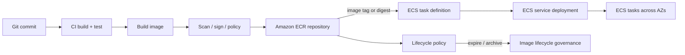
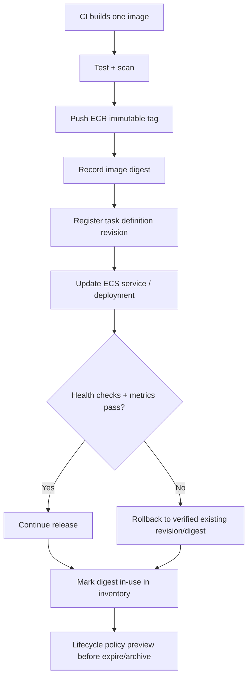
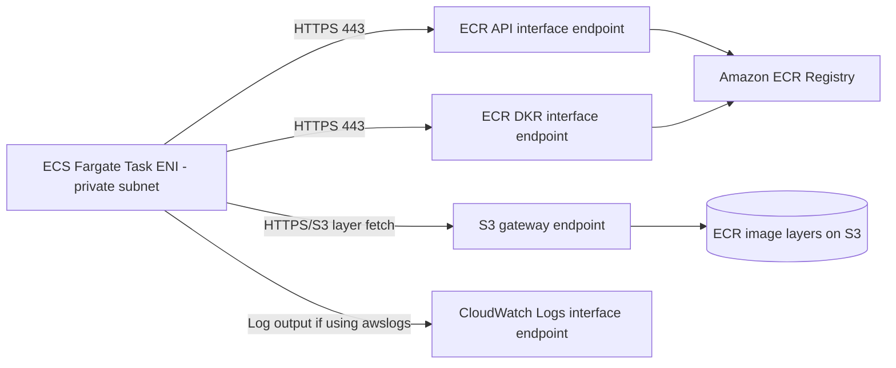
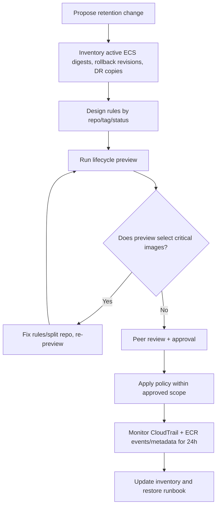

# ECR Repositories, Image Tags, and Lifecycle Policies

> **Chapter:** Containers with ECS · **Module:** `CLOUD_PROVIDERS_AWS`

## 1. From Source Code to Running Containers on ECS

A Java Spring Boot application is packaged as a Docker/OCI image and deployed as multiple **Amazon ECS tasks** spread across two Availability Zones (AZs). When a new release is ready, the CI/CD pipeline needs a reliable place to store images for ECS to pull. At the same time, the operations team needs to answer: which version is currently running, which image can be used to roll back, which old images can be deleted, and how are vulnerabilities in dependencies detected?

**Amazon Elastic Container Registry (Amazon ECR)** is a managed container registry service on AWS. It stores **container images and supported OCI artifacts**, provides endpoints for Docker/Podman/CI to push or pull, and integrates IAM, encryption, image scanning, replication, and **lifecycle policies**. For applications on ECS, ECR is a core link in the deployment chain:



**Three artifacts you must distinguish:**

- **Repository:** storage location for images belonging to an application or purpose; has its own policies and lifecycle rules.
- **Image tag:** a human-readable reference such as `1.4.2` or `git-a1b2c3d`, **which can change which image it points to if the repository allows mutable tags**.
- **Image digest:** a content-based identifier of the manifest, typically `sha256:...`; used to reference the exact pushed image/manifest version.

In the `CLOUD_PROVIDERS_AWS` module, managing ECR connects to **AWS Region/AZs, IAM, VPC endpoints, ECS/EC2/Fargate, CloudWatch, recovery/rollback, and storage cost**. How you tag and delete images directly affects ECS's ability to launch new tasks during scale-out or when replacing failed instances.

**Learning objectives:** After this lesson, learners will be able to:

1. Distinguish private/public registries, repositories, manifests, layers, tags, digests, and image URIs.
2. Create a private repository and build/tag/push/pull images using Docker and the AWS CLI.
3. Design a tag strategy, image immutability, and IAM policies separating CI from ECS.
4. Write, read, and **preview** an ECR lifecycle policy before applying it.
5. Explain the two actions **expire** (delete) and **transition to archive** (cold storage), along with their risks to ECS.
6. Integrate image references with ECS task definitions and deploy/roll back by digest.
7. Troubleshoot pull/push errors and monitor scanning, networking, and ECR operational costs.

## 2. Amazon ECR: Registry, Repository, Image, Manifest, and Digest

### 2.1. Private ECR and ECR Public

| Concept | Description | Example Use |
| --- | --- | --- |
| **Amazon ECR Private registry** | Private registry within an AWS account and Region, integrated with IAM and repository policies. | Store `orders-api` for an enterprise's ECS Fargate services. |
| **Private repository** | A sub-store within the registry, with a name, scanning/tag mutability/encryption settings, and lifecycle policy. | `team-a/orders-api`. |
| **Amazon ECR Public** | Public image registry service with different URIs, permissions, and configuration from private ECR. | Distribute base images or tools for the community. |
| **Image/manifest** | Describes configuration and a set of layers; a manifest list/image index can reference multiple images by CPU architecture. | One release containing both `linux/amd64` and `linux/arm64` images. |
| **Image layers** | Image layers shared/reused by content. | JRE base layer, dependencies, Java application. |
| **Image tag** | Human-readable reference name, which can be mutable or immutable. | `v1.4.2`, `git-a1b2c3d`. |
| **Image digest** | Hash of the manifest/index; uniquely identifies an exact image build. | `sha256:...`. |

For private ECR, the URI typically takes the form:

```text
111122223333.dkr.ecr.ap-southeast-1.amazonaws.com/team-a/orders-api:v1.4.2
|------------ registry / account / Region -------------| |---- repository ----| |tag|
```

Here `111122223333` is a **fictional AWS account ID**; `ap-southeast-1` is an AWS Region, not an AZ. If the same repository is created in another Region or account, the URI changes. ECS tasks in two AZs of the **same Region** typically pull images via the same registry URI using each task's permissions and network path; an ECR repository is not a per-AZ resource.

### 2.2. How Do Tags and Digests Differ?

Suppose CI pushes twice:

```text
Push 1: orders-api:latest  -> sha256:AAA...
Push 2: orders-api:latest  -> sha256:BBB...
```

If tags are **mutable**, `latest` can be updated to point to the new image. A running ECS task does not automatically swap its image just because the tag was re-pushed; when a new deployment or new task launches, ECS's image resolution rules and the digest pinned in the deployment determine which version is used. Therefore, `latest` is not sufficient evidence when investigating a release.

With a **digest**, the URI takes the form:

```text
111122223333.dkr.ecr.ap-southeast-1.amazonaws.com/team-a/orders-api@sha256:<digest-that-exists>
```

The digest depends on the **exact manifest or image index** referenced. For a multi-architecture image, the digest of the manifest list/index differs from the digest of each child image. CI/CD should capture the digest from the push/describe output, rather than inferring it from a tag or from a JAR file.

**Important:** A digest pins exact content **only as long as the image still exists and can be pulled**. A lifecycle policy can still delete or archive that image. Thus digest pinning does not replace proper **retention/backup/replication** and release policies.

### 2.3. Registry Images vs. Running Containers

| Component | Where is it? | Impact when the image in ECR is deleted |
| --- | --- | --- |
| **ECR repository** | AWS Registry | The deleted manifest/layers can no longer be pulled. |
| **ECS task definition** | ECS Configuration | May still hold the old tag/digest URI; ECS does not automatically rewrite URIs. |
| **Running ECS task** | Fargate/EC2 compute | Typically continues using the image already in the runtime environment, but provides no guarantee on restart/new launch. |
| **New ECS task / scale-out** | Launched by scheduler | May hit `CannotPullContainerError` if the manifest was deleted/archived or permissions/network are missing. |

ECR does not replace ECS: ECR **stores images**, ECS **orchestrates container execution**, IAM governs permissions, and VPC/networking provides the path to the registry.

## 3. Creating a Repository and Pushing Images to ECR

### 3.1. Preparing Tools and Identity

Examples use **Docker CLI**, **AWS CLI v2**, an IAM identity authorized to push to a lab account repository, and a built Spring Boot application image. Before performing real operations:

1. Verify account/Region with `aws sts get-caller-identity` to avoid pushing to production by mistake.
2. Choose repository name, image tag, and owner; attach governance tags (project/environment/cost-center) to the **repository resource** as needed.
3. Use least-privilege IAM for CI/staff; never use the root user or long-lived access keys stored in source code.
4. Determine the Internet/VPC endpoint path for the Docker client, disk capacity, and artifact storage location.
5. Estimate image storage/scan/network costs and clean up lab resources when authorized.

### 3.2. Creating a Private Repository

Using AWS CLI with repository management permissions (values are **examples**—do not run in production without review):

```bash
aws sts get-caller-identity

aws ecr create-repository \
  --region ap-southeast-1 \
  --repository-name team-a/orders-api \
  --image-tag-mutability IMMUTABLE \
  --encryption-configuration encryptionType=AES256
```

The command returns `repositoryUri`, `repositoryArn`, and other attributes. `IMMUTABLE` blocks **overwriting an existing tag**, not deleting the image via API or lifecycle policy. `AES256` uses ECR-managed encryption; if a customer-managed AWS KMS key is required, examine `KMS` encryption and govern the key policy per organizational requirements. Repository encryption settings must be chosen carefully at creation because not every option can be modified directly afterward.

**Do not assume enabling scan-on-push in `create-repository` is sufficient:** Amazon ECR supports configuring scanning at the **private registry** level to select basic/enhanced scanning and repository filters. Scanning configuration and vulnerability feeds should be decided at the organizational level; see Section 11.

### 3.3. Logging Docker Into the ECR Private Registry

```bash
AWS_REGION=ap-southeast-1
ACCOUNT_ID=111122223333
REGISTRY="$ACCOUNT_ID.dkr.ecr.$AWS_REGION.amazonaws.com"

aws ecr get-login-password --region "$AWS_REGION" \
  | docker login --username AWS --password-stdin "$REGISTRY"
```

An ECR authorization token for Docker authentication is valid for **12 hours**; once expired, log in again via the AWS CLI. The user or CI role must have `ecr:GetAuthorizationToken`. Passing `--password-stdin` avoids exposing the password on the command-line argument list. **Do not print the token to logs, and do not commit `~/.docker/config.json` or AWS credentials.** An ECR token is scoped to the IAM permissions of the identity that requested it and does not automatically grant all push/pull actions.

### 3.4. Building, Tagging, and Pushing a Version

Assuming a `Dockerfile` for the Java app and the repository created above:

```bash
IMAGE_REPO="$REGISTRY/team-a/orders-api"
RELEASE_TAG="git-a1b2c3d"  # example commit-based tag name

docker build -t orders-api:$RELEASE_TAG .
docker tag orders-api:$RELEASE_TAG "$IMAGE_REPO:$RELEASE_TAG"
docker push "$IMAGE_REPO:$RELEASE_TAG"

aws ecr describe-images \
  --region "$AWS_REGION" \
  --repository-name team-a/orders-api \
  --image-ids imageTag="$RELEASE_TAG" \
  --query 'imageDetails[].{Tags:imageTags,Digest:imageDigest,Size:imageSizeInBytes,Pushed:imagePushedAt}' \
  --output json
```

`git-a1b2c3d` is an example; real CI should use a **full or sufficiently unique short commit SHA**, standardized release version, and pipeline ID as needed. To ensure the image runs on ECS's CPU architecture, build/test for the right platform; when using `buildx` and multi-platform manifests, inspect the image index/digest rather than just the tag.

### 3.5. Testing Pull by Exact Digest

After pushing, retrieve the digest from `describe-images`, then:

```bash
docker pull "$IMAGE_REPO@sha256:<digest-from-ecr>"
docker image inspect "$IMAGE_REPO:$RELEASE_TAG"
```

Replace the `<digest-from-ecr>` placeholder with the real digest—do not run it literally. Before using the image in ECS, verify the image runs on the right architecture, entrypoint, exposed port, health endpoint, and contains no secrets in its layers. An image existing in ECR **does not prove** the application will start cleanly on Fargate/EC2.

## 4. Tag Strategy and Immutability

### 4.1. Common Tag Patterns

| Tag Type | Example | Used For | Risks |
| --- | --- | --- | --- |
| **Release version** | `v1.4.2` | Tracking releases, auditing, and rollback. | Mutable tags can be overwritten; must be controlled. |
| **Commit SHA** | `git-a1b2c3d` | Tracing source code, CI builds, and deployments. | Too-short SHAs or rebuilding the same tag can cause collisions. |
| **Environment** | `dev`, `staging` | Pointing to the build used in an environment. | Tags are often mutable and do not prove deployed content. |
| **Floating** | `latest` | Quick experiments and some caching workflows. | Can switch to a different image at any time. |
| **Digest** | `@sha256:...` | Pinning a deterministic artifact in task definitions. | The image can still be deleted/archived and become unpullable. |

**Recommended design:** build the artifact once, test and scan the image, release with a **non-reusable** tag, and record the digest alongside the CI build ID, source commit, test evidence, and task definition revision. Never rely solely on a `prod` tag to conclude what version is running or whether it passed security gates.

### 4.2. Image Tag Mutability

ECR supports the following options:

- **MUTABLE:** the same tag can be pushed again to point to a different manifest.
- **IMMUTABLE:** pushing an image with a tag that already exists in the repository fails, typically with `ImageTagAlreadyExistsException`.
- **MUTABLE_WITH_EXCLUSION / IMMUTABLE_WITH_EXCLUSION:** **exclusion filters** can be declared so certain tag patterns behave opposite to the repository default.

Example of updating an existing repository to immutable:

```bash
aws ecr put-image-tag-mutability \
  --region ap-southeast-1 \
  --repository-name team-a/orders-api \
  --image-tag-mutability IMMUTABLE
```

If a lab environment genuinely needs to overwrite `dev-*` while protecting release tags, you can evaluate exclusion mode:

```bash
aws ecr put-image-tag-mutability \
  --region ap-southeast-1 \
  --repository-name team-a/orders-api \
  --image-tag-mutability IMMUTABLE_WITH_EXCLUSION \
  --image-tag-mutability-exclusion-filters filterType=WILDCARD,filter=dev-*
```

This is an optional configuration example; verify against current AWS CLI/feature support, IAM, and organizational policy. Do not use exclusions for official release tags where immutability is required. **Immutability only prevents tag overwrites, not delete/expire/archive actions**, so continue controlling delete permissions and lifecycle policies.

### 4.3. Multiple Tags Can Point to the Same Image

One digest can carry multiple tags such as `git-a1b2c3d`, `v1.4.2`, and `prod-approved`. Adding another tag does not necessarily duplicate every layer. When a lifecycle policy evaluates images, you must look at **all tags on the same image** and understand that rules select images, not isolated tag strings.

**Critical trap:** An image carrying both `dev-123` and `prod-1.2.3` still matches a `dev-*` rule. A dev cleanup rule can accidentally act on a live prod image. Relying solely on prefixes is not a safe boundary for production; **separating development and release repositories** is the clearest choice when the two environments have different retention requirements.

### 4.4. Tagging and Re-Tagging Do Not Update Running Applications

An ECS service that already created tasks from a specific image digest does not automatically update running tasks just because `latest` is pushed again. Conversely, if operations forces a deployment using a floating tag or disables version consistency mechanisms, the pulled build may differ from expectations. Always record the digest and deploy an explicit **task definition revision**. See Section 9 on how ECS resolves tags to digests.

## 5. IAM for ECR: Who Can Push, Who Can Pull?

### 5.1. Three Commonly Confused Identities

| Identity | What is it used for? | ECR-Related Permissions |
| --- | --- | --- |
| **CI/CD build role** | Docker login, push images, read metadata, optionally trigger scan/deploy. | Push/pull on specific repositories; no `DeleteRepository` unless needed. |
| **ECS task execution role** | ECS/Fargate agent pulls images, writes CloudWatch Logs, fetches secrets in task definitions when configured. | Typically `ecr:GetAuthorizationToken`, `BatchGetImage`, `GetDownloadUrlForLayer`. |
| **ECS task role** | Application code running **inside the container** calling S3, DynamoDB, Secrets Manager, etc. | Does not need ECR pull permissions just for ECS to pull the image. Only needs ECR permissions if the app itself directly calls ECR APIs. |

For **ECS on EC2**, there is a distinction: the container instance IAM role (attached to the EC2 instance) typically supplies several agent permissions needed for ECR; the task execution role may still be required for other features depending on ECS configuration. For **Fargate**, the task execution role is the standard role the agent uses to pull private ECR images. Never grant `AdministratorAccess` to an application's task role just to fix an image pull error.

### 5.2. Example Read-Only ECR Policy for an Execution Role

```json
{
  "Version": "2012-10-17",
  "Statement": [
    {
      "Sid": "ECRAuthorization",
      "Effect": "Allow",
      "Action": "ecr:GetAuthorizationToken",
      "Resource": "*"
    },
    {
      "Sid": "PullOrdersImage",
      "Effect": "Allow",
      "Action": [
        "ecr:BatchGetImage",
        "ecr:GetDownloadUrlForLayer",
        "ecr:BatchCheckLayerAvailability"
      ],
      "Resource": "arn:aws:ecr:ap-southeast-1:111122223333:repository/team-a/orders-api"
    }
  ]
}
```

ARN/account/Region values are placeholders. If ECS also writes CloudWatch logs or reads Secrets Manager, grant the **exact** additional permissions required by the task definition. The AWS managed policy `AmazonECSTaskExecutionRolePolicy` is a common baseline; when stricter least privilege is required, use scoped policies with appropriate conditions.

### 5.3. Pushing Requires a Different Set of Permissions

A CI role pushing images typically needs:

- `ecr:GetAuthorizationToken` on `*` for Docker login.
- `ecr:BatchCheckLayerAvailability`, `ecr:InitiateLayerUpload`, `ecr:UploadLayerPart`, `ecr:CompleteLayerUpload`, and `ecr:PutImage` on the **specific repository**.
- `ecr:DescribeImages`/`ecr:DescribeRepositories` if the pipeline checks image existence and digests.

Permissions to create repositories, edit lifecycle policies, change tag mutability, or archive/delete images should be **separate administrative permissions**. A build pipeline should not by default be allowed to modify production retention. For **cross-account ECR pulls**, check both the IAM identity policy of the role in the ECS account and the **ECR repository resource policy** in the account owning the image. Use role assumption/temporary credentials rather than copying access keys across accounts.

### 5.4. Securing the Release Supply Chain

- CI/CD should use federation/assume-role with short-lived credentials; restrict who may push release tags.
- Combine tag immutability + digest/commit traceability + IAM policies + approvals; each protects a different layer.
- Artifacts can be stored/signed using OCI/supply-chain standards and signatures/provenance verified before deployment with appropriate tooling; **ECR does not automatically verify an image is safe just because the push succeeded**.
- Enable AWS CloudTrail for critical administrative/API events, monitoring changes to repository policies, lifecycle rules, tag mutability, and unusual deletions.
- For untrusted source code, pipelines must isolate code execution/builds and never expose production credentials to `docker build`.

## 6. What Is a Lifecycle Policy and How Does It Process Images?

An **ECR lifecycle policy** is a JSON ruleset attached to **one private repository** that automatically selects images based on tags, age, pull time, or image count and performs an action:

1. **`expire`:** deletes the image/manifest from the repository based on criteria. If the only image serving ECS gets deleted, the next pull can fail.
2. **`transition` to `archive`:** moves the image to the **ECR archival storage class** for lower-cost long-term retention in suitable use cases. **Archived images cannot be pulled** until restored.

Not every account/Region or legacy tool supports the exact same archive capabilities; verify support and AWS CLI versions before deploying. **A lifecycle policy does not replace deployment policies or backup/DR strategies for critical images.**

### 6.1. Structure of a Rule

```json
{
  "rulePriority": 1,
  "description": "Expire untagged images older than 7 days",
  "selection": {
    "tagStatus": "untagged",
    "countType": "sinceImagePushed",
    "countUnit": "days",
    "countNumber": 7
  },
  "action": {
    "type": "expire"
  }
}
```

This is **one rule object**; a complete policy must wrap rules inside `{"rules": [ ... ]}`. Key properties:

| Property | Purpose | Rules |
| --- | --- | --- |
| `rulePriority` | Rule evaluation priority. | Lower number has higher priority; must be unique within the policy. |
| `description` | Administrative note. | State behavior, scope, and retention rationale. |
| `tagStatus` | Selects `tagged`, `untagged`, or `any`. | With `tagged`, requires `tagPatternList` or `tagPrefixList`. |
| `tagPrefixList` | Matches tag names starting with a prefix. | E.g., `["dev-"]`; cannot be used together with `tagPatternList` in the same rule. |
| `tagPatternList` | Matches tag patterns using `*`. | E.g., `["feature-*"]`; each pattern has wildcard limits. |
| `countType` | How eligible images are counted/aged. | `imageCountMoreThan`, `sinceImagePushed`, `sinceImagePulled`, `sinceImageTransitioned`. |
| `countNumber` | Count or day threshold. | Positive integer; do not use 0. |
| `countUnit` | Time unit. | `days` for time-based `countType`; omit when counting images. |
| `action.type` | Delete or change storage class. | `expire` or `transition`. |
| `targetStorageClass` | Destination storage class. | `archive` when action is `transition`. |

For archived images, a `sinceImageTransitioned` rule combined with `storageClass: "archive"` and action `expire` is appropriate; deleting archived images has minimum storage duration billing implications—see Section 8.

### 6.2. Evaluation Order and Tag Selection Rules

- **All rules are evaluated first**, then results are applied according to `rulePriority`; **1 has higher priority than 2**.
- Each image can be acted on by **at most one rule** per evaluation run.
- A rule with `tagStatus: "any"` must have the **highest priority number** so it is evaluated last within a valid policy.
- With `tagStatus: "tagged"`, you must choose **either `tagPrefixList` or `tagPatternList`**, not both on the same rule. Multiple entries in the list mean the image must have tags satisfying **all** stated conditions, not an arbitrary OR.
- `imageCountMoreThan` keeps the newest images in the selected set and expires the excess from oldest to newest. This counts **images**, not tags.
- `sinceImagePushed` is based on when the image was pushed; `sinceImagePulled` is based on the **last pull timestamp recorded by ECR** (or an AWS-defined fallback timestamp if never pulled), not an exact log of every ECS run.
- For images with a **manifest list/index** (multi-architecture), a child image referenced by a manifest list cannot be deleted/archived independently by lifecycle before handling the parent manifest list. When reviewing previews, inspect both the manifest list and its component images.
- Lifecycle policy actions are executed asynchronously by AWS **within roughly 24 hours after an image becomes eligible**, not as an exact minute-by-minute cron job. Related events are recorded in CloudTrail.

### 6.3. Retention Must Protect the Rollback Window

Suppose production can roll back up to 30 days, staging keeps 14 days, and dev images only need 7 days. **Never apply a repository-wide policy like "expire all images older than 7 days"** if the repository still holds production releases. Choose one of these approaches:

1. **Separate repositories** `orders-api-dev` and `orders-api-prod` with distinct lifecycle policies.
2. Carefully design rules with peer approvals, previews, and per-image/digest checks before applying.
3. Maintain an inventory of releases/digests actively referenced by task definitions, live services, and rollback runbooks; never define "unused" by age alone.

Retention choices must account for **ASG/ECS scale-out, recovering from an AZ failure, redeploying from older task definitions, and rollbacks**. Currently running tasks do not guarantee the image remains available for replacement tasks.

## 7. Writing a Safe Lifecycle Policy for a Dev Repository

Suppose you have a **dedicated repository** `team-a/orders-api-dev` containing no production images. You want to:

- Expire **untagged** images pushed more than **7 days** ago.
- Retain only the **latest 20 images** matching prefix `dev-`, leaving tags outside that group untouched.

Create `lifecycle-dev.json` in your policy deployment workspace (this is **illustrative content**; do not add extra files to the lesson repository):

```json
{
  "rules": [
    {
      "rulePriority": 1,
      "description": "Expire untagged dev images older than 7 days",
      "selection": {
        "tagStatus": "untagged",
        "countType": "sinceImagePushed",
        "countUnit": "days",
        "countNumber": 7
      },
      "action": {
        "type": "expire"
      }
    },
    {
      "rulePriority": 2,
      "description": "Retain latest 20 images tagged dev-*",
      "selection": {
        "tagStatus": "tagged",
        "tagPatternList": ["dev-*"],
        "countType": "imageCountMoreThan",
        "countNumber": 20
      },
      "action": {
        "type": "expire"
      }
    }
  ]
}
```

This example policy **has no catch-all rule**. It will not proactively process tagged images that only have prefixes other than `dev-`; however, it can still select a **multi-tagged** image that carries `dev-...`. Therefore:

1. **Apply only to a true dev repository**, never copy into a prod repo.
2. Never attach both `dev-*` and `prod-*` tags to the same image when different retention rules exist without evaluating the impact.
3. Run a **lifecycle preview** and cross-check every digest slated for expiration against ECS task definitions, deployments, and rollback candidates.
4. Remember an untagged image can still be referenced by digest in ECS. `untagged` **does not mean unused**.
5. Account for storage and release cadence; 7 days / 20 images are **exercise assumptions**, not universal AWS recommendations.

### 7.1. Previewing via AWS CLI Before Writing the Policy

Assuming `lifecycle-dev.json` exists locally and AWS CLI v2 has the necessary permissions:

```bash
aws ecr start-lifecycle-policy-preview \
  --region ap-southeast-1 \
  --repository-name team-a/orders-api-dev \
  --lifecycle-policy-text file://lifecycle-dev.json

# Preview runs asynchronously; call after status is COMPLETE.
aws ecr get-lifecycle-policy-preview \
  --region ap-southeast-1 \
  --repository-name team-a/orders-api-dev \
  --output json
```

Inspect fields such as **`status`, `previewResults`, `imageTags`, `imageDigest`, `appliedRulePriority`, `action`**, and summary counts. If status is `IN_PROGRESS`, do not draw conclusions yet; poll again until complete. If `FAILED`, check the error message and JSON syntax. With many images, ensure **no paginated results are missed**. Previews are a vital control, but they represent a snapshot at check time; new images may be pushed afterward.

**Checklist to complete before applying:**

- Repository owner/approver and owners of ECS services using the images have reviewed.
- No active deployments, running task definitions, scheduled jobs, or rollback releases require the digests marked for expiration.
- Images to retain are protected by explicit process, not merely by assuming tag immutability.
- If image indexes/manifest lists exist, inspect all referenced child artifacts and OCI referrers.
- Have a policy rollback plan; understand that **removing a lifecycle policy does not restore already deleted images**.

### 7.2. Applying the Policy After Approval

```bash
aws ecr put-lifecycle-policy \
  --region ap-southeast-1 \
  --repository-name team-a/orders-api-dev \
  --lifecycle-policy-text file://lifecycle-dev.json

# Verify the active policy.
aws ecr get-lifecycle-policy \
  --region ap-southeast-1 \
  --repository-name team-a/orders-api-dev \
  --output json
```

**Real impact:** `put-lifecycle-policy` mutates the repository. Never run it just to experiment in a production account; if a bad policy is applied, eligible images can be deleted **within 24 hours**. Reverting to the old rules after deletion does not restore lost data; keeping releases requires re-pushing/restoring from a trusted artifact or backup source.

### 7.3. "Keep the Latest 20 Builds" Is Not "Keep 20 Tags"

Suppose digest A has two tags `dev-a` and `dev-latest`, and digest B has `dev-b`. Even though there are **three tags**, there are only **two image manifests** in the selected set. When evaluating `imageCountMoreThan: 20`, ECR counts images matched by the lifecycle rule, not raw tag strings. If a digest also carries a protected tag from another environment, the preview should expose that risk before execution.

## 8. Archiving Images: Cold Storage Instead of Immediate Deletion

AWS ECR supports an **archival storage class** in announced scenarios. This provides an option to retain older releases for auditing or recovery when **immediate pulls are not required**, unlike keeping images ready for instant pull in ECR Standard.

| Criterion | **Standard** | **Archive** |
| --- | --- | --- |
| Purpose | Images in active use or needing fast pulls. | Infrequently accessed images kept long-term per policy. |
| Can ECS pull immediately? | Yes, if IAM and networking permit. | **No**; pulling an archived image fails until restored. |
| Reuse speed | Pull speed depends on network/image size. | Must restore to Standard first; plan for restore time. |
| Lifecycle policy | Supports `expire` or `transition`. | Can `expire` after the minimum archive duration per rules. |
| Cost | Standard storage pricing. | Archive pricing plus applicable storage duration/restore terms; check Region. |

**Key point:** An archived image can still appear in `describe-images` with status `ARCHIVED`; seeing metadata **does not mean the image is pullable**. AWS notes that restoration can take **up to roughly 20 minutes**; never build minute-level autoscaling or emergency rollback workflows around images still sitting in Archive.

### 8.1. Rule to Transition Infrequently Pulled Images to Archive

In a **repository dedicated to historical builds not used for instant scale-out**, the following example policy transitions images tagged `historical-*` if not pulled for over **90 days**:

```json
{
  "rules": [
    {
      "rulePriority": 1,
      "description": "Archive historical images not pulled in 90 days",
      "selection": {
        "tagStatus": "tagged",
        "tagPatternList": ["historical-*"],
        "countType": "sinceImagePulled",
        "countUnit": "days",
        "countNumber": 90
      },
      "action": {
        "type": "transition",
        "targetStorageClass": "archive"
      }
    }
  ]
}
```

**Caution with `sinceImagePulled`:** the threshold uses the **last recorded pull time** (or ECR's fallback timestamp if never pulled/recently restored). A long-running ECS task might **not pull its image frequently**; therefore, never equate "90 days without a pull" with "not serving production." Check task definitions/deployments and protected release inventories first.

### 8.2. Expiring Images Already in Archive

For example, a **separate** policy for an archive repository can expire archived images after **365 days** in Archive:

```json
{
  "rules": [
    {
      "rulePriority": 1,
      "description": "Expire archive images after 365 days in archive",
      "selection": {
        "tagStatus": "any",
        "storageClass": "archive",
        "countType": "sinceImageTransitioned",
        "countUnit": "days",
        "countNumber": 365
      },
      "action": {
        "type": "expire"
      }
    }
  ]
}
```

ECR Archive has a **90-day minimum storage duration**. You cannot configure lifecycle rules to auto-expire an archived image sooner than this minimum; if manually deleted early via supported APIs, minimum-duration charges may still apply. **The 365-day window in this example is an assumed policy**, not an AWS requirement.

When using multiple rules in one policy, verify all validity constraints on **storage class, priority, tag filters, and actions**. Do not paste two separate JSON policy documents into a repository: each repository holds one lifecycle policy whose rules are evaluated together. Always preview the combined policy.

### 8.3. When Should You Not Archive?

Do not archive images that:

- Are currently used by an **ECS service/task definition revision** to launch new tasks.
- Are needed for **urgent rollbacks** under a short RTO.
- Are needed for **scale-out** and task replacement after an AZ/EC2 failure.
- Are component manifests/indexes needed by active multi-architecture images.
- Lack reliable backups/rebuild capability and proper provenance tracking.

Archive is a **long-term storage cost optimization** paired with an explicit restore runbook—not a harmless "soft delete." When restoring an image, confirm its status returns to `ACTIVE` before ECS attempts to pull. Check current ECR pricing for archive, restore, storage, and regional availability.

### 8.4. Lifecycle Events and Consistency

ECR lifecycle policies execute automatically once images meet criteria, with an expected delay of up to 24 hours. Expire/archive actions are logged by AWS in **CloudTrail**. If **ECR replication** is enabled across Regions/accounts, lifecycle policies apply per repository/Region; whether deletions replicate depends on replication delete configuration. Never assume an image deleted in one Region is identically retained or deleted everywhere: verify each replication target and DR strategy.

## 9. Using ECR Images in an Amazon ECS Task Definition

An **ECS task definition** specifies the image, CPU/memory, roles, network mode, ports, logging, environment variables, and runtime constraints. With **ECS Fargate**, task definitions typically use `awsvpc` network mode and `executionRoleArn` so the ECS agent can pull images from ECR.

### 9.1. Example Task Definition JSON for Spring Boot

```json
{
  "family": "orders-api",
  "networkMode": "awsvpc",
  "requiresCompatibilities": ["FARGATE"],
  "cpu": "256",
  "memory": "512",
  "executionRoleArn": "arn:aws:iam::111122223333:role/ecsTaskExecutionRole",
  "taskRoleArn": "arn:aws:iam::111122223333:role/ordersAppTaskRole",
  "containerDefinitions": [
    {
      "name": "orders-api",
      "image": "111122223333.dkr.ecr.ap-southeast-1.amazonaws.com/team-a/orders-api@sha256:<real-digest>",
      "essential": true,
      "portMappings": [
        { "containerPort": 8080, "protocol": "tcp" }
      ],
      "logConfiguration": {
        "logDriver": "awslogs",
        "options": {
          "awslogs-group": "/ecs/orders-api",
          "awslogs-region": "ap-southeast-1",
          "awslogs-stream-prefix": "ecs"
        }
      }
    }
  ]
}
```

**Not runnable verbatim:** the account ID, role ARNs, ECR repository URI, digest, CloudWatch Logs group, and resource capacity must exist and be valid. `<real-digest>` is a placeholder to replace, the app must listen on port 8080, and Fargate CPU/memory/architecture must match the image. When using an ALB with `awsvpc` tasks, the target group typically requires **target type `ip`**, not `instance`.

Key permission boundaries:

- **Execution role** lets the ECS/Fargate agent pull ECR images and write `awslogs` per policy.
- **Task role** lets Java code call S3, DynamoDB, Secrets Manager, SQS, etc.; never grant ECR admin permissions just because the app runs in a container.
- IAM trust policies, repository policies, KMS, and VPC endpoints must all allow access along the architectural path.

### 9.2. ECS Image Tag Resolution and Version Consistency

ECS provides **container image version consistency**: in supported ECS service deployments, ECS attempts to **resolve the image tag to a digest** at deployment time, then uses that digest so all tasks in the same deployment run the identical version. The `versionConsistency` parameter in the container definition can enable or disable this behavior where supported; it typically defaults to `enabled` on supported configurations.

This leads to several conclusions:

1. **Changing a tag's target in ECR does not automatically update running tasks.**
2. **A new deployment** may resolve the tag at a different point in time; record the actual digest rather than only the tag.
3. Specifying the **image URI by digest directly in the task definition** makes the content unambiguous; ensure the manifest and related platform images remain pullable.
4. When ECS cannot establish a digest, deployment outcomes and rollbacks depend on deployment type, agent/platform version, and `deployment circuit breaker`; never assume every failure rolls back automatically.
5. Knowing only the task definition revision is insufficient if the image uses a mutable tag and the resolved digest was not recorded; log deployment metadata and verify the running image.

Even after an ECS service has resolved a digest, launching new tasks can still require pulling from ECR. **If a lifecycle policy has expired or archived that image**, scale-out, replacing failed tasks, or rolling back to an older revision can break even though the CI pipeline and task definition still exist.

### 9.3. Safe Deploy/Rollback Workflow



In practice, coordinate **ALB target health**, application readiness, ECS deployment circuit breaker, CloudWatch alarms, and deployment checks. An ECR lifecycle rule does not know which digests all ECS services are using; protecting release images requires an inventory and explicit process.

### 9.4. How Image Cleanup Affects Incident Scenarios

| Scenario | How Does ECR Retention Affect It? | Prevention |
| --- | --- | --- |
| An ECS task running in AZ A is stable. | Deleting the image in the registry does not always kill the running container immediately. | Never assume the registry is safe just because existing tasks remain healthy. |
| AZ A fails; ECS launches a task in AZ B. | The new task may need to pull the deployed digest; if deleted or archived, launch fails. | Retain active deployment digests; verify multi-AZ network/pull readiness. |
| Rolling back to a prior ECS task definition revision. | That revision may reference an expired/archived image. | Keep a realistic rollback window and verify the digest before rolling back. |
| Fargate scales out in private subnets. | Image pulls require the execution role and connectivity to ECR/S3 layers. | Proper VPC endpoints/NAT and accurate IAM/trust/SG/DNS configuration. |
| Cross-Region disaster recovery. | ECR replicas and replicated lifecycle deletes can affect standby images. | Define replication/retention/restore rules explicitly and run DR drills. |

## 10. Which Network Path Do ECS/Fargate Tasks in Private Subnets Use to Pull Images?

An ECS Fargate task running `awsvpc` in a **private subnet** does not need a public IPv4 address to receive application requests from an ALB. However, before the container starts, ECS needs **outbound connectivity to ECR and the image layer store**; if tasks lack NAT/Internet egress, **VPC endpoints (AWS PrivateLink)** are typically used.

### 10.1. Endpoints Commonly Needed Without Internet Egress

| Endpoint | Type | Purpose |
| --- | --- | --- |
| `com.amazonaws.<region>.ecr.api` | **Interface endpoint** | ECR API used for authentication/metadata depending on platform version. |
| `com.amazonaws.<region>.ecr.dkr` | **Interface endpoint** | Docker Registry API for pulling/pushing private ECR images. |
| `com.amazonaws.<region>.s3` | **Gateway endpoint** (or supported alternative) | Fetches image layers that ECR stores in S3; private subnet route tables must route to this endpoint. |
| `com.amazonaws.<region>.logs` | **Interface endpoint** if needed | ECS tasks send logs to CloudWatch Logs when no other egress path exists. |
| Secrets Manager/SSM endpoints | Interface endpoints as needed | Used when task definitions or apps call secrets/parameters APIs. |

With **Fargate Linux platform version 1.4.0 or later** and the VPC endpoint pull model, you typically need `ecr.api`, `ecr.dkr`, and the S3 gateway endpoint; older versions differ. Check [AWS ECS task execution role](https://docs.aws.amazon.com/AmazonECS/latest/developerguide/task_execution_IAM_role.html) and [ECR VPC endpoints](https://docs.aws.amazon.com/AmazonECR/latest/userguide/vpc-endpoints.html) for your actual platform.

Frequently missed requirements:

- **Private DNS** enabled appropriately for interface endpoints, with VPC DNS resolution active.
- **Interface endpoint security group** allows inbound TCP 443 from the task ENI/security group; task SG allows corresponding outbound traffic.
- **Private subnet route table** associated with the S3 gateway endpoint; S3 bucket/endpoint policies do not block the objects/layers ECR requires.
- **Task execution role** and repository policy permit pulls; if restricted by `aws:SourceVpce`, verify the exact endpoint ID and account.
- **Initial ECS image pulls using ECR pull-through cache** or images containing foreign layers may require Internet/NAT access in AWS-documented cases; do not assume VPC endpoints automatically cover every upstream registry.



This is a logical diagram, not a packet-level or endpoint implementation specification. **ALB → task** is the application's inbound data path; **task → ECR** is the outbound path to prepare the container. They have separate security groups and routing needs. Missing pull networking can cause ECS to report `ResourceInitializationError` or `CannotPullContainerError` even when ALB/HTTP and Java code are completely valid.

### 10.2. Using NAT Instead of Endpoints

A private subnet with a `0.0.0.0/0` route to a properly configured NAT gateway can pull from ECR over public endpoints, but you must account for **NAT processing fees, data transfer, per-AZ availability**, and network controls. VPC endpoints carry interface endpoint hourly/per-AZ charges and data processing fees; there is no universally cheapest design for every workload. Measure pull frequency (deploys/scale-outs), image size, and egress volume.

## 11. Scanning and Supply Chain Protection

ECR provides **image scanning** to detect certain package/dependency vulnerabilities while images are stored, though it does not guarantee catching every application vulnerability or runtime risk. Before production deployment, also inspect code, dependencies, CI runners, base images, and permissions.

### 11.1. Basic Scanning vs. Enhanced Scanning

| Option | Meaning | How It Is Used |
| --- | --- | --- |
| **Basic scanning** | ECR scans vulnerabilities using the basic scanner with supported scan modes. | Fits pipeline image scanning per registry/repository settings. |
| **Enhanced scanning (Amazon Inspector)** | Integrates Amazon Inspector for deeper vulnerability assessment and continuous monitoring depending on configuration/support. | Fits security programs needing alerts and ongoing findings management. |
| **CI scanning/SBOM** | Pre-push scanning, base/dependency/provenance checks, policy gates. | Complements ECR scans to validate at build time and block non-compliant artifacts. |

**Best practice is configuring scanning at the ECR private registry level** with appropriate rules/filters per current documentation, rather than relying on a single repository setting without understanding the registry-wide scan mode. Enhanced scanning can incur **Amazon Inspector charges**; check pricing before enabling broadly.

### 11.2. Verifying Scan Results

Example for an image in a supported repository with scanning enabled:

```bash
aws ecr describe-images \
  --region ap-southeast-1 \
  --repository-name team-a/orders-api \
  --image-ids imageTag=git-a1b2c3d \
  --output json

# Retrieve findings directly via ECR API in supported modes.
aws ecr describe-image-scan-findings \
  --region ap-southeast-1 \
  --repository-name team-a/orders-api \
  --image-id imageTag=git-a1b2c3d \
  --output json
```

Results and applicable APIs can differ between **basic and enhanced scanning**, scan timing, and IAM permissions; for enhanced scanning, also inspect findings in **Amazon Inspector**. An unscanned image or one with zero findings **does not prove the image is secure**. Security gates should evaluate severity, exploitability, exposure, runtime impact, available patches, and remediation SLAs, with an approved exception process.

### 11.3. Additional Layers of Protection

1. **Image provenance/signature:** record commit, builder identity, and checksum/digest; use OCI signing/attestations suited to your organization's tooling.
2. **Base images:** use trusted sources, rebuild on a schedule; avoid `FROM ...:latest` without digest pinning when reproducibility is needed.
3. **Secrets:** never bake DB passwords, AWS keys, or tokens into Dockerfile `ARG`/`ENV`/layers/logs; use ECS Secrets Manager/Parameter Store integrations and proper task roles.
4. **Immutable tags:** prevent release overwrites while still enforcing IAM delete protections and retention.
5. **Encryption:** ECR repositories are encrypted at rest; optionally use AWS KMS as required; registry transfers use HTTPS/TLS.
6. **Observability:** CloudTrail logs sensitive API actions; EventBridge/CloudWatch/Inspector can route findings/events to operations teams.
7. **Multi-arch:** test `linux/amd64` and `linux/arm64` images against ECS task CPU settings; do not stop at verifying the tag push succeeded.

## 12. Troubleshooting Push, Pull, Deploy, and Lifecycle Issues

When Docker or ECS reports an error, separate four layers:

1. **Reference:** are the repository name, Region/account, tag, digest, manifest platform, and image status correct?
2. **Identity:** do the pusher/puller, ECR token, execution role, task role, repo policy, and KMS have the right permissions?
3. **Network:** does the client/runner have HTTPS reachability to ECR; does the Fargate task have NAT or endpoints/DNS/SG/S3 layer paths?
4. **Artifact and lifecycle:** was the image expired/archived; is it still within the rollback window; is the tag immutable?

### 12.1. Common Error Reference Table

| Symptom | Causes to Check | How to Verify or Fix |
| --- | --- | --- |
| Docker reports `no basic auth credentials`. | Not logged in, expired ECR token, wrong registry URI/Region. | `aws sts get-caller-identity`, re-run `get-login-password` login against the right registry. |
| `denied: User ... not authorized` on push. | CI role lacks upload/`PutImage`, repository policy/SCP denies, wrong account targeted. | Check IAM principal, repository ARN, denied action, and CloudTrail. |
| `ImageTagAlreadyExistsException`. | Repo/tag is immutable; CI is reusing an existing tag. | Use a new release/commit tag; do not disable immutability to overwrite production releases. |
| `repository does not exist`. | Wrong repo name, Region, account, or repository not yet created. | `describe-repositories`, verify `repositoryUri` and permissions. |
| `manifest unknown` or image not found. | Tag/digest missing, expired, archived, or push incomplete. | `describe-images`/`list-images`, inspect image status and lifecycle history. |
| ECS reports `CannotPullContainerError`. | Missing image, bad digest, permissions, registry token, platform mismatch, or network. | Inspect ECS task `stoppedReason`, execution role, ECR metadata, and endpoints. |
| ECS reports `ResourceInitializationError`. | Cannot fetch ECR auth, secrets, or logs; private subnet missing endpoint/NAT/DNS/SG. | Inspect detailed stopped reason, `ecr.api`/`ecr.dkr`/S3 endpoints, IAM role, and CloudWatch. |
| Container reports `exec format error`. | Image built for a different CPU architecture, wrong entrypoint, or binary mismatch. | Inspect image manifest/platform, ECS `runtimePlatform`, and `buildx` output. |
| Existing ECS tasks run, but scale-out fails. | Previously pulled image was expired/archived, or new tasks use different network/role settings. | Check service deployment digest and retention; test pulling digest in an authorized environment. |
| Lifecycle preview selects a production image by mistake. | Image has multiple tags, overly broad rule (`any`), wrong priority, or mixed-environment repository. | Halt rollout; split repositories, fix policy, and re-run full preview. |
| Policy JSON rejected on apply. | Invalid `tagStatus`, mixing prefix+pattern, missing `countUnit` for time rules, duplicate priority, invalid action. | Check ECR lifecycle policy properties and test preview on a lab repo. |
| ECR scan lacks expected results. | Registry scan config doesn't match repo, image not scanned, insufficient permissions/Inspector setup, timing. | Inspect scan configuration/status, CloudTrail, and Inspector findings. |
| Image archived and ECS pull errors. | Archived images **cannot be pulled** even though `describe-images` still shows metadata. | Restore image to Standard per runbook and confirm `ACTIVE` before deploying. |
| Sudden spike in ECR or NAT costs. | Accumulated image layers, frequent pushes/replication, increased scanning, oversized Fargate pulls or NAT traffic. | Analyze Cost Explorer, image size/count, ECS task starts, data transfer, and endpoint/NAT metrics. |

### 12.2. Read-Only CLI Commands to Inspect an Image

```bash
aws sts get-caller-identity

aws ecr describe-repositories \
  --region ap-southeast-1 \
  --repository-names team-a/orders-api \
  --output json

aws ecr describe-images \
  --region ap-southeast-1 \
  --repository-name team-a/orders-api \
  --image-ids imageTag=git-a1b2c3d \
  --output json

aws ecr list-images \
  --region ap-southeast-1 \
  --repository-name team-a/orders-api \
  --output json

aws ecr get-lifecycle-policy \
  --region ap-southeast-1 \
  --repository-name team-a/orders-api \
  --output json
```

If a repository has no lifecycle policy yet, `get-lifecycle-policy` may return `LifecyclePolicyNotFoundException`; this is not an error indicating a broken image. `describe-images` fails if the specified tag does not exist; inspect the list/other digests rather than assuming the IAM role lacks permissions.

For an ECS service, continue investigating from the task definition/container image string, task `stoppedReason`, execution role, and ECS service events. Never rely solely on `desiredCount` or ALB `HealthyHostCount` to conclude ECR is healthy.

### 12.3. Distinguishing Deleted Images from Overwritten Tags

**Scenario A — Mutable tag changed target:** ECR still has `:latest`, but its digest changed. A new deployment may resolve a different image while older tasks still use the earlier digest. Verify `imageDigest` and deployment metadata, not just the tag.

**Scenario B — Image expired:** The repository no longer has the manifest for that digest; new tasks cannot pull. Fixing the lifecycle policy now only stops future deletions; it does not recover the lost image. You must re-push an **equivalent built/tested artifact** or restore from a trusted backup source.

**Scenario C — Image archived:** Metadata exists, but the image is not pullable. Initiate an **image restore to Standard** via the supported process, wait for restoration to finish, and verify the digest before deploying. Factor restore duration into RTO/rollback SLAs.

## 13. Controlling Cost and Storage Growth

ECR charges based on **image/artifact storage volume**, traffic, and related features; pricing varies by Region, storage class, and time. Expiring old images reduces accumulated storage over time, while deleting too aggressively increases operational risk.

| Component | Cost Driver | Control Recommendation |
| --- | --- | --- |
| **ECR Standard image storage** | GB-months stored, build frequency, and image size. | Multi-stage Dockerfiles, lean base images, avoid pushing ephemeral builds without retention. |
| **ECR Archive** | Archive storage rate, minimum storage duration/restore charges, and access terms. | Archive only builds truly not needed for immediate pulls; require approval on retention. |
| **Image scanning** | Basic/enhanced setup and Amazon Inspector fees (where applicable). | Match scanning tier to risk level and repository scope. |
| **Data transfer/replication** | Cross-Region/network pulls, cross-account/Region repository replication. | Align ECR and ECS locality, DR Regions, and image sizes. |
| **NAT/VPC interface endpoints** | Fargate private subnet pulls via NAT or interface endpoints; hourly/data charges vary by type. | Measure pull traffic, AZ count, and actual spend; avoid redundant endpoints. |
| **ECS/Fargate/EC2 compute** | Pull/boot time, task retries, scale-out, and memory/CPU. | Shrink image size and prevent failed deployments from missing digests. |
| **CloudWatch/CloudTrail** | Log storage, events, alarms, and queries. | Set appropriate retention and avoid logging tokens/secrets. |

### 13.1. Example Retention Trade-Off

Suppose a team pushes 20 images/day, each adding roughly 200 MiB of unique billable layers compared to prior builds. Keeping everything forever steadily grows storage; expiring everything after one day can make production rollback impossible. A sound policy separates:

- **Temporary/feature branch builds:** retain by image count/days with clear tag discipline.
- **Staging releases:** keep enough versions for retesting or regression comparison.
- **Production releases:** keep actively deployed builds plus required rollback releases; archive only when restore delay is acceptable.
- **Compliance/legal hold:** retention governed by data policy; protect from generic cleanup rules.

Actual cost is not simply image count × displayed Docker image size, because shared layers, ECR storage accounting, and data patterns differ. Use **AWS Cost Explorer, ECR metadata, billing reports, and current pricing pages** instead of guessing from logical sizes. Never invent fixed prices across Regions.

### 13.2. Tracking Growth

Generate periodic reports covering:

1. Repository owner, Region, and tag/image counts across `dev`/`release`/`historical` groups.
2. Image sizes and ages (`imagePushedAt`), plus last recorded pull time where available.
3. Which digests are referenced by ECS services/task definition revisions, scheduled jobs, and DR.
4. Active lifecycle policies and preview results for images slated for expiration/archival.
5. Overdue security findings, scanning status, and IAM/repository policy changes.
6. Total costs for image storage, NAT/private endpoints, scanning, and replication under valid cost allocation tags.

Automation can scale with the organization, but **human approval gates remain necessary before retention changes that can delete artifacts**. Clarify ownership across application, platform, security, and FinOps teams.

## 14. Safe Runbook Before Enabling or Modifying a Lifecycle Policy

Recommended operational sequence for repositories that could impact ECS production:



**Before the change**

- Save a copy of the **current policy and preview results**, listing impacts by digest rather than by tag alone.
- Audit active ECS services/task definitions, release rollback candidates, scheduled tasks, and DR requirements.
- If multiple tags exist on one image, review the complete tag list to prevent accidental deletion.
- For Archive transitions, verify **restore lead time**, minimum duration, and the fact that archived images cannot be pulled immediately.
- Test on a staging repository/preview representative data; assign an approver and a monitoring window.

**During the change**

- Update only the approved repository/account/Region.
- Record actor, timestamp, review ticket, policy version, and preview status.
- Do not simultaneously alter IAM, image tags, ECS task definitions, and lifecycle rules unless explicitly coordinated in the runbook.
- If unexpected candidates appear after applying, pause further changes and investigate; never assume rolling back the policy restores images.

**After the change**

- Monitor CloudTrail and image state changes during the window when ECR executes the policy.
- Test ECS scale-out or deploy from an **in-use digest** in an authorized environment to verify retention still holds.
- Watch dashboards, costs, and any new `CannotPullContainerError` occurrences.
- Update retention docs, test restore/re-push from trusted sources, and feed findings into the next review.

## 15. Practical Exercises and Assessment Scenarios

### Exercise 1 — From Docker Image to ECR

You have a tested Spring Boot application and want to release `orders-api:v1.4.2` through private ECR:

1. Choose a repository name and Region, explaining why the ECR repository should reside near the ECS deployment.
2. Write the AWS CLI/Docker commands to create an immutable repository, log in, build, tag, push, and retrieve the digest.
3. Explain why `--password-stdin` and temporary credentials must be used.
4. State what happens if you re-push `v1.4.2` with a different manifest into an immutable repository.
5. List release evidence items: commit SHA, image digest, SBOM/scan, task definition revision, and approver.

**Passing criteria:** no static access keys, correct repository URI/Region, real digest captured, and no overwriting of existing release tags.

### Exercise 2 — Interpreting Tag and Digest Relationships

ECR contains these images:

| Fictional Image Digest | Tags | Pushed Time |
| --- | --- | --- |
| `sha256:AAA...` | `dev-101`, `prod-1.0.0` | 45 days ago |
| `sha256:BBB...` | `dev-102` | 20 days ago |
| `sha256:CCC...` | `dev-103` | 5 days ago |
| `sha256:DDD...` | *(untagged)* | 12 days ago |

Answer the following:

1. Which image(s) can a policy with `tagPatternList:["dev-*"]` and `imageCountMoreThan:2` select to expire? Why?
2. Which image(s) can an `untagged` policy with `sinceImagePushed:7 days` select?
3. Why is image A **unsafe** even though it also carries tag `prod-1.0.0`?
4. Why must you check whether an ECS task definition points to digest D before deleting it even though it is untagged?
5. How would you redesign the repository structure or promotion flow to protect production?

*Strings like `AAA`, `BBB`... are illustrative only, not valid SHA-256 digests.*

### Exercise 3 — Lifecycle Policy JSON and Preview

In a **simulated dev repository** with 60 images, requirements are: expire untagged images older than 10 days; keep the 15 newest dev images with prefix `dev-`; do not automatically expire images carrying only `release-*` tags.

Tasks:

1. Write the complete JSON policy with two rules, unique `rulePriority` values, and action `expire`.
2. Explain the difference between `sinceImagePushed` and `imageCountMoreThan`.
3. Write the `start-lifecycle-policy-preview` and `get-lifecycle-policy-preview` commands.
4. Create a table of items to review before running `put-lifecycle-policy`.
5. Explain why previewing does not replace approvals and checking digests actively used on ECS.

**Do not invoke mutating APIs** unless you have an authorized lab account. If executed on AWS, an owner must approve and the repository must contain test data only.

### Exercise 4 — Archive and Rollback

A team has 15 production releases, shipping one per month. They want to move older releases to ECR Archive after 90 days without pulls to cut costs.

1. Analyze whether "no pulls in 90 days" equals "unused."
2. Write a `transition` to `archive` rule scoped to `historical-*` tags; do not use `tagStatus:any` on the entire production repo.
3. Explain what happens if a new ECS task needs an archived digest.
4. Define RTO/rollback constraints before applying and describe the restore/status-check steps.
5. Explain how Archive's 90-day minimum storage duration affects total cost.

### Exercise 5 — Fargate in a Private Subnet Fails to Pull

An ECS Fargate service uses a private ECR image and runs in VPC private subnets with no NAT. ECS reports `ResourceInitializationError` when launching tasks; the execution role has basic ECR pull permissions.

Check in order:

1. Do `ecr.api` and `ecr.dkr` interface endpoints exist with **Private DNS** configured properly?
2. Is the S3 gateway endpoint attached to the task subnets' route tables?
3. Do endpoint SG inbound TCP 443 from the task SG and task SG outbound rules align?
4. Do the ECS task execution role, ECR repository policy, and endpoint policies allow the required actions?
5. Are additional endpoints needed for CloudWatch Logs/Secrets Manager?
6. If an image was built for `linux/amd64` while Fargate runs ARM64, how would symptoms differ from a network failure?

**Passing criteria:** clearly separate missing image, missing IAM permissions, blocked network path to ECR, incompatible image platform, and application crash after a successful pull.

### Exercise 6 — Protecting Releases in CI/CD

Design the pipeline: Git commit → build image → unit/integration tests → vulnerability scan → push ECR → capture digest → register ECS task definition → update service → monitor health/rollback.

Describe:

- Permissions of the CI role versus the ECS task execution role and task role.
- How to guarantee **build once, deploy across environments** with consistent digests.
- Gate criteria to block release if unmitigated critical vulnerabilities exist per policy.
- Per-repository retention policies for dev/staging/prod.
- Recovery when a production image is accidentally deleted versus when an image is only archived.
- Dashboards and alarms to catch spikes in `CannotPullContainerError`, failed ECS task starts, or image storage budget overruns.

### Self-Check Questions

1. Is an ECR repository like an ECS cluster or an ECS service? Why?
2. How do tags and digests differ, especially with `latest`?
3. Does a repository in another Region automatically share the same URI as the original repository?
4. Why does setting `IMMUTABLE` tags not stop a lifecycle policy from deleting an image?
5. Can a single `dev-*` rule safely protect all prod-tagged images in the same repository?
6. Does `rulePriority=1` or `rulePriority=10` have higher priority?
7. When is `countUnit: "days"` required, and when must it be omitted?
8. Does `imageCountMoreThan` count images or text tag strings?
9. Why should you preview a lifecycle policy before running `put-lifecycle-policy`?
10. How do `expire` and `transition to archive` differ regarding pullability and restoration?
11. Why does `sinceImagePulled` not guarantee an image is no longer used by ECS?
12. When an image is archived, how might running ECS tasks behave differently from newly launched tasks?
13. In Fargate, how do `executionRoleArn` and `taskRoleArn` differ?
14. Which three endpoints are typically needed for Fargate in a private subnet to pull from ECR via PrivateLink/S3?
15. Why does vulnerability scanning not replace CI tests and runtime security?
16. When recovering from an AZ failure, how does lifecycle retention affect ECS scale-out?
17. Why does ECR replication not automatically serve as an undeletable backup?
18. What factors affect ECR costs beyond stored image GBs?

## 16. Official AWS Documentation for Further Study

ECR features evolve over time, especially image archiving, scan configurations, and tag mutability options. When implementing, verify **AWS Region, IAM permissions, AWS CLI version, repository type, and current documentation**:

- [Amazon ECR — User Guide / What is ECR?](https://docs.aws.amazon.com/AmazonECR/latest/userguide/what-is-ecr.html)
- [Amazon ECR — Private repositories](https://docs.aws.amazon.com/AmazonECR/latest/userguide/Repositories.html)
- [Amazon ECR — Create a private repository](https://docs.aws.amazon.com/AmazonECR/latest/userguide/repository-create.html)
- [Amazon ECR — Private registry authentication](https://docs.aws.amazon.com/AmazonECR/latest/userguide/registry_auth.html)
- [Amazon ECR — Push an image](https://docs.aws.amazon.com/AmazonECR/latest/userguide/docker-push-ecr-image.html)
- [Amazon ECR — Image tag immutability](https://docs.aws.amazon.com/AmazonECR/latest/userguide/image-tag-mutability.html)
- [Amazon ECR — Lifecycle policies](https://docs.aws.amazon.com/AmazonECR/latest/userguide/LifecyclePolicies.html)
- [Amazon ECR — Lifecycle policy properties](https://docs.aws.amazon.com/AmazonECR/latest/userguide/lifecycle_policy_parameters.html)
- [Amazon ECR — Lifecycle policy examples](https://docs.aws.amazon.com/AmazonECR/latest/userguide/lifecycle_policy_examples.html)
- [Amazon ECR — Lifecycle policy preview](https://docs.aws.amazon.com/AmazonECR/latest/userguide/lpp_creation.html)
- [Amazon ECR — Create a lifecycle policy](https://docs.aws.amazon.com/AmazonECR/latest/userguide/lp_creation.html)
- [Amazon ECR — Archive images](https://docs.aws.amazon.com/AmazonECR/latest/userguide/archive-image.html)
- [Amazon ECR — Archival storage class](https://docs.aws.amazon.com/AmazonECR/latest/userguide/archive_restore_image.html)
- [Amazon ECR — Image scanning](https://docs.aws.amazon.com/AmazonECR/latest/userguide/image-scanning.html)
- [Amazon ECR — VPC endpoints](https://docs.aws.amazon.com/AmazonECR/latest/userguide/vpc-endpoints.html)
- [Amazon ECR — Encryption at rest](https://docs.aws.amazon.com/AmazonECR/latest/userguide/encryption-at-rest.html)
- [Amazon ECR — Replication](https://docs.aws.amazon.com/AmazonECR/latest/userguide/replication.html)
- [Amazon ECR — Using ECR images with ECS](https://docs.aws.amazon.com/AmazonECR/latest/userguide/ECR_on_ECS.html)
- [Amazon ECS — Task execution IAM role](https://docs.aws.amazon.com/AmazonECS/latest/developerguide/task_execution_IAM_role.html)
- [Amazon ECS — Task IAM role](https://docs.aws.amazon.com/AmazonECS/latest/developerguide/task-iam-roles.html)
- [Amazon ECS — Task definition parameters](https://docs.aws.amazon.com/AmazonECS/latest/developerguide/task_definition_parameters.html)
- [Amazon ECS — Image digest resolution in deployments](https://docs.aws.amazon.com/AmazonECS/latest/developerguide/deployment-type-ecs.html)
- [Amazon ECR — Pricing](https://aws.amazon.com/ecr/pricing/)

**Key takeaway:** An ECR **repository** stores OCI images, a **tag** is a mutable or immutable reference name, a **digest** identifies a specific manifest, and a **lifecycle policy** governs when images expire or archive. To operate ECS safely, always combine **least-privilege IAM, image scanning, VPC egress/PrivateLink, release digests, lifecycle previews, retention sized for rollback/scale-out, and cost tracking**. Never let a cleanup policy accidentally wipe out your ability to recover an application.
