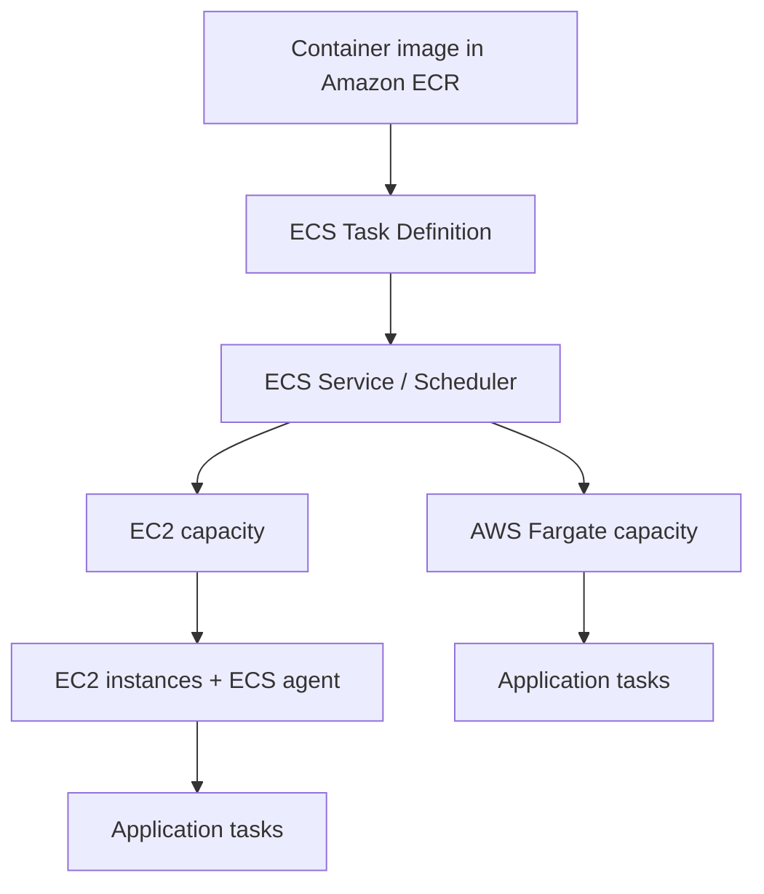
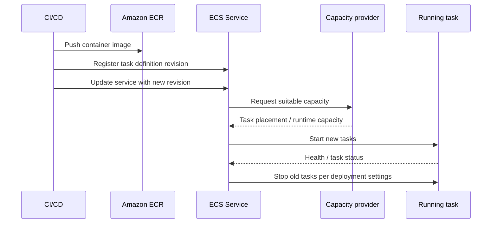
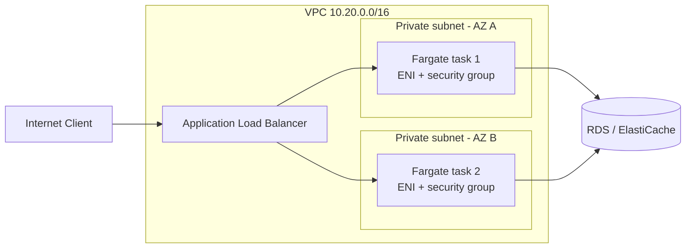
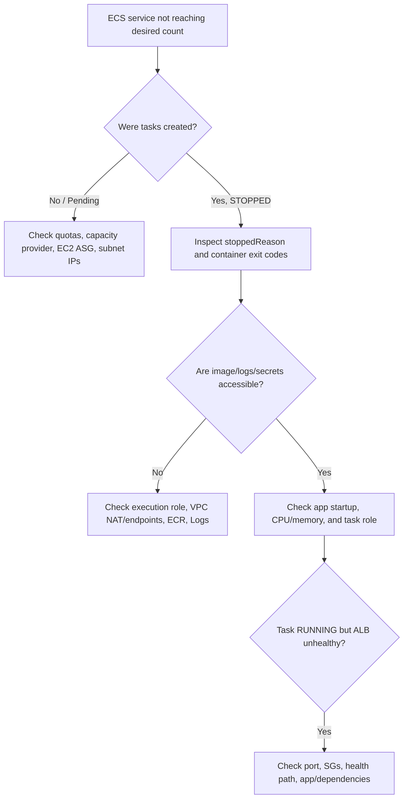

# ECS on EC2 and ECS on Fargate

## 1. The Challenge of Deploying Containers on AWS

An enterprise is migrating an ordering application from traditional servers to containers. The development team already has Docker images for APIs, background workers, and report-processing jobs. The application needs to run across multiple Availability Zones (AZs), connect to a database inside a VPC, scale replicas automatically under high traffic, and deploy new versions without service disruption.

With **Amazon Elastic Container Service (Amazon ECS)**, the enterprise can choose between two common execution models:

- **ECS on Amazon EC2:** containers run on EC2 instances provisioned and managed by the operations team inside an ECS cluster. The enterprise controls instance types, operating systems, capacity, and host resource utilization.
- **ECS on AWS Fargate:** containers run on AWS-managed serverless compute. The application team declares CPU, memory, networking, image, and required task permissions without provisioning or patching EC2 worker nodes.

This belongs to the **Containers with ECS** section in the **CLOUD_PROVIDERS_AWS** track. The track explores AWS services across Regions/AZs, IAM, VPC, compute, storage, databases, integration, and serverless; the goal is knowing how to choose services and operate securely, observably, resiliently, and cost-effectively. ECS is where these decisions converge: a container running fine on a developer workstation is not enough to guarantee production reliability in the cloud.

After this lesson, you will be able to explain ECS clusters, task definitions, tasks, and services; compare EC2 with Fargate; design networking and IAM permissions; use capacity providers and Auto Scaling; handle rolling deployments, logging, and deployment errors; and select the right model for your workload and budget.

## 2. What Does ECS Manage? Where Do EC2 and Fargate Differ?

Amazon ECS is a container orchestration service. You declare the application to run and the desired replica count; ECS deploys, maintains, and replaces tasks per configuration. **The ECS control plane is AWS-managed** in both models. The main difference lies in **compute capacity and operational responsibility for the underlying host infrastructure**.



| Question | ECS on EC2 | ECS on Fargate |
| --- | --- | --- |
| Who provisions container hosts? | Operations team creates/maintains EC2 instances or an Auto Scaling group | AWS provisions and manages compute infrastructure |
| Manage AMIs, OS patches, and host ECS agent? | **Yes**; can be automated with ECS-optimized AMIs and node refresh workflows | **No** access to or patching of the underlying host infrastructure |
| Primary billable resource unit | EC2 instances, EBS, network, and supporting services—even for unused host headroom | vCPU, memory, OS/architecture, and extra storage per task configuration/duration, plus related charges |
| Choose physical machine / instance type? | Yes: general purpose, compute, memory, GPU, instance storage, CPU architecture, etc. | No EC2 instance type selection; select from Fargate-supported CPU/memory pairs |
| Run privileged/host-level workloads? | More flexible depending on Linux/Windows, ECS, and configuration | Restricted by Fargate model; no host administrative access |
| Deploy tasks across multiple AZs? | Yes, when EC2 capacity is provisioned in those AZs | Yes, when appropriate subnets/AZs are selected and capacity is available |
| Can capacity run out? | Can exhaust EC2 instances/CPU/RAM/ENIs or fail to launch hosts | Can encounter Fargate capacity shortages, quotas, or Region/platform limits |
| Best suited for | Large steady baselines, host control, GPUs/specialized EC2 hardware | Standardized apps, minimizing host ops, variable workloads |

**ECS on EC2 is not a completely different orchestration service from Fargate.** Both share ECS task definitions, services, deployments, and most APIs. Different services in the same ECS cluster can use different capacity providers, though **a single capacity provider strategy cannot mix Fargate capacity providers with Auto Scaling group capacity providers** in the same strategy.

## 3. ECS Concepts to Master Before Comparing

| Component | Role | Example |
| --- | --- | --- |
| **Container image** | Packaged app and runtime ready to launch | `shop-api:v1` in Amazon ECR |
| **Task definition** | Declaration of image, CPU, memory, environment, ports, logs, IAM roles, and volumes | `shop-api-fargate:3` |
| **Task** | A single live execution of a task definition; can hold multiple containers | One API container plus one sidecar container |
| **Service** | Maintains desired task count, replaces failed tasks, deploys new versions | `shop-api-service`, `desiredCount=4` |
| **Cluster** | Logical grouping of tasks/services and capacity | `shop-production` |
| **Capacity provider** | Abstracts the compute type used and how capacity is allocated | `FARGATE`, `FARGATE_SPOT`, ASG capacity provider |
| **Service scheduler** | Decides where and when to place tasks per requirements/capacity | Replaces `STOPPED` tasks, coordinates rolling deployments |

**A task definition differs from a task:** a task definition is a registered versioned template; a task is a specific running instance of that template. **A service differs from a one-off task:** a service maintains desired count and launches replacements, whereas `RunTask` fits one-time or scheduled jobs that do not need continuously maintained replicas.

### 3.1. ECS Application Deployment Flow



Task definitions are immutable per revision: when changing the image or settings, register a **new revision**. Moving a service onto a new revision requires a deployment and real health verification. Never push an updated `latest` tag and assume running tasks will swap images automatically.

## 4. ECS on EC2: Host Control and Resource Allocation

### 4.1. Operational Architecture

In the EC2 model, you launch EC2 instances running a compatible container runtime and ECS agent, register them into an ECS cluster, and attach a **container instance IAM role**. The ECS agent on each host communicates with the ECS control plane to receive tasks and report available capacity.

```text
ECS Cluster: shop-production
   |
   +-- EC2 Auto Scaling group
       +-- EC2 instance AZ A (ECS agent, Docker/container runtime)
       |    +-- ECS task: shop-api
       |    +-- ECS task: metrics-worker
       +-- EC2 instance AZ B (ECS agent, Docker/container runtime)
            +-- ECS task: shop-api
            +-- ECS task: orders-worker
```

One EC2 instance can host **multiple tasks** as long as CPU, RAM, networking, and other constraints fit. You must ensure hosts have sufficient capacity for task placement; if a service requests 10 tasks but the cluster only has 2 small instances, excess tasks stay `PENDING` instead of running.

### 4.2. Responsibilities Remaining with the Operations Team

1. **Provisioning:** choosing instance types/AMIs, VPC subnets, storage, EC2 IAM instance profile, user data, and ECS cluster registration.
2. **Patching:** upgrading the ECS agent/container runtime, refreshing AMIs/OS, and cycling hosts safely—typically via node replacement rather than in-place manual edits.
3. **Capacity planning:** sizing instance counts, CPU/RAM/ENI requirements, placement constraints, and spare headroom for deployments and recovery.
4. **Security:** locking down SSH/Session Manager, enforcing IMDSv2, security groups, host hardening, EBS encryption, and IAM permissions.
5. **Availability:** spreading instances across AZs, configuring Auto Scaling, draining tasks on host replacement, and recovering from instance/AZ failures.
6. **Cost:** minimizing idle EC2, right-sizing, applying Savings Plans/Reserved Instances, and using EC2 Spot where workloads allow.

**ECS-optimized AMIs** reduce agent/runtime setup work, but do not eliminate host update responsibilities. Using an Auto Scaling group and launch template is the standard way to keep host configuration uniform and roll out newer versions.

### 4.3. Task Placement and Resource Utilization

ECS evaluates placement based on task requirements, remaining resources on container instances, network mode, and placement strategies/constraints. You can use `spread` to distribute tasks across AZs/instances or `binpack` to pack CPU/RAM onto fewer hosts depending on goals.

| Scenario | Sensible Priority | Trade-Off |
| --- | --- | --- |
| Need service continuity if an AZ fails | Spread instances and tasks across multiple AZs | May keep spare standby capacity |
| Batch tasks can pack onto fewer hosts | Binpack on CPU/memory where appropriate | Losing one host can impact many tasks simultaneously |
| App needs GPUs/specialized devices | GPU-capable EC2 instance family and matching task requirements | Higher cost and tighter placement constraints |
| Want EC2 Spot to lower cost | Spot ASG or mixed ASG with an appropriate capacity provider | Must handle EC2 Spot interruptions and capacity shortages |

Do not pick a placement strategy solely to minimize host count. A payment service requiring HA needs resilience against host/AZ failure; packing every task onto one EC2 instance is cheaper until that host becomes a single point of failure.

### 4.4. Sample ECS Task Definition for EC2

Example of a Linux EC2 worker using `bridge` network mode and shipping logs to CloudWatch Logs. ARNs and repositories are **placeholders**:

```json
{
  "family": "shop-worker-ec2",
  "requiresCompatibilities": ["EC2"],
  "networkMode": "bridge",
  "executionRoleArn": "arn:aws:iam::111122223333:role/ecsTaskExecutionRole",
  "taskRoleArn": "arn:aws:iam::111122223333:role/shopWorkerTaskRole",
  "containerDefinitions": [
    {
      "name": "worker",
      "image": "111122223333.dkr.ecr.ap-southeast-1.amazonaws.com/shop-worker:v1",
      "essential": true,
      "cpu": 256,
      "memoryReservation": 512,
      "logConfiguration": {
        "logDriver": "awslogs",
        "options": {
          "awslogs-group": "/ecs/shop-worker",
          "awslogs-region": "ap-southeast-1",
          "awslogs-stream-prefix": "ecs"
        }
      }
    }
  ]
}
```

This is an **EC2 configuration with Linux bridge networking**, not a Fargate template. `memoryReservation` is a soft memory reservation used for placement accounting—unlike a hard memory limit, it does not guarantee graceful handling of every out-of-memory condition. With multiple containers, total reservations plus networking/storage must fit within host capacity.

You can register the task definition and trigger a one-off run on a cluster **that already has EC2 container instances**:

```bash
aws ecs register-task-definition \
  --cli-input-json file://shop-worker-ec2.json \
  --region ap-southeast-1

aws ecs run-task \
  --cluster shop-production \
  --task-definition shop-worker-ec2:1 \
  --launch-type EC2 \
  --count 1 \
  --region ap-southeast-1
```

Revision `:1` is illustrative; use the actual revision/ARN returned by registration. When the cluster lacks EC2 capacity or tasks fail constraints, `RunTask` can return `failures`; inspect both `tasks` and `failures`, not just HTTP 200 status. These commands affect real resources and should only be run in an authorized test environment.

## 5. ECS on Fargate: No EC2 Worker Nodes to Manage

### 5.1. Operational Model

With **AWS Fargate**, you declare task CPU/memory, pick an image, configure VPC networking, IAM roles, logs, and storage. ECS places tasks on Fargate capacity when capacity and quotas allow. Operations never creates EC2 instances, never SSHs into worker hosts, and never patches the ECS agent on hosts.

```text
ECS Service (desiredCount = 4)
      |
      +-- Fargate task A (AZ A, task ENI)
      +-- Fargate task B (AZ A, task ENI)
      +-- Fargate task C (AZ B, task ENI)
      +-- Fargate task D (AZ B, task ENI)

AWS manages compute infrastructure; application teams remain responsible for config and security.
```

**Fargate does not eliminate networking or application administration.** Tasks still require VPC subnets, security groups, image pull paths, IAM roles, logs, secret management, and connectivity to downstream dependencies.

### 5.2. CPU, Memory, Operating System, and Platform

A Fargate task must select an AWS-supported **task-level CPU and memory pair**. You cannot arbitrarily set `cpu=300` and `memory=750` and expect Fargate to accept it. Depending on Linux/Windows, x86_64/Arm64 architecture, and Fargate platform version, valid combinations and supported features vary.

Common **Linux Fargate** examples:

| Task vCPU | Example Valid Memory | Sample Workload |
| --- | --- | --- |
| 0.25 vCPU | 0.5 GiB, 1 GiB, 2 GiB | Lightweight sidecar, small API |
| 0.5 vCPU | 1–4 GiB in supported increments | Web API and small worker |
| 1 vCPU | 2–8 GiB in supported increments | Standard API or worker |
| 2 vCPU | 4–16 GiB in supported increments | Higher CPU/RAM service |

These are only examples to illustrate CPU–RAM relationships, **not an exhaustive table of all Fargate sizes**. Larger vCPU tiers are supported with matching platforms/OSes. Before deploying, check ECS task definition parameters and Service Quotas for your Region, architecture, and OS.

**Do not confuse** **task-level** `cpu`/`memory` with **per-container** limits/reservations in the task definition. On Fargate, provisioning and billing are based on the task-level configuration; multiple containers inside one task share that task's CPU/memory budget.

### 5.3. Sample Task Definition for Fargate

Example API running on **0.5 vCPU / 1 GiB memory**, Linux x86_64, exposing container port 8080:

```json
{
  "family": "shop-api-fargate",
  "requiresCompatibilities": ["FARGATE"],
  "networkMode": "awsvpc",
  "cpu": "512",
  "memory": "1024",
  "executionRoleArn": "arn:aws:iam::111122223333:role/ecsTaskExecutionRole",
  "taskRoleArn": "arn:aws:iam::111122223333:role/shopApiTaskRole",
  "runtimePlatform": {
    "cpuArchitecture": "X86_64",
    "operatingSystemFamily": "LINUX"
  },
  "containerDefinitions": [
    {
      "name": "api",
      "image": "111122223333.dkr.ecr.ap-southeast-1.amazonaws.com/shop-api:v1",
      "essential": true,
      "portMappings": [
        { "containerPort": 8080, "protocol": "tcp" }
      ],
      "logConfiguration": {
        "logDriver": "awslogs",
        "options": {
          "awslogs-group": "/ecs/shop-api",
          "awslogs-region": "ap-southeast-1",
          "awslogs-stream-prefix": "ecs"
        }
      }
    }
  ]
}
```

Running this example requires a **real ECR repository/image**, CloudWatch log group `/ecs/shop-api`, valid IAM roles, VPC/subnets/security groups, and permissions. `networkMode=awsvpc` is mandatory for Fargate; you cannot reuse the EC2 `bridge` task definition from earlier on Fargate as-is.

### 5.4. Fargate Is Not AWS Lambda

Fargate runs ECS **container tasks/services**, which can be long-lived HTTP servers or active workers. AWS Lambda runs functions under a different invocation/event model, with distinct runtime/concurrency limits and billing structure. Fargate fits when an app needs full process/container control, listening ports, or jobs unsuited to Lambda; it is not necessarily optimal for every sub-second task.

## 6. Networking: Key Differences Between EC2 and Fargate

### 6.1. Fargate Always Uses `awsvpc`

With ECS on Fargate, every task receives an **elastic network interface (task ENI)** in a VPC subnet, with its own IP address and **security groups** per task/service configuration. This enables task-group traffic control similar to dedicated network resources. Subnets must have enough free IPs; if IP addresses run out, new tasks fail to launch even if CPU/memory quotas remain.



If tasks sit in **private subnets**, they typically need a **NAT gateway** to reach Internet endpoints or appropriate **VPC endpoints** to pull ECR images, fetch secrets, and ship logs. For example, with private ECR and no NAT, you typically evaluate ECR API, ECR DKR, an **S3 gateway endpoint** (for image layers), plus CloudWatch Logs and Secrets Manager endpoints as needed. Enable matching private DNS/routes/security groups and verify exact platform version requirements.

If tasks sit in a **public subnet** with a public IP assigned, a route to an Internet Gateway provides Internet egress. **Placing a task in a public subnet with `assignPublicIp=DISABLED` does not give Internet access.** For production, private subnets + load balancer/endpoints usually shrink the attack surface.

### 6.2. ECS on EC2 Networking Is More Flexible but More Complex

The EC2 launch type supports network modes such as `bridge`, `host`, and `awsvpc` depending on OS, agent, instance, and task definition requirements:

| Network Mode | Characteristics | Notes |
| --- | --- | --- |
| `bridge` | Containers use host bridge/NAT networking and port mappings | Supports dynamic host ports; coordinate ALB/service registration properly |
| `host` | Containers share the host's network namespace | Port conflicts and tighter host coupling; weigh security trade-offs |
| `awsvpc` | Each task gets its own ENI/IP | Per-task security groups; watch EC2 per-instance ENI/IP limits |

**Application Load Balancer target group:** with Fargate or `awsvpc` tasks, choose **target type `ip`**. With certain EC2 `bridge`/`host` models, target type `instance` may fit depending on port mappings; never blindly copy an EC2 target group configuration onto Fargate.

### 6.3. A `RUNNING` Task May Still Not Serve Customers

All layers must work together:

1. VPC/subnets/routes support ingress from the ALB and egress to ECR, logs, and databases.
2. The ALB security group permits HTTPS from expected clients; the task security group permits port 8080 from the **ALB security group**, not open to the entire VPC/Internet.
3. The container actually listens on the expected port/interface; the ALB target group matches `containerName`, `containerPort`, and health check path.
4. IAM roles, secrets, and database endpoints allow the application to initialize.
5. Across multiple AZs, apps and dependencies have matching availability; DNS, TLS/certificates, and logging work properly.

## 7. IAM: Three Commonly Confused Roles

### 7.1. ECS Task Role

The **task role** is the identity used by **application code inside the container** to call AWS APIs such as `s3:GetObject` or `dynamodb:Query`. SDKs retrieve temporary credentials from the provided ECS task credentials endpoint. Never store long-lived AWS access keys in Docker images or environment variables just to let an app read S3.

### 7.2. Task Execution Role

The **task execution role** performs actions on behalf of the task during startup/operations, such as pulling images from private ECR, sending logs via a log driver, or reading secrets for container definitions where supported. It **should not** hold application business permissions.

### 7.3. EC2 Container Instance Role

When ECS runs on EC2, the host instance carries an **EC2 instance profile/container instance IAM role** so the ECS agent can register and communicate with the ECS control plane. This role is distinct from both the task role and task execution role. On Fargate, operations never creates an EC2 container instance role because AWS manages the worker host.

| IAM Role | Who Uses It? | Example Permissions |
| --- | --- | --- |
| **Task role** | Application running inside the task | `s3:GetObject` on a prefix, `dynamodb:Query` on a table |
| **Task execution role** | ECS infrastructure acting on behalf of the task | ECR pull permissions, CloudWatch Logs, secret injection per config |
| **Container instance role** | ECS agent / EC2 host | Register container instance, update ECS host state |

**Least privilege:** never attach `AdministratorAccess` to a task role as a shortcut around `AccessDenied`. Inspect **CloudTrail**, the denied action, target resource ARN, and relevant **resource policies/KMS key policies/SCPs**. With EC2 launch type, also block untrusted containers from reaching EC2 instance metadata or host credentials.

## 8. Capacity Providers, Auto Scaling, and Spot

### 8.1. Fargate Capacity Providers

ECS supports two common Fargate capacity providers:

- **`FARGATE`**: runs tasks on Fargate at standard On-Demand pricing.
- **`FARGATE_SPOT`**: uses spare Fargate capacity at a reduced rate, though **tasks can be interrupted** when AWS reclaims capacity. Use only when the app tolerates task stops and restarts.

A **capacity provider strategy** can set `base` and `weight`. For instance, if a service needs 6 tasks, setting `base=2` on `FARGATE` and a `1:3` weight split between `FARGATE` and `FARGATE_SPOT` targets two baseline Fargate tasks and distributes the remaining 4 by weight. Actual task placement can vary temporarily during scaling or Spot capacity shortages.

**`base` can be configured on at most one capacity provider in a strategy.** `weight=0` excludes a provider from above-base allocation, and at least one provider must have a positive weight when applicable. Never run an entire payment API on `FARGATE_SPOT` just because it is cheaper without a baseline ensuring your SLO.

### 8.2. EC2 Capacity Providers

With ECS on EC2, you can associate an **EC2 Auto Scaling group** with an **ASG capacity provider**. When appropriate **managed scaling** features are enabled, ECS adjusts the ASG's EC2 instance count to meet task placement demand.

```text
ECS Service desired count increases
  -> ECS tasks need more compute capacity
  -> ASG capacity provider / managed scaling
  -> Auto Scaling group scales out EC2 instances
  -> New instances register into ECS cluster
  -> ECS schedules tasks onto hosts with available resources
```

**Service Auto Scaling and ASG capacity scaling are two separate layers.** Service Auto Scaling adjusts **desired task count** based on CPU, memory, ALB request count, or app metrics; ASG/capacity provider scaling adjusts **EC2 host count** to provide room for those tasks. Fargate removes the separate ASG host-scaling layer, while still requiring Service Auto Scaling to adjust task counts.

ASGs can use **On-Demand, EC2 Spot, or supported mixed configurations**. ECS container draining/managed instance draining and Spot interruption handling help migrate work when a host is shutting down, though in-flight work may not finish if remaining notice is short. If an EC2 capacity provider enables managed termination protection, configure matching scale-in protection and compatible ASG settings; never flip it on blindly for an ASG not designed for it.

### 8.3. How Fargate Spot and EC2 Spot Compare

| Aspect | Fargate Spot | EC2 Spot for ECS |
| --- | --- | --- |
| Interrupted unit | Fargate task | EC2 host instance, which may run multiple tasks |
| Host management | AWS | Enterprise manages host/ASG, AMI/agent/draining |
| Capacity pool | Fargate spare capacity | EC2 Spot capacity pools by instance type/AZ |
| Suitable workloads | Stateless tasks, batch, workers with retry/checkpointing | Similar, plus specialized host/instance needs |
| Protection against shortages | `FARGATE` baseline, retries/scaling, multi-AZ | On-Demand host baseline, diversified EC2 types/AZs, ASG tuning |

Fargate Spot sends an interruption notice with limited lead time (typically around two minutes before stopping the task for a Spot interruption). Containers receive standard ECS stop signals; configure **`stopTimeout`** appropriately and ensure the app handles `SIGTERM`, stops accepting new work, checkpoints, and exits cleanly. Never rely solely on the warning window to preserve data; idempotency/retries and externalizing state remain mandatory for critical workloads.

## 9. Sample Deployment: Fargate Service Behind an Application Load Balancer

Assume you already have ECS cluster `shop-production`, private subnets across two AZs, security groups, an ALB/`ip` target group, IAM roles, an ECR image, and a CloudWatch Logs group. You want to run `shop-api` with 4 tasks, combining a Fargate baseline with Fargate Spot overflow.

### 9.1. Prepare the Task Definition

Save the JSON from Section 5.3 as `shop-api-fargate.json`, then register it:

```bash
aws ecs register-task-definition \
  --cli-input-json file://shop-api-fargate.json \
  --region ap-southeast-1
```

Inspect the returned ARN and revision; do not assume the task definition is always `:1` if revisions already exist. With `FARGATE` compatibility enabled, the task definition must use valid CPU/memory pairs, `awsvpc`, a matching architecture/OS image, valid roles, and log configuration.

### 9.2. Create the ECS Service with a Capacity Provider Strategy

Example AWS CLI (**illustrative only; do not run with placeholders verbatim**):

```bash
aws ecs create-service \
  --cluster shop-production \
  --service-name shop-api \
  --task-definition shop-api-fargate:1 \
  --desired-count 4 \
  --capacity-provider-strategy \
    capacityProvider=FARGATE,base=2,weight=1 \
    capacityProvider=FARGATE_SPOT,weight=3 \
  --network-configuration \
    'awsvpcConfiguration={subnets=[subnet-11111111111111111,subnet-22222222222222222],securityGroups=[sg-0123456789abcdef0],assignPublicIp=DISABLED}' \
  --load-balancers \
    'targetGroupArn=arn:aws:elasticloadbalancing:ap-southeast-1:111122223333:targetgroup/shop-api/0123456789abcdef,containerName=api,containerPort=8080' \
  --region ap-southeast-1
```

`shop-production`, the task definition name, account ID, subnet IDs, security group ID, and target group ARN are all examples. Before running, ensure both subnets sit in **AZs with capacity**, the target group uses **target type `ip`**, tasks have paths to pull ECR images and write logs, the ALB listener has matching forwarding rules, and IAM/service-linked roles and quotas are satisfied.

If you do not want Fargate Spot for the API, use **`FARGATE` only**. If specifying a single **`launchType=FARGATE`**, do not pass `--launch-type` and `--capacity-provider-strategy` together in the same `create-service` call: they represent mutually exclusive ways to declare capacity.

### 9.3. Verify the Service Is Truly Healthy

```bash
aws ecs describe-services \
  --cluster shop-production \
  --services shop-api \
  --region ap-southeast-1 \
  --query 'services[0].[status,desiredCount,runningCount,pendingCount,events]'

aws ecs list-tasks \
  --cluster shop-production \
  --service-name shop-api \
  --region ap-southeast-1
```

Once you have a task ARN, run `aws ecs describe-tasks --cluster ... --tasks ...` to inspect `lastStatus`, `desiredStatus`, `stopCode`, `stoppedReason`, container statuses, and network attachments. **Meeting `runningCount` does not guarantee a healthy API endpoint**: check ALB target health, application logs, and a real HTTPS request.

## 10. Storage and Container Statefulness

### 10.1. Local Data Lives Only for the Task Lifecycle

Container filesystems and ephemeral storage must not be treated as permanent storage. When a task is replaced, any data stored only inside that task disappears. On modern Fargate Linux platforms, tasks receive **default ephemeral storage** per service rules (typically 20 GiB on current platform versions), configurable higher up to supported limits. Additional ephemeral storage carries separate pricing.

With ECS EC2, containers can use host storage (EBS or instance store) per Docker/ECS configuration, but you must manage host lifecycles, data placement, and migration when EC2 instances are replaced. Sharing a host path does not automatically make data highly available across AZ/host failures.

### 10.2. Durable Choices for Application Data

| Data Need | Typically Suitable Service / Approach |
| --- | --- |
| Images/object files, artifacts, backups | **Amazon S3** with appropriate IAM, encryption, lifecycle/versioning |
| Multiple Linux tasks sharing an NFS directory | **Amazon EFS** where supported by feature/launch type/platform |
| Transactional databases | **Amazon RDS/Aurora** or an appropriate managed database |
| Retryable work queues | **Amazon SQS** or a suitable message queue service |
| Shared cache/session store | **ElastiCache** or an appropriate cache/session service |
| Reproducible scratch/temp caches | Task/container ephemeral storage |

For instance, a worker reading SQS messages and generating reports should write final outputs to S3 and record completion in durable storage before acknowledging the message. When the ECS service replaces tasks during deployments or Spot interruptions, a new worker can continue without relying on the old task's disk.

**ECS EC2 and Fargate support different volume capabilities.** EFS works in supported configurations; EBS/task-attached volume features carry specific constraints by launch type, platform version, and task type. Check current ECS/EBS documentation at implementation time—never assume every host bind mount, privileged volume, or device works on Fargate.

## 11. New Deployments, Health Checks, and Rollbacks

### 11.1. Rolling Deployment

When updating an ECS service to a new task definition revision, the default ECS deployment controller can perform a **rolling update**: launching new tasks and then stopping old ones within deployment bounds, load balancer health, and available capacity.

Common parameters include:

- **`minimumHealthyPercent`**: minimum percentage of desired count that must remain healthy during a deployment per ECS rules.
- **`maximumPercent`**: upper percentage limit on total running/counted tasks during a deployment per ECS rules.
- **Deployment circuit breaker**: detects failed deployments and can **roll back** to the previous stable revision when enabled and conditions are met.
- **CloudWatch alarms**: some ECS deployment modes support alarms to detect failures and trigger rollbacks.

If an EC2 cluster has capacity for only the currently running tasks, a deployment requiring new tasks before stopping old ones can stall. Fargate removes host management, yet can still hit capacity shortages, subnet IP exhaustion, or quota limits. Provision **capacity headroom** and sensible deployment parameters rather than forcing mass termination of healthy tasks.

### 11.2. Multi-Layer Health Checks

| Check | Target | Example Failures Detected |
| --- | --- | --- |
| ECS task/container status | Container process and task | Container crash, OOM, image pull failure |
| Container health check | Command executed inside container if defined | Process fails readiness or stops listening |
| ALB target group health check | HTTP/TCP check to task port/path | Task `RUNNING` but `/health` returns 500 or TCP times out |
| Application / synthetic test | Business APIs and dependencies | API returns 200 on `/health` while DB queries fail |

**Overly superficial health checks** let broken tasks serve traffic; **overly aggressive health checks** cause constant task churn during brief external dependency blips. Design balanced readiness and liveness checks, configuring grace periods, timeouts, and retries around real startup and app behavior.

## 12. Monitoring, Logging, and Troubleshooting ECS

### 12.1. Metrics and Signals to Watch

| Category | Tools | Questions to Answer |
| --- | --- | --- |
| Service desired/running/pending tasks | ECS Console/API, CloudWatch metrics | Are enough replicas running to meet SLOs? |
| CPU/Memory utilization & reservation | ECS/CloudWatch, Container Insights if enabled | Are tasks starved for CPU/RAM or is the cluster out of host capacity? |
| ECS service events & stopped reasons | `describe-services`, `describe-tasks` | Were tasks replaced due to image, memory, networking, or health? |
| Application logs | `awslogs` → CloudWatch Logs or supported log routing | What are the code errors, exceptions, dependency, or startup failures? |
| ALB metrics/target health | ALB/CloudWatch | Are requests failing, latency spiking, or targets unhealthy? |
| EC2 node health/ASG scaling | EC2, Auto Scaling, ECS container instances | Are hosts failing to register or lacking CPU/RAM/ENIs? |
| Cost | Cost Explorer, Budgets, ECS/Fargate pricing | Are Fargate usage, EC2 utilization, and network/log/storage costs aligned? |

CloudWatch Container Insights provides deeper ECS/task/service CPU/memory telemetry when enabled within supported scope. Account for **log/metric ingestion cost** and retention policies; logging every full request or secret wastes money and creates security exposure.

### 12.2. Diagnosing Tasks That Won't Start or Receive Traffic



| Symptom | Likely Causes | How to Verify |
| --- | --- | --- |
| `RESOURCE:CPU`/`RESOURCE:MEMORY` placing EC2 tasks | Hosts lack sufficient free resources | `describe-container-instances`, ASG desired/current capacity |
| `CannotPullContainerError` | Wrong ECR URI/tag, missing execution role permission, network egress/endpoints | ECS stopped reason, ECR, SGs/routes/VPC endpoints |
| `ResourceInitializationError` | Cannot read secrets/log config/network resources | Task details, execution role, Secrets Manager/Logs/networking |
| `Task failed to start`/`STOPPED` | App crash, wrong runtime/architecture, OOM | Container exit code, CloudWatch Logs, task definition |
| Fargate task stuck Pending | Capacity/quotas, ENI IP exhaustion, or subnet config | ECS service events, Service Quotas, subnet available IP count |
| EC2 host missing from ECS cluster | Agent not running/registered, bad instance profile or network | EC2 user data/agent logs, ECS cluster association, IAM instance role |
| Task RUNNING but ALB 503/Unhealthy | Wrong target group type/port/health path/SG | ALB target health reasons, task ENI, service load balancer config |
| Service deployment rolls back | New tasks fail health/startup or trigger alarm | ECS deployment/events, app logs, target health |

**Never "quick-fix" issues by opening `0.0.0.0/0` to app ports or attaching `AdministratorAccess`.** Isolate the failing layer—capacity, image/network, IAM, task startup, routing, or application health—and adjust only that scope.

### 12.3. ECS Exec and Container Access

**ECS Exec** enables interactive access to running ECS containers where supported, for diagnostics once explicitly enabled with proper IAM, Session Manager, and logging settings. Never treat ECS Exec as a reason to maintain SSH-like access into production containers or leave manual file edits behind. Changes inside a running task vanish when the task is replaced; always update images/IaC/config and redeploy.

Administrators must tightly govern **who has `ecs:ExecuteCommand`**, which tasks/containers permit it, and session audit logging—especially for workloads handling sensitive data.

## 13. Security: How Far Does Shared Responsibility Go on EC2 vs. Fargate?

### 13.1. ECS EC2

The enterprise controls and must secure EC2 hosts: OS/AMI, patches, ECS agent, container runtime, EC2 instance IAM role, host networking, and storage. Multiple tasks can share a host; carefully evaluate trust boundaries, root/privileged mode, hostPath mounts, IMDS access, and who can control Docker/the agent. A compromised container on a poorly hardened host can impact beyond its own task scope.

### 13.2. ECS Fargate

AWS manages the host infrastructure and provides task-level execution isolation per the Fargate model. The enterprise remains responsible for container images, dependencies, secrets, task roles, VPC security groups, data, logging, task configuration, and application security. Fargate **does not protect you** from an API with SQL injection, an overly broad IAM role, or passwords leaked into environment variables/logs.

### 13.3. Common Controls to Enforce

1. Use scanned images, pin versions/digests or verify provenance; avoid unverified mutable tags.
2. Separate the **execution role** from the **task role**; apply least privilege and audit resource/KMS policies.
3. Store secrets in **AWS Secrets Manager** or **Systems Manager Parameter Store** as needed—never commit them to source/Dockerfiles. When rotating secrets, design how tasks pick up new values instead of assuming injected env vars update automatically.
4. Enforce network segmentation via subnets, security groups, and VPC endpoints, TLS to clients/databases, and ECR image security.
5. Enable CloudTrail/auditing for ECS/task definition/service/IAM changes; tightly restrict task definition update rights, `iam:PassRole`, and privileged roles.
6. Implement multi-AZ, health checks, logging, backups, and resilience to task/host replacement.

## 14. Comparing EC2 and Fargate Costs for Real Workloads

**ECS cost is never just the price of one task or one EC2 instance.** ECS on EC2 typically incurs EC2 instance charges and supporting resources. ECS on Fargate incurs compute charges based on **task vCPU and memory for billed runtime** (plus items like extra ephemeral storage depending on config), along with storage/networking/logging. Costs for ECR, ALB, NAT Gateway, data transfer, CloudWatch, and other services apply separately in both models.

### 14.1. Mental Cost Formulas

For Fargate running homogeneous tasks:

```text
Fargate compute cost (estimate)
  ≈ average running tasks × billed hours
    × (vCPU/task × vCPU-hour rate
       + GiB memory/task × GiB-hour rate)
    + extra ephemeral storage fee (if any)

Total cost = compute + ALB + network/NAT + storage + logs + dependent services
```

For ECS EC2:

```text
EC2 compute cost (estimate)
  ≈ total running hours per EC2 instance type × effective rate
    + billable EBS/instance storage + network + logs + dependent services

Paid EC2 capacity sitting idle is still part of the bill.
```

Unit rates also depend on Region, CPU architecture, OS, On-Demand vs. Spot, Savings Plans/Reserved Instances, and pricing updates. Never use simplified summary formulas in place of official pricing calculators for production budgeting.

### 14.2. Fictional Comparison Example

Suppose an app needs **8 tasks**, each using **0.5 vCPU and 1 GiB RAM**, running continuously for 720 hours/month. For practice, assume purely illustrative rates:

- **Fargate:** fictional unit rates of `0.05 USD/vCPU-hour` and `0.005 USD/GiB-hour`.
- **ECS EC2:** an EC2 host group sized for 8 tasks + reserve headroom at a fictional total compute rate of `0.22 USD/hour`.

| Option | Illustrative Formula | Compute / Month |
| --- | --- | ---: |
| Fargate, 8 tasks | `8 × 720 × (0.5 × 0.05 + 1 × 0.005)` | **172.80 USD** |
| EC2 hosts, 0.22 USD/hr total | `720 × 0.22` | **158.40 USD** |

**Do not treat these numbers as AWS quotes**; they exist only to illustrate how to compare. If Fargate scales down to **2 tasks at night and 8 tasks at peak**, actual cost tracks total task-hours and can look very different. Conversely, if EC2 hosts run 24/7 with large idle gaps, low utilization makes EC2 less efficient. If the team spends substantial hours patching hosts, maintaining ASGs/AMIs, or troubleshooting nodes, **human operational cost** belongs in the decision too.

### 14.3. Do Not Overlook NAT Gateway and Logging

A Fargate design in private subnets pulling ECR images through a NAT Gateway can generate notable hourly NAT charges and data processing fees if tasks churn frequently. With proper architecture, supported **VPC endpoints** can reduce NAT traffic, though endpoints (especially interface endpoints) have their own cost. Compare **total cost** rather than only thinking "Fargate bills per running task."

With EC2, packing many tasks onto hosts saves money at high utilization, while still requiring capacity headroom, AZ resilience, and EBS/host patching costs. Choose based on **cost per successful request/job** and SLO/RTO compliance, not raw compute/hour price alone.

## 15. Decision Framework: EC2 vs. Fargate

| Workload Requirement | Evaluate First | Rationale |
| --- | --- | --- |
| Stateless API, small team, variable load | **Fargate** | Minimal host management, per-task scaling |
| Many small services, standardized VPC/IAM/CI/CD | **Fargate** | Simplifies compute layer and per-task IAM boundaries |
| Very large, steady 24/7 CPU/RAM baseline | **ECS EC2** or compare both | Optimizes host utilization/discounts when an ops team is available |
| Needs GPUs/host devices, custom kernel, or specialized instance features | **ECS EC2** | Control over EC2 instance types and OS/runtime |
| Interruption-tolerant batch jobs | **Fargate Spot** or **ECS EC2 Spot** | Lower cost when jobs support checkpoints/retries/idempotency |
| Windows or Arm64 applications | **Verify support on both** | Feature/OS/architecture and CPU-memory pairs vary by launch type/platform |
| Shared NFS filesystem required | **Fargate or EC2 with EFS** | Verify platform, IAM, mount targets, security, and performance |
| Need to reduce EC2 host patching burden | **Fargate** | AWS manages underlying compute; team focuses on the application |

An organization **does not have to pick only one model**. For example, frontend APIs and event services can run on Fargate while GPU pipelines or workloads needing specialized host networking run as separate ECS EC2 services. Still, unify CI/CD, task IAM, logging, tagging, budgets, and operations to contain complexity when using both.

### 15.1. Pre-Production Checklist

1. Confirm whether workloads are stateless, along with SLO/RTO, traffic profile, and CPU/RAM/OS/architecture needs.
2. Verify ECR images: tags/digests, scans, CPU architecture, and pullability from target subnets.
3. Choose the right launch type/capacity provider strategy; never mix Fargate and ASG capacity providers in one strategy.
4. Design multi-AZ subnets, IP headroom, SGs, ALB target type, NAT/VPC endpoints, and TLS.
5. Separate task role, execution role, and EC2 instance role (if used); restrict `iam:PassRole`.
6. Configure secrets, CloudWatch Logs, image scanning, and data access permissions.
7. Plan scaling: service task count, EC2 ASG capacity if using EC2, and Fargate/EC2 quotas.
8. Design deployments, health checks, circuit breaker/rollbacks, and capacity headroom.
9. Move durable data to S3/EFS/RDS/SQS or suitable stores; test task recovery.
10. Monitor errors, latency, `STOPPED` tasks, ALB health, and costs; run controlled task/AZ failure drills.

## 16. Three Applied Scenarios

### Scenario A — E-Commerce API with a Lean Ops Team

A stateless Dockerized app connects to RDS, serving tens of requests/second normally while spiking sharply during sales events. The team has only two operations engineers and wants to avoid AMI/OS patching.

**Suggestion:** use **ECS Fargate** across private subnets in two AZs, an ALB with an `ip` target group, a task role scoped strictly to required resources, and an execution role for ECR/logs. Configure Service Auto Scaling on CPU/ALB request count, CloudWatch/ALB monitoring, rolling deployments, and rollbacks. Optionally test Fargate Spot for burst capacity above a `FARGATE` baseline guaranteeing minimum availability.

### Scenario B — Data Team Needing GPUs and Heavy Per-Host Resources

A video-processing pipeline uses GPUs and local scratch disks; jobs run for hours with relatively steady throughput, and a platform team can manage EC2/AMIs.

**Suggestion:** use **ECS EC2** with suitable GPU instance types, an ECS-optimized GPU AMI, and task definitions specifying supported resource requests. Design an Auto Scaling group/capacity provider, monitor GPU/CPU/RAM, and consider EC2 Spot for checkpointed jobs. Never force Fargate just to avoid host operations if Fargate cannot satisfy GPU/device requirements.

### Scenario C — Order-Processing Worker Consuming from SQS

A worker reads SQS messages, normalizes data, and writes outputs to S3/DynamoDB. Work is retryable and each message carries an ID to prevent duplicates. Job volume spikes 10x for a few hours then drops.

**Suggestion:** use an ECS Fargate service or batch `RunTask` with **`FARGATE_SPOT`** for interruption-tolerant work, or ECS EC2 Spot if an established managed host fleet exists. Keep checkpoints/transactions outside containers, configure SQS visibility timeouts, a dead-letter queue, scaling by queue depth/age, and `SIGTERM` handling. Measure cost per **successful** job to compare against On-Demand.

## 17. Self-Check Questions

**Q1.** An ECS service requests 6 tasks, but the ECS EC2 cluster has only 1 small instance; the service shows several `PENDING` tasks. Will increasing `desiredCount` to 12 solve this?

**Hint:** No. You must increase **EC2 host capacity** via the ASG/capacity provider or adjust task requirements. Service Auto Scaling only changes task count; it does not create host room unless managed scaling/capacity is configured properly.

**Q2.** Why can't a Fargate task definition use `networkMode=bridge`?

**Hint:** Fargate requires `awsvpc`; every task receives an ENI, IP, and security groups per configuration. `bridge` applies only to supported ECS EC2 models.

**Q3.** An app inside a task needs to read S3, but gets permission denied. Should you edit the ECS task execution role or the task role?

**Hint:** Usually edit the application's **task role** and inspect bucket/KMS policies and SCPs. The execution role is primarily for ECS actions on behalf of the task, such as ECR pulls and logging.

**Q4.** An ECS Fargate task runs in a private subnet with no public IP and reports `CannotPullContainerError`. Why?

**Hint:** It may lack a network path to ECR API/registry/S3 layers, NAT, or matching VPC endpoints; or the execution role lacks permissions or the image URI is wrong. Read the stopped reason before opening public access.

**Q5.** Does `FARGATE_SPOT` provide the same availability as Fargate On-Demand?

**Hint:** No. Fargate Spot can be reclaimed; keep a `FARGATE` baseline for critical services and implement graceful shutdown and retries/checkpointing. Even `FARGATE` requires quota/capacity, multi-AZ, and task recovery design.

**Q6.** Why must an ALB target group for ECS Fargate use `targetType=ip`?

**Hint:** Fargate tasks run with `awsvpc` and have their own task ENI/IP, rather than registering by EC2 instance ID as in certain ECS EC2 `bridge` configurations.

**Q7.** A Fargate API loses uploaded files whenever ECS replaces a task. Will switching to ECS EC2 automatically solve this?

**Hint:** No. Move durable data to S3/EFS or a proper data service; switching launch types does not create backups or HA for local filesystems.

**Q8.** Why can EC2 save money for high steady baselines while being expensive for rarely run tasks?

**Hint:** EC2 hosts generally bill per running hour even while idle; with many steady tasks, high host utilization can lower effective unit cost. Fargate works well when paying only for task runtime resources, though network/storage/logging fees must still be compared.

## 18. Takeaways

**ECS on EC2** and **ECS on Fargate** share the same **cluster, task definition, task, service, and deployment** model. The biggest difference: with **EC2**, the enterprise provisions, updates, and optimizes hosts; with **Fargate**, AWS manages compute infrastructure and the enterprise focuses on task declarations, networking, IAM, data, and application operations.

Choose based on **workload requirements**, not solely on the "serverless" label or an hourly unit price. Fargate suits many standardized container apps and variable loads; ECS EC2 shines when GPUs, specialized instances, or large-scale host optimization are required. Both require **least-privilege IAM, proper VPC/security groups, Auto Scaling, multi-AZ, durable storage, health checks, monitoring, and recovery runbooks**. The right choice is the one that meets SLOs/RTOs at a **reasonable total infrastructure and operational cost**.

### AWS Reference Documentation

- [Amazon ECS — Launch types](https://docs.aws.amazon.com/AmazonECS/latest/developerguide/launch_types.html)
- [Amazon ECS — AWS Fargate](https://docs.aws.amazon.com/AmazonECS/latest/developerguide/AWS_Fargate.html)
- [Amazon ECS — Task definitions](https://docs.aws.amazon.com/AmazonECS/latest/developerguide/task_definitions.html)
- [Amazon ECS — Task definition parameters](https://docs.aws.amazon.com/AmazonECS/latest/developerguide/task_definition_parameters.html)
- [Amazon ECS — Capacity providers](https://docs.aws.amazon.com/AmazonECS/latest/developerguide/cluster-capacity-providers.html)
- [Amazon ECS — Auto Scaling group capacity providers](https://docs.aws.amazon.com/AmazonECS/latest/developerguide/asg-capacity-providers.html)
- [Amazon ECS — Fargate capacity providers](https://docs.aws.amazon.com/AmazonECS/latest/developerguide/AWS_Fargate_Capacity_Providers.html)
- [Amazon ECS — Fargate task networking](https://docs.aws.amazon.com/AmazonECS/latest/developerguide/fargate-task-networking.html)
- [Amazon ECS — Task networking with awsvpc](https://docs.aws.amazon.com/AmazonECS/latest/developerguide/task-networking-awsvpc.html)
- [Amazon ECS — Task IAM role](https://docs.aws.amazon.com/AmazonECS/latest/developerguide/task-iam-roles.html)
- [Amazon ECS — Task execution IAM role](https://docs.aws.amazon.com/AmazonECS/latest/developerguide/task_execution_IAM_role.html)
- [Amazon ECS — Service Auto Scaling](https://docs.aws.amazon.com/AmazonECS/latest/developerguide/service-auto-scaling.html)
- [Amazon ECS — Fargate Spot](https://docs.aws.amazon.com/AmazonECS/latest/developerguide/ecs-fargate-spot.html)
- [Amazon ECS — Monitor service deployments](https://docs.aws.amazon.com/AmazonECS/latest/developerguide/service-deployment-monitoring.html)
- [Amazon ECS — Troubleshooting](https://docs.aws.amazon.com/AmazonECS/latest/developerguide/troubleshooting.html)
- [AWS Fargate pricing](https://aws.amazon.com/fargate/pricing/)
- [Amazon ECS pricing](https://aws.amazon.com/ecs/pricing/)
