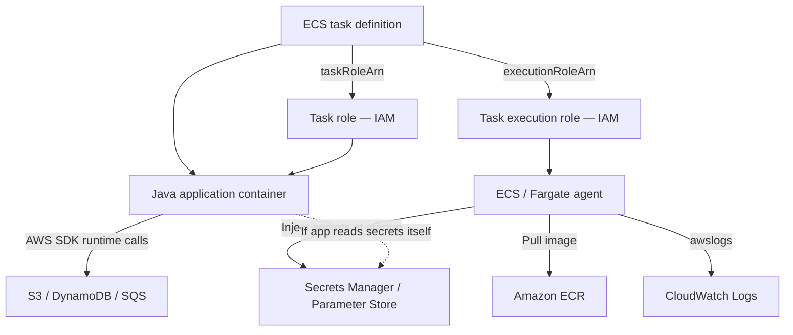
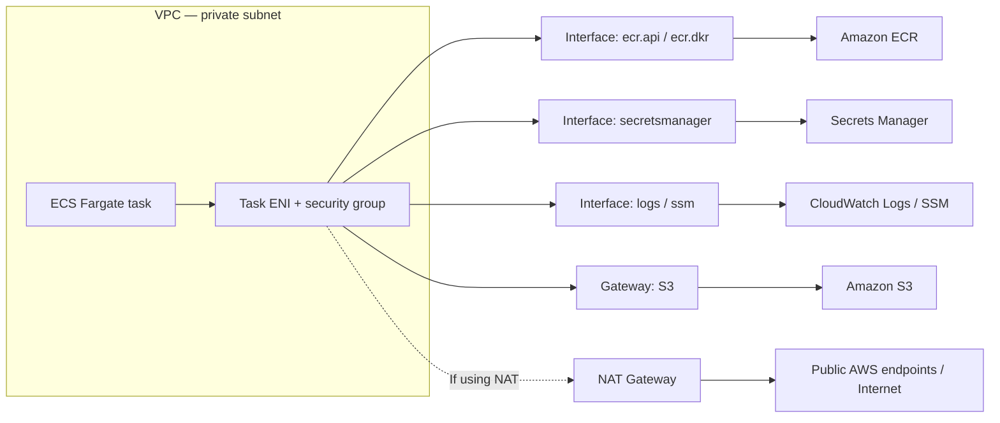
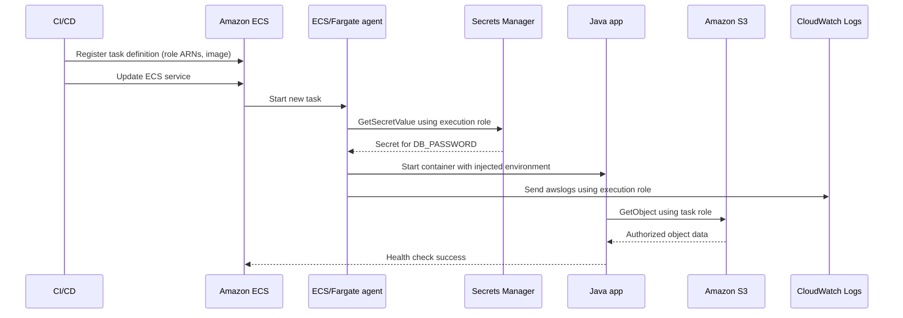

# Task Roles, Execution Roles, and Secret Management in Amazon ECS

> **Chapter:** Containers with ECS  
> **Module:** `CLOUD_PROVIDERS_AWS`  
> **Context:** A Java/Spring Boot application running as containers on Amazon Elastic Container Service (ECS), using Amazon ECR, Amazon S3, Amazon CloudWatch Logs, AWS Secrets Manager, or Systems Manager Parameter Store. The goal is to grant accurate IAM permissions for both the **application** and the **task-launching infrastructure**, distribute secrets securely, operate with observability, handle rotation, recover from deployment failures, and control costs.

## Learning Objectives

After this lesson, learners will be able to:

1. Distinguish the **IAM task role** (`taskRoleArn`) and **task execution role** (`executionRoleArn`) from EC2 container instance roles, service-linked roles, and deployer permissions.
2. Explain the flow of the ECS agent pulling container images, writing logs, and injecting secrets versus Java code calling AWS services via the AWS SDK.
3. Configure both roles under the **least privilege** principle, using the `ecs-tasks.amazonaws.com` trust policy and conditions to mitigate confused deputy risks.
4. Store secrets in **AWS Secrets Manager** or **SSM Parameter Store SecureString**, reference them via `containerDefinitions[].secrets[]`, and understand `GetSecretValue`/`GetParameters`/`kms:Decrypt` requirements.
5. Compare **startup secret injection** with **runtime secret retrieval** in terms of IAM roles, update timing, exposure risks, and rotation handling.
6. Design ECS Fargate in private subnets with NAT or appropriate VPC endpoints so tasks can pull images, fetch secrets, and write CloudWatch Logs.
7. Troubleshoot `ResourceInitializationError`, `CannotPullContainerError`, and `AccessDeniedException`, and safely redeploy tasks after secret rotation.
8. Inspect resources with the AWS CLI, build release checklists, monitor operations, and design rollback plans.

## 1. Why Does ECS Need Multiple IAM Roles?

An **ECS task** is the execution unit running one or more containers from a **task definition**. When a task starts, there are two separate groups of work:

- **The ECS/Fargate agent and orchestration infrastructure** must pull images from a registry, set up integrations, fetch secrets referenced by the task definition, and route logs to their configured destination.
- **Application code inside the container** executes business logic and may directly call S3, DynamoDB, SQS, Secrets Manager, or other AWS services.

Granting one broad role to both makes security and auditing difficult. ECS separates these responsibilities using two properties:

```json
{
  "taskRoleArn": "arn:aws:iam::111122223333:role/orders-api-task-role",
  "executionRoleArn": "arn:aws:iam::111122223333:role/orders-api-execution-role"
}
```

Account IDs and role names in this lesson are **all fictional** and do not represent real resources.

### 1.1 Comparing Responsibilities and Permission Rules

| Attribute | **Task role** | **Task execution role** |
|---|---|---|
| Task definition property | `taskRoleArn` | `executionRoleArn` |
| Who uses the credentials? | App/SDK/CLI inside the task's containers | ECS container agent or Fargate agent acting on the task's behalf |
| When is it active? | **While the application runs** to call AWS APIs | Primarily during task startup and integrated actions like log shipping |
| Typical permissions | `s3:GetObject`, `dynamodb:PutItem`, `sqs:SendMessage`, `secretsmanager:GetSecretValue` if app fetches directly | Amazon ECR pull permissions, `logs:CreateLogStream`, `logs:PutLogEvents`, reading secrets/parameters referenced in the task definition |
| Used for startup secret injection? | No, unless the app itself fetches secrets directly | **Yes** |
| Used for Java calling Secrets Manager via SDK? | **Yes** | No |
| Used for the app calling S3? | **Yes** | Should not be granted business permissions |
| Are credentials exposed directly to the container? | ECS supplies temporary task role credentials to SDKs | Execution role credentials are **not supplied directly to the application container** |

**Rule of thumb:** "Application calls an AWS API" → **task role**. "ECS prepares/runs the task on the app's behalf" → **execution role**. This is the single most important distinction in this lesson.

### 1.2 Diagram of the Two Permission Flows



The diagram shows **permissions used by function**, not every internal ECS control connection. When an app calls Secrets Manager directly, the task role must also hold the matching permissions; a single task can use both secret mechanisms simultaneously.

### 1.3 Other Commonly Confused Roles

| IAM Role Type | Who Uses It | Do Not Confuse With |
|---|---|---|
| **ECS task role** | Containerized application | Role of the EC2 host running containers |
| **ECS task execution role** | ECS/Fargate agent | Role of the application |
| **EC2 container instance IAM role** | EC2 host running the ECS agent on EC2 launch type | Task role; the host role has its own permission scope |
| **ECS service-linked role** | ECS service managing supported AWS resources | Per-task execution role |
| **ECS infrastructure IAM role** | Certain features like EBS volumes for tasks or infrastructure integrations | Task role / execution role |
| **CI/CD operator IAM role** | User or pipeline registering task definitions and updating ECS services | Task runtime execution permissions |

With **Fargate**, you do not manage EC2 hosts, so there is no host EC2 instance profile for the app to rely on. With **ECS on EC2**, the EC2 container instance IAM role serves the ECS agent/host; applications should use their own separate task roles.

## 2. Task Role: AWS Permissions for the Application Itself

The **task role** lets code inside an ECS task call AWS APIs using temporary credentials supplied by ECS. For example, `orders-api` needs to read documents from `s3://orders-documents-example/invoices/...`. You grant **`s3:GetObject` scoped to that prefix**, not administrator access across all buckets.

### 2.1 Example IAM Permissions for a Java Application

```json
{
  "Version": "2012-10-17",
  "Statement": [
    {
      "Sid": "ReadApprovedInvoices",
      "Effect": "Allow",
      "Action": [
        "s3:GetObject"
      ],
      "Resource": [
        "arn:aws:s3:::orders-documents-example/invoices/*"
      ]
    }
  ]
}
```

Attach this policy to **`orders-api-task-role`**. If the app also needs `s3:ListBucket`, add a separate statement on the bucket ARN with an appropriate prefix condition; never assume `GetObject` grants listing. If SSE-KMS is used, matching KMS permissions and key policies may also be required.

Another Java service that only sends SQS events should have **a different task role** scoped to `sqs:SendMessage` on its specific queue. Never share one broad task role across services just to reduce IAM role count.

### 2.2 How Does the AWS SDK Retrieve Task Role Credentials?

ECS provides **temporary role credentials** through the container credential provider mechanism. The ECS agent injects the `AWS_CONTAINER_CREDENTIALS_RELATIVE_URI` environment variable into the container; the AWS SDK for Java v2 default credentials provider chain automatically detects and uses container credentials.

In application code, usage is completely standard:

```java
import software.amazon.awssdk.regions.Region;
import software.amazon.awssdk.services.s3.S3Client;
import software.amazon.awssdk.services.s3.model.GetObjectRequest;
import software.amazon.awssdk.core.ResponseBytes;
import software.amazon.awssdk.services.s3.model.GetObjectResponse;

public class InvoiceReader {
    public byte[] loadInvoice(String key) {
        try (S3Client s3 = S3Client.builder()
                .region(Region.AP_SOUTHEAST_1)
                .build()) {
            ResponseBytes<GetObjectResponse> response =
                s3.getObjectAsBytes(GetObjectRequest.builder()
                    .bucket("orders-documents-example")
                    .key(key)
                    .build());
            return response.asByteArray();
        }
    }
}
```

This example requires the `software.amazon.awssdk:s3` dependency and the correct S3 Region. There are no hardcoded access keys, manual `AssumeRole` calls, or IAM secrets in code. The SDK automatically handles ECS-provided credentials when the environment is properly configured.

**Never log the value of `AWS_CONTAINER_CREDENTIALS_RELATIVE_URI` or the credential response.** That URI is part of the temporary credential delivery mechanism, not something the app should manipulate manually.

### 2.3 Task Roles Apply at the Task Level, Not Per Container

An ECS task can hold an app container, sidecars, and agent containers. **The task role applies to the entire task**; containers within the same task can access role credentials via the ECS mechanism. If two applications need very different permissions, consider splitting them into **separate ECS tasks/services** rather than assuming each container in one task gets a distinct IAM role.

**Security:** Containers are not automatically a strong enough isolation boundary across all compute options. Fargate provides per-task isolation; tasks sharing an ECS EC2 host can face risks of accessing sibling task data or host credentials if misconfigured. Avoid privileged containers, host mounts, or unnecessary access to EC2 instance metadata.

## 3. Task Execution Role: Permissions for Task-Launch Infrastructure

The **task execution role** is used by the ECS container agent/Fargate agent to call APIs "on behalf of running the task," typically including:

- Obtaining authorization tokens and pulling container images from **Amazon ECR**.
- Creating log streams and sending logs via `awslogs` to **CloudWatch Logs**.
- Reading secrets from Secrets Manager or parameters from SSM Parameter Store to inject into containers via task definition `secrets`.
- Using secrets for **private registry authentication** (`repositoryCredentials`).
- Other integrated ECS features that specify additional permissions.

The common AWS managed baseline policy is:

```text
arn:aws:iam::aws:policy/service-role/AmazonECSTaskExecutionRolePolicy
```

This policy covers **ECR and CloudWatch Logs** for standard scenarios. It **does not automatically grant all Secrets Manager or SSM permissions**; when a task definition references secrets/parameters, you typically must add an IAM statement scoped to those resources. Inspect the actual AWS policy in your account before relying on it.

### 3.1 Additional Permissions to Inject Secrets from Secrets Manager

Example allowing the execution role to read **one secret** named `prod/orders/db` encrypted with a customer managed KMS key:

```json
{
  "Version": "2012-10-17",
  "Statement": [
    {
      "Sid": "ReadOrdersDatabaseSecret",
      "Effect": "Allow",
      "Action": "secretsmanager:GetSecretValue",
      "Resource": "arn:aws:secretsmanager:ap-southeast-1:111122223333:secret:prod/orders/db-*"
    },
    {
      "Sid": "DecryptOrdersDatabaseSecret",
      "Effect": "Allow",
      "Action": "kms:Decrypt",
      "Resource": "arn:aws:kms:ap-southeast-1:111122223333:key/11111111-2222-3333-4444-555555555555"
    }
  ]
}
```

This is an **additional identity-based policy** on the execution role. In production, also verify the KMS key policy, account/Region, secret resource policy if any, and `kms:ViaService`/encryption context conditions where appropriate. Real secret ARNs have a six-character random suffix; the wildcard here only matches that named secret's suffix—never widen it to `secret:*`.

If the secret uses Secrets Manager's default AWS managed key, explicit `kms:Decrypt` requirements on the execution role typically differ from the customer managed key case. Never copy a broad KMS policy just because an app needs one password.

### 3.2 Execution Role Does Not Grant S3 Permissions to the Java SDK

Suppose you add `s3:GetObject` to the execution role but **not** to the task role. When Java code calls `S3Client.getObject`, the application still gets `AccessDenied`. That is the **expected behavior** of the permission model: execution role credentials are **not directly exposed to application container code**.

Conversely, putting `secretsmanager:GetSecretValue` on the **task role** when the task definition uses `secrets[].valueFrom` still causes startup to fail: **the agent** needs that permission on the **execution role**.

### 3.3 Deployer Permissions: `iam:PassRole`

A user or CI/CD pipeline registering a task definition containing `taskRoleArn` and `executionRoleArn` typically needs:

- Appropriate ECS permissions such as `ecs:RegisterTaskDefinition` and `ecs:UpdateService`.
- `iam:PassRole` scoped to the exact **two roles used by ECS**.
- Depending on workflow, the condition `iam:PassedToService=ecs-tasks.amazonaws.com`.

**`iam:PassRole` belongs to the deploying principal**, not to the task role or execution role by default. Missing `PassRole` fails when deploying/registering the task definition, distinct from errors when ECS launches the task.

## 4. Trust Policy: Can ECS Assume the Role?

An IAM role needs a **trust policy** specifying who may call `sts:AssumeRole`. Both the task role and execution role can use the ECS service principal:

```json
{
  "Version": "2012-10-17",
  "Statement": [
    {
      "Sid": "AllowEcsTasks",
      "Effect": "Allow",
      "Principal": {
        "Service": "ecs-tasks.amazonaws.com"
      },
      "Action": "sts:AssumeRole",
      "Condition": {
        "StringEquals": {
          "aws:SourceAccount": "111122223333"
        },
        "ArnLike": {
          "aws:SourceArn": "arn:aws:ecs:ap-southeast-1:111122223333:*"
        }
      }
    }
  ]
}
```

Account and Region values are placeholders. Create **two separate IAM roles**, each with its own permissions policy, even though their trust policies look similar. The `SourceAccount`/`SourceArn` conditions help prevent **confused deputy** attacks.

According to ECS documentation, `aws:SourceArn` cannot currently restrict the trust policy down to **one specific ECS cluster**; the example uses a wildcard after the Account ID as shown. Do not substitute a specific cluster ARN and assume tasks will still be able to assume the role.

### 4.1 Three IAM Layers That Must All Agree

A successful request depends on multiple layers:

1. **Trust policy**: is the ECS service allowed to assume the IAM role?
2. **Identity-based policy** on the task/execution role: are the specific action and resource allowed?
3. **Resource policies / KMS key policy / permissions boundaries / SCPs / VPC endpoint policies**: are there extra restrictions or explicit denies?

Adding `secretsmanager:GetSecretValue` to a role does not guarantee access if a cross-account secret resource policy blocks it or a KMS key policy denies decryption.

## 5. Two Primary Ways to Manage Secrets in ECS

Never store passwords, API tokens, SSH private keys, signing keys, or database credentials in:

- Dockerfiles, container image layers, source code, or build artifacts.
- Plaintext `environment` `value` entries in a task definition.
- Logs, traces, crash dumps, or publicly exposed debug endpoints.
- Git repositories or CI job command lines that persist in history.

For sensitive data, AWS offers two common options:

| Service | Best Suited For | Read Permission | Notes |
|---|---|---|---|
| **AWS Secrets Manager** | Database passwords, API credentials, secrets needing rotation/auditing | `secretsmanager:GetSecretValue` | Supports rotation, versions/staging labels; incurs per-secret and API request fees |
| **Systems Manager Parameter Store – SecureString** | Encrypted config, simpler secrets, or teams already using parameter hierarchies | `ssm:GetParameter`/`ssm:GetParameters` + KMS as needed | Standard/Advanced tiers; does not include built-in managed rotation like Secrets Manager |

**Parameter Store `String`/`StringList` is not a substitute for `SecureString` when storing secrets.** With `SecureString`, ensure you configure KMS decryption permissions properly.

### 5.1 Secrets Manager: Secret Name, ARN, and JSON Keys

A secret can have a name:

```text
prod/orders/db
```

And JSON content (illustrative structure only; **contains no real credentials**):

```json
{
  "username": "orders_app",
  "password": "<value-stored-in-secrets-manager>"
}
```

The actual ARN includes a random suffix, for example:

```text
arn:aws:secretsmanager:ap-southeast-1:111122223333:secret:prod/orders/db-AbCdEf
```

To reference the **entire secret**, use the ARN above. To inject only the `password` field into an environment variable, use the suffix syntax:

```text
arn:aws:secretsmanager:ap-southeast-1:111122223333:secret:prod/orders/db-AbCdEf:password::
```

The trailing `::` omits `version-stage` and `version-id`, defaulting to the version labeled `AWSCURRENT`. Do not add this suffix to the secret name inside Secrets Manager; it is ECS `valueFrom` syntax.

### 5.2 Version Stages During Secret Rotation

Secrets Manager supports multiple secret versions and staging labels:

- `AWSCURRENT`: the active current version.
- `AWSPENDING`: a pending version or one undergoing rotation, depending on workflow.
- `AWSPREVIOUS`: the previous version maintained by rotation/version labeling.

General format:

```text
arn:aws:secretsmanager:region:account-id:secret:secret-name:json-key:version-stage:version-id
```

You can specify **either** `version-stage` or `version-id`, never both. In production, using the default `AWSCURRENT` means each **newly launched task** reads the current version at task start; an already-running task does not automatically receive updated injected values.

### 5.3 SSM Parameter Store SecureString

Example parameter:

```text
/prod/orders/db/password
```

The task definition can reference the parameter ARN:

```text
arn:aws:ssm:ap-southeast-1:111122223333:parameter/prod/orders/db/password
```

If the **ECS agent** injects the parameter into env vars, the execution role needs `ssm:GetParameters` per ECS docs (plus appropriate KMS permissions). If the **Java app directly calls** `GetParameter` with `WithDecryption=true`, the task role needs `ssm:GetParameter` and `kms:Decrypt` if required by the key policy/encryption setup.

Never grant `ssm:GetParametersByPath` on all of `/prod` just because one service needs a single parameter. Path-wide permissions can unintentionally expose unrelated secrets.

## 6. Startup Injection: ECS Fetches Secrets Before the Container Runs

The `containerDefinitions[].secrets[]` field lets ECS fetch secrets/parameters and populate them as **environment variables** inside the container at task startup.

Example:

```json
{
  "name": "orders-api",
  "secrets": [
    {
      "name": "DB_PASSWORD",
      "valueFrom": "arn:aws:secretsmanager:ap-southeast-1:111122223333:secret:prod/orders/db-AbCdEf:password::"
    },
    {
      "name": "INTERNAL_TOKEN",
      "valueFrom": "arn:aws:ssm:ap-southeast-1:111122223333:parameter/prod/orders/token"
    }
  ]
}
```

Flow:

1. The ECS agent/Fargate agent prepares the task.
2. The **execution role** calls Secrets Manager/Parameter Store and related services.
3. ECS injects the resolved values as container environment variables at startup.
4. The Java application reads `DB_PASSWORD`/`INTERNAL_TOKEN` from its environment.
5. Those values remain fixed inside the **running container**, even if the source secret changes.

### 6.1 No Automatic Updates After Rotation

Suppose `prod/orders/db` rotates from `P1` to `P2` at 10:00:

```text
09:00  Task A starts  -> DB_PASSWORD=P1
10:00  Secret rotates -> AWSCURRENT=P2
10:05  Task A running -> DB_PASSWORD is still P1
10:10  Task B starts  -> DB_PASSWORD=P2
```

For an ECS service, you can cycle tasks using:

```bash
aws ecs update-service \
  --cluster orders-prod \
  --service orders-api \
  --force-new-deployment \
  --region ap-southeast-1
```

This command **modifies live infrastructure**: the ECS service triggers a new deployment and replaces tasks per deployment configuration. It does not change the task definition revision. Before running it, ensure the new secret works, deployment capacity exists, the app is compatible, and the backend maintains an overlap window for credential transition.

For standalone tasks launched via `RunTask`, you must **stop and launch a new task** per your replacement process; ECS cannot mutate environment variables inside an already-running container.

### 6.2 Exposure Risks via Environment Variables

Environment variable values can be read by processes inside the container, debugging tools, or privileged actors, and can leak into logs if an app accidentally dumps `printenv`/`System.getenv()`, crash reports, or diagnostic bundles.

Using `secrets` is safer than putting plaintext in a task definition, yet it **does not turn environment variables into an unreadable vault**. Ensure you:

- Never log env vars, JDBC URLs with embedded passwords, or HTTP `Authorization` headers.
- Restrict ECS Exec/container exec rights and limit who can debug production.
- Never grant `ecs:ExecuteCommand` broadly to all staff.
- Scrub secrets from telemetry, error messages, and support bundles.
- Run containers as a non-root user and restrict capabilities/mounts where possible.

When strict protection against env var exposure is required, consider **runtime SDK retrieval**, a sidecar writing secrets to a shared ephemeral volume with strict file permissions, or other AWS-supported patterns.

### 6.3 ECS Runtime Version Requirements

Some injection features require minimum runtime versions:

| Platform | Inject Whole Secret | Inject JSON Key / Secret Version |
|---|---|---|
| **AWS Fargate Linux** | Platform `1.3.0` or later | Platform `1.4.0` or later |
| **AWS Fargate Windows** | Per supported version | Platform `1.0.0` per docs |
| **ECS on EC2** | ECS container agent `1.22.0` or later | Agent `1.37.0` or later |

Use currently AWS-supported platforms/agents and verify real compatibility rather than relying only on minimums. For Fargate Linux, `LATEST` currently maps to `1.4.0` per AWS docs; platform version and task definition revision are separate concepts.

## 7. Runtime Retrieval: Application Calls Secrets Manager Directly

In this model, the Java app actively calls AWS Secrets Manager **at runtime**:

1. ECS supplies temporary task role credentials to the container.
2. The AWS SDK for Java uses the **task role** to call `GetSecretValue`.
3. The app parses the JSON or `SecretString` and manages the credential in its own lifecycle.
4. When rotation occurs, the app can re-fetch on TTL expiry, events, or auth-retry triggers.

**In this model, the execution role does not need permission to read that secret just because Java fetches it.** However, if the task definition also injects the same secret, the execution role still needs permission for the injection step.

### 7.1 Java SDK v2 Example Reading a Secret at Runtime

```java
import software.amazon.awssdk.regions.Region;
import software.amazon.awssdk.services.secretsmanager.SecretsManagerClient;
import software.amazon.awssdk.services.secretsmanager.model.GetSecretValueRequest;
import software.amazon.awssdk.services.secretsmanager.model.GetSecretValueResponse;

public final class OrdersSecretReader {
    public String loadDatabaseSecretJson() {
        try (SecretsManagerClient client = SecretsManagerClient.builder()
                .region(Region.AP_SOUTHEAST_1)
                .build()) {
            GetSecretValueResponse response = client.getSecretValue(
                GetSecretValueRequest.builder()
                    .secretId("prod/orders/db")
                    .build()
            );

            // Never log response.secretString().
            // The app should parse the JSON and retain values only within the required scope.
            return response.secretString();
        }
    }
}
```

This requires the `software.amazon.awssdk:secretsmanager` dependency, `taskRoleArn` having `secretsmanager:GetSecretValue` on the target secret, KMS permissions/key policy if using a customer managed key, and network reachability to the endpoint. There are **no hardcoded credentials**; the SDK uses the default credentials provider chain, which picks up task role credentials inside ECS.

This snippet creates a new client and calls Secrets Manager on every invocation. In production, **reuse the SDK client** and cache secrets with a safe TTL or use an appropriate caching library. Never call Secrets Manager on **every HTTP request** unnecessarily, as that adds latency, API cost, and throttling risk.

### 7.2 Choosing Startup Injection vs. Runtime Retrieval

| Criterion | ECS Startup Injection | Runtime SDK Retrieval |
|---|---|---|
| Role needing `GetSecretValue` | **Execution role** | **Task role** |
| Must Java call Secrets Manager API? | No | Yes |
| Value stored in env vars? | Yes | Not required |
| Secret rotates → running task updates immediately? | No | **Possible** if app implements fetch/cache/reload properly |
| Startup impact if Secrets Manager unreachable | Task fails to launch | App may start or fail depending on runtime handling |
| API cost/latency | Mainly at task start/refresh | Depends on fetch frequency and caching |
| Application complexity | Lower | Higher: caching, retries, refresh, circuit breaking, fail-closed logic |
| Env exposure risk | Higher if logs/debug misconfigured | Avoids env exposure, though memory/log hygiene is still required |

**Guidance:** For infrequently rotated secrets, startup injection is simpler and easy to operate if the ECS service has a redeploy workflow after rotation. For frequently rotated secrets or zero-restart updates, runtime retrieval with controlled caching and retries fits better.

### 7.3 Real Credential Rotation Readiness

Even if the app fetches the newest secret version, rotating a database password can disrupt open connection pools. Coordinate:

- Secrets Manager rotation strategy and database user accounts.
- Overlap/transition window between old and new credentials.
- Java connection pool behavior: refreshing or recreating connections cleanly.
- Bounded retries with `AWSCURRENT` when authentication fails during rotation.
- Monitoring DB auth errors, latency, and safe rollback capability.

Never assume a single `GetSecretValue` re-fetch solves everything if the old password is revoked immediately.

## 8. Sample Fargate Task Definition with Both Roles and a Secret

Suppose you deploy `orders-api` in Singapore (`ap-southeast-1`) with an ECR image and CloudWatch Logs. The app needs S3 `GetObject` via its **task role**; the DB password is injected via the **execution role**.

Illustrative task definition JSON:

```json
{
  "family": "orders-api",
  "networkMode": "awsvpc",
  "requiresCompatibilities": ["FARGATE"],
  "cpu": "512",
  "memory": "1024",
  "taskRoleArn": "arn:aws:iam::111122223333:role/orders-api-task-role",
  "executionRoleArn": "arn:aws:iam::111122223333:role/orders-api-execution-role",
  "containerDefinitions": [
    {
      "name": "orders-api",
      "image": "111122223333.dkr.ecr.ap-southeast-1.amazonaws.com/orders-api:2026-11-20",
      "essential": true,
      "portMappings": [
        {
          "containerPort": 8080,
          "protocol": "tcp"
        }
      ],
      "environment": [
        {"name": "APP_ENV", "value": "prod"},
        {"name": "DB_HOST", "value": "orders-db.internal"}
      ],
      "secrets": [
        {
          "name": "DB_PASSWORD",
          "valueFrom": "arn:aws:secretsmanager:ap-southeast-1:111122223333:secret:prod/orders/db-AbCdEf:password::"
        }
      ],
      "logConfiguration": {
        "logDriver": "awslogs",
        "options": {
          "awslogs-group": "/ecs/orders-api",
          "awslogs-region": "ap-southeast-1",
          "awslogs-stream-prefix": "ecs"
        }
      }
    }
  ]
}
```

The example intentionally contains **no real passwords**. ARNs, ECR repository, DNS, log group, and Account ID are placeholders: create the resources, IAM roles, KMS key, CloudWatch log group, VPC subnets, and security groups before running in practice.

### 8.1 Reading This File from Both Roles' Perspectives

- `image` and `awslogs`: the agent uses the execution role, typically needing `AmazonECSTaskExecutionRolePolicy` plus any conditional permissions.
- `secrets[].valueFrom`: the agent uses the execution role to call `secretsmanager:GetSecretValue` and decrypt via KMS as needed.
- `environment[]`: holds **non-sensitive** configuration only.
- Java calling S3: the SDK uses the **task role**, requiring prefix-scoped S3 permissions.
- `taskRoleArn` and `executionRoleArn` are **IAM role ARNs**, not session credentials.
- Task definitions are versioned; when changing configuration, register a new revision and roll out the service with controls.

### 8.2 Registering the Task Definition (Mutates Resources)

After saving the JSON above to a local deployer file such as `orders-task-definition.json`:

```bash
aws sts get-caller-identity

aws ecs register-task-definition \
  --cli-input-json file://orders-task-definition.json \
  --region ap-southeast-1
```

This command modifies infrastructure (registers a new revision) and requires ECS/IAM permissions, including `iam:PassRole` for both roles where applicable. Do not run it in production just to test syntax.

You can inspect the registered task definition afterward:

```bash
aws ecs describe-task-definition \
  --task-definition orders-api \
  --region ap-southeast-1 \
  --query 'taskDefinition.{Family:family,Revision:revision,TaskRole:taskRoleArn,ExecutionRole:executionRoleArn,Secrets:containerDefinitions[].secrets}' \
  --output json
```

This returns **secret ARN metadata** (not secret values). However, a full task definition could still expose plaintext `environment.value` entries if misconfigured; restrict output sharing and never put secrets directly there.

## 9. Private Subnets: Even Valid IAM Permissions May Not Be Enough

A frequent failure: a task has a valid execution role yet fails at startup because it **lacks a network path to ECR, Secrets Manager, or CloudWatch Logs**.

On Fargate Linux platform `1.4.0`, ECR pulls, secret fetches, log shipping, and application traffic all flow through the **task ENI** in the VPC and can be observed in VPC Flow Logs.

### 9.1 Minimum Connectivity Paths

| Operation | Typical Endpoint / Network Path | Role |
|---|---|---|
| Fetch ECR auth & image manifest | Interface VPC endpoints `ecr.api`, `ecr.dkr`, or suitable network egress | Execution |
| Download ECR image layers | Typically requires **S3 gateway endpoint** alongside ECR endpoints when no NAT exists | Execution |
| Fetch secret | Interface endpoint `secretsmanager` or suitable NAT/Internet egress | Execution at injection; task at SDK runtime |
| Fetch SSM parameter | Interface endpoint `ssm` or suitable network egress | Execution at injection; task at runtime |
| Push `awslogs` | Interface endpoint `logs` or suitable network egress | Execution |
| Java code reading S3 | S3 gateway/interface endpoint or NAT per architecture | Task |

Check specifics for **non-ECR private registries** and pull-through caches: some flows may need initial Internet egress or extra config even when ECR endpoints exist.

### 9.2 NAT Gateway or PrivateLink?

To place Fargate tasks in private subnets with `assignPublicIp=DISABLED`, there are two common patterns:

- **NAT Gateway**: outbound access to public AWS service endpoints/Internet; configure routes, security groups, and pay NAT/data processing fees per AZ/Region/NAT type.
- **VPC endpoints (PrivateLink/gateway)**: supported endpoints inside the VPC for ECR, S3, Secrets Manager, Logs, SSM, etc., reducing reliance on public Internet paths. Interface endpoints incur hourly and data-processing charges and are not automatically cheaper than NAT in every scenario.



The diagram shows **selectable network paths**; tasks do not simultaneously require both NAT and every endpoint. Enable **Private DNS** on supported interface endpoints, associate endpoints with the right subnets/route tables, and allow TCP/443 from task ENIs to endpoint security groups (plus return traffic per SG/NACL design).

### 9.3 Does KMS Need an Endpoint?

When the ECS agent calls Secrets Manager to retrieve an encrypted secret, Secrets Manager normally handles KMS calls service-to-service; do not assume the task automatically requires a KMS interface endpoint just because the secret uses a customer managed key. If the application **calls KMS directly** or runtime steps call KMS APIs from inside the VPC, then design the corresponding network path and KMS permissions.

## 10. Rotation: Changing Secrets Without Disrupting the Application

Sound secret management covers **all three lifecycle stages**:

1. **Creation/distribution**: manage secret store, encryption, ownership, and IAM/KMS.
2. **Consumption**: startup injection or runtime retrieval.
3. **Rotation/revocation**: update values, redeploy or refresh caches, verify, and retire old credentials.

### 10.1 Workflow with ECS Startup Injection

Suppose a database uses credentials rotated automatically by Secrets Manager:

1. Operations verifies the rotation function/strategy and new secret version.
2. Confirm `AWSCURRENT` holds valid credentials.
3. If required by the backend, maintain a grace overlap period so existing tasks do not lose connections instantly.
4. Run `aws ecs update-service --force-new-deployment` or trigger the equivalent deployment pipeline.
5. ECS launches new tasks; the execution role fetches the new `AWSCURRENT` version and injects it into the app.
6. ALB/service health checks confirm new tasks are healthy before stopping old ones per deployment settings.
7. Monitor DB auth errors, HTTP 5xx, task restarts, and secret retrieval errors.
8. Revoke old credentials per rotation policy and keep rollback runbooks aligned.

**Never rotate a DB password in a way that invalidates all active connections instantaneously** if the app lacks retry/connection refresh and ECS has not rolled out new tasks yet.

### 10.2 Workflow with Runtime Fetch/Caching

If Java calls `GetSecretValue` directly:

- Choose a cache TTL balancing freshness against API cost, latency, and rate limits.
- When TTL expires or a legitimate authentication failure occurs, re-fetch `AWSCURRENT`.
- Never hold stale secrets indefinitely; set refresh deadlines and alerts.
- Emit metrics on refresh events **without logging secret values**.
- Fail closed if no valid credential remains; short-lived fallback to a cached credential is acceptable only while the backend still honors it and policy permits.
- Test password rotation under load alongside task restarts and AZ impairments.

**Always decouple secret rotation from container image changes**, even though rollouts can coordinate when needed: rotating a secret should not require rebuilding an image.

## 11. IAM and Secret Errors to Distinguish

| Symptom | Stage | Common Causes | What to Check |
|---|---|---|---|
| `ResourceInitializationError: unable to pull secrets...` | Startup | Execution role lacks `GetSecretValue`/`GetParameters`, KMS deny, bad secret ARN, or unreachable endpoint | Task stopped reason, execution role, secret policy/KMS, VPC endpoints/DNS |
| `CannotPullContainerError` | Startup | Missing ECR permissions or network/wrong registry image tag/digest | Execution role ECR permissions, ECR/S3 endpoints, image URI, task ENI |
| `AccessDeniedException` when Java calls S3 | Runtime | Task role lacks `s3:GetObject` or bucket policy denies | Task role, resource ARN/prefix, SCPs, bucket policy, KMS |
| `AccessDeniedException` when Java calls Secrets Manager | Runtime | Task role lacks `GetSecretValue`, KMS deny, or secret resource policy | Task role, key policy, secret ARN/Region |
| Task runs with old password | Runtime | Injected at task launch prior to rotation | Secret version vs. task `startedAt`; force new deployment |
| New task cannot connect to database | Startup/runtime | Current secret mismatched with backend, SG issue, or DB rotation incomplete | Check `AWSCURRENT`/backend, DB logs, connection policy |
| `iam:PassRole` denied | Deploy/register | User/pipeline lacks permission to pass roles | CI/CD role and role ARNs in task definition |
| Task fails to send CloudWatch Logs | Startup/runtime | Missing log group, execution role lacks log permissions, or logs endpoint unreachable | `awslogs` config, execution role, log group, VPC endpoints |
| Fargate in private subnet times out pulling image/secret | Startup | Missing NAT/endpoints, routes, private DNS, or SG/NACL blocks | Task ENI, route tables, DNS, endpoints, logs |
| JSON key suffix fails to resolve | Startup | Fargate/agent too old, secret is not valid JSON, bad ARN syntax | Platform/agent version, `:key::` suffix, `SecretString` format |

### 11.1 Effective Diagnostic Order

1. Identify **Account, Region, ECS cluster, service, task ARN, task definition revision**, compute type, and launch platform.
2. Read `stopCode`, `stoppedReason`, container `reason`, and ECS service events.
3. If the task **never reached the app**, inspect the **execution role** and network paths to ECR/Secrets Manager/Logs.
4. If the task **started and the SDK hit AccessDenied**, inspect the **task role** and resource/KMS policies.
5. Verify the **actual secret ARN**, Region, version stage, and secret existence. Avoid running `get-secret-value` just to debug, as stdout could expose passwords.
6. If errors align with rotation timing, compare task `startedAt` against `AWSCURRENT` changes.
7. Inspect CloudWatch logs, CloudTrail, VPC Flow Logs, and metrics per layer; never print secrets to logs.
8. After fixing permissions/networking, roll out tasks cleanly and verify healthy state.

## 12. AWS CLI: Inventorying Task Roles and Secret Config (Read-Only)

All commands below read metadata only. Resource names and Account IDs are fictional; use your authorized Account/Region.

### 12.1 Check Account and Service

```bash
aws sts get-caller-identity

aws ecs describe-services \
  --cluster orders-prod \
  --services orders-api \
  --region ap-southeast-1 \
  --query 'services[].{Service:serviceName,Status:status,Desired:desiredCount,Running:runningCount,TaskDef:taskDefinition}' \
  --output json
```

### 12.2 Inspect Task Definition and Both IAM Roles

```bash
aws ecs describe-task-definition \
  --task-definition orders-api \
  --region ap-southeast-1 \
  --query 'taskDefinition.{Family:family,Revision:revision,TaskRole:taskRoleArn,ExecutionRole:executionRoleArn,Secrets:containerDefinitions[].secrets,Image:containerDefinitions[].image}' \
  --output json
```

Share only necessary metadata; an insecurely authored task definition might contain plaintext values in `environment`. `secrets[].valueFrom` exposes **secret ARNs/names**, not password values, though secret names can still be internal metadata best kept private.

### 12.3 Inspect Roles and Policies

```bash
aws iam get-role \
  --role-name orders-api-task-role \
  --query 'Role.{Arn:Arn,Trust:AssumeRolePolicyDocument}' \
  --output json

aws iam list-attached-role-policies \
  --role-name orders-api-execution-role \
  --output table

aws iam list-role-policies \
  --role-name orders-api-execution-role \
  --output table
```

`list-attached-role-policies` shows managed policies only; `list-role-policies` lists inline policy names without returning their JSON body. To read policy documents, call `get-role-policy` or `get-policy-version` as applicable. When debugging `AccessDenied`, evaluate all effective permissions and explicit denies across SCPs, permissions boundaries, and resource policies.

### 12.4 Inspect Secret Metadata Without Reading Values

```bash
aws secretsmanager describe-secret \
  --secret-id prod/orders/db \
  --region ap-southeast-1 \
  --query '{Arn:ARN,Name:Name,RotationEnabled:RotationEnabled,LastChangedDate:LastChangedDate,VersionIdsToStages:VersionIdsToStages,KmsKeyId:KmsKeyId}' \
  --output json
```

**Do not run `get-secret-value` when your goal is only to check status.** That command prints the secret value to stdout; if read permissions truly must be tested, do so in a secured environment without logging or echoing the output.

### 12.5 Inspect Stopped Tasks and Reasons

```bash
aws ecs list-tasks \
  --cluster orders-prod \
  --service-name orders-api \
  --desired-status STOPPED \
  --region ap-southeast-1

# Replace the ARN with an actual ARN returned by list-tasks
aws ecs describe-tasks \
  --cluster orders-prod \
  --tasks arn:aws:ecs:ap-southeast-1:111122223333:task/orders-prod/0123456789abcdef0123456789abcdef \
  --region ap-southeast-1 \
  --query 'tasks[].{Task:taskArn,TaskDef:taskDefinitionArn,StopCode:stopCode,Reason:stoppedReason,Started:startedAt,Stopped:stoppedAt,Containers:containers[].{Name:name,Exit:exitCode,Reason:reason}}' \
  --output json
```

ECS only retains stopped task metadata for a limited service retention window; never assume tasks stopped months ago will still appear via the API. Set up dedicated logging and event capture for historical investigations.

## 13. Example IAM Policies and Release Workflow

### 13.1 Roles and Policies in the Ordering System

Suppose `orders-api` has these requirements:

| Action | Granted To | Scope |
|---|---|---|
| Pull ECR image | Execution role | ECR repository/token via managed policy and additional constraints |
| Send logs via `awslogs` | Execution role | Target log group/stream |
| Inject DB password from Secrets Manager | Execution role | ARN `prod/orders/db-*` + matching KMS key |
| App reads invoices from S3 | Task role | `arn:aws:s3:::orders-documents-example/invoices/*` |
| App fetches other credentials at runtime | Task role | Corresponding secret ARN + KMS |
| Register task definition, update service | CI/CD role | ECS permissions + `iam:PassRole` for both roles |

Do not grant `secretsmanager:GetSecretValue` to the **task role** solely for injecting `DB_PASSWORD` if the app never calls Secrets Manager via the SDK.

### 13.2 Safe Release Flow



Real deployments should use image digests or explicit version tags, test secrets and IAM before rollout, preserve rollback capability across task definition revisions, verify ALB health checks, and monitor metrics. Never let CI/CD write secret values into task definitions or console output.

### 13.3 Secret Rotation in Production

One night the DB team rotates a password in Secrets Manager. Running tasks still hold the old password from startup injection. Procedure:

1. Check secret rotation status and verify the backend accepts `AWSCURRENT`.
2. Ensure the ECS service has enough healthy capacity to run a rolling deployment.
3. Trigger `--force-new-deployment` through an audited pipeline.
4. Monitor service events, `runningCount`, `desiredCount`, ALB target health, and DB auth failures.
5. Retire the old credential only once enough new tasks are healthy or the backend rotation strategy guarantees continuity.
6. If the rollout fails, roll back the deployment carefully and assess backend credential state; rolling back the ECS task definition **does not automatically roll back the secret**.

## 14. Defense in Depth for ECS Credentials

### 14.1 Never Use Long-Lived IAM Access Keys Inside Containers

When an ECS task has an appropriate task role, the AWS SDK automatically uses short-lived credentials refreshed by the ECS environment. **Never create an IAM user access key and put `AWS_ACCESS_KEY_ID`/`AWS_SECRET_ACCESS_KEY` into the task** just to let an app access S3/Secrets Manager; that creates distribution, rotation, and long-term leak hazards.

If an app configures an explicit credentials provider or inherits env credentials from CI, it can **override** the default credentials chain and bypass the task role. When unexpected `AccessDenied` errors happen at runtime, check whether stray credential env vars were injected—without dumping credentials into logs.

### 14.2 Protecting Containers and ECS Exec

- Disallow `privileged` containers, host networking, and host mounts when unnecessary.
- Use a read-only root filesystem and a non-root Linux user where the application supports it.
- Grant `ecs:ExecuteCommand` only to authorized operators and log/audit shell sessions.
- Never print env vars in support scripts; when debugging, log variable names or existence flags, not values.
- Restrict permissions to modify task definitions, ECS services, Secrets Manager rotations, and KMS keys.
- On ECS on EC2, protect the **EC2 instance metadata service (IMDS)** from unauthorized containers; review ECS agent/host firewall settings per AWS documentation.
- Separate dev/staging/prod by account, role, secret, and prefix as scale and compliance dictate.

### 14.3 Practical Least Privilege

Least privilege goes beyond having few actions:

- Restrict by **resource ARN** and S3 prefix.
- Avoid `Resource:"*"` for secrets whenever possible.
- Use **customer managed KMS keys** when different apps need distinct decryption boundaries.
- Enforce explicit resource policies and cross-account conditions when secrets are shared.
- Scope the CI/CD role's `iam:PassRole` so deployers cannot attach overly privileged roles.
- Monitor CloudTrail/API history and IAM Access Analyzer to spot unused or overly broad permissions.
- Never treat injecting a single **JSON key** from a secret as field-level IAM isolation: a principal allowed `GetSecretValue` on a secret generally has access to read the **entire `SecretString`** of that resource.

## 15. Observability, Recovery, and Cost Control

### 15.1 Metrics and Events to Track

| Area | What to Observe | How to Respond |
|---|---|---|
| **Task startup** | `STOPPED` tasks at launch, `ResourceInitializationError`, `CannotPullContainerError` | Inspect execution role, ECR/Secrets endpoints/network |
| **IAM/secrets** | `AccessDenied`, Secrets Manager rotation state, API failures, CloudTrail events | Distinguish task vs. execution role, KMS/secret policies |
| **Service deployment** | `desiredCount`, `runningCount`, deployment state, service events | Pause/roll back rollout if healthy capacity drops |
| **Application** | DB auth failures, HTTP 5xx, p95/p99 latency, readiness | Confirm rotation has not broken connections |
| **Networking** | VPC Flow Logs and endpoint/NAT connectivity | Diagnose DNS, routes, SGs, and endpoint policies |
| **Costs** | Fargate vCPU/memory, Secrets Manager API/rotation calls, NAT Gateway, VPC endpoints, CloudWatch Logs, KMS | Tune caching/config and log retention |

CloudTrail supports auditing relevant API calls and does not log plaintext `SecretString` values in `GetSecretValue` events, though metadata such as secret ARN/name, caller, and timestamp can still be sensitive. Enforce retention, IAM scoping, and keep secrets out of request parameters everywhere.

### 15.2 Cost Differences Across Secret Strategies

Startup injection generally queries secrets only at task launch; runtime retrieval can generate high API volume if caching is poorly designed. At thousands of tasks, `GetSecretValue` call counts, endpoint bandwidth, latency, and service limits can become significant.

**Optimization:** reuse AWS SDK clients, cache with a TTL, avoid secret API calls per HTTP request, and stagger task restarts during rotation; at the same time, never cache secrets longer than the credential transition deadline.

Choosing between a NAT Gateway and interface endpoints is also a cost trade-off: interface endpoints bill per hour and GB processed, while NAT bills per hour, GB processed, and network data transfer. Model based on your Region/AZs and real traffic—neither option is universally cheaper.

### 15.3 Recovering from a Bad Secret or Role Change

When a deployment fails due to IAM/KMS/secrets:

1. Halt further rollout if the service is losing healthy capacity.
2. Check whether the new task definition revision altered role ARNs, image, secret references, or networking.
3. Inspect stopped reasons, service events, and CloudTrail.
4. Fix the IAM/resource policy/KMS or secret reference at the root cause; avoid adding wildcards just to "make it work."
5. Trigger a controlled new deployment; verify at least one healthy task and real DB/S3 operations.
6. If rolling back a task definition, remember the current secret version may have already rotated; **reverting a revision does not revert an old password**.
7. Document the incident and add pipeline validation checks.

## 16. Self-Check Exercises

**Exercise 1 — Distinguishing Permissions.** An ECS Fargate task uses an ECR image, CloudWatch Logs, and a Java app that reads objects from S3. Identify which role needs ECR/logs permissions and which needs `s3:GetObject`.

**Exercise 2 — Secret Injection.** A task definition uses `secrets[].valueFrom` to inject `DB_PASSWORD` from Secrets Manager. You granted `GetSecretValue` to the task role, yet the task fails to initialize. Where might permissions be missing?

**Exercise 3 — Secret Rotation.** A secret updated `AWSCURRENT` at 14:00, and the service has been running since 13:00. Why do existing tasks still hold the old password, and what action launches new tasks with the new value?

**Exercise 4 — IAM Trust.** A role has a valid `s3:GetObject` permissions policy, yet ECS reports it cannot assume the role. Name the missing or misconfigured IAM component and the required service principal.

**Exercise 5 — Cross-Account and KMS.** ECS in Account A needs to read a secret in Account B encrypted with a customer managed KMS key. Is adding `secretsmanager:GetSecretValue` to the execution role sufficient? What else is required?

**Exercise 6 — Networking.** A Fargate task in a private subnet with no NAT has a valid execution role, yet fails to fetch a secret. Which VPC endpoints, DNS settings, and security groups must be checked?

**Exercise 7 — Task Definition JSON.** Explain the difference between:

```json
{"environment":[{"name":"DB_PASSWORD","value":"plaintext"}]}
```

and

```json
{"secrets":[{"name":"DB_PASSWORD","valueFrom":"arn:aws:secretsmanager:ap-southeast-1:111122223333:secret:prod/orders/db-AbCdEf:password::"}]}
```

**Exercise 8 — Java SDK.** The app calls `SecretsManagerClient.getSecretValue` at runtime, and the execution role already has `GetSecretValue`. Why can the app still get `AccessDenied`? If the app switches to startup injection, which role must be updated?

**Exercise 9 — Sidecar.** An organization prohibits storing secrets in environment variables. Propose an alternative pattern in ECS along with notes on task role, file permissions, and rotation.

**Exercise 10 — Deployment Role.** A pipeline registers a new task definition, but the API returns `iam:PassRole` denied. Should `iam:PassRole` be added to the task execution role? Which principal needs that permission?

<details>
<summary>Answer Hints</summary>

1. ECR/logs: execution role; S3 called by app: task role.
2. The execution role lacks `GetSecretValue` or KMS/key policy permissions; also verify the secret ARN, endpoints, and related permissions.
3. ECS injects env vars at task startup and does not update running tasks automatically. Use `--force-new-deployment` or controlled task replacement.
4. The role's trust policy must allow `ecs-tasks.amazonaws.com` to call `sts:AssumeRole` with matching `SourceAccount`/`SourceArn` conditions.
5. Not sufficient. You also need Account B's secret resource policy, KMS key policy/permissions, the exact ARN, and networking.
6. Secrets Manager interface endpoint in the VPC, Private DNS, endpoint security group TCP/443, routes/NACLs/endpoint policies; also check ECR/S3/logs endpoints if the task fails during those stages too.
7. `environment.value` stores plaintext directly in the task definition; `secrets.valueFrom` references an ARN that the agent fetches at task start using the execution role. The secret still resides in the process environment after injection.
8. Runtime SDK calls use the task role, not the execution role. Startup injection requires the execution role to hold the secret-read permissions.
9. A sidecar fetches the secret and writes it to a task-scoped shared volume with minimal file permissions; the app reads the file without logging its contents. The sidecar shares the task role if using the SDK, and you must design rotation reloads and restrict volume access.
10. No. `iam:PassRole` belongs to the user or CI/CD role registering/updating the task so it is allowed to pass the task and execution roles to ECS.

</details>

## 17. Pre-Production Checklist

- [ ] Distinguished `taskRoleArn` and `executionRoleArn` by actual API caller; never share one role indiscriminately.
- [ ] Task role grants only the business permissions container code genuinely needs.
- [ ] Execution role has proper ECR/logs policies and only the secret/parameter permissions needed at startup.
- [ ] Both roles have an `ecs-tasks.amazonaws.com` trust policy with matching `SourceAccount`/`SourceArn` conditions.
- [ ] CI/CD role has `iam:PassRole` restricted to the two approved roles.
- [ ] Zero plaintext secrets in Dockerfiles, task definition `environment`, image layers, or logs.
- [ ] Secrets stored in Secrets Manager or `SecureString` with proper KMS/secret resource policies.
- [ ] Verified JSON key suffix, `AWSCURRENT`, and platform/agent version for secret injection.
- [ ] Chosen startup injection vs. runtime SDK retrieval based on rotation and caching needs.
- [ ] Process exists for `--force-new-deployment` or runtime secret refresh after rotation.
- [ ] Verified Fargate private subnets: ECR, S3 layer, Secrets Manager/SSM, logs endpoints/NAT, DNS, and TCP/443.
- [ ] No long-lived IAM keys in containers; no dumping temporary credentials/secrets to logs.
- [ ] Restricted ECS Exec, privileged containers, EC2 IMDS, and task-level secret exposure.
- [ ] Tested startup IAM errors, runtime SDK errors, KMS denials, missing secrets, endpoint failures, and rollbacks.
- [ ] Enabled alerts for task start failures, deployment health, DB auth failures, and CloudTrail auditing.
- [ ] Budgeted costs for Secrets Manager requests, KMS, Fargate, logging, NAT/PrivateLink, and rotation.

## Official AWS Documentation

- [Amazon ECS — Best practices for IAM roles](https://docs.aws.amazon.com/AmazonECS/latest/developerguide/security-iam-roles.html)
- [Amazon ECS — Task IAM role](https://docs.aws.amazon.com/AmazonECS/latest/developerguide/task-iam-roles.html)
- [Amazon ECS — Task execution IAM role](https://docs.aws.amazon.com/AmazonECS/latest/developerguide/task_execution_IAM_role.html)
- [Amazon ECS — IAM roles overview](https://docs.aws.amazon.com/AmazonECS/latest/developerguide/ecs-iam-role-overview.html)
- [Amazon ECS — Pass Secrets Manager secrets through environment variables](https://docs.aws.amazon.com/AmazonECS/latest/developerguide/secrets-envvar-secrets-manager.html)
- [Amazon ECS — Pass Parameter Store values through environment variables](https://docs.aws.amazon.com/AmazonECS/latest/developerguide/secrets-envvar-ssm-paramstore.html)
- [Amazon ECS — Pass sensitive data to containers](https://docs.aws.amazon.com/AmazonECS/latest/developerguide/specifying-sensitive-data.html)
- [Amazon ECS — Fargate task networking](https://docs.aws.amazon.com/AmazonECS/latest/developerguide/fargate-task-networking.html)
- [Amazon ECS — Migrate to Fargate Linux platform 1.4.0](https://docs.aws.amazon.com/AmazonECS/latest/developerguide/platform-version-migration.html)
- [Amazon ECS — Fargate platform versions](https://docs.aws.amazon.com/AmazonECS/latest/developerguide/platform-fargate.html)
- [Amazon ECS — Rolling deployment](https://docs.aws.amazon.com/AmazonECS/latest/developerguide/deployment-type-ecs.html)
- [AWS Secrets Manager — Use AWS Secrets Manager secrets](https://docs.aws.amazon.com/secretsmanager/latest/userguide/retrieving-secrets.html)
- [AWS Secrets Manager — Rotate AWS Secrets Manager secrets](https://docs.aws.amazon.com/secretsmanager/latest/userguide/rotating-secrets.html)
- [AWS Systems Manager — Parameter Store access control](https://docs.aws.amazon.com/systems-manager/latest/userguide/parameter-store-setting-up.html)
- [AWS SDK for Java 2.x — Credentials chain](https://docs.aws.amazon.com/sdk-for-java/latest/developer-guide/credentials-chain.html)

**Key takeaway:** The **task role** grants AWS permissions to **application code** inside an ECS task; the **execution role** grants permissions to the **ECS/Fargate agent** to pull images, write logs, and inject secrets at startup. **Startup injection does not pick up rotated secrets automatically**, while **runtime SDK retrieval** requires proper task role permissions, caching, and error handling. Both approaches are secure only when IAM, KMS, networking, logging, deployment, and recovery testing are designed together.
