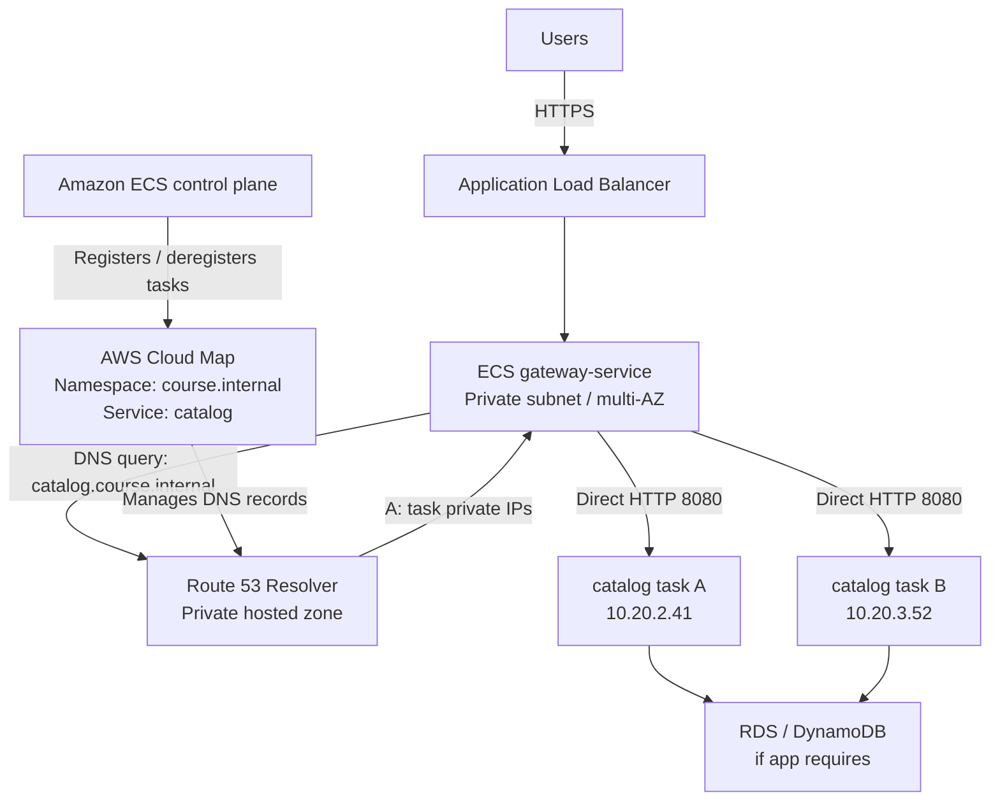
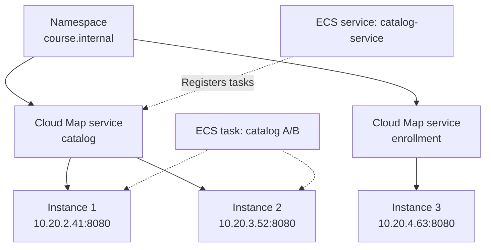
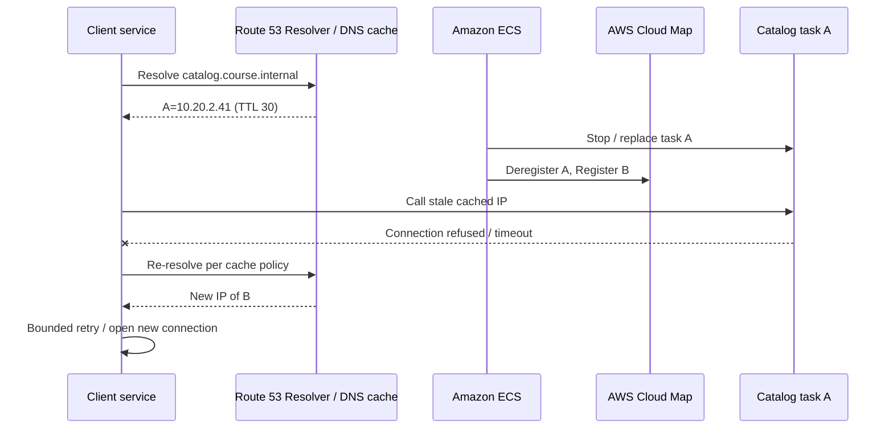
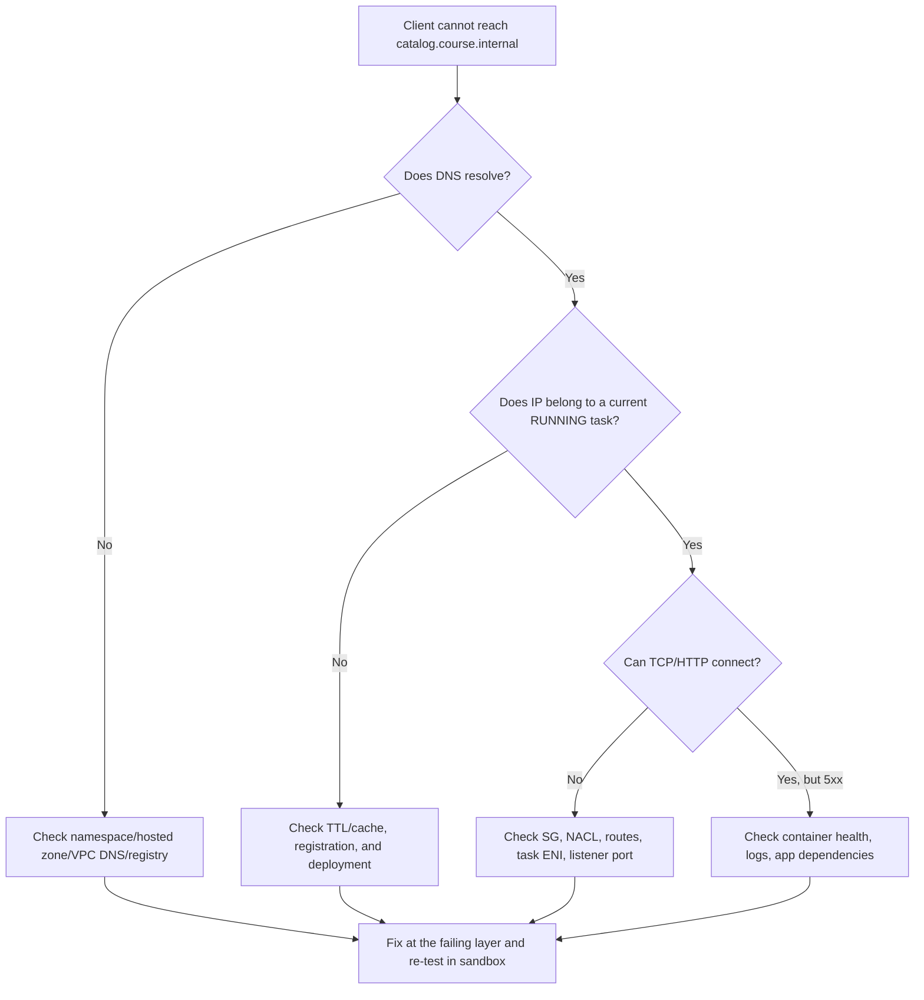

# Service Discovery with AWS Cloud Map

> **Module:** CLOUD_PROVIDERS_AWS  
> **Chapter:** Containers with ECS  
> **Lesson:** Service Discovery with AWS Cloud Map  
> **Scope:** Amazon ECS on AWS Fargate or EC2, AWS Cloud Map, Amazon Route 53 private DNS, VPC, IAM, health checks, and internal Java/Spring Boot service-to-service communication.

## 1. Context: ECS Task IP Addresses Constantly Change

Suppose an online learning platform deploys three components:

- **gateway-service** receives requests from an Application Load Balancer (ALB).
- **catalog-service** serves the course catalog over HTTP on port `8080`.
- **enrollment-service** handles course enrollments and calls `catalog-service` to validate courses.

The services run as **Amazon ECS tasks** inside private subnets across multiple Availability Zones. ECS replaces tasks during deployments, unhealthy task replacements, scale-out/scale-in, or infrastructure recovery. With the `awsvpc` network mode, each task receives its own network interface and IP address; this IP **is not a permanent service address**.

If an application stores an address like `http://10.20.2.41:8080` in configuration:

1. When the task is replaced, the old IP stops serving.
2. A new task gets a different IP, yet the app config has not updated.
3. Subsequent requests fail even though ECS already started the desired number of tasks.

**Service discovery** solves the problem of *finding live endpoints by a logical name*. With **AWS Cloud Map**, ECS automatically registers and deregisters tasks in a service directory. Clients call a name such as:

```text
http://catalog.course.internal:8080/api/courses
```

instead of hardcoding individual task IPs.

**Learning objectives:**

1. Explain Cloud Map **namespace → service → service instance** and its relationship to ECS clusters, services, and tasks.
2. Distinguish **private DNS namespaces**, **public DNS namespaces**, and **HTTP namespaces**.
3. Understand `A`, `AAAA`, and `SRV` DNS records and pick the right one for your ECS network mode.
4. Configure an ECS/Fargate service to auto-register tasks in Cloud Map.
5. Verify registration using `dig`, `getent`, the Cloud Map API, and AWS CLI commands.
6. Understand **TTL**, DNS caching, health updates, and fail-open behavior; build safe retries.
7. Compare **direct Cloud Map service discovery**, **ECS Service Connect**, and an **internal ALB**.
8. Design IAM, security groups, observability, resilience, and cost controls for microservices.

## 2. Reference Architecture



In this diagram:

- ECS manages desired count, deployments, and task lifecycles.
- AWS Cloud Map manages **service names and the set of service instances**.
- A Route 53 private hosted zone serves DNS records inside associated VPCs.
- Clients resolve the service name and **connect directly** to task IPs/ports; requests **do not automatically go through an ALB** just because the service also uses an ALB elsewhere.
- Security groups, routes, subnets, and the live application still govern whether connections succeed.

**Key point:** Cloud Map solves **endpoint discovery**, not Layer 7 load balancing with continuous per-request health probing, TLS termination, WAF, path routing, or connection draining like an ALB. If a client caches an IP too long, it can still try to connect to a stopped task.

## 3. Three Conceptual Layers of AWS Cloud Map

| Concept | Meaning | Example |
|---|---|---|
| **Namespace** | Logical scope grouping Cloud Map services and defining how they are discovered. | `course.internal` |
| **Cloud Map service** | Directory entry for an endpoint type; holds name, DNS/TTL/routing config, and health settings. | `catalog` |
| **Service instance** | A concrete registered endpoint with IP, port, and metadata attributes. | Task A `10.20.2.41:8080` |
| **ECS service** | ECS resource maintaining desired task count and coordinating deployments. | `catalog-service` |
| **ECS task** | A running execution of a task definition, with containers, networking, and status. | Task ARN running Spring Boot container |

**Do not confuse a Cloud Map service with an ECS service.** They are two distinct resources. The ECS service references the ARN of a **Cloud Map service registry**; ECS tasks are reflected as **Cloud Map service instances**.

### 3.1. One-to-Many Relationships



When ECS replaces task A:

1. The old task leaves the service and ECS deregisters the old endpoint.
2. The new task receives a new ENI/private IP and is registered in Cloud Map.
3. DNS or API discovery gradually begins returning the new endpoint.
4. Clients must handle the **transition window** involving caches, in-flight requests, or a just-stopped task.

Never assume every instance change appears instantaneously across all clients: registry updates, propagation, and DNS caching are separate steps.

### 3.2. Metadata Registered by Amazon ECS

When ECS integrates with AWS Cloud Map, service instances can include these attributes:

| Attribute | Meaning |
|---|---|
| `AWS_INSTANCE_IPV4` | Task's private IPv4 address, when `A` records are used. |
| `AWS_INSTANCE_IPV6` | Task's IPv6 address under compatible IPv6 configs. |
| `AWS_INSTANCE_PORT` | Port published for service discovery. |
| `AVAILABILITY_ZONE` | AZ where the task runs. |
| `REGION` | Region of the task. |
| `ECS_SERVICE_NAME` | ECS service name. |
| `ECS_CLUSTER_NAME` | ECS cluster name. |
| `ECS_TASK_DEFINITION_FAMILY` | Task definition family. |
| `EC2_INSTANCE_ID` | EC2 container instance ID when using ECS EC2 capacity; absent on Fargate. |

These attributes are useful when querying with the **AWS Cloud Map `DiscoverInstances` API**. The address and port provide connection details; other metadata aids filtering and observability. Never treat Cloud Map metadata as storage for secrets or personal data.

## 4. Choosing the Right Namespace

AWS Cloud Map supports these namespace types:

| Namespace Type | Discovery Mechanism | When to Use |
|---|---|---|
| **Private DNS namespace** | DNS inside associated VPCs **and** Cloud Map API. | Internal ECS microservices where clients use hostnames. |
| **Public DNS namespace** | Public DNS **and** Cloud Map API. | Endpoints genuinely designed for public DNS resolution. |
| **HTTP namespace** | **Cloud Map API only** such as `DiscoverInstances`; no DNS records. | Apps with SDK/API discovery clients needing metadata or custom lookup logic. |

For **ECS service discovery via the ECS service creation flow**, the Console workflow supports **private DNS namespaces**. AWS Cloud Map itself supports additional types, but **you cannot pick an HTTP namespace and expect `dig catalog.course.internal` to work**.

### 4.1. Private DNS and Route 53

Creating a private DNS namespace `course.internal` creates a corresponding **Amazon Route 53 private hosted zone**. When ECS registers tasks for Cloud Map service `catalog`, DNS records are managed so clients inside the VPC can resolve:

```text
catalog.course.internal
```

Typical prerequisites:

- The VPC must enable `enableDnsSupport` to use Amazon-provided DNS resolution.
- The VPC should enable `enableDnsHostnames` per architecture and service discovery guidance.
- Clients run inside a VPC associated with the private hosted zone, or have matching DNS forwarding/association.
- If using a custom DNS resolver, it must forward matching queries to Route 53 Resolver.
- Private DNS **does not automatically route network traffic** across VPCs; routes, peering/Transit Gateway, and security controls are still required if cross-VPC communication is intended.
- A private namespace does not authenticate callers; clients still need TLS and service-level authorization when data sensitivity requires it.

**Domain naming note:** `course.internal` is an illustrative private name. To avoid colliding with internal DNS or other namespaces, plan naming and VPC associations before creation.

### 4.2. Warning on Public Namespaces

Even if ECS service discovery uses a public DNS namespace in supported configurations, **DNS records registered by ECS still contain the task's private IP**, not a public IP. Therefore, creating a public namespace **does not make private tasks reachable from the Internet**.

For external user-facing APIs, typically use an **ALB/API Gateway**, TLS, WAF, and proper authorization instead of relying on public Cloud Map records to advertise internal tasks directly.

## 5. DNS Records: A, AAAA, and SRV

### 5.1. A/AAAA in `awsvpc` Network Mode

With `awsvpc`, each ECS task has its own network address, matching `A` (IPv4) or `AAAA` (IPv6 with compatible VPC/subnet setup) records.

Example lookup inside a client task:

```bash
dig +short A catalog.course.internal
```

Simulated output:

```text
10.20.2.41
10.20.3.52
```

Clients typically specify the application port, e.g., `http://catalog.course.internal:8080`. **An `A` record does not carry a port.** If the app listens on a different port than the client calls, resolving the right IP via DNS `A` still fails to connect.

### 5.2. SRV Carries Ports Too

An `SRV` record can return **service hostname and port** per instance:

```bash
dig +short SRV catalog.course.internal
```

Illustrative output:

```text
1 1 8080 task-a.catalog.course.internal.
1 1 8080 task-b.catalog.course.internal.
```

SRV syntax follows `priority weight port target-hostname`. An application using SRV needs a resolver/client that knows how to **query SRV, parse the port, and resolve the target hostname's address**. Most HTTP clients given `http://catalog.course.internal` **do not automatically query SRV** and default to port `80`.

Thus, `SRV` is not a drop-in replacement for standard REST clients. For ECS Fargate/`awsvpc` with a fixed HTTP port, `A` records are usually simpler.

### 5.3. Compatibility with ECS Network Modes

| Network Mode | Supported ECS Service Discovery Records | Rationale |
|---|---|---|
| `awsvpc` | `A` or `SRV`; can combine `AAAA` in supported dual-stack setups | Task has its own ENI and IP; `SRV` requires port config. |
| `bridge` | **SRV** | Port mappings can be dynamic; multiple containers share host IP. |
| `host` | **SRV** | Must advertise host/port endpoints per ECS rules. |
| `none` | ECS service discovery not supported | Task has no suitable networking model. |

With `bridge`/`host`, `serviceRegistries` must specify **container name + container port** from the task definition. With `awsvpc` and `SRV`, configuration can specify `port` or container name/port per API rules; never pass just an ARN and expect ECS to guess the port.

For IPv6-only subnets, do not configure `A` records when no IPv4 exists. Always check dual-stack support, network mode, and AWS platform version before choosing DNS record types.

### 5.4. Cloud Map Routing Policies

Cloud Map DNS services support the following Route 53 routing policies:

| Policy | General Behavior |
|---|---|
| `MULTIVALUE` | Returns **up to 8** eligible records per DNS answer, preferring healthy endpoints when health checks exist. |
| `WEIGHTED` | Selects from service instances using weighted routing; in Cloud Map, instances receive equal weights. |

With many healthy tasks, a single `A` response **does not necessarily list every task in the service**, especially with `MULTIVALUE`'s 8-record limit per DNS answer. DNS resolvers/clients may also reorder records or pick a single IP. **Never use the IP count in one `dig` output as the exact count of running ECS tasks.**

## 6. DNS TTL, Caching, and Impact on Scaling/Deployments

A DNS record's **TTL** (*Time to Live*) sets the cache duration advertised by authoritative DNS, in seconds.

Example Cloud Map service configuration:

```text
Service: catalog
Namespace: course.internal
DNS: A
RoutingPolicy: MULTIVALUE
TTL: 30 seconds
```

When task A stops and task B replaces it:



TTL **does not guarantee** every app switches IPs after exactly 30 seconds:

- Recursive resolvers cache up to the TTL.
- JVM/application DNS caches may follow their own rules.
- HTTP connection pools can **reuse open sockets to the old IP** even after DNS updates.
- ECS registration/deregistration, health propagation, and DNS updates also have propagation delay.
- Some environments apply negative caching for unresolved hostnames.
- In-flight requests are never transparently migrated to a new task when the old task disappears.

### 6.1. Choosing a TTL Value

Low TTLs give clients an **opportunity** to discover new endpoints sooner, at the cost of higher DNS query volume and system pressure. High TTLs reduce queries while keeping clients pinned to old IPs longer.

For labs, **30 seconds** lets you observe changes fairly quickly. In production, measure restart/deploy cadence, resolver caching, lookup rates, client count, and transient error tolerance before picking a TTL.

There is no magic rule where "TTL = 0 eliminates all errors." Even as new addresses propagate, active connections and in-flight requests can still fail.

### 6.2. Application Behavior When DNS Returns Multiple IPs

DNS returning multiple IPs **does not equal Layer 7 load balancing**. Some clients pick only the first IP, some round-robin across IPs, and some hold long-lived keep-alive connections. For balanced traffic and resilience, clients need an appropriate connection strategy.

Options:

1. **Direct DNS:** Client handles resolution, timeouts, retries, and reconnects on error; fits simple architectures.
2. **ECS Service Connect:** ECS-managed proxies handle discovery/routing and provide richer observability.
3. **Internal ALB/NLB:** Centralized load balancing, health checks, and HTTP/TCP features per LB type.

## 7. Health Checks: Healthy in ECS Is Not an ALB Health Check

ECS service discovery integrates **AWS Cloud Map custom health checks**: Amazon ECS updates instance health based on **task status and container-level health checks**.

When creating a Cloud Map service for ECS, you typically specify:

```json
{
  "HealthCheckCustomConfig": {
    "FailureThreshold": 1
  }
}
```

ECS pushes health updates rather than Cloud Map having Route 53 health checkers send HTTP probes into private ECS tasks. **Do not configure Route 53 HTTP health checks for a service in a private DNS namespace**, as public Route 53 health checks cannot probe private VPC endpoints that way.

### 7.1. Container Health Check in the Task Definition

Example Spring Boot container with Actuator readiness:

```json
{
  "healthCheck": {
    "command": [
      "CMD-SHELL",
      "curl -fsS http://127.0.0.1:8080/actuator/health/readiness > /dev/null || exit 1"
    ],
    "interval": 15,
    "timeout": 5,
    "retries": 3,
    "startPeriod": 30
  }
}
```

Notes:

- The Docker image **must include `curl`**, or substitute another health-check tool actually installed in the image.
- The app must expose the readiness endpoint and return status reflecting real serving capability.
- Health checks are tracked by ECS, but Cloud Map/DNS updates **are not instantaneous**.
- `essential` containers in the same task affect overall health evaluation.
- An ALB health check (if an ALB is also attached) is **a separate health system** with its own path, thresholds, and routing effects.

### 7.2. When No Healthy Instance Remains

AWS Cloud Map / Route 53 exhibits **fail-open** behavior under certain conditions. For example, when **all records are unhealthy**, Route 53 may return up to a set of unhealthy records rather than returning an empty answer. This avoids total DNS blackouts in some scenarios, but does not mean the backend can handle requests successfully.

**Never design on the assumption that "DNS will never return an unhealthy task."** Applications still need timeouts, bounded retries, and error logging. If you need strict health-aware routing that avoids unready backends, use a dedicated health-aware routing layer.

## 8. Hands-On on AWS Console: ECS + Cloud Map Private DNS

This lab assumes you already have:

- A sandbox AWS account with ECS, Cloud Map, VPC, and IAM permissions.
- A VPC, e.g., `vpc-0123456789abcdef0`, with private subnets in **two AZs**.
- Security groups for caller and catalog services; VPC DNS resolution enabled.
- An ECS cluster, Docker image `catalog:1.0.0` pushed to ECR, and a Fargate/`awsvpc` task definition exposing port `8080`.
- Outbound network paths for tasks to pull images, send logs, and fetch secrets via NAT/appropriate VPC endpoints.

Do not run illustrative IDs verbatim in a real account. Practice labs can incur charges for Fargate, Cloud Map, Route 53, and networking resources.

### 8.1. Create a Private DNS Namespace

1. Open **AWS Cloud Map Console → Namespaces → Create namespace**.
2. Name it `course.internal`.
3. Select **API calls and DNS queries in VPCs** (private DNS).
4. Pick the target VPC, add description and tags.
5. Create the namespace; wait for the operation to complete and confirm creation.
6. Verify Cloud Map created the corresponding Route 53 private hosted zone.

You can also create a namespace directly inside the Console **Create ECS service** workflow when Service Discovery options appear. However, creating the Cloud Map resources separately makes resource relationships and naming easier to learn and govern.

### 8.2. Create a Cloud Map Service

Inside namespace `course.internal`:

1. Choose **Create service** and name it `catalog`.
2. Choose DNS record type **A** with a **30-second** TTL for `awsvpc` IPv4.
3. Choose an appropriate routing policy, such as **Multivalue answer**.
4. Select **custom health check** if using ECS health propagation.
5. Create the Cloud Map service and note its ARN.

**Only when you create an ECS service whose service registry points to this ARN** does ECS manage task registration for that service. Creating a Cloud Map service alone will not populate IPs for unregistered tasks.

### 8.3. Create an ECS Service Attached to the Service Registry

In the **Amazon ECS Console**:

1. Go to **Clusters → select cluster → Services → Create**.
2. Choose the task definition with `networkMode=awsvpc` serving HTTP on `8080`.
3. Pick Fargate launch type or supported compute; set desired tasks, e.g., **2**.
4. Select private subnets across multiple AZs, catalog security group, and required egress path for image pulls.
5. Open **Service discovery**, select namespace `course.internal` and Cloud Map service `catalog` (or create per current Console flow).
6. Enable **ECS task health propagation** if available and ensure container health checks are set.
7. Create the ECS service, wait for tasks to enter `RUNNING` and pass health checks.
8. Open the Cloud Map service and inspect **service instances**; verify IP/port metadata.
9. From a workload inside the same VPC, resolve `catalog.course.internal` and make an HTTP call to the service.

**Do not confuse names:** The ECS service might be named `catalog-service` while the Cloud Map service is named `catalog`. DNS resolves hostnames using the **Cloud Map service name**, not necessarily the ECS service name.

## 9. Deploying via AWS CLI: Namespace → Registry → ECS Service

The commands below are **samples for Linux/macOS shells**. Replace Region, account ID, VPC ID, subnet IDs, security group, task definition ARN, IAM role ARN, and image with resources you own.

### 9.1. Verify Account and Network Attributes

```bash
aws sts get-caller-identity

aws ec2 describe-vpc-attribute \
  --vpc-id vpc-0123456789abcdef0 \
  --attribute enableDnsSupport \
  --region ap-southeast-1

aws ec2 describe-vpc-attribute \
  --vpc-id vpc-0123456789abcdef0 \
  --attribute enableDnsHostnames \
  --region ap-southeast-1
```

If DNS support is disabled, a VPC administrator must enable it first. Never casually alter production VPC attributes without assessing impact on existing hosted zones and apps.

### 9.2. Create a Private DNS Namespace

```bash
aws servicediscovery create-private-dns-namespace \
  --name course.internal \
  --description "Internal ECS service discovery lab" \
  --vpc vpc-0123456789abcdef0 \
  --region ap-southeast-1
```

The output returns an **`OperationId`**, because namespace creation is asynchronous.

Check operation status (replace with the actual ID from output):

```bash
aws servicediscovery get-operation \
  --operation-id operation-id-from-create-response \
  --region ap-southeast-1
```

Proceed only once `Status=SUCCESS`. Read the `NAMESPACE` ID from `Operation.Targets`, e.g., `ns-abc123example`. That ID is illustrative only—nothing exists until the command runs.

### 9.3. Create a Cloud Map Service for `A` Records

Save the following JSON as `cloud-map-service.json` in your working directory:

```json
{
  "Name": "catalog",
  "Description": "Catalog HTTP endpoints in ECS",
  "DnsConfig": {
    "NamespaceId": "ns-abc123example",
    "RoutingPolicy": "MULTIVALUE",
    "DnsRecords": [
      {
        "Type": "A",
        "TTL": 30
      }
    ]
  },
  "HealthCheckCustomConfig": {
    "FailureThreshold": 1
  }
}
```

Create the service:

```bash
aws servicediscovery create-service \
  --cli-input-json file://cloud-map-service.json \
  --region ap-southeast-1
```

Record `Service.Id` and `Service.Arn`. Sample ARN:

```text
arn:aws:servicediscovery:ap-southeast-1:123456789012:service/srv-abc123example
```

Read-only verification:

```bash
aws servicediscovery list-services --region ap-southeast-1

aws servicediscovery get-service \
  --id srv-abc123example \
  --region ap-southeast-1
```

Before tasks launch, the service has zero instances and DNS returns no task IPs; this is normal prior to running ECS tasks linked to the registry.

### 9.4. Sample Fargate/`awsvpc` Task Definition

Illustrative `catalog-task.json`:

```json
{
  "family": "catalog-task",
  "networkMode": "awsvpc",
  "requiresCompatibilities": ["FARGATE"],
  "cpu": "256",
  "memory": "512",
  "executionRoleArn": "arn:aws:iam::123456789012:role/ecsTaskExecutionRole",
  "containerDefinitions": [
    {
      "name": "catalog",
      "image": "123456789012.dkr.ecr.ap-southeast-1.amazonaws.com/catalog:1.0.0",
      "essential": true,
      "portMappings": [
        {
          "containerPort": 8080,
          "hostPort": 8080,
          "protocol": "tcp"
        }
      ],
      "healthCheck": {
        "command": [
          "CMD-SHELL",
          "curl -fsS http://127.0.0.1:8080/actuator/health/readiness > /dev/null || exit 1"
        ],
        "interval": 15,
        "timeout": 5,
        "retries": 3,
        "startPeriod": 30
      },
      "logConfiguration": {
        "logDriver": "awslogs",
        "options": {
          "awslogs-group": "/ecs/catalog",
          "awslogs-region": "ap-southeast-1",
          "awslogs-stream-prefix": "ecs"
        }
      }
    }
  ]
}
```

**Prerequisites before running this sample:** The ECR image must exist with Spring Boot listening on `0.0.0.0:8080`, Actuator readiness active, and `curl` installed. Log group `/ecs/catalog` must exist. The execution role needs image pull and logging permissions. CPU/memory sizes here are for API illustration and **may be insufficient for a production JVM**.

Register the task definition:

```bash
aws ecs register-task-definition \
  --cli-input-json file://catalog-task.json \
  --region ap-southeast-1
```

A task definition alone does not launch tasks; an ECS service or task invocation is required. Automated service discovery in this lesson is driven by the **ECS service**, not by calling `RunTask` standalone and expecting DNS registration.

### 9.5. Create an ECS Service Pointing to the Cloud Map Registry

Example `catalog-ecs-service.json`:

```json
{
  "cluster": "course-cluster",
  "serviceName": "catalog-service",
  "taskDefinition": "catalog-task",
  "launchType": "FARGATE",
  "platformVersion": "LATEST",
  "desiredCount": 2,
  "serviceRegistries": [
    {
      "registryArn": "arn:aws:servicediscovery:ap-southeast-1:123456789012:service/srv-abc123example"
    }
  ],
  "networkConfiguration": {
    "awsvpcConfiguration": {
      "subnets": [
        "subnet-11111111",
        "subnet-22222222"
      ],
      "securityGroups": [
        "sg-0123456789abcdef0"
      ],
      "assignPublicIp": "DISABLED"
    }
  }
}
```

Execute (after verifying VPC/networking, IAM, and image):

```bash
aws ecs create-service \
  --cli-input-json file://catalog-ecs-service.json \
  --region ap-southeast-1
```

Inspect:

```bash
aws ecs describe-services \
  --cluster course-cluster \
  --services catalog-service \
  --region ap-southeast-1 \
  --query 'services[].{name:serviceName,desired:desiredCount,running:runningCount,registries:serviceRegistries,events:events[0:3]}'
```

Service events highlight task launch failures, health check failures, image pull errors, or service discovery registration failures. **Never blame DNS if the service doesn't even have tasks in `RUNNING` state.**

### 9.6. Inspect Cloud Map Instances

```bash
aws servicediscovery list-instances \
  --service-id srv-abc123example \
  --region ap-southeast-1

aws servicediscovery discover-instances \
  --namespace-name course.internal \
  --service-name catalog \
  --region ap-southeast-1
```

When successful, instance entries may look like:

```json
{
  "InstanceId": "example-task-registration-id",
  "Attributes": {
    "AWS_INSTANCE_IPV4": "10.20.2.41",
    "AWS_INSTANCE_PORT": "8080",
    "ECS_SERVICE_NAME": "catalog-service",
    "ECS_CLUSTER_NAME": "course-cluster",
    "REGION": "ap-southeast-1"
  }
}
```

This is an **abbreviated snippet** of an instance entry, not the full AWS JSON response. Actual fields and values depend on command and instance type.

### 9.7. Updating or Removing a Service Registry

Per current Amazon ECS API behavior, `serviceRegistries` can **be updated on services using rolling deployments**, and adding/changing/removing a registry triggers a new deployment. Updating requires the service-linked role and appropriate permissions; **never remove a registry while clients still depend on that hostname**.

When changing registry config:

1. Prepare the new Cloud Map service and verify its name/TTL.
2. Update the ECS service via a supported deployment workflow.
3. Verify new tasks register and old tasks deregister.
4. Monitor DNS/connection errors during the transition window.
5. Delete the old Cloud Map service/namespace only after all clients have migrated.

Cloud Map namespaces/services and Route 53 private hosted zones may **not be cleaned up automatically just by deleting the ECS service**. Perform separate cleanup checks and avoid deleting shared namespaces still used by other services.

## 10. Testing DNS and HTTP from the Right Location

**Private DNS only resolves when queried from an environment able to resolve the private hosted zone.** Never test from a personal laptop outside the VPC without a valid VPN/resolver and conclude ECS is broken.

Use a test EC2 instance or an ECS client task inside the same VPC, with proper permissions and DNS utilities:

```bash
# Inspect returned A records.
dig +short A catalog.course.internal

# Inspect full TTL and DNS details.
dig catalog.course.internal A

# If the image lacks dig, test OS resolver:
getent ahostsv4 catalog.course.internal

# Test HTTP against the exact application port.
curl -sS --connect-timeout 3 --max-time 10 \
  http://catalog.course.internal:8080/actuator/health/readiness
```

**Distinction:** `dig` succeeding only proves DNS knows the endpoint. `curl` succeeding additionally requires valid security groups, network routes, a listening container, matching app routes, and passing readiness.

### 10.1. Testing Scale-Out and Scale-In

1. Note `desiredCount=2`, the ECS task list, and DNS responses.
2. In sandbox, increase desired count to **3**.
3. Wait for the new task to reach `RUNNING` and healthy; verify Cloud Map registered the third instance.
4. Query DNS repeatedly, keeping in mind `MULTIVALUE` does not necessarily return every instance when counts grow large.
5. Scale desired count back to **2** and verify the stopped task deregisters.
6. Monitor application retries and connection errors across the DNS caching window.
7. At the end of the lab, restore the agreed desired count and clean up temporary resources.

Command to update desired count (impacts live resources and cost):

```bash
aws ecs update-service \
  --cluster course-cluster \
  --service catalog-service \
  --desired-count 3 \
  --region ap-southeast-1
```

Never scale down critical workloads without checking active requests, graceful shutdown, queue/worker state, and remaining task capacity.

## 11. Java/Spring Boot Calling Services via Cloud Map DNS

Once a service has an in-VPC DNS name, Java apps can use standard URIs. There is no need to call the Cloud Map API when using **DNS discovery**:

```yaml
app:
  catalog:
    base-url: http://catalog.course.internal:8080
```

This is only **application configuration YAML**; Spring Boot does not read `app.catalog.base-url` automatically unless bound via `@ConfigurationProperties`, `@Value`, or similar code.

### 11.1. Java `HttpClient` Example

Java 17 sample with connect timeout, response timeout, and bounded retries **only for business-safe GET calls**:

```java
import java.io.IOException;
import java.net.URI;
import java.net.http.HttpClient;
import java.net.http.HttpRequest;
import java.net.http.HttpResponse;
import java.time.Duration;

public final class CatalogClientExample {
    private static final URI CATALOG_URI = URI.create(
        "http://catalog.course.internal:8080/api/courses");

    public static void main(String[] args) throws Exception {
        HttpClient client = HttpClient.newBuilder()
                .connectTimeout(Duration.ofSeconds(3))
                .build();

            IOException lastNetworkError = null;

            for (int attempt = 1; attempt <= 3; attempt++) {
                HttpRequest request = HttpRequest.newBuilder(CATALOG_URI)
                    .timeout(Duration.ofSeconds(10))
                    .GET()
                    .build();

                try {
                    HttpResponse<String> response =
                        client.send(request, HttpResponse.BodyHandlers.ofString());

                    if (response.statusCode() == 200) {
                        System.out.println(response.body());
                        return;
                    }

                    // 4xx errors should generally not be retried without a clear reason.
                    if (response.statusCode() != 502 &&
                        response.statusCode() != 503 &&
                        response.statusCode() != 504) {
                        throw new IllegalStateException(
                            "Unexpected HTTP status: " + response.statusCode());
                    }
                } catch (IOException ex) {
                    lastNetworkError = ex;
                    if (attempt == 3) {
                        throw ex;
                    }
                }

                if (attempt < 3) {
                    Thread.sleep(200L * attempt);
                }
            }

            throw new IllegalStateException(
                "Catalog unavailable after bounded retries", lastNetworkError);
    }
}
```

**Java note:** In **Java 17**, `HttpClient` does not implement `AutoCloseable`, so the example intentionally omits `try-with-resources`. Reuse a shared `HttpClient` instead of creating one per request; on newer JDKs supporting closing clients, manage lifecycle accordingly. Test timeouts, retry/backoff, and exception handling on your target Java version.

In Spring Boot production apps, teams typically use managed clients (e.g., `RestClient` or `WebClient`) with configured connection pools and observability. **DNS cache expiry can diverge from socket reuse timing**: evaluate connection pool lifecycles, idle timeouts, and DNS refreshes during rollouts.

### 11.2. Retries Must Be Bounded and Idempotent

**Never blindly retry every HTTP POST** just because a task IP rotated. An order-creation request may have persisted data before its response dropped; retrying can create a duplicate order.

For operations with side effects:

- Use an **idempotency key** or database transaction/unique constraints.
- Cap retry counts and apply exponential backoff with jitter.
- Retry only **transient** recoverable failures.
- Enforce an overall request deadline; avoid retry storms overloading the backend.
- Emit metrics for timeouts, 5xx responses, retry counts, and upstream service names.
- Implement circuit breakers or graceful degradation when downstream services are unavailable.

### 11.3. When to Discover via the Cloud Map API

AWS Cloud Map also provides `DiscoverInstances`, useful when clients need custom metadata or attribute filtering rather than plain hostname lookup:

```bash
aws servicediscovery discover-instances \
  --namespace-name course.internal \
  --service-name catalog \
  --query-parameters ECS_CLUSTER_NAME=course-cluster \
  --region ap-southeast-1
```

Unlike standard DNS queries, calling the Cloud Map API from AWS SDK/CLI **requires IAM permissions such as `servicediscovery:DiscoverInstances`** and generates potentially billable API calls. If an app simply calls HTTP over a DNS name, avoid adding API-based discovery complexity without a clear requirement.

## 12. Security: DNS Does Not Replace IAM or Security Groups

### 12.1. Security Groups for Internal Communication

Assume two security groups:

- `sg-gateway` for caller tasks.
- `sg-catalog` for catalog tasks.

Minimum design:

| Where | Rule | Purpose |
|---|---|---|
| `sg-catalog` inbound | TCP `8080` from **security group `sg-gateway`** | Only approved callers can reach catalog. |
| `sg-gateway` outbound | TCP `8080` to `sg-catalog`, when strict egress applies | Allows calling the backend. |
| Network ACLs and routes | Permit bidirectional traffic per design | Ensures reachability; NACLs are stateless. |
| ECS task container | Listen on a suitable address, e.g., `0.0.0.0:8080` | Reachable via ENI, not only `localhost`. |

**Learning an IP from DNS does not authorize a connection.** Cloud Map never automatically adds ingress rules for targets; network policy stays governed by VPC/IAM/application controls.

### 12.2. IAM Permissions by Operation

| Operation | Who Needs Permissions? | Guidance |
|---|---|---|
| Create namespace / Cloud Map service | Deployer / automation | Scope `servicediscovery:*` management APIs to business needs. |
| Create ECS service or update registry | Deployer / CI-CD | `ecs:CreateService`/`ecs:UpdateService` plus `iam:PassRole` and service-linked role permissions. |
| Auto-register/deregister ECS tasks | **ECS control plane / service-linked role** | Never put Cloud Map access keys inside app containers to do ECS's job. |
| Pull ECR image and send CloudWatch Logs | ECS **task execution role** | Least-privilege pull/logging permissions. |
| Call Cloud Map `DiscoverInstances` from app | ECS **task role** | `servicediscovery:DiscoverInstances` scoped as allowed. |
| Query private DNS like `catalog.course.internal` | DNS client inside VPC | **Requires no IAM API credentials** to query internal Route 53 Resolver; still requires working network/DNS. |
| Call catalog over HTTP | Application client | Security groups, TLS/app auth, authorization, networking. |

**Do not confuse the ECS task execution role with the task role.** The execution role lets ECS pull images and emit logs; the **task role** grants AWS API permissions to application code. Normal DNS resolution **is not an IAM-signed Cloud Map API call**.

### 12.3. Transport Encryption and Application Authorization

A private hostname does not automatically enable HTTPS or internal authentication. For sensitive data, consider:

1. TLS or mTLS per architecture, with certificate lifecycle and rotation.
2. Service-to-service authentication, tokens, or application-layer authorization policies.
3. Network segmentation and least-privilege SGs.
4. Auditing Cloud Map/ECS/IAM changes via CloudTrail.
5. Never exposing internal Cloud Map namespaces publicly without strong justification.
6. Never attaching IAM admin rights to fix `Connection refused`; that indicates a socket/network/readiness failure, not an AWS API permission error.

## 13. Direct Cloud Map DNS, Service Connect, or Internal ALB?

**ECS Service Connect** uses Cloud Map as part of its service substrate while adding **ECS-managed proxies**, service endpoints, routing logic, and telemetry. It **differs** from the direct Cloud Map DNS usage covered in this lesson.

| Criterion | ECS + Direct Cloud Map DNS | ECS Service Connect | Internal ALB |
|---|---|---|---|
| Service discovery | DNS `service.namespace` returns task IPs | Logical names via Service Connect proxy and Cloud Map registry | Single load balancer hostname |
| Network path | Client connects directly to task IP | Through managed sidecar/proxy in the task | Client → ALB → healthy targets |
| Must client handle stale IPs? | Yes; TTL/caching and retries are critical | Proxy manages discovery/routing/retries per config | ALB handles target selection server-side |
| Health-aware routing | Custom health/DNS, subject to lag and fail-open | Managed proxy and health/routing per Service Connect | ALB target health checks |
| TLS / HTTP layer | Implemented by the application | Configurable TLS/telemetry options | ALB handles TLS termination and host/path routing |
| Cost | Cloud Map + Route 53/DNS + task/network | Task resources for proxy and related services | ALB/LCU + task/network |
| Best fit | Few services, simple design, app manages retries | Many ECS services wanting unified naming, routing, and observability | Need centralized load balancing/health and L7 features |

AWS recommends **Service Connect** for many in-VPC ECS service-to-service scenarios, while direct Cloud Map DNS remains useful when you want minimal moving parts, direct connections, and client-managed resilience.

**Shared namespace difference:** standard ECS **direct service discovery** does not support registering services into a **shared AWS Cloud Map namespace** under its feature limits; **Service Connect** supports certain shared namespace/cross-account models under its own guidance. Never assume Service Connect's namespace-sharing capabilities apply to traditional ECS DNS service discovery.

### 13.1. Choosing by Scenario

- Two ECS services in one VPC where the team controls the Java HTTP client: **Cloud Map private DNS** can suffice.
- Dozens of ECS services needing proxy-based routing, retries/metrics, and uniform naming across clusters: evaluate **Service Connect**.
- An API requiring WAF/TLS termination, host/path routing, sticky sessions, or centralized HTTP health checks: choose an **ALB**.
- Services spanning multiple VPCs/accounts needing service-network access control: consider **VPC Lattice** or an appropriate network architecture.
- Clients cannot parse `SRV` yet tasks use `bridge` with dynamic host ports: change networking mode or use ALB/Service Connect rather than assuming HTTP URIs read SRV automatically.

## 14. Monitoring and Troubleshooting

### 14.1. Inspection Order When a Service Call Fails



Fix only the failing layer: **`DNS NXDOMAIN`**, **`Connection refused`**, **timeout**, and **HTTP 503** each mean different things.

### 14.2. Troubleshooting Reference Table

| Symptom | Common Causes | How to Verify |
|---|---|---|
| `NXDOMAIN` for `catalog.course.internal` | Wrong namespace/service name, no records yet, private hosted zone not associated with client VPC. | `get-namespace`, `get-service`, `list-instances`, VPC association/DNS resolver. |
| `dig` returns IP but `curl` times out | SG/NACL/route blocks path to task or app not listening. | Task ENI, port `8080`, container logs, SG source/destination. |
| DNS returns IP of stopped task | ECS deregistration/Route 53 propagation lag or un-expired DNS/JVM cache. | Compare ECS tasks vs. Cloud Map instances, TTL, connection pool. |
| ECS task `RUNNING` but missing in Cloud Map | Service lacks `serviceRegistries`, registration failed, waiting on health/operation. | ECS `describe-services` events, Cloud Map `list-instances`, task health. |
| Cloud Map has instances, discovery returns empty/few | Health status, routing policy, filters, max 8 DNS records/answer. | `DiscoverInstances`, `list-instances`, `get-service`, health, DNS query. |
| Service discovery still returns unhealthy endpoints | Fail-open when zero healthy records remain; health lag. | Container checks, ECS events, client retries, readiness. |
| `AccessDenied` calling Cloud Map API | Task role or deploy principal lacks IAM permissions. | STS identity, `servicediscovery:DiscoverInstances`/specific API, policy denies. |
| DNS updated yet Java app calls old IP | JVM DNS cache or HTTP connection pool holds old endpoint. | JDK settings, HTTP client connection TTL/retry, measure errors during deploy. |
| Fargate task fails to pull image | Missing NAT/ECR VPC endpoints, bad execution role, SG/route block. | ECS stopped reason, execution role, ECR endpoints, logs. |
| ECS service healthy, client in another VPC fails | Private hosted zone not associated/forwarded properly; no network connectivity. | VPC association, routes, peering/Transit Gateway, resolver rules. |
| DNS `A` record exists, client hits wrong port | `A` record carries no port; task listens on a different port. | Task definition `portMappings`, app listening port, client URL. |
| Charges/namespace linger after deleting ECS service | Cloud Map namespace/services/Route 53 resources still exist. | Inspect Cloud Map and hosted zone resources during cleanup. |

### 14.3. Read-Only Investigation Commands

```bash
aws ecs describe-services \
  --cluster course-cluster \
  --services catalog-service \
  --region ap-southeast-1

aws ecs list-tasks \
  --cluster course-cluster \
  --service-name catalog-service \
  --region ap-southeast-1

aws servicediscovery get-namespace \
  --id ns-abc123example \
  --region ap-southeast-1

aws servicediscovery get-service \
  --id srv-abc123example \
  --region ap-southeast-1

aws servicediscovery list-instances \
  --service-id srv-abc123example \
  --region ap-southeast-1
```

To check real task ENIs/IPs, take task ARNs from `list-tasks` and call `aws ecs describe-tasks --tasks ...`. Inspect task attachment/ENI fields rather than relying on a single DNS lookup.

### 14.4. Useful Telemetry Signals

- **ECS service events**, desired/running/pending task counts, stopped reasons, container health.
- **CloudWatch Logs** from Java/Spring Boot: DNS failures, connection refused, timeouts, upstream 5xx, retries.
- **CloudWatch ECS metrics / Container Insights** when enabled: CPU, memory, and service/task health telemetry.
- **AWS Cloud Map**: registered service instances and health statuses.
- **Route 53 DNS metrics/query logs** if configured; private DNS queries are not logged automatically unless enabled.
- **VPC Flow Logs**: ENI IP/port flow metadata; no HTTP payloads.
- **CloudTrail**: who modified ECS services, registries, namespaces, IAM, and related settings.
- **Cost Explorer/Budgets**: ECS/Fargate, Route 53, Cloud Map API, logging, and network spend.

Correlate **deploy/scale timestamps** with error graphs. A dashboard showing tasks as `RUNNING` does not prove Java clients refreshed DNS or switched to healthy endpoints.

## 15. Limits, Quotas, and Cost

### 15.1. Key Constraints

Per ECS service discovery documentation:

- ECS service discovery has a limit of **1,000 tasks per service** tied to Route 53 quotas; verify quotas and design before scaling further.
- Private DNS is supported in VPCs with proper DNS settings; the ECS Console service-discovery creation flow restricts which namespace types it supports.
- ECS service discovery **does not support shared Cloud Map namespaces** via this mechanism.
- With `awsvpc`, `A`/`AAAA`/`SRV` records depend on IPv4/IPv6 and subnet configuration.
- With `bridge`/`host`, `SRV` and matching port mappings are required.
- ECS service discovery does not support Classic Load Balancers in the associated configuration per AWS docs.
- DNS records only publish the **private IP** of ECS tasks in this integration, even if the Cloud Map namespace is public.
- Route 53 DNS responses and Cloud Map discovery APIs cap returned records per response; never treat one DNS response as a full registry snapshot.
- Deleting an ECS service does not automatically delete the Cloud Map namespace or service.

Limits and Regional/platform support can change; verify current AWS documentation and quotas when deploying.

### 15.2. Cost Categories

| Component | Potential Charges |
|---|---|
| **AWS Cloud Map** | API discovery calls and service instance registration per pricing and usage. |
| **Amazon Route 53** | Private hosted zone and DNS queries at applicable rates. |
| **Amazon ECS / AWS Fargate** | vCPU, memory, task duration, and supporting resources. |
| **Amazon EC2 launch type** | EC2 instances, EBS, and host infrastructure costs. |
| **VPC/NAT/VPC endpoints** | Data transfer, NAT Gateway, and interface endpoint charges depending on design. |
| **CloudWatch / Container Insights** | Log ingestion, retention, metrics, and queries. |
| **ALB / Service Connect** | Load balancer fees or proxy/observability resources if combined. |

Never claim "Cloud Map is free because it's just DNS." Account for **hosted zones, DNS/API queries, instance registrations, and network resources** at your Region's real usage rates.

### 15.3. Load Sizing Example for Solution Choice

Suppose:

- 4 ECS services, each with **3 tasks**.
- 50 client tasks resolve the catalog DNS name repeatedly.
- Each client has distinct DNS caching and connection pooling.
- During a deploy, roughly 3 catalog tasks roll sequentially.

To pick a TTL and retry policy, measure **lookup rate, effective DNS cache duration, connections hitting stale IPs, p95/p99 latency, and error rate**. Cutting TTL in half does not automatically halve connection errors if clients hold open sockets or lack retries.

When factoring Cloud Map into cost models, compare **total operational cost** against an internal ALB and Service Connect—not just a single DNS line item.

## 16. Comprehensive Lab: Catalog and Enrollment Microservices

**Scenario:** A Java/Spring Boot learning app has `enrollment-service` calling `catalog-service` to validate course IDs. Both services run on ECS Fargate in private subnets across two AZs in `ap-southeast-1`. The team requires independent scaling, restricted Internet exposure, and automatic endpoint updates when tasks cycle.

### 16.1. Tasks

1. Diagram **ECS cluster → ECS services/tasks → AWS Cloud Map namespace/service/instances → Route 53 private hosted zone**.
2. Choose private DNS namespace `course.internal`, Cloud Map service `catalog`, and `A` record with 30-second TTL; explain why an HTTP namespace will not work if clients use DNS URLs.
3. Design two security groups allowing only `enrollment-service` to hit port `8080` on catalog.
4. Author a Fargate/`awsvpc` task definition and Spring Boot-compatible container health check.
5. Write ECS `serviceRegistries` pointing to the Cloud Map service ARN. Highlight the difference between the ECS service name and Cloud Map service name.
6. Use the AWS CLI to create the private namespace, **wait for operation SUCCESS**, create the Cloud Map service, then create the ECS service.
7. From a client task, run `dig catalog.course.internal A` and `curl http://catalog.course.internal:8080/actuator/health/readiness`.
8. Scale catalog from 2 to 3 tasks in sandbox; observe Cloud Map instances and DNS answers.
9. Stop/replace a task via an ECS deployment and observe **TTL/cache/connection errors**; explain why the client must retry.
10. Write or describe a Java/Spring Boot HTTP client with timeouts, bounded retries, and idempotency for APIs with side effects.
11. Describe when to switch to **Service Connect** or an **internal ALB**.
12. Pick at least three observability sources and four cost components to track.
13. Plan cleanup so shared namespaces are not deleted accidentally and resources do not incur indefinite charges.

### 16.2. Self-Assessment Criteria

Your solution is solid if it:

- Never hardcodes ECS task private IPs.
- Clearly separates Cloud Map **namespace, service, instance** from ECS **cluster, service, task**.
- Knows `A` records exclude ports while `SRV` records include ports and need client support.
- Distinguishes DNS discovery from the IAM-authenticated Cloud Map API.
- Does not confuse service discovery with an ALB or ECS Service Connect.
- Understands TTL does not force every client to switch IPs instantaneously.
- Includes health checks, retries, security groups, task-failure recovery, and error observability.
- Includes sandbox safeguards, cost control, and resource cleanup.

### 16.3. Quick Check Questions

**1. When an ECS task changes IP, must clients manually edit application URLs?**  
No, when using Cloud Map service discovery and clients resolve via DNS/API. However, clients must still handle broken existing connections.

**2. Does a private DNS namespace create a Route 53 private hosted zone?**  
Yes. Cloud Map creates the corresponding hosted zone; apps in associated VPCs can resolve the names.

**3. Are a Cloud Map service and an ECS service the same resource?**  
No. The ECS service manages tasks; the Cloud Map service is the registry holding the service's endpoints.

**4. Does a DNS `A` record tell an HTTP client that the backend runs on port `8080`?**  
No. The client still needs the port from configuration or another mechanism. `SRV` carries ports, but clients must explicitly query and parse `SRV`.

**5. In ECS Fargate `awsvpc`, should you start with `A` or `SRV` for a fixed-port REST service?**  
`A` records are usually simpler, since each task has its own IP and HTTP URIs can specify the fixed port.

**6. Once ECS marks health as unhealthy, does DNS always return an empty list?**  
No. Route 53 can return unhealthy endpoints when zero healthy records remain (*fail-open*).

**7. Does Cloud Map private DNS automatically open catalog's Security Group port for enrollment?**  
No. SGs/NACLs/routes must still be configured explicitly.

**8. Does a Java client using `HttpClient` with a DNS name need `servicediscovery:DiscoverInstances`?**  
No. That IAM permission is for the Cloud Map API discovery; standard DNS resolution is not an IAM-signed Cloud Map API call.

**9. Does deleting an ECS service always delete the Cloud Map namespace?**  
No. Inspect and clean up Cloud Map/Route 53 resources separately once no services depend on them.

**10. How does Service Connect differ from direct Cloud Map DNS?**  
Service Connect adds ECS-managed proxies, naming/routing, and telemetry; direct Cloud Map DNS mainly publishes DNS records for apps to connect and handle retries themselves.

## 17. Summary and AWS Reference Documentation

**AWS Cloud Map lets ECS services call each other by logical name**, avoiding hardcoded IPs that change whenever tasks deploy, scale, or recover. With a private DNS namespace, ECS registers tasks into Cloud Map and a Route 53 private hosted zone resolves `service.namespace` for clients. However, **discovery is not transport, security, or Layer 7 load balancing**: pair it with VPC networking, least-privilege SGs, container health checks, TTL/cache awareness, timeouts, bounded idempotent retries, and telemetry.

Official AWS documentation to verify current settings and limits:

- [Amazon ECS — Use service discovery to connect ECS services with DNS names](https://docs.aws.amazon.com/AmazonECS/latest/developerguide/service-discovery.html)
- [Amazon ECS — Creating a service that uses Service Discovery](https://docs.aws.amazon.com/AmazonECS/latest/developerguide/create-service-discovery.html)
- [Amazon ECS — Best practices for connecting services in a VPC](https://docs.aws.amazon.com/AmazonECS/latest/developerguide/networking-connecting-services.html)
- [Amazon ECS — Service Registry API structure](https://docs.aws.amazon.com/AmazonECS/latest/APIReference/API_ServiceRegistry.html)
- [Amazon ECS — Update Service and serviceRegistries behavior](https://docs.aws.amazon.com/AmazonECS/latest/APIReference/API_UpdateService.html)
- [Amazon ECS — Service Connect concepts](https://docs.aws.amazon.com/AmazonECS/latest/developerguide/service-connect.html)
- [Amazon ECS — ECS task definition health checks](https://docs.aws.amazon.com/AmazonECS/latest/developerguide/healthcheck.html)
- [AWS Cloud Map — Creating namespaces](https://docs.aws.amazon.com/cloud-map/latest/dg/creating-namespaces.html)
- [AWS Cloud Map — Service DNS configuration](https://docs.aws.amazon.com/cloud-map/latest/dg/services-route53.html)
- [AWS Cloud Map — Service health checks](https://docs.aws.amazon.com/cloud-map/latest/dg/services-health-checks.html)
- [AWS Cloud Map — DiscoverInstances API](https://docs.aws.amazon.com/cloud-map/latest/api/API_DiscoverInstances.html)
- [Amazon VPC — DNS attributes for VPC](https://docs.aws.amazon.com/vpc/latest/userguide/vpc-dns.html)
- [AWS Cloud Map — Pricing](https://aws.amazon.com/cloud-map/pricing/)
- [Amazon Route 53 — Pricing](https://aws.amazon.com/route53/pricing/)

> **Note:** Account IDs, ARNs, VPC/subnet/SG IDs, IP addresses, namespaces, and image names in this lesson are fictional. Adapt illustrative code/commands to your real AWS account, Region, Java runtime, network, and Docker image. Only run create/modify/delete operations for ECS or Cloud Map in an authorized sandbox, as they can affect application traffic and incur charges.
