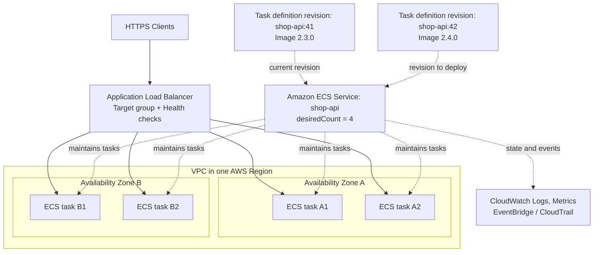
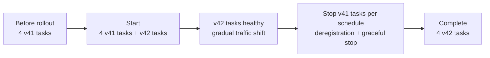
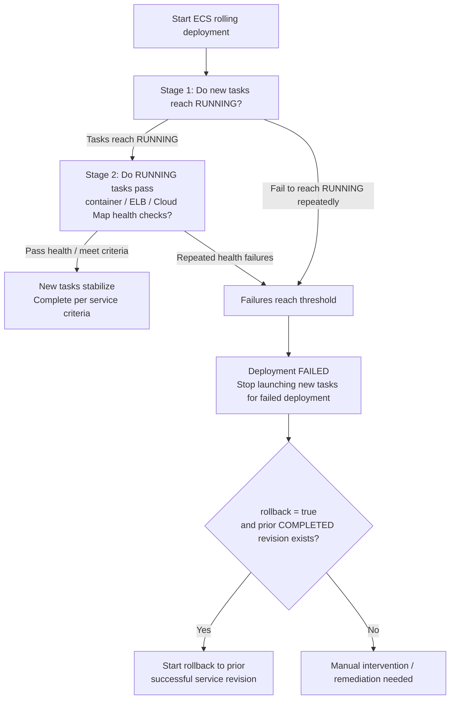
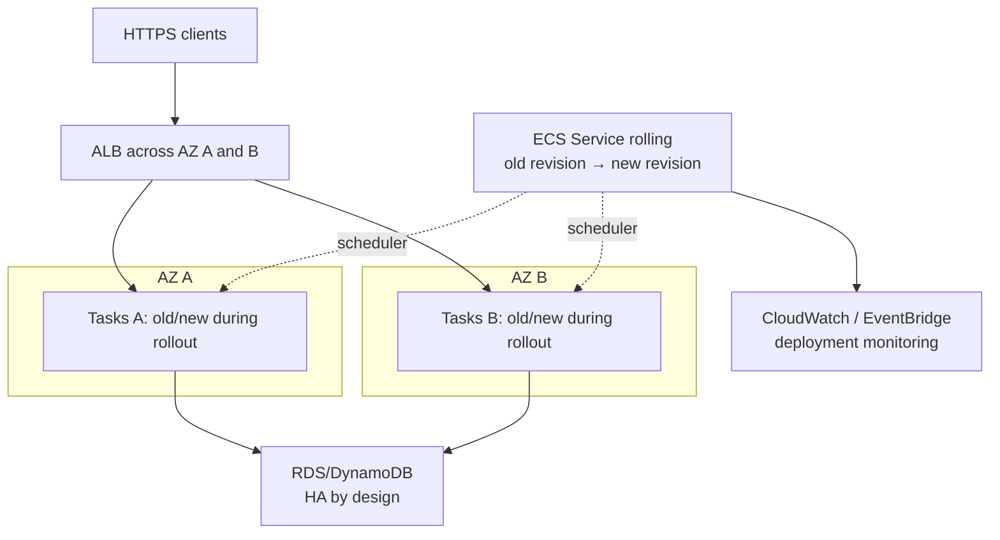

# Rolling Deployments, Deployment Circuit Breakers, and Rollbacks on Amazon ECS

> **Chapter:** Containers with ECS  
> **Module:** CLOUD_PROVIDERS_AWS  
> **Goal:** roll out new container versions on Amazon Elastic Container Service (Amazon ECS) in waves, detect deployments failing to stabilize, roll back automatically or manually, and monitor availability, security, and cost.

## 1. Real-World Problem: Updating an API Without Disrupting Customers

An online store runs a `shop-api` service on Amazon ECS:

- Containers run on **AWS Fargate** or EC2 container instances.
- The ECS service maintains **`desiredCount` = 4 tasks**, spread across multiple **Availability Zones (AZs)** in a VPC.
- An **Application Load Balancer (ALB)** accepts HTTPS and routes requests to healthy ECS tasks.
- Amazon ECR stores image `shop-api:2.3.0`; a new version `2.4.0` is ready for release.
- Amazon RDS or DynamoDB stores data; CloudWatch collects logs and metrics.
- The team wants to keep the API available during updates while automatically reverting to the prior version if new containers crash repeatedly or fail health checks.

Three concepts address this requirement:

1. **Rolling deployment:** ECS gradually replaces old-version tasks with new-version tasks within configured limits on minimum healthy tasks and maximum total running tasks.
2. **Deployment circuit breaker:** ECS detects when a deployment cannot reach steady state, marks the deployment failed, and stops launching new tasks for the failing deployment.
3. **Rollback:** if enabled and a prior successful deployment exists, ECS reverts the service to the **most recent successful service revision/deployment**.

**Note:** A "successful rollback" typically means restoring the prior workload configuration/container version. It **does not automatically undo database migrations, written data, emitted events, secrets, or IAM/VPC changes**.

### 1.1. After This Lesson, Learners Will Be Able To

- Distinguish **task definition**, **task**, **service**, **service revision**, and **service deployment**.
- Calculate the effect of `minimumHealthyPercent` and `maximumPercent` on a rolling update.
- Configure health checks that catch unready containers.
- Understand the two evaluation stages of the deployment circuit breaker and **configurable** failure thresholds.
- Distinguish the circuit breaker from CloudWatch alarm-based deployment failure detection.
- Observe deployments via the ECS Console, AWS CLI, CloudWatch, EventBridge, and ALB target health.
- Design rollbacks with bounded blast radius, data compatibility, and predictable extra cost.

## 2. Background: ECS Objects Involved in a Deployment

### 2.1. System Structure



| Concept | Role |
|---|---|
| **Cluster** | Logical namespace managing services and tasks; can use Fargate or EC2 capacity |
| **Task definition** | Immutable revision declaration of containers, image, CPU/memory, ports, environment, roles, health checks, logs, etc. |
| **Task** | A concrete running execution of a task definition |
| **Service** | Orchestrator maintaining desired task count and integrating load balancers, discovery, and Auto Scaling |
| **Deployment controller/strategy** | Governs how ECS swaps versions: rolling and other supported strategies |
| **Service revision** | Snapshot of service configuration at deployment time, used for history tracking |
| **Service deployment** | A single rollout of a new service revision, with its own status and history |
| **Target group** | Set of IP/instance targets receiving load balancer traffic |
| **Capacity provider** | Mechanism ECS uses to obtain compute capacity from Fargate or EC2 Auto Scaling groups |

A **task definition revision** (e.g., `shop-api:42`) is only one part of a service revision. An update can also modify service settings, networking, or parameters; when diagnosing rollbacks, never look solely at the image tag.

### 2.2. When Is a New Deployment Created?

For an ECS service using rolling updates, changes such as pointing to a **new task definition revision** normally start a service deployment. Calling update-service with **`forceNewDeployment`** can also trigger a deployment even when the task definition is unchanged—useful when rolling tasks with an updated tag; however, **using image digests or immutable tags** remains far more reliable for reproducibility.

Not every operation, such as adjusting `desiredCount`, creates the same kind of application release deployment. Which parameters trigger a service deployment and affect rollbacks depends on the active API and strategy; inspect **`UpdateService`** and service deployment history.

### 2.3. How Do Fargate and EC2 Differ?

- **Fargate:** AWS manages hosts; you declare CPU/memory, networking, and image. Rolling deployments still require Fargate capacity/quotas, free subnet IPs, image pull permissions, and paths to ECR/CloudWatch/Secrets.
- **EC2 launch type / capacity provider:** you must also ensure container instances have enough CPU, RAM, ports, ENIs, disk, and scale-out headroom. `maximumPercent=200` cannot add EC2 slots if the capacity provider/ASG cannot scale out.

The **ECS service scheduler** creates/replaces tasks; **ELB** routes traffic to healthy targets; **Auto Scaling** scales capacity or desired count. These are three distinct functions.

## 3. What Is a Rolling Deployment?

A **rolling deployment** introduces a new release **in gradual batches** rather than stopping all old tasks simultaneously before starting new ones.

Typical sequence:

1. `shop-api:41` is serving traffic in steady state.
2. The team registers tested revision `shop-api:42`.
3. ECS creates a new deployment and starts one or more tasks on the new revision.
4. New tasks initialize and pass container and load balancer/service discovery health checks.
5. Once healthy, ECS gradually stops old tasks within `deploymentConfiguration` bounds.
6. Upon meeting completion criteria, ECS reports the result; if it fails, configured failure detection/rollback runs.



This is the **rolling** model; it does not enforce an exact traffic percentage like a **10% canary** or blue/green with separate target groups. ECS also offers strategies such as `BLUE_GREEN`, `LINEAR`, and `CANARY` in supported features/services; choose those if you need release-level **traffic shifting** control.

## 4. Two Core Parameters: `minimumHealthyPercent` and `maximumPercent`

In an ECS rolling deployment, the scheduler uses:

- **`minimumHealthyPercent`:** minimum fraction of tasks that must stay running and healthy during the update, calculated as a **percentage of `desiredCount` rounded up**.
- **`maximumPercent`:** maximum fraction of total `RUNNING` or `PENDING` tasks allowed during the deployment, calculated as a **percentage of `desiredCount` rounded down**.

Suppose a service has `desiredCount = 4` with:

```json
{
  "deploymentConfiguration": {
    "strategy": "ROLLING",
    "minimumHealthyPercent": 100,
    "maximumPercent": 200
  }
}
```

Therefore:

\[
\text{Minimum healthy tasks}=\left\lceil4\times1.00\right\rceil=4
\]

\[
\text{Maximum total RUNNING/PENDING tasks}=\left\lfloor4\times2.00\right\rfloor=8
\]

ECS can **launch new tasks before stopping old tasks**, theoretically using up to eight slots during transition. Actual batching depends on capacity, health checks, and the scheduler.

### 4.1. Comparing Configurations

| Desired Tasks | Min Healthy | Max Total | Min Healthy Tasks | Max `RUNNING`/`PENDING` | Key Consequence |
|---:|---:|---:|---:|---:|---|
| 4 | 100% | 200% | 4 | 8 | Starts new before stopping old; needs temporary capacity surge |
| 4 | 50% | 100% | 2 | 4 | Can stop old tasks first, reducing serving capacity during rollout |
| 4 | 75% | 150% | 3 | 6 | Balances availability and headroom |
| 3 | 100% | 200% | 3 | 6 | Temporarily doubles total tasks to keep three healthy |
| 1 | 100% | 200% | 1 | 2 | Leaves room for replacement without stopping the sole task first |
| 1 | 100% | 100% | 1 | 1 | Can **stall deployment**—cannot start a new task or stop the old one |

**Note:** `minimumHealthyPercent` does not conjure spare capacity if the backend is unscaled, nor does it guarantee zero failing requests. It is a scheduler constraint on task states and health checks, not a complete SLA.

### 4.2. Why 100/200 Is Not Always Ideal

Advantages:

- Keeps healthy task count near `desiredCount` throughout the rollout.
- Leaves room to validate the new version before draining the old one.
- Fits many web services with fairly steady traffic.

Trade-offs:

- **Fargate:** temporarily runs extra vCPU/GiB tasks in parallel and incurs matching charges.
- **EC2:** the cluster may lack room; requires capacity provider/ASG scale-out or slows the rollout.
- **VPC:** `awsvpc` IP usage spikes temporarily, risking subnet IP exhaustion.
- **ALB:** target registration and startup take time; unready new tasks do not yet serve traffic.

A rollout demanding high healthy counts without spare scaling capacity easily **stalls in `IN_PROGRESS`** or hits placement failures.

### 4.3. Why 50/100 Carries Risk

With `desiredCount` 4, 50/100 allows healthy tasks to drop to 2 during transition. If live traffic sits near the capacity of 4 tasks, dropping to 2 can:

- Spike latency or error rates.
- Distort Auto Scaling behavior.
- Overload databases as surviving tasks absorb concentrated traffic.
- Make the new release look broken when the backend simply ran out of capacity.

Such settings fit only maintenance windows, off-peak traffic, or apps tolerating reduced capacity.

### 4.4. Check Rounding and Forward Progress

The scheduler must be able to **start at least one new task or stop at least one old task** within bounds. If neither action is allowed, service events may report that the deployment configuration prevents starting or stopping tasks.

Verify the integer bounds for your **actual `desiredCount`**, especially on small services. Never assume `minimumHealthyPercent=75` lets you stop 25% when `desiredCount` is 2; \(\lceil2\times0.75\rceil=2\), so zero tasks can be stopped ahead of launching a replacement.

## 5. What Makes a Task "Healthy" for ECS Replacement?

### 5.1. Multiple Health Check Layers

A task transitions through `PROVISIONING`, `PENDING`, `ACTIVATING`, `RUNNING`, and eventually `STOPPED`. Yet **`RUNNING` does not mean the application is ready**.

ECS evaluates signals per configuration:

| Layer | Check | Example Failures |
|---|---|---|
| **ECS task lifecycle** | Can the task provision and reach `RUNNING`? | Cannot pull ECR image, missing IAM execution role, container crash |
| **Container health check** | Does the in-container health command exit 0? | `curl localhost` fails, app not listening on port |
| **ALB/NLB target health** | Do probes/requests to the target succeed per config? | SG blocks, wrong port, HTTP 503, startup too slow |
| **Cloud Map service health** | Health status via service discovery if configured | Service discovery instance marked unhealthy |
| **Application monitoring** | Business KPIs/error rate/latency beyond health endpoints | Business API fails while `/health` returns 200 |

The **circuit breaker** mainly catches task startup failures and integrated ECS health checks. Business-logic bugs surfacing only as HTTP 500s or falling conversions may **not** trip the circuit breaker alone. Use **CloudWatch alarm-based failure detection** and pipeline checks for those.

### 5.2. Container Health Check in the Task Definition

Abbreviated container definition example:

```json
{
  "name": "api",
  "image": "111122223333.dkr.ecr.ap-southeast-1.amazonaws.com/shop-api:2.4.0",
  "essential": true,
  "portMappings": [
    {
      "containerPort": 8080,
      "protocol": "tcp"
    }
  ],
  "healthCheck": {
    "command": [
      "CMD-SHELL",
      "curl --fail --silent http://localhost:8080/health/ready || exit 1"
    ],
    "interval": 15,
    "timeout": 5,
    "retries": 3,
    "startPeriod": 60
  }
}
```

Explanation:

- `CMD-SHELL`: runs the command through a shell inside the container; the image must contain a shell and `curl` (or equivalent). Distroless images usually lack these and require a different health check binary.
- `interval`: seconds between checks.
- `timeout`: maximum seconds per check.
- `retries`: consecutive failures before marking the container unhealthy.
- `startPeriod`: startup grace window during which failures don't count per AWS rules; **an early passing check can end the grace period early**.

Health checks must not perform heavy work, expensive database queries, or depend on non-critical external systems. Overly strict checks cause cascading unhealthy containers during minor peripheral blips.

### 5.3. ALB Target Group Health Check

For an API on port 8080:

- Protocol is typically HTTP hitting `/health/ready`.
- HTTP status matcher matches expected success code, e.g., `200`.
- Timeout/interval/healthy/unhealthy thresholds align with startup time.
- Task security group permits port 8080 from the ALB security group.
- Task ENI/subnet/routes and `ip` target group align with `awsvpc` mode.

When `curl localhost` works inside the container yet the ALB target stays unhealthy: **container health** is fine, while the **ALB → task path** is broken by SGs, ports, VPC networking, or the wrong probe path.

### 5.4. `healthCheckGracePeriodSeconds`

A service with a load balancer or integrated health checks can set **`healthCheckGracePeriodSeconds`** so ECS **ignores initial unhealthy results** right after task start while the app initializes.

For example, if the app takes 90 seconds to warm caches and load config, a 120-second grace period stops ECS from killing the task prematurely. However:

- Grace period **never turns a broken task healthy**.
- It does not extend indefinitely and never prevents crashes/exits of essential containers.
- Setting it too high delays catching genuinely broken releases.
- **ECS service** grace period is distinct from **container health check** `startPeriod` and **ALB target group** thresholds.

Measure actual startup latency distributions (p95/p99) and tune these timers intentionally instead of guessing.

## 6. What Problem Does the Deployment Circuit Breaker Solve?

Suppose version `2.4.0` has a bug:

- The image cannot be pulled from ECR, so tasks never reach `RUNNING`; or
- Tasks reach `RUNNING`, yet `/health/ready` returns 500 continuously and the ALB/ECS keeps replacing new tasks.

Without failure detection, ECS can **keep retrying replacement tasks** or leave the deployment stuck away from steady state. The **deployment circuit breaker** defines failure conditions to halt launching new tasks for a broken deployment and, if rollback is enabled, revert to the last successful deployment.

### 6.1. The Circuit Breaker Is Not an ALB Circuit Breaker

This is neither an application-level circuit breaker pattern (tripping calls to dependencies) nor an ALB setting. It is **ECS service deployment failure detection**.

In this lesson, it is configured via `deploymentConfiguration.deploymentCircuitBreaker` on an ECS service using **rolling updates with the ECS deployment controller**; do not assume every other deployment strategy works identically. AWS also provides blue/green, linear, and canary strategies and feature-specific failure detection.

### 6.2. Two Failure Evaluation Stages



**Stage 1:** ECS tracks whether tasks in the new deployment reach `RUNNING`. Repeated failures before `RUNNING` increment the failure counter per configuration.

**Stage 2:** once at least one task in the deployment reaches `RUNNING`, ECS tracks **container health**, **Elastic Load Balancing health**, and **Cloud Map health checks** where configured. If tasks are repeatedly replaced as unhealthy or cumulative failures hit the threshold, the deployment fails.

**Distinction:** the circuit breaker governs **rollout safety**, not whether an API behaves flawlessly days after deployment.

## 7. Failure Threshold: From Defaults to 2026 Customizability

### 7.1. Default Mechanism

According to Amazon ECS documentation updated in **2026**, the default circuit breaker uses `thresholdConfiguration.type = BOUNDED_PERCENT` with `value = 50`.

Failure count required to trip:

\[
T=\min\left(200,\max\left(3,\left\lceil 0.5\times\text{desiredCount}\right\rceil\right)\right)
\]

| Desired Task Count | 50% Desired | Default Threshold |
|---:|---:|---:|
| 1 | 0.5 | **3** |
| 4 | 2 | **3** |
| 6 | 3 | **3** |
| 25 | 12.5 | **13** |
| 100 | 50 | **50** |
| 400 | 200 | **200** |
| 800 | 400 | **200** |

**Note:** the failure threshold is *not* the minimum healthy task count from `minimumHealthyPercent`. They are completely separate constraints.

### 7.2. Failure Counting Mode: `resetOnHealthyTask`

Starting with the 2026 update, the circuit breaker supports choosing how failures count:

| Setting | Counting Behavior | Purpose |
|---|---|---|
| `resetOnHealthyTask=true` (**default**) | Resets counter to 0 when a task becomes healthy; primarily tracks **consecutive** failures | Avoids rollbacks from isolated startup blips |
| `resetOnHealthyTask=false` | Accumulates failures across the entire deployment, **without resetting** when an intervening task succeeds | Catches releases with intermittent recurring failures sooner |

**Example:** failure threshold = 3, observed sequence: failure → healthy task → failure → failure.

- With reset on healthy, the counter after this sequence is **2**, below threshold 3.
- With cumulative counting, **3** failures have accrued, which can trip the circuit breaker.

This is a conceptual counter example within one deployment; real outcomes depend on how ECS records task failures and health transitions.

### 7.3. Three `thresholdConfiguration` Types

| Type | Interpretation | When to Use |
|---|---|---|
| **`BOUNDED_PERCENT`** | `value% × desiredCount`, rounded up, clamped between **3** and **200** | Sensible default, scaling proportionally within safe bounds |
| **`UNBOUNDED_PERCENT`** | `value% × desiredCount`, rounded up, **without the 3–200 clamp** | Large-scale services wanting thresholds strictly proportional to task count |
| **`COUNT`** | Fixed failure count in `value` | Small environments or exact rollback sensitivity targets |

With `BOUNDED_PERCENT` and `UNBOUNDED_PERCENT`, AWS bounds `value` to **1–100** percent per documentation. `desiredCount` uses the active value during deployment; **autoscaling mid-deployment can shift percentage-based thresholds**.

**Example:** `desiredCount` = 800:

- Default 50% `BOUNDED_PERCENT` → threshold **200**.
- 50% `UNBOUNDED_PERCENT` → threshold **400**.
- `COUNT` 5 → threshold **5**, even with 800 tasks.

**Never set an ultra-low threshold without testing.** A few slow-starting tasks under tight capacity can trigger unnecessary rollbacks.

### 7.4. Example Configuration

This is an **illustrative JSON snippet for ECS service deployment configuration**, not a task definition file:

```json
{
  "deploymentConfiguration": {
    "strategy": "ROLLING",
    "minimumHealthyPercent": 100,
    "maximumPercent": 200,
    "deploymentCircuitBreaker": {
      "enable": true,
      "rollback": true,
      "resetOnHealthyTask": false,
      "thresholdConfiguration": {
        "type": "COUNT",
        "value": 5
      }
    }
  }
}
```

Meaning:

- ECS uses rolling replacement.
- Healthy tasks must not drop below 100% of desired within scheduler bounds.
- Total tasks may temporarily surge up to 200% when capacity allows.
- Circuit breaker is enabled with rollback enabled.
- Just 5 cumulative task failures during the deployment trip the breaker under this setting.

Not every CLI/SDK/IaC version installed in existing projects supports newer fields immediately; for 2026 additions, update tooling and verify schemas before applying.

### 7.5. What If Rollback Is Not Enabled?

With `enable=true, rollback=false`, the circuit breaker still **marks the deployment `FAILED`** and stops launching new tasks for the broken deployment, but **does not automatically revert the service to the prior successful version**. Operations must inspect the state and manually remediate or deploy a good revision.

Never assume enabling the circuit breaker automatically enables rollback; **the two flags are separate**.

## 8. Rollback: Mechanics and Limitations

### 8.1. Which Version Does Rollback Target?

When a new deployment fails, ECS looks for the most recent **successfully completed deployment** (state **`COMPLETED`** in rollout status). If rollback is enabled and an eligible revision exists, ECS initiates a rollout back to that completed configuration.

Example:

| Time | Revision | Outcome |
|---|---|---|
| 09:00 | `shop-api:41` | Completed and verified healthy |
| 09:15 | `shop-api:42` | New tasks crash repeatedly |
| 09:18 | `shop-api:42` | Circuit breaker hits failure threshold → `FAILED` |
| 09:18+ | `shop-api:41` | ECS initiates rollback; tasks on the prior version are restored/maintained |
| After stabilization | `shop-api:41` | Rollback completes if capacity and health permit |

**Rollback itself takes time** and can fail. If subnet IPs run out, Fargate quotas cap out, ECR is unreachable, or the database became incompatible, the old revision can still fail to recover cleanly.

### 8.2. Why Is a Prior `COMPLETED` Deployment Required?

If this is the **very first deployment of the service** with no prior successful revision, the circuit breaker can mark the release failed, yet **there is no good revision to roll back to**. The deployment stops launching new tasks and requires manual intervention.

**Lesson:** on initial deployment, configure accurate health checks and verify steady state. Never assume `rollback=true` provides a "safe prior version" when the service has never completed a deployment.

### 8.3. Rollback Does Not Undo Changes Outside ECS

| Change Accompanying Release | Auto-Reverted When ECS Reverts Task Definition? | What You Should Do |
|---|---|---|
| Image and task configuration in service revision | **Yes, can be restored** by ECS rollback | Use image digests/immutable tags; inspect service revision state |
| Database schema migrations | **No** | Use backward-compatible or expand/contract migrations |
| Data written to RDS/DynamoDB | **No** | Backups, idempotency, data repair runbooks when needed |
| Messages published to SQS/EventBridge | **No** | Backward-compatible consumers, deduplication/retries |
| Secrets rotated in Secrets Manager | **Not automatically** | Support dual/overlapping credentials across transitions |
| IAM policies, SG/VPC routes outside service | **No** | Separate IaC/rollback and change controls |
| External ALB listener rule edits | **Not automatically** | Version infrastructure alongside releases |
| In-memory container session state | **No** | External session stores or stateless design |

For reliable rollbacks, build **backward compatibility** from day one. For example, run database migrations via **expand → deploy both versions → shift traffic → contract later** rather than dropping a column before rollout.

### 8.4. Mutable Image Tags Can Break Reproducible Rollbacks

If a task definition uses `latest` and the pipeline later pushes a different image to `latest`, rolling back to an older task definition revision might not pull the exact **old binary** in every case. Although ECS resolves tags to digests during deployments, you should still:

- Use **immutable build tags** and prefer recording **image digests**.
- Retain older artifacts in ECR long enough per retention policy.
- Record commit SHA, task definition revision, and service deployment ID.
- Never delete older images while they remain rollback candidates.

## 9. CloudWatch Alarms: Catching Business Errors After Tasks Look Healthy

### 9.1. Why Isn't the Circuit Breaker Enough?

Suppose `shop-api:42`:

- Containers run fine.
- `/health/ready` returns 200.
- ALB targets show healthy.
- Yet `POST /checkout` returns HTTP 500 for 25% of requests due to a cart bug.

A circuit breaker checking only task startup and health checks **will miss this**. ECS supports **CloudWatch alarms** as deployment failure criteria to monitor application-level signals.

Example alarms:

| Metric | Suggested Condition | Watch-Outs |
|---|---|---|
| ALB `HTTPCode_Target_5XX_Count` | Backend errors spike abnormally | Account for traffic volume and sample size |
| ALB `TargetResponseTime` | p95 latency breaches SLO | Tune period, statistic, and sensible threshold |
| Custom metric `CheckoutFailureRate` | Checkout failure rate exceeds threshold | Requires accurate instrumentation and steady data |
| Queue backlog / order processing | Message age or queue depth spikes | Can stem from causes unrelated to the release |
| ECS task failures | Abnormal `STOPPED` tasks | Distinguish task crashes from normal scale-in |

Alarms used for deployment failure detection must avoid **false positives**, especially under low traffic or pre-existing background errors. Verify CloudWatch `ALARM`, `OK`, `INSUFFICIENT_DATA`, evaluation periods, and how ECS consumes the alarm.

### 9.2. Combining Circuit Breaker and Alarms

| Mechanism | Primarily Detects | Examples |
|---|---|---|
| **Deployment circuit breaker** | Tasks failing to reach `RUNNING`, repeated health check failures | Image crashes, unhealthy targets |
| **CloudWatch alarm-based detection** | Application/operational metrics breaching thresholds during deployment | HTTP 5xx, p95 latency, checkout errors |

When both are enabled, **either one** can fail the deployment and trigger rollback as configured. Design metrics and observation windows carefully.

**Protection window:** ECS deployment failure detection and automatic rollback operate **only during the deployment**. Once a deployment is marked complete, they do not provide permanent rollback protection. CloudWatch alarms should continue alerting afterward, with post-deploy rollback handled by your operational workflow.

### 9.3. Bake Time and Rolling Deployments

With alarm-based rollbacks, certain configurations support a **bake time** to watch metrics before declaring a deployment successful. Balance carefully:

- Too short: insufficient traffic to expose bugs.
- Too long: slow releases and prolonged dual capacity overhead.
- Observation windows differ between low-traffic APIs and high-throughput services.

**Never treat bake time as a substitute for canary traffic shifting.** Rolling deployments replace tasks via the scheduler; if you need an exact percentage of users routed to a canary version, pick a strategy/tool supporting traffic shifting.

## 10. Early Success Criteria and Rollback Boundaries

### 10.1. Why Does ECS Offer Early Success Criteria?

AWS supports **early success criteria** for rolling deployments. Instead of always waiting until 100% of desired new tasks are healthy and all old tasks are drained, ECS can declare the deployment complete **earlier** once a configured healthy percentage is reached.

Example: `desiredCount` 10, `minimumHealthyPercent` 75%, early `healthyPercent` 80%. Once **8 new-version tasks** become healthy and remaining criteria pass, ECS can mark the deployment successful before every remaining task reaches `RUNNING`.

**Never set early `healthyPercent` lower than `minimumHealthyPercent`.** Pick values within AWS-supported bounds.

### 10.2. Source Revision Cleanup: `BLOCKING` and `DEFERRED`

| Value | Behavior |
|---|---|
| **`BLOCKING`** | Waits to clean up source-revision tasks before marking the deployment complete per selected criteria |
| **`DEFERRED`** | Can declare the deployment complete early, cleaning up source tasks outside the deployment phase; useful for long-lived connections or scale-in protection |

With `DEFERRED`, operators must watch **lingering old tasks** and capacity during cleanup. Never assume `SUCCESSFUL` means zero tasks remain on the old revision.

### 10.3. Special Warning Regarding Rollbacks

**Once ECS declares a deployment complete under early success criteria, circuit breaker and CloudWatch alarm rollout protection stop automatically rolling back that deployment.** Remaining new tasks continue launching under regular scaling activity, meaning late-onset bugs can still surface.

Enable early completion only when teams have verified the healthy percentage and bake window are trustworthy, backed by:

- Post-deployment alarms and monitoring.
- Tested manual rollback or roll-forward runbooks.
- Data compatibility guarantees.
- Capacity and timeouts sized for long-lived connections.

For newer applications lacking mature observability, waiting for standard completion is usually safer.

## 11. Step-by-Step Design of a Safe Rolling Deployment

### 11.1. Sample Workload Profile

Application:

- ECS service `shop-api`, `desiredCount` 4 across two AZs.
- ALB HTTPS 443 listener, target group forwarding to container port 8080.
- Task role scoped strictly to required DynamoDB/S3 calls; execution role for ECR pull, logs, and startup secrets.
- Prior task definition revision already completed stably.
- New release image tested and stored with an immutable tag/digest.
- CloudWatch provides logs, metrics, and deployment alerts.

### 11.2. Preflight Checklist

Before deploying:

1. **Task definition:** verify image URI/digest, task CPU/memory, container ports, log driver, execution role, and task role.
2. **VPC:** Fargate subnets have enough private IPs, accurate SGs, and routes to ECR/CloudWatch/Secrets via NAT or VPC endpoints.
3. **ECS capacity:** verify Fargate quotas or EC2 capacity provider/ASG headroom for `maximumPercent`.
4. **ALB target group:** verify health check path, thresholds, `ip` target type for `awsvpc`, port, and deregistration delay.
5. **Container readiness:** know startup time, task definition probes, and grace period.
6. **Rollback target:** verify a prior `COMPLETED` deployment exists and its image remains pullable.
7. **Database:** migrations are backward-compatible; never drop columns still needed by the old version.
8. **Monitoring:** verify dashboards for `HealthyHostCount`, 5xx, latency, stopped reasons, and alerts.
9. **Change control:** maintenance plan, on-call rollback owner, smoke tests, and release verification steps.
10. **Cost:** budget temporary surge tasks during rollout plus extra metrics/logging.

### 11.3. Illustrative Deployment Configuration

In the ECS Console, when creating or updating a service:

- Choose **ROLLING** deployment strategy with the ECS controller.
- Set `minimumHealthyPercent=100`, `maximumPercent=200` if headroom allows.
- Enable **Deployment circuit breaker** and **Rollback on failures**.
- Keep the default failure threshold or tune thresholds/counting mode based on measurements.
- Consider enabling CloudWatch alarms for business metrics.
- Avoid enabling early success criteria solely to make pipelines finish faster.

**Mutating command example — never run in production without approval:**

```bash
# Illustrative example; triggers a new ECS service deployment.
# Assumes cluster, service, and task definition revision already exist.
aws ecs update-service \
  --region ap-southeast-1 \
  --cluster shop-prod \
  --service shop-api \
  --task-definition shop-api:42 \
  --deployment-configuration '{
    "strategy": "ROLLING",
    "minimumHealthyPercent": 100,
    "maximumPercent": 200,
    "deploymentCircuitBreaker": {
      "enable": true,
      "rollback": true
    }
  }'
```

This command illustrates basic circuit breaker settings; a real deployment may also specify network configuration, capacity providers, target groups, and other parameters. For newer CLI fields like `thresholdConfiguration`, verify your AWS CLI version and supported schema.

### 11.4. Monitoring During Rollout

Once the rollout starts, monitor simultaneously:

- ECS service deployments and per-revision counts (`desired`/`running`/`pending`).
- ECS service events, especially placement, image pull, and container exit errors.
- ALB target group health: have new targets moved from `initial` to `healthy`?
- CloudWatch application metrics: p95 latency, HTTP 5xx, checkout errors.
- EventBridge deployment state change events and CloudTrail for control-plane actions.
- Downstream infrastructure: RDS connections, DynamoDB throttling, SQS backlog.

Declare a rollout **business-successful** only once metrics confirm users can transact normally—not simply when ECS marks the deployment completed/successful.

### 11.5. Post-Rollout Phase

After completion:

1. Verify active task definitions/revisions and running task counts.
2. Check whether any old-revision tasks remain (especially with `DEFERRED` cleanup).
3. Watch for delayed errors emerging after the deployment window.
4. Confirm log retention, artifact retention, and KMS/secret validity.
5. Record the release ID, before/after metrics, and verification results.
6. Update manual rollback notes if data or DB schemas continued evolving.

## 12. Deployment Status: Two Views You Must Not Mix Up

AWS ECS exposes **`rolloutState`** inside `DescribeServices` and a richer **service deployment history** lifecycle. Their status strings **are not identical**.

### 12.1. `rolloutState` in `DescribeServices`

Typical values for rolling ECS deployments:

| Value | Meaning |
|---|---|
| **`IN_PROGRESS`** | Revision is rolling out or rolling back toward steady state |
| **`COMPLETED`** | Revision finished per scheduler/deployment rules |
| **`FAILED`** | Circuit breaker determined the deployment could not stabilize |

Inspect `rolloutStateReason` for details. When rollback starts, a previously completed revision can temporarily re-enter **`IN_PROGRESS`** while recovering.

### 12.2. Service Deployment History

Service deployment history APIs expose finer-grained states, such as:

- `PENDING`, `IN_PROGRESS`.
- `ROLLBACK_REQUESTED`, `ROLLBACK_IN_PROGRESS`.
- `SUCCESSFUL`, `ROLLBACK_SUCCESSFUL`, `ROLLBACK_FAILED`.
- `STOP_REQUESTED`, `STOPPED`.

**Example:** a deployment showing `rolloutState=FAILED` does not always show literally `FAILED` in the `status` field of service deployment history. When investigating, identify the exact **API and field** you are reading instead of equating both state lists.

Service deployment history surfaces revision details, failure detection triggers, rollback reasons, and timestamps, subject to AWS retention windows.

## 13. AWS CLI: Observing Deployments Without Mutating Infrastructure

These commands are **read-only**. Replace `shop-prod`, `shop-api`, and sample ARNs with authorized test resources. Ensure your AWS CLI supports current service deployment APIs.

### 13.1. Inspect Service Config and Deployments

```bash
aws ecs describe-services \
  --region ap-southeast-1 \
  --cluster shop-prod \
  --services shop-api \
  --query 'services[0].{
    Name:serviceName,
    Status:status,
    Desired:desiredCount,
    Running:runningCount,
    Pending:pendingCount,
    Controller:deploymentController.type,
    Config:deploymentConfiguration,
    Deployments:deployments
  }' \
  --output json
```

Inspect:

- `deploymentConfiguration` for strategy, min/max percentages, circuit breaker, alarms, and related settings.
- `deployments[].taskDefinition` showing which revisions exist during rollout.
- `deployments[].rolloutState`/`rolloutStateReason` for rolling status and reasons.
- Reaching `desiredCount` in `runningCount` is not enough; verify target health and app metrics.

### 13.2. Inspect ECS Service Events

```bash
aws ecs describe-services \
  --region ap-southeast-1 \
  --cluster shop-prod \
  --services shop-api \
  --query 'services[0].events[0:15].[createdAt,message]' \
  --output table
```

Messages commonly reveal:

- Task placement failures from insufficient CPU/memory or ENIs/IPs.
- Image pull failures, missing permissions, or registry network errors.
- Container exits and target group health check failures.
- Deployment completion, rollback initiation, or stalled progress.

### 13.3. Inspect Service Deployment History

```bash
aws ecs list-service-deployments \
  --region ap-southeast-1 \
  --cluster shop-prod \
  --service shop-api \
  --output json
```

The history API returns ARNs/metadata for service deployments (depending on version/fields). With an ARN, call `describe-service-deployments` for richer rollback/status and failure details:

```bash
aws ecs describe-service-deployments \
  --region ap-southeast-1 \
  --service-deployment-arns arn:aws:ecs:ap-southeast-1:111122223333:service-deployment/shop-prod/shop-api/EXAMPLE \
  --output json
```

History may be unavailable for very old deployments or accounts/API versions lacking support. Never cite dummy ARNs as real environment checks.

### 13.4. Inspect Running and Stopped Tasks

```bash
# Currently running tasks for the service
aws ecs list-tasks \
  --region ap-southeast-1 \
  --cluster shop-prod \
  --service-name shop-api \
  --desired-status RUNNING \
  --output json

# Recently stopped tasks still retained in ECS metadata
aws ecs list-tasks \
  --region ap-southeast-1 \
  --cluster shop-prod \
  --service-name shop-api \
  --desired-status STOPPED \
  --output json
```

Pass a real task ARN into `describe-tasks`:

```bash
aws ecs describe-tasks \
  --region ap-southeast-1 \
  --cluster shop-prod \
  --tasks arn:aws:ecs:ap-southeast-1:111122223333:task/shop-prod/EXAMPLE \
  --query 'tasks[0].{
    LastStatus:lastStatus,
    DesiredStatus:desiredStatus,
    StoppedReason:stoppedReason,
    StopCode:stopCode,
    Containers:containers,
    TaskDefinitionArn:taskDefinitionArn
  }' \
  --output json
```

Focus on `stoppedReason`, `stopCode`, `containers[].exitCode`, and `containers[].reason`. For example, `CannotPullContainerError` points to a completely different layer than an app starting and exiting with code 1.

### 13.5. Inspect the Task Definition

```bash
aws ecs describe-task-definition \
  --region ap-southeast-1 \
  --task-definition shop-api:42 \
  --query 'taskDefinition.{
    Family:family,
    Revision:revision,
    Roles:[executionRoleArn,taskRoleArn],
    NetworkMode:networkMode,
    Containers:containerDefinitions
  }' \
  --output json
```

The `Roles` array expression in `--query` is illustrative: if your CLI's JMESPath syntax rejects it, omit `--query` and inspect full `--output json`. Check image, `healthCheck`, `essential`, ports, logging, and secrets **without exposing secret values** when sharing output.

### 13.6. Inspect ALB Target Health

```bash
aws elbv2 describe-target-health \
  --region ap-southeast-1 \
  --target-group-arn arn:aws:elasticloadbalancing:ap-southeast-1:111122223333:targetgroup/shop-api/EXAMPLE \
  --query 'TargetHealthDescriptions[].[Target.Id,Target.Port,TargetHealth.State,TargetHealth.Reason,TargetHealth.Description]' \
  --output table
```

`healthy` is a helpful signal; `unhealthy`, `initial`, or `draining` must be correlated with task lifecycles and deregistration delays. Never conclude the entire app is fine from HTTP health checks alone.

### 13.7. CloudWatch Logs

If the task definition uses `awslogs`:

```bash
aws logs describe-log-streams \
  --region ap-southeast-1 \
  --log-group-name /ecs/shop-api \
  --order-by LastEventTime \
  --descending \
  --max-items 10
```

Once you have a stream name:

```bash
aws logs get-log-events \
  --region ap-southeast-1 \
  --log-group-name /ecs/shop-api \
  --log-stream-name ecs/api/EXAMPLE-TASK-ID \
  --limit 50 \
  --output json
```

Do not assume every stream starts with `ecs/api/...`; it depends on `awslogs-stream-prefix`, container name, and task ID. Log groups/streams may not exist if tasks never got far enough to emit logs or execution role/networking failed.

## 14. EventBridge and Failed Deployment Alerts

ECS emits **service deployment state change events** to Amazon EventBridge. You can match **`SERVICE_DEPLOYMENT_FAILED`** and route to SNS, Lambda, or internal alerting systems.

Conceptual event pattern example:

```json
{
  "source": ["aws.ecs"],
  "detail-type": ["ECS Deployment State Change"],
  "detail": {
    "eventName": ["SERVICE_DEPLOYMENT_FAILED"]
  }
}
```

Depending on EventBridge schema, details can include service/cluster ARNs, deployment ID, and reasons. Verify the real event schema before automating actions.

**Distinguish alerting from automated remediation:**

- EventBridge delivers events; **it does not fix bugs itself**.
- SNS/ChatOps notifies on-call engineers.
- Automation can open incidents, gather diagnostics, or run approved rollback workflows.
- When ECS automatic rollback is enabled, avoid secondary automation **simultaneously deploying another revision** and colliding with an `IN_PROGRESS` rollback.

Never automate "whenever `FAILED`, deploy `latest` again"—you may just redeploy the broken build.

## 15. Troubleshooting by Symptom

| Symptom | Common Causes | How to Inspect |
|---|---|---|
| New tasks stuck `PENDING` / never reach `RUNNING` | Insufficient capacity, subnet IP exhaustion, missing ENI, ECR pull failure | ECS service events, `STOPPED` tasks, Fargate quotas/EC2 capacity |
| `CannotPullContainerError` | Missing image, bad execution role, NAT/VPC endpoint/DNS failure | ECR repo/tag/digest, task execution role, VPC routes |
| `ResourceInitializationError` | Cannot fetch secrets/logs, broken network path | Secrets Manager/SSM/KMS, endpoints, execution role, CloudWatch |
| Container enters `RUNNING` then exits code 1 | Bad app config, missing env/secret, app crash | Container logs, stopped reason, startup command |
| Container healthy, ALB unhealthy | SG/port/path mismatch, timeout, app listening on `127.0.0.1` | Target health reason, ENI/SG, probe path |
| Circuit breaker trips too fast | Low threshold, cumulative counting, untuned startup/health | `thresholdConfiguration`, `resetOnHealthyTask`, `startPeriod`/grace |
| Circuit breaker takes too long to trip | Threshold not reached, healthy task resets counter, missing health signal | Deployment config, metrics, failure counts |
| Rollback never starts | `rollback=false` or no prior `COMPLETED` deployment | ECS deployments, `rolloutState`, events |
| Rollback starts but also fails | Old image deleted, insufficient capacity, incompatible DB | ECR retention, task logs, DB schema, service deployment history |
| Rolling update stalls, no task swap | Min/max percent blocks both stop and start; capacity shortage | Calculate integer task bounds, ECS events, ASG capacity |
| HTTP 500s spike yet circuit breaker never trips | Containers and targets stay healthy; business bug outside health check | CloudWatch alarms/custom KPIs, app logs |
| Deployment reports early success with old tasks still running | Early success criteria + `DEFERRED` cleanup | Service revision history, task counts |
| Errors appear hours after deploy finishes | Circuit breaker stops protecting after `COMPLETED` | Post-deploy monitoring, manual rollback |
| Deploy overloads the database | Old and new tasks query DB concurrently; connection pool surge | DB connections, RDS metrics, scaling/capacity |
| WebSocket clients drop during scale-in | Target deregisters and closes connections | Graceful shutdown, draining delay, reconnect logic |

### 15.1. Analysis Workflow When Circuit Breaker Reports `FAILED`

1. Identify the failing **deployment ID and task definition revision**.
2. Determine whether it failed in **Stage 1** (never `RUNNING`) or **Stage 2** (health failure).
3. Read `rolloutStateReason`, service events, and stopped task reasons.
4. Inspect app logs, health checks, and target group health.
5. Verify reachability to ECR/Secrets/KMS/CloudWatch from task subnets.
6. Diff image digest, task roles, env vars, and config against the last `COMPLETED` revision.
7. Check whether ECS initiated rollback and whether rollback tasks are healthy.
8. If no automatic rollback ran, execute an **approved** remediation plan (manual rollback or roll-forward).
9. Write a postmortem covering root cause, monitoring gaps, and prevention.

**Never open SGs to `0.0.0.0/0`, grant IAM `*`, or switch images to `latest` just to "make the service run"** before isolating the failing layer. Those hacks create security holes and destroy release reproducibility.

## 16. Designing Availability Across Regions and AZs

### 16.1. Multi-AZ in Rolling Deployments

Spreading a service across AZ A and AZ B limits single-AZ failure impact, provided that:

- VPC subnets/ENIs have enough capacity in each AZ.
- ALB/NLB target groups retain healthy targets in surviving AZs.
- ECS placement/capacity providers keep tasks balanced where possible.
- Databases/storage have HA or replication (RDS Multi-AZ, Regional EFS, etc.).
- DNS, KMS/Secrets, CloudWatch, and external dependencies are not single points of failure.



Circuit breakers cannot detect every shared infrastructure fault. For example, if a security group edit breaks DB access for **both old and new revisions**, rolling back the task definition will not fix the root cause.

### 16.2. A Rollout Flag Cannot Roll Back Across Regions

An ECS deployment operates on a service within one **Region**. If the Singapore Region becomes completely unavailable, setting `rollback=true` **will not deploy** your app in Tokyo. Multi-Region recovery requires:

- IaC/deployment pipelines in the standby Region.
- Image artifacts and secrets/keys pre-staged per plan.
- DNS / Global Accelerator / Route 53 failover where appropriate.
- Data replication, defined RPO/RTO, and periodic DR drills.
- IAM, quotas, and capacity management in the target Region.

## 17. Security in the Release Workflow

### 17.1. Task Role and Task Execution Role

| Role | Principal Using It | Permissions to Review |
|---|---|---|
| **Task execution role** | ECS/Fargate agent performing infrastructure startup actions on the task's behalf | Pull ECR images, write `awslogs`, read startup secrets per config |
| **Task role** | Application inside the container | Strictly business permissions for DynamoDB/S3/SQS/KMS, etc. |
| **CI/CD deployment role** | Pipeline or authorized release operator | Register task definitions, update services, inspect deployments, scoped `PassRole` |
| **Operations/audit role** | On-call responders / auditors | Read-only ECS/ELB/CloudWatch/CloudTrail plus authorized rollback actions |

Never grant unbounded `ecs:*` or `iam:PassRole` to every developer. Deployments affect customer data and cost, so enforce audit trails and approvals.

### 17.2. Images and Secrets

- Scan images in ECR or CI pipelines per policy.
- Sign/verify provenance if required by your organization; record image digests for reproducibility.
- Never place plaintext secrets inside images or logs.
- Use Secrets Manager/SSM Parameter Store with scoped KMS permissions.
- Never assume rolling back a deployment reverts a rotated secret or invalidates leaked credentials.
- Log image digest, commit SHA, task definition config, IAM roles, and deploy timestamp.

### 17.3. Avoiding Races Between Concurrent Pipelines

If Pipeline A is deploying revision 42 and Pipeline B updates to revision 43 before A finishes, rollout history and rollbacks get messy. Ensure you:

1. Enforce **deployment concurrency locks** per service/environment.
2. Check current deployment state before starting the next deploy.
3. Record release IDs and rollback ownership.
4. Never let "auto-rollback" and "auto-deploy" pipelines fire concurrently on the same service without coordination.

## 18. Cost of Rolling Deployments and Rollbacks

### 18.1. Cost During the Overlap Window

A rolling update with `minimumHealthyPercent=100` and `maximumPercent=200` temporarily runs **more tasks than `desiredCount`**.

Example:

- Service has **4 Fargate tasks**.
- Each task uses **0.5 vCPU** and **1 GiB RAM**.
- During a 10-minute rollout, total tasks temporarily hit **8**.
- After rollout, it returns to 4 tasks.

Additional resource usage above baseline **if all 4 extra tasks run for the full 10 minutes**:

\[
4\times 0.5\text{ vCPU}\times\frac{10}{60}\text{ hours}
=\frac{1}{3}\text{ vCPU-hours}
\]

\[
4\times 1\text{ GiB}\times\frac{10}{60}\text{ hours}
=\frac{2}{3}\text{ GiB-hours}
\]

This is only an **illustrative overlap estimate**. Actual Fargate cost depends on per-task runtime, Region, OS/architecture, CPU/RAM, extra ephemeral storage, and current pricing. On EC2, extra cost may come from the ASG launching additional instances to fit surge tasks.

### 18.2. Other Cost Factors to Include

- **ALB/NLB:** requests/bytes and load balancer capacity units; long deregistration delays stretch rollouts.
- **ECR:** retaining older image versions for rollbacks, plus data transfer per pull path.
- **CloudWatch Logs:** log ingestion/retention, custom metrics, and alarms.
- **VPC:** NAT Gateways, PrivateLink/VPC endpoints, public IPv4 if used, and cross-AZ traffic.
- **Rollbacks:** add another cycle of launching/stopping tasks, extending overlap and capacity charges.
- **Databases:** concurrent connections climb when old and new tasks overlap, sometimes requiring extra DB headroom.

Never cut costs by setting min/max bounds that cripple service availability during traffic peaks. Balance **availability, deployment speed, and budget**.

## 19. Exercises and Answers

### Exercise 1 — Calculate Rolling Bounds

A service has `desiredCount=6`, `minimumHealthyPercent=50`, `maximumPercent=150`. What are the minimum healthy tasks and maximum `RUNNING`/`PENDING` tasks?

**Answer:** Minimum healthy \(\lceil6\times0.5\rceil=3\); maximum total \(\lfloor6\times1.5\rfloor=9\).

### Exercise 2 — Stalled Deployment

A service has 1 task, `minimumHealthyPercent=100`, `maximumPercent=100`. The scheduler can neither start a new task nor stop the old task.

**Answer:** Configuration leaves zero room for forward progress. Increase `maximumPercent` enough to launch a replacement first, or lower `minimumHealthyPercent` if brief downtime is acceptable; also verify capacity.

### Exercise 3 — Tasks Fail to Pull Image

A new deployment fails repeatedly before `RUNNING` due to `CannotPullContainerError`.

**Answer:** Stage 1 circuit breaker failure. Check image URI/digest, execution role, ECR/NAT/VPC endpoint connectivity, task events, and logs; once the threshold hits, rollback triggers if enabled.

### Exercise 4 — `RUNNING` Yet Failing Health Checks

New tasks reach `RUNNING` but the ALB target group stays `unhealthy` due to a wrong health path.

**Answer:** The circuit breaker counts Stage 2 health failures. Fix the path/matcher/SG or app in the next revision; never raise thresholds just to hide errors.

### Exercise 5 — Default Threshold

A service has `desiredCount=25` using the default circuit breaker.

**Answer:** Default threshold = \(\lceil25\times50\%\rceil=13\), clamped within min 3 and max 200.

### Exercise 6 — New `COUNT` Threshold

A service has `desiredCount` 200 with `thresholdConfiguration.type=COUNT`, `value=4`, `resetOnHealthyTask=false`.

**Answer:** Four cumulative task failures trip the breaker instead of 50% × 200. This is very sensitive for a 200-task service; profile normal error rates before enabling.

### Exercise 7 — Consecutive vs. Cumulative Counting

Threshold = 3. Sequence: failure, healthy, failure, failure, healthy, failure.

**Answer:** `resetOnHealthyTask=true` resets on healthy, so there are never three consecutive failures; `false` accumulates at least three failures and can trip rollback sooner.

### Exercise 8 — Rollback Lacks a Good Prior Version

An ECS service deploys revision 1 for the very first time and crashes repeatedly. `rollback=true` is enabled.

**Answer:** No prior `COMPLETED` deployment exists, so the circuit breaker has nothing to roll back to. Fix the issue or manually deploy a healthy revision.

### Exercise 9 — Breaking Database Migration

A new release drops a column needed by the old version; the circuit breaker rolls back the image to the old version.

**Answer:** The old app still fails because the schema did not roll back. Always use backward-compatible/expand-contract migrations and a data remediation plan.

### Exercise 10 — HTTP 500s Without Automatic Rollback

New containers pass container and ALB health checks, yet `/checkout` returns 500s across requests.

**Answer:** The circuit breaker cannot catch business errors hidden behind a passing health endpoint. Use CloudWatch alarms on 5xx/custom KPIs, an appropriate observation window, and a rollback process.

### Exercise 11 — Early Success Criteria

Service `desiredCount` 10, `minimumHealthyPercent` 75, early `healthyPercent` 80, cleanup `DEFERRED`. ECS marks the deployment successful once 8 new tasks are healthy.

**Answer:** This follows the configured early completion rules; remaining new tasks and old task cleanup finish outside the deployment phase. Circuit breaker protection stops once the deployment completes, so post-release monitoring is essential.

### Exercise 12 — AZ Count and Availability

An ECS service spreads tasks across two AZs, while the database runs on a single EC2 instance in AZ A.

**Answer:** Multi-AZ compute alone cannot keep the service online if AZ A fails. Provision data/database redundancy and test end-to-end failover.

### Exercise 13 — Overlap Cost

A service runs 4 tasks, rollout allows up to 8 tasks, and each task uses 1 GiB RAM. If 4 extra tasks run for 15 minutes, how much additional RAM capacity is consumed?

**Answer:** \(4\times1\times15/60=1\) GiB-hour of extra usage, before multiplying by Fargate/EC2 rates and ancillary charges.

### Exercise 14 — Distinguishing `rolloutState` and Service Deployment Status

`describe-services` shows a revision with `rolloutState=FAILED`, while the service deployment history API displays a separate rollback status.

**Answer:** Both APIs/fields model state differently. Inspect both `rolloutStateReason` and service deployment history rather than expecting identical status strings.

### Exercise 15 — Issue Appearing After Deployment Completed

One hour after ECS reports `COMPLETED`, checkout error metrics spike sharply.

**Answer:** A completed deployment's circuit breaker no longer rolls back late-emerging bugs. Rely on alerts, incident response, and manual rollback/roll-forward using versioned artifacts and compatible data.

## 20. Production Checklist

1. **Release artifact:** task definition revision, immutable image digest, ECR retention for rollbacks.
2. **Strategy:** pick `ROLLING` or another strategy matching traffic-shifting needs; do not call every rolling update a canary.
3. **Capacity bounds:** compute integer counts from `minimumHealthyPercent` and `maximumPercent`; verify forward progress.
4. **Compute & network:** Fargate quotas, EC2 capacity providers, subnet IPs/ENIs, NAT/endpoints, and ALB targets.
5. **Readiness:** container health, ALB/Cloud Map checks, grace period, and measured startup latency.
6. **Failure detection:** enable circuit breaker, pick appropriate reset mode and thresholds, and consider CloudWatch alarms.
7. **Rollback:** enable rollback when desired, verify a prior `COMPLETED` revision exists, and confirm its artifact remains pullable.
8. **Data safety:** schema migrations, secrets, queue events, and external state remain backward-compatible.
9. **Early completion:** if enabled, understand exactly when automatic rollback stops and how source cleanup behaves.
10. **Observability:** service deployment history, ECS events, `STOPPED` task reasons, ALB metrics, EventBridge alerts, and CloudTrail.
11. **Multi-AZ:** balanced tasks, target groups, dependencies, and database/storage failover.
12. **CI/CD:** concurrency locks, change approvals, recorded release IDs, and staging rehearsals.
13. **Cost:** budget temporary overlap headroom and track Fargate/EC2, ALB, ECR, CloudWatch, and network spend.
14. **Drills:** intentionally test bad images, failing health checks, and rollbacks in staging to measure RTO.
15. **Post-deployment:** keep monitoring continuously; deployment auto-rollback never replaces ongoing observability.

**Key takeaway:** rolling deployment controls **how ECS swaps tasks in waves**; deployment circuit breaker decides **when an unstable rollout must fail**; rollback decides **whether ECS restores the prior successful version**. A reliable release combines **health checks, alarms, versioned artifacts, compatible data schemas, spare capacity, and post-deploy observability**.

## AWS Reference Documentation

- [Deploy Amazon ECS services by replacing tasks — Rolling deployments](https://docs.aws.amazon.com/AmazonECS/latest/developerguide/deployment-type-ecs.html)
- [How the Amazon ECS deployment circuit breaker detects failures](https://docs.aws.amazon.com/AmazonECS/latest/developerguide/deployment-circuit-breaker.html)
- [Amazon ECS deployment failure detection](https://docs.aws.amazon.com/AmazonECS/latest/developerguide/deployment-failure-detection.html)
- [AWS What's New: configurable ECS deployment circuit breaker settings (2026)](https://aws.amazon.com/about-aws/whats-new/2026/07/amazon-ecs-circuit-breaker-settings/)
- [Complete Amazon ECS rolling deployments early with early success criteria](https://docs.aws.amazon.com/AmazonECS/latest/developerguide/early-success-criteria.html)
- [DeploymentConfiguration API reference](https://docs.aws.amazon.com/AmazonECS/latest/APIReference/API_DeploymentConfiguration.html)
- [DeploymentCircuitBreaker API reference](https://docs.aws.amazon.com/AmazonECS/latest/APIReference/API_DeploymentCircuitBreaker.html)
- [View service history with ECS service deployments](https://docs.aws.amazon.com/AmazonECS/latest/developerguide/service-deployment.html)
- [How to use Amazon ECS task definition health check](https://docs.aws.amazon.com/AmazonECS/latest/developerguide/healthcheck.html)
- [Determining Amazon ECS task health](https://docs.aws.amazon.com/AmazonECS/latest/developerguide/health-check.html)
- [Amazon ECS service event messages](https://docs.aws.amazon.com/AmazonECS/latest/developerguide/service-event-messages-list.html)
- [Amazon ECS service deployment state change events](https://docs.aws.amazon.com/AmazonECS/latest/developerguide/ecs_service_deployment_events.html)
- [Use load balancing to distribute Amazon ECS service traffic](https://docs.aws.amazon.com/AmazonECS/latest/developerguide/service-load-balancing.html)
- [Amazon ECS service Auto Scaling](https://docs.aws.amazon.com/AmazonECS/latest/developerguide/service-auto-scaling.html)
- [AWS Fargate pricing](https://aws.amazon.com/fargate/pricing/)
