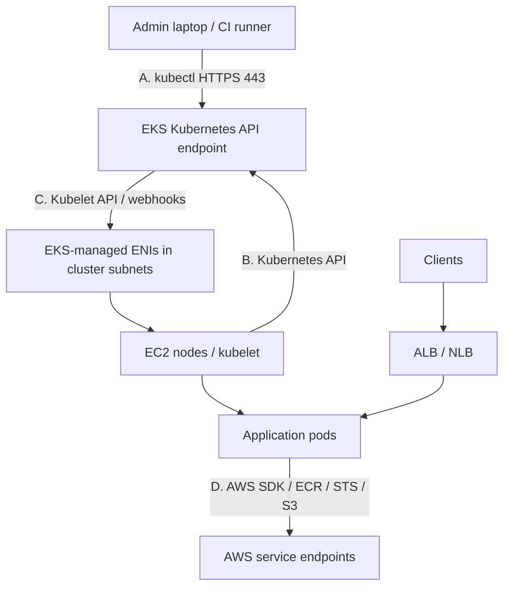
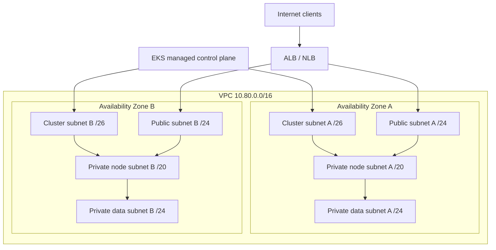
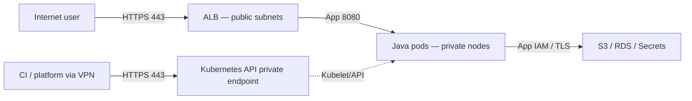

# Designing Subnets, Endpoints, and Cluster Access for Amazon EKS

A development team deploys a Java application on **Amazon Elastic Kubernetes Service (Amazon EKS)**. They already have a VPC and two subnets, yet nodes fail to join the cluster; in another environment, `kubectl` run from a laptop times out even though the IAM role has permissions; and a cluster running in private subnets fails to pull container images from Amazon ECR.

These three incidents illustrate three **distinct yet interdependent** designs:

1. **Subnets and IP addressing** determine how the EKS control plane connects to nodes/pods, node scaling capacity, and Availability Zone (AZ) fault tolerance.
2. **The Kubernetes API endpoint and AWS service endpoints** determine connectivity paths for administrators, nodes, and pods.
3. **IAM, EKS access entries, and Kubernetes RBAC** determine who is authenticated and who is permitted to read or modify resources inside the cluster.

This lesson belongs to the **Kubernetes with EKS** chapter of the **CLOUD_PROVIDERS_AWS** module. Building on Region/AZ, IAM, VPC, compute, storage, database, and serverless fundamentals, learners will design EKS for real-world applications with **least privilege, observability, resilience, and reasonable cost**.

> **Scope:** EKS architecture running in an AWS Region with nodes on EC2/EKS Auto Mode and appropriate variants. Characteristics regarding versions, cluster endpoints, EKS Auto Mode, and IP families can change over time and by Region. Do not follow a sample diagram while ignoring the actual state of your cluster.

## 1. Learning Objectives

After this lesson, you will be able to:

1. Distinguish between the **EKS managed control plane**, **cluster subnets**, **worker node subnets**, and network interfaces created by EKS in the VPC.
2. Select CIDRs and design subnets across **at least two AZs**, planning IPs for nodes, pods, endpoints, and load balancers.
3. Describe the three Kubernetes API endpoint configurations—**public-only, public + private, private-only**—and the trade-offs of each.
4. Distinguish between the **Kubernetes API server endpoint**, the **Amazon EKS service API endpoint**, and **VPC interface/gateway endpoints** used when there is no Internet access.
5. Design cluster access following the chain **network path → AWS IAM authentication → EKS access entries/Kubernetes RBAC authorization**.
6. Understand the impact of cluster security groups, node security groups, network ACLs, DNS, and CIDR allowlists.
7. Build checklists for verification, monitoring, operations, troubleshooting, and cost trade-offs.

## 2. EKS Architecture from a Networking Perspective

Amazon EKS manages the **Kubernetes control plane**, relieving organizations from operating infrastructure-level components such as the Kubernetes API server and etcd themselves. Organizations still manage the VPC, subnets, IAM, workloads, and the level of worker node operations required by their chosen model.

### 2.1. Key components

| Component | Where it runs / who manages it? | Role in the design |
|---|---|---|
| **EKS control plane** | AWS-managed infrastructure | Kubernetes API, scheduling/control components, cluster state management |
| **Kubernetes API server endpoint** | Endpoint provided by EKS | Where `kubectl`, kubelet, and controllers call the Kubernetes API over HTTPS |
| **EKS-created network interfaces (X-ENIs)** | Created by EKS in **cluster subnets** inside the customer VPC | Connectivity between the control plane and VPC resources; supports kubelet API, exec, logs, etc. |
| **Managed node group** | EC2 nodes in user-specified subnets; EKS manages part of the lifecycle | Runs application pods, kubelet, and container runtime |
| **EKS Auto Mode nodes** | Node capacity orchestrated by EKS Auto Mode | Reduces node/networking operations, though subnet policies, permissions, and costs still apply |
| **AWS VPC CNI / supported model CNI** | Networking component on the data plane | Assigns IPs and routes traffic for pods per network configuration |
| **CoreDNS** | Pods inside the cluster | Resolves Kubernetes service names and configured names |
| **ALB/NLB** | Load balancers in the VPC, attached to subnets/AZs | Receives user traffic to applications; distinct from the Kubernetes API endpoint |
| **Amazon ECR, STS, CloudWatch, S3...** | Separate AWS services | Registry, credentials, observability, data, etc., requiring their own access paths |

**Do not confuse:** a **public Kubernetes API endpoint** does not automatically make pods or applications public. Conversely, a private Kubernetes API endpoint **does not automatically block** a `LoadBalancer` Service deployed by an application team.

### 2.2. Four flows to diagram separately



- **A:** administrative tool connectivity to the API server. Depends on DNS, public/private endpoint mode, network path, and identity.
- **B:** kubelet/node connectivity to the API server. Depends on endpoint mode, DNS, SGs, and egress path.
- **C:** control plane connectivity into the VPC, supporting Kubernetes features like `kubectl exec`, `logs`, `port-forward`, or admission webhooks.
- **D:** pod/node connectivity to **AWS API services** (ECR, STS, EC2, CloudWatch, etc.). **Not** the Kubernetes API server endpoint.

## 3. Designing the VPC and Cluster Subnets

When creating an EKS cluster, you specify a **VPC and at least two subnets in two different AZs**. EKS uses these subnets to create requester-managed network interfaces for control-plane-to-VPC connectivity.

### 3.1. Requirements to remember

Per current AWS EKS networking requirements:

- **Cluster subnets must span at least two AZs.**
- Each cluster subnet needs **at least six available IPv4 addresses for EKS**; AWS recommends **a minimum of 16 available addresses** to support long-term operations and upgrades.
- Cluster subnets can be public or private, though AWS recommends **private** when appropriate.
- EKS typically creates **2–4 network interfaces** in the specified subnets during cluster creation.
- During Kubernetes version upgrades, EKS may **delete and recreate ENIs** in cluster subnets; subnets running low on IPs create risk for updates.
- When updating the cluster subnet list, new subnets must be in the **same set of AZs** as those specified at creation time; do not treat updating cluster subnets as a way to add arbitrary AZs to the control plane.
- The VPC must have **DNS resolution** and **DNS hostnames** enabled.
- AZs with restrictions by Region/deployment type must be checked against EKS documentation; do not assume every AZ is supported.

**Watch the math:** an IPv4 `/28` subnet has 16 total addresses, with only **11 typically assignable addresses** because AWS reserves 5 addresses. Therefore, a `/28` **cannot have 16 available addresses**, even though it has 16 IPs in theory. If designing subnets dedicated to EKS control-plane ENIs, choose a practical size with headroom such as `/27` or `/26` based on needs; do not rigidly force one size across every environment.

Source: [AWS — View EKS networking requirements for VPC and subnets](https://docs.aws.amazon.com/eks/latest/userguide/network-reqs.html).

### 3.2. Cluster subnets differ from node subnets

**Cluster subnets** are the subnets declared in the EKS cluster VPC configuration. EKS creates control-plane-related ENIs here.

**Node subnets** are the subnets used when creating managed node groups, self-managed nodes, or configuring NodeClass/Auto Mode. They **can differ from cluster subnets**, as long as the VPC design, routing, policies, and features used support it.

Benefits of separating these subnet groups:

- Reserves addresses for EKS network interfaces, preventing pods from exhausting IPs and breaking cluster updates.
- Allows nodes/pods to use larger CIDRs, reducing IP exhaustion risk during autoscaling.
- Supports distinct route tables/security groups for control-plane-related networking versus workloads.
- Simplifies IP capacity monitoring and platform team ownership.

Dedicated control-plane-only subnets are **not mandatory** for every cluster. This is an **architectural choice**; AWS only requires cluster subnets to have enough IPs, the right VPC/AZs, and valid networking conditions.

### 3.3. Two-AZ subnet diagram

Assume VPC `10.80.0.0/16` in one Region.



*Simplified diagram showing network tiering; not all traffic always follows these arrows. Actual paths depend on target mode, VPC CNI, SGs, route tables, and the application.*

### 3.4. Illustrative CIDR table

| Role | AZ A | AZ B | Notes |
|---|---|---|---|
| **Cluster ENI subnets** | `10.80.0.0/26` | `10.80.0.64/26` | Each `/26` has 59 typically assignable IPv4 addresses; keep headroom for ENIs/upgrades |
| **Public ingress subnets** | `10.80.8.0/24` | `10.80.9.0/24` | For internet-facing ALB/NLB/NAT per design |
| **Private node/pod subnets** | `10.80.16.0/20` | `10.80.32.0/20` | A `/20` has 4,091 assignable IPs; effective capacity depends on CNI/ENIs/pods |
| **Private data subnets** | `10.80.48.0/24` | `10.80.49.0/24` | RDS or data requiring isolation |
| **Reserved space** | Selected from unallocated ranges of `10.80.0.0/16` | — | Maintain an IP registry/IPAM and expansion plan |

The CIDRs do not overlap. However, this is only an **example plan**—do not use it if your organization already uses `10.80.0.0/16` on-premises or in another VPC. Also verify that the **Kubernetes Service** CIDR does not overlap with connected networks.

## 4. IP Planning for Nodes, Pods, and Services

**Kubernetes cluster CIDR**, **VPC CIDR**, and **Kubernetes Service CIDR** serve different roles:

| Address Type | Belongs To | Question to Ask |
|---|---|---|
| VPC CIDR | Amazon VPC | How many total IPs are allocated to ENIs/nodes/pods and AWS resources in the VPC? |
| Node primary IP | EC2 node primary ENI | Which addresses does each node consume? |
| Pod IP | CNI/networking model | Where do Pods get addresses from, and what can they reach? |
| Service ClusterIP CIDR | Virtual IPs of Kubernetes Services | Does it overlap with any peered/connected network or VPC? |
| Cluster DNS | CoreDNS, AmazonProvidedDNS, custom rules | How do Pods resolve Service names and AWS service names? |

### 4.1. Why can Pods exhaust subnet IPs?

In the common **Amazon VPC CNI on EC2** model, pods use VPC IP addresses via ENIs/prefix delegation per configuration. Consequently, **pod creation capacity can hit subnet IP limits** even before CPU/RAM runs out.

Hypothetical example in AZ A:

- 20 nodes, each with 1 primary private IP: minimum 20 IPs.
- 500 pods needing VPC addresses: roughly 500 IPs for pods, before counting reserve addresses, warm ENIs/prefixes, and endpoints.
- IPs for load balancers, interface VPC endpoints, testing, and rollouts have not yet been added.

A `/24` subnet only has 251 typically assignable IPs—**insufficient** for the scenario above. A `/22` subnet has 1,019 assignable IPs, yet you still must check instance types, ENI limits, VPC CNI version, prefix delegation, node density, quotas, and actual context.

For **EKS Auto Mode**, networking is managed by AWS and can separate pod subnets via NodeClass depending on version; **do not blindly apply self-managed VPC CNI variables like `WARM_IP_TARGET`/`ENIConfig` to Auto Mode**.

### 4.2. IPv4/IPv6 IP family

EKS offers `ipFamily=ipv4` or `ipv6` at cluster creation. Selecting the IP family is a **hard-to-reverse decision**: AWS currently requires creating a new cluster if you want to switch `ipFamily`.

In an IPv6 cluster, VPC/subnets still carry IPv4 constraints for certain components; nodes/control-plane ENIs receive appropriate addressing, while pods and Kubernetes Services have distinct IPv6 allocation mechanisms. Do not assume every AWS service/ingress/backend operates purely over IPv6.

When designing:

- Check support in VPC CNI or Auto Mode networking, ALB/NLB, DNS, AWS services, and monitoring.
- Forecast addresses according to how the actual network implementation allocates IPs/prefixes.
- Avoid Service CIDR overlaps with on-premises, VPC peering, or Transit Gateway.
- Define IPv4/IPv6 outbound paths, NAT, egress-only internet gateways, and endpoint support.

Sources: [EKS VPC and subnet considerations](https://docs.aws.amazon.com/eks/latest/best-practices/subnets.html) and [Network requirements](https://docs.aws.amazon.com/eks/latest/userguide/network-reqs.html).

## 5. Public/Private Subnets and Route Tables

A **Public subnet** in VPC terminology has a route to an **internet gateway (IGW)** for appropriate traffic; it does not mean every resource automatically receives a public IP. A **Private subnet** has no direct route from the subnet to an IGW, though it can reach AWS APIs or the Internet via NAT, VPC endpoints, or corporate network links.

### 5.1. Common pattern

- **Internet-facing ALB/NLB** placed in public subnets across multiple AZs per load balancer type.
- **Worker nodes and pods** in private subnets, without needing public IPv4 addresses.
- **RDS/cache/data** in private data subnets, allowing connections only from authorized workloads.
- **EKS cluster ENIs** can be created by EKS inside private cluster subnets.
- **Private-only Kubernetes API endpoint** if governance policy forbids any public access path.

### 5.2. Example route tables

| Subnet | Local Route | Default Egress (if any) | Notes |
|---|---|---|---|
| Public ingress A/B | `10.80.0.0/16 → local` | `0.0.0.0/0 → IGW` | Internet-facing ALB, NAT gateway if required |
| Private nodes A | `10.80.0.0/16 → local` | `0.0.0.0/0 → NAT A` or endpoints | Usually avoid cross-AZ NAT dependencies |
| Private nodes B | `10.80.0.0/16 → local` | `0.0.0.0/0 → NAT B` or endpoints | NAT is not strictly required if all needed VPC endpoints exist |
| Private data A/B | `10.80.0.0/16 → local` | Only strictly needed routes | Avoid unnecessary egress |

**No NAT** is a valid option for a private cluster if you design **complete VPC endpoints/appropriate egress paths** for all AWS services and registries used by nodes/pods.

**A NAT gateway is not a load balancer.** It handles outbound IPv4 from a private subnet; deploying NAT does not enable inbound `kubectl` from a laptop to a private-only API.

## 6. Kubernetes API Endpoint: Public or Private?

EKS provides a **Kubernetes API server endpoint** for the cluster, used by `kubectl`, kubelet, and controllers. This is the **cluster endpoint** found in the `cluster.endpoint` field when running `aws eks describe-cluster`.

Three modes to remember:

| Public | Private | Key Behavior | Use Case |
|---|---|---|---|
| Enabled | Disabled | **Public-only**: API has public DNS; requests from inside the VPC also traverse the public endpoint via AWS routing | Testing or environments with clear public CIDR controls |
| Enabled | Enabled | **Public + private**: requests from within the cluster VPC use the private endpoint; external callers use the public endpoint if IP is allowed | Common practice: private nodes, admins from corporate IPs |
| Disabled | Enabled | **Private-only**: API is only reachable from the VPC or properly connected networks | Environments requiring strict network path control, CI running inside VPC |
| Disabled | Disabled | **Invalid** | The Kubernetes API requires at least one access path |

### 6.1. Public-only: easy access, but understand the node → API path

When the public endpoint is enabled and private is disabled, the API server is reachable from the Internet; authentication/authorization is still required to invoke Kubernetes APIs.

If you configure **`publicAccessCidrs`** to allow only office IPs, remember that **worker nodes still must reach the endpoint**. With private node subnets behind NAT, the NAT's public egress IP may need to be in the allowlist—or better yet, **enable the private endpoint** so nodes communicate inside the VPC.

**Do not leave `0.0.0.0/0` by default** when your organization has stable egress IPs and requires minimizing public exposure. However, do not change the CIDR allowlist without verifying that nodes and CI runners retain connectivity.

### 6.2. Public + private: separating node and admin paths

When both are enabled:

- Nodes and clients inside the VPC use the **private endpoint** via EKS DNS resolution.
- Administrators outside the VPC can use the **public endpoint**, restricted by `publicAccessCidrs`.
- **The cluster security group** controls traffic to the private endpoint; **`publicAccessCidrs`** only controls the public endpoint.
- IAM/access entries/Kubernetes RBAC are still required even when an IP is in the allowlist.

Example for a company with VPN and laptops accessing the Internet via a corporate gateway:

```text
Office client over Internet    → Public Kubernetes API endpoint
                                  (allow corporate public egress CIDR)

Private EC2 node inside VPC    → Private Kubernetes API endpoint
                                  (private DNS, control plane ENIs)
```

For hybrid nodes **outside the VPC**, AWS recommends **not enabling both public and private endpoints simultaneously** in the usual pattern because hybrid nodes might resolve the cluster endpoint to a public IP; follow the dedicated EKS hybrid nodes guidance.

### 6.3. Private-only: locking down network exposure

When public is disabled:

- You cannot run `kubectl` from a laptop on the public Internet without valid network connectivity into the VPC.
- Administration can go through **VPN, Direct Connect**, an admin host in the VPC, a jump/SSM host, or a CI runner on a private connection.
- The API server DNS may resolve to **private IPs even from public DNS**; resolving to a private IP **does not prove the Internet has a route to that private IP**.
- **`publicAccessCidrs` does not govern the private endpoint**.
- The VPC requires `enableDnsHostnames=true` and `enableDnsSupport=true`, along with VPC DNS configured compatibly with `AmazonProvidedDNS`.

**Do not mistake the private endpoint for an interface endpoint shown in the VPC Console.** EKS creates its own mechanism for the Kubernetes API, distinct from AWS PrivateLink `com.amazonaws.region.eks`.

Source: [Cluster API server endpoint](https://docs.aws.amazon.com/eks/latest/userguide/cluster-endpoint.html).

## 7. Distinguishing Three Easily Confused “Endpoints”

A common operational mistake is seeing the term **EKS endpoint** and assuming everything uses the same VPC endpoint.

| Endpoint | Purpose | Caller | Can it replace the private Kubernetes endpoint? |
|---|---|---|---|
| **Kubernetes API endpoint** (`cluster.endpoint`) | Kubernetes objects, pods, deployments, namespaces, `kubectl` | kubelet, kubectl, controllers | **This is the cluster API itself**, with its own public/private access modes |
| **Amazon EKS service API** (`eks.<region>.amazonaws.com` or supported dual-stack form) | `DescribeCluster`, `CreateCluster`, `ListClusters`, and AWS-level EKS management | AWS CLI/SDK, IaC, admin scripts | **No** |
| **EKS Auth API** (`eks-auth`) | Delivers credentials for **EKS Pod Identity** | Pod Identity Agent / supported components | **No** |

**The VPC interface endpoint `com.amazonaws.<region>.eks`** supports AWS EKS management APIs over PrivateLink. It **does not create a private path to the cluster's Kubernetes API server**.

**The VPC endpoint `com.amazonaws.<region>.eks-auth`** serves **EKS Pod Identity** when calling the EKS Auth API privately; it is not the Kubernetes API endpoint and does not replace IAM/access entries.

### 7.1. Why does this distinction matter?

Suppose `aws eks describe-cluster` succeeds from a CI runner in a private subnet, yet `kubectl get pods` times out. The first command calls the **AWS EKS management API**; the second connects to the **Kubernetes API endpoint**. One path working does not prove the other works.

Conversely, `kubectl get pods` working while pods fail to obtain IAM credentials via EKS Pod Identity may point to the agent/role/`eks-auth` or network connectivity to the EKS Auth API, not the Kubernetes API.

## 8. Which VPC Endpoints Are Needed When Nodes Lack Internet Access?

An EKS cluster in private subnets can operate with a **NAT gateway** or **VPC endpoints** depending on which services are used. When an organization requires **no Internet egress**, you must inventory every API path used by nodes, pods, and controllers.

### 8.1. Common endpoints

| AWS Service | Common Endpoint | When Needed |
|---|---|---|
| **Amazon ECR API** | `com.amazonaws.<region>.ecr.api` | Retrieving registry info, auth tokens/image metadata per workflow |
| **Amazon ECR Docker registry** | `com.amazonaws.<region>.ecr.dkr` | Pulling images from ECR |
| **Amazon S3** | `com.amazonaws.<region>.s3` (gateway or supported type) | Fetching ECR image layers or S3 data |
| **AWS STS** | `com.amazonaws.<region>.sts` | IRSA using `AssumeRoleWithWebIdentity`; applicable IAM SDK flows |
| **Amazon EC2** | `com.amazonaws.<region>.ec2` | VPC CNI/EC2 API, ENI management, and features needing EC2 APIs |
| **Elastic Load Balancing** | `com.amazonaws.<region>.elasticloadbalancing` | AWS Load Balancer Controller or components calling ELB APIs |
| **CloudWatch Logs** | `com.amazonaws.<region>.logs` | Log agents/collectors shipping logs |
| **AWS Systems Manager** | `com.amazonaws.<region>.ssm` and supporting endpoints | Administering EC2 nodes via SSM when applicable |
| **Amazon EKS API** | `com.amazonaws.<region>.eks` | Cluster introspection or AWS EKS management API from the VPC |
| **EKS Auth** | `com.amazonaws.<region>.eks-auth` | Pod Identity Agent in environments without Internet egress |
| **EKS cluster OIDC discovery** | `com.amazonaws.<region>.oidc-eks` where supported | IRSA setup / OIDC/JWKS discovery from a private network |
| **Business services** | Secrets Manager, KMS, SQS, DynamoDB, S3, ... | Based on actual application dependencies |

**Do not create every endpoint just because you run EKS**: interface endpoints incur hourly, per-AZ, and data processing fees; Gateway endpoints have different pricing/routing characteristics. Choose based on workloads, actual APIs used, Region, and no-Internet requirements.

### 8.2. VPC endpoint DNS design

For interface endpoints, **Private DNS** is usually enabled so the AWS SDK calls standard service hostnames while DNS resolves to the private endpoint IP inside the VPC. This requires VPC DNS to be properly configured.

Certain services or OIDC/OAuth URLs have specific rules. If you use corporate DNS/custom resolvers, ensure proper conditional forwarding so traffic does not route out to public endpoints or fail with `NXDOMAIN`.

### 8.3. IRSA and EKS Pod Identity notes

- **IRSA (IAM Roles for Service Accounts)**: pods use a service account token to call **STS `AssumeRoleWithWebIdentity`**; in a private cluster without Internet access, an STS endpoint is needed, and the SDK typically must use the **regional STS endpoint** per current support. OIDC provider/discovery setup also requires connectivity to the issuer/JWKS when performed from a private VPC.
- **EKS Pod Identity**: pods obtain credentials via the **Pod Identity Agent / EKS Auth API**; in a private cluster, the `eks-auth` VPC endpoint is required. Granting AWS permissions to pods via an IAM role association **is distinct from human permissions to run `kubectl`**.
- EKS Auto Mode has its own managed Pod Identity Agent mechanism and does not require manually installing the agent as some traditional node models do; connectivity to IAM/AWS APIs still needs to be evaluated.

**Warning:** creating the `eks-auth` endpoint will not fix a `kubectl get nodes` timeout. Each error must be traced to its corresponding endpoint.

Source: [Deploy private clusters with limited internet access](https://docs.aws.amazon.com/eks/latest/userguide/private-clusters.html).

## 9. Cluster Security Group and Connectivity Paths

When creating a cluster, EKS creates a **cluster security group**, typically named `eks-cluster-sg-<cluster>-<id>`.

According to AWS documentation, by default this security group allows:

- **Inbound: all traffic from the security group itself (self-reference)**.
- **Outbound: all traffic to `0.0.0.0/0`** (and IPv6 in supported environments), plus self/EFA-related rules where applicable.
- EKS attaches this group to EKS-created ENIs and managed node group ENIs per service configuration.

**Do not interpret “all traffic by default” as meaning the Internet can always reach your nodes.** SGs are only one layer; Internet ingress also depends on public IPs, routes, NACLs, listeners, and targets.

### 9.1. Restricting rules as needed

For tightly controlled environments, AWS outlines minimum connectivity to consider on the control plane side, such as:

| Direction | Protocol/Port | Purpose |
|---|---|---|
| Outbound to cluster SG | **TCP 443** | Kubernetes API / required control path |
| Outbound to cluster SG | **TCP 10250** | Kubelet API, `exec`, `logs`, `port-forward` |
| Outbound to cluster SG | **TCP/UDP 53** | DNS per configured path |
| Node ↔ node | Per workload/CNI | Inter-node, pod network, CNI overlays if any |
| Nodes → AWS endpoints | TCP 443 and used ports | ECR/STS/EC2/EKS Auth/CloudWatch… |
| ALB/NLB → pods/nodes | App/health check ports | Workload ingress, not cluster API |

**Do not copy a minimal SG table into production** without knowing what traffic your CNI, admission webhooks, metrics-server, kubelet, kube-dns, and services use. Some `self` rules are recreated by EKS during cluster updates; IaC management must account for service behavior.

### 9.2. A security group is not Kubernetes RBAC

- **SG**: allows/blocks network traffic at the ENI level by port/protocol/source.
- **IAM + access entry**: authenticates which AWS principal can sign in to the Kubernetes API.
- **Kubernetes RBAC / EKS access policy**: defines which Kubernetes operations a principal can perform.
- **NetworkPolicy (if supported/enforced by CNI)**: controls pod-to-pod traffic per configuration.

Opening TCP 443 in an SG to the private endpoint **does not automatically grant permission** for `kubectl delete namespace`. Conversely, a cluster admin in IAM cannot run `kubectl` if the SG/routes block the connection.

Source: [View EKS security group requirements](https://docs.aws.amazon.com/eks/latest/userguide/sec-group-reqs.html).

## 10. Cluster Access Consists of Two Independent Stages

To run:

```bash
kubectl get deployments --namespace payments
```

a principal must pass **two gates**:

1. **Authentication:** the Kubernetes API identifies the caller. On EKS, when using IAM authentication, `kubectl` can use a token generated by `aws eks get-token` from temporary AWS credentials/roles.
2. **Authorization:** EKS/Kubernetes checks whether the principal is allowed to `get/list deployments` in the `payments` namespace.

**Permission to run AWS CLI `eks:DescribeCluster`** only lets you read cluster metadata to build a kubeconfig; it **does not mean** the principal can read `deployments` inside Kubernetes.

### 10.1. Three EKS authentication modes

| Mode | How IAM principals map to Kubernetes | Notes |
|---|---|---|
| `CONFIG_MAP` | Legacy `aws-auth` ConfigMap | Older approach; does not use access entries |
| `API_AND_CONFIG_MAP` | EKS access entries **and** `aws-auth` | Useful during migrations |
| `API` | EKS access entries only | Recommended when managing access via AWS APIs/IaC |

Facts to remember:

- **Access entries require a mode that includes EKS API**, i.e., `API` or `API_AND_CONFIG_MAP`.
- Once access entries are enabled, **you cannot switch back to a mode that disables EKS API**.
- If a cluster was created without enabling the `aws-auth` method, you cannot arbitrarily re-enable the ConfigMap method later.
- In `API_AND_CONFIG_MAP`, access entries and the ConfigMap are **two separate stores**, not a single auto-synced copy.
- EKS Auto Mode requires **access entries**.

Sources: [Grant IAM users and roles access to Kubernetes APIs](https://docs.aws.amazon.com/eks/latest/userguide/grant-k8s-access.html) and [Change authentication mode](https://docs.aws.amazon.com/eks/latest/userguide/setting-up-access-entries.html).

## 11. EKS Access Entries and Kubernetes RBAC

An **EKS access entry** associates **an IAM principal ARN** with the cluster; for `STANDARD` entries, permissions can be granted in two ways:

- **Attach EKS access policies** such as `AmazonEKSViewPolicy`, `AmazonEKSEditPolicy`, `AmazonEKSClusterAdminPolicy` with a cluster- or namespace-level **access scope**.
- **Map to Kubernetes groups**, then create `Role`/`ClusterRole` and `RoleBinding`/`ClusterRoleBinding` inside Kubernetes for customized permissions.

These two authorization mechanisms **can be used independently or combined** as needed; both do not have to be present together. EKS access policies are evaluated by the EKS authorization layer, not as `ClusterRole` objects visible in `kubectl get clusterroles`.

### 11.1. Example three-group permission model

| Group / IAM role | Desired Permission | Recommended Model |
|---|---|---|
| `PlatformAdminRole` | Controlled cluster administration, operational handling | Access entry + cluster-scoped admin policy; restrict who can assume the role |
| `PaymentsDeployerRole` | Deploy applications in the `payments` namespace | Access entry + namespace-scoped `AmazonEKSEditPolicy`, or custom RBAC |
| `PaymentsReadOnlyRole` | View deployments/pods/services in `payments` only | Namespace-scoped `AmazonEKSViewPolicy` or least-privilege read `RoleBinding` |
| `AuditRole` | Inspect necessary resources without modifying | Scoped view access, combined with AWS audit/CloudTrail |
| `Node IAM role` | Nodes joining the cluster | Node identity mechanism per node type; never grant human admin |
| **Pod workload identity** | Pods calling S3, DynamoDB, Secrets Manager… | **Pod Identity/IRSA**, never a Kubernetes admin role |

**Never use the same IAM role as both a human cluster-admin and a node instance role or pod workload role.** Responsibility boundaries and incident blast radius become unclear.

### 11.2. Namespace access scope is not general AWS IAM permission

For example, assigning `AmazonEKSViewPolicy` to a role scoped to `payments` only governs **namespace-scoped Kubernetes resources** per the EKS policy. It does not grant the role `s3:GetObject`, `ec2:TerminateInstances`, or `eks:DeleteCluster`.

Some Kubernetes resources are **cluster-scoped** (e.g., namespaces, nodes, CRDs). Permissions to manage them must be designed separately; never infer them from a namespace-scoped access policy.

**Be cautious with wildcard namespaces:** they may fit team naming conventions, but if someone creates another namespace matching the pattern, the permission scope may expand unexpectedly. Prefer explicit namespaces or controlled naming governance.

### 11.3. Example read-only RBAC for one namespace

```yaml
apiVersion: rbac.authorization.k8s.io/v1
kind: Role
metadata:
  name: deployment-reader
  namespace: payments
rules:
  - apiGroups: ["apps"]
    resources: ["deployments"]
    verbs: ["get", "list", "watch"]
---
apiVersion: rbac.authorization.k8s.io/v1
kind: RoleBinding
metadata:
  name: bind-deployment-reader
  namespace: payments
subjects:
  - kind: Group
    name: payments-readers
    apiGroup: rbac.authorization.k8s.io
roleRef:
  kind: Role
  name: deployment-reader
  apiGroup: rbac.authorization.k8s.io
```

**Meaning:** a `STANDARD` access entry can be assigned `kubernetesGroups=["payments-readers"]`, allowing the RoleBinding to grant permission to view deployments in the `payments` namespace.

This template **does not grant permission to read pods/logs/secrets**. To view specific resources, add the corresponding `apiGroups/resources/verbs` after permission analysis. Especially avoid `resources: ["*"]` or `verbs: ["*"]` for users who only need read access.

## 12. Accessing the Cluster from Admin Workstations or CI/CD

### 12.1. Kubeconfig and effective identity

Common commands:

```bash
# Read-only cluster metadata lookup and update local kubeconfig.
# Replace cluster name/Region with your organization's values.
aws eks update-kubeconfig \
  --region ap-southeast-1 \
  --name example-eks \
  --profile learning

# Check local context before running Kubernetes operations.
kubectl config current-context

# List namespaces; only succeeds if granted Kubernetes access.
kubectl get namespaces
```

`update-kubeconfig` **writes or updates a local kubeconfig file** (usually `~/.kube/config`); it **does not create/modify the EKS cluster**. If you need to avoid modifying your active kubeconfig, pass `--kubeconfig <separate-path>` and verify the context.

When using `aws eks get-token` and assumed roles, **the actual AWS identity of your CLI session** might not be the IAM role you think it is. Verify first:

```bash
aws sts get-caller-identity --profile learning
aws eks describe-cluster \
  --region ap-southeast-1 \
  --name example-eks \
  --profile learning \
  --query 'cluster.{Name:name,Status:status,Endpoint:endpoint,Auth:accessConfig.authenticationMode}'
```

**Error distinction:**

- `aws eks describe-cluster` returns `AccessDenied` → **AWS EKS management API** permission issue.
- `update-kubeconfig` succeeds but `kubectl` times out → **route/DNS/endpoint/SG** issue.
- `kubectl` returns `Unauthorized` or “You must be logged in to the server” → inspect credentials, token, access entry/authentication.
- `kubectl` returns `Forbidden` → usually authenticated, but missing **Kubernetes/EKS access policy** permission for the action.

### 12.2. When the cluster is private-only

Valid access paths can include:

- Corporate laptop → **Client VPN/Site-to-Site VPN/Direct Connect** → VPC private endpoint.
- CI runner inside the VPC or a properly connected VPC.
- Admin/bastion host with a path to the private endpoint; prefer **SSM Session Manager** over public SSH where the model permits.
- An in-cluster GitOps controller pulling configurations from a protected repository, reducing the need for inbound `kubectl` from the Internet.

**Do not re-enable the public endpoint just to work around a kubeconfig error** before analyzing DNS, VPN, security groups, and permissions. If a temporary exception is needed, enforce an expiration, explicit CIDR, risk review, and rollback.

### 12.3. CI/CD must use a dedicated identity

Deployment pipelines should use **temporary IAM roles** via federation/OIDC per the CI platform, instead of long-lived access keys. Create a dedicated access entry with namespace-scoped permissions whenever possible.

Also ensure:

- The runner has a network path to the Kubernetes API per endpoint mode.
- The role has minimal AWS metadata permissions to execute its defined workflow.
- The role has Kubernetes authorization to apply the appropriate resources.
- Application release pipelines cannot modify cluster-wide RBAC/CRDs unless needed.
- Changes are audited; secrets are never printed in CI logs.

## 13. Nodes, Pod Identity, and “Cluster Access” Are Not the Same

**Three identity layers are frequently confused:**

| Identity | Used For | Permission Type |
|---|---|---|
| **EKS cluster IAM role** | EKS service managing cluster infrastructure per service responsibilities | Control plane/service AWS IAM permissions |
| **Node IAM role** | EC2 kubelet, image pulls/CNI/add-on flows per architecture | Node AWS IAM permissions; node authentication mechanism |
| **Pod IAM role** via IRSA/Pod Identity | Applications in pods calling S3/SQS/DynamoDB/Secrets Manager | Dedicated AWS IAM permissions for the workload |
| **Human/CI IAM role** | Running `kubectl`/managing the cluster | Kubernetes access via EKS access entry/RBAC + required AWS permissions |

For example, a Java service running on EKS needs to read `s3://invoices-prod/*`:

- Use **IRSA** or **EKS Pod Identity** to grant `s3:GetObject` to the pod.
- Do not attach `s3:*` to every node IAM role just so one pod can read S3.
- Do not grant `cluster-admin` to the application “just to make sure it works.”
- Control S3 data using bucket policies, Block Public Access, KMS if applicable, and VPC endpoint policies per design.

**Node authentication** depends on node type and EKS authentication mode (managed groups, Fargate, Auto Mode, self-managed). Do not manually create `STANDARD` access entries for every node without following the node identity documentation for your deployment type.

## 14. Complete Architecture Example: Java API on EKS

**Context:** a company deploys a Java Spring Boot API consisting of two components: `orders-api` and `payments-api`. Requirements:

- Serve customers via HTTPS/ALB.
- Nodes run privately and tolerate losing one AZ.
- Only the payments CI team may update deployments in the `payments` namespace.
- Restrict Kubernetes API administration paths from the Internet.
- Pods read data from S3/RDS using least privilege.
- Support logging, scale-out, backups, and cost tracking.

### 14.1. Recommended design

| Component | Choice | Rationale |
|---|---|---|
| VPC | `10.80.0.0/16`, two AZs, separate cluster/private/public/data subnets | Prevent cluster updates from hitting pod IP pressure |
| Cluster subnets | Two private `/26`s, one per AZ | Reserve IPs/ENIs for control plane with headroom |
| Worker nodes | Managed node groups or Auto Mode in private `/20` subnets | Separate pod/node capacity and Auto Scaling |
| Kubernetes API | **Public + private**, public CIDRs restricted to CI/office IPs; or **private-only** if VPN/VPC runner exists | Balance operational access and network exposure |
| Ingress | Public ALB in public subnets A/B, ACM HTTPS | Separate app traffic from API management |
| Application | `orders` and `payments` namespaces | Deployment and RBAC boundary; not a complete security boundary on its own |
| Kubernetes auth | `API` mode, access entries for platform/audit/CI | Dedicated IAM roles and namespace-scoped permissions |
| Workload IAM | Pod Identity or IRSA | Per-pod S3/Secrets Manager access |
| AWS egress | NAT per AZ or VPC endpoints per service list | Prevent image pull/credential failures |
| Observability | EKS control plane logs, container logs, VPC Flow Logs, ALB metrics | Diagnose connectivity, authorization, and SLOs |
| DR/cost | Multi-AZ, separate data backups, EKS/EC2/ELB/endpoints costs | Multi-AZ does not equal backup |

### 14.2. Example Java Deployment

```yaml
apiVersion: apps/v1
kind: Deployment
metadata:
  name: payments-api
  namespace: payments
spec:
  replicas: 3
  selector:
    matchLabels:
      app: payments-api
  template:
    metadata:
      labels:
        app: payments-api
    spec:
      serviceAccountName: payments-api
      containers:
        - name: api
          image: 111122223333.dkr.ecr.ap-southeast-1.amazonaws.com/payments-api:1.0.0
          ports:
            - containerPort: 8080
          resources:
            requests:
              cpu: 250m
              memory: 512Mi
            limits:
              memory: 1Gi
          readinessProbe:
            httpGet:
              path: /actuator/health/readiness
              port: 8080
            initialDelaySeconds: 10
            periodSeconds: 10
```

**This is an illustrative snippet, not a complete production manifest.** Namespace, service account, ECR repository, node capacity, image trust, securityContext, liveness/startup probes, PodDisruptionBudget, autoscaling, and secrets must be configured for the real application.

Specifying `serviceAccountName` does not automatically grant AWS permissions. You must create the service account and Pod Identity/IRSA association along with the corresponding IAM role/policy. Ensure nodes can pull the ECR image via NAT or ECR/S3 endpoints, and that the image matches the architecture (amd64/arm64).

### 14.3. User network path differs from admin network path



The **USER → ALB → Pod** path can function even when the Kubernetes API is private-only. Conversely, CI permissions to deploy pods **do not allow CI to read S3 business data** unless explicitly granted by IAM.

## 15. Notable Differences with EKS Auto Mode (2026)

EKS Auto Mode automates much of node compute, networking, and load balancer management, but **does not remove the responsibility of choosing VPCs, subnets, access modes, and permissions**.

### 15.1. NodeClass and subnet selectors

With Auto Mode, you can specify a **NodeClass** and subnet selectors using appropriate tags/IDs. Ensure that:

- Selected subnets are truly private/public per their route tables, not just by name.
- Subnets have enough IPs when scaling nodes/pods.
- Sufficient AZs are included per architecture and regional support.
- Tag selectors are not overly broad: resources tagged similarly later could be selected automatically.
- Permissions, SGs, and egress paths for ECR/STS/EKS Auth/CloudWatch are accurate.

Do not apply every **self-managed Amazon VPC CNI add-on** tuning knob directly to EKS Auto Mode; Auto Mode has AWS-managed networking components with their own limits and configuration model.

### 15.2. Subnet tags for load balancing

For **EKS Auto Mode**, subnets require appropriate tags so the load balancing controller identifies their intended use:

| Subnet Type | Primary Tag |
|---|---|
| Public for internet-facing ELB | `kubernetes.io/role/elb = 1` (or empty value as supported) |
| Private for internal ELB | `kubernetes.io/role/internal-elb = 1` (or empty value) |

Do not attach `role/elb` to a private subnet just “so the controller can see it,” as it may pick the wrong subnet and create unintended ingress paths. **Verify route tables/IPv4/IPv6 and security groups**; do not treat tags as a firewall.

A separately installed AWS Load Balancer Controller and EKS Auto Mode have **different mechanisms/annotations** in several situations; follow the guide for the exact controller you are running.

Sources: [EKS Auto Mode networking](https://docs.aws.amazon.com/eks/latest/userguide/auto-networking.html) and [Subnet tags for EKS Auto Mode](https://docs.aws.amazon.com/eks/latest/userguide/tag-subnets-auto.html).

## 16. Safe Deployment or Change Procedure

### Phase A — Lock Down Architecture

1. Define Region, VPC CIDR, Service CIDR, AZ count, and EKS model (managed node groups, Fargate, Auto Mode…).
2. Separate subnets for cluster ENIs, nodes/pods, ingress, and data; calculate IP headroom per AZ.
3. Choose the **API endpoint mode** and network paths for laptops, CI, nodes, and controllers.
4. List AWS services nodes/pods will call to choose NAT vs. endpoints.
5. Define admins, CI roles, access entries, Kubernetes namespaces/RBAC, and workload IAM.
6. Diagram SGs, routes, DNS, encryption, logging, and rollback plans.

### Phase B — Build Networking

1. Provision VPC/subnets/route tables via IaC with network team approval.
2. Enable `enableDnsHostnames` and `enableDnsSupport`; verify DHCP DNS options.
3. Provision NAT or VPC endpoints per egress policy; enable private DNS where appropriate.
4. Create SGs for cluster/nodes/ingress and apply tested least privilege.
5. Tag subnets for controllers/Auto Mode per design, not indiscriminately.

### Phase C — Create Cluster and Permissions

1. Create the cluster with **cluster subnets in at least two AZs**, the selected authentication mode, and API endpoint options.
2. Verify cluster `ACTIVE`, X-ENIs, SGs, and cluster endpoint.
3. Configure **access entries** for platform/admin/audit/CI; test with actual principals.
4. Grant namespace-scoped permissions or custom RBAC rather than defaulting the whole team to cluster-admin.
5. Create node groups/NodeClasses in private subnets; verify nodes reach `Ready`.
6. Verify CoreDNS, CNI, CSI, metrics/logging, and identity add-ons per deployment type.

### Phase D — Verify Each Path

- Test `aws eks describe-cluster` via the AWS management API.
- Test DNS and TLS 443 to the **Kubernetes API endpoint** from the intended network vantage point.
- Test `kubectl get nodes` using an authorized role.
- Test `kubectl auth can-i` for each role/namespace.
- Test nodes pulling ECR images and pods calling STS/EKS Auth/S3/Secrets Manager.
- Test applications via ALB/NLB and confirm no unintended backend bypasses.
- Test scale-out, node rotation, and resilience when one AZ lacks capacity.

### Phase E — Move to Operations

- Maintain **IaC** for cluster endpoint mode, subnets, SGs, access entries, and VPC endpoints.
- Monitor subnet free IPs, node Ready status, API errors, and unauthorized access attempts.
- Periodically review roles, access scopes, public CIDRs, SGs, and NAT/VPC endpoint costs.
- Plan Kubernetes/EKS add-on upgrades, keeping sufficient IPs for control-plane ENI recreation.
- Document runbooks for “lost admin access,” “API timeout,” “pod ImagePullBackOff,” and “node NotReady.”

## 17. Inspecting Configuration with AWS CLI and kubectl (Read-Only)

Example commands use **hypothetical cluster/Region/profile values**. Execute only in authorized accounts; do not copy directly to production without verifying context.

### 17.1. View cluster subnets, endpoint, and SG

```bash
# Effective AWS identity of the CLI
aws sts get-caller-identity --profile learning

# Cluster parameters and endpoint modes
aws eks describe-cluster \
  --region ap-southeast-1 \
  --name example-eks \
  --profile learning \
  --query 'cluster.{Name:name,Status:status,Endpoint:endpoint,VPC:resourcesVpcConfig.vpcId,Subnets:resourcesVpcConfig.subnetIds,SecurityGroup:resourcesVpcConfig.clusterSecurityGroupId,Public:resourcesVpcConfig.endpointPublicAccess,Private:resourcesVpcConfig.endpointPrivateAccess,PublicCIDRs:resourcesVpcConfig.publicAccessCidrs,Auth:accessConfig.authenticationMode}'

# View subnet capacity and AZs
aws ec2 describe-subnets \
  --region ap-southeast-1 \
  --profile learning \
  --query 'Subnets[].{Id:SubnetId,VPC:VpcId,AZ:AvailabilityZone,CIDR:CidrBlock,Available:AvailableIpAddressCount}' \
  --output table

# View rules of a security group (obtain actual ID from describe-cluster)
aws ec2 describe-security-groups \
  --region ap-southeast-1 \
  --group-ids sg-0123456789abcdef0 \
  --profile learning
```

**Note:** the `describe-subnets` command in the example does not automatically filter by VPC; in accounts with multiple VPCs, add `--filters Name=vpc-id,Values=<your-vpc-id>` in real usage.

### 17.2. View access entries and assigned policies

```bash
# Access entries (requires auth mode with API)
aws eks list-access-entries \
  --region ap-southeast-1 \
  --cluster-name example-eks \
  --profile learning

# What permissions does a specific role have via EKS access policies?
aws eks list-associated-access-policies \
  --region ap-southeast-1 \
  --cluster-name example-eks \
  --principal-arn arn:aws:iam::111122223333:role/PaymentsReadOnlyRole \
  --profile learning

# View authentication mode via cluster metadata
aws eks describe-cluster \
  --region ap-southeast-1 \
  --name example-eks \
  --profile learning \
  --query 'cluster.accessConfig'
```

`list-access-entries` cannot replace auditing `aws-auth` if the cluster is still in `API_AND_CONFIG_MAP`; and access policies do not cover all Kubernetes RBAC bindings.

### 17.3. Check Kubernetes authorization

```bash
# Once kubeconfig is configured, endpoint is reachable, and appropriate permissions exist
kubectl get nodes -o wide

# Permissions of the current principal in the payments namespace
kubectl auth can-i get deployments --namespace payments
kubectl auth can-i create deployments --namespace payments
kubectl auth can-i delete namespaces

# View pods by AZ/node, or identify scheduling errors
kubectl get pods -A -o wide
kubectl get events -A --sort-by='.lastTimestamp'
```

`kubectl auth can-i` **does not modify the cluster**. However, `kubectl get events -A` may include sensitive workload details; use only within authorized scope and avoid sharing raw output publicly.

**Do not test** `kubectl delete` just to verify an access policy in this lesson; use `can-i` queries or test in an authorized sandbox namespace.

### 17.4. Check DNS/network status from the admin host

```bash
# Retrieve endpoint URL from describe-cluster first, replacing the placeholder below.
nslookup EXAMPLE_CLUSTER_ENDPOINT

# Check port 443 with an appropriate client; the endpoint requires separate authentication.
curl -I --connect-timeout 5 https://EXAMPLE_CLUSTER_ENDPOINT

# Read status of Kubernetes services in the cluster
kubectl get svc -A
```

**Explanation:** `curl -I` does not carry an AWS IAM token or Kubernetes client credentials, so receiving `401`/`403` from the API server **still indicates network/TLS is working**. Do not conclude “the cluster is broken” from that HTTP code alone; conversely, DNS/connection timeouts point to route/SG/endpoint mode errors.

## 18. Troubleshooting Table

| Symptom | Possible Failing Layer | How to Investigate |
|---|---|---|
| `aws eks describe-cluster` returns `AccessDenied` | AWS IAM permission, Organizations policy | Check caller identity, `eks:DescribeCluster`, SCPs, and resource scope |
| `aws eks describe-cluster` works, but `kubectl` times out | Kubernetes API endpoint network | DNS, public/private mode, VPN, routes, SG, ACL, public CIDRs |
| `kubectl` returns `Unauthorized` | IAM authentication / token / access entry | AWS principal, token signer, mode, access entry, kubeconfig |
| `kubectl` returns `Forbidden` | Kubernetes authorization | Access policy, scope, Role/RoleBinding, namespace, and verb |
| Node fails to join cluster | Endpoint, node role, bootstrap, egress, or CNI | Kubelet logs, cluster SG, DNS, NAT/VPCE, node IAM, EC2 quotas |
| `ImagePullBackOff` | Registry network, ECR auth, image tag/architecture | ECR API/DKR, S3 endpoint, node role, image URI, and logs |
| Pod cannot obtain AWS credentials | IRSA/Pod Identity/STS/EKS Auth | Service account/association, role trust, endpoint, regional STS SDK |
| `kubectl logs/exec` times out while `get pods` works | Control-plane → kubelet/ENI path | Cluster SG, TCP 10250, routes/NACLs, new node CIDRs |
| Pod `Pending` even though nodes have CPU | Pod IPs, node selectors, taints, quotas, volumes | IP capacity, CNI, events, PV/CSI, scheduling |
| ALB ingress not provisioned | Subnet tags, controller IAM, ELB API/endpoint | Controller logs, `role/elb`, IAM, SGs, VPC endpoints |
| Uneven node scaling across AZs | IPs/capacity/ASG/Auto Mode selectors | Free IPs per AZ, instance availability, topology constraints |
| Private endpoint DNS returns private IP on external laptop | Network/routing rather than necessarily DNS | Check VPN/Direct Connect and route to the private IP |

### 18.1. Logical investigation sequence

1. **Caller location**: laptop, CI runner, or node; inside or outside the VPC?
2. **Which endpoint**: Kubernetes API, EKS AWS management API, or EKS Auth/STS?
3. **DNS**: is the hostname resolving to a public or private IP, with proper VPC DNS/forwarders?
4. **Network path**: routes, subnets, SGs, NACLs, VPN, NAT, or VPC endpoints?
5. **Identity**: effective AWS role and credential expiration?
6. **EKS authentication mode and access entry**: is the principal recognized?
7. **Authorization**: EKS access policy or RBAC for the verb/resource/namespace?
8. **Capacity/observability**: available IPs, ENI quotas, pods/events/logging?

Following this sequence prevents editing IAM policies when the real issue is a private endpoint lacking a route, or opening the public endpoint when the real issue is RBAC.

## 19. Security, Observability, Cost, and Resilience

### 19.1. What must be protected

- **Cluster endpoint**: restrict public access CIDRs or use private-only per design; lock down the private endpoint SG.
- **IAM and access entries**: federation/temporary roles, MFA at the identity provider, role- and namespace-scoped permissions.
- **Node IAM role**: do not grant broad S3/database permissions across all nodes.
- **Workload identity**: IRSA/Pod Identity with least-privilege IAM roles.
- **Secrets**: Kubernetes Secrets with properly configured encryption at rest/KMS, strict RBAC, and controlled access.
- **Network**: SGs, NACLs, NetworkPolicy per CNI support, ALB ingress protected by TLS/WAF if needed.
- **Supply chain**: private ECR, image scanning/signatures/digests, admission policies.
- **Audit**: EKS control plane audit/authenticator logs, CloudTrail, Kubernetes events, VPC Flow Logs, CloudWatch/application logs.

### 19.2. Observability requires distinguishing layers

| Source | Issues Detected |
|---|---|
| EKS control plane `api` logs | Kubernetes API errors/activity per enabled logs |
| EKS `audit` logs | Kubernetes resource API activity and actors |
| EKS `authenticator` logs | IAM authentication into Kubernetes |
| CloudTrail EKS management events | Who changed access entries, endpoint mode, or cluster configuration |
| VPC Flow Logs | Traffic to ENIs/endpoints accepted/rejected within logged scope |
| CloudWatch `Container Insights` | Node/pod/resource metrics per configuration |
| ALB/NLB logs/metrics | Application traffic through load balancers |
| AWS Cost Explorer/Budgets | Cluster, node, storage, data transfer, and network costs |

Enabling control plane logging incurs CloudWatch log ingestion/storage costs. Each log type shows only part of the picture; **CloudTrail management logs do not replace Kubernetes audit logs**.

### 19.3. Cost trade-offs

Components that can generate costs:

- **EKS cluster fee** per cluster/version support tier.
- **EC2 managed/self-managed nodes, EKS Auto Mode**, or Fargate per execution model.
- **NAT gateways** (hourly, data processed), cross-AZ/Region data transfer.
- **Interface VPC endpoints** (hourly/ENI, data processing) or Gateway endpoints per service.
- **ALB/NLB**, EBS/EFS, logs, storage, backups, metrics.
- Private hybrid connectivity (VPN/Direct Connect/TGW), IPAM, additional security services.

Choose **NAT** when diverse Internet egress is needed and its cost/path is acceptable; choose **VPC endpoints** when private connectivity to AWS APIs is desired, public egress should be reduced, and workloads primarily use supported AWS services. Calculate total cost across AZs/endpoint count/traffic and other egress needs; **do not assume “private is always cheaper.”**

### 19.4. Resilience

- Subnets in at least two AZs **do not automatically** guarantee balanced pods; replicas, topology spread constraints, PodDisruptionBudgets, and proper node capacity are required.
- The EKS managed control plane is operated by AWS with appropriate HA, but workloads/data still require redundancy design.
- Database backups/snapshots, EBS/EFS/RDS recovery, and **RPO/RTO** are independent of subnet design.
- Private-only CI/admin access requires backup VPN/SSM paths and controlled “break-glass” principals.
- Test failures of a NAT/VPC endpoint IP/AZ, node rotations, cluster upgrades, and low subnet free IPs.
- During EKS upgrades, EKS may recreate X-ENIs; preserve available IPs in cluster subnets.

## 20. Design Practice Exercises

### Exercise A — Choosing cluster subnets

A team proposes:

- VPC: `10.90.0.0/16`.
- Cluster subnet A: `10.90.0.0/28`.
- Cluster subnet B: `10.90.0.16/28`.
- Node/pod subnets A/B: `10.90.16.0/24` and `10.90.17.0/24`.
- Expects many pods and 4x node growth within a year.

**Question:** can the cluster be created with two `/28` subnets? Why is this not a good production design?

**Hint:** a `/28` has 11 AWS-assignable IPv4 addresses, which may satisfy the **6 available addresses** minimum at creation if unused, but **fails the recommended 16 available addresses** for a cluster subnet. Headroom is needed for X-ENIs and upgrades; dedicated `/27` or `/26` subnets provide better headroom. Node/pod `/24` subnets must also be evaluated against CNI load and real pod capacity.

### Exercise B — Restricted public endpoint CIDR

A cluster has:

```text
Public endpoint = true
Private endpoint = false
publicAccessCidrs = ["203.0.113.10/32"]
Worker nodes private subnet → NAT gateway public egress = 198.51.100.20
```

**Question:** why might nodes fail to communicate with the Kubernetes API?

**Hint:** with public-only, nodes reach the public endpoint from NAT egress IP `198.51.100.20`, yet `publicAccessCidrs` only allows `203.0.113.10`. Consider **enabling the private endpoint** or explicitly allowing the node egress IP when justified and under change control.

### Exercise C — “Created the EKS VPC endpoint, but kubectl still times out”

A team creates the `com.amazonaws.ap-southeast-1.eks` interface endpoint, disables the cluster's public API, and runs commands from a home laptop.

**Question:** why does it still time out? What is the right fix?

**Hint:** the `eks` PrivateLink endpoint is for **AWS EKS management APIs**, not the Kubernetes API endpoint. The laptop needs a path to the private Kubernetes API via VPN/Direct Connect or an admin environment connected to the VPC, along with DNS/SG and access entries/RBAC.

### Exercise D — Has IAM permissions, but lacks Kubernetes permissions

IAM role `Developer` has `eks:DescribeCluster` and reaches the cluster endpoint fine. `kubectl get pods -n payments` returns `Forbidden`.

**Question:** where should this be configured?

**Hint:** AWS IAM `DescribeCluster` does not grant Kubernetes pod permissions; check the access entry, scope, or RoleBinding/ClusterRoleBinding. For read-only access, prefer namespace-scoped `AmazonEKSViewPolicy` on `payments` or equivalent RBAC `get/list`, rather than granting cluster-admin.

### Exercise E — Pod cannot retrieve credentials in a private cluster

A pod uses **EKS Pod Identity**, the cluster is private-only, nodes have no Internet access, and Pod Identity Agent logs report failure to reach the EKS Auth API.

**Question:** which endpoint needs to be checked?

**Hint:** **`com.amazonaws.<region>.eks-auth`**, along with SGs/Private DNS/routes to the interface endpoint, agent/node IAM permissions, and the Pod Identity association. Creating an `sts` endpoint will not automatically fix Pod Identity failures.

### Exercise F — ImagePullBackOff and cost

Private nodes have no NAT, and images live in ECR. The platform team wants to fix this by assigning public IPs to all nodes.

**Hint:** evaluate **ECR API, ECR DKR, and S3 endpoints**, along with node IAM, SG/DNS, ECR image URI, and image layer access. Assigning public IPs to all nodes is not the standard choice when an organization wants private workloads. Compare endpoint costs against NAT and the application's Internet dependencies.

### Exercise G — EKS Auto Mode selects the wrong subnet

Two private data subnets were tagged `kubernetes.io/role/elb=1`. Auto Mode creates an unintended internet-facing load balancer.

**Hint:** distinguish discovery tags from actual route tables and subnet types. Public subnets use `role/elb`; private subnets for internal LBs use `role/internal-elb`. Restrict NodeClass selectors to approved scopes and audit security groups.

### Review questions

1. At least how many AZs must EKS cluster subnets span?
2. What is the minimum available IPv4 address requirement per cluster subnet, and what does AWS recommend?
3. Must cluster subnets be the same subnets where worker nodes run?
4. Why can pod IP capacity leave pods Pending while nodes still have RAM?
5. Does a public-only Kubernetes API endpoint require inbound Internet access to EC2 nodes?
6. When both public and private endpoints are enabled, which path do nodes inside the VPC typically use?
7. Is the VPC endpoint `com.amazonaws.<region>.eks` the Kubernetes API endpoint?
8. Under private-only mode, what does a laptop outside the VPC need besides an IAM role?
9. Does `publicAccessCidrs` restrict the private Kubernetes endpoint?
10. Does a successful `aws eks update-kubeconfig` guarantee `kubectl` is allowed to list pods?
11. Which authentication modes support access entries?
12. Does a namespace-scoped `AmazonEKSViewPolicy` allow calling `s3:GetObject`?
13. How does Pod Identity differ from an administrator's EKS access entry?
14. Which AWS service does IRSA use to exchange a web identity token for credentials?
15. Which two different problems do the EKS cluster SG and Kubernetes RBAC solve?
16. Why should spare IPs be reserved in cluster subnets when upgrading EKS?
17. Which subnet tags does EKS Auto Mode use to discover internal/public load balancers?
18. Do multi-AZ subnets automatically create database backups and balance pod replicas?

**Suggested answers:** (1) 2; (2) minimum 6, recommended 16; (3) no; (4) ENI/CNI/IP or other quotas limit scheduling; (5) no; (6) private; (7) no; (8) VPN/private path, DNS/route/SG, and authorization; (9) no; (10) no; (11) API and API_AND_CONFIG_MAP; (12) no; (13) pod AWS permissions vs. human/CI Kubernetes API permissions; (14) STS; (15) network traffic vs. Kubernetes verbs/resources; (16) X-ENIs may be recreated; (17) `role/elb` and `role/internal-elb`; (18) no.

## 21. Pre-Production Checklist for EKS

- [ ] Defined Region, AZ count, IP family, and VPC ownership.
- [ ] Cluster subnets span at least two AZs, with **≥6 available IPs**, aiming for **≥16 free IPs** per subnet as recommended.
- [ ] Separate headroom planned for nodes/pods, ENIs, endpoints, ALB/NLB, and EKS upgrades.
- [ ] VPC CIDR and Kubernetes Service CIDR do not conflict with connected networks.
- [ ] DNS hostnames/resolution and DHCP AmazonProvidedDNS are properly configured.
- [ ] Public/private Kubernetes API endpoint mode is chosen intentionally; public CIDRs restricted if enabled.
- [ ] Separate network paths diagrammed for admins, CI, worker nodes, and control plane → kubelet.
- [ ] Clear distinction between Kubernetes API, AWS EKS API, and EKS Auth API/VPC endpoints.
- [ ] Private nodes have NAT or all required VPC endpoints for actual AWS services used.
- [ ] SGs/NACLs/routes for control plane, kubelet, ingress, and applications have been tested.
- [ ] Access entries and authentication mode have a management plan; no uncontrolled reliance on `aws-auth`.
- [ ] All human/CI principals follow least privilege via access policies or RBAC, no blanket admin grants.
- [ ] Node IAM roles and pod workload roles are separated from Kubernetes admin permissions.
- [ ] Subnet tags/Auto Mode NodeClass selectors match intended scope and LB type.
- [ ] Kubernetes audit/authenticator logs, network logs, app metrics, and cost alerts are ready.
- [ ] Tested `kubectl` from intended networks, `Ready` nodes, image pulls, Pod Identity/IRSA, and ingress.
- [ ] Tested scale-out, AZ loss, IP exhaustion conditions, and upgrade/rollback scenarios.
- [ ] Backup/restore/RTO/RPO strategy exists for application data, independent of control plane HA.
- [ ] Controlled break-glass emergency access, runbooks, and periodic IAM/network reviews are in place.

## 22. Summary

Secure EKS design requires **the right subnets, the right endpoints, and the right permissions**:

- **Subnets**: sufficient AZs, sufficient IPs, and separation between cluster X-ENIs and worker/pod capacity.
- **Endpoints**: public/private Kubernetes API access chosen according to caller sources; the AWS EKS management API and EKS Auth API are distinct endpoints and are not interchangeable.
- **Access**: network reachability does not equal permission. AWS identities must be authenticated and bound to **EKS access policies or Kubernetes RBAC** per permitted actions/namespaces.
- **Workloads**: nodes/pods need appropriate IAM and egress to call ECR, STS, S3, Secrets Manager, and other AWS services, while remaining scalable and observable.
- **Operations**: preserve spare IPs for upgrades, test HA/DR, manage SGs/DNS/IaC, and measure costs across NAT, VPC endpoints, ELBs, node compute, and EKS.

From this foundation, development teams can deploy Java/container applications, storage, databases, and AWS integrations on Kubernetes without unknowingly trading off availability, security, or cost.

### Official AWS and Kubernetes Documentation

1. [EKS VPC and subnet requirements](https://docs.aws.amazon.com/eks/latest/userguide/network-reqs.html)
2. [Cluster API server endpoint access](https://docs.aws.amazon.com/eks/latest/userguide/cluster-endpoint.html)
3. [Configure Kubernetes API endpoint access](https://docs.aws.amazon.com/eks/latest/userguide/config-cluster-endpoint.html)
4. [View Amazon EKS security group requirements](https://docs.aws.amazon.com/eks/latest/userguide/sec-group-reqs.html)
5. [VPC and subnet considerations — EKS Best Practices](https://docs.aws.amazon.com/eks/latest/best-practices/subnets.html)
6. [Deploy private clusters with limited internet access](https://docs.aws.amazon.com/eks/latest/userguide/private-clusters.html)
7. [Grant IAM users and roles access to Kubernetes APIs](https://docs.aws.amazon.com/eks/latest/userguide/grant-k8s-access.html)
8. [Create EKS access entries](https://docs.aws.amazon.com/eks/latest/userguide/creating-access-entries.html)
9. [Change authentication mode to use access entries](https://docs.aws.amazon.com/eks/latest/userguide/setting-up-access-entries.html)
10. [Assign access policies to access entries](https://docs.aws.amazon.com/eks/latest/userguide/creating-access-entries.html)
11. [Use EKS Pod Identities](https://docs.aws.amazon.com/eks/latest/userguide/pod-identities.html)
12. [IAM roles for service accounts (IRSA)](https://docs.aws.amazon.com/eks/latest/userguide/iam-roles-for-service-accounts.html)
13. [EKS Auto Mode networking](https://docs.aws.amazon.com/eks/latest/userguide/auto-networking.html)
14. [Tag subnets for EKS Auto Mode](https://docs.aws.amazon.com/eks/latest/userguide/tag-subnets-auto.html)
15. [Kubernetes — Using RBAC Authorization](https://kubernetes.io/docs/reference/access-authn-authz/rbac/)
16. [Amazon EKS pricing](https://aws.amazon.com/eks/pricing/)
