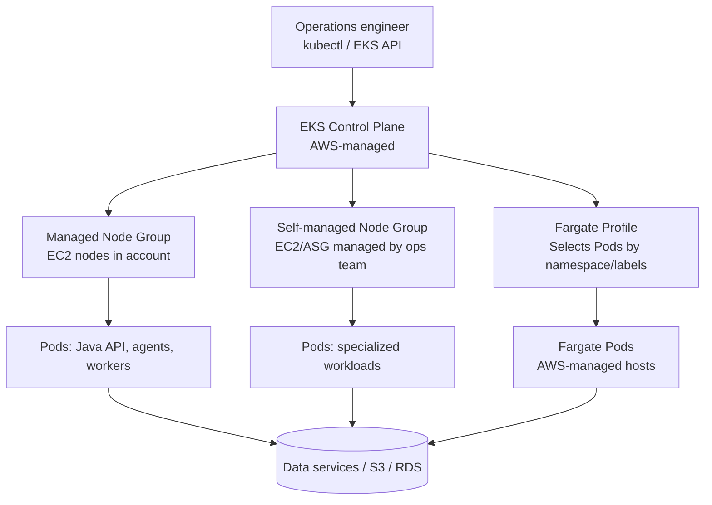
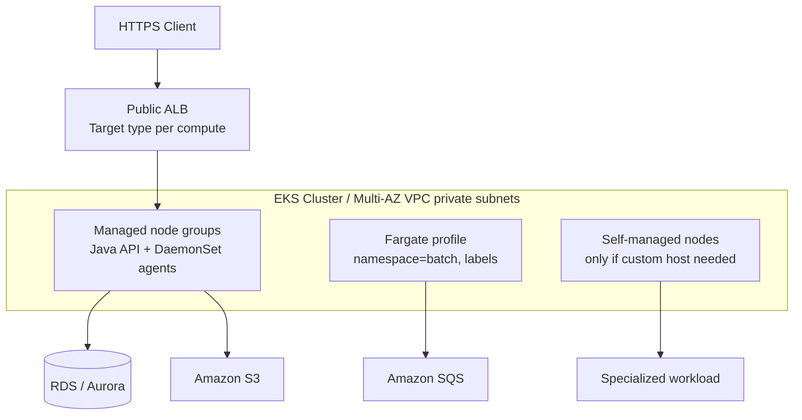

# Managed Node Groups, Self-Managed Nodes, and Fargate Profiles

An **Amazon EKS cluster** has an AWS-operated Kubernetes control plane, yet applications still need a place to run **Pods**. Three common options are **Amazon EKS managed node groups**, **self-managed EC2 nodes**, and **AWS Fargate via Fargate profiles**. All three can participate in the same EKS cluster, but they differ significantly in who manages the hosts, how Pods are scheduled, OS updates, IAM, storage constraints, and cost.

This lesson belongs to the **Kubernetes with EKS** chapter of the **CLOUD_PROVIDERS_AWS** module, connecting Region/Availability Zone, IAM, VPC, EC2, EBS/EFS, ALB, CloudWatch monitoring, databases, and serverless integration concepts. The ultimate goal is not picking one node type for every situation, but designing a **secure, scalable, resilient, and cost-controlled** platform to run applications.

> **Scope:** This lesson focuses on the three options in the title. **EKS Auto Mode** and **Karpenter** are introduced for comparison because they are important options in modern EKS, but they do not replace the hands-on material for managed node groups, self-managed nodes, and Fargate profiles.

## 1. Learning Objectives

After this lesson, you will be able to:

1. Distinguish between the EKS **control plane** and **data plane**, and between EC2 worker nodes and Fargate Pods.
2. Explain AWS responsibilities versus user responsibilities across the three deployment options.
3. Create or read **managed node group** configurations: node IAM role, subnets, instance types, capacity types, scaling, labels, taints, and update strategies.
4. Describe the operational work of **self-managed nodes**: EC2/Auto Scaling, AMI/bootstrap, cluster access, patching, rolling replacement, monitoring, and cleanup.
5. Explain **Fargate profile selectors**, Pod execution roles, private subnets, and how EKS decides which Pods run on Fargate.
6. Use labels, nodeSelector, taints/tolerations, and Kubernetes manifests to target appropriate workloads and prevent mis-scheduling.
7. Distinguish between **HPA** (scaling Pods) and **node provisioning/scaling**, as well as Fargate capacity expansion behavior.
8. Select appropriate storage, IAM, and networking for Java APIs, jobs, controllers, databases, and system Pods.
9. Diagnose **Pending**, **NotReady**, **ImagePullBackOff**, missing AWS permission, and node update failures.
10. Propose a multi-AZ application architecture with backups, observability, and a cost plan.

## 2. The EKS Control Plane Is Not Worker Nodes

Inside an EKS cluster:

- **Control plane**: AWS manages the Kubernetes API server, control-plane orchestration components, and control-plane availability per the EKS service.
- **Data plane**: where Pods actually run. This can include managed EC2 nodes, self-managed EC2 nodes, Fargate Pods, or other service-supported compute types.
- **Kubernetes API**: where you use `kubectl` to declare Deployments, Services, Jobs, Namespaces, RBAC, and other resources.
- **Scheduler/EKS Fargate mechanisms**: evaluate Pod requirements and scheduling conditions, including node labels/taints or Fargate profile selectors depending on capacity type.
- **VPC**: provides the subnets, IP addresses, security groups, and network routes needed for nodes/Pods to communicate with the cluster and applications.



**Do not confuse “EKS is managed Kubernetes” with “AWS automatically manages every EC2 machine in the cluster.”** Responsibilities for worker nodes vary by option.

### 2.1. Pods, nodes, and node groups

| Concept | Role | Example |
|---|---|---|
| **Pod** | Kubernetes deployment unit; has one or more containers sharing a network namespace | Pod running a Spring Boot API |
| **Node** | Compute capacity executing Pods; on EC2 this is a worker machine | EC2 `m7i.large` |
| **Node group** | Group of EC2 nodes whose configuration, lifecycle, and capacity are managed together | `api-managed-ng` |
| **Managed node group** | Node group with part of operations automated by EKS | AWS updates AMIs/rolls nodes when requested |
| **Self-managed node group** | Node group/ASG operated and managed by you | Custom AMI, bootstrap, drain |
| **Fargate profile** | Rules selecting Pods to run on Fargate by namespace/labels | `namespace=java-fargate` |
| **Fargate Pod** | Pod running on Fargate-provisioned compute, with no EC2 host management | A short-lived Java job |

A Fargate profile **is not like a node group**: creating a profile does not launch a group of EC2 instances with a fixed node count. Pods only receive Fargate compute capacity when they match the profile and are created/scheduled.

## 3. Comparing the Three Options

| Criterion | Managed node group | Self-managed EC2 nodes | Fargate profile |
|---|---|---|---|
| Who manages the EC2 worker host? | AWS assists lifecycle via EKS; EC2 remains in your account | Operations team is responsible | AWS operates Fargate infrastructure |
| Are EC2/ASG visible? | Yes, in your account | Yes, in your account | No EC2 host management |
| AMI/Kubernetes node updates | EKS supports rolling updates when requested/configured | Build your own replacement/patching workflow | AWS operates Fargate runtime |
| Choose EC2 instance types | Yes | Yes | No EC2 host selection; declare Pod CPU/memory |
| On-Demand/Spot | Yes, per node group config | Yes, depending on ASG/architecture | No Fargate Spot for EKS |
| DaemonSets/privileged/host access | Yes, subject to OS and policy constraints | Yes, with deeper customization | Many node-level features are **not supported** |
| Persistent block EBS | Yes, via EBS CSI driver within limits | Yes, via EBS CSI driver within limits | **Cannot mount EBS to Pods** |
| EFS | Yes, via appropriate CSI | Yes, via appropriate CSI | Yes, using static provisioning as supported |
| Application IAM permissions | EKS Pod Identity/IRSA depending on case | EKS Pod Identity/IRSA depending on case | **IRSA**; EKS Pod Identity does not support Fargate |
| Capacity cost | EC2/EBS and related resources | EC2/EBS and related resources | Fargate vCPU/memory/storage per Pod |
| Best suited for | Most standard Kubernetes workloads | Special OS, AMI, or runtime requirements | Standalone, simple Pods not needing daemons/host access |

**Starting recommendation:** For most Kubernetes applications requiring DaemonSets, EBS, node control, and Spot options, **managed node groups** are a sensible starting point. **Self-managed** is for specific requirements managed groups cannot satisfy. **Fargate** fits when you want to reduce host operations and accept the platform's Kubernetes constraints.

## 4. Managed Node Groups: EC2 with EKS-Assisted Lifecycle

A **Managed node group (MNG)** is a group of EC2 worker nodes for which EKS assists with creation, replacement, Auto Scaling group configuration, and version/AMI updates per service workflows. The nodes and ASG still reside in your **AWS account**, using your VPC/subnets, EBS volumes, IAM roles, and security groups.

### 4.1. Components when creating a node group

A basic managed node group includes:

| Attribute | Illustrative Example | Design Decision |
|---|---|---|
| Cluster | `java-prod-eks` | Right account/Region |
| Node group name | `api-managed-ng` | Easy identification of owner/workload |
| Node IAM role | `arn:aws:iam::123456789012:role/EKSNodeRole` | For kubelet/ECR and required node components |
| Subnets | Two private subnets across two AZs | Increases resilience and reduces public exposure |
| Instance types | `m7i.large`, `m7a.large` within limits | CPU/memory/hardware suited to workload |
| Capacity type | `ON_DEMAND` or `SPOT` | Price and interruption tolerance |
| Scaling | min=2, desired=2, max=6 | Capacity boundaries |
| AMI type | AL2023, Bottlerocket, Windows, or supported type | Runtime and security compatibility |
| Labels/Taints | `workload=api`, `dedicated=api:NoSchedule` | Controls scheduler placement |
| Update configuration | max unavailable/percentage, strategy | Disruption risk when changing AMI/version |

**A managed node group does not automatically adjust node count based on Pending Pods** if you have not deployed a suitable node autoscaling solution. Setting min/max/desired configures capacity boundaries, whereas **Cluster Autoscaler**, **Karpenter**, or EKS Auto Mode handles automatic adding/removing of nodes by design.

### 4.2. What does MNG manage, and what doesn't it manage?

EKS assists with:

- Provisioning an ASG and EC2 nodes per the group specification.
- Applying EKS-managed Kubernetes labels to nodes.
- Replacing unhealthy nodes via supported mechanisms, potentially combined with **node auto repair** when enabled.
- Updating AMI/launch template versions and upgrading node versions via managed update workflows.
- Adjusting min/max/desired, labels, taints, and supported node group settings.

You remain responsible for:

- Selecting **EC2, EBS, subnet, security group, IAM** configurations, ensuring networking and quotas.
- Configuring compatible **addons** such as VPC CNI, CoreDNS, kube-proxy, and CSI controllers.
- Choosing update timing, testing versions, and preparing rollbacks.
- Ensuring Pods have appropriate **resource requests/limits**, replicas, readiness/liveness probes, and PodDisruptionBudgets (PDBs).
- Managing applications, data, secrets, RBAC, IAM, network policies, and costs.

### 4.3. MNG updates and PodDisruptionBudget

During a **managed node group version update**, EKS performs a **rolling update** that normally respects PodDisruptionBudgets (PDBs). If a Pod cannot be evicted because a PDB is too strict, the update may fail with `PodEvictionFailure`. Depending on options, a **force update** can bypass PDBs and cause disruption; use it only after assessing impact.

**Crucial distinction:** **Reducing `desiredSize` in the scaling configuration** of a managed node group may cause the ASG to terminate nodes **without respecting PDBs the way a rolling update flow does**. Therefore, never use an abrupt desired-size reduction as a substitute for safe draining/rolling replacement workflows.

### 4.4. Using Spot with managed node groups

MNG supports `SPOT` if the cluster/instance types meet requirements. Spot can reduce costs for interruption-tolerant workloads, but:

- There is no guarantee Spot capacity will always be available.
- Replicas, multi-AZ/multi-instance-type diversity, and graceful termination mechanisms are needed.
- Non-interruptible components should not rely solely on Spot.
- For workloads needing steady state, consider mixing On-Demand and Spot groups with scheduling constraints.

### 4.5. Launch templates and custom AMIs

Launch templates allow deeper configuration (AMI, storage, user data, instance settings...) where supported by MNG. Several constraints apply:

- When a node group was created **without** a custom launch template, you cannot simply attach a different custom launch template via an update; you typically need to create a new node group.
- When using a launch template, update to a **new version of the same template** via the supported workflow.
- If using a **custom AMI**, you must maintain a tested AMI and ensure it bootstraps with the proper EKS/Kubernetes version.
- With **Amazon Linux 2023**, bootstrapping uses **nodeadm** and NodeConfig instead of relying uniformly on the legacy AMI `bootstrap.sh` script; custom AMIs or self-managed setups must supply appropriate cluster metadata.

## 5. Self-Managed Nodes: High Control and High Responsibility

**Self-managed nodes** are EC2 worker nodes provisioned and managed directly by the operations team: AMI, user data/bootstrap, Auto Scaling Group, EC2 instance lifecycle, OS updates, node joining, and upgrades. These are still worker nodes in the **EKS cluster**, just not managed through the EKS Managed Node Group API the way MNG is.

### 5.1. Minimum steps for a self-managed group

1. Have an **EKS cluster** in `ACTIVE` state along with its endpoint, certificate authority, and cluster networking details.
2. Create an EC2 instance IAM role and instance profile with appropriate permissions.
3. Prepare VPC/subnets, security groups, outbound routes/paths to the EKS API/ECR, and capacity.
4. Choose an **EKS-optimized AMI**, Bottlerocket, Windows, or appropriate custom AMI.
5. Prepare a **launch template** and EC2 Auto Scaling Group / node group.
6. Bootstrap kubelet and configure **node admission/authentication**: **EKS access entries** (if the cluster uses a supported authentication mode) or the `aws-auth` ConfigMap in legacy/ConfigMap mode per proper procedure.
7. Confirm nodes appear in Kubernetes in **Ready** state.
8. Apply labels/taints and deploy compatible workloads.
9. Establish patching, rollout, draining, auto scaling, logging/metrics, backup, and safe termination procedures.

**Do not assume editing `aws-auth` is always mandatory or the newest standard approach.** EKS has **access entries**; behavior depends on the cluster's authentication mode. Never change a production cluster's authentication mode just to test a manifest.

### 5.2. When are self-managed nodes necessary?

- Must use a specialized custom AMI/OS or agents/runtimes needing host privileges that MNG does not provide as desired.
- The organization has its own EC2/AMI management pipelines and complex custom rollout workflows.
- Specific bootstrap, hardware, deployment zone, or internal integration characteristics demand low-level control.
- Node governance requirements exceed MNG configuration capabilities in the current service/version.

With self-managed nodes, **you are responsible for draining Pods, replacing, and protecting nodes during updates**. If ASG scale-in runs without Kubernetes-aware draining, a node can be terminated while still serving requests or holding long-running tasks.

### 5.3. Self-managed patching and node replacement plan

A sound operational workflow:

1. Build/pull a new AMI from a trusted source, scan it, and sign/govern the artifact.
2. Create a new launch template version and test it in **staging**.
3. Verify compatibility across Kubernetes/kubelet, CNI, CSI, GPU drivers, and applications.
4. Scale out to provide replacement capacity if needed.
5. `kubectl cordon` the old node → `kubectl drain` respecting appropriate conditions.
6. Wait for Pods to reschedule and become **Ready** on new nodes while monitoring endpoints/traffic.
7. Terminate the old EC2 instance via the ASG per procedure; verify capacity/labels/taints.
8. Review errors, costs, and execute rollback if the update causes issues.

Example commands supporting an approved workflow:

```bash
# READ: inspect nodes and where workloads are running.
kubectl get nodes -o wide
kubectl get pods -A -o wide

# MUTATING: prevent new Pods from scheduling onto the specified node.
kubectl cordon ip-10-0-10-12.ec2.internal

# MUTATING: evict evictable Pods for maintenance.
# Replace with the exact node and understand PDBs, DaemonSets, and local data before running.
kubectl drain ip-10-0-10-12.ec2.internal \
  --ignore-daemonsets --delete-emptydir-data

# MUTATING: only after the node has been safely replaced.
kubectl uncordon ip-10-0-10-12.ec2.internal
```

`--delete-emptydir-data` can delete temporary data inside `emptyDir`. Do not run `drain` on a production node hosting stateful workloads or critical jobs without safeguards in place.

## 6. Fargate Profiles: Selecting Pods Instead of Managing EC2 Nodes

**AWS Fargate for Amazon EKS** runs Kubernetes Pods on AWS-managed capacity. Users do not SSH into hosts, patch host kernels/AMIs, or select EC2 instance types. Each Pod runs in an isolated compute environment provisioned with resources matching its **CPU/memory requests** and service limits.

To let EKS know **which Pods use Fargate**, you create one or more **Fargate profiles** in the cluster.

### 6.1. What does a Fargate profile contain?

| Field | Example | Meaning |
|---|---|---|
| Profile name | `java-api-fargate` | Profile identifier |
| Pod execution role | `arn:aws:iam::123456789012:role/EKSFargatePodExecutionRole` | IAM role for Fargate/kubelet infrastructure |
| Subnets | `subnet-private-a`, `subnet-private-b` | Pod network placement in private subnets |
| Selectors | `namespace=java-fargate`, `labels={workload=api}` | Pod selection rules |
| Tags | `Environment=training` | AWS tags managing the profile, not automatically added to Pods |

A profile allows up to **5 selectors**. Every selector requires a **namespace**; labels are optional. If a selector specifies only a namespace without labels, EKS can select **every Pod** in that namespace to run on Fargate.

For example, if you only want the Java API on Fargate while monitoring agents run on EC2: do not create a profile with just `namespace=default` if the default namespace contains mixed workloads. Prefer a dedicated namespace combined with explicit labels.

### 6.2. Pod selection rules

Suppose a profile has:

```yaml
fargateProfile: java-api-fargate
selectors:
  - namespace: java-fargate
    labels:
      workload: api
```

Example matrix:

| Pod Namespace | Pod Label | Matches Profile? |
|---|---|---|
| `java-fargate` | `workload=api` | **Yes** |
| `java-fargate` | `workload=worker` | No |
| `default` | `workload=api` | No |
| `java-fargate` | No `workload` label | No |

This YAML snippet is a **logical configuration description**, not a Kubernetes resource manifest you can `kubectl apply`. A Fargate profile is an **EKS API resource**, created via the AWS Console, AWS CLI, `eksctl`, or IaC.

### 6.3. Multiple profiles matching the same Pod

If a Pod matches multiple profiles, EKS selects based on **alphanumeric ordering of profile names**; a Pod can specify its preferred profile using the label:

```yaml
metadata:
  labels:
    eks.amazonaws.com/fargate-profile: java-api-fargate
```

This label only takes effect if the Pod **actually matches a selector** of the specified profile. Do not try using a label override to bypass namespace rules or place a Pod into an unconfigured subnet.

**Profiles cannot be modified in place.** When you need to change selectors, subnets, or execution roles, create a new profile, plan Pod migration/recreation, and then delete the old profile. Deleting a profile currently in use can cause Pods to stop and move to Pending/reschedule.

### 6.4. Private subnets and IP addresses

Fargate Pods for EKS run in **private subnets**, **without public IPs**, and profiles reject subnets with a direct route to an **Internet Gateway**.

Pods need to communicate with the control plane/ECR/STS/CloudWatch and other services required by the application. Depending on configuration, use a **NAT Gateway** or required **VPC endpoints**, private DNS, and appropriate routes/security groups.

- If a subnet lacks available IPs, a Fargate Pod may fail to receive a network interface.
- If routes/DNS cannot reach ECR, a Pod may fail image pulls.
- If security groups block the EKS API or internal dependencies, a Pod may fail to become Ready.
- Fargate Pods in EKS cannot be placed on Outposts/Wavelength/Local Zones per service limitations.

### 6.5. Fargate limitations to remember

| Requirement | Fargate for EKS |
|---|---|
| **DaemonSets** | Running DaemonSets on Fargate is not supported |
| **Privileged containers** | Not supported |
| **hostNetwork/hostPort** | Not supported |
| **GPUs/specialized EC2 hardware** | Does not offer EC2/GPU selections like node groups |
| **Spot** | Fargate Spot is not supported in EKS |
| **EBS PersistentVolumes** | **Cannot** mount EBS volumes to Fargate Pods |
| **EFS** | Yes, via **static provisioning**; no EC2-style dynamic provisioning |
| **Custom CNI** | Replacing Amazon VPC CNI on Fargate is not supported |
| **SSH to host / custom AMI** | No |
| **TopologySpreadConstraints** | Not supported in the current Fargate scheduler |
| **EKS Pod Identity** | Not supported on Fargate; use IRSA |
| **Long-running steady workloads** | Possible, but must estimate vCPU/memory and account for add-on limits |
| **Liveness/readiness probes** | Configurable like normal Kubernetes Pods |

The Fargate platform is patched/updated by AWS. During certain patch cycles, Pods may be evicted/restarted; you still need **replicas, readiness checks, PDBs where appropriate, graceful shutdown**, and application recovery mechanisms.

### 6.6. CPU, memory, and ephemeral storage

Fargate selects capacity based on Pod **resource requests** and supported configurations, plus runtime overhead resources. Capacity is rounded up to valid vCPU/memory combinations offered by Fargate; cost can be higher than multiplying directly from a container's smallest request.

Example with two containers or resource bounds in a Pod:

```yaml
resources:
  requests:
    cpu: "250m"
    memory: "512Mi"
  limits:
    cpu: "500m"
    memory: "768Mi"
```

This is only an example of **one container's resources**, not a final billing calculation. Fargate bills based on **total Pod requirements, overhead, and provisioned configuration**; consult the CPU/memory combination table and Regional pricing when estimating.

Fargate provides **roughly 20 GiB of default ephemeral storage** per Pod, with actual usable space being slightly lower due to system components. Additional ephemeral storage can be configured within service limits (currently up to 175 GiB total for EKS Fargate), but ephemeral storage **is not durable backup**: when a Pod terminates, temporary data is lost. For shared/durable files, consider **EFS** or S3/RDS depending on data type.

## 7. Pod Execution Role Differs from Application IAM Role

A very common security mistake is thinking the **Fargate Pod execution role** provides AWS SDK permissions to Java code running inside the container.

**Incorrect.**

| Role | Who uses it? | Purpose |
|---|---|---|
| **EC2 node IAM role** | EC2 node/kubelet and permitted node components | Join cluster, pull images, or interact with AWS per policy |
| **Fargate Pod execution role** | Fargate/kubelet infrastructure components | Pull images from ECR, register nodes, and perform supported infrastructure operations |
| **Application IAM role via IRSA** | Pod application using AWS SDK | Read S3, Secrets Manager, DynamoDB, SQS, etc., with least privilege |
| **EKS Pod Identity association** | Pods on supported Linux EC2 nodes | Deliver temporary AWS credentials to apps via EKS Pod Identity Agent |
| **Kubernetes RBAC** | Identities calling the Kubernetes API | Permissions to read/modify Pods, Deployments, Secrets inside the cluster |

**The Fargate Pod execution role is not inherited by application containers.** If your Java application needs `s3:GetObject`, configure a dedicated IAM role for the Kubernetes service account via **IAM Roles for Service Accounts (IRSA)** with proper OIDC trust and policies.

**EKS Pod Identity currently only supports Pods running on supported Linux EC2 nodes, not Fargate Pods.** IRSA remains the right choice for Fargate and can also be used on EC2 nodes when needed.

### 7.1. Why shouldn't AWS access keys be stored in a Kubernetes Secret?

Kubernetes Secrets can be further protected with encryption at rest and RBAC, but placing long-lived AWS access keys inside a Secret still creates leakage, key rotation, and over-permissioning risks.

Prefer:

1. Use a dedicated **service account** per application/workload.
2. Attach an **IAM role** via IRSA or EKS Pod Identity depending on supported compute.
3. Permit only necessary actions/resource ARNs (least privilege).
4. Never place tokens, keys, or passwords into container images/ConfigMaps, logs, or Git.
5. Use AWS Secrets Manager/Parameter Store for business secrets when appropriate, governing IAM and rotation.

## 8. Kubernetes Scheduling: Labels, Taints, and Fargate Selectors

### 8.1. Targeting workloads to a managed node group

When MNG creates nodes, EKS attaches labels such as `eks.amazonaws.com/nodegroup`. You can also configure custom group labels.

Example Deployment running only on node group `api-managed-ng`:

```yaml
apiVersion: apps/v1
kind: Deployment
metadata:
  name: java-api-ec2
  namespace: apps
spec:
  replicas: 2
  selector:
    matchLabels:
      app: java-api-ec2
  template:
    metadata:
      labels:
        app: java-api-ec2
    spec:
      nodeSelector:
        eks.amazonaws.com/nodegroup: api-managed-ng
      containers:
        - name: java-api
          image: 123456789012.dkr.ecr.ap-southeast-1.amazonaws.com/java-api:v1
          ports:
            - containerPort: 8080
          resources:
            requests:
              cpu: "250m"
              memory: "512Mi"
            limits:
              cpu: "1000m"
              memory: "1Gi"
          readinessProbe:
            httpGet:
              path: /actuator/health/readiness
              port: 8080
            initialDelaySeconds: 15
            periodSeconds: 10
```

**Note:** image names, clusters, namespaces, and node groups are examples only. Before applying in real environments, ensure the namespace, valid image, AWS identity for ECR, Spring Boot readiness endpoint, and sufficient node capacity exist.

**`nodeSelector` is a hard constraint.** If no node carries that label (or matching nodes are out of resources/tainted), the Pod remains `Pending`.

### 8.2. Taints and tolerations

Taints prevent Pods without matching tolerations from scheduling onto a node. For example, a node group running sensitive workloads has taint `dedicated=payments:NoSchedule`. An authorized Pod is configured with:

```yaml
spec:
  tolerations:
    - key: "dedicated"
      operator: "Equal"
      value: "payments"
      effect: "NoSchedule"
  nodeSelector:
    workload: payments
```

**A toleration does not mean “force the Pod onto this node.”** It only allows the Pod past the taint barrier; add `nodeSelector`/`nodeAffinity` to target the intended group.

Node-level features such as privileged pods, DaemonSets, or host networking require suitable EC2 nodes; do not try adding tolerations to “enable” features Fargate does not support.

### 8.3. Targeting Pods to Fargate with selectors

Suppose a profile has already been created:

- Name: `java-api-fargate`.
- Selector: `namespace=java-fargate`, `labels={workload=api}`.
- Subnets: two private subnets in two AZs.

Example Deployment:

```yaml
apiVersion: v1
kind: Namespace
metadata:
  name: java-fargate
---
apiVersion: apps/v1
kind: Deployment
metadata:
  name: java-api-fargate
  namespace: java-fargate
spec:
  replicas: 2
  selector:
    matchLabels:
      app: java-api-fargate
  template:
    metadata:
      labels:
        app: java-api-fargate
        workload: api
    spec:
      serviceAccountName: java-api-sa
      containers:
        - name: api
          image: 123456789012.dkr.ecr.ap-southeast-1.amazonaws.com/java-api:v1
          ports:
            - containerPort: 8080
          resources:
            requests:
              cpu: "500m"
              memory: "1Gi"
            limits:
              cpu: "500m"
              memory: "1Gi"
          readinessProbe:
            httpGet:
              path: /actuator/health/readiness
              port: 8080
            periodSeconds: 10
```

Before running `kubectl apply`, create the **Kubernetes service account `java-api-sa`** and IRSA if Java code calls AWS APIs, and verify the image exists. The snippet intentionally does not auto-create IAM roles/policies because IAM is a separate security decision.

**Do not add a `nodeSelector` forcing an EC2 node group** onto a Pod selected by a Fargate profile; conflicting requirements can leave the Pod unschedulable.

### 8.4. Fargate selector precedence does not override all Kubernetes rules

In a mixed EC2/Fargate EKS cluster, Fargate profile selectors determine which matching Pods run on Fargate per service mechanics. However:

- Pods not matching a profile do not automatically “become Fargate”; Kubernetes needs suitable EC2 capacity or another compute mechanism.
- Profiles with overly broad selectors can pull unintended system/application Pods onto Fargate.
- Pods with unsupported requirements on Fargate can stay **Pending** or fail to run even if namespace/labels match.
- Fargate profiles and nodeSelector/affinity configurations should be tested alongside real policies.

## 9. Networking and Load Balancing for Both Compute Types

### 9.1. EKS Pods, VPC CNI, and IP capacity

On EKS with VPC networking, Amazon VPC CNI normally allocates VPC IPs to Pods per EKS networking mechanics. EC2 nodes have limits on ENIs/IP addresses, CIDRs, instance types, and prefix delegation settings.

When a Pod is `Pending` or hits network errors:

- Check whether subnets still have available IPs.
- Check instance/network interface limits and whether VPC CNI is healthy.
- Verify routes from private subnets to EKS API, ECR, STS, CloudWatch, or required services.
- Inspect security groups, NACLs, DNS resolution, and VPC endpoints/NAT.
- Do not assume simply adding more nodes solves subnet IP exhaustion.

### 9.2. Fargate profiles only accept private subnets

Each Fargate Pod receives a service-provisioned network interface in the profile's private subnets. To deploy a Java API:

1. Select at least two private subnets in supported AZs with sufficient IPs.
2. Ensure paths to the EKS API, ECR (and S3 dependencies for image pulls when needed), STS if using IRSA, logging, and backend services.
3. Configure security groups/network access per supported architecture.
4. Use a Service or Ingress with an appropriate **AWS Load Balancer Controller** if client access is needed.
5. For ALB/NLB controller target registration with Fargate, **target type `ip`** is normally required because there is no EC2 node instance to register as an instance target.
6. Verify readiness, endpoint health, TLS, and DNS before sending live traffic.

Do not try assigning public IPs to Fargate Pods to fix access errors: EKS Fargate Pods **never receive public IPs**.

### 9.3. EC2 worker nodes and ALB

On managed/self-managed EC2, the AWS Load Balancer Controller can use target type `instance` or `ip` depending on the service/ingress and CNI. The choice must align with how Pods obtain IPs and the ALB routing path.

An ALB **does not automatically scale Pod counts**. Kubernetes Deployments/HPA adjust replicas; a node autoscaler or Fargate provisions compute capacity. Monitor both target health and Ready Pod counts.

## 10. HPA, Node Autoscaling, Karpenter, and Fargate

Three layers are easily confused:

| Mechanism | What does it decide? | Example |
|---|---|---|
| **Horizontal Pod Autoscaler (HPA)** | Number of **Pods/replicas** | 2 → 6 Java API Pods when CPU is high |
| **Cluster Autoscaler** | Scale **EC2 node capacity** of supported ASGs/node groups | 2 → 3 EC2 nodes when Pods are pending |
| **Karpenter** | Dynamically selects/provisions EC2 nodes to match Pod needs via NodePools/NodeClasses | Picks right-sized EC2 types for Pods |
| **Fargate scheduling** | Provisions **per-Pod compute** matching profiles | Launches additional Fargate Pods when HPA increases replicas |
| **EKS Auto Mode** | AWS manages many EKS infrastructure components, including Karpenter-style node provisioning | Uses Auto Mode-managed NodePools/NodeClasses |

**HPA does not add EC2 nodes.** If HPA scales replicas to 8 while an MNG has two full nodes, new Pods remain **Pending** until EC2 capacity grows. With Fargate, each matching Pod can have compute provisioned individually; no ASG is needed for those Pods, though quotas, subnet IPs, and supported resources still apply.

### 10.1. Does EKS Auto Mode replace the three traditional options?

EKS Auto Mode is a newer option where AWS manages many parts of the data plane and add-ons. It can coexist **in the same cluster** with managed node groups during migration plans. AWS currently recommends evaluating EKS Auto Mode when seeking reduced infrastructure management, rather than defaulting to Fargate for every workload wanting a “serverless-like” experience.

However, Auto Mode **is not a rebranding of Fargate profiles** and does not use the same selector APIs. Auto Mode uses a managed EC2 nodes/NodePools/Karpenter-inspired model, supporting many Kubernetes/EC2 capabilities that Fargate lacks. Compare limits, pricing, and organizational policies before migrating.

### 10.2. Why does HPA require a metrics server?

An HPA scaling on CPU/memory requires an appropriate metric source such as Kubernetes **Metrics Server** or a custom/external metrics pipeline. Without metrics or proper Pod resource requests, HPA may report `unknown` or fail to scale as expected.

Sample HPA for a Java API:

```yaml
apiVersion: autoscaling/v2
kind: HorizontalPodAutoscaler
metadata:
  name: java-api-hpa
  namespace: java-fargate
spec:
  scaleTargetRef:
    apiVersion: apps/v1
    kind: Deployment
    name: java-api-fargate
  minReplicas: 2
  maxReplicas: 6
  metrics:
    - type: Resource
      resource:
        name: cpu
        target:
          type: Utilization
          averageUtilization: 60
```

Increasing HPA `maxReplicas` means **permitting more Pods**; it does not guarantee new Pods start immediately and does not act as a hard billing cap. On Fargate, each added Pod increases Fargate charges.

## 11. Storage, Stateful Workloads, and Java Applications

### 11.1. EC2 nodes: EBS/EFS as needed

On managed/self-managed EC2 nodes, applications can use:

- **EBS CSI driver** for single-AZ block PersistentVolumes with scheduling/volume topology constraints.
- **EFS CSI driver** for shared NFS file storage across AZs per architecture.
- **S3** for object storage via APIs, rather than treating S3 as a traditional POSIX drive.
- **RDS/Aurora/DynamoDB** for database storage as needed.

An EBS volume resides in **one AZ**: if a Pod with an EBS PVC is rescheduled to a node in another AZ, scheduling/volume attachment can fail. Use appropriate StorageClasses, topology constraints, StatefulSets, and backup/recovery plans.

### 11.2. Fargate: no EBS mounts

Fargate supports ephemeral storage and **EFS persistent volumes via static provisioning** within AWS support bounds; it **does not mount EBS** and does not run the EBS CSI node DaemonSet.

Therefore, systems needing EBS volumes or self-managed local databases should evaluate EC2 nodes or managed database services. If a Java API runs on Fargate, store uploads in **S3**, relational data in **RDS**, shared files in EFS, and use ephemeral storage only for caches/regenerable temporary files.

### 11.3. Keep data outside the Pod lifecycle

When nodes update or Fargate Pods restart, files on the container filesystem/ephemeral storage can be lost. Production applications must:

- Not hold **unique session state** in a single Pod's RAM.
- Persist critical data in appropriate durable services.
- Implement **readiness/liveness probes**, graceful shutdown, and idempotent retries.
- Manage secrets using IAM and proper secrets management services.
- Maintain backups, restore tests, and RPO/RTO strategies per requirements.

## 12. Security: Cluster Access, Node Roles, and Workload Roles

### 12.1. Cluster authentication differs from AWS API permissions inside a Pod

| Requirement | Appropriate Mechanism |
|---|---|
| Operator running `kubectl` | EKS cluster access entries/legacy auth mode + Kubernetes RBAC |
| EC2 node joining cluster | Node IAM role, properly configured EKS access/bootstrap |
| Fargate infrastructure/kubelet operation | Fargate profile **Pod execution role** |
| Pod on EC2 needing S3/DynamoDB | EKS Pod Identity or IRSA per supported compute |
| Pod on Fargate needing S3/DynamoDB | **IRSA** |
| Encrypting secrets, logs, EBS/EFS | Appropriate KMS/IAM/service policies |
| Network access between Pods/services | Security groups, Kubernetes NetworkPolicy if supported by dataplane/plugin |

Do not grant `cluster-admin` to all service accounts or attach `AdministratorAccess` to the EC2 node role just to fix an app failing to call an AWS API.

### 12.2. Operating securely on EC2 nodes

- Enforce **IMDSv2** and consider blocking Pod access to IMDS/node roles when applications do not need it.
- Keep EKS-optimized AMIs and add-ons updated.
- Run nodes in private subnets whenever possible; inspect outbound paths via NAT/VPC endpoints.
- Do not expose SSH broadly to the Internet; consider Systems Manager Session Manager.
- Configure runtime security, image scanning, Kubernetes RBAC, and appropriate NetworkPolicies/SGs.
- Retain audit logs/CloudTrail and restrict who can modify MNGs, ASGs, launch templates, Fargate profiles, and IAM roles.

### 12.3. Fargate does not exempt application security

Fargate reduces host maintenance work, but **does not automatically make container images secure**. You still must:

- Scan images via ECR scanning or suitable tools.
- Set intentional resource requests/limits.
- Use least-privilege IAM for service accounts.
- Protect secrets and TLS connections to APIs/databases.
- Configure logging/observability suited to Fargate (not relying on DaemonSet agents).
- Configure replicas, health checks, and resilience when Pods are replaced.

## 13. Non-Disruptive Updates and Capacity Replacement

### 13.1. Managed node groups

Typical version upgrade workflow:

1. Check the current cluster version and node/kubelet versions.
2. Verify **version skew** and add-on compatibility.
3. Create appropriate snapshots/backups for stateful applications.
4. Review PDBs, replicas, topology, resource capacity, and rolling update plans.
5. Trigger the **managed node group version update** (AMI/Kubernetes or launch template version).
6. Monitor node-group update status, node conditions, Pending Pods, and ALB target health.
7. Verify applications and execute prepared rollback using a new node group/previous AMI if issues arise.

If an MNG uses a custom AMI, AWS does not automatically know about your custom patches. Release a new AMI and a new launch template version, then update through the supported process.

### 13.2. Self-managed nodes

You design:

- AMI build/patching and testing.
- Adding new capacity before removing old nodes.
- Cordon/drain respecting PDBs, jobs, stateful volumes, and system Pods.
- Checking node registration and labels/taints on new nodes.
- Managing rollbacks, instance provisioning failures, and ASG termination hooks yourself.

### 13.3. Fargate profiles/Pods

AWS manages Fargate hosts. You update **container images/Deployments** via Kubernetes rolling updates, rather than “SSHing into a Fargate node to patch.” When a profile needs replacement:

1. Create a new profile with the desired selectors/subnets/role.
2. Check which Pods will match the profile and the AZ distribution strategy.
3. Test new Pods, service readiness, and IAM before cutover.
4. Recreate/rolling-update Pods as planned; EKS selects profiles by selectors/priority.
5. After verification, delete the old profile; ensure Pods do not go Pending or get abruptly terminated.

Specifically, EKS Fargate **does not support topologySpreadConstraints**, so you cannot assume `replicas: 2` automatically places exactly one Pod per AZ. If controlled AZ balancing is required, design **two Fargate profiles, each with one subnet**, paired with matching labels/Deployments per AWS guidance.

## 14. Monitoring and Troubleshooting Nodes/Pods

### 14.1. Kubernetes observation command set

```bash
# Check context first: avoid operating on a production cluster by mistake.
kubectl config current-context

# Nodes, labels, and readiness.
kubectl get nodes -o wide --show-labels
kubectl describe node NODE_NAME

# Pods with namespace, hosting node, and status.
kubectl get pods -A -o wide

# Inspect Pods stuck in Pending / CrashLoop / ImagePullBackOff.
kubectl describe pod POD_NAME -n NAMESPACE
kubectl get events -n NAMESPACE --sort-by=.lastTimestamp

# View application logs when authorized.
kubectl logs -n NAMESPACE deployment/java-api-fargate --tail=100

# Check rollout and HPA.
kubectl rollout status deployment/java-api-fargate -n java-fargate
kubectl get hpa -A
```

`kubectl describe` and `kubectl get events` usually pinpoint scheduler errors, insufficient CPU/memory, affinity, taints, or image pull failures. Do not modify infrastructure based solely on a `Pending` status.

### 14.2. Common failure scenarios

| Symptom | Possible Causes | What to Check |
|---|---|---|
| Managed nodes `NotReady` | VPC CNI, kubelet, auth, DNS, EKS API, or EC2 health | `kubectl describe node`, node logs, and EKS node group health |
| Node group creation failed | Wrong node IAM role, subnet/IPs, quotas, launch template/AMI, bootstrap | EKS health issues, EC2/ASG activities, CloudTrail |
| Self-managed EC2 running but fails to join | Missing access entry/`aws-auth`, NodeConfig bootstrap, SG/route | Cluster auth mode, kubelet logs, API connectivity |
| Pod Pending on EC2 | Insufficient resource capacity, nodeSelector, taints, PVC AZ | `kubectl describe pod` and node labels/taints |
| Fargate Pod Pending | Selector mismatch, profile not Active, quotas, or subnet IPs | `describe-fargate-profile`, Pod events, subnets |
| Fargate image pull failed | Missing ECR reachability, NAT/endpoints, or Pod execution role | ECR, DNS, IAM, and events |
| Fargate app `AccessDenied` calling S3 | Confused Pod execution role with workload IAM, wrong IRSA | Service account, OIDC trust, IAM policy/KMS |
| Fargate Pod needs EBS or DaemonSet | Feature not supported by Fargate | Choose EC2 node group / different storage design |
| MNG update `PodEvictionFailure` | PDB too strict, Pod cannot evict, or lack of capacity | PDB, replicas, node update history |
| HPA scales Pods but EC2 Pods stay Pending | Scaled Pods without scaling node capacity | ASG/MNG scaling, CA/Karpenter, quotas |
| App lacks IPs | Subnet IP exhaustion, CNI limits, or Fargate network allocation | VPC subnet available IPs, VPC CNI metrics |
| Load balancer returns 503 | No healthy/ready targets, wrong target type/port | ALB/NLB target health, Service/Ingress, SGs |
| Unexplained bill increase | Idle EC2 nodes, oversized Fargate Pods, NAT/ALB/EBS/logs | Cost Explorer, Budgets, requests, replicas |

### 14.3. Check sequence when a Pod fails to run

1. **Right account/cluster/context?** `aws sts get-caller-identity`, `kubectl config current-context`.
2. **Which compute does the Pod match?** Namespace/labels, Fargate selectors, or nodeSelector/taints.
3. **Is compute available?** MNG/EC2 nodes Ready with sufficient CPU/RAM; or Fargate profile Active with sufficient quotas.
4. **Networking?** Private subnets, free IPs, SGs/NACLs/routes, DNS, EKS API/ECR endpoints.
5. **IAM?** Node role, Fargate Pod execution role, application IRSA/EKS Pod Identity.
6. **Storage?** EBS AZ/PVC pending, EFS mount/reachability, ephemeral storage.
7. **Application?** Image, configuration, probes, logs, external dependencies.
8. **Scale/HA/cost?** HPA, node autoscaler, PDBs, AZ fault tolerance, budget.

## 15. Cost: Paying by Cluster, EC2 Nodes, or Pod Compute

### 15.1. Cost components to calculate

| Layer | Managed node group | Self-managed node | Fargate |
|---|---|---|---|
| **EKS cluster fee** | Yes | Yes | Yes |
| **EC2 instances** | Yes, per provisioned instances | Yes | No direct EC2 node management |
| **EBS/worker storage** | Root/data volumes, snapshots | Root/data volumes, snapshots | Fargate ephemeral storage, EFS/S3 as needed |
| **Fargate CPU/memory** | No | No | **Yes, per provisioned Fargate Pod resources** |
| **Networking** | NAT/ALB/transfer/IPs and endpoints | Similar | NAT/endpoints/ALB/transfer and IPs used |
| **Logging/metrics** | CloudWatch, Prometheus... | Similar | CloudWatch/observability per compatible integration |
| **Node maintenance** | Partially automated by AWS | Operated by organization | AWS manages host infrastructure |

EKS **managed node groups do not add a separate surcharge for the node group feature itself** beyond the underlying AWS resources; however, the EKS cluster and EC2/EBS/networking remain billed per pricing tables. With **Fargate**, the main cost is per-Pod compute based on provisioned vCPU/memory, plus possible extra ephemeral storage and supporting services.

### 15.2. Capacity estimation example

Suppose a Java API needs **2 steady replicas**, each using about `0.5 vCPU` and `1 GiB RAM`:

- **MNG:** Can use 2 EC2 nodes across two AZs for HA, but pays for the nodes even when CPU is underutilized. When many Pods pack well onto shared nodes, utilization/cost efficiency can be strong.
- **Self-managed:** Same base EC2 cost plus operational effort to manage nodes; only justified by clear technical/strategic reasons.
- **Fargate:** Avoids idle EC2 nodes for matching Pods; pays for the vCPU/memory combinations Fargate provisions, which can be less economical for large 24/7 workloads or overly generous Pod requests.

You cannot declare one model universally cheaper from replica count alone. Account for **Region, instance types/Spot/Savings Plans, utilization, startup time, EBS/EFS, NAT, logging, EKS cluster fee, and operational overhead**.

### 15.3. The resource efficiency challenge

A 4 vCPU/16 GiB EC2 node does not give Kubernetes Pods all 4 vCPU/16 GiB: the OS, kubelet, DaemonSets, and reserved resources consume a portion. Conversely, a Fargate Pod also has overhead and rounds vCPU/memory up to valid combinations.

**Sensible optimization:**

- Measure actual CPU/memory usage and set appropriate Pod `requests/limits`.
- Keep HPA/replicas with headroom aligned to SLOs.
- If using EC2, monitor bin-packing, multi-AZ balance, and underutilized nodes.
- If using Fargate, avoid splitting workloads into excessive tiny Pods or over-provisioning memory unnecessarily.
- Set CloudWatch/Cost Explorer budgets and monitor NAT Gateway, EFS, ALB, and log storage costs.
- Clean up lab clusters/node groups/Fargate profiles on an approved schedule.

## 16. Design Scenario: Java API, Batch Worker, and Monitoring

An organization is building an ordering application:

- Java Spring Boot API needing 4–12 Pods depending on traffic.
- Worker reading SQS, processing batches at night.
- Monitoring system requiring a DaemonSet agent.
- Application uses RDS, EFS for shared files, and S3 for attachments.
- Requires resilience to losing one AZ, IAM security, and cost control.

### Recommended matrix

| Workload | Suggested Option | Rationale |
|---|---|---|
| Primary Java API, steady traffic, needs ALB | **Multi-AZ managed node group** | Shared node capacity, simpler operations, supports add-ons and autoscaling |
| Short-lived batch worker, standalone, no host access | **Fargate profile** if cost-effective | Provisions Pods on demand without host management |
| DaemonSet monitoring/security agent | **EC2 nodes** | Fargate does not run DaemonSets |
| GPU/custom OS/special security kernel | **Self-managed** or MNG custom image where supported | Requires node/driver control; evaluate suitable newer options |
| Critical database | **Amazon RDS/Aurora** if suitable, or EC2 StatefulSet with durable design | Do not rely on ephemeral Pod storage |
| API needing S3 | **EKS Pod Identity/IRSA on EC2**, **IRSA on Fargate** | Least-privilege workload IAM |

### 16.1. Infrastructure layering



This is a logical architecture; actual load balancers, subnets, SGs, EKS cluster endpoints, and service endpoints must be configured per the AWS Load Balancer Controller/compute used. Data protection and recovery do not emerge automatically just from having two AZs.

### 16.2. Mixed-compute decisions to note

- **MNG and Fargate can coexist in the same cluster**, but you must govern namespaces/labels so Pods land on the intended compute.
- Controllers requiring DaemonSets or host/network privileges belong on EC2 nodes.
- Creating an overly broad Fargate profile for `kube-system` can prevent certain system components from running as intended.
- To run **CoreDNS on a Fargate-only cluster**, you must meet Fargate profile settings for that namespace and specific EKS requirements, such as handling compute-selection annotations where applicable.
- Manage node/Pod access, logging, backups, and costs by **workload**, not only at the cluster level.

## 17. AWS Console: Configuration Workflows by Type

> **Cost and impact:** Creating an EKS cluster, node group, or Fargate Pods can incur charges; updates/deletions affect running workloads. These steps explain how the system works; execute only in authorized accounts and clusters.

### 17.1. Managed node group

1. Open the [Amazon EKS Console](https://console.aws.amazon.com/eks/), select your Region and an `ACTIVE` cluster.
2. Go to **Compute → Node groups → Add node group**.
3. Name it e.g. `api-managed-ng`, select an appropriate **Node IAM role**.
4. Choose AMI type, capacity type (`ON_DEMAND` or `SPOT`), instance types, and disk size/launch template as appropriate.
5. Select private subnets in at least two AZs if the architecture needs HA.
6. Set min=2, desired=2, max=6, update settings, and labels/taints.
7. Review IAM, subnets/IPs, SGs, quotas, and pricing, then create the node group.
8. Wait for `ACTIVE`, check node group health, and run `kubectl get nodes`.
9. Verify Pods, networking, CoreDNS, VPC CNI, and workload readiness.

**Do not set `MinSize=0` on every node group** if the cluster still requires DaemonSets/controllers running continuously on EC2.

### 17.2. Self-managed nodes

1. Prepare the EC2 node role and corresponding policies.
2. Prepare the AMI/launch template and ASG/CloudFormation/`eksctl` per organizational workflow.
3. Ensure cluster endpoint, DNS, private routes, CNI, and access entries/legacy auth mapping.
4. Launch instances, monitor bootstrapping, and verify nodes reach `Ready`.
5. Set up rolling updates, graceful draining, autoscalers, monitoring, and lifecycle cleanup yourself.
6. Document AMI build/version, launch template/ASG ownership, and rollback procedures.

Self-managed nodes do not appear in the **EKS managed node groups list** the way MNGs do; observe them via EC2/ASG/CloudFormation and `kubectl get nodes`.

### 17.3. Fargate profile

1. Open the EKS cluster → **Compute → Fargate profiles → Add Fargate profile**.
2. Enter name `java-api-fargate`.
3. Select the proper **Pod execution IAM role** for Fargate infrastructure (do not reuse an EC2 node role).
4. Select **private subnets** across the required AZs.
5. Add selector `namespace=java-fargate` and label `workload=api`.
6. Review and create the profile, waiting for **ACTIVE** status.
7. Create the namespace/service account/Deployment with Pod template labels matching the selector.
8. Inspect `kubectl get pods -n java-fargate -o wide` and events.
9. Configure application IAM via IRSA, IP-target ingress, logs, and health checks as needed.
10. When changing a profile, create a **new profile** and migrate Pods; do not look for an in-place selector edit button.

## 18. AWS CLI and kubectl: Inspection and Illustrative Configuration

Use **AWS CLI v2**, a cluster-compatible `kubectl`, and an authorized IAM Identity Center profile. All IDs/ARNs/cluster names below are **placeholders**; never run them blindly in production.

### 18.1. Read-only: EKS and node groups

```bash
# Confirm AWS account.
aws sts get-caller-identity --profile training

# Inspect cluster status and key configurations.
aws eks describe-cluster \
  --name demo-eks \
  --region ap-southeast-1 \
  --profile training

# List EKS managed node groups.
aws eks list-nodegroups \
  --cluster-name demo-eks \
  --region ap-southeast-1 \
  --profile training

# Inspect a managed node group.
aws eks describe-nodegroup \
  --cluster-name demo-eks \
  --nodegroup-name api-managed-ng \
  --region ap-southeast-1 \
  --profile training

# List Fargate profiles.
aws eks list-fargate-profiles \
  --cluster-name demo-eks \
  --region ap-southeast-1 \
  --profile training

# Inspect selectors, subnets, IAM role, and status of a profile.
aws eks describe-fargate-profile \
  --cluster-name demo-eks \
  --fargate-profile-name java-api-fargate \
  --region ap-southeast-1 \
  --profile training
```

If `list-nodegroups` returns empty while `kubectl get nodes` still shows EC2 nodes, those nodes may be **self-managed** or another compute type; do not conclude the cluster has no data plane.

### 18.2. Connecting kubectl to EKS

```bash
# MODIFIES local kubeconfig only, DOES NOT create AWS resources.
aws eks update-kubeconfig \
  --name demo-eks \
  --region ap-southeast-1 \
  --profile training

kubectl config current-context
kubectl get nodes -o wide
kubectl get pods -A -o wide
```

`update-kubeconfig` **does not grant Kubernetes RBAC**. If you get `Unauthorized`, inspect the cluster authentication mode, access entry/legacy mapping, and the user's Kubernetes RBAC.

### 18.3. Creating a managed node group via AWS CLI (has impact/cost)

```bash
# RUN ONLY in an authorized sandbox cluster.
aws eks create-nodegroup \
  --cluster-name demo-eks \
  --nodegroup-name api-managed-ng \
  --node-role arn:aws:iam::123456789012:role/EKSNodeRole \
  --subnets subnet-aaaaaaaaaaaaaaaaa subnet-bbbbbbbbbbbbbbbbb \
  --instance-types m7i.large \
  --capacity-type ON_DEMAND \
  --scaling-config minSize=2,maxSize=6,desiredSize=2 \
  --region ap-southeast-1 \
  --profile training
```

Subnets must belong to the cluster's VPC and meet network/availability zone requirements. The node IAM role needs appropriate permissions; once created, the node group generates **EC2/EBS charges**. Verify AMI/launch template choices, security groups, quotas, and addons before running.

### 18.4. Creating self-managed nodes via eksctl (has impact/cost)

`eksctl` provides an illustrative way to create a self-managed EC2 group:

```bash
# Example eksctl syntax; provisions billable EC2/ASG resources.
# Requires AWS CLI credentials, eksctl, cluster, and IAM to be ready.
eksctl create nodegroup \
  --cluster demo-eks \
  --name ops-self-managed \
  --node-type m7i.large \
  --nodes 2 \
  --nodes-min 1 \
  --nodes-max 4 \
  --managed=false \
  --region ap-southeast-1
```

Before using, check your `eksctl` version and [AWS self-managed nodes docs](https://docs.aws.amazon.com/eks/latest/userguide/launch-workers.html), as bootstrap, default AMIs, roles, access entries, and CLI flags may change. This example does not replace security/cost review.

### 18.5. Creating a Fargate profile via AWS CLI (incurs cost when Pods run)

```bash
# MUTATING: creates an EKS Fargate profile.
# Namespace/label selector must match Pod manifests.
aws eks create-fargate-profile \
  --cluster-name demo-eks \
  --fargate-profile-name java-api-fargate \
  --pod-execution-role-arn arn:aws:iam::123456789012:role/EKSFargatePodExecutionRole \
  --subnets subnet-aaaaaaaaaaaaaaaaa subnet-bbbbbbbbbbbbbbbbb \
  --selectors 'namespace=java-fargate,labels={workload=api}' \
  --region ap-southeast-1 \
  --profile training
```

Ensure the role trusts **`eks-fargate-pods.amazonaws.com`** with appropriate pod execution policies, and verify private subnets/IPs/paths to AWS services. In PowerShell, JSON/shorthand quoting differs from Bash; use `--cli-input-json` matching the schema to avoid escaping errors.

### 18.6. Cleaning up lab resources: avoid touching production by mistake

Creating node groups/Fargate profiles modifies infrastructure. When cleaning up:

1. Verify which namespaces, Deployments/Services, PVCs, load balancers, and IAM roles belong **exclusively** to the lab.
2. Back up any data to retain; delete/scale down workloads per procedure.
3. For Fargate profiles, migrate Pods before deleting the profile.
4. For EC2 node groups, drain and verify PDBs/replicas/state before deleting the group.
5. Delete only approved lab clusters/resources; then inspect for orphaned EC2/EBS, EFS, ALB, NAT, CloudWatch logs, and lingering charges.

**Never put automated delete commands into a shared script without verifying account/Region/owner/approval.**

## 19. Practice Exercise: Choosing Compute and Fixing Scheduling Errors

This exercise **does not require creating a billable EKS cluster**. It can be completed using the simulated setup below and read-only commands if you already have a sandbox cluster.

### 19.1. Context

Cluster `demo-eks` has two managed nodes across two AZs, a self-managed EC2 group for specialized workloads, and a Fargate profile:

```text
Managed node group:
  Name = api-managed-ng
  Node label = eks.amazonaws.com/nodegroup: api-managed-ng
  Node count = 2
  AZs = A, B

Self-managed nodes:
  Node label = workload: security-agent
  Taint = dedicated=security:NoSchedule

Fargate profile:
  Name = java-api-fargate
  Namespace = java-fargate
  Label selector = workload=api
  Subnets = private-a, private-b
```

### 19.2. Exercise A — Choosing placement

| Workload | Requirements | Recommended Placement |
|---|---|---|
| `java-api` Deployment | 4 replicas, stateless, ECR image, no host access needed | Managed nodes or Fargate, depending on cost and profile |
| `cluster-log-agent` DaemonSet | Collects per-host logs, requires DaemonSet | EC2 managed/self-managed |
| `payment-batch` Job | Runs 30 minutes nightly, no EBS/host needed | Fargate if selector matches |
| `db-writer` StatefulSet | Uses EBS PVC, requires AZ guarantees | EC2 nodes and EBS CSI |
| `nvidia-worker` | GPU/device plugin | Appropriate EC2 nodes; do not use Fargate |
| `s3-reader` | Reads S3 via AWS SDK | EKS Pod Identity/IRSA on EC2; **IRSA on Fargate** |

Explain the role of **namespace + labels** and why Fargate scheduling does not rely solely on the Deployment name.

### 19.3. Exercise B — Analyzing a Pending Pod

A Pod has:

```yaml
metadata:
  namespace: java-fargate
  labels:
    workload: worker
spec:
  containers:
    - name: worker
      image: 123456789012.dkr.ecr.ap-southeast-1.amazonaws.com/worker:v1
```

The Fargate profile only matches `workload=api`. If no EC2 node can schedule the Pod, the result can be `Pending`.

Answer:

1. Why does profile `java-api-fargate` **not select** this Pod?
2. How could changing the label to `workload=api` help, and what is the risk of mislabeling business workloads?
3. How is creating a dedicated profile selector a cleaner way to run workers on Fargate?
4. If the Pod matches a profile yet remains Pending, what factors beyond selectors should you check?

### 19.4. Exercise C — Finding an IAM error

A Java API running on Fargate successfully pulled its ECR image and became `Ready`, yet the AWS SDK reports `AccessDenied` when reading S3.

Explain:

- Which task did the **Pod execution role** already complete?
- Why might the application still lack `s3:GetObject`?
- How do you use IRSA/service account IAM roles to grant least privilege?
- What should be checked in the S3 bucket policy, KMS key policy, and AWS SDK credential provider chain?

### 19.5. Exercise D — Designing a zero-downtime upgrade

A Deployment has `replicas=2` and PDB `minAvailable=2`; both Pods run on two EC2 nodes. The team wants to update the managed node group.

Explain:

1. Why can the rolling update hit `PodEvictionFailure`?
2. How can you increase replicas, add capacity, or adjust the PDB in a controlled manner?
3. Why is using force update not a safe default option?
4. When decreasing the node group's `desiredSize`, can you assume the PDB always prevents node termination?

### 19.6. Exercise E — Report template

```text
AWS Account / Region: ...
EKS Cluster: ...
Kubernetes version / platform: ...
Node group managed / status / scaling: ...
Self-managed nodes and owner: ...
Fargate profile selectors / status: ...
Fargate private subnets and AZs: ...
Pod name / namespace / labels: ...
Expected compute type: ...
Pod scheduling result / events: ...
Node IAM role / Fargate execution role: ...
Application IAM via IRSA or Pod Identity: ...
Storage: EBS / EFS / S3 / RDS / None
HPA / node autoscaler configured: ...
Availability/backup plan: ...
Estimated cost and owner: ...
Reviewer / Date: ...
```

**Completion criteria:** accurately distinguish the three compute models, identify valid Pods for profiles, explain IAM roles, storage constraints, and the difference between scaling Pods and scaling EC2 nodes. Read-only and simulation exercises **do not require creating billable EC2 instances, EKS clusters, or Fargate Pods**.

## 20. Self-Check Questions

1. Does an AWS-managed EKS control plane mean AWS automatically patches all self-managed EC2 nodes?
2. How does a managed node group differ from self-managed nodes in ASG lifecycle, AMIs, and node updates?
3. A Pod has its replicas scaled up by HPA, but the cluster has no remaining EC2 capacity. Which components can provision new nodes?
4. Does lowering a managed node group's `desiredSize` reliably respect PodDisruptionBudgets the way a rolling version update does?
5. Why does using a Spot node group require interruption-handling strategies and capacity diversity?
6. Which fields does a Fargate profile use to select Pods? Is Namespace mandatory?
7. If two Fargate profiles match a Pod and the Pod has no override, which profile does EKS select?
8. Do Fargate Pods receive public IPs? Can a profile select a public subnet with an IGW route?
9. Why does a Fargate Pod execution role not mean the Java application has permission to read S3?
10. Can EKS Pod Identity be used on Fargate? What is the right workload IAM option?
11. Which workload types must run on EC2 because they require DaemonSets, hostNetwork, or EBS?
12. Why can a Fargate profile with `namespace=default` and no labels cause unintended scheduling?
13. With `replicas=2` running on Fargate across two AZs, is one Pod per AZ guaranteed? What design is needed when strict AZ separation is required?
14. AWS CLI `list-nodegroups` returns empty, yet `kubectl get nodes` shows EC2 nodes; how can this happen?
15. With an EC2 managed group, what risk does an EBS PersistentVolume face if a Pod is moved to another AZ?
16. Why is Fargate cost difficult to compare accurately against EC2 based solely on Pod count?
17. What problem do Karpenter/EKS Auto Mode solve that HPA does not?
18. Which layers should be checked when a Java API on Fargate fails with `ImagePullBackOff`?
19. When Fargate profile selectors need changes, can you edit the existing profile directly?
20. Why do applications still need backups/RPO/RTO even when running multi-AZ EKS with two replicas?

## 21. Official AWS Documentation

1. [Amazon EKS compute options](https://docs.aws.amazon.com/eks/latest/userguide/eks-compute.html).
2. [Managed node groups — overview](https://docs.aws.amazon.com/eks/latest/userguide/managed-node-groups.html).
3. [Create a managed node group](https://docs.aws.amazon.com/eks/latest/userguide/create-managed-node-group.html).
4. [Update a managed node group](https://docs.aws.amazon.com/eks/latest/userguide/update-managed-node-group.html).
5. [Managed node group update behavior and PodDisruptionBudget](https://docs.aws.amazon.com/eks/latest/userguide/managed-node-update-behavior.html).
6. [Maintain nodes yourself with self-managed nodes](https://docs.aws.amazon.com/eks/latest/userguide/worker.html).
7. [Create self-managed Amazon Linux nodes](https://docs.aws.amazon.com/eks/latest/userguide/launch-workers.html).
8. [Customize managed nodes with launch templates / AL2023 nodeadm](https://docs.aws.amazon.com/eks/latest/userguide/launch-templates.html).
9. [Simplify compute management with AWS Fargate](https://docs.aws.amazon.com/eks/latest/userguide/fargate.html).
10. [Define Pods using a Fargate profile](https://docs.aws.amazon.com/eks/latest/userguide/fargate-profile.html).
11. [Amazon EKS Pod execution IAM role](https://docs.aws.amazon.com/eks/latest/userguide/pod-execution-role.html).
12. [Understand Fargate Pod configuration and ephemeral storage](https://docs.aws.amazon.com/eks/latest/userguide/fargate-pod-configuration.html).
13. [Learn about EKS Pod Identity](https://docs.aws.amazon.com/eks/latest/userguide/pod-identities.html).
14. [IAM roles for service accounts (IRSA)](https://docs.aws.amazon.com/eks/latest/userguide/iam-roles-for-service-accounts.html).
15. [Grant IAM users and roles access to Kubernetes APIs](https://docs.aws.amazon.com/eks/latest/userguide/access-entries.html).
16. [EKS Auto Mode and node management](https://docs.aws.amazon.com/eks/latest/userguide/automode.html).
17. [EKS Auto Mode compared with Fargate](https://docs.aws.amazon.com/eks/latest/userguide/auto-migrate-fargate.html).
18. [Amazon EKS pricing](https://aws.amazon.com/eks/pricing/).
19. [AWS Fargate pricing](https://aws.amazon.com/fargate/pricing/).
20. [Amazon EC2 pricing](https://aws.amazon.com/ec2/pricing/).

> **Remember:** **Managed node groups** reduce EC2 operational work without removing application deployment responsibilities. **Self-managed** provides the highest node control and demands the highest management effort. **Fargate profiles** select Pods to run on AWS-managed compute, ideal when host features like DaemonSets/EBS are unneeded. Decide based on **workload constraints, IAM, VPC, autoscaling, resilience, and total cost**, not solely on “less server administration.”
