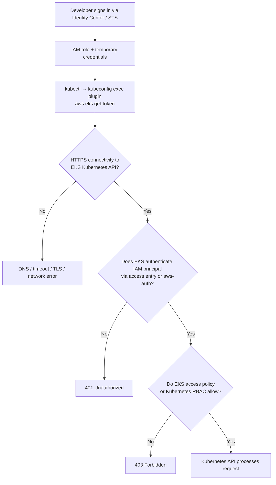
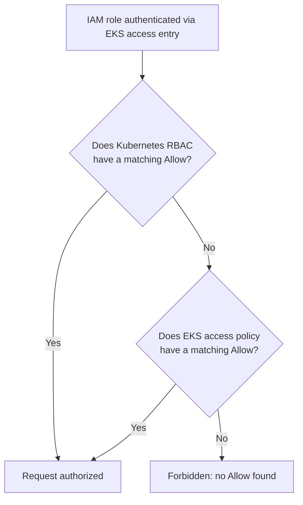
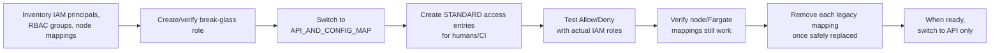
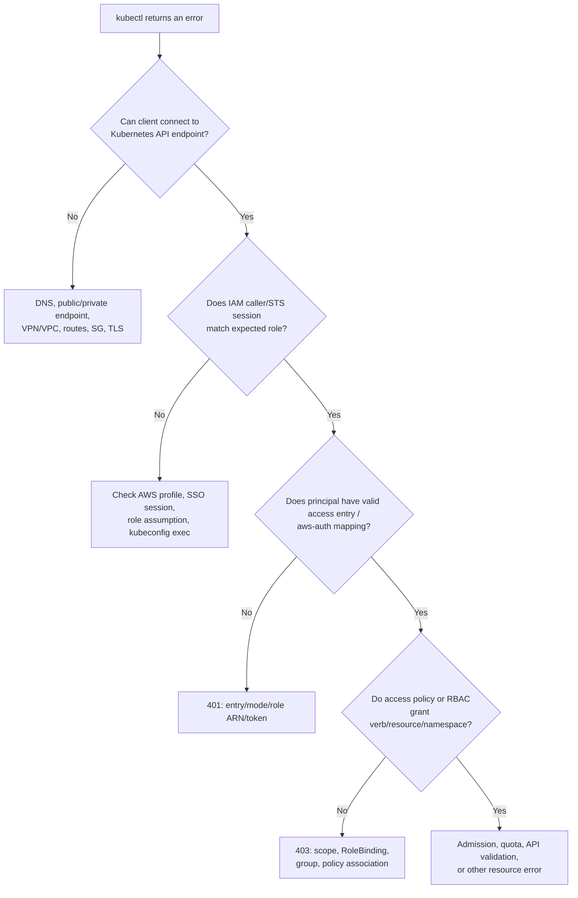
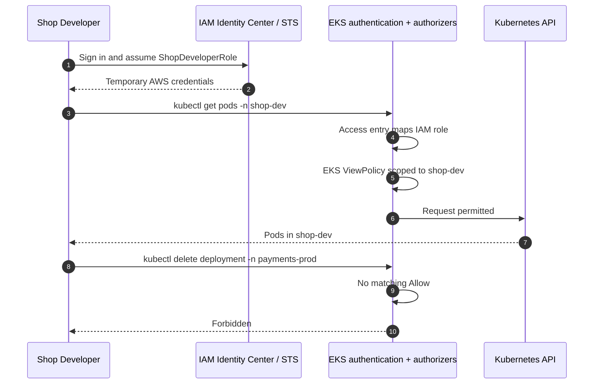

# EKS Access Entries and Kubernetes RBAC Authorization on AWS

When deploying Kubernetes with **Amazon Elastic Kubernetes Service (Amazon EKS)**, creating a cluster does not mean every IAM role in the AWS account can run `kubectl` against that cluster. The system must answer two independent questions: **who is requesting access to the Kubernetes API?** and **which Kubernetes resources is that identity permitted to operate on?**. Amazon EKS provides **access entries** to associate an IAM identity with Kubernetes access; fine-grained permissions can be granted via **EKS access policies**, **Kubernetes Role-Based Access Control (RBAC)**, or a combination of both.

This lesson belongs to the **Kubernetes with EKS** chapter of the **CLOUD_PROVIDERS_AWS** module. Within the scope of learning AWS from Regions/AZs, IAM, VPC, compute, storage, and databases through integration, serverless, monitoring, recovery, and cost control, cluster authorization provides the foundation for multiple development teams to operate applications on EKS **safely, accountably, and auditably**.

The direct focus of this lesson is **EKS access entries and Kubernetes RBAC authorization**: distinguishing authentication from authorization, understanding EKS API authentication modes, scoping permissions by namespace, creating real Roles/RoleBindings, migrating from `aws-auth`, detecting overly broad permissions, and diagnosing `Unauthorized/Forbidden` errors.

## 1. Learning Outcomes and Running Scenario

After this lesson, learners will be able to:

1. Distinguish AWS IAM, EKS access entries, EKS access policies, and Kubernetes RBAC by their **exact layer of responsibility**.
2. Explain the flow from an IAM role/STS credential to the Kubernetes API and authorization decisions.
3. Choose and administer the three authentication modes: `CONFIG_MAP`, `API_AND_CONFIG_MAP`, and `API`.
4. Create a `STANDARD` access entry, assign namespace-scoped EKS access policies, and verify with the corresponding IAM identity.
5. Grant custom permissions using `kubernetesGroups`, `Role`, `ClusterRole`, `RoleBinding`, and `ClusterRoleBinding`.
6. Combine and audit permissions across multiple sources without confusing AWS IAM policies with Kubernetes API permissions.
7. Execute safe migrations from `aws-auth`, protect production permissions, and resolve access errors.

**Primary scenario:** a company operates an EKS cluster `shop-eks` with namespaces `shop-dev`, `shop-staging`, `payments-prod`, and `platform-system`. Shop developers need to view Pods, logs, and Deployments in `shop-dev`; the QA team needs read access in staging; CI/CD may only deploy into authorized namespaces. Only select Platform/SRE roles may administer the cluster globally.

Command examples using Region `ap-southeast-1` and AWS account ID `111122223333` are **illustrative**; never execute permission-modifying commands in a production cluster without approval, a test plan, and a recovery path.

## 2. Mental Model: Authentication and Authorization Are Two Steps

| Component | Question It Handles | Example |
|---|---|---|
| **AWS IAM / STS** | Which AWS principal is using credentials and who may call AWS APIs? | Role `ShopDeveloperRole`, STS session |
| **EKS access entry** | Which IAM principal is mapped to access the cluster's Kubernetes API? | IAM role ARN → `STANDARD` entry |
| **EKS access policy** | Which Kubernetes operations does the AWS EKS authorizer permit for the principal via the entry? | `AmazonEKSViewPolicy` scoped to `shop-dev` |
| **Kubernetes RBAC** | Which Kubernetes user/group/service account has permissions on which resources, verbs, and namespaces? | Group `shop-developers` → `RoleBinding` → `Role` |
| **Cluster networking** | Can the client send HTTPS traffic to the Kubernetes API endpoint? | Public/private endpoint, SGs, routes, DNS |
| **IAM workload identity** | Which IAM role does a Pod use to call S3/SQS/Secrets Manager? | EKS Pod Identity or IRSA — a separate problem |

**Note:** an AWS IAM policy containing `eks:DescribeCluster` helps tools like AWS CLI retrieve cluster metadata, but **does not automatically grant `get pods` or `delete deployments` inside Kubernetes**. Similarly, having `iam:AssumeRole` permission for an IAM role does not grant Kubernetes permissions if that role has not been properly mapped and authorized.

### 2.1. Flow of a kubectl command



Sequence:

1. The user/pipeline obtains **temporary credentials** for a trusted IAM principal.
2. `kubectl` invokes the `exec` mechanism in kubeconfig, typically `aws eks get-token`, to generate a token for the cluster.
3. The EKS API endpoint must be **reachable** from the machine running `kubectl`.
4. EKS identifies the IAM principal and looks up the mapping via an **access entry**, or the `aws-auth ConfigMap` if the cluster mode still allows it.
5. Either or both the **EKS authorizer** and the **Kubernetes RBAC authorizer** evaluate request permissions.
6. Only when authorized does the API server return data or accept changes.

This is a logical diagram: the Kubernetes API also enforces admission, resource quotas, policies, and validation. An authorized operation can still be rejected by admission or fail due to resource state.

### 2.2. 401, 403, and network errors differ

| Result | What to Investigate First | Example |
|---|---|---|
| **Cannot connect** | DNS, public/private endpoint, firewall, VPC routes, TLS | `i/o timeout`, `no such host` |
| **401 Unauthorized** | IAM/session token, principal ARN, access entry mapping, cluster authentication mode | Client not authenticated by EKS |
| **403 Forbidden** | Authenticated identity lacks verb/resource/namespace per access policy or RBAC | `User ... cannot list resource "pods"` |
| **Admission/validation error** | Namespace, quota, webhook, policy, manifest | `exceeded quota` or admission webhook denied |

Never fix a 403 error by unconditionally granting `cluster-admin`. Identify the exact **verb**, **resource**, **namespace**, and real principal.

## 3. The Three EKS Authentication Modes

Before assigning access entries, the cluster must use an authentication mode that supports the EKS access API.

| `authenticationMode` | Principal Mapping Mechanism | Best Fit |
|---|---|---|
| `CONFIG_MAP` | `aws-auth` ConfigMap only (legacy) | Older unmigrated clusters |
| `API_AND_CONFIG_MAP` | EKS access entries **and** `aws-auth` | Controlled migration phase |
| `API` | EKS access entries only | Centralized governance via EKS API/IaC |

**EKS access entries require `API_AND_CONFIG_MAP` or `API`.** Before switching modes, verify supported version/platform requirements and the role currently used to administer the cluster. For EKS Auto Mode, access entries are required by the model.

### 3.1. Why is API_AND_CONFIG_MAP useful during migration?

In combined mode, a mapping for the same IAM principal may exist in both sources. In that case, the **access entry takes precedence over the `aws-auth` mapping** for that principal. However, principals present only in the ConfigMap continue working until they are migrated or `API` mode is enabled.

AWS does not automatically convert all custom mappings in `aws-auth` into access entries when you enable the feature. Therefore:

1. Inventory every IAM role/user, username/group, and current Kubernetes permission.
2. Create equivalent entries/permission grants before removing old mappings.
3. Test both allowed and denied actions using the actual IAM principal.
4. Keep a tested recovery/break-glass path.
5. Switch to `API` only when no unresolved dependencies on `aws-auth` remain.

### 3.2. Mode switching is a one-way decision

Once a mode with the EKS access API is enabled, **you cannot revert to a mode that removes the access API**. You can migrate along `CONFIG_MAP → API_AND_CONFIG_MAP → API`, but do not treat this as a toggle you can casually roll back during daily operations.

CLI example (run only after approving a migration plan):

```bash
aws eks describe-cluster \
  --name shop-eks \
  --region ap-southeast-1 \
  --query "cluster.accessConfig"

# Migration step requiring approval. Never run blindly in production.
aws eks update-cluster-config \
  --name shop-eks \
  --access-config authenticationMode=API_AND_CONFIG_MAP \
  --region ap-southeast-1
```

The cluster may transition to `UPDATING`; wait for it to return to `ACTIVE` and verify the mode before creating access entries. Do not create a batch of new permissions mid-update, as access entry updates exhibit **eventual consistency**.

### 3.3. Cluster creator and initial permissions

Older clusters may grant special administrative permissions to the principal **that created the cluster**. Newer clusters have options to grant or withhold bootstrap admin permissions for the creator. This is important context during migration, yet **you should never rely on implicit creator permissions** as the sole administrative path: maintain explicit Platform roles with access entries, auditing, and break-glass procedures.

## 4. What Information Does an Access Entry Contain?

An **EKS access entry** is a resource managed via the EKS API that binds a specific IAM principal to Kubernetes cluster access. Key fields:

| Field | Role | Example |
|---|---|---|
| `clusterName` | Cluster receiving the access entry | `shop-eks` |
| `principalArn` | ARN of an existing IAM user/role | `arn:aws:iam::111122223333:role/ShopDeveloperRole` |
| `type` | Type of principal/subject using the entry | `STANDARD` |
| `username` | Mapped Kubernetes username, following AWS default rules | Name generated by EKS from assumed-role session |
| `kubernetesGroups` | List of Kubernetes group names for RBAC evaluation | `shop-developers` |
| **Associated access policies** | Cluster- or namespace-scoped EKS policies | `AmazonEKSViewPolicy` in `shop-dev` |
| `tags` | Entry management metadata | `Owner=platform` |

**An access entry is not an IAM role**, does not contain AWS secret keys, and does not automatically create a Kubernetes `RoleBinding`. It connects an IAM identity to Kubernetes authentication/authorization.

### 4.1. Common access entry types

| `type` | Used For | Notes |
|---|---|---|
| `STANDARD` | IAM roles/users for developers, SREs, CI/CD | Can use Kubernetes groups and/or associate EKS access policies |
| `EC2_LINUX` | IAM role for self-managed Linux/Bottlerocket worker nodes per model | Cannot associate EKS access policies or arbitrary groups like STANDARD |
| `EC2_WINDOWS` | IAM role for self-managed Windows workers | For nodes, not human admins |
| `FARGATE_LINUX` | Role used with EKS Fargate infrastructure when needed | EKS normally manages mappings for Fargate profiles automatically |
| `HYBRID_LINUX` | Hybrid nodes under AWS-supported models | For node identity |
| `EC2` | Nodes using instance ID naming or EKS Auto Mode custom node classes per feature | Not for developer logins |

This list may expand as EKS adds new node/access entry types; consult current AWS documentation when deploying. **The default is `STANDARD`**, but do not apply it to node roles just to simplify CLI commands.

### 4.2. Principal constraints to remember

- Each access entry points to **exactly one IAM principal ARN**; within a single cluster, the same principal cannot have multiple entries.
- For `STANDARD`, the IAM principal may reside in the **same or a different AWS account** from the cluster. Node entry types do not share that cross-account flexibility.
- Prefer **IAM roles with temporary credentials**, such as roles provisioned via IAM Identity Center, over long-lived IAM user access keys.
- Never use an **STS assumed-role session ARN** as `principalArn` for an entry; use the stable **IAM role ARN**.
- **Deleting and recreating an IAM role with the same name/ARN** does not automatically restore an old access entry: EKS stores the internal role ID/user ID. You must delete/recreate the corresponding entry.
- You cannot modify `principalArn` or `type` on an existing entry; create the appropriate entry after assessing impact.
- Access entries cannot use IAM **service-linked roles** as principals.

### 4.3. Username and group

With `STANDARD`, EKS can auto-generate a username from the IAM role/session, including the session name for traceability. You can configure a custom username, but keep identities auditable and avoid collisions, especially if multiple principals share a group.

**A group name does not need to be created as a standalone Kubernetes object.** Kubernetes RBAC treats group names as strings in subjects. If an entry specifies `kubernetesGroups=["shop-developers"]` while the cluster has no `RoleBinding`/`ClusterRoleBinding` referencing that group, **EKS still accepts the entry**, though no RBAC permissions are granted yet.

## 5. Two Ways to Grant Kubernetes Permissions to an Access Entry

For a `STANDARD` entry, there are two common paths:

### Approach A — Associate an EKS access policy

AWS maintains a set of **predefined EKS access policies** matching common Kubernetes permission patterns. You select a policy and scope:

- **cluster**: applies the policy's permissions across the cluster.
- **namespace**: applies permissions within one or more specified namespaces.

You do not need to create Kubernetes Roles/RoleBindings manually when relying solely on EKS access policies.

### Approach B — Kubernetes RBAC groups

The entry declares a group, such as `shop-developers`. Kubernetes administrators create:

- A `Role` or `ClusterRole` defining verbs/resources.
- A `RoleBinding` or `ClusterRoleBinding` linking the group to those permissions.

This approach requires more configuration, yet enables finer custom permissions—for example, **only viewing Pods and Pods/log in the dev namespace**, without reading Secrets or modifying Deployments.

### 5.1. Design comparison

| Criterion | EKS access policy | Kubernetes RBAC via groups |
|---|---|---|
| Where managed | EKS API, Console, CLI, SDK/IaC | Kubernetes API, GitOps/Helm/YAML |
| Permission set | AWS-defined policies; policy contents cannot be edited | Custom verbs, apiGroups, resources, resourceNames |
| Scope | Cluster or namespaces declared on the association | Cluster-wide or namespaced via bindings |
| Granularity | Suited for common admin/edit/view patterns | Suited for custom read-only, subresource limits, custom CRDs |
| Visible via `kubectl get rolebindings` | EKS access policies are **not visible** | Roles/RoleBindings are visible |
| Can be combined? | Yes | Yes |
| Configuration overhead | Simpler for standard use cases | Requires RBAC YAML review and lifecycle management |

**For most standard needs**, EKS access policies are easier to manage. When precision down to individual resources/subresources is needed, use Kubernetes RBAC. Avoid granting both unnecessarily, because **permissions are additive**.

## 6. Understanding EKS Access Policies

EKS provides policies such as:

| EKS access policy | General Meaning | Prudent Usage |
|---|---|---|
| `AmazonEKSViewPolicy` | Read permissions on Kubernetes resources as defined by AWS | Developers/QA needing namespace observation only |
| `AmazonEKSEditPolicy` | Edit permissions across many workload resources | Requires review of app deployment/modification impact |
| `AmazonEKSAdminPolicy` | Common admin permissions, can be namespace-scoped | Do not treat as read-only |
| `AmazonEKSClusterAdminPolicy` | Very broad cluster-wide admin permissions | Approved break-glass/Platform roles only |
| `AmazonEKSAdminViewPolicy` | Broader administrative view permissions per policy definition | Inspect actual policy permissions before granting |

EKS also offers specialized access policies for other AWS features; **do not guess permissions from names**. Run:

```bash
aws eks list-access-policies \
  --region ap-southeast-1 \
  --output table
```

Consult the **Review access policy permissions** page to inspect exact resources/verbs. EKS access policies contain **Kubernetes permissions**, **not IAM policies**. You cannot author custom access policies or edit these AWS-managed policies; if they do not fit your requirements, use Kubernetes RBAC.

### 6.1. Scope is a boundary that must be strictly verified

For example, the Shop team may only view namespace `shop-dev`:

```text
principalArn: arn:aws:iam::111122223333:role/ShopDeveloperRole
accessPolicy: AmazonEKSViewPolicy
accessScope:
  type: namespace
  namespaces: [shop-dev]
```

Changing scope to `cluster` grants broader read permissions across the entire cluster with the same policy. Using a namespace pattern like `dev-*` may automatically include future namespaces matching that pattern. **Never use wildcard patterns without evaluating future scope expansion consequences.**

EKS **does not verify that a namespace exists or is spelled correctly** when associating a policy. An association specifying `shop-deev` will succeed while granting no access where `shop-dev` actually runs.

### 6.2. Multiple policies on the same entry

An entry can associate multiple EKS access policies; effective permissions are the **union of permissions granted** by those associations. Each policy can only be associated once per entry, though an association's scope can be updated via the API.

For example:

- Cluster-wide `ViewPolicy` for observation.
- `EditPolicy` only in `shop-dev`.

The principal can then read across multiple namespaces while editing only within dev scope (assuming no other grants). Always inspect the permission list and resource types rather than inferring solely from the word “Edit.”

## 7. Kubernetes RBAC: Role, ClusterRole, and Bindings

RBAC is the standard Kubernetes mechanism defining **who** may perform which **verbs** on which **API resources** within what scope.

| Object | Function | Scope |
|---|---|---|
| `Role` | Set of permission rules within a single namespace | Namespaced |
| `ClusterRole` | Set of permission rules usable cluster-wide or reused inside a namespace | Cluster-scoped object |
| `RoleBinding` | Binds User/Group/ServiceAccount to a Role or ClusterRole **within the binding's namespace** | Namespaced |
| `ClusterRoleBinding` | Binds User/Group/ServiceAccount to a ClusterRole across the entire cluster | Cluster-wide |

Common verbs: `get`, `list`, `watch`, `create`, `update`, `patch`, `delete`. Kubernetes RBAC has no **Deny rule** the way IAM has explicit denies; RBAC aggregates Allow rules, and if no matching permission exists, the request is denied.

### 7.1. Role for viewing Pods and logs only

For example, Shop developers need to list Pods, describe Pods, and read logs in namespace `shop-dev`, without reading Secrets or executing shells inside Pods:

```yaml
apiVersion: rbac.authorization.k8s.io/v1
kind: Role
metadata:
  name: shop-pod-observer
  namespace: shop-dev
rules:
  - apiGroups: [""]
    resources: ["pods"]
    verbs: ["get", "list", "watch"]
  - apiGroups: [""]
    resources: ["pods/log"]
    verbs: ["get"]
  - apiGroups: ["apps"]
    resources: ["deployments"]
    verbs: ["get", "list", "watch"]
---
apiVersion: rbac.authorization.k8s.io/v1
kind: RoleBinding
metadata:
  name: shop-developers-observe
  namespace: shop-dev
subjects:
  - kind: Group
    name: shop-developers
    apiGroup: rbac.authorization.k8s.io
roleRef:
  kind: Role
  name: shop-pod-observer
  apiGroup: rbac.authorization.k8s.io
```

Explanation:

- The `Role` exists **inside namespace `shop-dev`**, applying only to resources in that scope.
- `resources: ["pods/log"]` is a subresource for viewing logs; `get pods` alone does not grant `get pods/log`.
- `pods/exec`, `create pods`, and Secret read permissions are omitted because they are far more sensitive operations.
- The `RoleBinding` lists group `shop-developers` as its subject. The exact same group name must be configured on the corresponding **EKS access entry**.
- Once applied by an admin principal authorized to manage RBAC, developers in this group can view Pods/logs/Deployments in `shop-dev`.

The example above does not yet grant permission to read `events`; if `kubectl get events` is needed, add the corresponding least-privilege rule. The principle is to **add exactly what is needed**, never using wildcards just because a secondary command fails.

### 7.2. Reusing a ClusterRole inside a namespace

A `ClusterRole` can hold shared rules for multiple teams, yet when bound via a **RoleBinding in a single namespace**, permissions apply only to namespaced resources within that namespace.

```yaml
apiVersion: rbac.authorization.k8s.io/v1
kind: ClusterRole
metadata:
  name: reusable-workload-view
rules:
  - apiGroups: [""]
    resources: ["pods", "services"]
    verbs: ["get", "list", "watch"]
  - apiGroups: ["apps"]
    resources: ["deployments"]
    verbs: ["get", "list", "watch"]
---
apiVersion: rbac.authorization.k8s.io/v1
kind: RoleBinding
metadata:
  name: qa-view
  namespace: shop-staging
subjects:
  - kind: Group
    name: shop-qa
    apiGroup: rbac.authorization.k8s.io
roleRef:
  kind: ClusterRole
  name: reusable-workload-view
  apiGroup: rbac.authorization.k8s.io
```

**Important distinction:** defining a `ClusterRole` **does not automatically create cluster-wide permissions**. What determines effective scope is whether you use a **RoleBinding** or a **ClusterRoleBinding**. Using a `ClusterRoleBinding` for the QA group would expand permissions across the entire cluster—a very common misconfiguration.

### 7.3. RBAC for non-namespaced resources

Some Kubernetes resources like `nodes`, `persistentvolumes`, `namespaces`, and `clusterroles` are cluster-scoped. A RoleBinding in `shop-dev` **does not make these resources namespaced**. When read access to cluster-scoped resources is required, design a properly scoped ClusterRole/ClusterRoleBinding carefully since namespace isolation no longer applies.

## 8. How Do the EKS Authorizer and Kubernetes RBAC Combine?

EKS uses a combined authorization model pairing the **Kubernetes RBAC authorizer** with the **EKS authorizer** for access policies. Behaviorally, each can **allow** or abstain from a decision on a request; neither provides explicit Denies the way IAM policies do for AWS APIs.



Consequences:

1. If **RBAC allows** the action, permission takes effect even if no EKS access policy grants it.
2. If an **EKS access policy allows** the action, the request succeeds even if no RoleBinding grants it.
3. Only when neither grants permission is the request denied.
4. **You cannot use a narrow RoleBinding to “revoke” overly broad permissions from an EKS access policy.** The fix is to adjust/disassociate the access policy or narrow its scope, while auditing any other grants.

### 8.1. Outcome matrix

| Kubernetes RBAC | EKS access policy | Authorization Result | Meaning |
|---|---|---|---|
| Allows `get pods` | No Allow | Allow | RBAC group alone suffices to read Pods |
| No Allow | Allows `get pods` | Allow | EKS policy alone suffices to read Pods |
| Allows `get secrets` | Policy only views Pods | Allow for get secrets | Narrow EKS policy does not block RBAC grants |
| No Allow | No Allow | Forbidden | Corresponding permission not granted |

**When combining both systems**, inventory both policy associations **and** in-cluster bindings. Checking only one source underestimates actual permissions.

### 8.2. Limitations of kubectl auth can-i

`kubectl auth can-i` helps check Kubernetes permissions per request, with one subtle pitfall:

- `kubectl auth can-i --list` **does not list permissions granted solely through EKS access policies**. It displays Kubernetes RBAC permissions evaluated in that context.
- When using user/group impersonation via `--as` or `--as-group`, evaluation runs against **Kubernetes RBAC**, without carrying over EKS access policy permissions of the original IAM principal.
- To test real effective permissions, authenticate with the **actual IAM role/STS session without impersonation**, test both allowed and denied actions, and cross-check EKS policy associations.

Therefore, an empty output from `kubectl auth can-i --list` **does not prove** a principal lacks permissions via EKS access policies. Equally, a “yes” for one verb does not mean the principal lacks broader permissions elsewhere.

## 9. Safe Lab Preparation

The next two walkthroughs run on a test cluster:

| Item | Illustrative Value |
|---|---|
| AWS Region | `ap-southeast-1` |
| EKS cluster | `shop-eks` |
| Cluster account | `111122223333` |
| Developer role reading namespace | `arn:aws:iam::111122223333:role/ShopDeveloperRole` |
| QA role using custom RBAC | `arn:aws:iam::111122223333:role/ShopQaRole` |
| Dev Kubernetes namespace | `shop-dev` |
| Staging Kubernetes namespace | `shop-staging` |
| Kubernetes RBAC group | `shop-qa` |

### 9.1. Required tools

- AWS CLI version supporting EKS access entry APIs.
- `kubectl` compatible with the cluster's Kubernetes version.
- An approved administrative IAM principal authorized to create/edit access entries, associate policies, and create Kubernetes RBAC objects.
- A **test** IAM role without broad cluster permissions, to verify denials.
- Network connectivity to the Kubernetes API endpoint per the cluster's public/private endpoint configuration.

**Never use a production cluster for labs** without a change process. Administrative commands below assume the user/pipeline already holds authority and approval. This article does not create AWS resources or manifest files outside this Markdown document.

### 9.2. Verify the exact AWS principal before doing anything

```bash
aws sts get-caller-identity

aws eks describe-cluster \
  --name shop-eks \
  --region ap-southeast-1 \
  --query "cluster.{status:status,endpoint:endpoint,access:accessConfig}"
```

**Note:** `aws sts get-caller-identity` normally returns an **STS assumed-role ARN** when signing in via IAM Identity Center. Access entries require the **IAM role ARN**, not a specific session ARN. If the role includes a path (such as an Identity Center permission set role), retrieve the actual ARN from IAM/Identity Center or trusted infrastructure tooling; do not guess by naively splicing ARN strings.

### 9.3. Two identities are needed for testing

- **Admin/provisioner**: creates entries and RBAC manifests.
- **Developer/QA role**: separate session to verify granted permissions, including expected denials.

Do not test using the cluster-creator admin principal while thinking you are testing developer policies. Use separate AWS profiles/Identity Center sessions and verify `get-caller-identity` before each test suite.

## 10. Practice A — Granting Permissions with an EKS Access Policy

**Goal:** `ShopDeveloperRole` may only view Kubernetes resources in namespace `shop-dev` within the scope of `AmazonEKSViewPolicy`, and cannot modify workloads.

### Step 1 — Verify authentication mode

```bash
aws eks describe-cluster \
  --name shop-eks \
  --region ap-southeast-1 \
  --query "cluster.accessConfig.authenticationMode" \
  --output text
```

Proceed only when the cluster is in `API` or `API_AND_CONFIG_MAP` mode. If the cluster is still in `CONFIG_MAP`, prepare the migration covered in section 14; do not upgrade production mode just to test commands.

### Step 2 — Create a STANDARD entry for the role

```bash
aws eks create-access-entry \
  --cluster-name shop-eks \
  --principal-arn arn:aws:iam::111122223333:role/ShopDeveloperRole \
  --type STANDARD \
  --region ap-southeast-1
```

The role must exist, the caller must have proper EKS API permissions, and no duplicate entry may exist for that principal on the cluster. This command only **creates the mapping**; it does not grant Pod read access without an EKS policy or Kubernetes RBAC grants.

### Step 3 — Associate the view policy to one namespace

```bash
aws eks associate-access-policy \
  --cluster-name shop-eks \
  --principal-arn arn:aws:iam::111122223333:role/ShopDeveloperRole \
  --policy-arn arn:aws:eks::aws:cluster-access-policy/AmazonEKSViewPolicy \
  --access-scope type=namespace,namespaces=shop-dev \
  --region ap-southeast-1
```

The policy's permission set is managed by AWS. If you strictly need **read-only access to Pods and no other resources**, use custom RBAC as in section 11 rather than assuming ViewPolicy only covers `pods`.

### Step 4 — Verify the entry and association

```bash
aws eks describe-access-entry \
  --cluster-name shop-eks \
  --principal-arn arn:aws:iam::111122223333:role/ShopDeveloperRole \
  --region ap-southeast-1

aws eks list-associated-access-policies \
  --cluster-name shop-eks \
  --principal-arn arn:aws:iam::111122223333:role/ShopDeveloperRole \
  --region ap-southeast-1
```

Check `policyArn`, `accessScope.type`, and `accessScope.namespaces` carefully. If scope is `cluster` when only `shop-dev` was requested, fix it before handing over access.

### Step 5 — Test using the actual developer role

After switching to an IAM role session for `ShopDeveloperRole`:

```bash
aws sts get-caller-identity

aws eks update-kubeconfig \
  --name shop-eks \
  --region ap-southeast-1 \
  --alias shop-eks-developer

kubectl --context shop-eks-developer get pods -n shop-dev
kubectl --context shop-eks-developer get deployments -n shop-dev
kubectl --context shop-eks-developer get pods -n payments-prod
```

Expected: ViewPolicy-permitted queries in `shop-dev` succeed; querying `payments-prod` is **denied under this association alone**. However, if the IAM principal also holds other RBAC grants or EKS policy associations, effective permissions may be broader; always audit everything.

**Side requirement:** the IAM role running `aws eks update-kubeconfig` may need `eks:DescribeCluster`. If kubeconfig already exists, AWS API IAM conditions and Kubernetes API conditions differ; never solve `kubectl` permission errors by blindly granting `eks:*`.

### Step 6 — Grant read-only access to multiple namespaces (when approved)

You can update the scope of **the same association**:

```bash
aws eks associate-access-policy \
  --cluster-name shop-eks \
  --principal-arn arn:aws:iam::111122223333:role/ShopDeveloperRole \
  --policy-arn arn:aws:eks::aws:cluster-access-policy/AmazonEKSViewPolicy \
  --access-scope type=namespace,namespaces=shop-dev,shop-staging \
  --region ap-southeast-1
```

This is a **scope-changing operation**; review beforehand since it expands access from one namespace to two.

## 11. Practice B — Granting Fine-Grained Permissions via a Kubernetes RBAC Group

**Goal:** `ShopQaRole` may only view Pods/logs/Deployments in `shop-staging` per a custom Role, without reading Secrets or modifying workloads.

### Step 1 — Admin creates an access entry with a Kubernetes group

```bash
aws eks create-access-entry \
  --cluster-name shop-eks \
  --principal-arn arn:aws:iam::111122223333:role/ShopQaRole \
  --type STANDARD \
  --kubernetes-groups shop-qa \
  --region ap-southeast-1
```

In this example, **no EKS access policy is associated** with ShopQaRole. We want permissions to come exclusively from the reviewed Role/RoleBinding.

### Step 2 — Admin prepares namespace and RBAC

Admin confirms the namespace exists (read-only command):

```bash
kubectl get namespace shop-staging
```

If it does not exist yet, the admin creates the namespace following organizational approval and ownership processes. Then apply the manifest below via organizational GitOps/manifest management:

```yaml
apiVersion: rbac.authorization.k8s.io/v1
kind: Role
metadata:
  name: qa-observer
  namespace: shop-staging
rules:
  - apiGroups: [""]
    resources: ["pods", "pods/log", "services"]
    verbs: ["get", "list", "watch"]
  - apiGroups: ["apps"]
    resources: ["deployments", "replicasets"]
    verbs: ["get", "list", "watch"]
---
apiVersion: rbac.authorization.k8s.io/v1
kind: RoleBinding
metadata:
  name: qa-observer-binding
  namespace: shop-staging
subjects:
  - kind: Group
    name: shop-qa
    apiGroup: rbac.authorization.k8s.io
roleRef:
  kind: Role
  name: qa-observer
  apiGroup: rbac.authorization.k8s.io
```

In the practitioner's pipeline/IaC, save the approved manifest into a separate file and apply from that file. This STEP_4 worker **only writes documentation**, without creating lab YAML files or modifying clusters.

### Step 3 — Verify RBAC and group

Admin:

```bash
kubectl get role qa-observer -n shop-staging -o yaml
kubectl get rolebinding qa-observer-binding -n shop-staging -o yaml

aws eks describe-access-entry \
  --cluster-name shop-eks \
  --principal-arn arn:aws:iam::111122223333:role/ShopQaRole \
  --region ap-southeast-1
```

Confirm the group name on the entry matches **exactly** the subject `name: shop-qa` in the RoleBinding.

### Step 4 — Test using the QA role

After signing in as `ShopQaRole` and configuring the corresponding kubeconfig:

```bash
aws sts get-caller-identity
kubectl get pods -n shop-staging
kubectl logs -n shop-staging "<POD_NAME>"

kubectl auth can-i get pods -n shop-staging
kubectl auth can-i get secrets -n shop-staging
kubectl auth can-i update deployments -n shop-staging
kubectl auth can-i list pods -n shop-dev
```

Expected results based **solely on this role/binding**:

| Action | Namespace | Result |
|---|---|---|
| `get/list/watch pods` | `shop-staging` | Allowed |
| `get pods/log` | `shop-staging` | Allowed |
| `get/list deployments` | `shop-staging` | Allowed |
| `get secrets` | `shop-staging` | Denied |
| `update deployments` | `shop-staging` | Denied |
| `list pods` | `shop-dev` | Denied |

**Warning:** if this role also has an EKS access policy (or RBAC grants from other bindings), results will differ. Always inspect **total effective permissions** before drawing conclusions.

### Step 5 — Updating groups on an existing entry

If an access entry already exists, update `kubernetesGroups` via the supported API instead of creating a new entry:

```bash
aws eks update-access-entry \
  --cluster-name shop-eks \
  --principal-arn arn:aws:iam::111122223333:role/ShopQaRole \
  --kubernetes-groups shop-qa \
  --region ap-southeast-1
```

**Never run update commands from memory**: updating the group list can replace previous values; inspect the existing entry first, review which groups must remain, and test after the change.

## 12. Designing Roles/RoleBindings by Least Privilege

### 12.1. get, list, and watch permissions differ

| Verb | Typical Effect | Notes |
|---|---|---|
| `get` | View a specifically named resource | Can combine with `resourceNames` in supported scenarios |
| `list` | List resources | Can expose metadata across many objects in a namespace |
| `watch` | Stream ongoing changes | Suited for controllers/monitors, holds long-lived connections |
| `create` | Create new resources | Can create a Pod running arbitrary code in the namespace |
| `update` / `patch` | Modify objects | Editing a Deployment can swap images and execute different code |
| `delete` | Delete objects | Impacts availability, data, and operations |

**Reading Secrets is not the same as reading Pods.** Kubernetes Secrets can hold credentials/service tokens or sensitive data in encoded form, not client-unreadable encryption. `get/list/watch secrets` permissions must usually be restricted far more strictly than application status viewing.

### 12.2. Kubernetes subresources significantly alter permissions

Examples:

- `pods/log`: view container logs.
- `pods/exec`: execute commands inside a container, potentially reading files/secrets or making network calls from inside the Pod.
- `pods/portforward`: open connections to ports inside a Pod, potentially bypassing network boundaries intended by architects if uncontrolled.
- `deployments/scale`: change replica counts; affects cost and availability.
- `pods/eviction`: can affect availability.

Do not grant everything via `resources: ["pods", "pods/*"]` or wildcard `"*"` when users only need to view logs. Check exact subresource verbs (for instance, `create` is used for `exec` in many API interactions).

### 12.3. Edit roles are not harmless

In Kubernetes, anyone who can create Pods, edit Deployments, or create workloads can often:

- Run an image of their choice in the namespace.
- Read data/secrets mounted into the workload or leverage permissions of the service account attached to the Pod.
- Connect to internal services from the Pod's network position.
- Consume CPU/RAM/ephemeral storage and affect quotas/costs.

Therefore, **namespace-scoped edit** remains a sensitive permission. Pair RBAC with **Pod Security Admission**, admission policies, namespace quotas, network policies, least-privilege workload IAM, and container image controls.

### 12.4. Avoid escalation via RBAC management

Permissions such as `create/update rolebindings`, `clusterrolebindings`, `roles`, `clusterroles`, or special verbs `bind`/`escalate` are highly sensitive. Kubernetes includes safeguards preventing users from granting themselves higher-privilege Roles in some operations, but you should not rely solely on that in place of least privilege and review.

Application deployers do not need `create clusterrolebindings` or ability to modify `system:masters`. Separate:

- **Platform admin:** manages cluster-scoped RBAC and system components.
- **Namespace operator:** manages namespace resources with guardrails.
- **Developer/QA:** views/operates on approved resources.
- **CI/CD:** applies manifests from pipelines within granted scope, fully logged.

### 12.5. RoleBindings do not restrict all runtime behavior inside a namespace

A Kubernetes namespace is not a complete security boundary like an AWS account. For workloads that can spawn Pods, you must still govern CNI/networking, Pod IAM roles, service account permissions, host mounts, privileged settings, and access to data outside the namespace. **EKS access entries control human/pipeline access to the Kubernetes API, not sandboxing for running containers.**

## 13. Access for CI/CD, IAM Identity Center, and Operations Teams

### 13.1. Human sign-in via IAM Identity Center

A practical model:

1. Users sign in through **AWS IAM Identity Center** and the corporate identity provider.
2. A permission set lets the user assume an **IAM role in the AWS account hosting EKS**.
3. The EKS access entry uses the **actual IAM role ARN** of that permission set.
4. An EKS access policy or Kubernetes RBAC group defines Kubernetes permissions by team/environment.
5. The Platform team governs user lifecycles, temporary privileges, and change auditing.

Do not manually type an IAM username/email as a Kubernetes RBAC group assuming EKS automatically knows identity provider memberships. Mapping an IAM role → Kubernetes group is configured on the **access entry**, and that group still needs an RBAC binding if using the RBAC path.

**Note on Identity Center-created role lifecycles:** these roles have paths like `aws-reserved/sso.amazonaws.com/...` tied to the permission set. If a permission set is completely unassigned and the role is deleted/recreated, the ARN or role ID may change; the old access entry can stop working. Maintain role inventory/sync procedures and keep an independently managed recovery role.

### 13.2. CI/CD pipelines should have dedicated IAM roles

Suppose GitHub Actions or an internal CI system needs to deploy a Deployment to `shop-dev`:

- CI uses **OIDC federation/STS** or equivalent short-lived credentials, never hardcoded AWS access keys.
- CI assumes a **dedicated deployment role** such as `ShopDeployDevRole`, which has a `STANDARD` EKS access entry.
- The role maps to group `shop-deployers` and a Kubernetes Role allowing only required workload operations in `shop-dev`.
- Scope the IAM trust policy to the exact repository, branch/environment, workflow identity, and supported provider conditions.
- Production uses separate roles, policies, and approvals—never reusing dev credentials.

### 13.3. Example CI permissions to patch a Deployment in a namespace

```yaml
apiVersion: rbac.authorization.k8s.io/v1
kind: Role
metadata:
  name: shop-deployment-operator
  namespace: shop-dev
rules:
  - apiGroups: ["apps"]
    resources: ["deployments"]
    verbs: ["get", "list", "watch", "patch", "update"]
  - apiGroups: [""]
    resources: ["pods"]
    verbs: ["get", "list", "watch"]
  - apiGroups: ["apps"]
    resources: ["replicasets"]
    verbs: ["get", "list", "watch"]
---
apiVersion: rbac.authorization.k8s.io/v1
kind: RoleBinding
metadata:
  name: shop-deployment-ci-binding
  namespace: shop-dev
subjects:
  - kind: Group
    name: shop-deployers
    apiGroup: rbac.authorization.k8s.io
roleRef:
  kind: Role
  name: shop-deployment-operator
  apiGroup: rbac.authorization.k8s.io
```

This Role permits patching/updating existing Deployments, fitting pipelines that update image digests/replicas per policy; it does not allow creating new Deployments or editing Secrets. **However, anyone able to edit a Deployment template can run arbitrary container code in the namespace**, so enforce image, admission, service account IAM, network, and approval policies to prevent out-of-scope impact.

If CI needs to create new Deployments, add `create` intentionally after review. Avoid granting `create clusterroles`, `delete namespaces`, or `impersonate serviceaccounts` to application pipelines.

### 13.4. Role separation by environment

| Role / Team | Dev | Staging | Production |
|---|---|---|---|
| Shop Developer | Observe + modify workloads per policy | Usually read-only | No direct writes |
| QA | Read Pods/Deployments/logs; create approved test resources | Read/test in relevant namespaces | Read-only only if truly needed |
| CI Dev | Deploy vetted images/artifacts | Per promotion pipeline | No production role |
| CI Prod | Not used for daily dev | Verify artifacts | Approved deploys, specific namespace permissions |
| SRE/Platform | Administer as needed | Administer as needed | Time-bound, audited privileged access |
| Security Auditor | Read config/logs | Read config/logs | Read-only as required; never modifies workloads |

Sharing one cluster across multiple namespaces can save money, yet **namespace-level RBAC does not replace account/cluster isolation** when tenants, data sensitivity, or risk demand stronger boundaries.

## 14. Migrating from aws-auth ConfigMap to Access Entries

Older EKS clusters often configure IAM-to-Kubernetes mappings in a ConfigMap:

```text
kube-system/aws-auth
  ├─ mapRoles
  └─ mapUsers
```

EKS access entries are designed to manage mappings via EKS APIs. **Never delete the ConfigMap or switch immediately to API-only** on a running cluster, as nodes and admin roles can lose access.

### 14.1. Phased migration plan



Specific steps:

**Step 1 — Inventory:** while retaining Kubernetes admin access, read the ConfigMap:

```bash
kubectl -n kube-system get configmap aws-auth -o yaml

aws eks describe-cluster \
  --name shop-eks \
  --region ap-southeast-1 \
  --query "cluster.accessConfig"
```

Record all IAM role/user mappings, Kubernetes groups, owners, purposes, node roles, and service roles. **Do not paste the entire ConfigMap containing internal details into public logs or documentation.**

**Step 2 — Secure administrative recovery:** verify at least one or two Platform IAM roles can administer EKS via access entries after migration and can be assumed if SSO fails. AWS EKS API permissions to restore access entries should be managed independently from Kubernetes RBAC.

**Step 3 — Enable access API:** switch to `API_AND_CONFIG_MAP`, wait for the cluster to become Active, and verify configuration. This step cannot be “undone” by reverting to `CONFIG_MAP`.

**Step 4 — Migrate each human/CI role:** create `STANDARD` entries, map groups matching existing RBAC or attach appropriately scoped EKS access policies.

**Step 5 — Test both allowed and denied actions:** for instance, a role restricted to viewing `shop-dev` must succeed at `get/list pods` in dev and fail at `get secrets`/`delete deployments`; test production namespaces as well.

**Step 6 — Handle node mappings:** verify worker nodes continue joining and stay Ready; inspect EKS-managed entries for managed node groups/Fargate profiles. Never remove mappings that nodes still depend on.

**Step 7 — Clean up:** remove old mappings one by one only after replacement mappings exist and are verified. Only at the end consider `API` mode.

### 14.2. Access entries take precedence in combined mode

If the same role appears in both `aws-auth` and an EKS access entry, **the access entry mapping takes precedence**. For example, if a role previously belonged to `shop-readers` via the ConfigMap while the new entry specifies `shop-deployers`, Kubernetes permissions change **even before you delete the ConfigMap mapping**.

Thus, migration **is not a zero-impact “just add entries” operation**. Identify the permission cutover point and test each role.

### 14.3. Other node types needing attention

| Subject | Typical Management | Migration Risk |
|---|---|---|
| Managed node group | EKS creates/manages mappings/entries per cluster mode | Accidentally removing mappings before automatic entries exist |
| Fargate profile | EKS manages Fargate infrastructure mappings | Creating wrong entries or removing mappings breaks scheduling |
| Self-managed EC2 nodes | May need `EC2_LINUX`/`EC2_WINDOWS` or specialized node entry types | Mistakenly using `STANDARD` and human RBAC groups |
| EKS Auto Mode nodes | Access entries are part of Auto Mode design | Cannot revert to legacy-only mode |
| Hybrid nodes | Dedicated node entry type and authentication mechanism | Do not share human permission configs |

For managed node groups and Fargate profiles, **manual access entry creation is usually unnecessary** because EKS manages them; however, older clusters with legacy entries require checking actual state before cleanup. For self-managed nodes, test entry/node credential workflows on a subset of nodes before migrating the whole fleet.

**Never attach `AmazonEKSClusterAdminPolicy` to node roles** just “to let nodes join the cluster.” Node identities have dedicated entry types and permissions, not human cluster-admin rights.

### 14.4. Migration completion requires evidence

Consider migration complete only when:

- Entries for all required IAM roles exist with no incorrect ARN mappings.
- Human/CI roles sign in with their intended identities without relying on aws-auth.
- Allow and Deny permission tests pass.
- Nodes stay Ready, Fargate Pods run, and EKS add-ons/controllers retain permissions.
- Auditing covers who grants/modifies access, alongside a break-glass diagram and recovery runbook.
- The operations team understands `API` cannot revert to `CONFIG_MAP` once EKS API is enabled.

## 15. Protecting Access Entry Administration in AWS IAM

Administering Kubernetes RBAC is sensitive, and **administering EKS access entries via AWS APIs is equally sensitive**. A principal able to create an entry for an IAM role they control and associate `AmazonEKSClusterAdminPolicy` gains extremely broad administrative access to the cluster.

### 15.1. EKS APIs to control

| AWS API / IAM Action | Impact |
|---|---|
| `eks:CreateAccessEntry` | Adds a new IAM principal to the cluster mapping mechanism |
| `eks:UpdateAccessEntry` | Changes username/Kubernetes groups within API limits |
| `eks:DeleteAccessEntry` | Revokes mapping, potentially dropping access or breaking nodes |
| `eks:AssociateAccessPolicy` | Grants Kubernetes permissions from managed policies |
| `eks:DisassociateAccessPolicy` | Removes an association, though other RBAC grants remain |
| `eks:ListAccessEntries` / `eks:DescribeAccessEntry` | Inventories principal mappings |
| `eks:ListAssociatedAccessPolicies` / `eks:ListAccessPolicies` | Inventories grants and managed policies |
| `eks:UpdateClusterConfig` | Can change cluster authentication mode and other cluster properties |

Least-privilege IAM design should inspect **IAM condition keys supported in the Service Authorization Reference** for EKS access entry types, access policies, and clusters; avoid granting `eks:*` across all clusters merely for application deployment.

### 15.2. A role allowed to edit access entries is a privilege-granting role

| Role | Recommended Capability | Guardrail |
|---|---|---|
| Platform provisioning | Create entries/associations via IaC | PR approvals, restrict permitted clusters/policies/role ARNs |
| Security reviewer | View access entries, policies, audit logs | No write permissions by default |
| Application CI | Use granted Kubernetes permissions to deploy | Does not need `eks:AssociateAccessPolicy` |
| Break-glass admin | Restore mappings during incidents | MFA, on-demand privilege, logging, post-incident review |

Never let users promote a dev role to cluster-admin simply by editing an IaC file and merging without review. **Terraform/CloudFormation access entries** are also privilege-granting changes and require owner approval.

### 15.3. Why keep human roles out of system:masters?

The Kubernetes `system:masters` group carries very high privileges within cluster mechanics. Arbitrarily mapping developers/CI into this group or granting cluster-wide `AmazonEKSClusterAdminPolicy` defeats namespace isolation.

Instead, use:

- Namespace-scoped access policies for standard permissions.
- Custom RBAC Roles/RoleBindings for narrower permissions.
- Dedicated, audited cluster-admin roles with separation of duties.
- Independent, tested recovery mechanisms—never “make everyone admin just in case.”

## 16. EKS Access Entries Do Not Replace Pod IAM

This is a critical misconception in EKS:

- **EKS access entry:** lets a **human/pipeline/node IAM principal** access the Kubernetes API or node auth per entry type.
- **EKS Pod Identity / IAM Roles for Service Accounts (IRSA):** provides **temporary AWS credentials to workloads running inside a Pod** when the Pod calls S3, SQS, Secrets Manager, DynamoDB, or other AWS APIs.
- **Kubernetes ServiceAccount:** an in-cluster Kubernetes identity; can be constrained by Kubernetes RBAC when calling the Kubernetes API.
- **IAM node role:** for the node OS/kubelet and corresponding node components; should not substitute for application roles.

### 16.1. Example: Shop API application reading a secret

A `shop-api` Pod in namespace `shop-dev` needs to call `secretsmanager:GetSecretValue`:

1. The Pod uses ServiceAccount `shop-api` and a supported IAM workload identity mechanism.
2. The application's IAM role only permits reading the exact required **secret ARN**.
3. The role/node/network has a path to Secrets Manager/KMS with matching policies.
4. The secret is never baked into images or written to plaintext logs.

Attaching a **ShopDeveloperRole access entry** to EKS does not grant `secretsmanager:GetSecretValue` to the Pod. Conversely, a Pod with an IAM role reading S3 does not automatically gain permission to run `kubectl delete pods` or administer the Kubernetes API.

### 16.2. Distinct scenarios

| Need | Primary Mechanism |
|---|---|
| Developer runs `kubectl get pods` | EKS access entry + EKS access policy or Kubernetes RBAC |
| CI runs `kubectl apply` on a deployment | CI IAM role + EKS access entry + namespace-scoped RBAC/policy |
| Pod calls AWS S3 | EKS Pod Identity/IRSA + IAM policy + bucket/KMS policy |
| Pod calls Kubernetes API to read a ConfigMap | Kubernetes ServiceAccount + Kubernetes RBAC |
| Self-managed EC2 node joins EKS | Node IAM role + proper node entry type/mapping |
| User accesses EKS dashboard/Console | Appropriate combination of Console/AWS API permissions and Kubernetes permissions |

For EKS Fargate Pods, **EKS Pod Identity does not support Fargate** under current feature limits; IRSA is the option to use. Never mix the Fargate pod execution role (infrastructure permissions) with application permissions.

## 17. Namespaces, Networking, and Security Beyond RBAC

RBAC controls requests **to the Kubernetes API**, not every runtime access path:

| Layer | Risk If Relying Solely on RBAC | Additional Controls |
|---|---|---|
| **VPC/CNI** | Authorized Pods can reach IPs of other services | Security groups for Pods where supported, network policies, subnet segmentation |
| **Pod security** | Privileged Pods can access the host/container runtime | Pod Security Admission, admission controllers, securityContext |
| **Workload IAM** | Pods hold broad S3/KMS permissions across namespaces | IRSA/Pod Identity separated per service account/workload |
| **Secrets** | Containers read secrets via mounts/env/runtime | Mount only required secrets, enforce rotation/auditing |
| **Quotas** | Developers spawn excessive Pods, raising bills or exhausting capacity | ResourceQuota, LimitRange, node capacity policies |
| **Supply chain** | Deploying unscanned/unapproved images | ECR scans, image signing/admission, GitOps approvals |
| **Persistence** | Deleting PVCs or editing StatefulSets causes data loss | CSI permissions, EBS/EFS backups, RPO/RTO, restore drills |

**Kubernetes NetworkPolicies are only enforced when a supported CNI/network policy engine is configured**; having NetworkPolicy YAML in the cluster does not guarantee enforcement. Also govern admission and Pod-level IAM so a developer with workload edit permissions cannot use a Pod as a pivot to out-of-scope resources.

## 18. Troubleshooting EKS Authentication and Authorization Errors

A failed request usually falls into one of four categories: **Kubernetes API unreachable**, **bad token/identity**, **bad access entry**, or **authenticated yet lacking authorization**.

### 18.1. Diagnostic decision tree



### 18.2. Errors and causes table

| Symptom | Likely Cause | First Thing to Check |
|---|---|---|
| `i/o timeout` or `no route to host` | Private EKS API endpoint, missing VPN/bastion, wrong SG/route | VPC/network endpoint configuration and DNS from client host |
| TLS handshake or DNS error | Proxy, DNS resolver, certificate chain, or wrong kubeconfig endpoint | `kubectl config view --minify` (never share sensitive data) |
| `You must be logged in to the server` | No valid token, IAM principal unauthenticated/unmapped | `aws sts get-caller-identity`, access entry, auth mode |
| `the server has asked for the client to provide credentials` | AWS CLI/kubeconfig exec token failed or SSO session expired | AWS profile, `aws sso login` if needed, token plugin |
| `Forbidden: cannot list pods` | Principal authenticated but lacks verb/list in namespace | Policy association scope, Role/RoleBinding/group |
| `kubectl auth can-i --list` omits EKS grants | Command reflects Kubernetes RBAC permissions only | Check `list-associated-access-policies` and test real actions |
| Admin created access entry, permissions not active yet | Eventual consistency, wrong role, incompatible mode | Allow reasonable propagation, verify entry and current principal |
| Access entry has group, user still gets 403 | Missing RoleBinding or mismatched group name | `describe-access-entry` and `kubectl get rolebindings` |
| Policy has namespace, yet differs from current name | Typo or namespace does not exist | Compare actual namespace and access scope |
| Role deleted/recreated with same ARN, access fails | Internal role ID/user ID changed | Recreate access entry for the new principal |
| Read-only role can modify resources | Another EKS policy or Kubernetes binding grants broader rights | Inventory all grants across principal/groups |
| New nodes fail to join EKS after migration | Wrong node entry type, deleted old mapping, bad node trust/policy/network | Node identity, mapping/entry, kubelet logs, and networking |
| EKS API returns AccessDenied updating associations | IAM caller lacks EKS access API management permissions | Provisioner IAM policy/SCP/permissions boundary |

### 18.3. CLI investigation workflow

**On an admin workstation with appropriate AWS permissions:**

```bash
# 1. Confirm effective IAM identity
aws sts get-caller-identity

# 2. Inspect authentication mode
aws eks describe-cluster \
  --name shop-eks \
  --region ap-southeast-1 \
  --query "cluster.accessConfig"

# 3. List principals mapped via EKS API
aws eks list-access-entries \
  --cluster-name shop-eks \
  --region ap-southeast-1

# 4. Inspect a specific entry and EKS policy associations
aws eks describe-access-entry \
  --cluster-name shop-eks \
  --principal-arn arn:aws:iam::111122223333:role/ShopQaRole \
  --region ap-southeast-1

aws eks list-associated-access-policies \
  --cluster-name shop-eks \
  --principal-arn arn:aws:iam::111122223333:role/ShopQaRole \
  --region ap-southeast-1
```

**On a workstation with kubeconfig and appropriate Kubernetes permissions:**

```bash
kubectl config current-context
kubectl cluster-info
kubectl auth can-i list pods --namespace shop-staging
kubectl auth can-i get secrets --namespace shop-staging
kubectl auth can-i update deployments --namespace shop-staging

# Only appropriately authorized RBAC administrators can inspect all bindings:
kubectl get rolebindings -A
kubectl get clusterrolebindings
```

**Never paste `aws eks get-token` tokens into public logs** or issue trackers. Access tokens are issued for the current session; inspect non-sensitive metadata only and use proper secret handling. When confirming context, use `aws sts get-caller-identity` and avoid sharing secret contents from kubeconfig.

### 18.4. Handling kubeconfig in multi-account setups

`aws eks update-kubeconfig` uses AWS APIs to discover the cluster endpoint/CA and configure the client. When accessing a cluster in another account, the AWS CLI offers flags:

- `--assume-role-arn`: role used to fetch cluster info (e.g., DescribeCluster) cross-account when appropriate.
- `--role-arn`: role used when `kubectl` generates an authentication token for the cluster.

These two roles can differ, each with its own trust policies/IAM permissions. Do not assume you can `AssumeRole` into a role simply because its access entry exists in the cluster. Set up AWS credentials and trust relationships properly before invoking the CLI.

### 18.5. Using impersonation for limited testing

Kubernetes allows suitably authorized principals to use `--as`/`--as-group` to simulate a user/group. However, **impersonation does not carry over the original IAM principal's EKS access policy permissions**. Therefore:

- Use impersonation to test **pure RBAC**, if granted impersonate permissions.
- Use a **real STS session/role** to verify final effective permissions combining EKS access policies and groups.
- Do not treat a denial under `--as` as proof that the real role's EKS policy is broken.

## 19. Monitoring, Auditing, and Permission Lifecycle

### 19.1. CloudTrail differs from Kubernetes API audit logs

| Log Source | What It Captures | What It Does Not Replace |
|---|---|---|
| **AWS CloudTrail** | Who called AWS EKS APIs like CreateAccessEntry, AssociateAccessPolicy, UpdateClusterConfig | Not full Kubernetes API CRUD details |
| **EKS control plane audit logs** | Kubernetes API activity per cluster logging configuration | Not AWS-wide IAM change auditing |
| **Kubernetes events** | Scheduling/Pod/Deployment events for investigating cluster behavior | Not comprehensive user authorization auditing |
| **CloudWatch application logs** | Application/Pod logs shipped by agents/pipelines | Does not record access entry modifications |
| **IaC/GitOps PR history** | Who proposed/reviewed/merged role and RBAC YAML changes | Does not replace runtime evidence if out-of-band changes occur |

EKS control plane logging may require **explicitly enabling** log types such as `audit`, `api`, and `authenticator` per supported feature/version and incurs corresponding **CloudWatch Logs charges**. CloudTrail for EKS management APIs does not mean `kubectl delete pod` commands are logged in detail if audit logging is off.

### 19.2. What to monitor

1. **Access entry creation/deletion/updates** and policy association changes, especially cluster-admin grants.
2. **Cluster authentication mode changes**, including switching to API-only.
3. RoleBinding/ClusterRoleBinding changes, especially grants involving `system:masters`, `cluster-admin`, or wildcards.
4. IAM role trust policies, IAM Identity Center permission set assignments, and IAM principal lifecycles.
5. Anomalous Kubernetes API requests, spikes in 401/403s, execs into sensitive Pods, or off-hours Secret reads.
6. Modified node access entries causing `NotReady` nodes or Pod scheduling failures.
7. Out-of-scope permissions triggered when new namespaces/patterns are added to the cluster.

Critical alerts must have **an owner, threshold, on-call rotation, SLA, and runbook**, not just a dashboard.

### 19.3. Periodic permission reviews

A periodic audit report should include:

| Field | Purpose |
|---|---|
| Cluster / Account / Region | Identify scope |
| Principal ARN / role owner | Who can use the entry |
| Entry type / Kubernetes groups | Authentication mapping |
| Associated policies and access scope | EKS-managed permissions |
| Related RoleBindings/ClusterRoleBindings | Additional RBAC permissions |
| Environment, namespace owner | Justify business need |
| Created/updated dates, PR/change ID | Change traceability |
| Allow/Deny test results | Proof of least privilege |
| Expiration/revocation date | Remove unneeded permissions |

**Never inventory only access entries and assume you know all permissions.** RBAC bindings can expand permissions via groups. Conversely, listing `kubectl get clusterrolebindings` does not reveal permissions from EKS access policies.

### 19.4. Offboarding and revoking access properly

When an employee leaves a team or an application is retired:

1. Revoke the IAM role assignment/assume privilege in Identity Center/IdP per procedure.
2. Check whether the access entry and associated policies are still used by other principals.
3. Disassociate policies or delete the entry if the role is retired, keeping permissions intact for required nodes/objects.
4. Audit related Kubernetes bindings/groups, IaC definitions, and CI/CD pipelines.
5. Wait for system propagation, then verify **actual denial** using the relevant principal/flow.
6. Check active STS sessions and session/credential revocation risks; do not assume a change in one place instantly invalidates all live sessions.

Never delete an access entry shared by a managed node group or Fargate profile just because the role name resembles a human role. Always verify **entry type/owner** before acting.

## 20. Cost and Resilience When Designing Authorization

Creating access entries/RBAC is not a primary driver of EKS cost, but **the authorization model shapes cluster architecture, logging, and operations**:

- Separating **dev/staging/prod into separate clusters or accounts** increases cluster/control plane and infrastructure costs, while reducing blast radius if credentials leak.
- A shared multi-namespace cluster can be more cost-effective, yet requires strong RBAC, resource quotas, network policies, and governance.
- Enabling EKS audit logging, CloudTrail logs, log retention, and security tooling generates usage-based costs.
- CI/CD, automation, node groups, Fargate, or EKS Auto Mode carry different compute/network costs; you cannot estimate costs from an EKS access entry alone.
- **Break-glass** workflows, IaC access management, and access recovery improve security while also cutting downtime if an admin team loses access.

### 20.1. Losing cluster access can be a severe operational incident

Suppose a bad RBAC configuration leaves all developers with Forbidden errors while Pods are still running in the cluster. Operators should:

1. Not restart or recreate the cluster simply because access was lost.
2. Check whether an IAM role capable of administering AWS EKS APIs remains accessible.
3. Use an approved break-glass role to create/update an access entry and associate emergency recovery permissions if possible.
4. Verify namespace scope, EKS mode, and eventual consistency state.
5. Restore minimal access, fix IaC/RBAC, and write an incident report.

If even the IAM path administering EKS APIs is locked out, escalate using the enterprise's AWS account/organization runbook. Therefore, never depend on a single employee's IAM role or a single permission set that could easily be deleted.

### 20.2. RTO and rehearsal procedures

A sensible operational goal is **restoring administrative access within a bounded time** without giving everyone permanent cluster-admin. Define:

- Who is authorized to perform recovery actions and how identity/MFA is verified.
- Who approves emergency privilege elevation.
- Which command/IaC path creates temporary entries, revocation deadlines, and log evidence.
- How to verify post-recovery that deployments, logging, and Pod/node health are normal.
- The plan to revoke elevated privileges once the incident closes.

Proper authorization must support both **daily least privilege** and **tested recoverability** during incidents.

## 21. Integrated Scenario: Shop, Payments, QA, and Platform Teams

A company operates an e-commerce platform on Amazon EKS. The system includes:

- Shop APIs running in `shop-dev` and `shop-staging`.
- Payment API running in `payments-prod`, holding payment-related secrets.
- SQS workers and logging/observability components running in their respective namespaces.
- A Platform team administering clusters, IAM/VPC, EKS add-ons, CI/CD, and monitoring.

Goals: Shop developers **cannot** read Payments Secrets; Shop CI **can only** deploy to granted namespaces; QA users have staging observation rights; SREs have an audited emergency admin path.

### 21.1. Designing principals and scopes

| Principal/Role | Entry Type | Permission Method | Desired Scope |
|---|---|---|---|
| `ShopDeveloperRole` | `STANDARD` | EKS ViewPolicy | `shop-dev` |
| `ShopQaRole` | `STANDARD` | Kubernetes group `shop-qa` → RoleBinding | `shop-staging`, Pods/logs/Deployments only |
| `ShopDeployDevRole` | `STANDARD` | Kubernetes group `shop-deployers` → RoleBinding | `shop-dev`, patch/update approved Deployments |
| `PaymentsAuditorRole` | `STANDARD` | Custom RBAC group or reviewed view policy | `payments-prod`, strictly required read access |
| `PlatformSreRole` | `STANDARD` | Dedicated EKS admin policy/RBAC per duty | Controlled, audited, time-bound admin |
| `EKSBreakGlassRole` | `STANDARD` | Privileged access policy during emergencies | Cluster, granted only during approved incidents |
| Managed node roles | Appropriate EKS-managed entry type | Node authentication | Never granted as human cluster admin |

**Production boundary:** sharing one EKS cluster for dev and production creates a wider blast radius. If Payments holds sensitive data or faces strict compliance, evaluate **isolating production into its own cluster and AWS account** rather than relying solely on RBAC namespaces.

### 21.2. Request flow from developer to API



**Condition:** this scenario assumes the role holds no other policies/bindings. If `ShopDeveloperRole` also belongs to the cluster-admin RBAC group or has another cluster-wide EKS association, the final request could behave differently. Always inventory all permission paths when testing.

### 21.3. CI/CD deploying applications without cluster-admin

The pipeline obtains short-lived AWS credentials for `ShopDeployDevRole`, builds an image from a Git commit, pushes it to Amazon ECR, and updates the Deployment in `shop-dev` via the Kubernetes API. The role only holds:

1. AWS APIs needed to build/push images and identify the cluster.
2. Proper EKS access entry and Kubernetes RBAC groups for CI.
3. Permissions to patch/update approved workloads, with no admin clusterrolebindings.
4. Policies governing image digests, admission, resource quotas, and Pod service accounts.
5. Audit trails of PRs, deployment changes, and smoke test results.

Kubernetes RBAC does not itself control **who can merge Git commits** or **whether an image is secure**. Those controls belong in SCM/CI, signing/admission, and release governance.

### 21.4. Combining with workload IAM and data permissions

Once CI deploys, the Shop API Pod needs to fetch database secrets or send messages to SQS. The Pod uses a dedicated IAM workload identity, such as an IAM role with `sqs:SendMessage` on the Shop queue. The Pod's permissions **are not inherited** from the IAM role the developer uses to run `kubectl`.

Thus, there are at least three distinct boundaries:

- **Who can modify Kubernetes resources** — EKS access entries/RBAC.
- **Which workloads can call AWS services** — Pod Identity/IRSA and IAM/resource policies.
- **Who can access business data** — application authN/authZ, database permissions, KMS, and network segmentation.

### 21.5. Role-based test checklist

| Scenario | Shop Developer | Shop QA | Shop Dev CI | Platform SRE |
|---|---|---|---|---|
| `get pods -n shop-dev` | Allow | Per design | Can Allow to verify rollouts | Allow when admin role used |
| `get pods/log -n shop-staging` | Per granted policy | Allow | Not necessarily needed | Allow when granted |
| `patch deployment -n shop-dev` | Per design, usually Deny | Deny | Allow | Allow when granted |
| `get secrets -n payments-prod` | Deny | Deny | Deny | Only with justification, not by default |
| `create clusterrolebinding` | Deny | Deny | Deny | Approved admin roles only |
| `eks:AssociateAccessPolicy` on cluster | Deny | Deny | Deny | Authorized provisioning/security roles only |

This table states **design requirements**, not proof that sample policies already enforce every row. Test using real IAM sessions and actual RBAC/EKS associations in the cluster.

## 22. Practice Exercises and Self-Check Questions

### Exercise A — Distinguish IAM, access entries, and RBAC

Identify the primary mechanism needed for each requirement:

| Requirement | Primary Mechanism |
|---|---|
| Developer wants `kubectl get pods` in `shop-dev` | EKS access entry + EKS policy or group/RBAC |
| Application Pod wants `s3:GetObject` | Pod Identity/IRSA + IAM/bucket policy |
| Operator wants `aws eks describe-cluster` | AWS IAM permission for EKS API |
| CI wants to edit Deployments but not Secrets | Custom Kubernetes RBAC or appropriately reviewed policy |
| Cluster admin wants to add a new role with Kubernetes permissions | IAM EKS access API permissions + access entry/policy |
| Self-managed EC2 node wants to join EKS | Node IAM role + proper node entry type/mapping |

**Key takeaway:** the same AWS role can participate in multiple workflows, yet the way the Kubernetes API evaluates permissions differs from how an S3 or EKS management API request is evaluated.

### Exercise B — Predict the outcome of two authorizers

Suppose IAM role `ShopDeveloperRole`:

- Has EKS `AmazonEKSViewPolicy` on namespace `shop-dev`.
- Is also mapped to Kubernetes group `shop-deployers` with a RoleBinding granting `patch deployments` in `shop-dev`.

Predict:

1. `get pods` in `shop-dev` → **likely Allowed** via EKS ViewPolicy.
2. `patch deployments` in `shop-dev` → **Allowed** via RBAC group.
3. `patch deployments` in `payments-prod` → **Denied** assuming no other grants.
4. Does deleting the `shop-deployers` RoleBinding revoke `get pods` in dev? → **No**, because EKS ViewPolicy remains.
5. Does `kubectl auth can-i --list` reliably show all EKS ViewPolicy permissions? → **No**.

**Explanation:** EKS policy and RBAC grants are additive; a narrow binding cannot block a broad policy.

### Exercise C — Write a log-viewing-only Role

Requirement: group `support-l1` may only **get/list Pods and get Pod logs** in namespace `support`, without reading Secrets or execing into Pods. Write the `Role` and `RoleBinding`.

One solution:

```yaml
apiVersion: rbac.authorization.k8s.io/v1
kind: Role
metadata:
  name: support-pod-log-reader
  namespace: support
rules:
  - apiGroups: [""]
    resources: ["pods"]
    verbs: ["get", "list"]
  - apiGroups: [""]
    resources: ["pods/log"]
    verbs: ["get"]
---
apiVersion: rbac.authorization.k8s.io/v1
kind: RoleBinding
metadata:
  name: support-pod-log-binding
  namespace: support
subjects:
  - kind: Group
    name: support-l1
    apiGroup: rbac.authorization.k8s.io
roleRef:
  kind: Role
  name: support-pod-log-reader
  apiGroup: rbac.authorization.k8s.io
```

**Verify:** who receives group `support-l1` via EKS access entries? Does the Role inadvertently grant `pods/exec`, `secrets`, or cluster-wide permissions? If the user also holds a broad EKS access policy, narrow that additional permission path.

### Exercise D — Investigate a 403 Forbidden error

QA runs:

```text
Error from server (Forbidden):
pods is forbidden:
User "arn:aws:sts::111122223333:assumed-role/ShopQaRole/session-123"
cannot list resource "pods" in API group "" in namespace "shop-staging"
```

An operator checks and finds the access entry has `kubernetesGroups=["shop_qa"]`, while the RoleBinding subject has `name: shop-qa`.

**Resolution:** group names differ (underscore vs. hyphen); fix the entry or binding to match the standard name, allow reasonable propagation, and re-test with the QA role. No `cluster-admin` needed. Also verify the namespace and `list` verb on the Role.

### Exercise E — What are the risks of aws-auth migration?

A cluster in `CONFIG_MAP` mode has 4 access mapping groups:

- Historical cluster creator admin privileges.
- A CI role permitted to deploy to production.
- A developer role in a view-only group.
- A self-managed EC2 node role.

The operations team wants to switch immediately to `API` and delete `aws-auth`.

**Task:** list at least five risks and propose a sequence:

1. Without access entries for CI/developers yet, they could lose Kubernetes access.
2. Self-managed node roles could fail to join if their mapping is deleted.
3. Implicit cluster creator privileges are not a reliable long-term recovery path.
4. Enabling access API mode is a **one-way transition**; hard to reverse.
5. When a role has both mappings, the access entry takes precedence and can alter groups/permissions immediately.
6. Each step must be tested using real IAM roles and verified against Pods/Nodes.

**Recommendation:** inventory → prepare break-glass → `API_AND_CONFIG_MAP` → create/test each entry → verify nodes/controllers → clean up old mappings → consider `API` after collecting evidence.

### Exercise F — Detect overly broad permissions

A developer only needs to view logs in `shop-dev`, but holds:

- `AmazonEKSClusterAdminPolicy` scoped to `cluster`.
- A Kubernetes `RoleBinding` to a Role granting only `get pods/log`.

**Question:** does this RoleBinding restrict the cluster-admin permissions?

**Answer:** **No**. The cluster-admin EKS access policy is a separate, very broad grant. Remove/replace that association while keeping the narrow Role/RoleBinding; then verify using the actual session. RBAC has no explicit Deny to block a broad EKS policy.

### Exercise G — Design authorization for three environments

You have namespaces `app-dev`, `app-staging`, and `app-prod`, with developer/QA/SRE/CI teams. Requirements:

1. Developers only view dev status, never modifying production.
2. QA can view Pods/logs in staging, without reading Secrets.
3. Dev CI can patch dev Deployments; production CI requires approvals and a separate role.
4. SREs have break-glass access, auditing, and post-incident revocation duties.

**Deliverables should cover:**

- IAM roles and temporary credential sources.
- Access entries, entry types, and EKS policies/groups.
- RBAC YAML or list of EKS policies with namespace scopes.
- Explicit Allow/Deny matrix by verb/resource/namespace.
- Workflows to create, review, migrate, roll back permissions, and audit.
- Why stronger account/cluster boundaries are warranted if production is sensitive.

**Grading criteria:** do not confuse Pod IAM roles with `kubectl` roles; do not grant `cluster-admin` indiscriminately; distinguish EKS access policy vs. RBAC sources; include a test plan with actual principals and recovery.

## 23. Checklist for Applying EKS Access Entries and RBAC in Production

### Authentication and access entries

- [ ] Verified the EKS cluster/platform supports access entries.
- [ ] Authentication mode is `API_AND_CONFIG_MAP` or `API` per an approved plan.
- [ ] If migrating, inventoried `aws-auth` and understood the one-way nature of enabling the access API.
- [ ] Every entry uses the exact IAM role ARN, never an STS session ARN by mistake.
- [ ] Humans and CI use IAM roles/temporary credentials rather than long-lived access keys.
- [ ] Non-`STANDARD` entry types for nodes/self-managed/Fargate/hybrid are handled properly.
- [ ] No duplicate entries, broken mappings from recreated roles, or ownerless principals remain.

### Kubernetes permissions

- [ ] Chose EKS access policies or Kubernetes RBAC based on actual granularity needed.
- [ ] Associated policies have **accurate namespace/cluster scopes** and were reviewed.
- [ ] Avoided wildcard namespace patterns unless future namespace implications were evaluated.
- [ ] Kubernetes group names match RoleBinding/ClusterRoleBinding subjects identically.
- [ ] RBAC restricts `apiGroups`, `resources`, `verbs`, and required namespaces.
- [ ] `pods/log`, `pods/exec`, `secrets`, RBAC management, and `deployments/scale` are reviewed individually.
- [ ] Inventoried **combined permissions from both EKS access policies and Kubernetes RBAC**.
- [ ] Do not rely on `kubectl auth can-i --list` as sole proof of EKS policy grants.
- [ ] Verified both Allowed and expected Denied actions using actual IAM roles/sessions.

### Security and operations

- [ ] IAM APIs managing access entries/associations are restricted to approved provisioning roles.
- [ ] Cluster-admin/break-glass access is not broadly granted permanently to developers/CI.
- [ ] IAM Identity Center role lifecycles and offboarding are governed.
- [ ] AWS CloudTrail, EKS audit logs, and Kubernetes RBAC/IaC changes have proper collection/retention rules.
- [ ] Network/API endpoints permit only approved administrative sources.
- [ ] Workload IAM (Pod Identity/IRSA) is separated from human/CI permissions and enforces least privilege.
- [ ] Kubernetes namespaces include Pod security, resource quotas, and network policies as needed.
- [ ] Node roles, Fargate profiles, and EKS add-ons do not lose permissions during migration or cleanup.
- [ ] Access recovery paths, approvers, drill schedules, and post-incident privilege revocation exist.
- [ ] Every access entry has an owner, periodic reviews, and recorded change evidence.

## 24. Summary

**Amazon EKS access entries bridge IAM principals to Kubernetes API access; Kubernetes RBAC and EKS access policies are the two mechanisms deciding permitted actions.** Remember:

```text
IAM role / STS session
   -> EKS authentication via access entry (or legacy aws-auth)
   -> EKS access policy and/or Kubernetes RBAC
   -> Role/ClusterRole + RoleBinding/ClusterRoleBinding
   -> Kubernetes API operation on the right resource/namespace
```

- **IAM authenticates AWS principals**; an IAM policy `eks:DescribeCluster` does not automatically grant Kubernetes permissions.
- **`STANDARD` entries** fit humans/CI; **node entry types** follow separate mechanics.
- **EKS access policies** are fast for standard scoped permissions; **Kubernetes RBAC** provides precision for custom verbs/resources.
- **Permissions are additive**; a narrow RBAC binding does not cancel a broad EKS policy.
- **Mode migration is one-way**; transition from `aws-auth` step by step, verify nodes, and maintain break-glass recovery.
- **Least privilege must be tested with actual principals including Deny cases**, not inferred solely from YAML or `can-i --list`.
- **Pod permissions to call AWS services** use Pod Identity/IRSA and dedicated IAM roles, never inheriting a developer's access entry.

Within the **CLOUD_PROVIDERS_AWS** module, this skill enables learners to govern Kubernetes/EKS across multiple teams, namespaces, accounts, and environments while combining IAM, VPC, observability, recovery workflows, and cost control to build **secure, measurable, and sustainably operated** AWS systems.

### Official AWS and Kubernetes References

- [Amazon EKS — Grant IAM users access to Kubernetes with EKS access entries](https://docs.aws.amazon.com/eks/latest/userguide/access-entries.html)
- [Amazon EKS — Grant IAM users and roles access to Kubernetes APIs](https://docs.aws.amazon.com/eks/latest/userguide/grant-k8s-access.html)
- [Amazon EKS — Change authentication mode to use access entries](https://docs.aws.amazon.com/eks/latest/userguide/setting-up-access-entries.html)
- [Amazon EKS — Create access entries](https://docs.aws.amazon.com/eks/latest/userguide/creating-access-entries.html)
- [Amazon EKS — Associate access policies with access entries](https://docs.aws.amazon.com/eks/latest/userguide/access-policies.html)
- [Amazon EKS — Review access policy permissions](https://docs.aws.amazon.com/eks/latest/userguide/access-policy-permissions.html)
- [Amazon EKS — Access entry using Kubernetes groups](https://docs.aws.amazon.com/eks/latest/userguide/create-k8s-group-access-entry.html)
- [Amazon EKS — Migrate from aws-auth ConfigMap to access entries](https://docs.aws.amazon.com/eks/latest/userguide/migrating-access-entries.html)
- [Amazon EKS — Access management best practices](https://docs.aws.amazon.com/eks/latest/best-practices/cluster-access-management.html)
- [Amazon EKS — Configure control plane logging](https://docs.aws.amazon.com/eks/latest/userguide/control-plane-logs.html)
- [Amazon EKS — IAM Roles for Service Accounts (IRSA)](https://docs.aws.amazon.com/eks/latest/userguide/iam-roles-for-service-accounts.html)
- [Amazon EKS — EKS Pod Identity](https://docs.aws.amazon.com/eks/latest/userguide/pod-identities.html)
- [Kubernetes — Using RBAC Authorization](https://kubernetes.io/docs/reference/access-authn-authz/rbac/)
- [Kubernetes — Authorization overview](https://kubernetes.io/docs/reference/access-authn-authz/authorization/)
- [Kubernetes — User impersonation](https://kubernetes.io/docs/reference/access-authn-authz/authentication/#user-impersonation)
