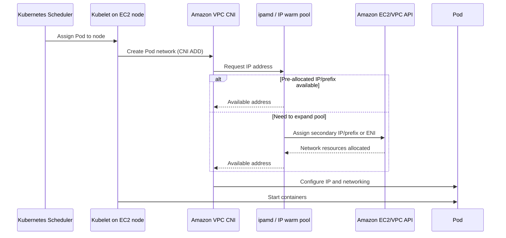
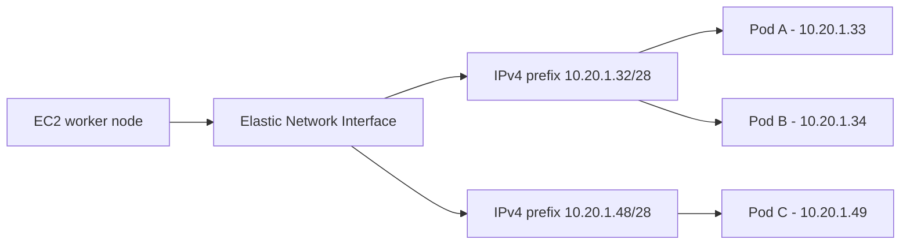
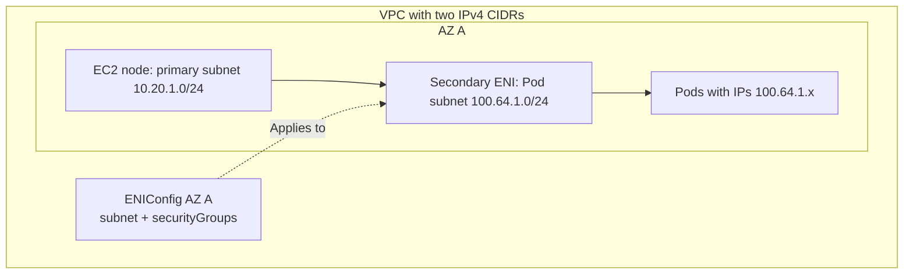
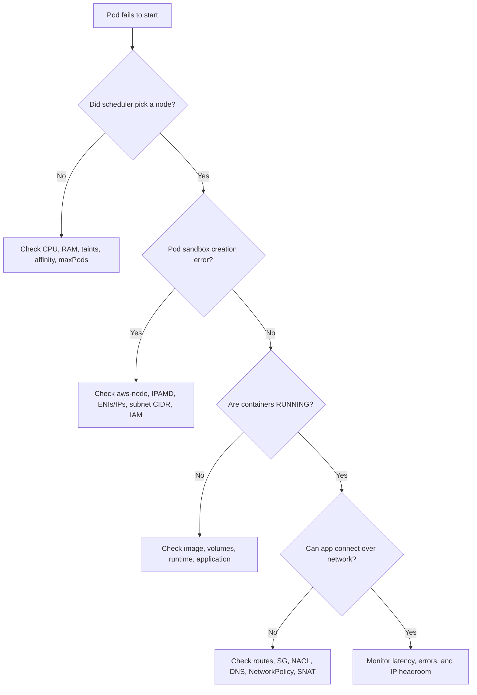

# Amazon VPC CNI and Pod IP Address Management

## 1. Context: Why Do Pods on EKS Run Out of IP Addresses?

An organization runs an ordering service on Kubernetes via **Amazon Elastic Kubernetes Service (Amazon EKS)**. EC2 nodes still have free CPU and RAM, yet when scaling a Deployment from 20 to 100 replicas, several Pods fail to start. Events display errors similar to `FailedCreatePodSandBox` or `failed to assign an IP address to container`. The operations team increases replicas and even scales up EC2 instance sizes, yet the problem is not fully resolved.

In EKS using the **Amazon VPC Container Network Interface (Amazon VPC CNI)** on EC2 worker nodes, each Pod normally receives an **IP address from the Amazon VPC address space**. To allocate IPs, the plugin must manage **Elastic Network Interfaces (ENIs)**, secondary IP addresses, or **IP prefixes**, while obeying the ENI/IP limits of the EC2 instance type and available IP count in the subnet. Therefore, **available CPU does not guarantee a node can run more Pods**.

This lesson belongs to the **Kubernetes with EKS** chapter of the **CLOUD_PROVIDERS_AWS** track. Knowledge of Regions/AZs, IAM, VPC, compute, storage, databases, integration, and serverless is applied to design secure, observable, resilient, and cost-controlled applications. The content focuses on **Amazon VPC CNI and Pod IP address management**, rather than deploying a generic Kubernetes system.

After this lesson, you will be able to:

- Describe the roles of `aws-node`, the CNI plugin, and the `ipamd` daemon during Pod creation.
- Distinguish **secondary IPv4 mode**, **prefix delegation**, **custom networking**, and **IPv6 mode**.
- Explain `WARM_ENI_TARGET`, `WARM_IP_TARGET`, `MINIMUM_IP_TARGET`, `WARM_PREFIX_TARGET`, and `maxPods` limits.
- Perform initial IP capacity calculations by node, Pod, AZ, and subnet; spot IPv4 exhaustion or `/28` block fragmentation.
- Inspect CNI status, subnets, ENIs, Pod events, and IAM permissions via `kubectl`/AWS CLI.
- Choose configurations suited for scalability, network segmentation, performance, and budget.

## 2. Where Does VPC CNI Sit in Kubernetes Architecture?

**CNI (Container Network Interface)** is the interface/plugin that configures container networking. The Kubernetes scheduler decides which node a Pod should run on; kubelet, the container runtime, and the CNI prepare the actual execution environment, including network interfaces and IPs.

**Amazon VPC CNI** is the VPC-native networking solution provided by AWS for EKS EC2 worker nodes. The add-on is typically named `vpc-cni` in the EKS API and deployed as the **`aws-node` DaemonSet** on eligible nodes. Key components are the **IP Address Management daemon (`ipamd`)** and the CNI binary:

1. `ipamd` maintains a pre-allocated pool of ENIs/IPs or prefixes (*warm pool*), calling EC2 APIs when allocating or releasing resources.
2. Kubelet requests network setup for a Pod; the CNI binary communicates with `ipamd` to obtain an available IP.
3. CNI configures node-side interfaces/routes and the Pod's network namespace so the Pod can communicate.
4. The Pod starts and communicates according to VPC routing, security groups, and other controls.



**Scope note:** operations involving the `aws-node` DaemonSet in this lesson apply primarily to **EKS EC2 Linux worker nodes** (including managed/self-managed nodes where supported). **EKS Fargate** uses service-managed networking; you do not manage an `aws-node` DaemonSet on Fargate tasks this way. **EKS Auto Mode** also manages node networking under its own architecture and does not require manually installing the VPC CNI add-on. Do not apply DaemonSet modification steps blindly to every EKS compute type.

### 2.1. Distinguishing four Kubernetes and AWS address types

| Address / DNS | Who uses it? | Key Points |
|---|---|---|
| **Node primary private IP** | EC2 node, primary ENI | Resides in the node's subnet |
| **Pod IP** | Pod running on node | Under default IPv4 VPC CNI, typically a secondary IP or an IP from a delegated prefix on an ENI |
| **Kubernetes Service ClusterIP** | Stable logical address for clients calling a Service | Not a separate VPC ENI/IP allocated per Service; kube-proxy or appropriate data plane handles routing |
| **Load Balancer IP/DNS** | External/cross-VPC clients accessing a Service | AWS Load Balancer Controller or service integration provisions ALB/NLB when configured |

With VPC CNI, Pods typically receive addresses **routable inside the VPC** rather than requiring an overlay network created by a standalone plugin. However, **a Pod IP is not a public IP**, and Pods still depend on subnet routing, security groups, NACLs, NetworkPolicies, and valid Internet or VPC endpoint paths.

## 3. Secondary IPv4 Mode: The Default Model

In an IPv4 EKS cluster running on EC2, **secondary IP mode** is typically the default: VPC CNI assigns secondary IPv4 addresses to a node's ENIs and distributes them to Pods. An EC2 node launches with a **primary ENI** and can attach additional **secondary ENIs** up to the instance type's limits.

```text
VPC: 10.20.0.0/16
Subnet AZ A: 10.20.1.0/24
       |
       +-- EC2 node (primary ENI)
       |     primary IP: 10.20.1.10
       |     secondary IP: 10.20.1.11  -> Pod orders-api
       |     secondary IP: 10.20.1.12  -> Pod cart-api
       |
       +-- secondary ENI (if allocated)
             primary IP: 10.20.1.20
             secondary IP: 10.20.1.21 -> Pod report-worker
```

Addresses in the diagram are illustrative. Each ENI has its primary address and secondary addresses; **do not count every address attached to an ENI as an available Pod IP**.

### 3.1. EC2 instance type limits

Each EC2 instance type has limits on:

- Number of **attachable ENIs**.
- Number of **private IPv4 addresses/slots per ENI**.
- CPU, RAM, network bandwidth, and Nitro/platform capabilities.

Hypothetical calculation exercise: an EC2 instance type supports up to **3 ENIs**, each with **4 IPv4 addresses** (including the primary address). The maximum secondary IPv4 slots by basic math is:

```text
3 ENI × (4 IPv4/ENI - 1 primary IPv4/ENI) = 9 secondary IPv4 slots
```

This number only illustrates the **theoretical IP slot limit in a baseline configuration**. The actual number of Pods a node can run also depends on reserved IPs, `hostNetwork` Pods, kubelet `maxPods`, custom networking/Pod security group configurations, free ENIs/IPs, CPU, RAM, and scheduling constraints. Never substitute this multiplication for checking actual instance types and node configurations.

**An often-overlooked point:** a subnet's `AvailableIpAddressCount` drops not only when Pods run, but also when VPC CNI **reserves addresses/IP prefixes in its warm pool**. Thus, running out of subnet IPs even with few active Pods is entirely possible.

### 3.2. Warm pool and Pod startup latency

If every Pod creation required an EC2 API call to request an IP or attach an ENI, startup latency would rise—especially during sudden workload bursts. `ipamd` pre-allocates unused IPs/ENIs so Pods start faster.

Trade-offs:

| Larger Reserve | Smaller Reserve |
|---|---|
| New Pods generally acquire IPs faster | Holds fewer unused IPv4 addresses |
| Consumes more subnet IPs | May call EC2 APIs more frequently |
| Can exhaust small subnets | Higher risk of allocation latency/throttling during sharp bursts |

The right goal is not “zero reserve,” but **holding enough addresses for your target scale-out speed without wasting subnet capacity**.

## 4. IPAMD Variables: Tuning the Warm Pool

Key environment variables for VPC CNI `aws-node`:

| Variable | Meaning | When to Care |
|---|---|---|
| `WARM_ENI_TARGET` | Target spare ENIs in individual-IP mode, typically defaults to 1 | Small clusters; consumes many reserved addresses on instances with high IPs/ENI |
| `WARM_IP_TARGET` | Unassigned IPs `ipamd` tries to keep ready for Pods | Want to conserve IPv4 while still absorbing bursts |
| `MINIMUM_IP_TARGET` | Minimum baseline IPs pre-allocated upfront | Known baseline Pod/node count, avoiding slow initial allocation |
| `ENABLE_PREFIX_DELEGATION` | Enables assigning IP prefixes to ENIs where supported | Want higher Pod density and fewer individual IP allocations |
| `WARM_PREFIX_TARGET` | Number of spare prefixes to maintain in **prefix mode** | Balancing scale-out speed against reserved IPv4 addresses |

In **secondary IP mode**, setting valid `WARM_IP_TARGET` or `MINIMUM_IP_TARGET` values switches allocation behavior to those IP targets rather than only maintaining the default warm ENI mechanism. In **prefix mode**, setting `WARM_IP_TARGET`/`MINIMUM_IP_TARGET` **takes precedence over `WARM_PREFIX_TARGET`**; understand the full variable interaction before tuning.

### 4.1. Mental model example for one node

Suppose a node averages 15 Pods and can burst to 22 Pods briefly during peak hours. The operations team wants roughly 3 spare IPs instead of reserving an entire ENI with many addresses:

```text
MINIMUM_IP_TARGET = 15
WARM_IP_TARGET    = 3

Idea: pre-allocate the baseline and maintain a small IP buffer for bursting Pods.
```

This is a **mental model**, not a formula guaranteeing exactly 18 IPs at every instant or an optimal config for every instance type. IPs are assigned in ENI/prefix slots, and exact behavior depends on CNI version and node state. Pick values only after measuring **actual pod density, burst rate, remaining subnet IPs, and EC2 API latency/throttling**.

### 4.2. Do not arbitrarily edit the DaemonSet in production

For an **EKS managed add-on**, manage parameters through **EKS add-on configuration** via Infrastructure as Code or the EKS API so settings are not lost during add-on upgrades. Modifying directly with `kubectl set env daemonset/aws-node` can be handy in learning environments or self-managed add-ons, but you must understand ownership and configuration drift with the EKS add-on manager.

Before making changes, inspect current settings, the add-on version, and your rollback plan. Never change too many parameters simultaneously, or it becomes difficult to isolate why Pod startup slowed down or IP consumption spiked.

## 5. Prefix Delegation: Increasing Pod Density with CIDR Prefixes

**Prefix delegation** (prefix mode) lets VPC CNI assign a **contiguous block of IP addresses** to an ENI slot instead of assigning individual secondary IPv4 addresses. For IPv4, AWS assigns a **/28 prefix containing 16 IPv4 addresses**. For IPv6 clusters, prefix mechanics differ and are covered in the IPv6 section.



Illustrative addresses cannot be used to predict exact addresses VPC CNI picks in a real cluster. CNI still assigns **one unique Pod IP per Pod**; prefixes only optimize how AWS allocates addresses onto ENIs and how `ipamd` manages the warm pool.

### 5.1. Benefits

- **Higher Pod density** on many eligible EC2 instance types because each ENI slot can hold a prefix rather than a single IP.
- **Fewer EC2 API calls** when allocating many IPs; attaching a prefix to an existing ENI is typically faster than creating/attaching another ENI.
- Helpful for Kubernetes workloads with many small, fast-changing Pods, or when paired with custom networking.

**Not unlimited scaling:** ENI and slot/ENI limits still exist, kubelet still enforces `maxPods`, instances still have CPU/RAM/network limits, and subnets must have free **contiguous** prefixes. In a node group with mixed instance types, `maxPods` configuration must account for the smallest-capacity instance per node group rules.

### 5.2. Prerequisites

For **Linux EC2 IPv4** per EKS guidance, you need:

1. A VPC CNI version supporting prefix delegation; AWS added support starting in 1.9.x under documented conditions, though you should pick an **AWS-supported add-on version for your current Kubernetes version**.
2. **Nitro-based instance types** where required by the feature; verify the instance platform before selecting.
3. Subnets with free **contiguous `/28` blocks**, not merely a high total count of free IPs.
4. `ENABLE_PREFIX_DELEGATION=true`, adjusted warm pool settings if needed, and recalculated `maxPods` limits when actually increasing density.
5. A node group transition plan, post-change observability, and rollback plan.

**Major trap:** a subnet has 80 free IPv4 addresses, yet is fragmented into small gaps by scattered ENIs/endpoints/instances; no **contiguous block of 16 addresses** remains. EC2 can return `InsufficientCidrBlocks` when CNI requests a prefix even though `AvailableIpAddressCount` looks plentiful. The fix is not increasing ENI targets; you need a **clean new subnet**, **Subnet CIDR reservations** for prefixes, or address defragmentation/reorganization.

### 5.3. Warm pool in prefix mode

With `WARM_PREFIX_TARGET=1`, `ipamd` tries to keep **one spare prefix** beyond current Pod demand. This accelerates Pod startup, yet one spare prefix holds **16 IPv4 addresses** in the subnet unused by Pods.

If conserving IPv4 is a priority, evaluate `WARM_IP_TARGET` alongside `MINIMUM_IP_TARGET` to track closer to actual demand, since they **override** `WARM_PREFIX_TARGET` when set. Prefixes are still allocated in `/28` blocks, so actual reserved IPs can exceed the exact target.

Do not configure unsupported **zero-target combinations in prefix mode** expecting to eliminate all spare IPs. Values set too low can slow Pod startup and spike EC2 API calls. Test under realistic load before tuning.

### 5.4. Kubelet `maxPods` is an independent limit

`maxPods` caps how many Kubernetes Pods may run on a node, unrelated to remaining subnet IPs. Even when prefix mode gives CNI plenty of Pod IPs, **kubelet will reject Pods beyond `maxPods`**.

Some managed node groups apply maximum `maxPods` caps based on vCPU and node management mechanics. EKS docs cite common caps such as **110 Pods for instances under 30 vCPUs and 250 Pods for other instances** in managed node group contexts; do not apply those numbers to every node type or treat them as targets to max out. Practical Pod limits also depend on CPU/RAM, system Pods, ENIs/IPs, plugins, workload demands, and network performance.

When migrating from secondary IP mode to prefix delegation, AWS recommends **creating a new node group and draining old nodes** rather than mutating running nodes with mixed IP/prefix states. Changing `maxPods` also requires coordinating bootstrap/user data or node configuration per your AMI and node provisioning method.

## 6. IPv4 Planning for Subnets, Nodes, and Pods

### 6.1. Separate demand by AZ

Each **ENI attaches to a subnet in a single Availability Zone**. You cannot use spare IPs in AZ B to directly satisfy a Pod waiting for an IP on a node in AZ A. Therefore, plan **per subnet/AZ**, not just across total VPC CIDR space.

Example of a two-AZ cluster:

| Component | AZ A | AZ B |
| --- | ---: | ---: |
| Planned EC2 worker nodes | 12 | 12 |
| Average application Pods/node | 18 | 18 |
| System Pods and headroom | Calculated separately | Calculated separately |
| IPv4 source | Subnet A | Subnet B |

Estimated application Pods = `24 × 18 = 432`, yet **that does not mean you only need 432 IPv4 addresses**. You must also account for ENI primary IPs, warm pools, EC2 IPs, ALB/NLB, NAT/PrivateLink endpoints, other resources, and **the 5 IPv4 addresses AWS reserves in every IPv4 subnet**. In prefix mode, also plan contiguous `/28` blocks and prefix packing density.

### 6.2. Types of limits to check

| Limit | Layer | Symptom |
|---|---|---|
| Subnet out of IPv4 | VPC | IPAMD cannot allocate IPs; new nodes/ENIs/endpoints lack addresses |
| Subnet lacks contiguous `/28` block | Prefix delegation | `InsufficientCidrBlocks` despite scattered free IPs |
| Max ENIs or IP slots/ENI | EC2 instance type | Cannot increase Pod IPs on node by attaching more ENIs/prefixes |
| Kubelet `maxPods` | Kubernetes node | Scheduler reports Pod capacity limit / `Too many pods` |
| Insufficient CPU/RAM | EC2/Kubernetes | Pod `Pending` with `Insufficient cpu/memory`, not an IP error |
| EC2 API throttle/IAM deny | AWS API/IAM | IPAMD fails to attach IPs/ENIs/prefixes; logs show API errors |
| Lacking subnet/EC2 capacity in AZ | AWS compute | Node group/Autoscaling cannot launch suitable nodes |

### 6.3. Ways to reduce IPv4 pressure

1. **Tune the warm pool** using load-based targets to avoid holding unneeded IPs.
2. **Prefix delegation** when higher Pod density is needed and subnets have `/28` blocks.
3. **Add IPv4 subnets/CIDRs** and scale node groups per IP plan; avoid overlapping on-premises or other VPC CIDRs.
4. **Custom networking** so Pods draw from a secondary VPC CIDR subnet where appropriate.
5. **IPv6 clusters** for greenfield architectures when applications, networking, and dependencies support it.
6. **Right-sizing and autoscaling** nodes/Pods; avoid keeping idle Pods with no business load.

**Never treat a NAT Gateway as a way to create more Pod IPs inside a subnet.** NAT shares/controls outbound source addresses, but does not remove the need for each Pod to have its own internal network IP.

## 7. Custom Networking and ENIConfig

By default, Pod IPs come from the subnet associated with the node's primary ENI. With **custom networking**, you can configure Amazon VPC CNI to use **different subnets** and **different security groups** for secondary ENIs used to allocate Pod IPs—for example, from a secondary IPv4 CIDR on the VPC.



Benefit: separates host address space from Pod address space, avoiding exhausting RFC1918 CIDRs reserved for nodes and other resources. AWS suggests considering **`100.64.0.0/10`** (shared address space, RFC 6598) where appropriate and within VPC CIDR association limits. Never use this range blindly if your corporate network/ISP/VPN already uses it.

**Trade-off:** custom networking **does not use the primary ENI to assign normal Pod IPs**, so available Pods per node may decrease unless paired with prefix delegation; `hostNetwork` Pods continue using the host network. You must define **`ENIConfig` with matching subnet/AZ**, routing, security groups, and capacity for additional ENIs. Custom networking is an **IPv4** model and does not apply to EKS IPv6 networking in the same manner.

### 7.1. ENIConfig example

Suppose subnet `subnet-0123456789abcdef0` is in AZ `ap-southeast-1a` and uses addresses from a secondary VPC IPv4 CIDR. Sample custom resource:

```yaml
apiVersion: crd.k8s.amazonaws.com/v1alpha1
kind: ENIConfig
metadata:
  name: ap-southeast-1a
spec:
  subnet: subnet-0123456789abcdef0
  securityGroups:
    - sg-0123456789abcdef0
```

This is an **illustrative configuration**, not a built-in cluster resource. Create an ENIConfig for each AZ/subnet used. When `AWS_VPC_K8S_CNI_CUSTOM_NETWORK_CFG=true` is enabled, nodes must pick the right ENIConfig via annotations/labels or configured AZ auto-selection:

```bash
# Read-only view of existing ENIConfigs
kubectl get eniconfigs.crd.k8s.amazonaws.com

# Check node labels and annotations to match ENIConfig
kubectl get nodes --show-labels
```

**Custom networking changes do not apply retroactively to all running Pods.** Plan for **node group replacement and cordon/drain**, avoiding untested network mutations on live nodes. For managed add-ons, store environment variables in the EKS add-on configuration so upgrades do not overwrite them.

### 7.2. Distinguishing ENIConfig security groups from Security Groups for Pods

- **ENIConfig** configures security groups for **secondary ENIs** used for Pod IPs in custom networking; multiple Pods can share that ENI's policy scope.
- **Security Groups for Pods** attaches a security group **per Pod** on supported nodes/instances using **trunk/branch ENIs** and `SecurityGroupPolicy`. Simply adding `securityGroups` to an ENIConfig does not give each Pod an independent SG.

These two features solve different problems. Notably, branch ENIs have their own limits and do not use `/28` prefix Pod IP allocation the way standard ENI-attached Pods do; check compatibility and limits before combining features.

## 8. IPv6 for EKS Pods

One way to relieve IPv4 pressure is creating an **IPv6-enabled EKS cluster** when your application ecosystem, load balancers, internal networks, firewalls, and dependencies support it. In the EKS IPv6 model on EC2, VPC CNI uses **prefix mode** with **IPv6 `/80` prefixes** on ENIs to allocate abundant Pod IPv6 addresses.

| Characteristic | Default EKS IPv4 | EKS IPv6 in Supported Configuration |
|---|---|---|
| Primary Pod address | IPv4 from subnet/ENI | IPv6 allocated from prefix on ENI |
| IP allocation method | Secondary IP or `/28` prefix | Managed IPv6 `/80` prefix |
| IPv4 Pod IP exhaustion risk | Can occur quickly in small subnets | No longer consumes VPC IPv4 addresses per Pod the same way |
| Pod network planning | CIDRs, ENI/IP slots, warm pool, maxPods | IPv6 CIDRs/prefixes, egress networking, maxPods, app support |
| Custom networking `ENIConfig` | Available on IPv4 where supported | Same mechanism does not apply to IPv6 |

**IPv6 does not automatically make every layer “dual-stack.”** In an EKS IPv6 cluster, Pods have IPv6 addresses known to Kubernetes and may also receive a **host-local IPv4 address** for certain compatibility needs via an accompanying plugin; that host-local address is not managed/advertised as a VPC Pod IPv4 address like in an IPv4 cluster.

Before selecting IPv6, verify support across **EC2 instances/AMIs, AWS CNI versions, EKS compute types, ingress/egress, AWS load balancers, CoreDNS, Services, on-premises VPNs, NAT64/IPv4 egress if needed, and application libraries**. Do not blindly apply IPv4 `WARM_IP_TARGET` variables to IPv6 without reading docs; IPv6 prefixes are allocated differently.

**Important:** choosing the IP family is an architectural decision made when creating the EKS cluster. Never plan to “flip a CNI env var to convert a running IPv4 cluster to IPv6” without evaluating a full cluster/workload migration.

## 9. Networking, Routing, and Pod Security

### 9.1. VPC-native does not mean Pods automatically reach the Internet

With Pod IPv4 via Amazon VPC CNI, intra-VPC traffic routes natively through the VPC; traffic leaving **outside the VPC** can undergo **source network address translation (SNAT)** on the node per CNI configuration. Environments setting `AWS_VPC_K8S_CNI_EXTERNALSNAT=true` delegate SNAT off-node; routes/NAT/firewalls must be designed accordingly.

If nodes in a **private subnet** need to pull ECR images, call AWS APIs, or reach the Internet, design **NAT Gateways or VPC endpoints** per service alongside accurate route tables, NACLs, and security groups. A Pod with a valid `10.x.x.x` IP but no NAT/endpoint route will still fail with `ImagePullBackOff` or connection timeouts.

### 9.2. Security groups and NetworkPolicy are not the same

By default in many EKS EC2 setups, Pods inherit network rules from the **node/ENI security group**. If you need to isolate RDS access between two app groups sharing a node, consider:

- **Security Groups for Pods:** assigns dedicated SGs per Pod within supported scope; requires eligible EC2 types, CNI/version, `SecurityGroupPolicy`, trunk/branch ENIs, and proper enforcing mode.
- **Kubernetes NetworkPolicy:** defines L3/L4 rules between Pods/namespaces; Amazon VPC CNI provides enforcement subject to **version/kernel requirements and extra configuration**. **Merely installing VPC CNI does not enforce NetworkPolicies automatically.**
- **VPC security groups, NACLs, AWS Network Firewall**, and route/subnet segmentation must still be evaluated.

Amazon VPC CNI NetworkPolicy support has platform constraints: enforcement applies to supported **EC2 Linux nodes**, so do not assume it applies identically to **EKS Fargate or Windows nodes**. Some Pods not managed by controllers may behave differently; check current docs and test with Deployments/ReplicaSets first.

### 9.3. IAM for CNI differs from IAM for applications

VPC CNI must call EC2 APIs to manage network interfaces and IPs, such as describing/attaching ENIs or assigning addresses. Separating the **IAM role for `aws-node`** from the **node IAM role** is recommended to reduce unnecessary host privileges. On supported EKS setups, permissions can be granted to the add-on via **EKS Pod Identity** or **IAM Roles for Service Accounts (IRSA)**. Add-on management configuration must align with the chosen identity method.

The `AmazonEKS_CNI_Policy` covers many **IPv4** setups; **IPv6** clusters require an IPv6-capable policy per AWS documentation. **Task/app Pods** should have their own IAM roles tied to service accounts and business permissions; never use the CNI IAM role to grant S3 read or RDS admin access to applications.

**Never broaden IAM to `ec2:*` or `AdministratorAccess` to fix Pod IP allocation errors.** Inspect the exact denied EC2 API action, CloudTrail, the effective `aws-node` role, and any SCP constraints before editing policies.

## 10. Quick Observation and Inspection Workflow via CLI

The following commands are mostly **read-only**, intended for EKS EC2 environments, and require authenticated `kubectl`/AWS CLI with valid kubeconfig and Kubernetes/AWS permissions. Replace `shop-eks`, node names, VPC/subnets, and Region with real values.

### 10.1. Inspect the add-on and DaemonSet

```bash
# Verify active AWS account
aws sts get-caller-identity

# Check status and version of the EKS managed add-on
aws eks describe-addon \
  --cluster-name shop-eks \
  --addon-name vpc-cni \
  --region ap-southeast-1

# View aws-node DaemonSet on EC2 Linux worker nodes
kubectl -n kube-system get daemonset aws-node
kubectl -n kube-system get pods -l k8s-app=aws-node -o wide

# Inspect deployed environment variables
kubectl -n kube-system describe daemonset aws-node
```

In clusters using a **self-managed CNI**, `describe-addon` may not reflect the deployment. On **EKS Auto Mode** or Fargate, do not treat the absence of an `aws-node` DaemonSet on that compute as a failure when the architecture does not use it that way.

### 10.2. Inspect Pods, nodes, and events

```bash
kubectl get nodes -o wide
kubectl get pods -A -o wide

# Replace with real Pod/namespace names
kubectl -n production describe pod orders-api-example

# Inspect node Pod capacity; compare Allocatable and non-terminated Pods
kubectl describe node ip-10-20-1-10.ap-southeast-1.compute.internal

# Recent events in the namespace
kubectl -n production get events --sort-by=.lastTimestamp
```

If a Pod is **Pending** because the scheduler reports `Too many pods`, `Insufficient cpu`, or `Insufficient memory`, investigate scheduling/compute. If the Pod was scheduled onto a node yet reports `FailedCreatePodSandBox` and fails IP assignment, investigate CNI/IPAMD, subnets, ENIs, and IAM.

### 10.3. Check remaining IPv4 addresses in subnets

```bash
aws ec2 describe-subnets \
  --subnet-ids subnet-0123456789abcdef0 subnet-0abcdef0123456789 \
  --region ap-southeast-1 \
  --query 'Subnets[*].[SubnetId,AvailabilityZone,CidrBlock,AvailableIpAddressCount]' \
  --output table

# View ENI and IPv4 limits on an illustrative instance type
aws ec2 describe-instance-types \
  --instance-types m5.large \
  --region ap-southeast-1 \
  --query 'InstanceTypes[*].[InstanceType,NetworkInfo.MaximumNetworkInterfaces,NetworkInfo.Ipv4AddressesPerInterface]' \
  --output table
```

`AvailableIpAddressCount` shows how many IPs AWS considers unused in the subnet; it **does not show whether contiguous `/28` blocks exist**, nor which nodes can attach more ENIs. Evaluate subnet IP counts, instance types, Pod density, and the IPAMD warm pool together.

### 10.4. Inspect CNI logs

```bash
# Pick a specific aws-node Pod after listing them
kubectl -n kube-system logs aws-node-EXAMPLE -c aws-node --tail=200

# When inspecting directly on an EC2 node with host admin access:
#   /var/log/aws-routed-eni/ipamd.log
#   /var/log/aws-routed-eni/plugin.log
```

Errors to look for include: `failed to assign an IP address`, `InsufficientCidrBlocks`, EC2 API `AccessDenied`/`UnauthorizedOperation`, EC2 API throttling, and ENI attachment failures. Container names, log paths, and formats can change across add-on versions; verify with `kubectl describe pod` and docs for your active version.

## 11. Example: Controlled Prefix Delegation Configuration

Assume you have EKS cluster `shop-eks` with **EC2 Linux nodes**, EKS-managed `vpc-cni` add-on, subnets prepared with contiguous `/28` blocks, and a planned new node group. The operations team wants to try prefix delegation with one warm prefix.

### 11.1. Read before writing

```bash
aws eks describe-addon \
  --cluster-name shop-eks \
  --addon-name vpc-cni \
  --region ap-southeast-1 \
  --query 'addon.[addonVersion,status,configurationValues]'

# Verify active configuration running on eligible nodes
kubectl -n kube-system describe daemonset aws-node
```

**Important:** each add-on version defines a JSON schema for configuration values. Use `aws eks describe-addon-configuration` to view the **schema matching the actual `addonVersion`**. If other configuration values are already in use (logging, probes, resources, network policies), **merge** them so existing settings are not wiped out.

### 11.2. Example JSON configuration values

Sample `vpc-cni-prefix-config.json`:

```json
{
  "env": {
    "ENABLE_PREFIX_DELEGATION": "true",
    "WARM_PREFIX_TARGET": "1"
  }
}
```

In a compatible managed add-on, this `env` structure illustrates configuration values. **Verify the exact schema fields and types** for your installed version. Never push a partial config that overwrites existing options.

Update command (**makes real changes**, run only after review, config backup, and preparing a rollback plan):

```bash
aws eks update-addon \
  --cluster-name shop-eks \
  --addon-name vpc-cni \
  --configuration-values file://vpc-cni-prefix-config.json \
  --resolve-conflicts PRESERVE \
  --region ap-southeast-1

# Monitor add-on status after update
aws eks describe-addon \
  --cluster-name shop-eks \
  --addon-name vpc-cni \
  --region ap-southeast-1
```

**Do not roll out to production with this command alone.** Create a new node group with prefix-compatible bootstrap/`maxPods`, ensure subnets/prefixes are ready, monitor DaemonSet rollout, and gradually drain old nodes. CNI is core infrastructure; a bad update can leave new Pods without networking.

### 11.3. Success criteria

1. The EKS add-on reports active status and `aws-node` pods are healthy across EC2 nodes.
2. New nodes launch Pods normally, receiving IPs matching the subnet or ENIConfig.
3. Usable max Pods per node increases per design target—**not merely because `maxPods` was raised**.
4. `AvailableIpAddressCount` retains headroom; no `InsufficientCidrBlocks` errors appear.
5. Pod startup latency, EC2 API throttling, and warm IP counts remain within acceptable bounds.
6. Web services, databases, network policies, SGs, DNS, and egress continue working after node transition.

## 12. Monitoring and Operating IP Capacity

### 12.1. Signals to track

| Signal | Source | Purpose |
|---|---|---|
| Subnet `AvailableIpAddressCount` by AZ | EC2 API, dashboards/automation | Alert on per-AZ IPv4 exhaustion risk |
| Allocated IPs/prefixes and ENIs on nodes | VPC CNI IPAMD metrics/logs, EC2 ENI inventory | Spot oversized warm pools or slot exhaustion |
| Pod `Pending` and scheduler events | Kubernetes API/events | Separate CPU/RAM/maxPods exhaustion from IP errors |
| `FailedCreatePodSandBox` and `aws-node` logs | Kubernetes events, node logs | Detect CNI/EC2 API failures |
| EC2 API errors/throttling | IPAMD logs, CloudTrail/relevant metrics | Monitor IAM/API quotas and allocation rate |
| Node scale-out latency | Cluster Autoscaler/Karpenter, EKS, EC2 | Assess whether new nodes or a larger IP pool are needed |
| Application request errors/latency | ALB, service telemetry, CloudWatch | Ensure IP tuning does not degrade SLOs |

A solid dashboard groups metrics by **cluster → node group → AZ/subnet → node → workload**. Total VPC IPv4 count may look healthy while a single AZ is exhausted; aggregate totals can hide the root cause.

### 12.2. IPAMD and startup latency

**Pre-allocating too few IPs:** when a workload suddenly spawns many Pods, IPAMD must request new prefixes/ENIs, wait for AWS APIs, and sync state; startup slows down.

**Pre-allocating too many IPs:** subnets hold many unused IPv4 addresses; scaling out EC2 nodes or provisioning ALBs/VPC endpoints can fail even before Pod count rises.

**Sensible changes:** measure peak Pods/node, pick balanced warm targets, test in a new node group, and compare before/after metrics. Never change all node groups at once or set arbitrary zero targets in prefix mode.

### 12.3. Add-on changes and upgrades

- Record cluster version, VPC CNI version, instance types, subnet CIDRs, IAM roles, ENIConfigs, and all configuration values.
- Review add-on release notes and compatibility before updating; newer features like NetworkPolicy or prefix mode may require minimum versions/kernels/platforms.
- Test in a production-like environment or new node group with a clear **rollback path**.
- Monitor EKS add-on status, DaemonSet rollout, network logs, Pod startup, and business traffic.
- Restrict permissions to modify VPC CNI, EC2 networking, and EKS add-ons to the responsible platform team.

## 13. Common Errors and Remediation Table

| Symptom | Possible Cause | Remediation |
|---|---|---|
| `FailedCreatePodSandBox: failed to assign IP` | IPAMD lacks IPs/prefixes, missing IAM, or EC2 API error | Check `aws-node` logs, subnet IPs, EC2 ENI limits, and permissions |
| `InsufficientCidrBlocks` | Fragmented subnet lacking contiguous `/28` in prefix mode | Use subnet CIDR reservations / new subnet, reorganize addressing |
| Many Pods `Pending` with `Too many pods` | Hit kubelet `maxPods` | Check node allocatable/maxPods, recalculate pod density, add nodes |
| Pod `Pending` with `Insufficient cpu` | No schedulable CPU left | Scale/resize nodes, tune requests; changing warm IPs will not help |
| `UnauthorizedOperation`/`AccessDenied` attaching ENIs | CNI IAM role lacks EC2 permissions, SCP/condition blocks | Check `aws-node` IAM role, policies, CloudTrail, and explicit denies |
| Node has IPs yet Pod creation is slow | Low warm target, EC2 API throttling, slow prefix/ENI attach | Inspect IPAMD latency and tune warm targets carefully |
| Custom networking only works on some nodes | ENIConfig mismatches AZ/label, old nodes not replaced | Check ENIConfig, annotations/labels, roll out node group |
| Pod has IP but cannot reach RDS | Security groups, NACLs, routing, SG for Pods enforcing mode | Trace traffic, inspect VPC Flow Logs/network policies |
| Pod lacks Internet access | Private subnet lacks NAT/endpoints, wrong SNAT mode | Check route tables, NAT, VPC endpoints, CNI settings |
| Networking unstable after CNI update | Incompatible config/schema/version or mixed node IP/prefix state | Inspect add-on status, logs, roll back, or use fresh node group |

### 13.1. Root-cause flowchart



**Troubleshooting principle:** distinguish whether the failure is in scheduling, IP allocation, or application traffic. Never open all security groups or grant `ec2:*` to node IAM roles as a default fix.

## 14. Real-World Scenario: E-Commerce Platform Scaling 10x

Suppose an e-commerce platform runs on EKS in Singapore across two AZs with EC2 node groups and dozens of Deployments. During a flash sale, Pod count scales 10x. Operations observes:

- Some nodes hit `maxPods` even though CPU remains free.
- Subnet `AvailableIpAddressCount` in AZ A is critically low while AZ B still has capacity.
- Some Pods get scheduled and then fail with `FailedCreatePodSandBox`.
- CNI logs occasionally warn of slow IP allocation.

**Analysis and implementation plan:**

1. **Separate failures:** Pods hitting `Too many pods` need Pod density/node count adjustments; Pods failing sandbox creation need subnet, ENI/IPAMD, and IAM checks. Do not lump both into one vague “Kubernetes scales slowly” issue.
2. **Audit subnets/AZs:** gather `AvailableIpAddressCount`, ENI counts, CIDR fragmentation, and needed growth per AZ. Add subnets/CIDRs or rebalance workloads carefully when one AZ runs low on IPs.
3. **Prefix delegation:** on supported Nitro EC2 Linux nodes, prepare subnets with contiguous `/28` blocks and a new node group, enabling prefix mode via compatible add-on configuration.
4. **Warm pool:** test `WARM_PREFIX_TARGET=1` or tune `WARM_IP_TARGET/MINIMUM_IP_TARGET` based on Pod startup times and IPv4 consumption, avoiding “reserve as much as possible.”
5. **Pod density and scaling:** configure appropriate `maxPods`, Kubernetes requests/limits, Cluster Autoscaler or Karpenter, and scale-out headroom.
6. **Security:** keep the CNI IAM role separate, avoid widening SGs across entire nodes if only one app needs RDS; evaluate supported SG for Pods/NetworkPolicy.
7. **Monitoring and testing:** run load tests, simulate IP exhaustion in one AZ, measure Pod startup, request error rates, and node provisioning time; test rollback before production.

### 14.1. Solution selection matrix

| Problem | Priority Solution to Evaluate | Rationale |
|---|---|---|
| Nodes out of Pod/IP slots while subnet is large | Prefix delegation, calculated node size/count increase | Increases per-node IP capacity and resolves density limits |
| Nodes have capacity, subnet IPv4 is scarce | Tune warm pool, add CIDRs/subnets, IPv6, or custom networking | Need additional IP supply, not just more CPU |
| Subnet has free IPs yet `/28` prefix fails | Defragment, subnet CIDR reservation, new subnet | Prefixes require contiguous blocks |
| Multi-AZ Pods yet one AZ runs out of IPs | Per-AZ subnet/IP planning, scaling, and placement | ENI IPs cannot cross AZs |
| Restrict RDS access for a Pod group | SG for Pods or NetworkPolicy within supported scope | Solves security segmentation, not capacity |
| Greenfield apps reducing long-term IPv4 pressure | Evaluate EKS IPv6 when dependencies support it | Pods use IPv6 prefix space, though ecosystem readiness is required |

## 15. Cost, Availability, and Operational Responsibility

**VPC CNI should not be judged solely by “how many IPs it uses.”** Networking choices impact cost and availability:

- **EC2 instances:** if a node runs few Pods due to IP limits while CPU/RAM remain idle, you pay for extra nodes.
- **IPv4 scarcity:** undersized subnets can force adding CIDRs/subnets, re-architecting hybrid/VPN networks, deploying NAT/VPC endpoints, or adding clusters.
- **Prefix delegation:** can reduce node counts for small Pods, yet warm prefixes consume `/28` IPv4 blocks and require defragmentation planning.
- **Network egress:** NAT Gateways, cross-AZ or Internet data transfer, VPC endpoints, and load balancers carry topology-dependent costs; CNI does not waive them.
- **Observability:** CloudWatch Logs/metrics, VPC Flow Logs, and audit tools incur charges; manage retention and logging levels.
- **Availability:** maintain IP headroom across **multiple AZs**, diversify compute, and prevent a single exhausted subnet from taking down an entire Deployment.

When evaluating total cost, track KPIs such as **successful Pods started/minute, Pending-to-Ready duration, reserved IPs/node, per-AZ subnet headroom, nodes needed per 1,000 Pods, and cost per successful request**. A configuration that saves 20% IPv4 while pushing scale-out past SLOs is not optimal.

## 16. Production Deployment Checklist

1. **Verify compute scope:** EKS EC2 Linux, Windows, Fargate, or Auto Mode; do not apply `aws-node` commands to compute models without that DaemonSet.
2. **Choose IP family:** IPv4 or IPv6 at cluster architecture stage; verify all dependencies.
3. **Select subnets per AZ:** measure free IPs, subnet fragmentation, and headroom for nodes/Pods/network endpoints.
4. **Verify instance limits:** ENI count, addresses/ENI, Nitro support, CPU/RAM, and kubelet `maxPods`.
5. **Select IP allocation mode:** secondary IPv4, IPv4 prefix delegation, or IPv6 prefix mode within supported bounds.
6. **Set warm targets intentionally:** `WARM_ENI_TARGET`/`WARM_IP_TARGET`/`MINIMUM_IP_TARGET`/`WARM_PREFIX_TARGET`, backed by before/after metrics.
7. **If using custom networking:** verify ENIConfig per AZ, non-overlapping CIDRs, SGs, node replacement, and primary ENI limits.
8. **If using SG for Pods/NetworkPolicy:** confirm instance types, CNI/version, kernel, and enforcement mode; test actual connectivity rules.
9. **Separate CNI IAM role from application roles:** sufficient EC2 API permissions without broad admin grants.
10. **Manage add-on via IaC/EKS API:** validate schema and preserve existing add-on options.
11. **Test recovery:** run Pod load tests, drain nodes, reduce free IPs in one AZ in a controlled test, measure startup/app impact, and test rollback.
12. **Monitor:** IP/ENI/prefix metrics, subnet headroom, Pod events, EC2 API errors, CloudWatch, and application SLOs.

## 17. Self-Check Questions

**Question 1.** An EC2 node has 50% CPU and RAM free, yet new Pods report `FailedCreatePodSandBox: failed to assign an IP address`. Should you increase replicas or raise CPU requests?

**Hint:** No. Inspect VPC CNI/IPAMD, subnet IPs, ENI/IP slots, IAM, and logs. Free CPU does not guarantee free Pod IPs.

**Question 2.** What block size does IPv4 prefix delegation allocate? Why might `AvailableIpAddressCount=60` still fail to allocate a prefix?

**Hint:** A `/28` prefix requires 16 **contiguous** addresses. A fragmented subnet may lack any contiguous block even when total free IPs look high.

**Question 3.** Does setting `ENABLE_PREFIX_DELEGATION=true` guarantee a node can run several times more Pods?

**Hint:** No. Kubelet `maxPods`, CPU/RAM, node group limits, EC2 networking, and subnet space remain independent constraints.

**Question 4.** What does `WARM_PREFIX_TARGET=1` mean? What is its impact on small IPv4 subnets?

**Hint:** CNI tries to maintain one spare prefix—a `/28` block—which speeds up Pod startup while reserving unused IPv4 addresses. Consider `WARM_IP_TARGET/MINIMUM_IP_TARGET` when tuning tightly.

**Question 5.** Is custom networking simply enabling a separate SG per Pod?

**Hint:** No. Custom networking uses `ENIConfig` with subnets/SGs for secondary ENIs; Security Groups for Pods uses a different trunk/branch ENI and `SecurityGroupPolicy` mechanism.

**Question 6.** Can a node in AZ A borrow free IPs from a subnet in AZ B for its Pods?

**Hint:** ENIs belong to a subnet/AZ, so headroom is needed in the node's own AZ subnet or another supported architecture. Never sum free IPs across the entire VPC as if they were interchangeable.

**Question 7.** An EKS Fargate task lacks networking; should you modify the `aws-node` DaemonSet on the Fargate node?

**Hint:** No. Fargate networking is managed differently from EC2 worker nodes; troubleshoot task networking, subnets/IPs, IAM, and VPC per Fargate documentation.

**Question 8.** A Pod has a valid IPv4 address and Pod-to-Pod connectivity works, yet calling S3 over the Internet fails. Is CNI definitely failing to allocate IPs?

**Hint:** Not necessarily. Check subnet routes, NAT/VPC endpoints, SGs/NACLs, DNS, IAM roles, and SNAT settings before altering IP allocation.

## 18. Key Takeaways

**Amazon VPC CNI** delivers VPC-native networking to Pods on EKS EC2 nodes via `aws-node`, `ipamd`, **ENIs**, and IP allocation modes. **Secondary IPv4 mode** uses secondary ENI addresses; **prefix delegation** allocates **`/28` IPv4 blocks** to improve Pod density and startup where supported. **Warm pools** accelerate Pod startup at the cost of holding spare IPv4s, while **`maxPods`**, ENI slots, CPU/RAM, and subnet capacity remain separate limits.

When IPv4 runs low, analyze by **AZ/subnet/node** to tune warm targets, adopt prefix mode, add CIDRs/subnets, use **custom networking**, or evaluate **IPv6**. **Security Groups for Pods** and NetworkPolicies handle access segmentation, not IP exhaustion. In production, govern add-on configuration properly, isolate CNI IAM roles, monitor IP/prefix capacity, and test scale-out and failover. The best choice ensures **timely Pod readiness, secure networking, met SLOs, and reasonable cost**.

### Official AWS References

- [Amazon EKS — Amazon VPC CNI best practices](https://docs.aws.amazon.com/eks/latest/best-practices/vpc-cni.html)
- [Amazon EKS — Best practices for networking](https://docs.aws.amazon.com/eks/latest/best-practices/networking.html)
- [Amazon EKS — Optimizing IPv4 address utilization](https://docs.aws.amazon.com/eks/latest/best-practices/ip-opt.html)
- [Amazon EKS — Prefix Mode for Linux](https://docs.aws.amazon.com/eks/latest/best-practices/prefix-mode-linux.html)
- [Amazon EKS — Assign more IP addresses with prefixes](https://docs.aws.amazon.com/eks/latest/userguide/cni-increase-ip-addresses.html)
- [Amazon EKS — Increase available IPs for a node](https://docs.aws.amazon.com/eks/latest/userguide/cni-increase-ip-addresses-procedure.html)
- [Amazon EKS — Custom networking](https://docs.aws.amazon.com/eks/latest/best-practices/custom-networking.html)
- [Amazon EKS — IPv6 best practices](https://docs.aws.amazon.com/eks/latest/best-practices/ipv6.html)
- [Amazon EKS — Configure IAM role for VPC CNI](https://docs.aws.amazon.com/eks/latest/userguide/cni-iam-role.html)
- [Amazon EKS — Configure IAM roles for add-ons](https://docs.aws.amazon.com/eks/latest/userguide/add-ons-iam.html)
- [Amazon EKS — VPC CNI add-on](https://docs.aws.amazon.com/eks/latest/userguide/managing-vpc-cni.html)
- [Amazon EKS — Security groups for Pods](https://docs.aws.amazon.com/eks/latest/userguide/security-groups-for-pods.html)
- [Amazon EKS — Network policies with VPC CNI](https://docs.aws.amazon.com/eks/latest/userguide/cni-network-policy.html)
- [Amazon EKS — Troubleshooting VPC CNI network policies](https://docs.aws.amazon.com/eks/latest/userguide/network-policies-troubleshooting.html)
- [Amazon VPC CNI — IP/prefix warm pool configuration](https://github.com/aws/amazon-vpc-cni-k8s/blob/master/docs/prefix-and-ip-target.md)
