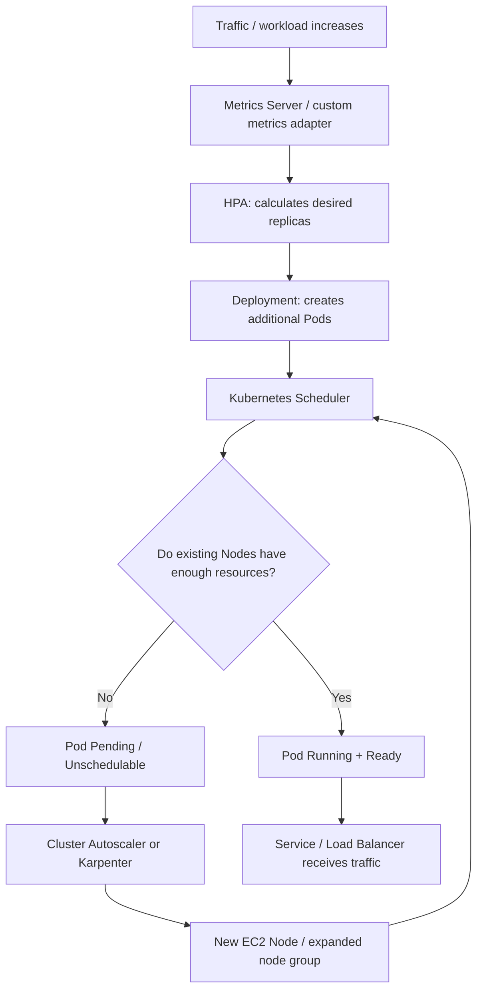
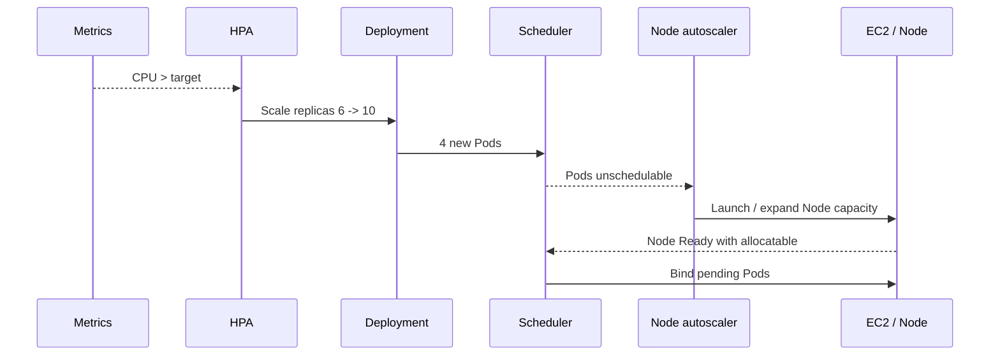
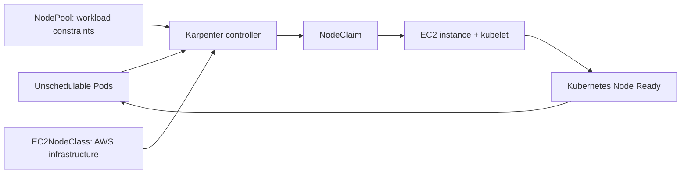

# Horizontal Pod Autoscaler, Cluster Autoscaler, and Karpenter on Amazon EKS

> **Chapter:** Kubernetes with EKS  
> **Module:** `CLOUD_PROVIDERS_AWS`  
> **Scope:** Designing Kubernetes application scaling and EC2 capacity scaling on Amazon EKS; combining HPA, Cluster Autoscaler (CA), Karpenter, and EKS Auto Mode to handle traffic, recover from failures, manage resources, and safely control costs.

## Learning Objectives

After completing this lesson, learners will be able to:

1. Explain the difference between **scaling Pods** and **scaling Nodes**; distinguish HPA, Cluster Autoscaler, Karpenter, EKS Auto Mode, and EC2 Auto Scaling Groups.
2. Configure **Horizontal Pod Autoscaler** using `autoscaling/v2` based on CPU or other metrics, understanding the roles of `resources.requests` and Metrics Server.
3. Describe how **Cluster Autoscaler** detects unschedulable `Pending` Pods, simulates node groups, and adjusts desired capacity on ASGs/EKS Managed Node Groups.
4. Describe how **Karpenter** selects matching EC2 instances directly from Pod demand, using `NodePool`, `EC2NodeClass`, and `NodeClaim` APIs.
5. Design safe **scale-in/disruption** conditions using PodDisruptionBudgets, readiness probes, graceful termination, topology spread, consolidation, drift, and Node expiration.
6. Trace a traffic surge from a Java service through HPA to Node provisioning requests, followed by load drop and capacity reclamation.
7. Choose among Cluster Autoscaler, self-managed Karpenter, and **EKS Auto Mode** based on flexibility, cost, operations, security, and recoverability.
8. Use `kubectl` and AWS CLI to diagnose why Pods fail to schedule, Nodes do not appear, HPA fails to scale replicas, or the cluster fails to scale down.

## 1. Two Control Loops of Kubernetes Autoscaling

In EKS, an application runs inside **Pods**; Pods must be assigned by the Kubernetes Scheduler onto **Nodes** with sufficient CPU, memory, networking, volumes, and scheduling conditions. When request volume rises, two separate problems must be solved:

- **Application layer:** add Pods to handle more requests.
- **Infrastructure layer:** add Nodes when Pods lack room to run.

Kubernetes cannot create physical CPU on a Node simply by increasing `replicas`. Conversely, launching extra EC2 instances does not automatically make a Deployment create more Pods without an application scaling signal.

### 1.1 Diagram of HPA coordinating with a Node autoscaler



HPA **does not call EC2 APIs to add Nodes**. Cluster Autoscaler/Karpenter **do not increase Deployment replicas** when application CPU is high; they respond to scheduling demand or dedicated capacity rules.

### 1.2 Quick comparison

| Mechanism | What It Changes | Primary Signal | Scope and Limits |
|---|---|---|---|
| **Horizontal Pod Autoscaler (HPA)** | Replica count of Deployment/StatefulSet or `scale` subresource | CPU, memory, custom/object/external metrics | Scales Pods; still needs Node room |
| **Cluster Autoscaler (CA)** | Desired capacity of EC2 Auto Scaling Groups / node groups | Unschedulable Pods and node group resource simulation | Constrained by predefined node groups/min/max/instance templates |
| **Karpenter (self-managed)** | EC2 Nodes via `NodePool` / `EC2NodeClass` / `NodeClaim` | Unschedulable Pod demand, constraints, and consolidation | Selects EC2 offerings directly; requires installing/maintaining controller and AWS permissions |
| **EKS Auto Mode** | Managed compute/NodePools operated by AWS | Pod demand and NodePool policies | Uses a Karpenter-based mechanism, with AWS operating core components |
| **EC2 Auto Scaling policy** | EC2 capacity in an ASG | EC2-level AWS metrics/policies | Does not directly understand Pod requests/taints/PVCs like the scheduler |

**Note:** HPA and a node autoscaler usually run **together**. Cluster Autoscaler and Karpenter can coexist in one cluster for **distinct sets of Nodes**, but must never control overlapping node infrastructure. With EKS Auto Mode, AWS manages autoscaling for Auto Mode NodePools; do not install self-managed Karpenter to “re-manage” those same NodePools.

## 2. Kubernetes Concepts Governing Scaling

### 2.1 Pod requests, limits, and allocatable

The Kubernetes Scheduler uses container **`resources.requests`** (plus relevant overhead) to decide whether a Pod fits on a Node. The Scheduler **does not wait until actual CPU hits 100%** before evaluating capacity.

Example:

```yaml
resources:
  requests:
    cpu: "250m"
    memory: "512Mi"
  limits:
    cpu: "1000m"
    memory: "1024Mi"
```

Explanation:

- `250m` CPU = 0.25 vCPU **requested by the Pod for scheduling**.
- `512Mi` memory = 512 mebibytes requested.
- `limits.cpu` enforces CPU throttling where applied; `limits.memory` set too low can trigger OOMKilled.
- A Node's **allocatable** CPU/memory is lower than nominal capacity due to kubelet, OS, DaemonSets, and reserved resources.

If requests are too low relative to actual usage, Pods suffer resource contention, throttling, or OOM. If requests are too high, the Scheduler sees Nodes as full prematurely even with idle CPU, launching extra Nodes and raising costs.

### 2.2 Scheduling constraints

Even when total cluster CPU has plenty of headroom, a Pod can fail to schedule because:

- `nodeSelector` or node affinity only permits a specific Node subset.
- `taints` require matching `tolerations` on the Pod.
- `topologySpreadConstraints`/pod anti-affinity restrict placement.
- A PersistentVolume is already bound in another Availability Zone.
- GPUs or other extended resources are unavailable.
- ENI/Pod IPs, per-Node Pod caps, or network limits are exhausted.
- Namespace `ResourceQuota`, admission policies, or PodSecurity policies reject the Pod **before** scheduling.

**Not every `Pending` Pod triggers a new Node.** A node autoscaler only helps when Pods are genuinely unschedulable due to capacity/scheduling and a valid Node configuration exists to satisfy them.

### 2.3 Pod `Running` differs from `Ready`

Even after a Node is provisioned, a Pod may be `Running` while the Spring Boot app has not passed readiness, the database is unreachable, or caches are cold. Until then, Services/ALBs should not route traffic to that Pod.

Effective scaling requires all of the following simultaneously:

1. Pod is scheduled.
2. Containers start.
3. Readiness probe passes.
4. Endpoint/target enters service rotation.
5. Metrics reflect **business health**, not merely running container counts.

## 3. How Does Horizontal Pod Autoscaler (HPA) Work?

**HPA** is a Kubernetes API resource used by the control-plane HPA controller to adjust `spec.replicas` on workloads exposing a `scale` subresource, such as a `Deployment`.

HPA runs in a control loop, typically with a default sync interval of roughly **15 seconds** (depending on controller manager flags). It is not a real-time per-request dispatcher.

### 3.1 Basic scaling formula

For a single metric:

```text
desiredReplicas = ceil(
  currentReplicas * currentMetricValue / desiredMetricValue
)
```

Example:

- Currently running **4 Pods**.
- Average CPU equals **80% of requested CPU**.
- HPA target CPU = **50% of requested CPU**.

Calculation:

```text
ceil(4 * 80 / 50)
= ceil(6.4)
= 7 Pods
```

HPA may propose scaling to 7 Pods, though the actual outcome also depends on:

- `minReplicas` / `maxReplicas`.
- HPA default tolerance, typically around 10%.
- Missing metrics, unready Pods, and conservative calculation rules.
- `behavior.scaleUp` and `behavior.scaleDown`.
- Additional metrics when HPA evaluates multiple metrics.

**HPA CPU utilization is measured against CPU requests, not % of Node CPU.** If a Pod requests 250m and uses 200m, utilization is 80%. You cannot interpret that 80% as “the Node is at 80% CPU.”

### 3.2 Metrics Server and metric types

To use CPU/memory resource metrics, HPA normally relies on the `metrics.k8s.io` API served by **Kubernetes Metrics Server**. Metrics Server must be installed and healthy; EKS does not guarantee every cluster includes Metrics Server unless operators install the appropriate add-on.

Metric sources:

| Type | Example | Requirement |
|---|---|---|
| **Resource** | Pod CPU/memory | Metrics Server, properly set container requests |
| **Pods custom metric** | Average requests/second per Pod | Custom metrics adapter |
| **Object metric** | Metric attached to a Kubernetes object | Adapter providing `custom.metrics.k8s.io` |
| **External metric** | SQS queue depth, Kafka lag, CloudWatch metric | External metrics adapter / tools like KEDA per architecture |

HPA uses **`autoscaling/v2`** for multi-metric rules and scaling behavior. With multiple metrics, HPA computes proposed replicas for each metric and picks the **maximum**; if one metric fails while remaining metrics call for scale-down, HPA may hold steady to avoid scaling down erroneously.

**Never rely blindly on CPU metrics** when throughput is constrained by I/O, thread pools, database connections, queue backlogs, or external APIs. For SQS workers, queue depth or oldest message age often reflects load far better than CPU.

## 4. Example Java Deployment and `autoscaling/v2` HPA

### 4.1 Deployment with resource requests and readiness

Minimal example for `orders-api` in namespace `orders`:

```yaml
apiVersion: apps/v1
kind: Deployment
metadata:
  name: orders-api
  namespace: orders
spec:
  replicas: 3
  selector:
    matchLabels:
      app: orders-api
  template:
    metadata:
      labels:
        app: orders-api
    spec:
      terminationGracePeriodSeconds: 45
      topologySpreadConstraints:
        - maxSkew: 1
          topologyKey: topology.kubernetes.io/zone
          whenUnsatisfiable: ScheduleAnyway
          labelSelector:
            matchLabels:
              app: orders-api
      containers:
        - name: orders-api
          image: 111122223333.dkr.ecr.ap-southeast-1.amazonaws.com/orders-api:1.0.0
          ports:
            - containerPort: 8080
          resources:
            requests:
              cpu: "250m"
              memory: "512Mi"
            limits:
              cpu: "1000m"
              memory: "1024Mi"
          readinessProbe:
            httpGet:
              path: /actuator/health/readiness
              port: 8080
            initialDelaySeconds: 10
            periodSeconds: 5
          livenessProbe:
            httpGet:
              path: /actuator/health/liveness
              port: 8080
            initialDelaySeconds: 30
            periodSeconds: 10
```

This is a **learning** manifest—omitting service accounts/IAM, imagePullSecrets if not using ECR, Service/Ingress, securityContext, and production policies. The image URI is hypothetical.

**Note on `replicas`:** when HPA manages a Deployment, avoid repeatedly re-applying `spec.replicas=3` from GitOps or deploy scripts as a competing source of truth. Configure field ownership properly so deployment workflows do not overwrite HPA adjustments.

### 4.2 HPA targeting 60% CPU with scaling behavior

```yaml
apiVersion: autoscaling/v2
kind: HorizontalPodAutoscaler
metadata:
  name: orders-api-hpa
  namespace: orders
spec:
  scaleTargetRef:
    apiVersion: apps/v1
    kind: Deployment
    name: orders-api
  minReplicas: 3
  maxReplicas: 30
  metrics:
    - type: Resource
      resource:
        name: cpu
        target:
          type: Utilization
          averageUtilization: 60
  behavior:
    scaleUp:
      stabilizationWindowSeconds: 0
      selectPolicy: Max
      policies:
        - type: Pods
          value: 4
          periodSeconds: 60
        - type: Percent
          value: 100
          periodSeconds: 60
    scaleDown:
      stabilizationWindowSeconds: 300
      selectPolicy: Min
      policies:
        - type: Percent
          value: 25
          periodSeconds: 60
```

Meaning:

- Maintain between **3 and 30 replicas**.
- Target average CPU of **60% of CPU request**.
- Scale up faster during load spikes, bounded by `policies`.
- Scale down conservatively with a **300-second** stabilization window and rate limits.
- HPA **does not verify business serving validity**. Readiness, graceful shutdown, and business metrics remain essential.

When multiple Pods are freshly starting or metrics are missing, HPA applies specialized rules for missing metrics and initialization periods. Do not expect the simple formula to match every individual sync cycle exactly.

### 4.3 Commands to verify HPA

```bash
# Read-only: check Metrics Server/resource metrics
kubectl top pods -n orders
kubectl get --raw /apis/metrics.k8s.io/v1beta1/pods

# Read-only: inspect HPA and target Deployment
kubectl get hpa -n orders
kubectl describe hpa orders-api-hpa -n orders
kubectl get deployment orders-api -n orders
kubectl get pods -n orders -o wide
```

`kubectl top` may report `Metrics API not available` if Metrics Server is missing or encounters TLS/network/permission issues. HPA `TARGETS: <unknown>` indicates metrics need investigation, not that HPA is scaling properly.

## 5. Why Do Pods Stay `Pending` After HPA Scales Replicas?

Suppose existing Nodes only have room for **6 Pods**. Under load, HPA raises desired replicas to **10**.

- The Deployment creates 4 new Pods.
- The Scheduler finds no Node with enough CPU/memory requests or matching constraints.
- New Pods stay `Pending` with events such as `0/3 nodes are available: Insufficient cpu`.
- A node autoscaler must provision additional Nodes for them to run.



Even with HPA working properly, scaling can still lag if:

- Launching new EC2 instances takes time.
- EC2 capacity or subnet IPs are exhausted.
- AMI/user data/CNI/DaemonSets delay Node readiness.
- Suitable Nodes cannot launch due to node group max size, NodePool requirements, or quotas.
- Application readiness takes a long time after Pod scheduling.

**Takeaway:** Autoscaling must measure **time from load spike until new Pods are genuinely Ready and serving requests**, not just when HPA changed `desiredReplicas`.

## 6. Cluster Autoscaler (CA) on Amazon EKS

**Cluster Autoscaler** is an in-cluster Kubernetes autoscaler. When it sees Pods that cannot schedule on existing Nodes, CA evaluates configured **node groups**, simulates whether adding a Node from a group would allow those Pods to schedule, and requests a size increase on the corresponding **EC2 Auto Scaling Group**.

On EKS, node groups can be **EKS Managed Node Groups** or self-managed EC2 node groups. An EKS Managed Node Group is backed by one or more service-managed EC2 ASGs.

### 6.1 Scale-out flow via CA

```text
Pod Pending / Unschedulable
      ↓
Cluster Autoscaler scans cluster state
      ↓
Simulates scheduling against each group's Node template
      ↓
Selects eligible group below MaxSize
      ↓
Updates desired capacity of underlying EC2 ASG
      ↓
New EC2 boots, kubelet joins EKS
      ↓
Scheduler binds Pod onto Ready Node
```

When load drops, CA can mark a Node **unneeded** and scale it down if Pods can safely move elsewhere and eviction rules permit. Reclamation is affected by PDBs, DaemonSets, non-evictable Pods, and CA settings.

### 6.2 CA depends on predefined node groups

Suppose operations configured:

| Node Group | Instance Type(s) | AZs | Min/Max | Purpose |
|---|---|---|---|---|
| `general-ondemand` | Matching M/C types with equivalent scheduling capacity | Two or three AZs | 2/12 | General APIs |
| `batch-spot` | Types with relatively uniform shape | Multi-AZ | 0/20 | Interruptible batch/workers |
| `gpu-on-demand` | Matching GPU type | AZs with EC2 offering | 0/3 | Specialized accelerated jobs |

CA **cannot invent an arbitrary new node group** just because a Pod has new requirements. A Pod requesting `arm64` will stay Pending if no node group provides `arm64` or satisfies its constraints.

With **Mixed Instances Policy**, AWS recommends keeping instance types within one group similar in scheduling capacity (CPU/memory/GPU). CA often simulates using the policy's **first** instance type; if subsequent types are smaller, Pods may not fit; if larger, capacity may be wasted.

### 6.3 Installation, IAM permissions, and auto-discovery

Cluster Autoscaler typically runs as an in-cluster **Deployment** using Kubernetes leader election. Multiple replicas can exist for HA, though **only one leader performs autoscaling at a time**. It is not automatically enabled by the EKS managed control plane on every cluster.

Operational details:

- **Match CA version to Kubernetes cluster version**; AWS recommends exact version alignment rather than untested cross-version combinations.
- Grant CA IAM permissions via **EKS Pod Identity** or **IAM Roles for Service Accounts (IRSA)** per supported model.
- Auto-discovery uses ASG tags such as `k8s.io/cluster-autoscaler/enabled` and `k8s.io/cluster-autoscaler/<cluster-name>`.
- Scope IAM permissions for `autoscaling:SetDesiredCapacity` and `autoscaling:TerminateInstanceInAutoScalingGroup` **strictly** to the cluster's ASGs, never all ASGs in the account.
- CA needs read permissions for ASG/EC2/EKS describe APIs and Kubernetes RBAC for Nodes/Pods/events.
- Scanning many node groups raises controller CPU/memory and API calls; measure this in large clusters.

### 6.4 Scaling from 0 and simulation

CA can scale a node group from `0`, but must know the future Node's scheduling properties. Labels/taints, GPU/extended resources, node selectors, or topology constraints omitted from the node group template can prevent CA from **selecting the right group**.

Template metadata can be declared via ASG tags such as:

```text
k8s.io/cluster-autoscaler/node-template/label/<label-key>
k8s.io/cluster-autoscaler/node-template/taint/<taint-key>
k8s.io/cluster-autoscaler/node-template/resources/<resource-name>
```

These are key templates for configuring ASG tags, not shell commands. Do not relax taints/tolerations and IAM just to “force” Pods to schedule.

### 6.5 Does CA reduce costs?

CA reduces unnecessary Nodes, yet:

- Nodes remain bound to the group's instance types, leaving possible unused CPU.
- CA does not immediately bin-pack every Pod optimally in all cases.
- Node group `MinSize` sets a hard floor.
- PDBs, local storage, and eviction rules can block scale-down.
- A multi-AZ EC2 node group may not satisfy AZ-bound EBS PVCs.
- Many small node groups raise operational and simulation overhead.

Measure **Node allocatable vs. requests, cost per business request, time-to-ready, and pending Pods**, not merely Node count drops.

## 7. Karpenter: Provisioning EC2 Directly from Pod Demand

**Karpenter** is a Kubernetes node lifecycle and provisioning controller. Rather than picking only from fixed node groups, Karpenter aggregates unschedulable Pods and **selects EC2 instance types, capacity types, and AZs** matching defined constraints.

In EKS with **self-managed Karpenter**, it calls the EC2 Fleet API and required EC2 APIs to launch and terminate Nodes. Common strengths:

- Selects from a wide range of EC2 instance types for better bin packing and cost.
- Blends **On-Demand/Spot** across multiple AZs when workloads permit.
- Scales CPU/memory/GPU/arm64 directly from Pod specifications.
- Reduces the need to maintain many separate ASGs/MNGs.
- **Consolidation** reclaims empty or underutilized Nodes when disruption rules allow.
- **Drift** replaces Nodes whose configuration no longer matches the NodePool/EC2NodeClass.

**Karpenter does not scale Deployment replicas**: continue pairing it with HPA/KEDA or workload scalers.

### 7.1 Three key resources

| Resource | API Group/Kind (self-managed Karpenter v1) | Purpose |
|---|---|---|
| **NodePool** | `karpenter.sh/v1`, `NodePool` | Defines constraints, capacity types, labels/taints, resource limits, and disruption |
| **EC2NodeClass** | `karpenter.k8s.aws/v1`, `EC2NodeClass` | Defines AWS infrastructure: AMI, IAM node role, subnets, security groups, disks, tags |
| **NodeClaim** | `karpenter.sh/v1`, `NodeClaim` | Represents a concrete Node request created from a NodePool and NodeClass; tied to Node/EC2 lifecycle |

Visualized:



**A NodeClaim is neither a Pod nor an EC2 ASG.** With self-managed Karpenter, you generally do not maintain an EC2 ASG per NodePool.

### 7.2 Example NodePool for a Java application

This example uses **self-managed Karpenter v1** resources (not EKS Auto Mode), favoring EC2 On-Demand/Spot diversity on `amd64` across common instance categories:

```yaml
apiVersion: karpenter.sh/v1
kind: NodePool
metadata:
  name: orders-general
spec:
  template:
    metadata:
      labels:
        workload: orders
    spec:
      nodeClassRef:
        group: karpenter.k8s.aws
        kind: EC2NodeClass
        name: orders-ec2
      requirements:
        - key: kubernetes.io/arch
          operator: In
          values: ["amd64"]
        - key: karpenter.k8s.aws/instance-category
          operator: In
          values: ["c", "m", "r"]
        - key: karpenter.sh/capacity-type
          operator: In
          values: ["on-demand", "spot"]
      expireAfter: 720h
      terminationGracePeriod: 1h
  limits:
    cpu: "1000"
  disruption:
    consolidationPolicy: WhenEmptyOrUnderutilized
    consolidateAfter: 5m
    budgets:
      - nodes: "10%"
```

Explanation:

- `nodeClassRef` references the matching **EC2NodeClass**.
- `requirements` constrain architecture, instance categories, and capacity types; Karpenter can pick from any matching instance types.
- `limits.cpu` caps total CPU provisioned by this NodePool—**not** HPA max replicas. Once reached, the NodePool stops launching more Nodes.
- `expireAfter` sets NodeClaim lifetime in this API, commonly documented as **720 hours** by default in self-managed Karpenter; Nodes can be replaced sooner due to consolidation or drift.
- `disruption` governs voluntary actions. `budgets` do not block involuntary disruptions like expiration or Spot interruptions.

**Never deploy this manifest straight to production:** set limits per quotas/budget, verify Regional instance offerings, IAM node role, Pod requests, pricing, Spot tolerance, and safe Pod scaling.

### 7.3 Example EC2NodeClass

```yaml
apiVersion: karpenter.k8s.aws/v1
kind: EC2NodeClass
metadata:
  name: orders-ec2
spec:
  role: "KarpenterNodeRole-orders-eks"
  amiSelectorTerms:
    - alias: al2023@latest
  subnetSelectorTerms:
    - tags:
        karpenter.sh/discovery: "orders-eks"
  securityGroupSelectorTerms:
    - tags:
        karpenter.sh/discovery: "orders-eks"
  tags:
    Environment: "staging"
    Application: "orders"
```

This illustrates resource **shape**. Before applying:

1. Ensure the EKS cluster and valid **node IAM role** exist.
2. Accurately tag permitted subnets/security groups in the right VPC/cluster.
3. Install the Karpenter controller and configure IAM permissions via IRSA/Pod Identity per version/docs.
4. Choose a Kubernetes/OS-compatible **AMI alias**. `al2023@latest` is convenient in testing, whereas production should consider **pinning an AMI release** and governing drift/rollouts.
5. Verify networking/VPC CNI/Pod IPs, NAT or endpoints to ECR, STS, EC2, SQS, and required APIs.
6. Review disruption requirements, PDBs, and multi-AZ availability.

When using Spot, give Karpenter **diverse instance types and AZs** to maximize fulfillment chances. Constraining instance types/AZs/capacity types too tightly leaves Pods Pending even while EC2 quota exists for other machine types.

### 7.4 Disruption, consolidation, and drift

| Term | Meaning | Risks to Control |
|---|---|---|
| **Consolidation** | Reclaims/consolidates empty or underutilized Nodes when Pods fit more efficiently | Impacts connections, caches, batch jobs, local state |
| **Drift** | NodeClaim no longer matches NodePool/EC2NodeClass config (e.g., updated AMI or fields) | Node replacement requires Pod draining and rolling updates |
| **Expiration** | Reclaims Nodes exceeding configured NodeClaim lifetime | Can trigger immediately at expiration, bypassing NodePool disruption budgets |
| **NodePool disruption budgets** | Caps simultaneous voluntary Node disruptions | Does not block Spot interruptions or forced expirations |
| **PodDisruptionBudget (PDB)** | Restricts voluntary evictions to keep healthy Pods | Does not prevent infrastructure failures or forced termination; not readiness |
| **Termination grace period** | Gives Pods time to finish requests/commits before SIGKILL | Too short drops requests/data; too long delays scale-down |

Enabling `WhenEmptyOrUnderutilized` with a very short `consolidateAfter` can trigger **node churn** under fluctuating traffic. Coordinate HPA scaleDown stabilization, NodePool budgets, and app startup times.

## 8. Karpenter vs. Cluster Autoscaler: Which to Choose?

### 8.1 Provisioning model differences

| Criterion | Cluster Autoscaler | Self-managed Karpenter |
|---|---|---|
| Control target | Pre-created ASGs/EKS node groups | Direct Nodes via NodePool/NodeClass/NodeClaim |
| Node shape | Fixed upfront in group/template | Dynamically selects instance types/capacity at launch |
| Response to Pending Pods | Simulates node groups, raises desired capacity | Aggregates Pod demand, picks matching EC2 offerings |
| Scale from 0 | Yes, depending on group/template/labels | Dynamically creates capacity from eligible NodePools |
| Bin packing | Bounded by node group shapes/constraints | Flexibly picks right-sized Nodes |
| Node reduction | Scale-down via simulation/eviction | Consolidation/drift/expiration with disruption controls |
| IAM | Auto Scaling + EC2/EKS describe permissions | EC2/EC2 Fleet, IAM/SQS/EKS/API permissions per setup |
| Operations | Install CA controller, match cluster version, manage node groups | Install controller, update CRDs, govern node lifecycle |
| Best suited for | Stable fleets, explicit node groups | Variable workloads, instance diversity, Spot/cost optimization |
| Cost | EC2, EKS, and related services | EC2, EKS, controller, and related services; Karpenter itself does not make infrastructure free |

**Neither option is universally cheaper.** Karpenter can cut EC2 waste via bin packing and instance diversity, yet poor consolidation/Spot/PDB settings can increase disruptions, startup delays, and operational cost.

### 8.2 Can CA and Karpenter run together?

You can use CA for **one set of managed node groups** and Karpenter for **Karpenter-owned Nodes**, provided workload and ownership boundaries are strictly separated. A common pattern keeps a small, steady node group for system/controller Pods while Karpenter provisions Nodes for application workloads.

However:

- Never let both controllers manage the same group of Nodes.
- Separate labels, taints, affinities, and capacity pools.
- Guard against duplicate scale-out costs, mis-scheduling, and controller startup loops.
- The Karpenter controller needs a **reliable place to run** before dynamic Nodes exist; use a small managed node group or Fargate profile depending on design.

## 9. EKS Auto Mode: Karpenter-Based, AWS-Managed

**EKS Auto Mode** is a compute option where AWS manages many Node-related layers: provisioning, OS/AMI, patching, CNI/storage integration, and handling certain disruption events. It uses a Karpenter-based model, yet **is not identical** to self-installing Karpenter into an EKS cluster.

### 9.1 API differences to remember

| Item | Self-managed Karpenter | EKS Auto Mode |
|---|---|---|
| NodePool | `karpenter.sh/v1` | `karpenter.sh/v1` with Auto Mode-supported feature subset |
| NodeClass | `EC2NodeClass`, `karpenter.k8s.aws/v1` | `NodeClass`, `eks.amazonaws.com/v1` |
| Node OS | AL2023, Bottlerocket, or permitted AMIs | AWS-managed Bottlerocket within Auto Mode limits |
| Controller | Installed, operated, and upgraded by you | Operated by AWS |
| Node lifecycle | You configure NodePool/NodeClass and upgrade controller/infra | AWS manages provisioning/patching per policy |
| Network/storage components | Deployed/managed appropriately by you | Many components integrated into Auto Mode |
| Host customization | More flexible | Constrained to preserve the managed model |
| Cost | EC2/EKS and supporting infra | EC2/EKS plus **Auto Mode management fee** per pricing and related services |

**Never apply the self-managed `EC2NodeClass` from section 7 directly to EKS Auto Mode.** Likewise, do not think of EKS Auto Mode as “AWS installing Cluster Autoscaler for you”; the provisioning model is fundamentally different.

### 9.2 Built-in NodePools and custom NodePools

EKS Auto Mode offers built-in NodePools typically named:

- `system`: for eligible system workloads, with taints protecting critical add-ons.
- `general-purpose`: for standard application workloads.

You can enable/disable them per AWS documentation. Do not edit built-in NodePools directly as custom NodePools. When specialized workloads need Spot, GPUs, or team/cost isolation, create **custom NodePools** and NodeClasses using Auto Mode-supported labels and features.

If a cluster disables built-in NodePools, pay attention to creating NodeClasses, access entries, and permissions per AWS workflows; never assume a default NodeClass always exists.

### 9.3 When to choose Auto Mode?

Best when teams want to offload controller, node image, CNI, and storage maintenance, accepting a managed model and customization limits.

Consider self-managed Karpenter when you need deeper control over AMIs/OS, Node lifecycles, networking/storage, or controller features Auto Mode does not yet expose. Consider CA when running EKS Managed Node Groups with steady shapes and minimal desire to change existing operations.

## 10. Scale-In: Harder Than Scale-Out

Adding 5 Pods is usually easier than **removing 5 Pods** without causing business errors. In a Java system, a terminating Pod may be:

- Processing a long HTTP request.
- Committing a database transaction.
- Consuming messages from SQS/Kafka.
- Holding WebSockets/sessions.
- Uploading files or flushing volume state.

### 10.1 PodDisruptionBudget (PDB)

Example keeping at least **2 healthy Pods** during voluntary disruptions:

```yaml
apiVersion: policy/v1
kind: PodDisruptionBudget
metadata:
  name: orders-api-pdb
  namespace: orders
spec:
  minAvailable: 2
  selector:
    matchLabels:
      app: orders-api
```

A PDB **does not guarantee** Running Pods never dip below 2 if a Node crashes, an AZ fails, or Spot reclaims capacity. It governs API-driven evictions and voluntary disruptions that respect PDBs.

If HPA sets `minReplicas: 2` and PDB sets `minAvailable: 2`, draining a Node can stall when both Pods would need moving. Pick baseline replicas, topology, and PDBs after testing real rollout and drain behavior.

### 10.2 Readiness, graceful termination, and `preStop`

A solid shutdown flow for Spring Boot:

1. Kubelet receives a Pod termination request.
2. The Pod enters `Terminating`; endpoints/targets are removed from traffic via relevant controllers.
3. The application stops accepting new requests and drains in-flight requests within the grace period.
4. Message consumers commit/nack safely, close connections, and flush telemetry.
5. The container exits before `terminationGracePeriodSeconds`; otherwise kubelet sends SIGKILL.

Applications should implement **graceful shutdown** and accurate readiness. With AWS Load Balancer Controller/ALB, account for target deregistration delay and endpoint/target sync—especially for long-lived requests.

Never use `preStop: sleep 60` as a blanket “fix.” It slows down drains, drags out consolidation/upgrades, and can still be cut short by forced Node termination.

### 10.3 Topology spread and multiple AZs

A Deployment with 3 replicas all landing in one AZ remains exposed if that AZ fails. Use:

- `topologySpreadConstraints` on `topology.kubernetes.io/zone`.
- Pod anti-affinity for critical workloads.
- NodePools/NodeGroups capable of provisioning across multiple AZs.
- PodDisruptionBudgets, readiness probes, and load balancer health checks.
- Durable data in RDS/S3/DynamoDB/EFS/EBS CSI with matching AZ semantics.

For **EBS PVCs**, each volume lives in a single AZ; scheduling a Pod into another AZ cannot attach the old AZ's EBS volume. Pair a `volumeBindingMode: WaitForFirstConsumer` StorageClass with scheduling and node autoscalers. Never scale capacity in another AZ expecting cross-AZ PVC attachment.

## 11. Spot, On-Demand, and Avoiding Surprise Disruptions

Karpenter commonly combines diverse instance types and capacity types to optimize cost:

- **On-Demand:** steadier capacity by purchase model, though EC2/Node failures can still happen.
- **Spot:** generally cheaper, yet subject to **interruption** when EC2 reclaims capacity; applications must tolerate termination.
- **Capacity reservations** and other options: fit specialized capacity needs per AWS/EKS support.

### 11.1 Safe Spot selection practices

1. Allow multiple instance categories/sizes/AZs rather than picking one single cheapest EC2 type.
2. Classify workloads: multi-replica stateless APIs and idempotent workers tolerate interruptions far better than stateful databases lacking recovery mechanisms.
3. Isolate critical workloads using NodePool labels/taints/affinities or priority configurations.
4. Configure PDBs and graceful termination; understand **Spot termination** bypasses voluntary disruption limits.
5. Configure SQS/Kafka visibility timeouts/acknowledgements so killed Pods never lose messages.
6. Evaluate an On-Demand baseline so critical services keep minimum capacity during Spot scarcity.
7. Monitor EC2 Spot interruption events, Node readiness, pending Pods, and API latency.

### 11.2 Why evaluate Spot ratios?

If every workload demands `karpenter.sh/capacity-type=spot` and that AZ/instance runs out of Spot capacity, **Karpenter cannot pick On-Demand** when the policy forbids it. Pods stay Pending even though On-Demand capacity is available.

Use NodePools/requirements permitting both or tiered priority NodePools when fallback is needed, balancing cost against isolation and instance constraints.

## 12. IAM, Networking, and Costs on Amazon EKS

### 12.1 Node autoscaler IAM

**HPA** operates via Kubernetes APIs and metrics, generally without calling EC2 APIs to launch Nodes.

**Cluster Autoscaler** and **self-managed Karpenter** require **AWS IAM permissions** to modify compute; prefer **EKS Pod Identity** or **IRSA** with tight trusts and scoped resources/actions. Controllers also require proper Kubernetes RBAC.

Boundary examples:

| Component | Permissions to Evaluate | What Not to Do |
|---|---|---|
| HPA | Kubernetes RBAC/controller access to scale/metrics APIs | Granting app IAM admin just to scale Pods |
| Cluster Autoscaler | Describe node groups, SetDesiredCapacity/TerminateInstance scoped to permitted ASGs | Allowing mutations on every ASG in the account |
| Karpenter controller | EC2 Fleet/RunInstances, Describe, IAM node role, events/SQS… per version policy | Granting unrestricted `ec2:*` / `iam:*` |
| Karpenter-launched node | Node IAM role to join EKS, pull images, and required node actions | Reusing node role instead of app Pod Identity/IRSA |
| Java application Pod | S3, SQS, DynamoDB… via Pod Identity/IRSA per workload | Baking long-lived access keys into images/manifests |

The EKS **control plane** has its own responsibilities; never confuse IAM roles for the cluster, nodes, controllers, and application ServiceAccounts.

### 12.2 VPC networking and Pod IPs

New Nodes only help if networking works:

- Eligible private/public subnets with routes to the EKS endpoint, ECR, S3, EC2/STS/SSM, or VPC endpoints/NAT per design.
- Security groups/NACLs permitting control plane, DNS, and application traffic.
- **Amazon VPC CNI** configured for sufficient IP allocation; subnet private IP exhaustion leaves Pods in `ContainerCreating` or CNI errors.
- NodeSecurityGroup/PodSecurityGroup aligned with networking design; never open all ports to the Internet just for autoscaling.
- Controllers need reliable DNS/identity/networking; Karpenter must **be able to run even when application Nodes are scarce**.

### 12.3 Cost categories

| Cost | Driver |
|---|---|
| EKS cluster control plane | EKS pricing by version/support tier |
| EC2 instances | Nodes provisioned by CA/Karpenter/Auto Mode |
| EKS Auto Mode fee | Additional managed compute model per current pricing and related services |
| EBS / EFS / data | PVs, root EBS volumes, application storage |
| Public IPv4 / NAT / VPC endpoints | Networking and AWS API reachability |
| CloudWatch logs/metrics | Observability for autoscalers and workloads |
| Image pulls/data transfer | ECR, S3, cross-AZ/cross-Region traffic |
| Spot interruption/restart overhead | App restarts, cache warmups, unavailability windows |

**Autoscaling saves money only when it actually reclaims unneeded compute capacity**, not merely because HPA lowered replicas. If no node autoscaler is configured or PDBs block drains, EC2 counts remain unchanged after Pods scale down.

## 13. Inspecting the Right Layers with `kubectl`

Before investigating, confirm you selected the right **AWS Account, EKS cluster, namespace, and kubeconfig context**. The commands below are read-only.

### 13.1 Inspect context and workloads

```bash
kubectl config current-context
kubectl get nodes -o wide
kubectl get deployments,hpa -n orders
kubectl get pods -n orders -o wide
kubectl get events -n orders --sort-by=.metadata.creationTimestamp
```

If Pods are Pending, inspect scheduling events:

```bash
kubectl describe pod <POD_NAME> -n orders
```

Messages like `Insufficient cpu`/`Insufficient memory` indicate insufficient allocatable resources; messages like `node(s) didn't match Pod's node affinity` or `untolerated taint` indicate constraint mismatches.

### 13.2 View resource requests/usage

```bash
kubectl top nodes
kubectl top pods -n orders
kubectl describe nodes
kubectl describe hpa orders-api-hpa -n orders
```

**Note:** `kubectl top nodes` shows actual resource metric usage; the Scheduler and CA/Karpenter evaluate **requests/constraints** when placing Pods. Low CPU usage can still leave zero “free” capacity for new Pods if requests are fully committed.

### 13.3 Read-only commands for Cluster Autoscaler

If CA is installed in `kube-system` with Deployment name `cluster-autoscaler`:

```bash
kubectl -n kube-system get deploy cluster-autoscaler
kubectl -n kube-system logs deploy/cluster-autoscaler --tail=150

aws autoscaling describe-auto-scaling-groups \
  --region ap-southeast-1 \
  --query 'AutoScalingGroups[].{Name:AutoScalingGroupName,Min:MinSize,Max:MaxSize,Desired:DesiredCapacity}' \
  --output table
```

Do not assume CA uses this exact name/namespace; verify the actual chart/manifest in your cluster. If CA does not raise desired capacity, check auto-discovery tags, IAM permissions, group max size, and scheduling simulation.

### 13.4 Read-only commands for self-managed Karpenter

```bash
kubectl get nodepools
kubectl get ec2nodeclasses
kubectl get nodeclaims
kubectl describe nodepool orders-general
kubectl get nodeclaims -o wide

# Depends on actual namespace and deployment
kubectl -n kube-system logs deploy/karpenter --tail=150
```

Do not assume `nodeclaims`/`ec2nodeclasses` always exist in an **EKS Auto Mode** cluster with identical CRDs and access permissions as self-managed Karpenter; use Auto Mode-supported API resources. If Pods are Pending without a NodeClaim, inspect NodePool/NodeClass readiness, selectors/taints, IAM/quotas, EC2 offerings, and subnet discovery.

### 13.5 Inspect EKS cluster and managed node groups

```bash
aws eks describe-cluster \
  --name orders-eks \
  --region ap-southeast-1 \
  --query 'cluster.{Name:name,Version:version,Status:status,Endpoint:endpoint}' \
  --output json

aws eks list-nodegroups \
  --cluster-name orders-eks \
  --region ap-southeast-1

# Replace NODEGROUP_NAME with the actual name
aws eks describe-nodegroup \
  --cluster-name orders-eks \
  --nodegroup-name NODEGROUP_NAME \
  --region ap-southeast-1 \
  --query 'nodegroup.{Status:status,Scaling:scalingConfig,Instances:resources.autoScalingGroups}' \
  --output json
```

These commands only read metadata. Cluster endpoint addresses may be sensitive internal operational info; restrict sharing output outside the team.

## 14. Deployment Workflow: HPA + CA on EKS Managed Node Groups

### Step 1 — Prepare foundation

- EKS cluster running an AWS-supported Kubernetes version.
- Multi-AZ EKS Managed Node Groups with appropriate min/max/desired capacities and Node labels/taints.
- Metrics Server healthy and `kubectl top` returning data.
- App Deployment with CPU/memory requests, readiness/liveness probes, and multiple baseline replicas.

### Step 2 — Install version-matched Cluster Autoscaler

- Pick a CA image/chart version matching the EKS Kubernetes version.
- Create ServiceAccount and IAM Pod Identity/IRSA with Auto Scaling permissions scoped to the target node groups.
- Configure auto-discovery tags on managed ASGs.
- Verify CA can read cluster APIs and node groups, with logs free of AccessDenied/throttling.

### Step 3 — Apply HPA

Use `autoscaling/v2` HPA; select targets from app benchmarks, setting min/max replicas and scaleDown stabilization to prevent thrashing.

### Step 4 — Test scale-out

Generate load in staging so HPA scales replicas high enough to trigger Node scaling; observe:

```text
HPA desiredReplicas ↑
     → New Pods Pending
     → CA computes scale-up
     → ASG DesiredCapacity ↑
     → EC2 Node joins EKS
     → Pods Running & Ready
```

### Step 5 — Test scale-in and disruption controls

Reduce load, confirm HPA scales down, and verify CA marks Nodes unneeded. Check PDBs, non-evictable Pods, Pod termination, and actual Node reclamation time.

**Never manually force ASG DesiredCapacity** while CA controls autoscaling without a plan, as you create two competing capacity controllers.

## 15. Deployment Workflow: HPA + Self-Managed Karpenter

### Step 1 — Prepare permissions and infrastructure

- EKS cluster with IAM OIDC or Pod Identity associations per Karpenter setup.
- Node IAM role, instance profile/permissions, and controller role.
- Private subnets, security groups, discovery tags, routes/VPC endpoints.
- Spot interruption handling via SQS/EventBridge where supported.
- Stable compute to run the controller even when app capacity scales down.

### Step 2 — Install compatible controller and CRDs

Follow Karpenter installation guides **matched to your exact EKS Kubernetes version/CRDs**. Never copy legacy `Provisioner`/`AWSNodeTemplate` manifests onto Karpenter v1; they were replaced by `NodePool`/`EC2NodeClass`.

### Step 3 — Create EC2NodeClass and NodePool

Apply reviewed configurations like sections 7.2–7.3. The NodePool must be Ready before expecting Karpenter to launch Nodes.

### Step 4 — Let HPA scale Pods and observe NodeClaims

Set realistic Pod requests and increase traffic. When existing Nodes fill up, Karpenter creates matching NodeClaims/EC2 instances. Measure `Pending → Running → Ready`, not merely EC2 launch time.

### Step 5 — Reduce load and tune consolidation

Scale down replicas, confirm Karpenter consolidates empty/underutilized Nodes, and verify disruption budgets and PDBs. Prevent churn beyond what the application tolerates.

### Step 6 — Test Spot interruptions and AZ failures

Simulate interruptions in staging or run controlled fault injection, verifying workloads shift to surviving Nodes/AZs, restore state/queues, and meet target RTO.

## 16. Real-World Scenario: Spring Boot Order Processing

Suppose a system consists of:

- `orders-api`: stateless Java/Spring Boot Pods behind an ALB.
- `orders-worker`: consumer reading SQS, processing messages idempotently.
- PostgreSQL/RDS and S3 for durable data.
- EKS across two or three AZs, with monitoring and deployment pipelines.

### 16.1 Choosing HPA metrics per workload

| Workload | Appropriate Pod Scaling Metric | Rationale |
|---|---|---|
| `orders-api` | CPU or controlled request rate/latency | Expands HTTP capacity as traffic rises |
| `orders-worker` | SQS queue length, age, or backlog per replica | CPU can remain low while queues grow |
| Scheduled batch job | KEDA/Job scaling or batch mechanism | HPA is not always appropriate for every Job |
| PostgreSQL DB | Database / managed service scaling | App HPA cannot replace DB capacity |

### 16.2 Infrastructure options

Three directions:

**Option A — Cluster Autoscaler:** EKS Managed Node Groups `general-on-demand` for APIs and `batch-spot` for workers. CA scales groups when Pods stay Pending. Easy to operate when node shapes and scheduling constraints are predictable.

**Option B — Karpenter:** NodePools for general/worker workloads with diverse instance families/AZs/capacities, and a node class holding subnets/SGs/AMIs. Karpenter provisions right-sized Nodes from pending Pod demand; consolidation trims cost during troughs.

**Option C — EKS Auto Mode:** AWS manages Node provisioning via managed NodePools, cutting controller/node maintenance overhead while requiring review of OS/AMI constraints and pricing.

### 16.3 Prioritizing availability

- `orders-api` configures HPA `minReplicas=3`, cross-AZ topology spread, readiness probes, and PDBs.
- Workers use idempotency keys, SQS visibility timeouts, and dead-letter queues to survive Pod termination.
- Protect controllers, DNS, CNI, and logging so the cluster can scale reliably under load spikes.
- Keep an On-Demand baseline or reliable capacity for critical services; use Spot for interruptible workloads.
- Monitor HPA targets, unschedulable Pods, NodeClaims/ASGs, request errors, and EC2 costs.
- Periodically test AZ failover, rate limiting/backpressure, and Node/app startup times.

**Bottom line:** Scaling API replicas cannot fix a database bottleneck. If RDS has hit connection limits or storage IOPS, HPA can inadvertently open even more connections and worsen the outage. Monitor downstream dependencies and enforce limits/safety rails.

## 17. Troubleshooting Autoscaling Issues

| Symptom | Possible Cause | How to Check |
|---|---|---|
| HPA does not increase replicas under high traffic | Metric doesn't reflect load, missing CPU requests, Metrics Server failure, wrong target | `kubectl describe hpa`, `kubectl top`, Deployment requests |
| HPA shows `TARGETS: <unknown>` | Missing resource/custom/external metric, API adapter error | Metrics API and HPA events |
| Replicas increase yet Pods stay Pending | Nodes lack allocatable capacity or scheduling constraints block placement | `kubectl describe pod`, Pod requests, taints/affinity/PVC |
| CA does not scale Nodes | ASG max size, discovery tags, IAM deny, K8s version mismatch, incompatible NodeGroup template | CA logs, ASG Desired/Max, Pod scheduling events |
| CA launches Nodes yet Pods fail to run | Node join error, CNI lacks IPs, wrong label/taint, AZ/PV mismatch | Node events, CNI logs, subnet IPs, Pod events |
| Karpenter creates no NodeClaim | NodePool/NodeClass NotReady, overly strict requirements, IAM/EC2 quota/capacity | `kubectl describe nodepool`, EC2NodeClass, controller logs |
| Karpenter creates NodeClaim yet Node stays NotReady | EC2 boot, AMI/user data, IAM/node role, EKS endpoint/network/CNI | NodeClaim conditions, EC2 status, bootstrap logs |
| Many Nodes with low actual CPU | Oversized requests, poor bin packing, PDB/consolidation blocked, DaemonSets overhead | Pod requests vs. usage, NodePool disruption, cost |
| Scale-in causes HTTP 5xx errors | Missing readiness/graceful shutdown, misconfigured PDB, ALB deregistration | App logs, Pod events, PDB, target health |
| Spot reclamation breaks jobs | Missing idempotency/checkpoints/DLQ or baseline capacity | Events, worker ack strategy, node interruption |
| EKS Auto Mode rejects `EC2NodeClass` | Wrong NodeClass API group | Use `eks.amazonaws.com/v1 NodeClass` and Auto Mode docs |
| Both CA and Karpenter add capacity | Overlapping ownership/scheduling pools; both react to same Pending Pods | Inspect node groups, NodePools, tags, controller logs |
| Nodes not deleted after Pods decrease | DaemonSets/last Pod, PDB, min capacity, NodePool budget, local state | CA/Karpenter scale-down logs, Node taints/Pod list |
| Bill spikes after autoscaling | HPA maxReplicas too high, oversized requests, API bottleneck, node churn, cross-AZ traffic | Cost Explorer/Budgets, EC2 utilization, request metrics |

### 17.1 Structured investigation sequence

1. **Does the workload truly need to scale?** Check RPS/queues, saturation, HPA targets.
2. **What replica count did HPA decide?** Inspect `currentReplicas`, `desiredReplicas`, events.
3. **Did the Deployment create enough Pods?** Check rollout, ReplicaSet, and namespace quotas.
4. **Are Pods Pending?** Read the exact `FailedScheduling` reason.
5. **Did the node autoscaler request capacity?** Check CA logs or Karpenter NodeClaims.
6. **Can Cloud/AWS supply the Node?** Check EC2 quotas/offerings, ASG max, VPC networking, IAM.
7. **Are the Node and Pod Ready?** Check kubelet/CNI/DaemonSets, app startup, ALB target health.
8. **Is scale-in safe?** Check PDBs, eviction, graceful shutdown, disruption budgets.
9. **How are business outcomes and costs?** Track latency, error rate, queue age, EC2/Fargate/EKS spend.

## 18. Self-Check Questions and Exercises

**Exercise 1 — Two scaling layers.** A Java Deployment runs 4 Pods; average CPU is 80% of request, HPA target is 50%. Compute proposed replicas using the basic formula. If Nodes have no room left, which component provisions extra machines?

**Exercise 2 — Pending Pod.** An `orders-api` Pod is Pending even though Nodes are only at 30% actual CPU. List at least four reasons the Kubernetes Scheduler still cannot place it.

**Exercise 3 — Cluster Autoscaler.** A Managed Node Group has `MaxSize=5` and currently runs 5 Nodes. HPA creates more Pods that stay Pending due to Insufficient CPU. Why doesn't CA add a Node? What are safe fixes?

**Exercise 4 — CA and instance shapes.** An ASG Mixed Instances Policy lists an 8 vCPU/32 GiB instance first, while remaining types are 4 vCPU/8 GiB. Why can CA simulation mispredict? How should it be reconfigured?

**Exercise 5 — Karpenter resources.** Explain the responsibilities of `NodePool`, `EC2NodeClass`, and `NodeClaim`. Which resource governs subnets/SGs/AMIs for Nodes on EKS with self-managed Karpenter?

**Exercise 6 — Karpenter disruption.** A NodePool sets `budgets: nodes: "0"` to block consolidation during business hours. When a Spot instance is reclaimed or a Node expires per `expireAfter`, does this budget always stop Node deletion?

**Exercise 7 — EKS Auto Mode.** A team copies a `kind: EC2NodeClass` manifest from self-managed Karpenter and applies it to EKS Auto Mode. What is wrong, and which API should be used?

**Exercise 8 — Stateful Pods.** A Pod has an EBS PVC in AZ-A, yet Karpenter provisions a Node in AZ-B. Why can't the Pod use the volume as expected? How should provisioning/scheduling be designed?

**Exercise 9 — HPA scale-in.** `minReplicas=2`, PDB `minAvailable=2`, and the node autoscaler wants to drain a Node hosting one Pod. Why might scale-in be blocked? How should baseline and PDB be chosen?

**Exercise 10 — Spot and cost.** A NodePool only allows Spot `c7i.large` in one AZ; Pods sit Pending for hours due to Spot exhaustion. Recommend changes to requirements and how to preserve minimum availability.

**Exercise 11 — Business bottleneck.** After enabling HPA, HTTP 5xx errors jump when 20 extra Pods launch. The database reports connection limit exhaustion. Why won't raising `maxReplicas` fix this? Recommend two app/infra mitigations.

<details>
<summary>Suggested answers</summary>

1. `ceil(4 * 80/50)=7`. The Scheduler checks fit; CA/Karpenter/Auto Mode node provisioning must create additional capacity when Pods are unschedulable.
2. Resource requests already fill allocatable, untolerated taints, nodeSelector/affinity, topology spread, EBS PVC AZ mismatch, GPU/ENI/IP limits.
3. CA is blocked by node group max size; consider raising max after checking quotas/budgets, adding suitable node groups, or optimizing requests.
4. CA simulates using the first instance type, so Pods may fail to fit smaller Nodes. Use instance types with matching scheduling shapes.
5. NodePool selects scheduling/capacity constraints; EC2NodeClass defines AWS infrastructure; NodeClaim represents a concrete Node. EC2NodeClass manages subnets/SGs/AMIs.
6. No. Budgets govern voluntary disruptions; involuntary events follow separate rules. PDBs likewise do not stop forced terminations.
7. EKS Auto Mode uses `eks.amazonaws.com/v1 NodeClass`, not self-managed `karpenter.k8s.aws/v1 EC2NodeClass`.
8. EBS volumes exist in a single AZ; use a `WaitForFirstConsumer` StorageClass, topology constraints, and matching NodePool AZs.
9. PDBs can block voluntary eviction when only two Pods exist; test designs with at least three replicas/multi-AZ and tuned PDBs.
10. Diversify instance families/sizes/AZs, allow On-Demand fallback/baseline, and avoid Spot-only for critical workloads.
11. More Pods open more DB connections; add connection pooling/circuit breakers/concurrency limits, optimize queries, or scale the database to actual capacity rather than blindly adding replicas.

</details>

## 19. Production Deployment Checklist

- [ ] Distinguished HPA for Pods from node autoscaler for Nodes; no competing controllers on the same resources.
- [ ] Deployments define realistic CPU/memory `requests`, readiness probes, graceful termination, and rollout strategies.
- [ ] Metrics Server/adapters report valid data; chosen metrics reflect saturation/queues/RPS properly.
- [ ] HPA sets `minReplicas`, `maxReplicas`, and `behavior` to curb oscillation.
- [ ] Selected exactly one of CA, self-managed Karpenter, or EKS Auto Mode per Node pool.
- [ ] If using CA, node groups/ASGs have auto-discovery tags, min/max, matching instance shapes, IAM, and aligned versions.
- [ ] If using Karpenter, NodePool/EC2NodeClass/NodeClaims are Ready; requirements, budgets, AMIs, and IAM are governed.
- [ ] If using Auto Mode, proper NodeClass/NodePool APIs and managed model are used without copying EC2NodeClass by mistake.
- [ ] Node provisioning supports multiple AZs/instance types with sufficient EC2 quotas, subnet IPs/ENIs/CNI.
- [ ] Spot workloads implement idempotency, retries/queues, On-Demand fallback if needed, and interruption monitoring.
- [ ] PDBs, topology spread, and stateful PVC/AZ handling plans are in place.
- [ ] Tested load spikes, capacity exhaustion, scale-in, drains, PDB blocks, Spot interruptions, and AZ failures.
- [ ] Monitoring covers `Pending`, HPA metrics, NodeClaim/ASG desired capacity, Pod readiness, and business latency/errors.
- [ ] Budgets account for EC2/EKS/Auto Mode, EBS, networking, logs, data transfer, and unexpected traffic surges.
- [ ] Rollback runbooks exist for manifests/NodePools/CA, alongside GitOps governance and Kubernetes/AMI/controller upgrade schedules.

## Official Documentation

- [Kubernetes — Horizontal Pod Autoscaling](https://kubernetes.io/docs/concepts/workloads/autoscaling/horizontal-pod-autoscale/)
- [Kubernetes — Resource Management for Pods and Containers](https://kubernetes.io/docs/concepts/configuration/manage-resources-containers/)
- [Kubernetes — Pod Disruptions](https://kubernetes.io/docs/concepts/workloads/pods/disruptions/)
- [Kubernetes — Topology Spread Constraints](https://kubernetes.io/docs/concepts/scheduling-eviction/topology-spread-constraints/)
- [Amazon EKS — Scale pod deployments with Horizontal Pod Autoscaler](https://docs.aws.amazon.com/eks/latest/userguide/horizontal-pod-autoscaler.html)
- [Amazon EKS — Scale cluster compute with Karpenter and Cluster Autoscaler](https://docs.aws.amazon.com/eks/latest/userguide/autoscaling.html)
- [Amazon EKS best practices — Cluster Autoscaler](https://docs.aws.amazon.com/eks/latest/best-practices/cas.html)
- [Amazon EKS best practices — Karpenter](https://docs.aws.amazon.com/eks/latest/best-practices/karpenter.html)
- [Amazon EKS — EKS Auto Mode](https://docs.aws.amazon.com/eks/latest/userguide/automode.html)
- [Amazon EKS — Create NodePool for EKS Auto Mode](https://docs.aws.amazon.com/eks/latest/userguide/create-node-pool.html)
- [Karpenter — NodePools](https://karpenter.sh/docs/concepts/nodepools/)
- [Karpenter — EC2NodeClasses](https://karpenter.sh/docs/concepts/nodeclasses/)
- [Karpenter — NodeClaims](https://karpenter.sh/docs/concepts/nodeclaims/)
- [Karpenter — Disruption](https://karpenter.sh/docs/concepts/disruption/)

**Key takeaway:** **HPA scales Pod counts from metrics; Cluster Autoscaler scales Node counts in predefined node groups; Karpenter flexibly provisions and consolidates EC2 Nodes from Pod demand; EKS Auto Mode brings this model into an AWS-managed service.** Truly effective autoscaling requires aligning resource requests, scheduling, IAM/VPC, readiness, PDBs, multi-AZ resilience, observability, recovery plans, and cost guardrails.
