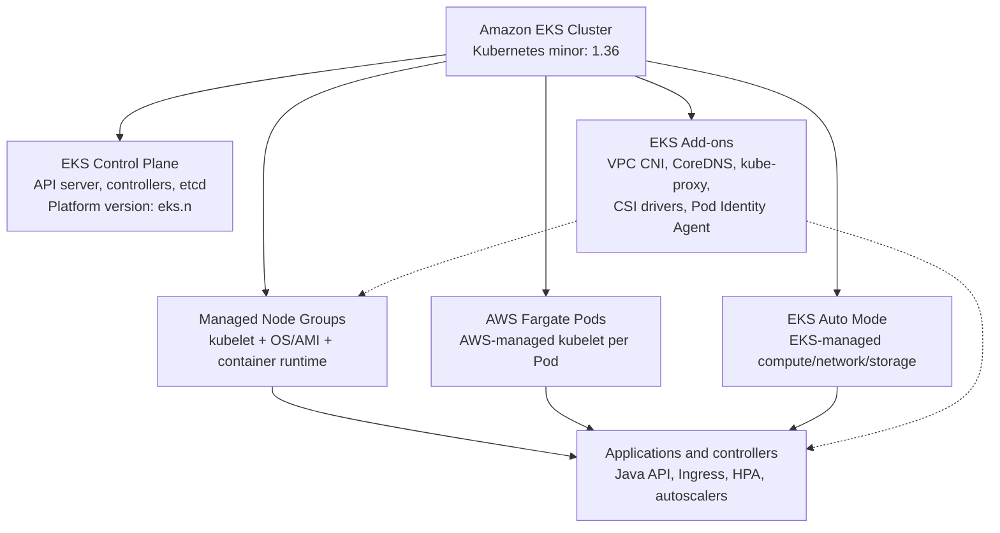
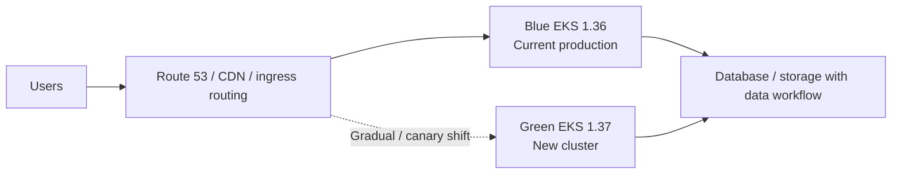
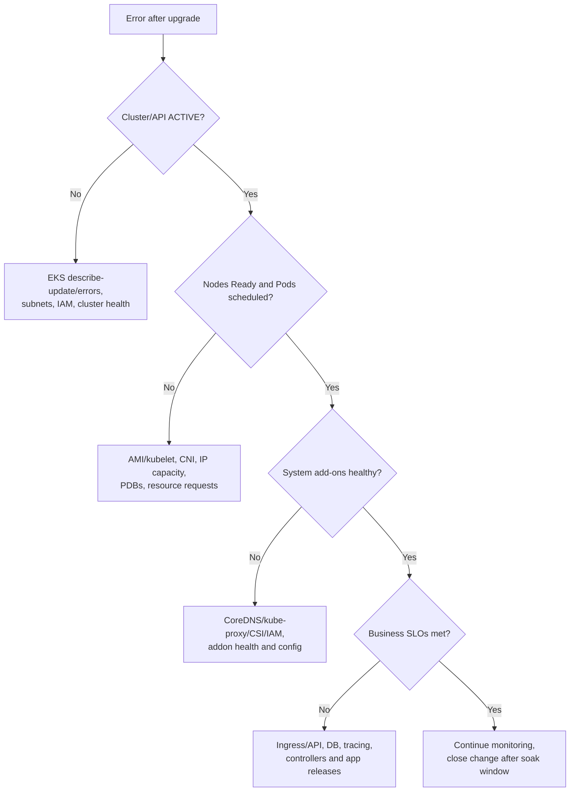

# Managing Add-ons, Versions, and EKS Upgrades

## Learning Objectives

After this lesson, you will be able to:

1. Explain why the **EKS control plane Kubernetes version**, **EKS platform version**, **node/kubelet version**, **Amazon EKS add-on version**, and **application version** follow distinct lifecycles.
2. Distinguish **self-managed add-ons**, **Amazon EKS managed add-ons**, **AWS Marketplace** add-ons, and built-in **EKS Auto Mode** capabilities.
3. Look up cluster-compatible versions/add-ons using the AWS CLI; inspect **VPC CNI, CoreDNS, kube-proxy, EBS CSI driver**, and IAM-managing add-ons.
4. Plan Kubernetes upgrades **one minor version at a time**, use **EKS upgrade insights**, handle deprecated/removed APIs, and evaluate Pod disruption.
5. Execute the **control plane → compute nodes → add-ons/controllers → kubectl** workflow while adapting for Fargate, EKS Auto Mode, and real application needs.
6. Understand the **7-day control plane rollback** constraint per current EKS docs, and distinguish that rollback from downgrading node groups, add-ons, and application data.
7. Build post-upgrade monitoring, troubleshooting, security, availability, and cost-control checklists for production EKS operations.

## 1. Why Is an EKS Upgrade More Than Changing One Version Number?

An e-commerce system running on **Amazon Elastic Kubernetes Service (Amazon EKS)** might include:

- **EKS control plane** managed by AWS: Kubernetes API server, control components, and cluster state store.
- **Managed node groups** running EC2 instances to execute application Pods.
- **VPC CNI** allocating Pod network addresses, **CoreDNS** resolving service names, and **kube-proxy** handling Service connectivity.
- **Amazon EBS CSI driver** enabling PersistentVolumeClaims (PVCs) to provision and attach EBS volumes on EC2 nodes.
- **AWS Load Balancer Controller**, **ExternalDNS**, **metrics-server**, **Cluster Autoscaler**, or monitoring tools installed by operations.
- Java/Spring Boot applications, Redis, API gateways, queue consumers, and data services.

If you only upgrade the **control plane** from Kubernetes 1.36 to 1.37 and stop, nodes may remain on kubelet 1.36, add-ons stay on older builds, and controllers may call removed Kubernetes APIs. The cluster API might still respond, yet new Pod creation, DNS, IP allocation, storage, or autoscaling can fail.

Conversely, upgrading a core add-on without checking cluster version compatibility or custom settings can disrupt Pods relying on networking, DNS, or storage even before the control plane upgrades.

> **Principle:** an EKS upgrade is a **multi-layer** change workflow, not a single “update all” button. Verify compatibility, recoverability, Pod disruption bounds, and application health at every step.

## 2. Architecture and Version Layers to Track



This diagram shows **deployment options that can be combined**, not that every cluster runs EC2, Fargate, and Auto Mode simultaneously.

| Layer | Typical Version | Who Manages It? | What to Do During Upgrades? |
|---|---|---|---|
| **Kubernetes control plane** | `1.36`, `1.37` | Amazon EKS upgrades version via API/console. | Check upgrade readiness, move to **next minor**. |
| **EKS platform version** | `eks.1`, `eks.2`... | AWS releases platform patches/improvements per minor. | Track and know it **differs** from Kubernetes minor; AWS rolls out platform updates via managed mechanisms. |
| **Node kubelet** | `v1.36.x` | MNG/self-managed/hybrid/Fargate/Auto Mode per compute type. | Maintain valid version skew, update AMI/runtime, and roll nodes properly. |
| **EKS add-on** | `vA.B.C-eksbuild.N` | EKS for managed add-ons; user for self-managed. | Select a **compatible** add-on version and update in a controlled manner. |
| **External controllers/CRDs** | Independent Helm charts and image tags | Operations team or vendor. | Verify Kubernetes API/CRD/permissions compatibility and upgrade per project docs. |
| **Applications** | Independent releases/tags | Development teams. | Test functionality, probes, PDBs, migrations, load, and recovery. |

### Kubernetes minor, patch, and EKS platform version

**Kubernetes 1.36 → 1.37** is a **minor version** change. Changing minors can remove old APIs and alter admission, scheduler, networking, or security policy behavior. This requires planning.

**Kubernetes patch** versions (e.g., `1.36.x`) deliver bug/security fixes within the same minor, whereas `eks.N` is the **EKS platform version** carrying AWS-managed control plane patches and enhancements. Do not confuse `eks.4` with Kubernetes 1.4. During audits, record **both** Kubernetes version and platform version.

### Responsibilities of AWS vs. the operator

AWS is responsible for the managed control plane infrastructure, EKS platform releases, control plane upgrade execution, and service availability. You remain responsible for:

- Container images, runtimes, Kubernetes manifests, Helm releases, CRDs, and controllers.
- Self-managed or managed EC2 compute nodes, which you must **actively upgrade**.
- Add-on compatibility, add-on IAM permissions, VPC subnet/IP capacity, and Security Groups.
- Cross-AZ workload distribution, PodDisruptionBudgets, data recovery, backups, and monitoring.

Never treat “control plane update successful” as final success if DNS, CNI, EBS mounts, Pods, or business APIs are failing.

## 3. Kubernetes Support Lifecycle on Amazon EKS

Under current AWS policy, **each Kubernetes minor on EKS** receives:

1. **Standard support:** roughly **14 months** from EKS version release.
2. **Extended support:** an additional **12 months**, at a **higher hourly control plane fee**.
3. **End of extended support:** AWS gradually **auto-upgrades the control plane** to a supported version per policy; node groups and add-ons are not automatically synced in full.

Total support typically spans **26 months**. Start and end dates follow AWS's published calendar; always verify live dates at maintenance time.

### Example EKS-supported versions on 2026-11-20

| Support Tier | Kubernetes Minor |
|---|---|
| **Standard support** | `1.37`, `1.36`, `1.35`, `1.34` |
| **Extended support** | `1.33`, `1.32`, `1.31` |

This list is a **point-in-time snapshot**, not a permanent list for future years. For example, `1.34` had its AWS standard support end date scheduled for **2026-12-02**; a cluster still on 1.34 past that date enters extended support if un-upgraded and configured accordingly.

### Upgrade policy: STANDARD vs. EXTENDED

| `upgradePolicy.supportType` Value | When Version Exits Standard Support | Considerations |
|---|---|---|
| `EXTENDED` | Cluster enters extended support to retain version longer at higher cost. | **Default** if unchanged per current AWS documentation. |
| `STANDARD` | AWS may auto-upgrade once standard support ends. | Avoids extended fees, but requires accepting and preparing for auto-upgrades. |

Inspect the cluster policy and version:

```bash
aws eks describe-cluster \
  --name commerce-prod \
  --region ap-southeast-1 \
  --query 'cluster.{Name:name,Version:version,PlatformVersion:platformVersion,Status:status,UpgradePolicy:upgradePolicy,Health:health.issues}'
```

Inspect available cluster versions and support dates from the API:

```bash
aws eks describe-cluster-versions \
  --region ap-southeast-1 \
  --query 'clusterVersions[].{Version:clusterVersion,Status:status,Default:defaultVersion,EndStandard:endOfStandardSupportDate,EndExtended:endOfExtendedSupportDate}' \
  --output table
```

**Do not wait until AWS auto-upgrades** to discover outdated add-ons/AMIs. Maintain a proactive maintenance calendar, review quarterly or upon each minor release, and monitor AWS Health notices.

## 4. Amazon EKS Add-ons: Installation, Management, and Ownership

An **add-on** is supporting software for Kubernetes operations not tied to a single business app—for example Pod networking, DNS, storage drivers, or observability agents. Add-ons can be managed via the **Amazon EKS API** or deployed directly via Helm/manifests.

### 4.1. Self-managed vs. EKS managed add-ons

| Aspect | Self-managed add-on | Amazon EKS managed add-on |
|---|---|---|
| Installation method | Helm/kubectl/manifests/scripts. | EKS console, `aws eks create-addon`, or compatible IaC. |
| Where config lives | Helm values, GitOps, Kubernetes resources. | EKS Add-on resource and `configurationValues`, with matching Kubernetes resources. |
| Who picks the version | Operations team. | Operations team **still chooses** a compatible version; EKS provides a vetted catalog. |
| Who executes updates | Operations team. | EKS applies updates **when requested**, not automatically for every add-on during control plane upgrades. |
| Config conflicts | Handled by your tooling. | `NONE` / `OVERWRITE` / `PRESERVE` on update. |
| Risk when switching modes | Duplicate resources/ownership, drift with GitOps/Helm. | Must follow ownership transfer steps, resolve conflicts, and govern config afterward. |

Depending on cluster creation tools/options, `vpc-cni`, `coredns`, and `kube-proxy` may start as **self-managed** or EKS managed add-ons. **Do not assume an add-on is managed** merely because its DaemonSet/Deployment appears in `kube-system`.

Verify with:

```bash
aws eks list-addons --cluster-name commerce-prod --region ap-southeast-1
kubectl -n kube-system get daemonsets,deployments
```

If `aws eks list-addons` omits `coredns` while `kubectl -n kube-system get deployment coredns` exists, CoreDNS is self-managed. Never call `update-addon` on an add-on not managed by EKS.

### 4.2. Common add-ons

| Add-on | Function | Impact If Failing |
|---|---|---|
| **Amazon VPC CNI** (`vpc-cni`) | Assigns IPs/interfaces to Pods on EC2, tied to VPC networking. | New Pods fail to get IPs or connect; affects VPC/subnet IP capacity. |
| **CoreDNS** (`coredns`) | Internal DNS for Kubernetes Services/Pods. | `*.svc.cluster.local` resolution fails; apps cannot locate services. |
| **kube-proxy** (`kube-proxy`) | Maintains Service networking rules on eligible nodes. | Traffic to ClusterIP/Services can fail. |
| **Amazon EBS CSI driver** (`aws-ebs-csi-driver`) | Provisions/attaches EBS volumes for PVCs on EC2. | PVCs stay Pending, Pods stall mounting, persistent workloads cannot scale. |
| **Amazon EFS CSI driver** | Mounts EFS into Pods on supported compute. | Shared filesystems fail to mount or hit I/O errors. |
| **EKS Pod Identity Agent** | Delivers IAM identities to Pods using EKS Pod Identity on supported compute. | Add-ons/controllers fail to obtain AWS credentials. |
| **Metrics Server** | Supplies resource metrics for HPA/`kubectl top`. | CPU/RAM-based HPA fails to scale properly. |
| **Observability agents** | Collect logs, metrics, traces. | Operational blind spots even while apps keep running. |

Beyond this list are **AWS Marketplace add-ons**, third-party controllers, and regional/compute-specific add-ons. Marketplace add-ons may require subscriptions with separate terms/costs. Do not assume every image/chart listed in AWS Marketplace is pre-installed.

### 4.3. EKS Auto Mode differences

**EKS Auto Mode** integrates compute autoscaling, Pod/Service networking, cluster DNS, block storage, and load balancing on EKS-managed infrastructure. In clusters running **Auto Mode compute only**, traditional add-ons like VPC CNI, CoreDNS, kube-proxy, EBS CSI driver, and Pod Identity Agent **may not need to be installed as separate Pods**.

If a cluster mixes **Auto Mode with managed EC2 nodes, self-managed nodes, or Fargate**, appropriate add-ons are still needed for those non-Auto compute types. When checking compatibility, examine **`computeTypes`** returned by `DescribeAddonVersions`; never delete an add-on serving EC2 nodes simply because Auto Mode is enabled.

**Hybrid nodes** also have specific limits; for example, Amazon VPC CNI does not deploy onto hybrid nodes. Choose CNIs/CSIs and versions according to live support documentation.

## 5. Managing Add-on Lifecycles Independently

Add-on selection should never rely solely on a “latest” label. Each Kubernetes minor and compute type has a **list of compatible versions**; a version suited for 1.36 is not automatically compatible or optimal for 1.37.

### 5.1. Version schema and compatibility

A managed add-on version looks like:

```text
v1.20.1-eksbuild.1
```

`v1.20.1` reflects the upstream component version, while `eksbuild.1` is the EKS-packaged build. Never compare Kubernetes version numbers with add-on numbers visually; query the compatibility API:

```bash
# 1) Which EKS add-ons are actually managed on this cluster
aws eks list-addons \
  --cluster-name commerce-prod \
  --region ap-southeast-1

# 2) Version/status of a specific add-on
aws eks describe-addon \
  --cluster-name commerce-prod \
  --addon-name vpc-cni \
  --region ap-southeast-1 \
  --query 'addon.{Name:addonName,Version:addonVersion,Status:status,Issues:health.issues,Config:configurationValues}'

# 3) Versions compatible with Kubernetes 1.37
aws eks describe-addon-versions \
  --kubernetes-version 1.37 \
  --addon-name vpc-cni \
  --region ap-southeast-1 \
  --query 'addons[].addonVersions[].{Version:addonVersion,Default:compatibilities[0].defaultVersion}' \
  --output table
```

The API returns versions published by EKS in that Region for the target Kubernetes version. Lists change over time; example versions in docs are not mandatory for live environments.

### 5.2. Configurations to back up before updating

Add-ons such as VPC CNI and CoreDNS often carry custom settings (e.g., environment variables, resource limits, tolerations, topology spread, `replicaCount`). Uncontrolled updates can revert customizations to defaults.

Inspect the add-on configuration schema:

```bash
# Replace addon-version with the ACTUAL version you looked up
aws eks describe-addon-configuration \
  --addon-name vpc-cni \
  --addon-version v1.20.1-eksbuild.1 \
  --region ap-southeast-1
```

**Do not assume `v1.20.1-eksbuild.1` exists or is compatible**; it is purely a syntax example. Use `describe-addon-versions` to pick a real version before reading its schema.

Back up `configurationValues`, IAM role/Pod Identity associations, annotations, resources, and GitOps/Helm links. If an EKS add-on manages those resources, avoid ad-hoc `kubectl edit` on live DaemonSets/Deployments without understanding EKS reconciliation.

### 5.3. Resolving conflicts during updates

`--resolve-conflicts` on `aws eks update-addon` offers three choices:

| Option | Behavior | Risk |
|---|---|---|
| **`NONE`** | Does not overwrite modified config; update can **fail** on conflicts. | Safe for catching drift, requires manual resolution. |
| **`PRESERVE`** | Attempts to keep user-customized values. | May carry settings invalid in the new version; must validate against schema. |
| **`OVERWRITE`** | Overwrites changes with EKS-managed defaults. | Can **wipe custom app/networking/DNS settings**. |

The following is a **mutating command**—run only after checking versions, backups, and permissions:

```bash
aws eks update-addon \
  --cluster-name commerce-prod \
  --addon-name vpc-cni \
  --addon-version "<version-compatible-with-cluster>" \
  --resolve-conflicts PRESERVE \
  --region ap-southeast-1
```

Never pass `OVERWRITE` just “to make it succeed” without knowing which settings will be lost. Legacy incompatible settings may require updating `configurationValues` and IAM permissions beforehand.

### 5.4. IAM permissions for add-ons

Several add-ons require AWS API permissions—for example, VPC CNI manages network interfaces/IPs and the EBS CSI driver manages EBS volumes. Two primary mechanisms:

- **EKS Pod Identity:** EKS manages associations between Kubernetes service accounts and IAM roles, requiring the **Pod Identity Agent** on eligible compute. Recommended by AWS for many EKS add-ons.
- **IAM Roles for Service Accounts (IRSA):** relies on the cluster OIDC provider and `serviceAccountRoleArn`.

With EKS-managed add-ons, associations created via the add-on API share the add-on's lifecycle; deleting the add-on can delete its owned associations. Updating Pod Identity associations may trigger EKS to restart add-on Pods.

**Never grant broad AWS permissions to the EC2 node IAM role just because an add-on needs EBS/VPC APIs.** Maintain separate least-privilege roles per add-on, auditing ServiceAccounts, IAM trust policies, SCPs, and Kubernetes RBAC.

## 6. Checking Version Skew Before Upgrading a Cluster

**Version skew** is the minor version gap between Kubernetes components. Upstream Kubernetes defines different skew rules per component/version. On EKS, AWS defines a clear safe upgrade path:

1. Before upgrading the **control plane from N → N+1**, **managed node groups and Fargate nodes** should already match control plane minor **N**. EKS requires managed node groups to match the control plane minor to upgrade the cluster.
2. Upgrade the control plane **one minor version at a time** (e.g., `1.35 → 1.36 → 1.37`); never jump straight from 1.35 to 1.37.
3. After upgrading the control plane to N+1, upgrade **managed/self-managed/hybrid nodes** to N+1. For Fargate, newly launched Pods receive the updated version while older Pods may require replacement.
4. Update controllers/add-ons and `kubectl` to supported versions.

Never treat upstream's maximum allowed skew as an excuse to leave components out of sync long term. Certain EKS/API setups enforce tighter support rules; follow published Amazon EKS procedures.

### Inspecting currently running versions

```bash
aws eks describe-cluster \
  --name commerce-prod \
  --region ap-southeast-1 \
  --query 'cluster.{Kubernetes:version,Platform:platformVersion,Status:status}'

kubectl version
kubectl get nodes -o wide

# Inspect kubelet on each node across visible compute pools
kubectl get nodes \
  -o custom-columns=NAME:.metadata.name,KUBELET:.status.nodeInfo.kubeletVersion,OS:.status.nodeInfo.osImage,RUNTIME:.status.nodeInfo.containerRuntimeVersion
```

`kubectl` should remain within **±1 minor** of the control plane per EKS docs; align it right after upgrading. For production automation, pin `kubectl`, Helm, Terraform providers, and `eksctl`/AWS CLI versions in CI/CD.

### Typical compatibility checklist

| Item | Before Upgrading 1.36 → 1.37 | After Successful Upgrade |
|---|---|---|
| Control plane | `1.36` | `1.37` |
| MNG kubelet | `1.36` | Upgraded to `1.37` via rolling update |
| Fargate pods | No legacy Pods below upgrade prerequisites | Newly created Pods on supported version |
| Self-managed nodes | Same minor `1.36` where possible | Recreated/upgraded to `1.37` |
| VPC CNI/CoreDNS/kube-proxy | Current versions compatible with upgrade path | Updated to EKS-validated versions for `1.37` |
| CSI/ingress/autoscaler | Checked compatibility and API deprecations | Updated per vendor guidance |
| Applications | Staging tested, PDBs, probes/backups ready | Smoke/integration/performance tests passing |

## 7. Pre-Upgrade Preparation: Technical Checklist

### 7.1. Are there deprecated or removed APIs?

Older manifests/CRDs may reference Kubernetes APIs removed in the target version. Past transitions off `extensions/v1beta1`, `networking.k8s.io/v1beta1`, or `policy/v1beta1` show that changing `apiVersion` alone is rarely enough; schemas, selectors, webhooks, and controllers often need updates too.

Check:

- Kubernetes and **Amazon EKS** release notes for **each N → N+1 hop**.
- Cluster EKS **upgrade insights**.
- API versions inside Helm charts, CRDs, admission webhooks, and controller images.
- Application and automation Kubernetes client libraries (Java clients, operators, Argo CD/Flux).
- Deployment pipelines no longer apply manifests using removed APIs.

Never run `kubectl get deployments` alone and conclude no deprecated APIs exist: deprecated APIs may be sent by **live requests from controllers/automation**, invisible in stored manifests.

### 7.2. EKS upgrade insights

Amazon EKS automatically evaluates **upgrade readiness insights** to flag potential version-change issues, including API deprecations, node skew, kube-proxy, and cluster health. Common statuses:

| Insight | Operational Meaning |
|---|---|
| `PASSING` | No issues detected within check scope; does not guarantee full app compatibility. |
| `WARNING` | Potential impact on future versions or items to review beforehand. |
| `ERROR` | Issue must be resolved before upgrading; consult check documentation. |
| `UNKNOWN` | EKS lacks sufficient data to conclude; investigate and refresh. |

```bash
aws eks list-insights \
  --cluster-name commerce-prod \
  --region ap-southeast-1 \
  --filter categories=UPGRADE_READINESS

# Inspect a specific insight using an ID from list-insights
aws eks describe-insight \
  --cluster-name commerce-prod \
  --id "<insight-id>" \
  --region ap-southeast-1

# After fixing an issue, ask EKS to refresh insights
aws eks start-insights-refresh \
  --cluster-name commerce-prod \
  --region ap-southeast-1
```

The EKS console also provides an **Upgrade insights** tab under cluster monitoring. Insights are a point-in-time signal and **never replace** staging/integration tests and engineering review.

**Warning about `--force`:** force-override behavior for blocking insights has evolved in EKS; never use `--force` by default or assume it bypasses every check. `--force` may bypass specific insight checks without bypassing all prerequisites, leaving operators fully exposed to risk.

### 7.3. VPC subnets, IPs, and security groups

EKS requires **up to 5 free IP addresses** from the **cluster subnets** specified at cluster creation to swap control plane network interfaces. Before upgrading:

1. Verify the subnets still exist and have sufficient available IPv4 addresses.
2. Verify **Security Groups** allow required control-plane-to-node traffic across those subnets.
3. For private nodes, verify paths to EKS API, ECR/S3, STS/SSM/CloudWatch endpoints, or NAT per design.
4. Ensure IP capacity for **new worker nodes and Pods** during rolling updates, not just the control plane.

If VPC CNI exhausts Pod IPs, a Managed Node Group can launch EC2 instances yet new Pods stay Pending/ContainerCreating without IPs. Forecast temporary extra nodes, Pod density, ENI/prefix delegation, and subnet design.

### 7.4. Workload availability

Before upgrade day:

- Spread replicas across **two or more AZs** if SLOs require it, using `topologySpreadConstraints`/anti-affinity.
- Configure **readiness/liveness/startup probes** reflecting real app health rather than just container process life.
- Configure **PodDisruptionBudgets (PDBs)** to protect minimum replicas during node drains.
- Ensure **resource requests/limits**, `terminationGracePeriodSeconds`, and preStop hooks cover in-flight requests.
- Test deployment rollouts, connection closing, Pod restarts, scale-out, and recovery from a node failure.
- Inspect `kubectl get pdb -A`, node taints, DaemonSets, and workloads using local storage.

An overly tight PDB like `minAvailable: 3` on a Deployment with only **3 replicas** blocks voluntary evictions. That protects availability but causes Managed Node Group updates to fail with `PodEvictionFailure`. Fix capacity/replicas first rather than immediately forcing updates past PDBs.

### 7.5. Backups and recovery plans

EKS manages the control plane database, yet you must still back up configurations, apps, and data owned by your organization:

- GitOps/IaC manifests, Helm values, CRD definitions, admission webhooks, and IAM policies.
- Data in RDS, EBS PVs, EFS, S3, queues, or external services per RPO/RTO.
- Snapshot/backup solutions such as **AWS Backup**, EBS snapshots, DB-native backups, Velero, and tested restore runbooks.
- Inventory of add-on versions/role associations, node group AMIs/launch templates, and cluster settings.

**Never treat a standalone EBS snapshot or YAML export as a complete Kubernetes cluster backup.** For StatefulSets/DBs, ensure application consistency and test restores directly.

## 8. CLI Inventory Before Making Changes

Assume:

```text
AWS Region: ap-southeast-1
Cluster: commerce-prod
Current: Kubernetes 1.36
Target: Kubernetes 1.37
Managed node group: app-ng
Commands below: practice examples, never run automatically in production
```

### 8.1. Confirm account/cluster

```bash
aws sts get-caller-identity
aws eks describe-cluster \
  --name commerce-prod \
  --region ap-southeast-1 \
  --query 'cluster.{Name:name,Version:version,Platform:platformVersion,Status:status,Issues:health.issues,UpgradePolicy:upgradePolicy}'

# Update kubeconfig with an authorized IAM role/profile
aws eks update-kubeconfig --name commerce-prod --region ap-southeast-1
kubectl config current-context
kubectl get nodes -o wide
kubectl get pods -A --field-selector=status.phase!=Running
```

`update-kubeconfig` **changes the current context** in your local kubeconfig; verify cluster and account before any mutating command. Filtering `kubectl get pods` by phase alone does not catch Running Pods that are not Ready.

### 8.2. List node groups and add-ons

```bash
aws eks list-nodegroups --cluster-name commerce-prod --region ap-southeast-1

aws eks describe-nodegroup \
  --cluster-name commerce-prod \
  --nodegroup-name app-ng \
  --region ap-southeast-1 \
  --query 'nodegroup.{Version:version,Release:releaseVersion,Status:status,Issues:health.issues,UpdateConfig:updateConfig}'

aws eks list-addons --cluster-name commerce-prod --region ap-southeast-1

aws eks describe-addon \
  --cluster-name commerce-prod \
  --addon-name coredns \
  --region ap-southeast-1 \
  --query 'addon.{Name:addonName,Version:addonVersion,Status:status,Issues:health.issues,Config:configurationValues}'
```

If an add-on is not listed, it may be **uninstalled** or **self-managed outside EKS**. Do not conclude a Pod/component is absent: inspect namespaces and actual deployment tooling.

### 8.3. Workload health and dependencies

```bash
kubectl get nodes
kubectl get pods -A -o wide
kubectl get deployments,statefulsets,daemonsets -A
kubectl get pdb -A
kubectl get pvc -A
kubectl get events -A --sort-by='.lastTimestamp'
kubectl -n kube-system get deployments,daemonsets
```

For Java applications behind an ALB, also run HTTP smoke tests, database connection checks, queue consumer health checks, and external synthetic checks; `Pods Ready` is only one piece of end-to-end availability.

## 9. Upgrading the Control Plane from Kubernetes 1.36 to 1.37

**This procedure mutates the cluster.** Run only after verifying actual current/target versions in Region, upgrade insights, data plane health, IAM permissions, and recovery plans. This article does not connect directly to any live AWS account.

### 9.1. Pre-conditions before the update command

1. Cluster `commerce-prod` is `ACTIVE`, on Kubernetes **1.36**, with no other update in progress.
2. **Managed node groups** already run the same `1.36` minor as the control plane. Fargate Pods on older minors are handled per EKS upgrade prerequisites.
3. Control plane subnets have free IPs (EKS may need **up to 5**), and Security Groups and IAM/KMS keys are valid.
4. Reviewed **upgrade insights** for 1.37, with no unresolved API deprecation or controller compatibility blockers.
5. Staging tests passed, backups/rollback prepared, change window and notifications scheduled.
6. Workloads have replicas/PodDisruptionBudgets and spare capacity to stay available across node rollouts.

### 9.2. Trigger the update

```bash
aws eks update-cluster-version \
  --name commerce-prod \
  --kubernetes-version 1.37 \
  --region ap-southeast-1
```

The command returns an `update` object containing an `id` (e.g., `7c3b6f0e-12ab-4f96-9dca-111122223333`) and `status=InProgress`. Save the **actual Update ID**.

This is an **asynchronous** operation: the CLI returning does not mean the control plane upgrade is finished. Once an upgrade is running, interrupting the CLI does not pause or cancel it; never issue competing update commands.

Track progress:

```bash
aws eks describe-update \
  --name commerce-prod \
  --update-id "7c3b6f0e-12ab-4f96-9dca-111122223333" \
  --region ap-southeast-1 \
  --query 'update.{Id:id,Type:type,Status:status,Errors:errors,CreatedAt:createdAt}'
```

When `status=Successful`, the control plane update is complete. If `Failed`, inspect `errors` and `describe-cluster`; do not assume the cluster is destroyed or unrecoverable. EKS has built-in checks and control-plane infrastructure recovery during updates.

### 9.3. Verify immediately after control plane upgrade

```bash
aws eks describe-cluster \
  --name commerce-prod \
  --region ap-southeast-1 \
  --query 'cluster.{Version:version,Platform:platformVersion,Status:status,Issues:health.issues}'

kubectl version
kubectl get --raw='/readyz?verbose'
kubectl get nodes
kubectl -n kube-system get pods
```

`/readyz` is the Kubernetes API readiness endpoint; verifying permissions and endpoint reachability is necessary, though it does not prove applications or worker nodes are synced on versions.

**Disruption note:** AWS rolling-upgrades API server instances to maintain availability, yet clients may experience brief disconnects and must reconnect/retry. Older controllers may hit compatibility errors if APIs changed; monitor logs and events during and after the upgrade.

## 10. Upgrading Compute Node Versions

Once the control plane is on 1.37, bring the data plane onto compatible versions and patched AMIs/runtimes.

### 10.1. EKS Managed Node Group (MNG)

Inspect the node group:

```bash
aws eks describe-nodegroup \
  --cluster-name commerce-prod \
  --nodegroup-name app-ng \
  --region ap-southeast-1
```

If the node group uses an eligible **EKS-optimized AMI** supporting direct updates:

```bash
aws eks update-nodegroup-version \
  --cluster-name commerce-prod \
  --nodegroup-name app-ng \
  --kubernetes-version 1.37 \
  --region ap-southeast-1
```

The command returns an update ID; monitor with:

```bash
aws eks describe-update \
  --name commerce-prod \
  --nodegroup-name app-ng \
  --update-id "<update-id-from-nodegroup-update>" \
  --region ap-southeast-1
```

During a rolling update, EKS launches new nodes, verifies readiness, **cordons/drains** old nodes, and replaces them according to `maxUnavailable` or `maxUnavailablePercentage`. Rolling updates **respect PDBs**; if draining fails under constraints, the update reports an error.

**Never use `--force` as the default option.** Forced node updates bypass PDB constraints and cause service outages.

Example PDB for a three-replica API:

```yaml
apiVersion: policy/v1
kind: PodDisruptionBudget
metadata:
  name: checkout-api-pdb
  namespace: commerce
spec:
  minAvailable: 2
  selector:
    matchLabels:
      app: checkout-api
```

A PDB limits voluntary evictions—it **does not create extra replicas or EC2 capacity**. Ensure the scheduler can place replacement Pods onto new nodes and readiness probes pass.

If a node group uses a **custom AMI**, EKS may not offer automatic Kubernetes version updates the way EKS-optimized AMIs do. Typical workflow:

1. Build, harden, and test an AMI supporting Kubernetes 1.37.
2. Create a new **launch template version**.
3. Update the node group to the new launch template version or create a **replacement node group**.
4. Drain/migrate Pods carefully, check logs, and delete the old node group only after smoke tests pass.

### 10.2. Self-managed or hybrid nodes

With **self-managed EC2 nodes**, operations handles updating AMIs, kubelet, container runtime, bootstrap, CNI networking, scaling, and drains. The safest approach is usually **launching new nodes on the updated image, migrating Pods, then terminating old nodes**, rather than mutating live production nodes in place.

With **EKS Hybrid Nodes**, follow dedicated AWS guidance for versions, nodeadm/agents, supported add-ons, and control-plane connectivity. Never assume EKS automatically replaces off-AWS hosts.

### 10.3. AWS Fargate

On Fargate, Kubernetes workers/kubelets run on AWS-managed infrastructure. When the control plane upgrades minors, **running Fargate Pods do not automatically change kubelet versions**; newly created Pods after the upgrade receive the matching version.

Before upgrading the control plane, if Fargate nodes remain on an older minor below requirements, recreate Pods per EKS guidance. After upgrading, redeploy Fargate workloads as needed to align versions, verifying Pod scheduling, IAM, and networking.

Never run `update-nodegroup-version` for Fargate: Fargate has no managed EC2 node groups of that kind.

### 10.4. EKS Auto Mode

If a cluster uses **EKS Auto Mode compute**, after the control plane upgrades minors, EKS begins updating **Auto Mode nodes gradually**, respecting PodDisruptionBudgets under managed orchestration. You do not manually upgrade Auto Mode's built-in compute autoscaling, networking, block storage, or load balancing features the way you upgrade traditional add-ons.

However, you must still monitor Pods/scheduling, NodePools, disruptions, workload readiness, and any add-ons/controllers outside Auto Mode. In clusters mixing Auto Mode and MNGs, **you remain responsible for upgrading MNGs**.

### A common outage trap

Directly decreasing **desired size** on a Managed Node Group to scale in can cause the ASG to terminate nodes **without respecting PDBs** the way a managed node group version update does. Never treat “lower desired capacity” as a safe substitute for draining/rolling updates.

## 11. Updating Add-ons and Controllers After Cluster Upgrade

Once the control plane and nodes are on target versions, upgrade supporting components and controllers per the **compatibility matrix**. Earlier, if EKS release notes required a **minimum add-on version before upgrading the control plane**, handle that prerequisite during preparation. Never apply a rigid order blindly to all add-ons.

### 11.1. VPC CNI, CoreDNS, and kube-proxy

For traditional EC2 clusters, the three core add-ons:

1. **VPC CNI:** ensures Pod IP allocation and networking. Verify version compatibility, env vars, IAM role, and IP capacity.
2. **CoreDNS:** keeps internal Service DNS working; verify deployment replicas, node placement, `coredns` ConfigMap, or EKS-managed `configurationValues`.
3. **kube-proxy:** maintains required version skew, rules/DaemonSet, and Service connectivity.

Example CLI flow for the CoreDNS managed add-on:

```bash
# Confirm CoreDNS is EKS-managed
aws eks describe-addon \
  --cluster-name commerce-prod \
  --addon-name coredns \
  --region ap-southeast-1

# List versions compatible with 1.37
aws eks describe-addon-versions \
  --addon-name coredns \
  --kubernetes-version 1.37 \
  --region ap-southeast-1

# Update only after selecting a real version and inspecting current config
aws eks update-addon \
  --cluster-name commerce-prod \
  --addon-name coredns \
  --addon-version "<real-compatible-addon-version>" \
  --resolve-conflicts PRESERVE \
  --region ap-southeast-1
```

Monitor:

```bash
aws eks describe-addon \
  --cluster-name commerce-prod \
  --addon-name coredns \
  --region ap-southeast-1 \
  --query 'addon.{Version:addonVersion,Status:status,Issues:health.issues}'

kubectl -n kube-system rollout status deployment/coredns
kubectl -n kube-system get pods -o wide
```

If `addon.status=DEGRADED`, inspect `health.issues`, events, and Pod logs; halt dependent upgrades until the cause is resolved.

### 11.2. EBS CSI driver and persistent data

For clusters running stateful workloads on EC2 and EBS, verify:

- Whether `aws-ebs-csi-driver` is managed or self-managed.
- ServiceAccount/Pod Identity or IRSA holds matching permissions.
- Controller/node Pods are healthy and StorageClasses/CSIDriver configs are valid.
- New PVCs provision EBS volumes and new Pods mount them; **existing PVCs/PVs retain data intact**.

```bash
aws eks describe-addon \
  --cluster-name commerce-prod \
  --addon-name aws-ebs-csi-driver \
  --region ap-southeast-1

kubectl get storageclass
kubectl get pvc -A
kubectl -n kube-system get pods
```

Never delete the driver “for a clean reinstall” on a cluster running workloads with PVs without understanding data protection and Kubernetes resource lifecycles.

### 11.3. External controllers outside EKS

Components not necessarily updated automatically by EKS:

- **AWS Load Balancer Controller:** Helm chart version, CRDs, and IAM permissions.
- **Cluster Autoscaler:** AWS recommends matching **major/minor version to the Kubernetes cluster** to avoid API/scheduler mismatches.
- **Karpenter**, ExternalDNS, cert-manager, metrics-server, logging agents, service meshes, secondary CNIs, admission webhooks.
- GitOps controllers like Argo CD/Flux, CI/CD deployment automation, and custom operators.

Check vendor release notes, API group/CRD conversions, and compatibility with the new Kubernetes minor. Before Helm upgrades, record `helm list -A`, chart versions, and Git commits; avoid updating controllers directly out-of-band from IaC/GitOps repos.

### 11.4. Comparing in-place updates vs. workload replacement

| Scenario | Approach |
|---|---|
| Compatible EKS managed add-on with EKS-managed config | Controlled `update-addon` using `PRESERVE` or explicit conflict policy. |
| Self-managed add-on via Helm | Upgrade Helm release per chart compatibility; do not call `update-addon` before transferring ownership. |
| Major CNI/storage driver change, incompatible APIs/CRDs | Staging validation, dedicated migration, and rollback plan. |
| Controller unsupported on target version | Upgrade or replace controller **before** control plane if release notes require. |
| Auto Mode-only cluster | Do not reinstall core capabilities managed by Auto Mode; manage only exceptions and extra add-ons. |

## 12. EKS Version Rollback: New Scope and 7-Day Limit

**Current AWS information (2026):** After an **in-place upgrade**, Amazon EKS allows **rolling back the control plane to the immediately preceding minor version within 7 days** of upgrade completion. This is newer than older guidance that stated EKS did not support downgrades.

### 12.1. What gets rolled back vs. what does not

| Component | Does EKS Rollback Handle It? | Remaining Responsibility |
|---|---|---|
| Kubernetes API server and control plane components | **Yes**, back to eligible N-1 minor version. | Verify APIs/CRDs and workload compatibility. |
| EKS platform version | **Yes**, reverts to a platform build for the older minor. | Review control plane release notes. |
| etcd data/Kubernetes objects | **Preserved**, does not “turn back time.” | Back up/restore if apps or resources were altered incorrectly. |
| EKS managed add-ons | **Not** rolled back automatically. | Select add-on versions compatible with the older minor. |
| Managed node groups | **Not** rolled back automatically. | Downgrade node versions properly before the control plane. |
| Self-managed/hybrid nodes | **No**. | Update/recreate nodes onto compatible versions yourself. |
| EKS Auto Mode nodes | **Has automated handling before control plane rollback.** | Monitor disruptions/NodePools/PDBs. |
| Fargate Pods | Running Pod kubelets do not auto-downgrade. | Recreate Pods on the rolled-back version; check skew. |
| Application data, PersistentVolumes, databases | **Kept intact**, does not undo executed migrations. | Restore data from backups/replication if needed. |

### 12.2. Rollback eligibility conditions

Rollback is only possible when:

1. The cluster reached its current version via an **in-place upgrade**, not fresh creation on that version.
2. **No more than 7 days** have passed since upgrade completion.
3. Returning to **exactly one minor back (N-1)**, without skipping versions.
4. The target version remains EKS-supported. If in **extended support**, switch `upgradePolicy.supportType=EXTENDED` beforehand and accept associated charges.
5. The cluster is `ACTIVE`, has no concurrent update, and does not rely on irreversible newer-version-only features.
6. **Not** a cluster **auto-upgraded by AWS at end of extended support** (those cannot roll back).

If auto-upgraded at the end of **standard support**, rollback may be permitted under AWS conditions after switching the support policy appropriately. Never assume all auto-upgrades share identical rollback rules.

### 12.3. Rollback procedure from 1.37 to 1.36 (only when eligible)

First, inspect **rollback readiness insights**:

```bash
aws eks list-insights \
  --cluster-name commerce-prod \
  --filter categories=ROLLBACK_READINESS \
  --region ap-southeast-1
```

Verify app/API conditions, add-on versions, kube-proxy/kubelet skew, PodDisruptionBudgets, and data integrity. If a **managed EC2 node group is on 1.37**, address it so nodes do not run a **newer** kubelet than the 1.36 control plane after rollback:

```bash
# Example after reviewing the node group and custom AMI rollback path
aws eks update-nodegroup-version \
  --cluster-name commerce-prod \
  --nodegroup-name app-ng \
  --kubernetes-version 1.36 \
  --region ap-southeast-1
```

Wait for the node group to reach the valid version. Downgrade/update add-ons incompatible with 1.36, and handle self-managed nodes and **Fargate Pods** per docs. Finally, roll back the control plane:

```bash
aws eks update-cluster-version \
  --name commerce-prod \
  --kubernetes-version 1.36 \
  --region ap-southeast-1
```

This returns an Update ID of type `VersionRollback`. Monitor via `aws eks describe-update` and verify applications once `Successful`.

### 12.4. What rollback cannot replace

- **Does not revert etcd data** to a pre-upgrade snapshot; edited objects and configs remain.
- **Does not auto-rollback Helm charts, CRDs, database schemas, images**, or IAM policies.
- **Cannot bypass the 7-day window**, skip multiple minors, or override all checks with `--force`.
- **Does not replace blue-green migrations** for major breaking changes, complex integrations, or strict downtime risk reduction.

Once the rollback window expires or a target version is ineligible, the viable path may be **creating a new cluster on a supported version, redeploying workloads, and shifting traffic/data as planned**. Keep a blue-green contingency even with 7-day rollback available.

## 13. Blue-Green Upgrades and Canaries Before Production

**In-place upgrades** are usually simpler on cost and networking, yet mutate the live production control plane. **Blue-green** builds a fresh cluster on the target version and gradually shifts workloads and traffic from the old cluster to the new one:



Pros and cons:

| Criterion | In-place | Blue-green |
|---|---|---|
| Control plane | Upgrades existing cluster. | Creates new cluster on target version. |
| Time/ops effort | Fewer resources; shorter workflow. | Requires running in parallel and shifting traffic. |
| Testing | Separate staging; some issues only surface in prod. | Can test on prod-like infra before cutting over traffic. |
| Recovery | 7-day rollback if eligible; separate app rollback. | Can shift traffic back to old cluster if data/routing remain compatible. |
| Stateful data | Same cluster, yet apps/CSI still need backups. | Requires migration/replication/PV/DB plans without split-brain writes. |
| Cost | Typically less double-running. | Pays for two control planes, nodes, load balancers, and transfer during cutover. |

For stateless Java APIs behind an ALB, blue-green is straightforward when state lives in RDS/S3/queues. For StatefulSets with single-AZ/cluster-bound EBS volumes, reusing storage is non-trivial and requires snapshot/restore or replication.

## 14. Post-Upgrade Monitoring and Verification

### 14.1. Technical checklist

After **every** change to the control plane, node groups, add-ons, or controllers:

1. **Cluster status:** `ACTIVE`, accurate version/platform, no unresolved `health.issues`.
2. **Update status:** `Successful` with no unexpected `InProgress` Update IDs remaining.
3. **Nodes:** `kubectl get nodes` shows all expected Ready nodes, aligned kubelet/AMI/container runtime, multi-AZ, sufficient capacity.
4. **Pods:** accurate Running/Ready counts, deployment rollouts finished, no spike in CrashLoopBackOff, ImagePullBackOff, or Pending.
5. **Networking:** Pods obtain IPs, `kubernetes.default.svc` DNS and service names resolve; NetworkPolicies/SG for Pods intact if used.
6. **Storage:** PVCs Bound, CSI controller/node Pods healthy, safe read/write tests pass on EBS/EFS.
7. **Ingress:** ALB/NLB targets healthy, TLS working, API success rates/latencies stable, no anomalous 4xx/5xx spikes.
8. **Autoscaling:** HPA/Karpenter/Cluster Autoscaler operational, node provisioning satisfies tests and quotas.
9. **IAM/Pod Identity:** Pods calling AWS APIs receive credentials for their granted roles; no spike in AccessDenied.
10. **Monitoring:** metrics/logs/traces from add-ons and apps continue flowing; CloudWatch/EventBridge alarms intact.
11. **Data:** verify consistency/recoverability of ordering workflows and stateful dependencies.

### 14.2. Verification commands

```bash
kubectl get nodes -o wide
kubectl get pods -A
kubectl get deployments,statefulsets,daemonsets -A
kubectl get pvc -A
kubectl get pdb -A
kubectl -n kube-system rollout status deployment/coredns
kubectl get events -A --sort-by='.lastTimestamp'

aws eks describe-cluster \
  --name commerce-prod \
  --region ap-southeast-1 \
  --query 'cluster.{Version:version,Status:status,Issues:health.issues}'
```

For web applications:

```bash
# Run from an authorized client/test runner in the appropriate environment
curl --fail --silent --show-error https://api.example.com/health/ready
```

Never treat one successful `curl` as proof the entire system recovered. Monitor across a meaningful observation window covering AZ failover, error rates, P95/P99 latency, autoscaling, and scheduled jobs.

### 14.3. Observability sources

| Source | What to Look For |
|---|---|
| **EKS control plane logs** | API server/authenticator/audit/controller manager/scheduler logs per enabled types. |
| **Amazon CloudWatch** | Node/Pod metrics, app latency/errors, alarms, CPU/memory/disk via agents. |
| **AWS Health/EventBridge** | Service lifecycle notices, version support warnings, cluster events. |
| **VPC Flow Logs** | Network connections to nodes/VPC endpoints or rejected traffic. |
| **EKS add-on health** | `addon.status` and `addon.health.issues`. |
| **Kubernetes Events/Pod logs** | Evictions, scheduling, image pulls, CSI mounts, CNI allocations, and crashes. |
| **APM/traces and SLO dashboards** | Business transaction success rates post-rollout. |

You do not need every log type permanently enabled at maximum retention across all clusters: balance retention, access controls, encryption, and cost. Ensure **sufficient telemetry** is active before the upgrade window to investigate failures.

## 15. Handling Common Upgrade Failures

| Symptom | Possible Cause | Diagnosis / Remediation |
|---|---|---|
| `InvalidParameterException` upgrading 1.35 → 1.37 | Attempting to skip **two minors** in one operation. | Upgrade sequentially **1.35 → 1.36 → 1.37**, testing each hop. |
| Control plane update fails due to subnets | Insufficient free IPs, deleted subnet, or SG blocking EKS ENIs/traffic. | Check cluster subnets (**up to 5 IPs**), SGs/IAM, and `describe-update.errors`. |
| Upgrade insight `ERROR` | Deprecated APIs, version skew, kube-proxy/cluster health. | `describe-insight`, fix root cause, then `start-insights-refresh`. |
| Managed node group `PodEvictionFailure` | PDB too tight, non-drainable Pods, or insufficient capacity. | Check PDBs, replicas, readiness, AZs, resource requests; avoid default force. |
| Node group rejects new version | Custom AMI/launch template incompatible with chosen update method. | Build compatible AMI/launch template or create a new node group. |
| Pods stuck `ContainerCreating` after upgrade | VPC CNI, IP capacity, node IAM role, SGs/routes, or image pulls. | Inspect CNI logs, free subnet IPs, ECR/NAT/endpoints, `kubectl describe pod`. |
| CoreDNS `DEGRADED` | Incompatible version, overwritten config, bad scheduling/low replicas. | `describe-addon.health.issues`, schema/config, Pod logs, resource capacity. |
| Pod fails to mount EBS | Incompatible EBS CSI driver/IAM/Pod Identity/StorageClass or volume/AZ mismatch. | CSI logs, `kubectl describe pvc/pod`, EBS API permissions, and AZs. |
| HPA stops scaling | Metrics Server/controller or CRD/API incompatibility. | `kubectl top`, HPA events, controller logs, and version alignment. |
| `update-addon` conflict | Manual edits to Kubernetes resources or invalid `configurationValues`. | Review diff/schema, test `PRESERVE`; use `OVERWRITE` only if accepting reset to defaults. |
| Load Balancer Controller breaks after upgrade | Controller/CRD/webhook using incompatible API/version or missing IAM. | Controller release notes, logs, webhooks, IAM, and Ingress reconciliation. |
| Rollback request rejected | Past 7 days, ineligible version, nodes newer than target CP, or failed rollback insight. | Check rollback readiness, cluster policy, nodegroup versions, and irreversible features. |
| API OK yet orders fail | Incompatible app/database/queue or dropped connections. | End-to-end transactions, app logs, traces, RDS/queue health, app rollback if needed. |

### Layered diagnosis



**Important:** never let “finish the upgrade fast” pressure lead to disabling PDBs, loosening Security Groups, or granting `AdministratorAccess` to node IAM roles. Those shortcuts mask symptoms and leave lasting security exposure.

## 16. Security, Change Policy, and Cost

### 16.1. IAM/RBAC boundaries

Permissions to invoke `aws eks update-cluster-version`, `update-nodegroup-version`, and `update-addon` are **AWS IAM permissions**, governed by SCPs and permission boundaries. Meanwhile, `kubectl` operations inside the cluster depend on **Kubernetes RBAC** and EKS authentication mechanisms (access entries/role mappings per cluster mode).

Operations teams should:

- Use **IAM Identity Center or short-lived roles**; never use root accounts or long-lived access keys.
- Separate permissions for **read-only audits**, **add-on updates**, **node group management**, and **control plane upgrades** where needed.
- Log AWS API calls via **CloudTrail**, plus Kubernetes audit logs as needed.
- Pin Terraform provider, Helm chart, container image, and controller versions in repositories; require PR reviews before production.
- Monitor image CVEs, kernel/AMI patches, IAM role trusts/policies, and deprecated APIs/CRDs.
- Test PDBs, rolling updates, and recovery in staging ahead of production change windows.

### 16.2. Cost components

| Component | When Can Costs Occur? |
|---|---|
| **EKS control plane** | Hourly cluster fee, differing between **standard** and **extended support**. |
| **EC2 nodes/MNG** | EC2 hours, EBS volumes, public IPv4, data transfer, temporary surge nodes during rolling upgrades. |
| **Fargate** | vCPU/memory provisioned across Pod runtime duration. |
| **EKS Auto Mode** | Published AWS feature/compute fees beyond underlying EC2 resources where applicable. |
| **Add-ons/Marketplace** | Most EKS add-ons add no separate add-on fee, though underlying AWS resources bill; Marketplace may charge subscriptions. |
| **Load balancers/ingress** | ALB/NLB hours and LCUs, data transfer, logs. |
| **CloudWatch, CloudTrail, backups** | Log ingestion/retention, metrics/alarms, audit trails, snapshots/restores. |
| **Blue-green** | Running **two clusters/nodes/ingresses** in parallel during testing and cutover. |

In EKS, staying too long in **extended support** can significantly raise control plane bills. Use **AWS Cost Explorer**, Pricing Calculator, and version support calendars; never hardcode a fixed USD rate since Regions and pricing evolve.

Never save money by skipping backups or shrinking nodes until PDBs block rolling updates. The right approach is **forecasting and controlling** upgrade costs within defined windows.

## 17. Scenario-Based Practice Exercise

### Context

A company runs a Java application on cluster `commerce-prod` in Singapore:

- Control plane **1.36**, two managed node groups on **1.36**.
- Three `checkout` API replicas across two AZs behind an ALB.
- Add-ons: `vpc-cni`, `coredns`, `kube-proxy`, `aws-ebs-csi-driver`.
- `Cluster Autoscaler` controller version built for Kubernetes 1.36.
- API stores data in RDS; batch Pods use EBS PVCs.
- Goal: upgrade cluster to **1.37** during a maintenance window without disrupting all replicas at once.

### Tasks

1. List the **read-only** commands to retrieve control plane, platform, MNG, Pod, and add-on versions.
2. Check **upgrade insights** and choose remediation if an `ERROR` flags a removed API.
3. Propose a `PodDisruptionBudget` for the three replicas and explain why extra node capacity is still needed.
4. State the upgrade order for **control plane**, **node groups**, **add-ons**, **Cluster Autoscaler**, and clients; explain the exception if an add-on requires a minimum pre-upgrade version.
5. Select add-on versions via `describe-addon-versions` and choose `resolve-conflicts` when CoreDNS has a custom `replicaCount`.
6. List verification tests for DNS, CNI, EBS, ALB, and checkout transactions.
7. If a severe bug surfaces two days after upgrading, describe the **1.37 → 1.36 rollback** conditions/path and components requiring separate handling.
8. Present a risk-reduction plan and cost estimate for running canary or blue-green cutovers.

### Suggested solution

**Step A — Inventory:** `describe-cluster`, `list-nodegroups`/`describe-nodegroup`, `list-addons`/`describe-addon`, `kubectl get nodes/pods/pdb/pvc`. Cross-check against current EKS-supported versions.

**Step B — Readiness:** review 1.37 release notes and `UPGRADE_READINESS` insights; fix deprecated APIs/CRDs/controllers. Confirm both node groups are on 1.36, subnets have free IPs, cluster is healthy, IAM/KMS valid, and app backups tested.

**Step C — Workloads:** run at least 3 replicas with PDB `minAvailable: 2`, spread across two AZs, with valid requests/limits and probes. Test rolling replacement in staging, verifying HPA/Cluster Autoscaler have headroom.

**Step D — Upgrade:** control plane 1.36 → 1.37; once `Successful`, rolling-upgrade node groups to 1.37. Update Cluster Autoscaler for Kubernetes 1.37, then select compatible EKS add-on versions (handling any add-on pre-upgrade requirements during prep). Upgrade `kubectl` and toolchain.

**Step E — Validate:** test CoreDNS resolution, Pod networking, EBS PVC mounts, ALB target health, checkout API transactions, logs/traces, and alarms. Fix issues by layer; if control plane rollback is required within **7 days**, downgrade nodes/add-ons to compatible versions **before** triggering the N-1 rollback. Handle business data separately.

**Step F — Close change:** observe SLOs over a soak window, log versions in the change record, and update IaC and runbooks. Track EKS control plane billing and temporary surge capacity costs.

## 18. Common Misconceptions

**Misconception 1: “Upgrading the EKS cluster version automatically upgrades all EC2 nodes and add-ons.”** False. Control plane, managed/self-managed nodes, and add-ons have separate lifecycles; Auto Mode follows its own managed behavior.

**Misconception 2: “Jump straight from 1.35 to 1.37 to save time.”** False. EKS in-place control plane upgrades advance **one minor at a time**.

**Misconception 3: “Kubernetes version and `eks.platformVersion` are the same.”** False. `1.37` is the Kubernetes minor; `eks.N` is the EKS platform release for that minor.

**Misconception 4: “An add-on tagged latest works on every cluster.”** False. Pick versions via the EKS compatibility API and verify compute types.

**Misconception 5: “`update-addon` with `OVERWRITE` keeps all custom configs.”** False. `OVERWRITE` can reset settings to defaults; `PRESERVE` tries to retain customizations, yet still requires testing.

**Misconception 6: “If `kubectl get nodes` reports Ready, the upgrade is done.”** False. DNS, CNI, storage, ingress, controllers, and applications still need verification.

**Misconception 7: “A PDB guarantees app availability even under resource exhaustion.”** False. PDBs cap voluntary disruptions; they do not create nodes or capacity to reschedule Pods.

**Misconception 8: “EKS can never roll back the control plane under any circumstances.”** **Outdated.** AWS now allows N → N-1 control plane rollbacks within **7 days** of an in-place upgrade when conditions are met; add-ons and MNGs do not auto-rollback.

**Misconception 9: “Rolling back EKS restores application data to pre-upgrade state.”** False. EKS preserves etcd/object state and volumes; it never reverts database migrations or Helm rollouts.

**Misconception 10: “EKS Auto Mode always requires manually installing VPC CNI, CoreDNS, and EBS CSI.”** False for capabilities built into Auto Mode; mixed-compute clusters must check what serves non-Auto Mode nodes.

**Misconception 11: “EKS extended support is free like standard support.”** False. Extended support adds an hourly control plane surcharge.

**Misconception 12: “With upgrade insights PASSING, you can skip staging and backups.”** False. Insights evaluate specific checks at a point in time and cannot guarantee every application is compatible.

## 19. Self-Check Questions

**Question 1.** Which components typically require upgrading after the control plane moves to a new Kubernetes minor?

**Answer:** Managed/self-managed nodes, add-ons like VPC CNI/CoreDNS/kube-proxy/CSI, and controllers/`kubectl`; exact order depends on dependencies and compute types.

**Question 2.** Can an EKS control plane upgrade directly from 1.35 to 1.37?

**Answer:** No. Upgrade `1.35 → 1.36` then `1.36 → 1.37`, validating each step.

**Question 3.** If CoreDNS has a customized `replicaCount`, what risk does `OVERWRITE` carry?

**Answer:** It can overwrite custom settings back to defaults; test with `PRESERVE` or proactively manage configuration per schema.

**Question 4.** Which command shows the version of an EKS managed add-on?

**Answer:** `aws eks describe-addon --cluster-name ... --addon-name ...`; select target versions with `describe-addon-versions`.

**Question 5.** How many additional free IPs might a cluster upgrade need from cluster subnets?

**Answer:** AWS EKS requires **up to 5 free IP addresses** to upgrade the control plane; additional IPs for nodes/Pods must also be accounted for.

**Question 6.** A Managed Node Group rolling update fails with `PodEvictionFailure`. Should you enable force immediately?

**Answer:** No. Inspect PDBs, replicas, node capacity, and Pod state; forcing can cause unexpected outages.

**Question 7.** On 2026-11-20, is a Kubernetes 1.33 cluster in standard or extended support?

**Answer:** **Extended support** per the active EKS schedule; watch fees and upgrade plans.

**Question 8.** Does rolling back EKS from 1.37 to 1.36 automatically downgrade CoreDNS and managed node groups?

**Answer:** No. You must handle node/add-on compatibility separately; Auto Mode nodes have EKS-managed rollback handling.

**Question 9.** A Java API fails after a cluster upgrade even though all nodes are Ready. What should you inspect?

**Answer:** Ingress/ALB, DNS, CNI, application logs, DB/queues, controller/webhook compatibility, and end-to-end metrics—not node health alone.

**Question 10.** Why don't EKS Add-ons necessarily need to be installed on an Auto Mode-only cluster?

**Answer:** Core capabilities such as networking, DNS, block storage, and Pod Identity agent are built into EKS Auto Mode; mixed-compute clusters have different needs.

## Official AWS Documentation

- [Amazon EKS — Kubernetes version lifecycle](https://docs.aws.amazon.com/eks/latest/userguide/kubernetes-versions.html)
- [Amazon EKS — Update existing cluster to new Kubernetes version](https://docs.aws.amazon.com/eks/latest/userguide/update-cluster.html)
- [Amazon EKS — Roll back a cluster to a previous Kubernetes version](https://docs.aws.amazon.com/eks/latest/userguide/rollback-cluster.html)
- [Amazon EKS — Upgrade insights](https://docs.aws.amazon.com/eks/latest/userguide/cluster-insights.html)
- [Amazon EKS — View cluster insights](https://docs.aws.amazon.com/eks/latest/userguide/view-cluster-insights.html)
- [Amazon EKS — Amazon EKS add-ons](https://docs.aws.amazon.com/eks/latest/userguide/eks-add-ons.html)
- [Amazon EKS — Create an add-on](https://docs.aws.amazon.com/eks/latest/userguide/creating-add-on.html)
- [Amazon EKS — Update an add-on](https://docs.aws.amazon.com/eks/latest/userguide/updating-an-add-on.html)
- [Amazon EKS — IAM roles for EKS add-ons](https://docs.aws.amazon.com/eks/latest/userguide/add-ons-iam.html)
- [Amazon EKS — Update a managed node group](https://docs.aws.amazon.com/eks/latest/userguide/update-managed-node-group.html)
- [Amazon EKS — Cluster upgrade policy](https://docs.aws.amazon.com/eks/latest/userguide/view-upgrade-policy.html)
- [Amazon EKS — Add-ons available for EKS](https://docs.aws.amazon.com/eks/latest/userguide/workloads-add-ons-available-eks.html)
- [AWS Best Practices — Cluster upgrades](https://docs.aws.amazon.com/eks/latest/best-practices/cluster-upgrades.html)
- [AWS Best Practices — Version rollback](https://docs.aws.amazon.com/eks/latest/best-practices/rollback-cluster-upgrades.html)
- [AWS CLI — update-cluster-version](https://docs.aws.amazon.com/cli/latest/reference/eks/update-cluster-version.html)
- [AWS CLI — describe-addon-versions](https://docs.aws.amazon.com/cli/latest/reference/eks/describe-addon-versions.html)
- [AWS CLI — update-addon](https://docs.aws.amazon.com/cli/latest/reference/eks/update-addon.html)

**Remember:** An EKS upgrade is a sequence of **compatibility checks → deprecation cleanup → one-minor-at-a-time control plane upgrade → compute node updates → add-on/controller updates → application and data verification**. EKS managed add-ons standardize versions and configuration, yet **do not auto-upgrade every component**, and **7-day** control plane rollback is only a conditional safety net. To achieve security, observability, recoverability, and cost control, operate EKS using checklists, IaC, staging tests, SLOs, and auditable change workflows.
