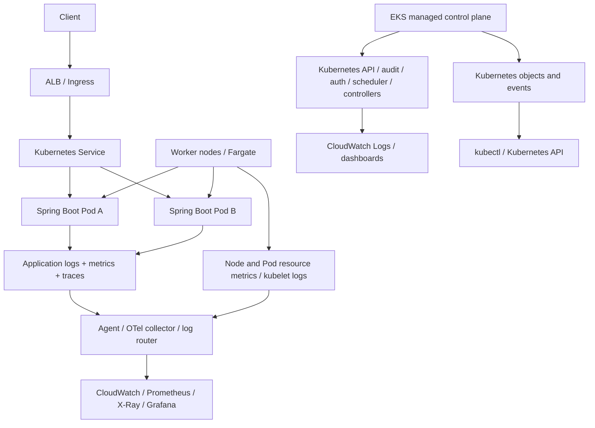
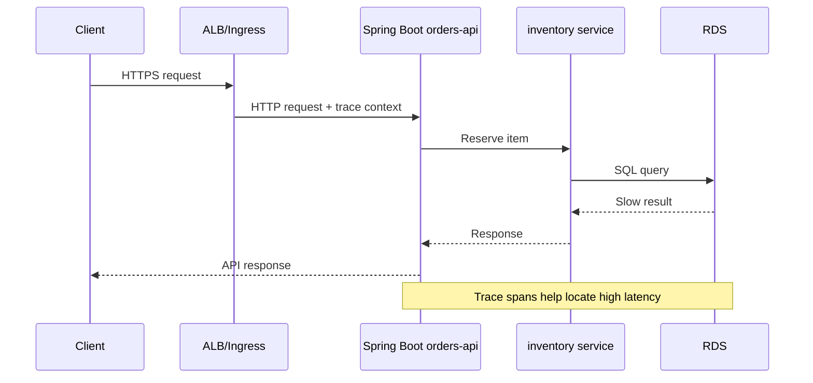
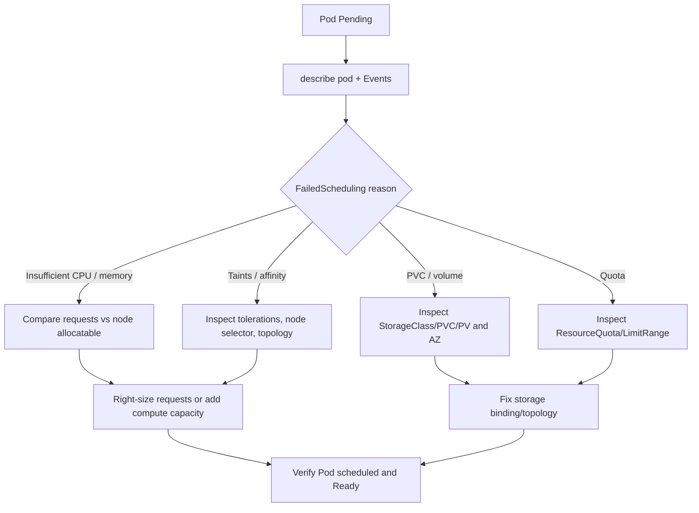

# Cluster Observability, Control Plane Logs, and Pod Performance

> **Chapter:** Kubernetes with EKS · **Module:** `CLOUD_PROVIDERS_AWS`

## 1. Why Does Amazon EKS Require Multi-Layer Observability?

A Java Spring Boot service running on **Amazon Elastic Kubernetes Service (Amazon EKS)** can return HTTP 503 even while the cluster status is `ACTIVE`. The root cause could be a Pod in `CrashLoopBackOff`, a worker node running out of memory, the Kubernetes scheduler unable to find a node with enough capacity, rejected Kubernetes API calls, misconfigured ingress routing, or a slow backend database. No single dashboard or log file answers all of these questions alone.

**Observability** is the ability to understand system state and behavior from **metrics, logs, traces, and Kubernetes events/state**. The goal is not merely knowing “the cluster is up,” but answering:

1. **What is happening?** Which Pods show rising latency, restarts, or lost readiness?
2. **Where is it happening?** Which namespace, deployment, Pod, node, AZ, service, endpoint, or dependency?
3. **Since when?** Correlate timestamps with rollouts, autoscaling, IAM/VPC changes, or infrastructure events.
4. **Why?** Combine control plane audits, Pod events, app logs, CPU/memory metrics, and distributed traces.
5. **What should be done?** Mitigate impact, roll back safely, add capacity in the right place, fix policies or configs, and verify recovery.

Within the `CLOUD_PROVIDERS_AWS` module, EKS observability connects to **AWS Regions/AZs, IAM, VPC, EC2/Fargate, ECR, storage (EBS/EFS), RDS, serverless integrations, monitoring, recovery, and cost control**. EKS manages the Kubernetes control plane, while operators remain responsible for workloads, permissions, networking, logs, alerts, and observability costs.

**After this lesson, learners will be able to:**

- Distinguish control plane logs, Kubernetes events, node/container logs, metrics, and traces.
- Enable and verify each EKS control plane log type exported to CloudWatch Logs; read sample audit logs.
- Use `kubectl get/describe/logs/top` to isolate Pod/Node issues and understand each command's limits.
- Monitor Pod CPU, memory, throttling, OOMs, networking, restarts, and scheduling based on requests/limits.
- Select Container Insights, OpenTelemetry, Prometheus, CloudWatch/Application Signals, and alerting suited to requirements.
- Build runbooks for `Pending`, `CrashLoopBackOff`, `OOMKilled`, `ImagePullBackOff`, `NotReady` nodes, and elevated latency.
- Design telemetry security, log retention, SLOs, multi-AZ resilience, and observability cost controls.

## 2. Map of EKS Observability Layers

EKS has an **AWS-managed control plane** and a **data plane** where Pods run (Amazon EC2 managed/self-managed nodes, Fargate, or other supported compute models). Control plane logs are exported by EKS when enabled; they **do not contain full container stdout/stderr**.



| Layer / Signal | Question Answered | Common Source |
|---|---|---|
| **EKS control plane logs** | Who called the API? Any authN/RBAC errors? What did scheduler/controllers log? | EKS export to CloudWatch log group `/aws/eks/<cluster>/cluster`. |
| **Kubernetes objects and events** | Why is a Pod `Pending`? Does Deployment have enough replicas? Are Nodes `Ready`? | Kubernetes API via `kubectl get/describe/events`. |
| **Node/kubelet/container runtime** | Is a node short on disk/memory? Are kubelet or CNI failing? | Host/kubelet logs, node metrics, Container Insights. |
| **Pod/container logs** | Any Java stack traces? Where did HTTP 500 originate? | Container stdout/stderr via `kubectl logs` and log collectors. |
| **Resource metrics** | How much CPU/memory is used? Throttling, network, filesystem? | Metrics Server (`kubectl top`), Container Insights, Prometheus/OTel. |
| **Application metrics** | p95 latency, error rate, throughput, queue depth? | Spring Boot Actuator/Micrometer, OTel, Prometheus, CloudWatch Application Signals. |
| **Traces** | Which service, DB, or external API slowed the request? | OpenTelemetry + AWS X-Ray or chosen tracing backend. |
| **AWS infrastructure/audit** | Who modified EKS/VPC/IAM/ECR? Any EC2/RDS/AZ events? | AWS CloudTrail, AWS Health, VPC Flow Logs, ALB logs, CloudWatch. |

**Do not confuse CloudTrail with Kubernetes audit logs:** CloudTrail primarily records **AWS API actions** (such as `eks:UpdateClusterConfig` or IAM/VPC resource edits). **Kubernetes audit logs** record interactions with the **Kubernetes API server** (such as users creating/deleting Deployments inside the cluster). Both are often needed together, yet neither replaces the other.

### 2.1. Three pillars and operational signals

- **Logs:** timestamped, contextual events (request ID, Pod name, component, exception). Useful to learn “what happened.”
- **Metrics:** numeric time series (CPU, memory, error rate, latency, healthy Pod count). Useful for trends, SLOs, and alerting.
- **Traces:** spans linking a request across multiple services, pinpointing slow segments.
- **Kubernetes events/desired state:** important, yet **not a complete audit history**; events have short retention and can be aggregated. Never rely on events in place of long-term log retention.

### 2.2. What AWS manages vs. what remains with operations

AWS manages EKS control plane components. Operators **do not SSH into the control plane** to read logs as on a self-built Linux host. For diagnostics, use EKS control plane logging, the EKS observability dashboard, and authorized Kubernetes/AWS APIs. Operations remains responsible for **cluster add-ons, worker nodes per chosen model, application logs, telemetry pipelines, RBAC/IAM, namespace resources, and alerting systems**.

## 3. Five Amazon EKS Control Plane Log Types

EKS lets you independently enable/disable **5 log types** from the managed control plane, exporting to **Amazon CloudWatch Logs** in the same AWS account. **Export is disabled by default**, so an active cluster does not automatically populate CloudWatch with audit or scheduler logs.

| EKS Log Type | Component | When to Read? | Example Signals |
|---|---|---|---|
| `api` | Kubernetes API server | API errors, request handling, API server flags/diagnostics. | Request/response failures, API server operational messages. |
| `audit` | Kubernetes API audit | Investigate who performed actions on Kubernetes objects and outcomes. | `verb=create/update/delete`, identity, resource, namespace, response code. |
| `authenticator` | Amazon EKS authenticator | Kubernetes sign-ins via IAM identities rejected or suspicious access mappings. | Principal/role authentication details and outcomes. |
| `controllerManager` | Kubernetes controller manager | Deployment/ReplicaSet/Node controllers not reconciling as expected. | Controller reconciliation errors, unable to process state. |
| `scheduler` | Kubernetes scheduler | Pods fail to schedule, queue/capacity/policy issues. | Scheduling failures, plugin interactions, scheduler details. |

**Isolate root causes:** `scheduler` logs assist in tracing Pod placement; a Pod's own `FailedScheduling` event is usually the first thing to inspect. If a Pod was scheduled yet the container fails to pull an ECR image, check Pod events, kubelet, and node/Fargate networking/IAM rather than scheduler logs alone.

### 3.1. Log group path and read permissions

Control plane log groups follow the format:

```text
/aws/eks/<cluster-name>/cluster
```

Example for cluster `learning-eks`:

```text
/aws/eks/learning-eks/cluster
```

Inside this group, component streams typically start with:

```text
kube-apiserver-
kube-apiserver-audit-
authenticator-
kube-controller-manager-
kube-scheduler-
```

Log streams can **rotate**; never hardcode a stream ID. Readers require CloudWatch Logs IAM permissions (e.g., scoped `logs:DescribeLogStreams`, `logs:FilterLogEvents`, `logs:StartQuery`, `logs:GetQueryResults`), separate from EKS/Kubernetes permissions. Restrict access to audit logs since they may include identities, resource names, request metadata, and sensitive event details.

### 3.2. Delivery latency and no backfill before enabling

AWS notes control plane logs are normally delivered within **a few minutes** on a **best-effort** basis, with no guarantee every event appears instantaneously. Logs generated before export was enabled are not automatically backfilled. During incident investigations, note **when logging was enabled**, ingestion delay, and potential missing events.

**Cost:** EKS clusters carry control plane fees; enabling logging adds **CloudWatch Logs ingestion, storage, and query scanning charges**. Audit logs can produce high volumes on clusters with heavy automation/API calls. Choose log types and retention from security/operations requirements rather than “turning everything on forever” without a budget.

### 3.3. Observing the control plane beyond logs

The Amazon EKS Console includes an **observability dashboard** displaying cluster health, configuration insights, and **control plane metrics** for supported Kubernetes versions (control plane metrics in the dashboard are supported from Kubernetes **1.28 onward** per AWS docs). This dashboard exposes API server, scheduler, and controller manager signals without starting in raw log text.

Metrics can also be queried in Prometheus format from EKS-supported endpoints, such as the `metrics.eks.amazonaws.com` API group for scheduler/controller manager on compatible clusters. **Do not assume `kubectl top` shows control plane metrics**: `kubectl top` reports node/Pod resource metrics, not API latency or kube-apiserver `429` counts.

## 4. Safely Enabling/Disabling Control Plane Logs

### 4.1. Preflight

Before modifying a live cluster:

1. Verify **AWS account, Region, cluster name**, and required `eks:DescribeCluster` / `eks:UpdateClusterConfig` permissions.
2. Check cluster `ACTIVE` state, Kubernetes version, existing logging config, and change approval workflow.
3. Identify required log types (often audit and authenticator for security; api/scheduler/controllerManager for diagnostics), retention, and log access permissions.
4. Ensure subnets used by EKS during updates have enough free IPs; AWS notes updating control plane logging can require **up to 5 free IPs per subnet**.
5. Budget CloudWatch Logs ingestion/storage costs; avoid logging application secrets and protect audit logs.

### 4.2. Read current EKS configuration (read-only)

```bash
aws sts get-caller-identity

aws eks describe-cluster \
  --region ap-southeast-1 \
  --name learning-eks \
  --query 'cluster.{name:name,status:status,version:version,logging:logging.clusterLogging}' \
  --output json
```

Cluster and Region names are **placeholders**. If `logging.clusterLogging` does not list a type as enabled, CloudWatch will not receive those logs. Do not treat missing log streams as a service bug when export has not been enabled.

### 4.3. Example enabling only `audit` and `authenticator`

**The following commands mutate a real cluster and can incur CloudWatch charges; run only after approval**:

```bash
aws eks update-cluster-config \
  --region ap-southeast-1 \
  --name learning-eks \
  --logging '{"clusterLogging":[{"types":["audit","authenticator"],"enabled":true}]}'
```

To enable all 5 types:

```bash
aws eks update-cluster-config \
  --region ap-southeast-1 \
  --name learning-eks \
  --logging '{"clusterLogging":[{"types":["api","audit","authenticator","controllerManager","scheduler"],"enabled":true}]}'
```

The command returns `update.id` and an initial status; **do not assume the update finished just because the AWS CLI returned HTTP success**. Verify:

```bash
aws eks describe-update \
  --region ap-southeast-1 \
  --name learning-eks \
  --update-id <update-id-from-previous-command> \
  --query 'update.{status:status,type:type,errors:errors}' \
  --output json

aws eks describe-cluster \
  --region ap-southeast-1 \
  --name learning-eks \
  --query 'cluster.logging.clusterLogging' \
  --output json
```

Replace `<update-id-from-previous-command>` with the actual ID; status may show `InProgress` before reaching `Successful`. Control plane logging can be updated independently per log type; avoid unintentionally overwriting already enabled types.

### 4.4. Inspect CloudWatch log group and retention (read-only)

```bash
aws logs describe-log-groups \
  --region ap-southeast-1 \
  --log-group-name-prefix /aws/eks/learning-eks/cluster \
  --output json

aws logs describe-log-streams \
  --region ap-southeast-1 \
  --log-group-name /aws/eks/learning-eks/cluster \
  --order-by LastEventTime \
  --descending \
  --limit 10 \
  --output table
```

Changing retention requires owner approval and `logs:PutRetentionPolicy`; select retention days per security/compliance and budget. The following **mutating** example is illustrative only:

```bash
aws logs put-retention-policy \
  --region ap-southeast-1 \
  --log-group-name /aws/eks/learning-eks/cluster \
  --retention-in-days 30
```

30-day retention is an **exercise assumption**, not a universal AWS recommendation. Warning: shortening retention can **delete older log data**; do not treat this as a reversible filter change. For long-term audit needs, evaluate S3 log archiving, security controls, and legal compliance.

## 5. Querying Audit, Authenticator, and Scheduler Logs

Control plane logs reveal **who did what on the Kubernetes API**, how authentication behaved, and what issues the scheduler/controllers hit. Alongside the CloudWatch Console, **CloudWatch Logs Insights** filters by time range, component, and log fields to speed up investigations.

### 5.1. Audit log: “who deleted the Deployment?”

Kubernetes audit logs typically include structured fields such as `verb`, `user.username`, `sourceIPs`, `objectRef`, `responseStatus`, and `requestURI`. Depending on audit event level, not every field is present; verify actual EKS log formatting and auto-parsed fields in Logs Insights.

Sample Logs Insights query on `/aws/eks/learning-eks/cluster`:

```sql
fields @timestamp, verb, user.username, objectRef.namespace,
       objectRef.resource, objectRef.name, responseStatus.code
| filter @logStream like /kube-apiserver-audit/
| filter verb in ["delete", "patch", "update"]
| sort @timestamp desc
| limit 100
```

This template assumes **log events parsed into JSON fields**. If logs appear as plain text or unparsed fields, inspect `@message` and apply `parse` matching the actual log format. `user.username` may be a service account or an IAM principal mapped to a Kubernetes identity; **do not guess the final human actor** if multiple users share a role, service account, or automation pipeline.

When investigating unexpected changes:

1. Note timestamp/namespace/resource and search `delete`/`patch`/`update` events.
2. Inspect principal, source IP, user agent, and response code; distinguish **requested** actions from actions that **actually succeeded**.
3. Cross-check CloudTrail (IAM/STS, AWS APIs), deployment pipelines, and Kubernetes RBAC/access entries.
4. Check Deployment/ReplicaSet events to measure impact on Pods.
5. Never paste full sensitive audit logs into public tickets; excerpt only needed lines and restrict access.

### 5.2. Authenticator log: IAM authentication and Kubernetes permissions

EKS maps IAM principals to Kubernetes identities and governs access via EKS access entries/RBAC or legacy mappings depending on cluster mode. If `kubectl get pods` returns `Unauthorized` or `Forbidden`:

- **Unauthorized** usually means the identity was not properly authenticated / invalid token / principal not accepted by EKS.
- **Forbidden** means the request reached authorization, yet the identity lacks permission for that action under policies/RBAC.

Check `authenticator` logs for IAM authentication clues, then run `kubectl auth can-i` (once authenticated) to verify Kubernetes permissions. **Authenticator logs do not replace a complete RBAC audit trail**; correlate audit `responseStatus.code` with EKS access policies and RoleBindings.

Example checking permissions of the current context:

```bash
kubectl auth can-i list pods --namespace orders
kubectl auth can-i get deployments --namespace orders
```

Never edit a `ClusterRoleBinding` or grant `cluster-admin` just to load a dashboard; find the missing permission and grant the minimal namespace/object scope.

### 5.3. Scheduler and controller manager logs

Simple text query for scheduler logs:

```sql
fields @timestamp, @logStream, @message
| filter @logStream like /kube-scheduler/
| filter @message like /schedule|pod|error|fail/
| sort @timestamp desc
| limit 100
```

For `Pending` Pods, **`kubectl describe pod` and events** usually provide clearer reasons: `0/3 nodes are available: insufficient memory`, node affinity, taints, pending PVCs, or Pod topology constraints. Scheduler logs are a secondary layer for complex cases, not the first tool for every issue.

Controller manager logs help when a controller fails to reconcile desired state—for instance, a Deployment with desired replicas=3 creating only 1. Inspect `kubectl describe deployment`, ReplicaSet events, resource quotas, and controller logs rather than looking only at running Pods.

### 5.4. Choosing between CloudWatch Logs Insights and kubectl

| Scenario | Where to Start? | Why |
|---|---|---|
| Who called the Kubernetes API to delete a namespace? | **Audit logs** and related CloudTrail. | Namespace events are not a complete audit history. |
| New Pod `Pending` in one AZ. | **`kubectl describe pod` and events**, then scheduler logs. | The Pod's reason usually appears right in events. |
| Java exception in a running container. | **`kubectl logs`** or centralized app logs. | The control plane does not store Java stack traces. |
| Pod restarted due to OOM. | **`kubectl describe pod`**, container status, memory metrics, app logs. | `OOMKilled` happens at the container runtime/memory cgroup. |
| API server slow, clients frequently get `429`. | **EKS control plane metrics/API logs**, client retry behavior. | Node `kubectl top` does not measure API server latency. |

## 6. Cluster Investigation Workflow via `kubectl` (Read-Only)

Sample commands assume your `kubeconfig` has an authorized lab cluster context. Before running any command, verify AWS account, Region, and Kubernetes context to avoid inspecting or mutating production by mistake.

### 6.1. Select context and inspect overall state

```bash
# List contexts and view active context.
kubectl config get-contexts
kubectl config current-context

# Read cluster-wide state; requires sufficient RBAC.
kubectl get nodes -o wide
kubectl get namespaces
kubectl get pods -A -o wide
kubectl get deployments -A

# View latest cluster events.
kubectl get events -A --sort-by=.metadata.creationTimestamp
```

In EKS, to create/update kubeconfig via AWS CLI (this **modifies your local kubeconfig**, not the cluster):

```bash
aws eks update-kubeconfig --region ap-southeast-1 --name learning-eks
```

IAM permission `eks:DescribeCluster` to fetch endpoint/CA **does not automatically grant Kubernetes RBAC**. Verify access entries/policies and principal mappings. Someone able to view the EKS Console does not necessarily have `list pods` permission across all namespaces.

### 6.2. From Deployment down to a specific Pod

Suppose the app runs in namespace `orders`:

```bash
kubectl get deployment -n orders
kubectl describe deployment orders-api -n orders

# List Pods, nodes, and restart counts.
kubectl get pods -n orders -o wide

# Replace <pod-name> with an actual Pod name from above.
kubectl describe pod <pod-name> -n orders
kubectl get events -n orders --sort-by=.metadata.creationTimestamp
```

Inspect these fields in `describe pod`:

- **Status/Conditions:** `Pending`, `Running`, `Ready`, and container states.
- **Containers.Last State:** `Terminated` reason (e.g., `OOMKilled`), exit code, timestamps, and restart count.
- **Requests/Limits:** are CPU, memory, and ephemeral storage set appropriately?
- **Node/Node selector/Affinity/Tolerations:** which node is the Pod assigned to; any AZ/taint constraints?
- **Events:** `FailedScheduling`, `FailedMount`, `FailedCreatePodSandBox`, `Pulling`, `BackOff`.

`Running` does not guarantee `Ready`. A Pod whose process is up while its readiness probe fails is **excluded from Service endpoints**, leaving traffic short of backends.

### 6.3. Reading container logs

```bash
# Current logs by Pod and container.
kubectl logs -n orders <pod-name> -c orders-api --tail=200 --timestamps

# Stream live logs (stop with Ctrl+C).
kubectl logs -n orders <pod-name> -c orders-api -f --since=10m

# If container restarted and previous logs still exist.
kubectl logs -n orders <pod-name> -c orders-api --previous --tail=200

# Logs across a deployment (kubectl picks matching Pods).
kubectl logs -n orders deployment/orders-api --all-containers=true --tail=100
```

**Limits:** `kubectl logs` reads logs kept by the container runtime/kubelet, primarily container stdout/stderr. Logs can rotate, vanish when a node/Pod is deleted, or be lost across multiple restarts. `--previous` only works when the immediate prior container instance remains on disk. Historical analysis across Pods and AZs requires **centralized logging**.

### 6.4. Difference between events and logs

Events describe Kubernetes control decisions (such as image pull failures), while application logs show execution inside the container (such as Java exceptions). Events do not replace application logs; Pod logs do not explain scheduler failures or IAM authentication errors. Correlating **timestamps, namespaces, Pod UID/deployment revisions, and nodes** ties causes together.

## 7. Resource Metrics: `kubectl top`, Metrics Server, and Limits

`kubectl top` gives a quick snapshot of **recent CPU and memory usage**:

```bash
kubectl top nodes
kubectl top pods -n orders
kubectl top pods -n orders --containers
```

These commands require **Metrics Server** or a compatible implementation of the Kubernetes `metrics.k8s.io` Metrics API. On EKS, Metrics Server can be installed as the **`metrics-server` community add-on** (or via another managed setup). **Do not assume Metrics Server is installed in every EKS cluster by default.**

Verify:

```bash
kubectl get apiservices | grep metrics.k8s.io
kubectl get deployment metrics-server -n kube-system
kubectl get pods -n kube-system -l k8s-app=metrics-server
```

The label in the last command is illustrative and may differ per manifest/add-on; if absent, run `kubectl get pods -n kube-system`. When `kubectl top` reports `Metrics API not available`, check installation, RBAC, kubelet connectivity, TLS, and add-on health instead of assuming the cluster uses zero CPU.

### 7.1. Why is `kubectl top` insufficient for long-term monitoring?

- It reflects **short-window resource metrics** built for Kubernetes autoscaling, not granular second-by-second history.
- It does not report request latency, HTTP error rates, Java GC, CPU throttling, or network I/O.
- It provides no dashboarding or alert history without a metrics backend.
- Reported CPU/memory usage may not match raw OS/container process tools identically, as Kubernetes follows kubelet resource metrics semantics.

For trends, p95/p99 latency, and capacity planning, add **Container Insights (CloudWatch)** or a **Prometheus/OTel metrics backend**.

### 7.2. Reading sample `kubectl top` output

```text
NAME                           CPU(cores)   MEMORY(bytes)
orders-api-6cb789d7c4-8lz6p    480m         390Mi
orders-api-6cb789d7c4-p7bc2    120m         170Mi
```

`480m` means roughly **0.48 CPU cores** in the measurement window; `390Mi` is memory usage reported via resource metrics. These numbers are **not resource requests**. To inspect requests/limits, check the Pod spec and `kubectl describe pod`:

```bash
kubectl get pod -n orders <pod-name> -o yaml
```

If an app requests `250m` and uses `480m`, that is not automatically an error: **CPU requests govern scheduling/shares**, not a hard ceiling. If the CPU limit is `500m`, the container may be nearing its limit and throttling; inspect throttling counters and response latency. If memory limit is `512Mi`, 390Mi usage does not guarantee safety from OOM during traffic bursts or memory spikes.

## 8. Pod Performance: Requests, Limits, and Bottlenecks

### 8.1. CPU and memory mean different things

| Concept | CPU | Memory |
|---|---|---|
| **Request** | Used for scheduling and CPU shares allocation in Kubernetes; e.g., `250m`. | Used for scheduling; e.g., `256Mi`. |
| **Limit** | Caps runtime CPU; exceeding it triggers **CPU throttling**. | Caps memory; exceeding it triggers **OOM kill**. |
| **Usage** | CPU consumed during the measurement window. | Working memory per resource metrics, not identical to every OS memory metric. |
| **Overload symptom** | Slow requests, growing queues, throttling even when overall node CPU is free. | Container `OOMKilled`, typically exit code 137, restarts, rising errors. |

**Do not diagnose throttling from a high CPU usage percentage alone.** Compare against CPU limits and metrics such as `container_cpu_cfs_throttled_periods_total` / `container_cpu_cfs_periods_total` where exported, alongside app latency and CPU saturation. Similarly, an `OOMKilled` event can stem from memory leaks, misconfigured JVM heap sizing, native/off-heap allocations, traffic bursts, or an undersized memory limit.

### 8.2. A Spring Boot Deployment with clear resources and probes

This YAML illustrates key fields; the image URI is a **placeholder** and cannot deploy without a real image and configured health endpoints:

```yaml
apiVersion: apps/v1
kind: Deployment
metadata:
  name: orders-api
  namespace: orders
spec:
  replicas: 3
  selector:
    matchLabels:
      app: orders-api
  template:
    metadata:
      labels:
        app: orders-api
    spec:
      containers:
        - name: orders-api
          image: 111122223333.dkr.ecr.ap-southeast-1.amazonaws.com/orders-api:v1.4.2
          ports:
            - containerPort: 8080
          resources:
            requests:
              cpu: "250m"
              memory: "256Mi"
            limits:
              cpu: "1000m"
              memory: "768Mi"
          startupProbe:
            httpGet:
              path: /actuator/health/liveness
              port: 8080
            periodSeconds: 10
            failureThreshold: 30
          readinessProbe:
            httpGet:
              path: /actuator/health/readiness
              port: 8080
            periodSeconds: 5
            failureThreshold: 3
          livenessProbe:
            httpGet:
              path: /actuator/health/liveness
              port: 8080
            periodSeconds: 10
            failureThreshold: 3
```

**Prerequisites:** Spring Boot Actuator must be included and configured to expose those probe endpoints; not every app/version enables both URLs by default. `startupProbe` gives the JVM warmup time before liveness/readiness checks run normally. **Readiness** should reflect ability to accept traffic; **liveness** should not depend on unstable external servers, which can trigger cascading restarts even when the app could recover.

CPU/memory/timeout values above are **examples**—validate via load testing with your actual image, JVM heap/off-heap footprint, node types, and SLOs. Never blindly raise `limits` to “fix” everything: overly low CPU limits cause throttling, while overly high memory limits risk node-level memory pressure and OOMs.

### 8.3. Pending does not always mean low actual CPU

The Kubernetes scheduler evaluates **requests** and scheduling constraints, not instantaneous CPU usage. A Pod requesting `4Gi` RAM can stay `Pending` even while a node uses very little RAM if **allocatable minus sum of scheduled requests** is insufficient, or if quotas, topology spread, taints/tolerations, EBS PV AZs, or affinities fail.

Inspect:

```bash
kubectl describe pod -n orders <pending-pod-name>
kubectl describe node <node-name>
kubectl get resourcequota -n orders
kubectl get limitrange -n orders
```

If events report insufficient CPU/memory, compare **node allocatable, existing Pod requests, and node groups/compute autoscaling**. If events report `volume node affinity conflict`, check PV/EBS AZs; adding CPU in another AZ will not resolve an AZ-bound volume. If taints or namespace quotas block placement, adding more nodes may also fail to help.

### 8.4. Key Pod signals

| Signal | Interpretation | What to Cross-Check |
|---|---|---|
| `pod_cpu_usage_total` / `container_cpu_usage_seconds_total` | CPU consumption per collector/schema. | CPU requests/limits, throttling, latency, and traffic. |
| `pod_memory_working_set` / `container_memory_working_set_bytes` | Estimated working set memory. | Memory limit, `OOMKilled`, heap/native memory. |
| `container_cpu_cfs_throttled_periods_total` | Count of throttled CFS CPU periods (if exported). | CPU limit and app response time; compute period ratio. |
| Restart count | Container restarts. | `Last State`, exit code, liveness probe, JVM crash/OOM. |
| Pod readiness / desired vs. available replicas | Ability to serve requests. | Probes, ALB target health, deployment rollouts. |
| Pod/node network RX/TX | Network throughput. | CNI, VPC networking, bandwidth, and egress costs. |
| Filesystem and ephemeral storage | Disk pressure or storage throughput. | `DiskPressure`, ephemeral limits, EBS/EFS/PVCs, logs/caches. |

Metric names differ across **CloudWatch Container Insights Classic, OTel Container Insights, and Prometheus exporters**. Names in the table illustrate concepts—**do not assume every collector emits every name**, and never mix Prometheus syntax with CloudWatch metric dimensions.

## 9. Container Insights, OpenTelemetry, Prometheus, and Grafana

`kubectl top` is handy during live incidents, yet cannot chart history, calculate SLOs, or send predictive alerts. You need a pipeline collecting **metrics/logs/traces**, a queryable storage backend, and dashboard/alert routing.

### 9.1. Choosing an observability stack

| Solution | Signal Types / Strengths | Limits / Considerations |
|---|---|---|
| **EKS observability dashboard** | Cluster state, health/config insights, and control plane metrics on supported versions. | Does not replace app metrics, logs/traces, or full alerting across all use cases. |
| **CloudWatch Container Insights** | EKS infra: nodes, Pods, containers, network/storage/resource metrics; dashboards and alarms. | Requires installing compatible agent/add-on, IAM, networking; incurs ingest/observation fees. |
| **CloudWatch Application Signals** | Service-level metrics, request/dependency telemetry, and SLOs with supported instrumentation. | Requires instrumentation and service prerequisites; billed by application signals. |
| **OpenTelemetry (OTel) / AWS Distro for OpenTelemetry (ADOT)** | Standard collection/export for metrics, traces, and logs to multiple backends. | Requires managing collectors, sampling, processors, labels, schemas, and agent resources. |
| **Prometheus + Alertmanager** | Scrapes metrics and queries via **PromQL**, rules/alerts for apps/Kubernetes. | Requires self-hosting or managed service; manage cardinality and retention. |
| **Amazon Managed Service for Prometheus (AMP)** | AWS-managed Prometheus-compatible backend supporting collectors/scrapers. | Ingest, storage, and query fees; requires IAM policies, networking, and scrape config. |
| **Amazon Managed Grafana / Grafana** | Dashboards across Prometheus, CloudWatch, X-Ray, and supported data sources. | Visualization layer; produces no data without collectors. |
| **AWS X-Ray / tracing backend** | Distributed tracing and service maps from instrumented apps. | Requires trace context propagation, sampling, export permissions, and retention. |

**No single solution is exclusive:** EKS can use CloudWatch for Kubernetes/host metrics, Prometheus for custom app metrics, and OpenTelemetry for traces. However, pushing identical metrics/logs through multiple collectors inflates cost and duplicates data. Pick **one standard pipeline per signal type** and clearly define ownership.

### 9.2. Amazon CloudWatch Observability EKS add-on

AWS provides the **`amazon-cloudwatch-observability`** EKS add-on. Depending on version/configuration, it deploys the CloudWatch agent and Fluent Bit, supporting Container Insights and Application Signals when configured.

CloudWatch docs currently distinguish:

1. **Enhanced Container Insights (Classic):** traditional Container Insights metrics pipeline.
2. **OTel Container Insights (Recommended):** **OpenTelemetry Protocol (OTLP)** pipeline supporting PromQL analysis where supported. AWS recommends this option for new EKS deployments.

**OTel Container Insights is not necessarily enabled merely by installing the add-on.** Supported add-on versions start at **`v6.2.0-eksbuild.1` and above**, requiring `otelContainerInsights.enabled: true`. Per current quick-start docs, Kubernetes **1.28+**, a compatible EKS platform, matching add-on version, and Pod Identity/IRSA are required. Never apply an older add-on guide to a newer cluster without checking compatibility.

### 9.3. Inspect the add-on before changing it (read-only AWS CLI)

```bash
aws eks list-addons \
  --region ap-southeast-1 \
  --cluster-name learning-eks

aws eks describe-addon \
  --region ap-southeast-1 \
  --cluster-name learning-eks \
  --addon-name amazon-cloudwatch-observability \
  --output json
```

If the add-on is not installed, `describe-addon` returns a not-found error; that **does not prove the cluster lacks metrics**, as it may use Helm, self-managed OTel, Prometheus, or another observability tool.

For compatible installed add-ons, AWS accepts configuration such as:

```json
{
  "containerInsights": {
    "enabled": true
  },
  "otelContainerInsights": {
    "enabled": true
  }
}
```

**This is a configuration sample, not a command to run blindly.** Enabling both pipelines simultaneously helps during migration/comparison, yet causes **double ingestion and cost**. Read the exact schema for your add-on version and [OTel Container Insights](https://docs.aws.amazon.com/AmazonCloudWatch/latest/monitoring/container-insights-eks-otel.html) before creating or updating, and ensure the service account role has CloudWatch/X-Ray permissions.

### 9.4. IAM, Pod Identity, and telemetry paths

For agents to write metrics/logs/traces to AWS, proper IAM credentials are required:

- On supported add-ons, use **EKS Pod Identity** or **IAM Roles for Service Accounts (IRSA)** per prerequisites to authorize the service account; never embed access keys in ConfigMaps or Pods.
- IAM policies like `CloudWatchAgentServerPolicy` and `AWSXrayWriteOnlyAccess` serve as starting points; review and tighten where appropriate. If tracing is unused, check whether X-Ray permissions are even needed.
- Kubernetes **RBAC** lets agents read required cluster metadata; IAM governs exporting to AWS. These are **two separate permission layers**.
- Worker nodes and agents in **private subnets** require HTTPS paths to CloudWatch Logs/Monitoring, X-Ray, STS, or needed services via NAT or supported **VPC interface endpoints**. Security groups, VPC endpoint policies, DNS, and KMS also apply.
- **EKS Fargate does not run node-level DaemonSets the way EC2 nodes do**; use a Fargate-compatible log router/monitoring model rather than applying the same DaemonSet manifest everywhere. Verify add-on/collector support across compute types (EC2, Fargate, EKS Auto Mode).

Never grant broad CloudWatch write permissions to all application Pods when only the collector writes telemetry. Enforce role isolation and restrict access to sensitive logs.

### 9.5. Container Insights for node/Pod metrics

Container Insights collects metrics such as:

| Level | Example Metric / Concept | Diagnostics |
|---|---|---|
| Cluster | `cluster_node_count`, `cluster_failed_node_count`. | Node availability and degradation. |
| Node | `node_cpu_utilization`, memory/network/disk metrics per schema. | Capacity, saturation, node resource pressure. |
| Pod | `pod_cpu_utilization`, `pod_memory_utilization`, or matching usage. | Which Pods consume high resources or spike. |
| Container | Container CPU/memory, restarts, disk I/O per collector. | Which containers throttle, OOM, or leak. |
| Workload | Running/desired Pods, namespace resource stats, pod failures. | Service degradation before HTTP errors spike. |

**Metric names and dimensions depend on the pipeline.** In **Enhanced Container Insights (Classic)**, AWS docs use the `ContainerInsights` namespace and specific metric names; in **OTel Container Insights**, schemas/labels and queries differ. Inspect live metrics in CloudWatch before writing alarms or copying queries.

### 9.6. Prometheus for application metrics

If a Spring Boot app includes the **Micrometer Prometheus registry** and exposes `/actuator/prometheus` securely, a Prometheus-compatible collector can scrape:

- HTTP request rates, 4xx/5xx counts, and response latencies.
- JVM heap/non-heap memory, garbage collection, threads, and process CPU.
- HikariCP connection pools, custom business metrics, and queue depths.
- Kubernetes object state from `kube-state-metrics` and node metrics from node exporters/cAdvisor where deployed.

**Never expose `/actuator/prometheus` publicly on the Internet.** Use internal service discovery, network policies, auth/TLS where needed, and bounded label cardinality.

Example PromQL for an environment with matching exporters (verify exact metric/label names):

```promql
# Total CPU cores used by containers (5-minute average).
sum by (pod) (
  rate(container_cpu_usage_seconds_total{
    namespace="orders",
    container!="",
    pod!=""
  }[5m])
)
```

```promql
# Working-set memory by Pod, in bytes.
sum by (pod) (
  container_memory_working_set_bytes{
    namespace="orders",
    container!="",
    pod!=""
  }
)
```

```promql
# Ratio of CPU-throttled periods over 5 minutes, by container.
sum by (pod, container) (
  rate(container_cpu_cfs_throttled_periods_total{namespace="orders"}[5m])
)
/
clamp_min(
  sum by (pod, container) (
    rate(container_cpu_cfs_periods_total{namespace="orders"}[5m])
  ), 1e-9
)
```

Queries only work when exporters provide matching metrics/labels, data exists in the selected window, and collectors scrape properly. A high throttled-periods ratio must be **cross-checked with request latency, CPU limits, and traffic**, never automatically read as “the node lacks CPU.”

### 9.7. AWS-managed Prometheus collector and control plane metrics

**Amazon Managed Service for Prometheus (AMP)** supports managed collectors for EKS where available. The collector scrapes Prometheus-compatible endpoints without you operating a full Prometheus server. On supported EKS versions, API server metrics are exposed; scheduler/controller manager control plane metrics are available on Kubernetes **1.28+**.

This **differs** from Metrics Server: Metrics Server powers `kubectl top`/HPA resource metrics APIs, while Prometheus/AMP stores history, queries, alerts, and detailed app/control-plane metrics. Before configuring scrapers, verify RBAC, security groups/networking, targets, scrape intervals, and label cardinality caps.

## 10. Centralized Logging for Pods, Nodes, and Java Applications

### 10.1. Logs from stdout/stderr and log collectors

Kubernetes writes container stdout/stderr to container runtime log files; `kubectl logs` reads from there. A centralized pipeline uses **Fluent Bit** (usually a DaemonSet on EC2 worker nodes) or a compatible log router to ship logs to CloudWatch Logs or another backend.

In typical CloudWatch Container Insights/Fluent Bit setups, log groups include:

| Common Log Group | Content |
|---|---|
| `/aws/containerinsights/<cluster>/application` | Container application stdout/stderr with Kubernetes metadata. |
| `/aws/containerinsights/<cluster>/host` | Selected host/system logs from nodes. |
| `/aws/containerinsights/<cluster>/dataplane` | Kubelet, kube-proxy, and data plane components per agent/runtime config. |
| `/aws/eks/<cluster>/cluster` | **Control plane logs** exported directly by EKS, not Fluent Bit's app log group. |

Paths and collection formats may differ with **OTel Container Insights**, custom OpenTelemetry Collectors, ECS/EKS Auto Mode, or Fargate. Never assume all log types are collected simply because a log group name exists.

### 10.2. Example Java application log with correlation ID

Applications should emit structured JSON logs per request/event so they can be queried in CloudWatch Logs Insights or other backends:

```json
{
  "timestamp": "2026-11-20T02:30:45.123Z",
  "level": "ERROR",
  "service": "orders-api",
  "environment": "staging",
  "requestId": "req-example-001",
  "traceId": "example-trace-id",
  "message": "Failed to reserve inventory",
  "errorType": "DependencyTimeout",
  "durationMs": 1220
}
```

Never log **authorization headers, access tokens, passwords, PII, or sensitive payment data**. Enforce log levels, field masking, and proper retention. A trace ID is a correlation identifier—not proof that a user identity was authenticated.

### 10.3. Logs Insights for application errors

If the log collector writes JSON and CloudWatch auto-discovers fields:

```sql
fields @timestamp, service, level, message, requestId, traceId, durationMs
| filter service = "orders-api"
| filter level = "ERROR"
| sort @timestamp desc
| limit 100
```

For multi-line Java stack traces, configure **multiline parsing** in Fluent Bit/collectors so one exception is not split into dozens of contextless events. When emitting JSON lines, favor structured fields with `errorType` and bounded stack traces instead of logging huge payloads.

### 10.4. Log pipeline reliability

Collectors themselves can fail. Monitor:

- Log delivery rate, dropped/retry counts, buffer backlogs, and export errors.
- Collector CPU/memory, restarts, `Pending` states, IAM `AccessDenied`, or lost endpoint connectivity.
- Log groups/streams whose **last event time** stays fresh.
- Clock skew/lag between application timestamp and ingestion timestamp.
- Retention settings, ingestion spikes, and log loss when nodes/Pods terminate.

If a collector loses network connectivity and its buffer fills, the application may keep running while logs are dropped; engineer pipeline reliability to match requirements. **CloudWatch Logs ingestion and Logs Insights queries cost money**, and audit/PII data requires strict access control.

## 11. Distributed Tracing and SLOs for Microservices

Metrics show error volume, logs describe events, and **traces** reveal request paths:



### 11.1. Instrumenting Spring Boot

Java applications can use **OpenTelemetry Java instrumentation** or Micrometer Tracing/Actuator depending on version. Capture HTTP server/client spans, DB calls (masked), messaging, and custom business spans, exporting via **OTel Collector/ADOT** to X-Ray or your chosen backend.

Do not assume every request must be traced: **sampling** reduces volume and cost. Include trace IDs and request IDs in logs for correlation. Sampling design must consider traffic volume and critical endpoints; a single trace never proves system-wide health.

### 11.2. Practical SLI/SLO metrics

Illustrative internal targets for the `orders` API:

| SLI | How Measured | Illustrative SLO |
|---|---|---|
| Availability | Ratio of valid requests receiving non-server-error responses in window. | ≥ 99.9% over 30 days. |
| Latency | Percentage of successful requests completing below threshold. | 95% under 500 ms over 30 days. |
| Error budget | Allowable errors/downtime before breaching the SLO. | Derived from target and service traffic. |
| Saturation | CPU throttling, memory pressure, connection pool / queue depth. | Alert thresholds set by benchmarks and capacity plans. |

**These numbers are learning examples, not AWS SLAs or universal targets.** Define SLOs from user expectations and business impact; avoid alerting only on 80% CPU while ignoring error rates, latency, and request throughput.

### 11.3. Alerts should be actionable

Separate into three tiers:

1. **Page (wakes on-call):** high SLO burn rate, service outage, all replicas losing readiness, severe API server errors.
2. **Ticket:** rising Pod memory trend, storage pressure, backup/DR drift, collector instability while alternate telemetry remains.
3. **Dashboard/periodic review:** normal CPU utilization, cost trends, deployment latency, log throughput.

Every alert needs an **owner, service, cluster, namespace, severity, dashboard link, runbook, and false-positive mitigation**. In particular, never page on every single Pod restart if the app self-heals within SLO; instead, alert when self-healing repeatedly fails.

## 12. Runbook: From Symptom to Root Cause

A strong runbook starts from the **impacted signal**, narrows scope by cluster/namespace/Deployment/AZ, and moves from non-invasive checks to controlled configuration changes. Never edit live production resources ad-hoc just because `kubectl describe` shows an error; respect GitOps/IaC managing desired state.

### 12.1. Symptom matrix

| Symptom | Typical Signals | Check First | Evidence-Based Remediation |
|---|---|---|---|
| **Pod `Pending`** | `FailedScheduling`, missing CPU/memory, taints, topology, PVC. | `kubectl describe pod`, node allocatable/requests, quotas/affinity. | Fix requests/constraints, add capacity in matching node group/AZ, fix PVC. |
| **`CrashLoopBackOff`** | Rising restarts, exit codes, repeating logs. | `kubectl logs --previous`, `describe pod`, probes. | Fix configs, secrets, dependencies, startup logic, or roll back release. |
| **`OOMKilled`** | Last State `Terminated: OOMKilled`, restarts, memory limit. | `describe pod`, JVM heap/native, working set memory history. | Tune code/JVM/capacity or memory limit based on benchmarks. |
| **CPU throttling** | Rising latency, throttled counters, CPU near limit. | CPU limit/request, Prometheus/Container Insights, traffic. | Profile, adjust CPU limit/replicas, optimize JVM/DB; verify p95. |
| **`ImagePullBackOff`** | `ErrImagePull`, `CannotPullContainerError` in events/logs. | Image URI/tag/digest, ECR auth, node role/Pod execution role, networking. | Fix IAM/VPC endpoints/ECR image availability or CPU architecture. |
| **`CreateContainerConfigError`** | Missing Secret/ConfigMap or invalid config. | Pod events, Pod spec, Secret/ConfigMap existence and namespace. | Fix config via pipeline; never print secrets in logs. |
| **Pod `Running` yet not `Ready`** | Readiness probe failing, Pod absent from Service endpoints. | Probe path/port, app logs, DB readiness, resource pressure. | Fix readiness, roll back, or restore dependency. |
| **Node `NotReady`** | Node conditions and kubelet/runtime/CNI logs. | `kubectl describe node`, EC2/ASG/health, DiskPressure/MemoryPressure. | Remediate node/network/storage/capacity per AZ; use node replacement. |
| **HPA not scaling** | High CPU yet desired replicas static, or `Unknown` metrics. | `kubectl describe hpa`, Metrics API, requests, min/max. | Fix Metrics Server/adapters/target configs and node capacity. |
| **Pods `Evicted`** | Events showing memory/disk/ephemeral storage pressure. | Node conditions, ephemeral storage, Pod requests/limits. | Trim logs/caches, expand disk/node capacity, adjust quotas. |
| **API `Forbidden`** | Audit response 403, `kubectl` denied. | IAM identity/access entry, Kubernetes RBAC, authenticator/audit. | Grant least privilege per namespace/resource; never grant `cluster-admin`. |
| **API server latency/429** | Slow client requests, throttling/retries, control plane metrics. | EKS observability metrics, API logs, excessive watches/clients. | Tune client retry/backoff, reduce polling, review quotas/scale. |
| **Application HTTP 5xx** | ALB target 5xx, Java exceptions, slow DB traces. | ALB logs, Pod logs, traces, Service endpoints/RDS health. | Isolate app/dependency failure, roll back or fail over appropriately. |
| **No new CloudWatch logs** | Stale log stream last event time, collector errors. | Add-on/Fluent Bit Pod logs, IAM, networking, log group, retention. | Fix export pipeline, permissions, or collector resources. |

### 12.2. Investigating a Pod in `CrashLoopBackOff`

1. **Select the right namespace/Pod** and verify restart count:

   ```bash
   kubectl get pods -n orders -o wide
   kubectl describe pod -n orders <pod-name>
   ```

2. **Read current and previous container logs**:

   ```bash
   kubectl logs -n orders <pod-name> -c orders-api --tail=100
   kubectl logs -n orders <pod-name> -c orders-api --previous --tail=200
   ```

3. **Separate root-cause categories:** Spring profile/config error, missing Secret, `ClassNotFoundException`, JVM `OutOfMemoryError`, DB timeout, overly aggressive liveness probe, wrong CPU architecture image, or startup dependency failure.
4. **Check recent events and rollouts:** `kubectl rollout history deployment/orders-api -n orders` alongside Pod labels/image digests. Inspect CI/CD, CloudTrail, or Kubernetes audit logs when needed.
5. **Remediate based on evidence:** if caused by a bad release, roll back via reviewed pipeline/GitOps; if under-resourced, use benchmarks and dashboards to tune requests/limits. **Never just increase restart delays and call it fixed.**

`CrashLoopBackOff` is Kubernetes's backoff timer after repeated container failures—not a bug command or proof the control plane is broken.

### 12.3. Investigating `OOMKilled` with Spring Boot

Suppose a Pod has `memory limit=512Mi` and JVM `-Xmx512m`. **A 512 MiB max heap is not total process memory**: add metaspace, thread stacks, direct buffers, JIT/code cache, native allocations, and container overhead. A container can OOM even before Java heap hits `-Xmx`, especially during traffic spikes.

Workflow:

1. Confirm `Last State: OOMKilled` and exit code; distinguish from a `Java OutOfMemoryError` logged by the JVM prior to container exit.
2. Review `container_memory_working_set_bytes` (or collector equivalent) history and request rates at the time of termination.
3. Audit `-Xmx`, JVM container awareness, thread pools, caches, and native memory; check for steady upward leaks.
4. Compare requests/limits against **node allocatable and replicas** rather than setting unlimited limits that starve neighboring Pods.
5. Test JVM/memory limit/capacity adjustments under load in staging while monitoring readiness and rollouts.
6. Verify `OOMKilled` stops, latency/error rates do not regress, and cost stays within budget.

**Important:** Kubernetes `kubectl top` working-set memory can include page cache and is smoothed across scrape windows; it does not replace heap dumps or continuous profiling for diagnosing memory leaks.

### 12.4. Investigating `Pending` Pods



When adding compute, check whether **Karpenter, Cluster Autoscaler, EKS Auto Mode**, or another managed node group handles provisioning. Autoscalers differ in algorithms and IAM permissions; high metric usage **does not mean** an autoscaler can launch nodes if instance quotas, subnet IPs, AZ availability, or launch templates constrain it.

### 12.5. Investigating `ImagePullBackOff`

Inspect Pod events for the exact image URI and reason (`manifest unknown`, `403`, timeout, DNS, architecture mismatch). With **private ECR**:

- Verify the image **tag/digest actually exists** and was not expired/archived by a lifecycle policy.
- Verify IAM permissions on the **node role/Pod execution role** per compute type, plus cross-account ECR repository policies if applicable.
- Verify HTTPS paths to ECR API, ECR DKR, and **S3 image layers** when using VPC endpoints; check DNS, SG 443, route tables/S3 gateway endpoint, or NAT.
- On Fargate, inspect platform/network profiles rather than looking for EC2-style node DaemonSet logs.
- If the image pulled yet fails with `exec format error`, inspect CPU architecture `amd64/arm64` rather than registry auth.

If a lifecycle policy already deleted a live image, updating the policy only stops future deletions; **re-push a verified artifact** or restore the archived image before the service can scale.

### 12.6. Investigating network and storage errors

| Symptom | Additional Sources | How It Differs from CPU/Memory Errors |
|---|---|---|
| Pod fails to attach EBS volume | CSI driver logs, PVC/PV events, EBS volume/AZ. | EBS volumes are AZ-bound; adding CPU will not fix it. |
| Pod EFS mount times out | EFS CSI driver, per-AZ mount targets, SG TCP 2049, IAM/access points. | NFS/network/auth issue; `kubectl top` looks normal. |
| Pod cannot reach RDS | VPC/subnets/SGs/NACLs, DNS, RDS health, DB pool logs. | Pod CPU is low while requests time out waiting on DB. |
| Pod experiences network packet drops | VPC CNI logs, node ENIs/IP capacity, conntrack, Flow Logs. | Network saturation does not always show 100% CPU. |
| Service misses Pod backends | Kubernetes Service endpoints/EndpointSlices, labels, readiness. | `Running` Pods may still be un-`Ready`. |

Correlate VPC Flow Logs, CloudWatch, and EKS Kubernetes logs together. Avoid opening security groups to `0.0.0.0/0` on TCP 2049, DB ports, or health checks just “to see if the error disappears” in production.

## 13. Security, Access Control, and Data Inside Telemetry

Observability systems often hold **identities, hostnames, internal endpoints, URLs, business data, and sensitive metadata**. Secure your observability stack with the same rigor as your applications.

### 13.1. IAM and Kubernetes RBAC have distinct scopes

- **AWS IAM** controls who can view/modify EKS configs, CloudWatch log groups, AWS resources, and whether agents can publish telemetry to CloudWatch/X-Ray.
- **Kubernetes RBAC** controls Kubernetes API actions such as `get pods`, `get pods/log`, and `list events` within a namespace.
- **EKS access entries/access policies** map or authorize IAM principals to access the Kubernetes API per supported cluster mode. Never equate an IAM role holding `eks:DescribeCluster` with Kubernetes `cluster-admin`.
- **Pod Identity/IRSA** delivers AWS credentials to service accounts/Pods; it does not grant Kubernetes ClusterRoles.

Example Kubernetes Role granting read-only access to Pods, events, and Pod logs in namespace `orders`:

```yaml
apiVersion: rbac.authorization.k8s.io/v1
kind: Role
metadata:
  namespace: orders
  name: orders-observer
rules:
  - apiGroups: [""]
    resources: ["pods", "pods/log", "events"]
    verbs: ["get", "list", "watch"]
  - apiGroups: ["apps"]
    resources: ["deployments", "replicasets"]
    verbs: ["get", "list", "watch"]
```

This is only a **Role** and grants nothing until paired with an approved **RoleBinding**. Operators running `kubectl top` may also need permissions on `metrics.k8s.io`/Metrics API. Never grant `ClusterRoleBinding cluster-admin` to everyone just to read logs.

### 13.2. Protecting logs and traces

1. **Redaction:** strip passwords, access tokens, cookies, authorization headers, and PII; never log full request/response bodies by default.
2. **Encryption:** enable CloudWatch Logs encryption (with KMS keys where required) and TLS on telemetry transport. Govern key policies and decrypt permissions.
3. **Retention:** set log retention days per security/compliance; classify audit, infrastructure, debug, and application logs separately.
4. **Least privilege:** restrict `logs:StartQuery`/`GetLogEvents` and access to sensitive log groups; govern cross-account dashboards.
5. **Integrity/auditability:** monitor `PutRetentionPolicy`, `DeleteLogGroup`, logging config changes, and role permissions via CloudTrail and security controls.
6. **Cardinality:** avoid unbounded labels like `userId`/`requestId` on metrics; keep per-request identifiers in logs/traces since high-cardinality metrics inflate cost and slow queries.
7. **Sampling and access:** traces can expose DB paths and identifiers; enforce sampling/redaction and tight data access controls.

### 13.3. Risks of log collectors

Log collectors/OTel agents often require access to read logs or metadata across many Pods/nodes, sometimes via privileged host mounts. A compromised DaemonSet carries a wide blast radius. Review manifests, image digests, service accounts/IAM, RBAC, resource limits, network policies, agent updates, and log destinations. Never apply unreviewed manifests from external URLs directly in production.

In private subnets, design **telemetry egress paths** deliberately: Amazon VPC endpoints, NAT, and VPC DNS/SGs/IAM. Losing CloudWatch export does not necessarily crash the app; configure an independent dead-man's-switch alert when **telemetry goes silent**.

## 14. Capacity Planning, Availability, and Observability Cost

### 14.1. Maintaining observability during an AZ outage

An EKS cluster across two or three AZs can lose a node group in AZ A. To stay informed and recover:

1. Ensure backends have enough replicas, **Pod topology spread**, anti-affinity, or placement policies; do not rely solely on a two-AZ ALB.
2. Check **Deployment available replicas**, Pod readiness, and PDBs during drains/upgrades; PDBs cannot stop outages or create replicas.
3. If using Karpenter/Cluster Autoscaler/Auto Mode, confirm capacity can launch in surviving AZs with free subnet IPs and valid IAM/quotas.
4. Deploy metrics/log collectors compatibly across AZs and compute types so surviving workloads keep emitting telemetry when nodes fail.
5. Plan redundancy for metrics/alerting backends and telemetry transport; monitor ingestion lag.
6. Account for EBS PV AZ affinity, EFS mount targets, RDS Multi-AZ/replication, and dependent AWS endpoints.

**Spreading Nodes across multiple AZs does not automatically protect stateful data.** True resilience requires storage topology, replication strategies, backups/restores, and runbooks aligned with RTO/RPO.

### 14.2. CloudWatch / Prometheus / tracing costs

| Item | Cost Driver | How to Control |
|---|---|---|
| **EKS control plane logs** | CloudWatch Logs ingestion/storage/queries, especially high-volume audit logs. | Select needed log types, retention, query windows, and subscription filters. |
| **Container Insights Classic/OTel** | Observation or metrics ingestion charges depending on pipeline/version. | Run only the needed pipeline; avoid prolonged dual publishing. |
| **Prometheus/AMP** | Ingested metric samples, storage, queries, managed collectors/networking. | Tune scrape intervals, labels, high cardinality, and unused exporters. |
| **CloudWatch Application Signals** | Signals by configured requests, dependencies, and SLOs. | Instrument high-value services with proper sampling and scope. |
| **Traces/X-Ray** | Collected, stored, and queried spans/segments. | Use sampling, drop noisy spans, set retention, and target queries. |
| **CloudWatch Logs Insights** | Billed per volume of log data scanned by queries. | Narrow time ranges, log groups, filters, and parsed fields; avoid frequent full-account scans. |
| **Collector compute/network** | DaemonSets/Pods consume CPU/memory; egress/NAT/endpoints can bill. | Right-size requests/limits, batch/compress, and place endpoints carefully. |
| **Dashboards/log archives** | S3 storage, queries, data transfer, visualization service fees. | Retention tiers, clear ownership, and budget alerts. |

**Example:** a team enables both Enhanced Container Insights (Classic) and OTel Container Insights for 7 days to compare. Once metric parity is confirmed and dashboards/alerts are migrated, **disable the redundant pipeline** to eliminate double billing. Never shut off collection before verifying there are no monitoring gaps or compliance violations.

### 14.3. Build dashboards by service, not just by cluster

A production EKS dashboard for `orders-api` should include:

- **User experience:** request rate, 4xx/5xx counts, p50/p95/p99 latency, and SLO error budget.
- **Workload:** desired/ready/available replicas, rollout version, restart counts, OOMs, pending Pods.
- **Resources:** CPU usage/requests/limits/throttling, memory working set/limits, node allocatable, pod/network rates.
- **Dependencies:** RDS connection pools/latency, queue depth, ECR image pull errors, EFS/EBS latency if used.
- **Control plane:** scheduler pending counts, API errors, access denied counts, and EKS health issues.
- **Observability health:** log ingestion lag, missing metrics, collector retries/drops.
- **FinOps:** EC2/Fargate/ALB/EKS costs, CloudWatch/AMP ingestion, expensive labels, and query scan volume.

Add annotations for **deployment times**, configuration changes, and AWS Health events. When a metric spikes, change timelines isolate root causes far faster than reading isolated metrics.

## 15. Practice Exercises and Assessment Scenarios

### Exercise 1 — Build an observability map for an EKS application

Given:

- EKS cluster `learning-eks` in one AWS Region with node groups across two AZs.
- Namespace `orders` containing three Spring Boot Pods and one Kubernetes Service.
- Internet-facing ALB routing HTTP requests to the backend.
- Application calling RDS PostgreSQL and SQS; logs/metrics shipped to CloudWatch.

**Tasks:**

1. Diagram the flow client → ALB/Ingress → Service → Pod → RDS/SQS.
2. Mark on the diagram where **control plane logs, Kubernetes events, container logs, resource metrics, application metrics, and traces** live.
3. Explain what to inspect when requests return `503` even though the cluster is `ACTIVE`.
4. State two differences between CloudTrail and Kubernetes `audit` logs.
5. Identify which signals are easily lost once a Pod is deleted without centralized logging.

**Deliverable:** diagram plus a table mapping `signal → question → tool → owner`. Never draw a diagram assuming CloudWatch automatically receives all logs without collectors/exports enabled.

### Exercise 2 — Enable and query EKS audit logs safely

Perform on an **authorized lab cluster**, or write a change plan if you lack write access:

1. Run `aws sts get-caller-identity` and `aws eks describe-cluster` to confirm account, Region, cluster, and logging config.
2. Propose enabling only `audit` and `authenticator`; specify the target CloudWatch log group, IAM permissions, and cost impact.
3. Describe the `aws eks update-cluster-config --logging ...` command and track the update ID until `Successful`.
4. Inspect log streams and write a Logs Insights query finding `delete` operations in namespace `orders`.
5. Explain how to correlate service account/IAM identities with Kubernetes RBAC and CloudTrail.
6. Propose a retention period per organizational policy and explain the consequences of setting it too short.

**Pass criteria:** distinguish enabling logging from verified delivery, avoid exposing sensitive audit records, and never run mutating commands in production without approval.

### Exercise 3 — Pod Pending while nodes “still have CPU”

A cluster has two nodes:

| Node | Allocatable CPU | Sum of Scheduled Pod CPU Requests | Observed CPU Usage |
|---|---|---|---|
| Node A | 2 CPU | 1.8 CPU | 0.5 CPU |
| Node B | 2 CPU | 1.9 CPU | 0.6 CPU |

A new Pod requests **500m CPU** and stays `Pending` with `FailedScheduling: Insufficient cpu`.

Explain:

1. Why low actual CPU usage does not guarantee the new Pod can schedule.
2. On each node, how much CPU remains based on **requests**?
3. What are three sound fixes other than “setting `requests.cpu: 1m`”?
4. If the Pod also requires an EBS PV in AZ A, will adding a node only in AZ B solve it?
5. What cost and availability trade-offs arise when adding node capacity?

**Hint:** Remaining request capacity is 0.2 CPU on Node A and 0.1 CPU on Node B; neither satisfies 0.5 CPU for scheduling. You must also factor in allocatable, taints, topology, and other constraints.

### Exercise 4 — Spring Boot hit by OOMKilled

A Spring Boot Deployment sets `memory request=256Mi`, `limit=512Mi`, `-Xmx512m`; Pods restart 8 times in 20 minutes with `Last State=OOMKilled`.

Tasks:

1. Propose the sequence across `kubectl describe`, `logs --previous`, metrics history, and JVM profiling.
2. Explain why setting `Xmx` equal to the memory limit is dangerous.
3. Distinguish a gradual memory leak from a sudden traffic burst.
4. Propose adjustments to benchmark in staging rather than guessing a production limit.
5. Define verification metrics: restart count, p95 latency, heap/native usage, throughput, node memory pressure, and cost.

### Exercise 5 — API and Kubernetes permission errors

An engineer running `kubectl get pods -n payments` gets `Forbidden`, while an automation pipeline just deleted a Deployment in another namespace.

1. Which data belongs in `authenticator` logs vs. `audit` logs?
2. Why does `Forbidden` differ from `Unauthorized`?
3. Write `kubectl auth can-i` commands to verify permissions of the current context.
4. Should you grant `cluster-admin` or create a scoped Role/RoleBinding? Why?
5. How do you use CloudTrail to investigate related IAM/STS/AWS APIs without confusing it with Kubernetes API audit logs?

### Exercise 6 — Choosing metrics tools

A team wants to:

- View live Pod CPU/memory via `kubectl top`.
- Retain throttling and memory history to debug an incident from 14 days ago.
- Compute HTTP 5xx error rates and p95 latency from Spring Boot.
- Trace requests across two microservices and RDS.

Map tools to each need: **Metrics Server, CloudWatch Container Insights, Prometheus/AMP, OpenTelemetry/X-Ray/Application Signals**. Compare cost, IAM, networking, agent overhead, and dashboards. Explain why **Metrics Server does not replace Prometheus** and **control plane logs do not replace application tracing**.

### Exercise 7 — SLO-driven alerting

Suppose `orders-api` has a 99.9% successful response SLO over 30 days. Design:

1. SLIs: request rate, HTTP 5xx ratio, p95 latency, ready replicas, OOM/restarts.
2. Two alarm conditions worthy of **paging on-call** and two signals suited for tickets, based on user impact.
3. A dashboard broken down by cluster/namespace/deployment/AZ and correlation ID.
4. A procedure distinguishing ALB-originated 5xx from target 5xx alongside app logs.
5. A runbook to roll back versions or scale capacity without recklessly opening security groups.
6. Ways to prevent false alarms during zero traffic or collector disconnects.

Do not treat the SLO number in this exercise as a universal enterprise standard; justify targets from product needs and error budgets.

### Exercise 8 — Optimizing observability cost

An EKS cluster's CloudWatch bill tripled after:

- Enabling all five control plane log types.
- Installing the new Container Insights add-on without disabling the Classic pipeline.
- Enabling debug logging of full HTTP request bodies.
- Adding `userId` and `requestId` labels to Prometheus metrics.

Plan a cost audit covering CloudWatch ingestion/retention/queries, metric observations/OTel, Prometheus cardinality, traces, and collector compute. Propose **measures preserving security/operational visibility while trimming sensitive logs and duplicate data**. Explain why audit logs should not be deleted immediately if compliance investigations apply.

### Self-check questions

1. Why can an `ACTIVE` EKS cluster still serve errors to users?
2. What are the exact names of the five EKS control plane log types?
3. Is control plane log export to CloudWatch enabled by default?
4. What is the log group path format for a cluster named `learning-eks`?
5. How do Kubernetes `audit` logs differ from AWS CloudTrail?
6. Why do `kubectl events` not replace long-term audit logging?
7. When is `kubectl logs --previous` helpful, and what are its limits?
8. What is required for `kubectl top pods` to work?
9. How do CPU usage and CPU requests differ to the scheduler?
10. How do memory requests differ from memory limits, and how does `OOMKilled` relate to limits?
11. How can CPU-limit throttling affect p95 latency?
12. Why might a `Running` Pod not yet receive traffic from a Service?
13. How do Metrics Server, Container Insights, and AMP/Prometheus differ?
14. Does the `amazon-cloudwatch-observability` add-on enable OTel Container Insights by default?
15. Why can't Fargate use every EC2 node-level DaemonSet deployment pattern?
16. How do Pod Identity/IRSA differ from Kubernetes RBAC in responsibilities?
17. When an app fails to pull an ECR image in a private subnet, which endpoints and permissions should be checked?
18. Does a trace ID replace user identity in audit logs?
19. What must be verified before shortening CloudWatch Logs retention to 7 days?
20. Why can a multi-AZ cluster still suffer an outage if EBS PVs or RDS lack recovery plans?

## 16. Official Documentation for Reference and Verification

EKS and CloudWatch features vary by **Kubernetes version, EKS platform version, add-on version, Region, compute type (EC2/Fargate/Auto Mode), and IAM setup**. When deploying, verify current docs for your cluster:

### Amazon EKS control plane and cluster monitoring

- [Amazon EKS — Send control plane logs to CloudWatch Logs](https://docs.aws.amazon.com/eks/latest/userguide/control-plane-logs.html)
- [Amazon EKS — Monitor cluster performance and view logs](https://docs.aws.amazon.com/eks/latest/userguide/eks-observe.html)
- [Amazon EKS — Observability dashboard](https://docs.aws.amazon.com/eks/latest/userguide/observability-dashboard.html)
- [Amazon EKS — Fetch control plane raw metrics](https://docs.aws.amazon.com/eks/latest/userguide/view-raw-metrics.html)
- [Amazon EKS Best Practices — Auditing and logging](https://docs.aws.amazon.com/eks/latest/best-practices/auditing-and-logging.html)
- [Amazon EKS Best Practices — Control plane monitoring](https://docs.aws.amazon.com/eks/latest/best-practices/control_plane_monitoring.html)

### Container Insights, metrics, and traces

- [Amazon EKS — Metrics Server / kubectl top](https://docs.aws.amazon.com/eks/latest/userguide/metrics-server.html)
- [Amazon EKS — Community add-ons](https://docs.aws.amazon.com/eks/latest/userguide/community-addons.html)
- [Amazon CloudWatch — Container Insights](https://docs.aws.amazon.com/AmazonCloudWatch/latest/monitoring/ContainerInsights.html)
- [Amazon CloudWatch — OTel Container Insights (Recommended)](https://docs.aws.amazon.com/AmazonCloudWatch/latest/monitoring/container-insights-eks-otel.html)
- [Amazon CloudWatch — OTel Container Insights quick start](https://docs.aws.amazon.com/AmazonCloudWatch/latest/monitoring/container-insights-eks-otel-quickstart.html)
- [Amazon CloudWatch — Install EKS Observability add-on](https://docs.aws.amazon.com/AmazonCloudWatch/latest/monitoring/install-CloudWatch-Observability-EKS-addon.html)
- [Amazon CloudWatch — Enhanced EKS metrics reference](https://docs.aws.amazon.com/AmazonCloudWatch/latest/monitoring/Container-Insights-metrics-enhanced-EKS.html)
- [Amazon CloudWatch — Fluent Bit application/host/data plane logs](https://docs.aws.amazon.com/AmazonCloudWatch/latest/monitoring/Container-Insights-setup-logs-FluentBit.html)
- [Amazon Managed Service for Prometheus — Managed collectors for EKS](https://docs.aws.amazon.com/prometheus/latest/userguide/AMP-collector-how-to.html)
- [Amazon EKS — Pod Identity](https://docs.aws.amazon.com/eks/latest/userguide/pod-identities.html)

### Kubernetes and pricing

- [Kubernetes — Resource metrics pipeline](https://kubernetes.io/docs/tasks/debug/debug-cluster/resource-metrics-pipeline/)
- [Kubernetes — kubectl top](https://kubernetes.io/docs/reference/kubectl/generated/kubectl_top/)
- [Kubernetes — Manage resources for containers](https://kubernetes.io/docs/concepts/configuration/manage-resources-containers/)
- [Kubernetes — Configure liveness, readiness and startup probes](https://kubernetes.io/docs/tasks/configure-pod-container/configure-liveness-readiness-startup-probes/)
- [Kubernetes — Debug Pods](https://kubernetes.io/docs/tasks/debug/debug-application/debug-pods/)
- [Amazon CloudWatch — Pricing](https://aws.amazon.com/cloudwatch/pricing/)
- [Amazon Managed Service for Prometheus — Pricing](https://aws.amazon.com/prometheus/pricing/)
- [Amazon EKS — Pricing](https://aws.amazon.com/eks/pricing/)

**Remember:** No single “cluster healthy” indicator replaces multi-layer observability. **EKS control plane logs** uncover API, audit, authentication, controller, and scheduler issues; **`kubectl`/events** show live object state; **Container Insights/Metrics Server/Prometheus** illuminate CPU, memory, performance, and capacity; **application logs/traces/SLOs** reveal real user impact. Combine proper IAM/RBAC, networking, retention, alerts, and cost controls to keep systems observable both during rollouts and when AZs, Pods, or dependencies fail.
