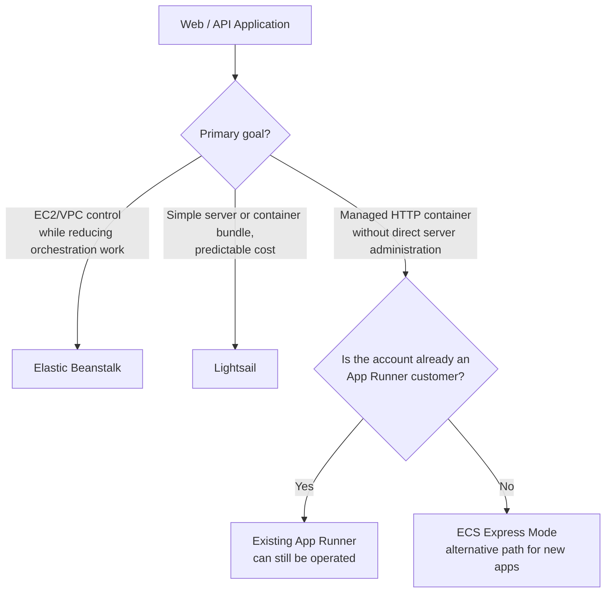
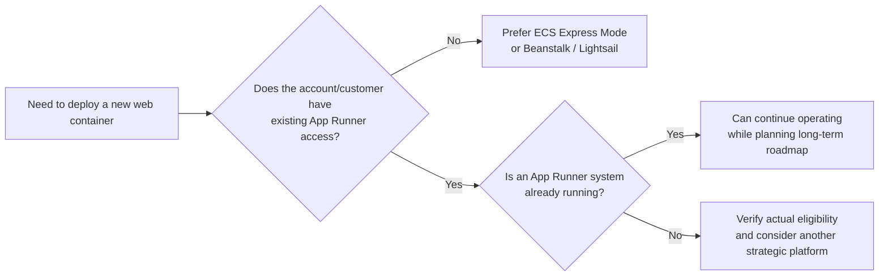
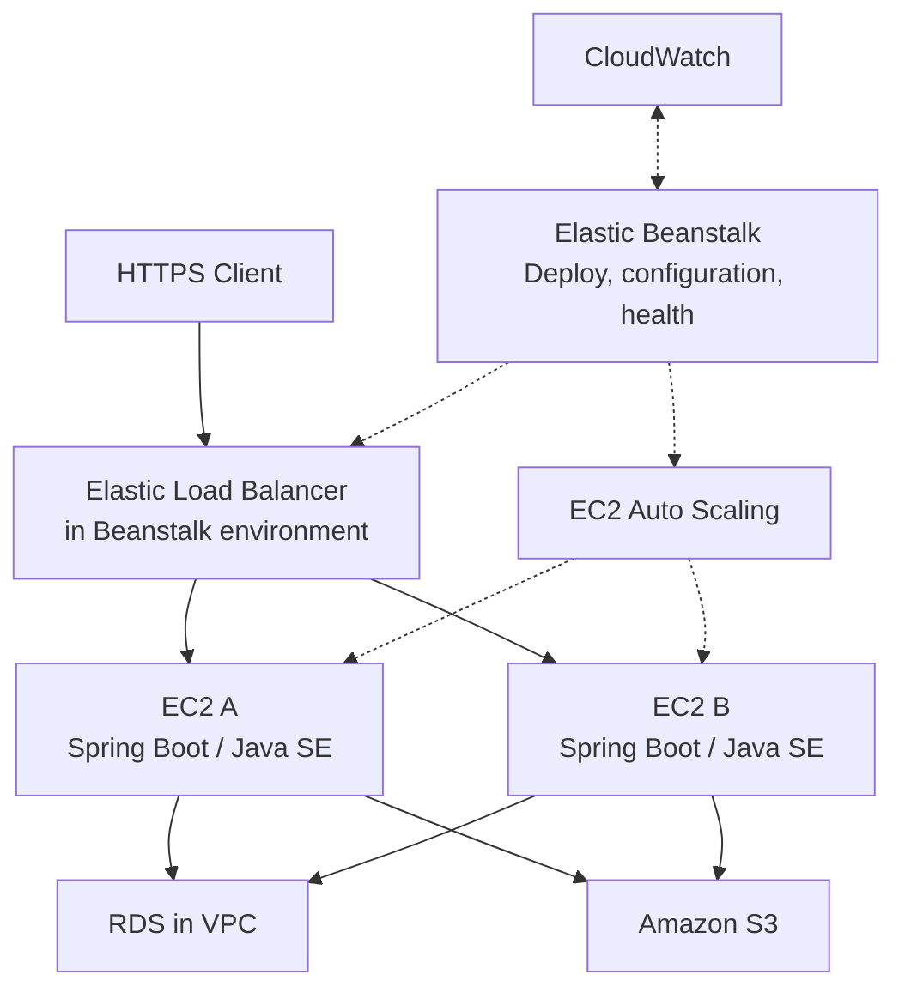
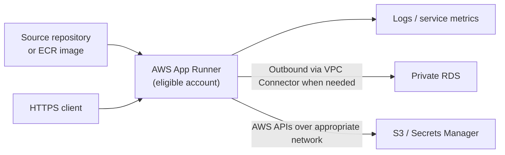
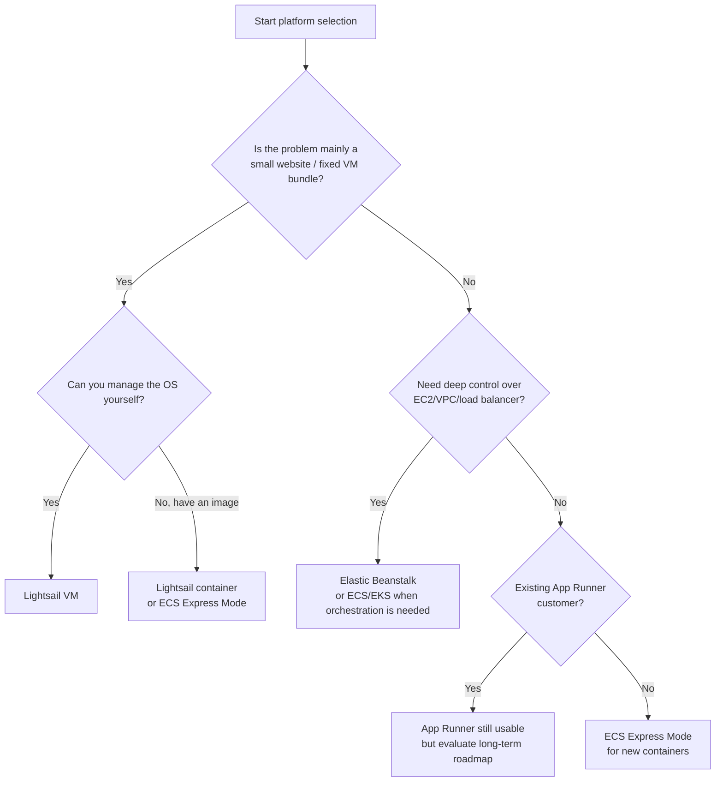
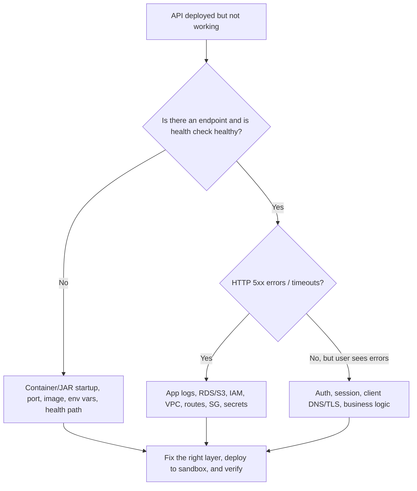

# Choosing Elastic Beanstalk, App Runner, or Lightsail

> **Module:** CLOUD_PROVIDERS_AWS  
> **Chapter:** Managed Application Platforms  
> **Focus:** Choosing a web/API application deployment service on AWS based on application type, infrastructure control, VPC networking, scalability, operations, and cost.  
> **Target Practice:** Java/Spring Boot applications as a JAR or container, though the selection principles apply across many languages and frameworks.

> **Important Update — November 20, 2026:** **AWS App Runner closed to new customers starting April 30, 2026.** Existing customers can continue operating the service and creating additional resources, but AWS has no plans to add new features. When designing a **new project on an account that is not eligible for App Runner**, do not select App Runner as the deployment option. AWS recommends **Amazon ECS Express Mode** for similar simple web container needs. See the [official App Runner announcement](https://docs.aws.amazon.com/apprunner/latest/dg/apprunner-availability-change.html) and the [AWS Decision Guide](https://docs.aws.amazon.com/decision-guides/latest/decision-guides/modern-apps-strategy-on-aws-how-to-choose.html).

## 1. The Dilemma: Fast Deployment or Deep Control?

Suppose a team develops a course management API using Spring Boot. The application needs to:

- Serve HTTP/HTTPS and scale as traffic grows.
- Read data from Amazon RDS or DynamoDB.
- Upload reports or documents to Amazon S3.
- Have health checks, logs, alerts, and low-disruption ways to deploy new releases.
- Protect secrets with IAM and Secrets Manager/SSM Parameter Store.
- Control costs during both testing and production usage.

Instead of manually configuring individual EC2 instances, an Application Load Balancer, an Auto Scaling group, firewalls, TLS, and pipelines, AWS provides different platforms to **reduce the amount of infrastructure you have to operate yourself**.

However, fewer deployment steps do not mean AWS automatically handles all business, security, and recovery requirements. Even on a managed platform, the application must still know how to connect to the database, authenticate, handle retries, persist state durably, and track errors.

### Learning Outcomes

After this lesson, learners can:

1. Accurately explain the roles of **AWS Elastic Beanstalk**, **AWS App Runner**, and **Amazon Lightsail**.
2. Evaluate **App Runner eligibility under the change effective April 30, 2026** and recognize **ECS Express Mode** as the alternative for new container applications.
3. Choose between a **Java JAR/ZIP**, a **container image**, a **Lightsail server**, and a **Lightsail container service**.
4. Compare EC2/VPC control, auto scaling, load balancing, TLS, CI/CD, and deployment mechanisms.
5. Plan **RDS/S3** connectivity, IAM permissions, secrets, and logs.
6. Design for at least two AZs or have a recovery strategy matching the criticality level.
7. Estimate **total cost** rather than comparing only listed service prices.
8. Perform a lab in an authorized environment and explain why one platform is chosen over another.

## 2. Three Approaches: Who Manages the Infrastructure?



**Elastic Beanstalk** is a managed application environment deployment layer. In the common EC2-backed mode, Beanstalk provisions and orchestrates resources such as **EC2, Auto Scaling, Elastic Load Balancing, and CloudWatch** in your AWS account. You can adjust many infrastructure characteristics, while still operating, updating, and paying for the underlying resources.

**App Runner** is a service for running web/API applications from source code or a container image, automatically handling much of the underlying infrastructure, HTTP/TLS, and scaling. The key point to keep in mind at the time of writing is that **it is no longer accepting new customers**; it is not a generally available choice for new accounts.

**Lightsail** provides simple infrastructure bundles including **virtual servers (instances)**, **container services**, managed databases, block/object storage, DNS, CDN, and load balancers, typically with **predictable monthly bundle pricing**. Lightsail instances behave like VPSs: the team still retains significant responsibility for the operating system and application processes.

### 2.1. Quick Comparison

| Criterion | Elastic Beanstalk | App Runner (existing customers) | Lightsail |
|---|---|---|---|
| Common deployment unit | JAR/source bundle, Docker, and supported platforms | Supported source code or container image | VM instance or container deployment |
| Server management | AWS orchestrates, but EC2 and configuration remain in your account | No direct EC2 management | For VMs: you manage the OS; for container services: the platform manages compute nodes |
| Load-based Auto Scaling | Yes, via load-balanced environments and ASG | Yes, via concurrency/instance settings | VM instances do not have EC2-style ASGs automatically; container services change **power/scale** via configuration |
| HTTP load balancing | Included in load-balanced environments | Built-in | Option for Lightsail load balancer or container service routing |
| HTTPS | Configured via load balancer/certificates or corresponding architecture | Managed HTTPS endpoint | Configure TLS/domains via Lightsail features or web server |
| Network control | Deeper; choose VPC, subnets, SGs, EC2/ELB | Public/private ingress; outbound via VPC connector if needed | Simplified; advanced VPC/AWS integrations have limits to verify |
| Deploy/rollback | Multiple deployment/update policies, health monitoring | Deploy from image/source, service-managed revisions | Snapshots/VM deployments or container deployments |
| Billing | **No separate Beanstalk fee**; pay for EC2/ELB/EBS and underlying services | vCPU/memory charges on a provisioned/active model | Compute/container bundles and add-on services |
| Suitability in 2026 | Recommended for suitable new projects | **Existing customers only** | Viable for simple workloads with predictable scale |

**Distinguish** between "AWS manages the environment" and "zero operational responsibility." Every service still requires secure code, least-privilege IAM, testing, monitoring, backups, and recovery design.

## 3. First Decision Point: Is App Runner Still Open to You?

According to the [AWS App Runner availability change](https://docs.aws.amazon.com/apprunner/latest/dg/apprunner-availability-change.html), AWS stopped onboarding **new App Runner customers** on **April 30, 2026**:

- **Existing App Runner customers:** can continue using the service, maintaining resources, and creating new resources/services within the terms applied by AWS.
- **Customers who were never onboarded to App Runner:** should not plan new project deployments that depend on creating an App Runner service.
- AWS continues investing in **security and availability**, but **has no plans to introduce new features**.
- AWS recommends **Amazon ECS Express Mode**, built on Amazon ECS with AWS Fargate, where an ALB, networking, and Auto Scaling are automatically set up through a streamlined deployment workflow.



**Do not conflate two separate facts:** Closing to new customers **does not mean existing services were immediately shut down on April 30, 2026**. Conversely, another company using App Runner **does not prove** your new account can create a service.

### 3.1. When Is It Still Worth Learning App Runner?

Studying App Runner remains useful to:

- Understand a low-ops PaaS/container option for serving HTTP.
- Maintain existing App Runner systems.
- Plan migrations from App Runner to ECS Express Mode, Beanstalk, or another platform.
- Learn the difference between an **inbound endpoint** and an **outbound VPC connector**.

In this lesson, the App Runner steps serve as a **reference guide for accounts that already have access**, not a guarantee that every new AWS account can run it.

## 4. Elastic Beanstalk: Managed Deployment on Infrastructure You Control

### 4.1. Application, Environment, Version, and Platform Concepts

| Component | Meaning | Example |
|---|---|---|
| **Application** | Logical object grouping code, versions, and environments. | `course-api` |
| **Application version** | A deployable packaged build. | `v2026-11-20-a` |
| **Environment** | Resources running the application, infrastructure configuration, and health status. | `course-api-staging`, `course-api-prod` |
| **Platform branch/version** | Runtime/OS stack and components provided by AWS for the application. | Java SE on a supported platform |
| **Web server environment** | Serves HTTP, either single-instance or load-balanced. | Spring Boot REST API |
| **Worker environment** | Pulls and processes background jobs via Amazon SQS using Beanstalk's supported mechanism. | Asynchronous report processing |

When choosing a **web server environment**, Beanstalk provisions resources according to the environment type.

**Single-instance environment**:
- Contains **one EC2 instance**, without a load balancer.
- Suitable for labs/dev/staging or workloads that can tolerate downtime.
- Not a multi-AZ architecture; no real high availability if the node fails.

**Load-balanced, scalable environment**:
- Uses EC2 Auto Scaling and Elastic Load Balancing.
- Configures min/max capacity, health, and rolling/immutable deployments.
- Can place instances across multiple AZs in an appropriate VPC.
- Better suited for production workloads requiring HA and capacity scaling.

> **Common Mistake:** "Choosing Beanstalk automatically gives multi-AZ HA." That is false for a **single-instance environment**. You must select the appropriate environment type, capacity, and subnets/AZs.

### 4.2. Architecture Flow



This is an **illustrative architecture for a load-balanced environment**, not the resources automatically created when you select single-instance.

### 4.3. Control and Responsibilities

You can configure:

- Instance types, Auto Scaling min/max, subnets, and security groups as needed.
- Staging/production environments, deployment policies, and rolling/immutable updates.
- Java SE, Docker, and AWS-supported platform branches.
- Environment properties, platform hooks, and extensions such as `.ebextensions`.
- Logs, health metrics, and alerts via CloudWatch.

However, the team must still:

- Manage the application lifecycle and data migrations.
- Design health endpoints and graceful shutdown.
- Review platform updates, especially when changing major runtimes/OS versions.
- Protect the IAM instance profile, secrets, and data in S3/RDS.
- Maintain backup/restore and rollback procedures.

### 4.4. Platform Updates Do Not Automatically Handle Every Upgrade

Beanstalk supports **managed platform updates** during a configured maintenance window. According to the documentation, managed updates support **patch/minor platform updates**, but **do not automatically switch to a platform branch with a new major runtime/OS**. For example, an application running on an older major Java version still needs a branch migration plan, compatibility testing, and coordinated release.

When updating environments, consider **rolling**, **immutable**, or **blue/green deployment** depending on requirements. Rollout choices must account for minimum capacity, health checks, connection impact, and rollback capability.

## 5. Elastic Beanstalk Lab: Deploying a Spring Boot Java JAR

### 5.1. Preparing the Application

Example Spring Boot REST API:

```java
package example.course;

import java.util.Map;
import org.springframework.web.bind.annotation.GetMapping;
import org.springframework.web.bind.annotation.RestController;

@RestController
public class CourseController {
    @GetMapping("/api/health-demo")
    public Map<String, String> hello() {
        return Map.of("status", "ok", "service", "course-api");
    }
}
```

This is only a demo controller; the project also needs a `@SpringBootApplication` class and the Spring Web dependency to build an executable JAR. In production, use the Spring Boot Actuator readiness endpoint instead of an endpoint that returns a hardcoded `ok`.

Build with Maven in your Java project:

```bash
./mvnw clean package -DskipTests
```

In CI/Production, **do not skip tests** just because the lab command includes `-DskipTests`. The example JAR is created at `target/course-api.jar`; the actual name depends on your project.

### 5.2. Source Bundle and Procfile

With Java SE, Beanstalk supports running a JAR via `java -jar`. When the bundle contains multiple JARs or requires an explicit startup command, add a **Procfile** at the root of the source bundle:

```text
course-api.jar
Procfile
```

Contents of `Procfile`:

```text
web: java -jar course-api.jar --server.port=5000
```

Port `5000` is an illustrative value matching the common default Java SE proxy configuration; if you change the application port, **you must keep it synchronized with the environment's proxy/health check**. Do not assume Beanstalk automatically guesses every Spring Boot port correctly.

**Note:** A source bundle must have **files at the root of the ZIP package**, not a single parent directory wrapping all the contents. Verify the file layout before uploading. Never include a `.env` file containing passwords or `~/.aws/credentials` in the ZIP.

### 5.3. Deploying via the AWS Console

1. Sign in to the sandbox account and verify the Region and IAM permissions.
2. Open **Elastic Beanstalk → Create application**.
3. Enter an application name, such as `course-api`.
4. Select **Web server environment**.
5. Choose the **Java SE** platform with an AWS-supported runtime; confirm the AMI/platform version matches your build.
6. Upload the ZIP source bundle or JAR according to the Java SE instructions.
7. Choose **Single-instance** for a low-cost lab, or **Load-balanced** if you want to practice HA.
8. Review the service role, EC2 instance profile, VPC, subnets, security groups, and runtime environment settings.
9. Create the environment and monitor Events/Health until it becomes Ready/healthy.
10. Open the environment URL and call `/api/health-demo`; observe the status code and application logs.

For Production, you need at least two healthy instances and appropriate AZs (when using load-balanced), TLS, health/alerts, backups, and a permissions review.

### 5.4. EB CLI

After **installing and verifying the EB CLI version** per AWS documentation, from a valid project directory:

```bash
# Interactive workflow to select account, Region, app, and platform.
eb init

# Create a sandbox environment after reviewing the options.
eb create course-api-lab

# View environment status and health.
eb status course-api-lab
eb health course-api-lab

# Deploy a new application version.
eb deploy course-api-lab

# Read logs to diagnose startup/runtime issues.
eb logs course-api-lab
```

`eb create` provisions resources and **may incur charges**. Do not run it if the project/Region/profile is incorrect. If the application does not have a prebuilt source bundle, configure an appropriate packaging workflow rather than assuming the EB CLI will always locate the right JAR automatically.

Clean up the test environment using an approved procedure:

```bash
# WARNING: This can destroy all resources in the environment.
eb terminate course-api-lab
```

Double-check the environment name and data impact before terminating. Databases or external resources created for or attached to the environment must have a separate retention/backup policy.

### 5.5. Environment Variables and Secrets

A Spring Boot application can use environment variables:

```yaml
spring:
  datasource:
    url: jdbc:postgresql://db.example.internal:5432/courses
    username: app_user
    password: ${DB_PASSWORD}
```

In a real application environment, Spring Boot requires properly configured property resolution. This example illustrates the idea of **not hard-coding passwords**; `DB_PASSWORD` should be injected via a supported secrets management mechanism, never committed with a real value.

According to AWS documentation, Beanstalk platform versions released **on or after March 26, 2025** can pass **Secrets Manager/SSM Parameter Store** values into environment variables using the supported feature. However, if a secret is rotated, syncing the new value into environment variables may require a **manual refresh per AWS procedures**—do not assume a running process automatically sees the new secret. The AWS SDK can query Secrets Manager directly when a different refresh mechanism is needed.

The EC2 IAM role in the environment must have permissions for the secret and the required KMS actions; do not grant `secretsmanager:*` across all resources.

## 6. App Runner: PaaS for Web/API Containers (Existing Customers Only)

Even though App Runner is closed to new customers, understanding its technical characteristics remains important when maintaining running applications.

### 6.1. Deployment Model

App Runner can pull applications from:

1. A **source code repository** using an AWS-supported managed runtime for a specific language/version.
2. A **container image** from Amazon ECR or a supported container source, with the appropriate IAM configuration.

App Runner handles much of the underlying layer: running containers, providing an HTTPS endpoint, load balancing, monitoring, and auto-scaling active instances based on load/concurrency settings.



Limitations:

- Operators **do not have control over the underlying EC2 host** as in Beanstalk.
- There are limits on runtimes, builds, memory/CPU, startup, and platform configuration; check each use case against them.
- Concurrency-based scaling **does not mean** running arbitrary unbounded background jobs or keeping a persistent local filesystem.
- The proper IAM access role and instance role are required for their respective tasks.

### 6.2. Java Runtimes: Do Not Confuse Java on Beanstalk and App Runner

Beanstalk Java SE lets you deploy a JAR on an appropriate Java platform branch. App Runner source-based deployments have **their own list of managed Java runtimes**; do not assume every modern Java version is supported in source mode. Java 17/21 applications may require a **container image** built and tested with the appropriate runtime.

For existing App Runner deployments, the container image approach lets you control the JDK/JRE version and dependencies inside the image, while AWS still manages application execution at the App Runner service level.

### 6.3. IAM Roles in App Runner

| Role / Permission | Purpose |
|---|---|
| **Access role** | Allows App Runner to pull images from an **ECR private repository** when configured with the appropriate image source. |
| **Instance role** | Allows the **running application code** to call AWS APIs such as S3, DynamoDB, or Secrets Manager with least privilege. |
| **Deployer** | Holds permissions to create/update App Runner services, IAM pass role, and related permissions per organization policy. |

**Do not put AWS access keys in environment variables** just because the application needs S3. Use the App Runner IAM instance role and the AWS SDK default credentials chain, along with the appropriate resource/KMS permissions.

### 6.4. Inbound vs. Outbound VPC

This is a common source of confusion:

| Traffic Direction | Configuration | Effect |
|---|---|---|
| **Inbound public** | Public endpoint (default for standard services) | The endpoint can be called from the Internet; the application still needs authentication. |
| **Inbound private** | **VPC interface endpoint + VPC Ingress Connection** | Restricts access from the VPC via AWS mechanisms; the endpoint still needs appropriate policies/SGs. |
| **Outbound public** | Default without a custom VPC connector | The application can call public endpoints according to policy. |
| **Outbound custom VPC** | **VPC Connector** with private subnets and SGs | Enables connectivity to private resources such as RDS/ElastiCache; outbound traffic routes through the selected VPC. |

**Connecting to RDS from App Runner:** Configure an **outbound VPC connector**, select appropriate **private subnets**, and use a security group allowed to reach RDS. **Do not confuse the outbound connector with the inbound private endpoint** — they are two distinct features.

When an outbound VPC connector is enabled, application network egress routes through that VPC; the application may **lose connectivity to the public Internet and AWS APIs** unless a NAT gateway or the corresponding VPC endpoints are configured. Certain traffic managed by App Runner itself (image pulls, logs/secrets service operations) does not traverse the same application VPC connector path.

### 6.5. Reference Steps for Existing App Runner Accounts

1. Verify the account has permission to operate App Runner.
2. Prepare a web/API container image with a startup command listening on the right port.
3. Push the image to ECR and grant the appropriate access role.
4. In App Runner, select **Create service** or update an existing service as permitted on the account.
5. Configure the image, CPU/memory, port, health check, and autoscaling configuration.
6. Select public/private ingress and public/VPC connector outbound based on RDS/S3 needs.
7. Attach an instance role with only the AWS API permissions the application needs.
8. Observe deployment status, endpoint, request/error metrics, and logs.
9. Review the provisioned memory/active vCPU+memory billing model and pause/resume options if applicable.

**Read-only** commands for accounts that already have App Runner:

```bash
aws sts get-caller-identity

aws apprunner list-services \
  --region ap-southeast-1

# Use the actual ServiceArn from the previous output.
aws apprunner describe-service \
  --service-arn arn:aws:apprunner:ap-southeast-1:123456789012:service/course-api/0123456789abcdef0123456789abcdef \
  --region ap-southeast-1
```

The ARN above is only a placeholder; without App Runner permissions, the commands may return `AccessDenied` or an empty list. On ineligible accounts, **do not attempt to create a new service**; see the ECS Express Mode option below.

## 7. ECS Express Mode: Practical Alternative for New Container Applications

AWS recommends **Amazon ECS Express Mode** as the path forward for applications seeking a simple experience similar to App Runner.

### 7.1. What Does It Provide?

According to current AWS documentation, you provide a **container image** and the required **IAM roles**. ECS Express Mode sets up a stack based on:

- An **Amazon ECS service**.
- **AWS Fargate** to run containers.
- An **Application Load Balancer** to receive HTTP/HTTPS traffic.
- **Auto Scaling** and networking.
- Integrated logging/monitoring across the created resources.

ECS Express Mode reduces initial configuration effort, though the underlying resources can still appear in your account and are billed accordingly. Do not treat it as simply a renamed App Runner or a Lightsail VM.

### 7.2. Conceptual Console Workflow

1. Build and push the image to Amazon ECR.
2. Open **Amazon ECS Console → Express mode**.
3. Select the **image URI** and ECR source.
4. Choose the task configuration, roles, and networking settings.
5. Confirm the public endpoint/TLS, scaling, and expected resources to be created.
6. Create the service and inspect the ECS tasks, ALB/health, and logs.
7. Configure access to RDS/S3, VPC endpoints/NAT, and secrets as needed.
8. Deploy a new release and verify rollback/readiness.

This workflow is included because **App Runner is no longer accepting new customers**, even though **it is not one of the three primary platforms in the title**. When choosing a new architecture in 2026, this alternative should not be overlooked.

### 7.3. When Should You Not Force an Application into Express Mode?

If you need multiple microservices with complex service discovery, multiple task definitions, specialized network policies, sidecars, or advanced orchestration, consider **ECS standard services**, **EKS**, or other managed models. Express Mode is a streamlined initial deployment path—it does not eliminate the need to understand ECS/Fargate, VPC, IAM, ALB, and costs.

## 8. Lightsail: Simple Server and Container Bundles

**Amazon Lightsail** is a good fit when you want to launch an application or website quickly with clear compute/transfer bundles and do not need all the granular infrastructure features of EC2.

However, **Lightsail does not have just one compute type**. You must distinguish between:

| Option | What You Get | Responsibilities |
|---|---|---|
| **Lightsail instance (VM)** | Linux/Windows virtual server with bundled CPU, RAM, SSD, and transfer | Patch the OS, install Java/Docker/reverse proxy, configure firewall, manage the app, and handle backups |
| **Lightsail container service** | Runs container images, provides a public endpoint, and scales by node count and configured power | Manage images, config, health, and deployments; no host-level administration like a VM |
| **Lightsail managed database** | Managed database within Lightsail's feature set | Schema, access credentials, backups, and application security; verify HA/tiers |
| **Lightsail load balancer** | Simple HTTP/HTTPS balancing for VMs | Domain/certificate/health configuration and capacity limits |
| **Lightsail object/block storage, snapshots** | Supporting services | Lifecycle, backup/restore, permissions, and costs |

### 8.1. Is a Lightsail Instance a PaaS?

If you choose a **Lightsail Linux VM** to run Spring Boot, you must still:

1. Install a supported Java runtime.
2. Manage OS updates and security patches.
3. Configure the service with `systemd` or Docker.
4. Set up a reverse proxy and TLS (when using the VM directly).
5. Manage ports/firewalls and SSH/credentials.
6. Back up data and monitor resources.

Therefore, a Lightsail VM is closer to a **simplified VPS/IaaS** than a fully automated source-to-running-app platform. If your goal is zero OS administration, consider Lightsail **container service**, Beanstalk, or ECS Express Mode.

### 8.2. Container Service: Power and Scale

For a **Lightsail container service**:

- **Power** selects the vCPU and RAM per compute node.
- **Scale** is the number of nodes serving the container deployment.
- You can increase/decrease power and scale using the mechanisms AWS provides.
- It does not include **metric-based Auto Scaling at the depth of ECS/ASG** by default; choosing capacity is an operator decision, and automation capabilities should be evaluated.
- Container service pricing is typically **power price per node × scale**.
- AWS states that each container service includes a **500 GB/month data transfer allowance** under the current model; overages may apply.
- **Container services continue to be billed even when disabled or when no deployment is active**; to stop charges, you must verify and delete the resource per the documentation.

An **illustrative example based on the AWS pricing page** (not a quote for every Region): a Medium node at **$40/month** with **scale 3** results in **$120/month for the nodes**, excluding add-on services or other fees. Always verify pricing in your target Region at deployment time.

### 8.3. Console Workflow for a Lightsail Instance

1. Open **Lightsail → Create instance** and choose the Region/AZ.
2. Choose Linux/Unix, an appropriate blueprint/OS, and a bundle with enough RAM for the JVM.
3. Configure the SSH key and minimal firewall rules; do not open administrative ports to every IP unnecessarily.
4. Create the instance, update the OS, and install Java or Docker via a controlled process.
5. Copy the artifact from your pipeline or pull a trusted image.
6. Use `systemd` to run Spring Boot; configure the reverse proxy/TLS.
7. Use a static IP, DNS, or load balancer as required.
8. Set up monitoring, snapshots, and restore testing.

Example unit file for a lab:

```ini
[Unit]
Description=Course API Spring Boot
After=network-online.target
Wants=network-online.target

[Service]
Type=simple
User=course-api
WorkingDirectory=/opt/course-api
ExecStart=/usr/bin/java -jar /opt/course-api/course-api.jar --server.port=8080
Restart=on-failure
RestartSec=5
TimeoutStopSec=120

[Install]
WantedBy=multi-user.target
```

This unit only manages the **Java process**. It does not automatically provide HTTPS, Auto Scaling, backups, or multi-AZ support. Ensure the `course-api` user, directory/JAR, network, and Java version are valid before applying it.

### 8.4. Lightsail Container Service Workflow

1. Package the application as a container image and test it locally.
2. Open **Lightsail → Containers → Create container service**.
3. Choose the Region, power, and scale based on CPU/RAM and availability needs.
4. Push or point to a supported image using Lightsail's mechanism.
5. Configure the container name, entrypoint, environment variables, and **public endpoint**.
6. Define an appropriate health check, such as `/actuator/health/readiness`.
7. Create the deployment and verify healthy status and URL.
8. Configure domains, certificates, and backups/monitoring within the service's capabilities.

Lightsail container service has different limits than ECS (networking, features, bundled resources). **Do not use ECS CLI examples directly for Lightsail container services.**

### 8.5. When Should You Not Choose Lightsail?

Do not choose Lightsail solely because of its simple bundle pricing if your system requires:

- Complex network segmentation with multiple private subnets, NACLs, VPC endpoints, and multi-account organization.
- Multi-dimensional Auto Scaling on multiple metrics and large traffic bursts.
- Many microservices, service discovery, queue consumers, and advanced container orchestration.
- Specific compliance controls and IAM resource policies requiring deep integration.
- Canary/blue-green rollouts, service mesh, or multi-AZ operations with strict SLOs that the chosen Lightsail architecture cannot meet.

In those cases, Elastic Beanstalk with granular VPC control, ECS/Fargate, or EKS are usually better candidates; however, validate actual requirements rather than assuming every small app needs Kubernetes.

## 9. A Comprehensive Decision Matrix

| Priority Criterion | Elastic Beanstalk | Existing App Runner | Lightsail VM | Lightsail Container |
|---|---|---|---|---|
| No OS administration | **Partial**; Beanstalk manages the platform, but you retain EC2 config | **Good** | **No** | **Better than VM** |
| Getting a Spring Boot JAR live quickly | **Suitable** | Needs a supported source runtime or container image | Install Java/deploy manually | Needs a container image |
| Custom VPC with granular control | **Suitable** | Outbound connector/private ingress have limits | Simplified; verify integrations | Simplified; verify integrations |
| Multi-AZ + automatic scaling | Yes, with an appropriate load-balanced environment | Yes, per service architecture | Requires designing/adding LB and nodes | Node scale is operator-configured |
| Predictable monthly cost bundle | Calculated across multiple AWS resources | Based on provisioned/active resource usage | **Very suitable** | **Suitable** |
| Custom OS runtime packages | Configurable via platform/instance hooks within limits | Via image, no host access | **Host access** | Via image, no host access |
| Quick launch for low-traffic website | Possible, but involves more resources | Yes, for existing customers | **Suitable** | Suitable if an image exists |
| Available to new accounts after Apr 30, 2026 | Yes | **No** | Yes | Yes |
| Multi-service apps & advanced networking | Feasible within Beanstalk limits | Limited; consider ECS | Usually not preferred | Usually not preferred |

### 9.1. Question-Based Decision Tree



This is a **heuristic** for discussion, not an absolute rule. For instance, a startup needing a VM for legacy software that cannot be containerized might also use Lightsail; an enterprise needing a custom VPC might pick Beanstalk, ECS, or another service depending on operations.

## 10. Real-World Scenarios: Choosing for Java/Spring Boot

### 10.1. Scenario A — Marketing Website + Small API

- A simple Spring Boot service with low traffic.
- Fixed budget; one person can handle Linux administration and deployments.
- No complex subnet, IAM, or multi-AZ requirements.

**Candidate:** Lightsail instance or Lightsail container service. If choosing a VM, you accept responsibility for the OS, firewall, TLS, and backups. If a container image is ready, Lightsail container can reduce host maintenance.

**When unsuitable:** When the SLA demands multi-AZ fault tolerance, complex private databases, or unpredictable spikes.

### 10.2. Scenario B — Course Platform with Private RDS in a VPC

- Spring Boot REST API built as a JAR.
- Needs two AZs, Auto Scaling, ALB, an IAM instance profile, and private networking to RDS.
- The team wants control over the VPC, subnets, security groups, and deployment policies.

**Candidate:** Elastic Beanstalk **load-balanced environment**. You can select the Java SE platform and integrate EBS/RDS/S3 as architected. Design stateless sessions or a shared store, health checks, and platform upgrades.

**Do not:** Use Beanstalk single-instance and claim HA.

### 10.3. Scenario C — Minimal Container Web API on a New AWS Account

- Have a Docker image in ECR.
- Want HTTPS, scaling, and no EC2 management.
- The account **is not eligible for App Runner**.

**Recommended candidate per current AWS guidance:** **ECS Express Mode**. Verify the Region, IAM, VPC, Fargate/ALB costs, and automatically provisioned resources.

**Do not:** Pick App Runner based on a pre-2026 blog post promising "deploy in a few clicks" without realizing the service closed to new customers.

### 10.4. Scenario D — Maintaining an Existing App Runner Workload

- System is already running on App Runner with CI/CD and metrics.
- Needs to connect to RDS in a VPC, add S3 permissions for the service, and keep endpoints stable.

**Immediate approach:** Continue managing the existing App Runner service if the account remains eligible, configure the outbound VPC connector and instance role properly, and monitor latency and costs.

**Long-term approach:** Plan an evaluation of ECS Express Mode or another solution since App Runner has no new features planned. There is no forced emergency migration solely from the new-customer closure announcement if the existing system continues to be supported by AWS.

### 10.5. Scenario E — Multi-Hour Reporting Job, No HTTP Serving

- Large data processing job needing retries/checkpoints and pulling messages from a queue.
- No need to keep a web request open for hours.

**Do not default** to using App Runner or Lightsail container as a long-running worker. Consider a Beanstalk worker environment (if SQS fits), AWS Batch, ECS tasks/services, or Lambda for eligible workloads. Base the choice on control, timeouts, retry semantics, and cost.

## 11. How Do Networking and IAM Architectures Differ?

### 11.1. Connecting to a Private Database

| Platform | Private RDS Approach |
|---|---|
| Elastic Beanstalk load-balanced | Place app EC2 instances in private VPC subnets; allow RDS SG inbound only from the app SG; keep ALB public if needed. |
| Existing App Runner | **Outbound VPC connector**, private subnets, and SG; configure NAT/VPC endpoints if the app also needs public AWS APIs. |
| Lightsail VM/container | Check Lightsail's supported VPC/peering/endpoint capabilities; complex private architectures may require other AWS services. |
| ECS Express Mode | Based on ECS/Fargate + VPC networking created/configured by Express Mode; inspect task SGs/subnets and the RDS SG. |

Do not use a database on the web container's local filesystem as the sole data store; containers and instances can be replaced. For critical data, use RDS/Aurora/DynamoDB or another durable store as required.

### 11.2. IAM for Application Code

- **Beanstalk:** Applications on EC2 can use an **EC2 instance profile** with an IAM role.
- **App Runner:** Runtime uses an **instance role** for AWS APIs; the access role is for pulling private ECR images.
- **Lightsail VM:** Evaluate the resource's IAM capabilities and AWS-supported integrations; **do not assume** all EC2 instance profile/IAM features exist identically on a Lightsail VM. Never store long-lived IAM user access keys in repositories or AMIs.
- **ECS Express Mode:** Uses an ECS task role for application code and an execution role for ECS image pulls/logs per ECS/Fargate architecture.

Example least-privilege policy for an API that only needs to read objects under an S3 prefix:

```json
{
  "Version": "2012-10-17",
  "Statement": [
    {
      "Sid": "ReadCourseMaterial",
      "Effect": "Allow",
      "Action": "s3:GetObject",
      "Resource": "arn:aws:s3:::course-materials-demo-123456789012/public-lessons/*"
    }
  ]
}
```

This illustrative policy **only grants GetObject**. If the application needs `ListBucket`, KMS Decrypt, or cross-account access, add the exact ARNs/actions along with the corresponding bucket/key policies and security controls. Never substitute `AdministratorAccess` for lab convenience.

### 11.3. Secrets and Configuration

Distinguish between:

| Configuration Type | Examples | Management Approach |
|---|---|---|
| Non-secret | `SPRING_PROFILES_ACTIVE`, port, public API URL | Environment properties/variables or controlled config |
| Secret | DB password, API token | Secrets Manager/Parameter Store or platform-supported secret mechanism |
| AWS credentials | AccessKeyId/SecretAccessKey/SessionToken | Prefer IAM workload roles/temporary credentials; never hard-code |
| Application data | Uploads, reports, user sessions | S3, RDS, DynamoDB, Redis/shared state per workload |

When using environment variables that hold secrets, avoid dumping all of `env` into logs, crash dumps, or support tickets. For rotating secrets, verify when the running process actually picks up the new value.

### 11.4. TLS, Domains, and Public Exposure

- ALB/Beanstalk: Use ACM and an HTTPS listener, with security groups restricting sources/destinations properly.
- App Runner: Service-managed HTTPS endpoint; for private endpoints, configure a VPC interface endpoint/ingress connection.
- Lightsail: Attach domains and certificates/HTTPS using Lightsail features; if using a raw VM, you still manage the reverse proxy/TLS.
- ECS Express Mode: Verify the provisioned HTTPS/ALB setup and endpoint access rules per configuration.

**Do not assume** "managed platform" = application authentication. Every API still requires business authentication/authorization if it exposes private data.

## 12. Health Checks, Scaling, and Low-Disruption Deployments

### 12.1. Readiness and Liveness in Spring Boot

When using Spring Boot Actuator:

```yaml
management:
  endpoint:
    health:
      probes:
        enabled: true

server:
  shutdown: graceful

spring:
  lifecycle:
    timeout-per-shutdown-phase: 60s
```

The readiness endpoint (once Actuator is added and properly configured/exposed) can be:

```text
/actuator/health/readiness
```

Point the platform's health check to the right path: Beanstalk proxy/ELB, App Runner health config, Lightsail health check, or the ALB in ECS Express Mode. Health checks should reflect readiness to serve traffic, not merely that the JVM is alive.

### 12.2. Deploying New Versions

| Platform | Control Points |
|---|---|
| Beanstalk | Rolling/immutable/blue-green, health checks, min capacity, platform updates. |
| App Runner | Deployment status, health checks, concurrency scaling, traffic for existing services. |
| Lightsail VM | You orchestrate deploys, restarts, rollback/snapshots, or use a load balancer. |
| Lightsail container | Create a new deployment, check status, manage power/scale. |
| ECS Express Mode | ECS tasks, ALB target health, deployment settings, and rollback within ECS capabilities. |

**Do not claim zero downtime** simply because there is a "Deploy" or "Update" button. With Beanstalk single-instance, a Lightsail VM, or a single task/service, deployments can cause unavailability. With multi-instance setups, ensure sufficient capacity, readiness checks, connection draining, and graceful shutdown.

### 12.3. Resilient Data Persistence

Never write user-uploaded data solely to the local disk of an EC2 instance or container and expect the next release to retain those files. Solutions:

1. Store user-uploaded files in S3.
2. Use RDS/DynamoDB for transactional business data.
3. Use Redis/shared session storage or stateless auth when scaling out.
4. Use SQS/queues for long async jobs, with idempotency.
5. Take backups, test restores, and document clear RPO/RTO targets.
6. Decouple the database from the web environment lifecycle if you want to deploy or terminate environments without losing data.

## 13. Application Observability and Operations

### 13.1. What to Collect?

| Signal | Why |
|---|---|
| HTTP request count, 4xx/5xx rates, and p95/p99 latency | Monitor user experience and deployment errors |
| CPU, memory, concurrency/instance or node counts | Tune capacity and costs |
| Health check status/readiness | Know when the app is not ready to receive traffic |
| Application logs with request ID/correlation ID | Trace Spring Boot, DB, and upstream errors |
| Deployment events / rollout status | Correlate errors with version changes |
| RDS connections, latency, and storage | Identify database bottlenecks |
| External calls to S3/Secrets Manager | Catch IAM/network errors and request costs |
| Cost by account/Region/service/tag | Stay on budget and detect forgotten resources |

### 13.2. By Platform

- **Beanstalk:** Environment health/events, logs from EC2 and CloudWatch, Auto Scaling/ALB metrics.
- **App Runner:** Service status, logs, and platform-provided application metrics.
- **Lightsail:** Instance/container metrics and resource states; add application observability tools as needed.
- **ECS Express Mode:** ECS service/task metrics, ALB, CloudWatch Logs, and related observability settings.

CloudTrail is useful for auditing configuration activities like creating/modifying services, roles, and networking, but **it does not replace application access logs** or HTTP request metrics.

### 13.3. Troubleshooting Flowchart



## 14. Cost Comparison: TCO, Not Just Listed Prices

### 14.1. General Formulas

**Elastic Beanstalk (EC2 environment):**

```text
Monthly total ≈ EC2 instances
              + EBS
              + Load Balancer / LCU (if applicable)
              + data transfer / NAT / endpoints
              + CloudWatch / logs
              + RDS / S3 / secrets
```

Beanstalk **charges no separate orchestration layer fee** under the standard model; costs come from the created resources. Single-instance avoids ALB charges but lacks HA.

**App Runner (existing customers):**

```text
Monthly total ≈ provisioned memory
              + active vCPU/memory during request processing
              + data transfer
              + VPC/NAT/interface endpoints if used
              + logs / AWS APIs / database
```

Do not claim App Runner "only charges when there is an HTTP request" because **provisioned memory** can still accrue charges while the service is running/idle. Check pause/resume details and applicable billing models.

**Lightsail instance/container:**

```text
Monthly total ≈ VM bundle or (container power price × scale)
              + load balancer (if needed)
              + database
              + snapshots / extra storage
              + data transfer overages
              + additional AWS services
```

A monthly bundle **does not mean all costs are all-inclusive**, especially transfer overages, snapshots, and managed databases.

### 14.2. Illustrative Numerical Example (Hypothetical Labels)

Suppose a team evaluates a **Medium Lightsail container service with 3 nodes**. If the price is **$40/month/node** in an AWS pricing page example:

```text
3 nodes × $40 / node / month = $120 / month
```

This covers **only the container nodes**, excluding databases, load balancers (if added), snapshots, overages, or other services. Prices and availability must be checked for the current Region.

For Beanstalk, if a team runs two EC2 instances and an ALB, each resource must be calculated by hour/GB/usage. You cannot conclude Beanstalk is "expensive" just because it has more billing line items; it can be noticeably more economical for steady loads, with appropriate commitments, or when private networking is required.

### 14.3. Commonly Overlooked Costs

- NAT gateway hourly and per-GB processing charges for private workloads calling the Internet/AWS APIs.
- ALB/LCU and health check traffic/requests.
- Log ingestion/retention in CloudWatch.
- S3 storage/GET/PUT and cross-AZ/Region transfer per policy.
- Database backups, snapshots, and storage.
- Staging environments left running after testing.
- Always-on standby caches/proxies/containers.
- Engineering time spent on OS patching, troubleshooting, and recovering failed instances.

Set up **AWS Budgets** and alerts, keeping in mind that a budget alert **does not automatically stop compute** and does not replace IAM permissions.

## 15. Common Troubleshooting Table

| Symptom | Common Platform | What to Check |
|---|---|---|
| JAR runs locally, but Beanstalk returns 502 | Elastic Beanstalk | App port vs. reverse proxy, Procfile, Java version, environment logs |
| Beanstalk environment is Healthy, but DB is unreachable | Elastic Beanstalk | RDS SG, VPC/subnets/routes, DNS, DB credentials, and IAM if using IAM auth |
| Beanstalk single-instance drops connections on deploy | Elastic Beanstalk | No other targets exist; consider switching to load-balanced with rolling/blue-green |
| Cannot create a new App Runner service in the account | App Runner | **Service closed to new customers on Apr 30, 2026**; evaluate ECS Express Mode |
| App Runner times out reaching private RDS | Existing App Runner | Outbound VPC connector, subnets, SG, RDS inbound rules |
| App Runner loses public AWS API access after enabling VPC connector | Existing App Runner | NAT or VPC endpoints for outbound traffic; do not confuse with private ingress |
| Lightsail VM is running, but API is unreachable from Internet | Lightsail VM | Firewall ports, reverse proxy, static IP/DNS, TLS, and service logs |
| New Lightsail VM loses data after instance replacement | Lightsail VM | Snapshots/backups and data storage strategy; do not keep data only locally |
| Lightsail container is unhealthy | Lightsail container | Image, port, env vars, public endpoint, health path, resource power |
| Lightsail still charges even with container service disabled | Lightsail container | Check for remaining resources; AWS bills for un-deleted services |
| Adding more nodes still yields 5xx errors | Any platform | Database bottleneck, session state, health checks, timeouts, logs |
| `AccessDenied` when calling S3 | Any platform | Workload IAM identity, policies, bucket/KMS/endpoint policies |
| Higher-than-expected costs | Any platform | Resource inventory, RDS/NAT/ALB, transfer, logs, snapshots |

## 16. Applied Exercises: Choosing a Platform for Three Products

### 16.1. Case Study 1 — MVP Needed Online Today

**Prompt:** The team has a very small web app with steady traffic and one person who can administer Linux; costs must be predictable monthly.

Tasks:
1. Compare a Lightsail VM and a Lightsail container.
2. State who is responsible for OS patching and TLS.
3. Define minimum requirements for backups, monitoring, and DNS.
4. Explain when migrating to Beanstalk or ECS Express Mode makes sense.

**Guidance:** Lightsail can be a strong choice if the operational responsibilities and capacity limits are acceptable.

### 16.2. Case Study 2 — Spring Boot + RDS + 2 AZs

**Prompt:** An e-commerce API packaged as a JAR needs private RDS, traffic-based scale-out, and low-disruption version deployments.

Tasks:
1. Choose between an **Elastic Beanstalk load-balanced** or single-instance environment and explain why.
2. Diagram public ALB → private EC2 across two AZs → private RDS.
3. Design an IAM instance profile allowing reads from one S3 prefix and one DB secret.
4. Select a readiness endpoint, min/max instances, and a rolling/immutable policy.
5. List billable resources and the backup/rollback plan.

**Guidance:** Beanstalk fits well when you want EC2/VPC control while reducing manual LB/ASG setup.

### 16.3. Case Study 3 — Container API on a New Account in November 2026

**Prompt:** The team has a Docker image in ECR, wants no OS administration, and needs HTTP/TLS and autoscaling. The account has never used App Runner.

Tasks:
1. Explain why App Runner **is not an available option for new customers**.
2. Compare ECS Express Mode against Beanstalk Docker and Lightsail container.
3. Select one option along with networking, IAM, and operational considerations.
4. Diagram the request flow and dependencies to S3/RDS.
5. Create a checklist covering health, latency, cost, alerts, and resource cleanup.

**Guidance:** ECS Express Mode is the AWS-recommended alternative, though the final choice depends on specific requirements.

### 16.4. Sample Scoring Matrix

To make a quantitative decision, assign **weights** based on your priorities (not every team needs the same weights):

| Factor | Example Weight | Question to Answer |
|---|---:|---|
| Security & VPC/private DB | 25% | Does the network architecture meet organizational policy? |
| Scalability/HA | 25% | How many AZs/nodes? What happens if one node fails? |
| Operational simplicity | 20% | Who handles patching, deployments, rollbacks, and app monitoring? |
| Total cost | 20% | Compute, network, LB, DB, logs, operations? |
| Runtime/CI-CD fit | 10% | Does it support the Java version/image and current pipeline? |

Total weight is **100%**. Score each candidate on a consistent scale **and immediately disqualify unavailable options** (App Runner for new customers)—do not give App Runner a high score and ignore service eligibility limits.

## 17. Quick Knowledge Check

**1. Is Elastic Beanstalk completely free for the whole application?**  
No. There is no separate fee for the Beanstalk layer, but EC2, EBS, ELB, networking, logs, and other resources are still billed.

**2. Does Beanstalk single-instance guarantee two AZs and zero-downtime deployments?**  
No. Single-instance runs only one EC2 instance in its standard environment configuration; use load-balanced and proper capacity design to improve HA.

**3. As of November 20, 2026, can new customers choose App Runner as before?**  
No. AWS stopped onboarding new customers on **April 30, 2026**; existing customers can still use it.

**4. Which service does AWS recommend for migrating from App Runner to a similarly simple web container experience?**  
**Amazon ECS Express Mode**.

**5. Are a Lightsail instance and a Lightsail container service the same thing?**  
No. A VM requires OS/process administration; a container service manages compute nodes and deploys images via Lightsail's container mechanism.

**6. Does increasing the node count of a Lightsail container mean you have traffic-based Auto Scaling like ECS?**  
No. Power/scale sets fixed capacity configured by you; verify AWS-supported automation capabilities against actual operational needs.

**7. Does an App Runner VPC Connector restrict users to accessing the app only from a VPC?**  
No. Here, the VPC Connector primarily handles **outbound** traffic to resources in a VPC. Private **inbound** access uses a VPC interface endpoint/VPC Ingress Connection.

**8. Does Spring Boot need IAM user access keys stored in `application.yml` to access S3 on Beanstalk?**  
No. Prefer an IAM role instance profile and the AWS SDK default credentials chain.

**9. Does using a managed platform mean the DB automatically has backups and the app cannot lose state?**  
No. You must design backup/restore, shared data storage, and test the system against RPO/RTO requirements.

**10. When choosing among the three platforms, should you compare compute prices or total cost?**  
**Total cost**, including compute, load balancing, DB, storage, networking, logs, deployments, and operations.

## 18. Summary and References

**Elastic Beanstalk** fits when you want fast Java/Docker application deployment while retaining control over EC2, networking, Auto Scaling, deployments, and environments. **Lightsail** fits small-to-medium websites/APIs with clear resource bundles and operational responsibility corresponding to whether you choose a VM or container. **App Runner** used to be a very streamlined path for web containers, but since **April 30, 2026 it no longer accepts new customers**; existing customers can continue operating it and should proactively plan their long-term roadmap. For new container apps, **ECS Express Mode** is the alternative explicitly highlighted by AWS.

### Official Documentation

- [AWS — App Runner availability change](https://docs.aws.amazon.com/apprunner/latest/dg/apprunner-availability-change.html)
- [AWS Decision Guide — Choosing a modern application strategy (updated Nov 13, 2026)](https://docs.aws.amazon.com/decision-guides/latest/decision-guides/modern-apps-strategy-on-aws-how-to-choose.html)
- [AWS Decision Guide — Lightsail, Elastic Beanstalk, or EC2?](https://docs.aws.amazon.com/decision-guides/latest/decision-guides/lightsail-elastic-beanstalk-ec2.html)
- [AWS Elastic Beanstalk — How Elastic Beanstalk works](https://docs.aws.amazon.com/elasticbeanstalk/latest/dg/concepts.html)
- [AWS Elastic Beanstalk — Environment types](https://docs.aws.amazon.com/elasticbeanstalk/latest/dg/using-features-managing-env-types.html)
- [AWS Elastic Beanstalk — Java SE platform](https://docs.aws.amazon.com/elasticbeanstalk/latest/dg/java-se-platform.html)
- [AWS Elastic Beanstalk — Quickstart: Java app](https://docs.aws.amazon.com/elasticbeanstalk/latest/dg/java-quickstart.html)
- [AWS Elastic Beanstalk — Managed platform updates](https://docs.aws.amazon.com/elasticbeanstalk/latest/dg/environment-platform-update-managed.html)
- [AWS Elastic Beanstalk — Environment variables and Secrets Manager](https://docs.aws.amazon.com/elasticbeanstalk/latest/dg/AWSHowTo.secrets.env-vars.html)
- [AWS App Runner — Using source code and source images](https://docs.aws.amazon.com/apprunner/latest/dg/service-source-code.html)
- [AWS App Runner — Outbound VPC networking](https://docs.aws.amazon.com/apprunner/latest/dg/network-vpc.html)
- [AWS App Runner — Incoming networking](https://docs.aws.amazon.com/apprunner/latest/dg/network-incoming.html)
- [Amazon ECS — Create your first Express Mode service](https://docs.aws.amazon.com/AmazonECS/latest/developerguide/express-service-first-run.html)
- [Amazon Lightsail — Instances, Containers and managed resources](https://docs.aws.amazon.com/lightsail/latest/userguide/what-is-amazon-lightsail.html)
- [Amazon Lightsail — Container services](https://docs.aws.amazon.com/lightsail/latest/userguide/amazon-lightsail-container-services.html)
- [Amazon Lightsail — Change container service capacity](https://docs.aws.amazon.com/lightsail/latest/userguide/amazon-lightsail-changing-container-service-capacity.html)
- [Amazon Lightsail — Pricing](https://aws.amazon.com/lightsail/pricing/)
- [AWS App Runner — Pricing](https://aws.amazon.com/apprunner/pricing/)
- [AWS Elastic Beanstalk — Pricing](https://aws.amazon.com/elasticbeanstalk/pricing/)

> **Deployment Notice:** All application names, domains, ARNs, buckets, ports, and costs shown are for learning purposes only. Before deploying, verify service eligibility, Region, quotas, current pricing, and internal security requirements. Only create or terminate test environments in authorized accounts, and never commit real credentials into source code or documentation.
