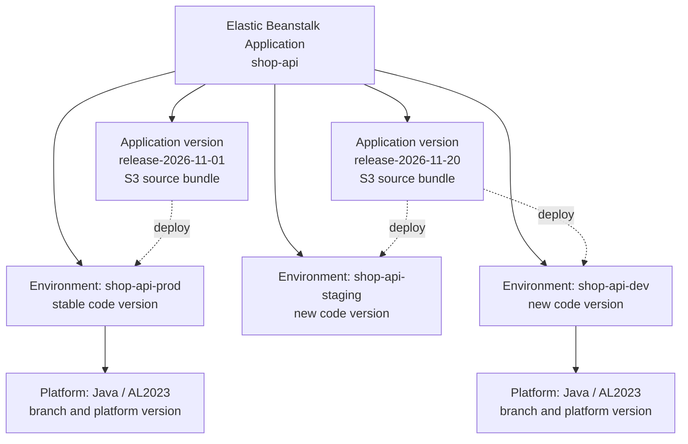
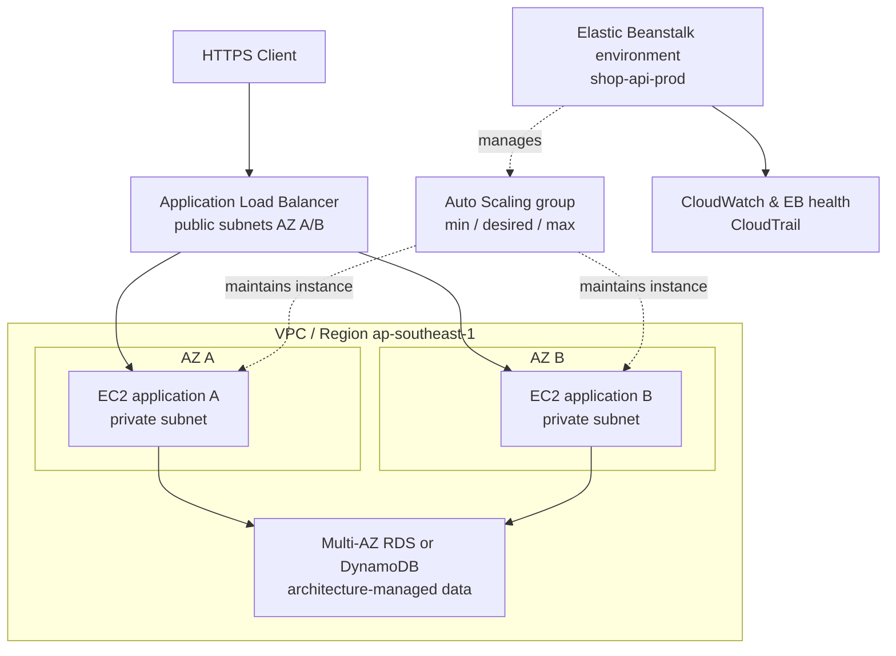
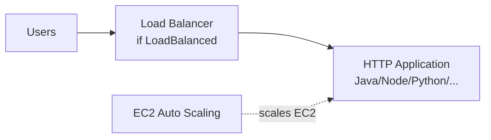
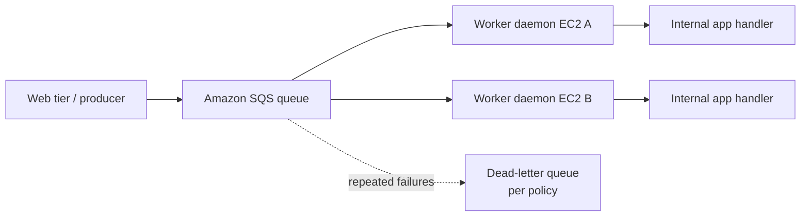
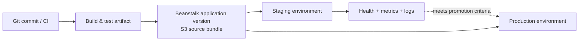
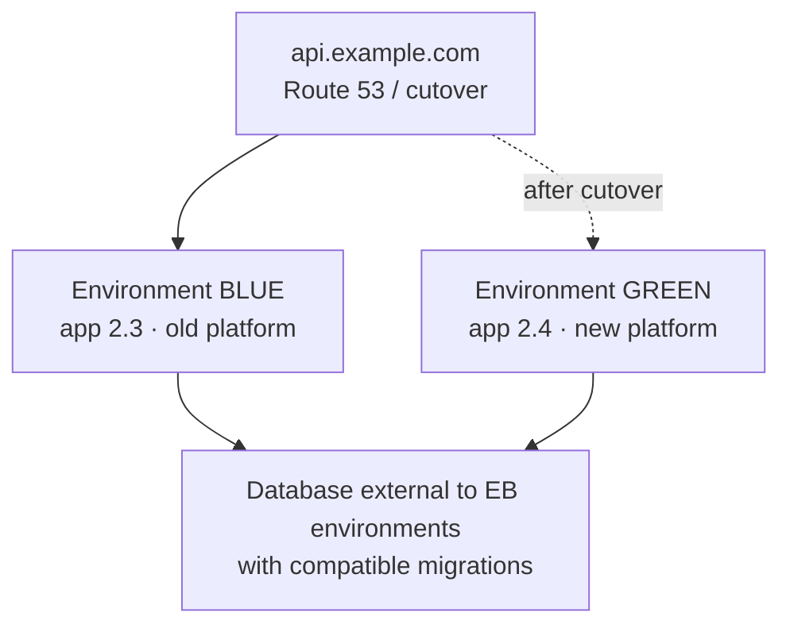
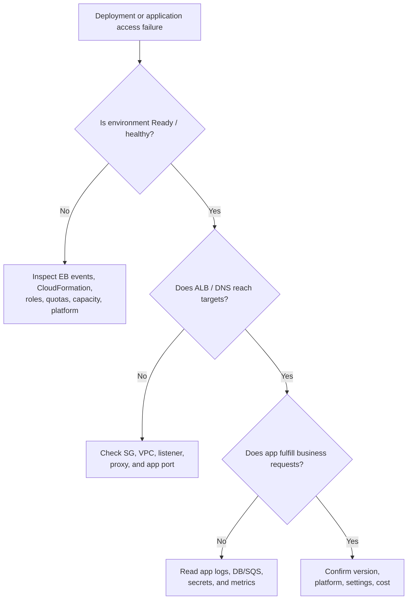

# Elastic Beanstalk Application, Environment, and Platform on AWS

> **Chapter:** Managed Application Platforms  
> **Module:** CLOUD_PROVIDERS_AWS  
> **Objective:** Distinguish and properly use the three concepts **application**, **environment**, and **platform** in AWS Elastic Beanstalk; know how to package, deploy, upgrade, monitor, and recover an application while still controlling IAM, VPC, costs, and resource lifecycles.

## 1. What Problem Does Elastic Beanstalk Solve?

A Java development team has a sales API written in Spring Boot. If deploying manually on Amazon EC2, the team must organize many tasks themselves:

- Launching instances and setting up the operating system, Java runtime, and reverse proxy.
- Uploading source code or build artifacts, configuring the application process and network ports.
- Creating Security Groups, subnets, an Application Load Balancer (ALB), and target groups.
- Setting up Auto Scaling, health checks, and logging.
- Rolling out new releases onto EC2 instances with minimal disruption.
- Updating the OS/runtime, backing up data, and troubleshooting issues.

**AWS Elastic Beanstalk** provides an orchestration layer to deploy and manage many of these components from a unified application model. Developers provide source code or artifacts, choose how to run them, and configure settings; Elastic Beanstalk creates, manages, and updates the associated AWS resources.

**Do not misunderstand:** "managed application platform" does not mean AWS assumes all responsibility. With Beanstalk Standard, customers remain responsible for **application code, data, IAM permissions, VPC/security group configuration, capacity, platform version selection, and application compatibility with the runtime**. Elastic Beanstalk reduces deployment overhead, while underlying services still carry their own costs and limits.

### 1.1. Three Keywords You Must Distinguish

| Concept | Question It Answers | Example |
|---|---|---|
| **Application** | "Which product or workload group is this?" | `shop-api` |
| **Application version** | "Which code/artifact build is running?" | `release-2026-11-20.1` |
| **Environment** | "Which specific set of AWS resources is running a given code version?" | `shop-api-dev`, `shop-api-prod` |
| **Platform** | "Which OS, runtime, web/app server, and Beanstalk components run the code?" | Java on Amazon Linux 2023 on a supported platform branch |
| **Environment configuration** | "How many machines, which network, which secrets, and how does the environment scale?" | 2–6 EC2s, load-balanced, private VPC instances |
| **Saved configuration** | "Can we save an environment configuration template for reuse?" | `prod-template` |

The trio **application – environment – platform** operates along different axes; **application version** is the artifact deployed to an environment. Understanding how they relate is the foundation for upgrade and rollback decisions.

## 2. Relationship Diagram: One Application Has Multiple Environments



In this example:

- `shop-api` is **one logical application**.
- `shop-api-dev`, `shop-api-staging`, and `shop-api-prod` are **three separate environments**: they can each have their own compute, networking, databases, IAM roles, and URLs.
- Each environment runs **one application version at a time**. Multiple environments may run the same version or different versions.
- The platform is chosen per **environment**; two environments under the same application can be on different platform versions while preparing an upgrade.

**Operational lesson:** do not create a new application just to deploy every code change; that is the job of an **application version**. Likewise, do not use a single environment for both testing and serving production if you require fault and access isolation.

## 3. Application: Logical Organizational Unit

### 3.1. What Does an Application Contain?

An Elastic Beanstalk **application** groups:

1. **Application versions** (individual code/artifact releases).
2. **Environments** that run those versions.
3. **Saved configurations** and related metadata.

An application is not directly an EC2 instance, Docker image, IAM role, or DNS record. It is a logical boundary for organizing a workload in Elastic Beanstalk.

**Naming examples:**

| Component | Suggested Name | Meaning |
|---|---|---|
| Application | `shop-api` | Order API system |
| Application version | `git-a92b71c` | Immutable artifact tied to a commit |
| Development environment | `shop-api-dev` | Rapid testing of changes |
| Staging environment | `shop-api-stg` | Pre-production testing |
| Production environment | `shop-api-prod` | Serving customers |
| Saved configuration | `shop-api-prod-baseline` | Production configuration template |

For larger organizations, separate **AWS accounts** may be used for development, staging, and production to isolate IAM and billing; each account then has its own application/environments or corresponding deployment setup. Having the same name does not merge resources across accounts.

### 3.2. An Application Is Not a Microservice Orchestrator

If a system consists of `shop-web`, `shop-api`, and `payment-worker` with independent release lifecycles, you can create **multiple Elastic Beanstalk applications**. Avoid cramming everything into one application:

- Owning teams, IAM permissions, and CI/CD pipelines may differ.
- Web and worker services use different environment types.
- Each component has different capacity, platform, and rollback requirements.
- Databases and message queues need clear ownership.

You can use one application containing multiple environments for **the same codebase/service** across stages. Split into separate applications when there are genuinely **distinct artifacts and lifecycles**.

## 4. Application Version: Deployable Code Release

### 4.1. What Is an Application Version Really?

In the **Beanstalk Standard** model, an **application version** is a labeled iteration of your application, typically referencing a **source bundle** stored in Amazon S3. For example:

- Java: JAR/WAR files and startup configuration in a platform-compliant source bundle.
- Node.js: application code and `package.json`.
- Python: application code and dependency declarations.
- Docker: Dockerfile or container configuration compatible with the Docker platform.

An application has many versions, while **each environment runs one selected version**. A deployment team can upload a version without pushing it straight to production; once staging passes validation, that same version is deployed to the production environment.

With the newer **Beanstalk Cluster** mode, application and version concepts still apply, though the artifact can be a **container image** or source code that Beanstalk builds into an image to run on EKS. Do not rigidly assume "always a WAR in S3" across every mode.

### 4.2. Version Label vs. Platform Version

Two version numbers are frequently confused:

| Field | Subject | Example |
|---|---|---|
| **Application version label** | Product code/artifact | `build-1837`, `v2.4.0` |
| **Platform version** | OS/runtime/proxy/Beanstalk components | A release within the Java on AL2023 branch, numbered `X.Y.Z` |
| **Platform branch** | Platform lineage by major runtime/OS | Java 21 on Amazon Linux 2023, depending on available branches |
| **EC2 instance type** | Compute specification running the app | `t3.small`, `m7i.large` |
| **Environment name** | Independent deployment | `shop-api-prod` |

**Deploying a new application version does not automatically upgrade the Java runtime**; updating the platform likewise does not rebuild your application from a new commit.

### 4.3. Versioning for Reliable Rollbacks

A safe pipeline should:

1. Build and test in CI, producing a reproducible artifact.
2. Assign a **unique version label** containing the build ID or commit SHA.
3. Upload the artifact to managed storage; avoid mutating the contents of a labeled source bundle.
4. Deploy that version to staging and run smoke/integration/performance checks.
5. Promote **the exact same artifact** to production.
6. Retain versions still needed for rollback along with their associated dependencies.
7. Configure an **application version lifecycle policy** to stay under version count limits and control storage costs.

**Note:** A lifecycle policy can delete old versions by **age or count**, but will not automatically delete a version currently deployed to an environment; deleting the underlying S3 source bundle depends on configuration options. An overly aggressive cleanup policy can remove older versions needed for rollback later.

## 5. Environment: Where the Application Actually Runs

### 5.1. Which AWS Resources Does an Environment Include?

An **environment** is the collection of resources provisioned and coordinated by Elastic Beanstalk to run an application version.

In **Beanstalk Standard**, this typically includes:

- One or more **Amazon EC2 instances** inside an Auto Scaling group.
- **Security groups**, an EC2 instance profile, a service role, and related networking resources.
- An **Elastic Load Balancer (ALB, NLB, or supported type for the platform/model)** if a load-balanced environment is chosen.
- **CloudWatch metrics/logs**, health reporting, and resource configuration.
- **S3** for storing source bundles/logs/application artifacts as configured.
- Optional **RDS** integration, though production databases are usually managed **outside the environment lifecycle**.

Beanstalk uses **AWS CloudFormation** to manage many environment resources. This is an important point: operators can inspect the real EC2 instances, Auto Scaling groups, ELBs, and CloudFormation stack in the AWS account—these are not completely hidden "virtual" resources.



**Do not assume multi-AZ production is automatic:** the environment type, subnets, instance min/max, database, and load balancer must be configured accordingly.

### 5.2. One Environment Runs Only One Application Version

A production environment may run `build-1829` while staging runs `build-1837`. Redeploying `build-1829` to production does not require creating a new application. However, the environment still has its own **platform version**; if the older artifact's runtime is incompatible with the currently running platform, a code-only rollback may fail.

### 5.3. Environment Name, CNAME, and Endpoint

Elastic Beanstalk can assign an environment domain name such as:

```text
shop-api-prod.<region>.elasticbeanstalk.com
```

The exact name is provisioned by the service and varies by Region. You can attach a **custom domain** such as `api.example.com` via a **Route 53 CNAME/alias** pointing to the appropriate target resource, while configuring an **HTTPS/TLS certificate** with ACM and the load balancer listener.

Do not confuse:

- **Environment URL:** the hostname provided by Beanstalk.
- **ALB DNS name:** the endpoint of the environment's load balancer.
- **Custom domain:** public DNS owned by your organization.
- **Application name:** logical grouping, not a domain name.

For internal-only environments, DNS and access routing must match your VPC/VPN/Direct Connect setup; an environment can exist without direct Internet accessibility.

## 6. The Two Environment Tiers of Beanstalk Standard

### 6.1. Web Server Environment Tier

The **web server tier** serves HTTP traffic from users:



Commonly used for:

- Websites, REST APIs, and HTTP-serving backends.
- Services with relatively short response times.
- APIs requiring HTTP health checks, ALB, TLS, and autoscaling.

To be production-ready, the design should account for multiple AZs, appropriate minimum instances, and an independent database.

### 6.2. Worker Environment Tier

The **worker tier** processes asynchronous jobs via **Amazon SQS**. Elastic Beanstalk creates and configures a worker daemon on EC2 that polls messages from the queue and POSTs the payload to a local HTTP endpoint on your worker application.



For example, the web tier accepts an order and enqueues email delivery and invoice generation jobs. The worker runs separately with its own capacity and scaling policy.

Key operational details:

- The daemon calls your application over HTTP and **deletes the message from SQS upon receiving a success response per worker daemon rules**.
- On errors or timeouts, the message can return to the queue after the visibility timeout and be reprocessed.
- **Standard SQS provides at-least-once delivery:** the worker application must be **idempotent** to avoid sending duplicate invoices or double-charging.
- Configure visibility timeouts, retries, a dead-letter queue, queue age metrics, and worker concurrency.
- The worker tier **does not use a web-tier load balancer**. It uses an Auto Scaling group to scale message-processing capacity.
- Some platforms such as **.NET on Windows Server** do not support the worker environment tier; verify platform/tier compatibility before creating one.

### 6.3. Tier Is Not Environment Type

These are two separate axes:

| Concept | Common Choices | Meaning |
|---|---|---|
| **Environment tier (Standard)** | Web server, Worker | Whether the app serves user HTTP requests or processes SQS jobs |
| **Web environment type** | Single instance, Load balanced | One EC2 without an LB vs. a group of EC2s with LB/Auto Scaling |
| **Platform** | Java/Node.js/Python/... with OS/runtime version | Runtime/OS/proxy used to run the code |
| **Application version** | `build-123`, `build-124` | Deployed business code |

Do not create a worker tier merely because an API spawns a background thread; choose it when you want Elastic Beanstalk's managed SQS/worker daemon flow.

## 7. Single-Instance and Load-Balanced Environments

### 7.1. Single-Instance

A single-instance web environment typically has:

- **One EC2 instance** (managed by an Auto Scaling group with min/max/desired = 1).
- No load balancer.
- An environment endpoint attached to an **Elastic IP** under Standard mode.
- Lower cost by omitting the ALB/LB component, suitable for **dev/test, demos, and workloads that tolerate downtime**.

Drawbacks:

- Does not survive an EC2 or AZ failure for HA.
- Deployments/updates can interrupt the application.
- Does not scale instance count under load because capacity is fixed to one machine.
- Public IPv4, EBS, EC2, and logs still incur charges; it does not mean "free."

**Do not use single-instance as the default for high-SLA production** simply because it is easy to create.

### 7.2. Load-Balanced, Scalable

A load-balanced web environment typically:

- Creates an **Elastic Load Balancer** and an **Auto Scaling group**.
- Can distribute EC2 instances across multiple AZs.
- Scales EC2 count between min/max bounds using metrics/scaling policies.
- Supports deployment policies that reduce downtime.

For production, consider:

1. Minimum instance count sufficient to keep serving if one EC2 or AZ fails.
2. ALB health checks targeting an endpoint that reflects true app readiness.
3. ECS/EKS is not required: Beanstalk Standard runs directly on EC2 according to the platform.
4. Session state, uploads, and databases should live in external services when scaling horizontally.
5. Configure subnets, SGs, NAT/VPC endpoints, SSL/TLS, and autoscaling based on real requirements.

### 7.3. From Dev to Production

You can start with single-instance in dev and change the environment type to load-balanced when needed. However, that operation can **create or replace resources**, change endpoints, and cause downtime and cost changes. For critical production workloads, it is usually better to create a new environment and test it before switching traffic.

| Criterion | Single-Instance | Load-Balanced |
|---|---|---|
| EC2 count | One | One or more, per min/max |
| ALB/NLB | No | Yes, per configuration |
| Scale-out | No instance-count scaling | Auto Scaling capable |
| EC2/AZ fault tolerance | Does not meet HA | Possible across multiple AZs with suitable backend/data tiers |
| Cost | Generally lower | Adds LB and EC2 capacity costs |
| Deployments | Can disrupt traffic | Multiple policies: rolling/immutable/traffic splitting |
| Use case | Dev/test/POC | Production and scalable workloads |

## 8. Platform: Where OS, Runtime, and Beanstalk Components Meet

### 8.1. What Does a Platform Include?

In **Beanstalk Standard**, a **platform** is a combination of:

- Operating system (such as Amazon Linux 2023 or Windows Server, depending on branch).
- Language runtime (Java/Corretto, Node.js, Python, PHP, Ruby, .NET, etc., from the supported list).
- Web server / reverse proxy / application server (Nginx, Apache HTTPD, Tomcat/IIS, etc., depending on platform).
- Elastic Beanstalk components to manage deployments, configuration, health, and logs.

**The platform is not your application code.** Java 21, Nginx, and Amazon Linux 2023 are the foundation layers; `shop-api.jar` is the business artifact.

### 8.2. Platform, Platform Branch, and Platform Version

| Term | Scope | Conceptual Example |
|---|---|---|
| **Platform family** | Ecosystem-level platform group | Java |
| **Platform branch** | Line sharing the same major OS/runtime/web/app server | Corretto/Java on Amazon Linux 2023 with a supported major runtime |
| **Platform version** | Specific release within a branch, including patches/component updates | `X.Y.Z` |
| **Application version** | Code built/deployed by the development team | `release-2026-11-20` |

**Do not use the illustrative `X.Y.Z` placeholder as a real platform version.** Query the list of supported/recommended platform versions in your Region/account.

### 8.3. Platform Branch Lifecycle

AWS classifies platform branches by lifecycle state:

| State | Interpretation | Action to Take |
|---|---|---|
| **Supported** | Actively supported branch receiving updates | Suitable for production if requirements match |
| **Beta** | Experimental/pre-release branch | Try in labs; avoid critical production |
| **Deprecated** | Includes a component approaching or past EOL; being phased out | Plan migration before retirement |
| **Retired** | No longer receives updates; typically cannot create new environments in console | Migrate to a supported branch |

For a **platform version** within a branch, AWS also distinguishes:

- **Recommended:** the latest update recommended by AWS.
- **Not recommended:** older versions in the same branch that may lack patches.

A **Supported** branch can still have older, non-recommended platform versions. Branch status and version status are two separate checks.

### 8.4. Upgrading a Platform Version vs. Changing a Platform Branch

**Within-branch update:** for example, updating the Java platform version within the same Amazon Linux 2023 branch to receive runtime/OS/web server patches. AWS recommends staying updated; you can use **managed platform updates**.

**Cross-branch migration:** for example, moving from an older major runtime to a newer major runtime, or from Amazon Linux 2 to Amazon Linux 2023. Such changes may require:

- Rebuilding code, dependencies, and verifying Java target compatibility.
- Replacing OS packages no longer present in the newer OS.
- Checking `.ebextensions`, `.platform/hooks`, reverse proxy configs, systemd units, and file paths.
- Updating monitoring agents, secrets, KMS/IAM policies, and health checks.
- Creating a **new environment** on the target branch if an in-place change is not supported.
- Using blue/green deployment and a planned rollback.

**Key detail from AWS documentation:** every **platform version** update may **replace the environment's EC2 instances**, even for within-branch updates. Use appropriate rolling/immutable updates and prepare capacity, externalized state, and connection draining. Do not assume a platform patch is automatically zero-downtime.

### 8.5. Runtime Lifecycle Does Not Equal Application Version

A Java application may be compiled against JDK 21 while the production platform runs Java 17. If the code uses Java 21-only APIs, deploying the artifact can prevent the app from starting. Verify:

- Actual `java -version` / platform branch.
- Bytecode target and native library dependencies.
- Environment variables, JVM options, and port/proxy configuration.
- Start command, container/app logs, and health checks.
- Platform patch level and deprecations.

**Separate three workflows:** (1) upgrading the application, (2) upgrading the platform version within the same branch, and (3) migrating to a different branch/major runtime. Avoid bundling all three into one emergency change without a clear rollback strategy.

## 9. Beanstalk Standard and Beanstalk Cluster (Current Update)

Current AWS documentation describes **two modes** that share the application, application version, environment, and configuration concepts:

| Criterion | **Beanstalk Standard** | **Beanstalk Cluster** |
|---|---|---|
| Compute layer | Applications run **directly on Amazon EC2** managed by the environment | Applications run as **containers on Amazon EKS** created/operated by Beanstalk |
| Application platform | Select a platform branch/version (OS/runtime/proxy) | Provide a container image or source for the service to build an image; **no Standard-style Java/Node OS platform branch selection** |
| Scaling management | EC2 Auto Scaling group and capacity triggers/settings | Replica scaling on EKS, with nodes provisioned via EKS Auto Mode per service mechanics |
| Configuration namespaces | `aws:autoscaling:*`, `aws:elasticbeanstalk:*`, etc. | `aws:elasticbeanstalk:eks` and its child namespaces |
| Update mechanism | Deployments to EC2 instances, platform updates | Rolling updates of container workloads |
| `.ebextensions` customization | Applies to Standard | **Does not apply the Standard way**; use Cluster-compatible configuration options/APIs |
| Isolation | Each environment has its own ASG/EC2 resources | Multiple Cluster environments in the same account and subnet set can share an EKS cluster, with workloads isolated per the service model |
| Best-fit use case | Quickly run web/backend apps on an AWS-managed runtime with EC2 config control | Want container orchestration and service-operated compute |

**Why mention Cluster in a lesson about platforms?** Because the statement "creating a Beanstalk environment means picking a Java/Python platform on EC2" is **true for Standard, but false for Cluster**. In Cluster mode, the workload's runtime lives inside the container image and service-managed EKS compute.

In the hands-on sections of this lesson, `.ebextensions`, EC2 platform branch, and EB CLI configuration examples **are explicitly scoped to Standard**. If working with Cluster, consult the dedicated Cluster documentation; do not use `aws:autoscaling:asg` to configure EKS replicas.

### 9.1. Shared Cluster Compute Does Not Mean Shared Data

In Beanstalk Cluster, multiple environments may share an EKS cluster based on account/subnet conditions, yet you must still:

- Configure network isolation, IAM permissions, secret injection, and data access.
- Plan replicas, scaling, and availability.
- Secure namespaces and workload identities per AWS guidelines.
- Monitor underlying EKS and EKS Auto Mode costs in your real environment.

**Do not mistake Cluster for an automatically provisioned ECS service.** It is a container model built on **Amazon EKS**, distinct from the ECS/Fargate infrastructure learners may have encountered elsewhere.

## 10. Environment Configuration: Where Do Values Come From?

### 10.1. Key Environment Settings

An environment has several configuration categories:

| Group | Examples | Impact |
|---|---|---|
| **Software** | Runtime environment properties, proxy, process command | How the application starts and reads config |
| **Instances** | EC2 instance type, root volume, instance profile | Capacity and application permissions |
| **Capacity** | Single/LoadBalanced, min/max EC2, scaling triggers | Availability and cost |
| **Load balancer** | Type, 80/443 listeners, health check path | Client/backend connectivity |
| **Network** | VPC, public/private subnets, security groups | Traffic paths, ECR/S3/RDS access |
| **Rolling updates/deployments** | Batch size, policy, timeout, health | Downtime and rollback behavior |
| **Monitoring** | Health reporting, log streaming, retention | Incident investigation capability |
| **Platform updates** | Managed updates/window/options | Patching and EC2 replacement |
| **Database** | Coupled RDS or external | Data lifecycle and recovery |

Changing a setting does not necessarily just edit a config file on EC2. Elastic Beanstalk may update or recreate AWS resources depending on the change; review **environment events** and evaluate downtime impact.

### 10.2. Configuration Sources and Precedence in Standard

For Beanstalk Standard, AWS documents the precedence order from highest to lowest:

1. **Values applied directly to the environment** via the console/EB CLI/API (including certain recommended settings applied by clients).
2. **Saved configuration** applied at creation or update time.
3. **`.ebextensions/*.config`** inside the source bundle.
4. **Default values**.

For example, if `.ebextensions` declares min EC2 = 2, but the console sets min = 3 on the environment, the console/direct environment value wins.

**Operational issue:** editing a file in Git and redeploying without seeing the change take effect can happen because **a higher-precedence option is overriding it**. Inspect the live configuration rather than assuming the source bundle is the sole source of truth when console edits are allowed.

### 10.3. Saved Configuration

A saved configuration is a reusable **environment configuration template**, useful when:

- Standardizing dev/staging/prod.
- Saving a baseline before cloning or creating a new environment.
- Comparing differences between configuration versions.

However, a **saved configuration is neither a runtime database backup** nor a code archive. It does not replace IaC or secrets protection workflows. Some values or resource references may be invalid when copied to another VPC, Region, or account; test before applying.

### 10.4. `.ebextensions` Example (Standard Only)

Structure of a Java source bundle:

```text
shop-api-bundle.zip
├── application.jar
├── Procfile
└── .ebextensions/
    └── 01-app-env.config
```

Contents of `.ebextensions/01-app-env.config`:

```yaml
option_settings:
  aws:elasticbeanstalk:application:environment:
    SPRING_PROFILES_ACTIVE: production
    LOG_LEVEL: INFO
```

Here:

- `.config` files must be valid YAML or JSON.
- The `.ebextensions` directory must sit at the **root of the source bundle**.
- Never put passwords, API tokens, or KMS private keys directly in the repository.
- Higher-precedence values from the console or API can still override these settings.

Illustrative Java SE **Procfile**:

```text
web: java -jar application.jar --server.port=5000
```

Ensure the artifact filename, main class/executable JAR, reverse-proxy forwarding port, and actual platform settings match. Some Java platforms follow different conventions, notably Tomcat WARs; do not copy a Java SE `Procfile` to a Tomcat platform without verifying.

### 10.5. Platform Hooks vs. `.ebextensions`

On eligible Amazon Linux 2/2023 platforms, you can use directories like `.platform/hooks/prebuild`, `predeploy`, and `postdeploy` to customize deployment stages.

When using hooks:

- Commands must be **idempotent** because they can re-run on new deployments or new instances.
- Do not run destructive data migrations in a hook that executes across multiple instances.
- Verify execute permissions, line endings, shell, and platform version.
- Do not write critical data to the local filesystem because instances can be replaced.
- Log clearly so deployment failures can be investigated.

**The more you customize the host, the higher the maintenance burden.** If the system requires heavy host customization, re-evaluate Standard vs. a container platform or ECS/EKS.

## 11. Environment Properties and Secrets

### 11.1. Environment Variables for Application Configuration

An application should separate settings from binaries:

- `SPRING_PROFILES_ACTIVE=production`.
- `LOG_LEVEL=INFO`.
- `ORDER_QUEUE_URL=https://sqs...` or configured endpoint.
- `DB_HOST=db.internal...`.
- Feature flags for rollouts.

Environment variables are **configuration**, not an access-control system. Never store plaintext secrets inside `.ebextensions` files or expose them in build logs.

### 11.2. AWS Secrets Manager and Systems Manager Parameter Store

Elastic Beanstalk supports referencing certain secrets/parameters into environment properties depending on platform capabilities; alternatively, the application can fetch them directly using the AWS SDK via an appropriate **EC2 instance profile/task identity**.

A secure design requires:

1. Creating the secret in **Secrets Manager/Parameter Store** with an appropriate KMS key.
2. Attaching a least-privilege IAM policy to the application's role.
3. Ensuring networking via **NAT Gateway/VPC endpoints** when instances sit in private subnets.
4. Handling secret rotation/reloading in the application; updating a secret in the store does not automatically cause a running process to reload the new value.
5. Verifying that logs and diagnostics do not print secrets to stdout or the console.

**Role distinction:** The Elastic Beanstalk **service role** lets Beanstalk manage resources and health, whereas the **EC2 instance profile** lets code on EC2 call AWS APIs; these are two distinct roles.

## 12. Deploying to an Environment

### 12.1. Application Version Release Flow



For each release, you can deploy to the desired environment via **Application versions → select version → Deploy** or the EB CLI.

Questions to answer before deploying:

- Has the artifact version been tested, and is it reproducible?
- Is the platform branch's runtime compatible with the new artifact?
- Is the database schema compatible with **both the old and new versions** during rollout?
- Do the environment type and instance count provide enough capacity for low-disruption deployment?
- Does the health check endpoint reflect readiness?
- If the deployment fails, what is the procedure to roll back to the previous version?

### 12.2. Common Deployment Policies for Beanstalk Standard

| Policy | How It Works | Downtime/Capacity Trade-off |
|---|---|---|
| **All at once** | Deploys new code to all instances simultaneously | Fast, but can cause downtime across the entire environment |
| **Rolling** | Deploys in batches, temporarily removing each batch from service | Capacity decreases while each batch updates |
| **Rolling with additional batch** | Launches an extra batch before replacing existing batches | Preserves capacity better; incurs temporary extra instance cost |
| **Immutable** | Deploys to a new group of instances, verifies health, then replaces the old group | Avoids mutating existing instances; requires more resources and provisioning time |
| **Traffic splitting** | Launches a new instance group and routes a percentage of traffic during evaluation | Enables canary/partial traffic testing; requires an **ALB** and supported config |

**Not every policy works with Single-instance.** AWS documentation states that **All at once** and **Immutable** are supported on Single-instance, whereas **Rolling** and **Rolling with additional batch** require a load-balanced environment; **Traffic splitting** requires a load-balanced environment using an **ALB**.

### 12.3. Code Rollbacks and Blue/Green

A fast recovery method is to **redeploy the previous application version** to the environment. However, if a rolling deployment fails mid-way, EC2 instances may be running mixed batch versions; inspect environment events, instance health, and the deployment policy.

**Blue/green** runs **two separate environments**, for example:

- Blue: `shop-api-prod-blue` currently serving traffic.
- Green: `shop-api-prod-green` on the new platform/runtime/app version.
- Test Green using its own environment URL.
- Shift traffic via **CNAME swap** or DNS/routing updates per design.



**Why blue/green fits platform branch changes:** different EC2/OS/runtime stacks can be validated independently before cutover.

**Warning:** A CNAME swap does not automatically synchronize databases or sessions; DNS caches/TTLs may keep sending some clients to Blue during transition. Keep Blue alive long enough for rollback and verify **backward-compatible** data changes.

### 12.4. Successful Deployment Does Not Mean Successful Product

Elastic Beanstalk may report `Ready/Green` because the process and HTTP health check pass, while the checkout API still fails business logic. You need:

- Smoke tests and contract tests.
- p95 latency, 4xx/5xx rates, database errors, and conversion metrics.
- Pre/post-deployment metric comparisons.
- CloudWatch alarms and a rollback runbook when anomalies appear.
- Do not rely solely on platform health status.

## 13. Platform Updates and Maintenance

### 13.1. Managed Platform Updates

Elastic Beanstalk supports **managed platform updates** to periodically apply eligible platform patches according to your settings. Administrators must still:

1. Choose a **Supported** branch.
2. Review changelogs and updated components.
3. Validate the application in staging whenever possible.
4. Select an appropriate maintenance window and rolling vs. immutable update mode.
5. Monitor environment health and logs.
6. Maintain a rollback/migration plan if an update proves incompatible.

**Platform updates can replace EC2 instances**, so data on local instance stores or unbacked-up filesystems can be lost. Use S3, EFS, RDS, or durable storage with a lifecycle independent of EC2 for data that must persist.

### 13.2. Components Updated Independently

Do not confuse:

- **Application version:** customer code.
- **Platform version:** OS/runtime/proxy/Beanstalk components.
- **EC2 instance type:** compute resource sizing.
- **Environment configuration:** security groups, ASG capacity, VPC, health settings.
- **RDS engine:** upgraded on its own database schedule.

For example, updating the Java platform does not update a PostgreSQL schema; deploying new code does not patch the Amazon Linux platform.

### 13.3. Safe Cross-Branch Migration

Suppose an organization migrates a Java Beanstalk Standard environment from an older branch to a supported branch on AL2023:

1. Inventory configuration, Java version, dependencies, Nginx/Tomcat behavior, and OS commands.
2. Build the artifact for the new runtime and run tests.
3. Create a **new environment** on the supported target branch.
4. Use reviewed saved configs/`.ebextensions` rather than blindly copying incompatible values.
5. Connect to the **external database** with valid IAM/SGs/secrets.
6. Verify smoke, performance, security, logs, and scaling tests.
7. Cut over traffic (CNAME/DNS) and monitor.
8. Keep the old environment for controlled rollback; terminate it once no longer needed and retention is confirmed.

The goal is not merely that the app "starts up," but that it meets **security, performance, recovery, and total cost** targets after the change.

## 14. Databases: Managing Lifecycle Independently of the Environment

### 14.1. Why Avoid Coupling a Production Database to an Environment?

Elastic Beanstalk Standard supports **coupled RDS** integration in some scenarios. For new or dev apps, this is convenient: Beanstalk creates the database alongside the environment and supplies the corresponding environment properties.

In production, however, this introduces significant risks:

- Terminating or recreating the environment can affect the database lifecycle if deletion policies are mishandled.
- Blue/green requires two environments sharing a database or replicated data per architecture.
- Databases have separate patching, backup, Multi-AZ/restore, and IAM/KMS schedules.
- Out-of-band RDS modifications outside Beanstalk's management path easily cause drift or errors.

AWS recommends considering **decoupling RDS** or creating and managing the database **outside the environment** as you move toward production.

### 14.2. Database Deletion Policies

Available options can include:

| Policy | Behavior When Decoupling/Terminating per Supported Rules | Risks to Watch |
|---|---|---|
| **Retain** | Keeps the database running independently of the environment | Continues incurring charges; connections/SGs/secrets must be managed separately |
| **Snapshot** | Creates a snapshot and deletes the DB instance per the supported workflow | RTO depends on restore time; snapshots incur storage charges |
| **Delete** | Deletes the database | Risk of data loss without separate backups |

**Operational risk:** AWS warns that changing the **deletion policy** in the same operation as **decouple** may **fail to apply the new setting**; save the deletion policy change in a separate operation **before** decoupling.

**Never terminate a production environment to "clean up resources" without verifying data, snapshots, S3, log retention, IAM/CloudFormation, and RDS deletion policies.**

### 14.3. Where Should Data and Sessions Live?

| Data Type | Recommended Location |
|---|---|
| Static files/uploads | S3, or EFS when the app genuinely requires shared POSIX storage |
| Transactional data | RDS/Aurora/DynamoDB per requirements |
| Session state | ElastiCache/Redis or an appropriate external session store |
| Background jobs | SQS/worker tier or an appropriate orchestrator |
| Logs | CloudWatch Logs or a managed log store |
| Build artifacts | S3 source bundles or ECR depending on mode |
| Ephemeral cache | EC2 disk/memory only if loss upon instance replacement is acceptable |

A **stateless web tier** lets the application scale and take platform updates with far lower data risk.

## 15. IAM, VPC, and Security

### 15.1. Roles Not to Confuse

| Role | Who Uses It? | Function |
|---|---|---|
| **Elastic Beanstalk service role** | The EB service | Manages/monitors environment resources using assigned permissions |
| **EC2 instance profile** | Code and agents on Standard instances | Accesses S3, SQS, DynamoDB, CloudWatch, Secrets, etc. as required |
| **CI/CD deployment role** | Pipeline or deployer | Creates application versions, deploys/updates environments, scoped `iam:PassRole` |
| **EKS cluster/node roles (Cluster mode)** | Amazon EKS and EC2 nodes in Cluster mode | Provisions/operates EKS foundation and nodes |
| **End-user identity** | API consumers | Must not be replaced by Beanstalk administrative permissions |

**Least privilege:** grant the application only the data API permissions it needs; never grant `s3:*`, `ec2:*`, or `iam:*` just "so Beanstalk works." Only admins/pipelines should modify environments and roles; end users need separate application-level authentication and authorization.

### 15.2. VPC Networking

For a load-balanced production Standard environment, the common pattern is:

- ALB in **public subnets** across multiple AZs (if internet-facing).
- Application EC2 instances in **private subnets**, without public IPv4 addresses.
- Outbound access from EC2 to ECR/S3/CloudWatch/Secrets via **NAT Gateway/VPC endpoints** when needed.
- EC2 SG allowing inbound traffic only from the ALB SG on the app port.
- RDS in private subnets with an SG allowing only the app SG on the DB port.
- HTTPS listener and ACM certificate for the official domain.

**Creating a Beanstalk environment does not guarantee all Internet connectivity works automatically.** An instance in a private subnet needs proper routes/NAT/endpoints and DNS; without them, deployments may fail to download dependencies or ship logs.

### 15.3. Consequences of Manually Modifying Beanstalk-Created Resources

If an administrator edits an Auto Scaling group, listener, SG, or CloudFormation stack directly without syncing with the Beanstalk environment configuration, the system suffers **configuration drift**, and manual changes may be overwritten on the next update.

Prefer:

- Supported Elastic Beanstalk configuration/EB CLI/API updates.
- `.ebextensions` or appropriately scoped IaC.
- Change control with versioning, review, and rollback.
- CloudTrail/Config to detect unexpected changes.

When a resource needs an independent lifecycle, create it **outside the environment** and reference it in the app rather than letting Beanstalk own everything.

## 16. Health Reporting and Monitoring

### 16.1. Basic vs. Enhanced Health

| Characteristic | Basic Health | Enhanced Health |
|---|---|---|
| Primary data | EC2/ELB health and resource state | Adds an agent and request/OS/app signals where supported |
| States | General color indicators | Detailed states such as OK, Warning, Degraded, Severe, Pending, etc. |
| Purpose | Know whether the environment is minimally available | Diagnose why an instance or environment is unhealthy |
| Limitation | Misses many business-logic failures | Still requires logs, business metrics, and synthetic tests |

A `Green/OK` health status **does not prove** transactional data is accurate or that every API path is error-free. Combine it with:

- ALB target health and CloudWatch 4xx/5xx metrics.
- CPU/memory/response latency/request rates.
- Application logs, traces, and dependency timeouts.
- Database/SQS metrics.
- Product-level alarms (checkout success rate, queue age, etc.).

### 16.2. Environment Events, CloudWatch, and Logs

Elastic Beanstalk records **events** during environment creation/updates, deployments, scaling, missing IAM permissions, or health state transitions. Operators can view them via the console, EB CLI, or API.

An investigation runbook includes:

1. Check recent **environment events**.
2. Inspect `HealthStatus`, `Status`, and the currently running version.
3. Check **EC2/ALB** health and ASG activity.
4. Read Nginx, application, and deployment agent logs from Beanstalk or CloudWatch.
5. Verify IAM/KMS, SGs/subnets/NAT, and database connectivity.
6. Record the last known good time and any recent releases, platform updates, or config changes.

**CloudTrail** tracks control-plane management APIs; application logs reflect HTTP requests and exceptions. Do not substitute CloudTrail for application access logs.

## 17. AWS CLI and EB CLI Practice

> The **`describe/list` commands below are read-only**. Simulated `create`, `deploy`, and `terminate` commands can create, modify, or delete resources and incur charges; use them only in authorized labs.

### 17.1. List Applications

```bash
aws elasticbeanstalk describe-applications \
  --region ap-southeast-1 \
  --query "Applications[].[ApplicationName,DateCreated]" \
  --output table
```

Shows which logical applications exist in the Region. It is **not** a list of EC2 instances.

### 17.2. View Environments

```bash
aws elasticbeanstalk describe-environments \
  --region ap-southeast-1 \
  --application-name shop-api \
  --include-deleted false \
  --query "Environments[].[EnvironmentName,EnvironmentId,Status,Health,VersionLabel,CNAME,PlatformArn]" \
  --output table
```

Key fields:

- `EnvironmentName/EnvironmentId`: which environment.
- `Status`: lifecycle state such as Ready/Updating/Launching as applicable.
- `Health`: overall health signal.
- `VersionLabel`: currently deployed application version.
- `PlatformArn` or `SolutionStackName`: designated platform, depending on generation/mode.
- `CNAME`: AWS-assigned environment URL.

**To inspect a single environment**, pass `--environment-names shop-api-prod`. Querying a nonexistent application name may return an empty list or an error depending on the API, which does not prove resources were deleted.

### 17.3. List Application Versions

```bash
aws elasticbeanstalk describe-application-versions \
  --region ap-southeast-1 \
  --application-name shop-api \
  --query "ApplicationVersions[].[VersionLabel,Status,DateCreated]" \
  --output table
```

Compare the production environment's `VersionLabel` against the application's versions. If you need `SourceBundle` and `BuildArn`/image-related metadata supported by the API, request full JSON output.

### 17.4. View Supported Platform Versions

```bash
aws elasticbeanstalk list-platform-versions \
  --region ap-southeast-1 \
  --query "PlatformSummaryList[].[PlatformArn,PlatformBranchName,PlatformVersion,PlatformBranchLifecycleState,PlatformLifecycleState]" \
  --output table
```

The list varies by Region/account/mode and may be paginated. Check **Supported/Recommended** before choosing a version. To inspect details of a specific platform version:

```bash
aws elasticbeanstalk describe-platform-version \
  --region ap-southeast-1 \
  --platform-arn arn:aws:elasticbeanstalk:ap-southeast-1::platform/EXAMPLE-PLATFORM/1.0.0 \
  --output json
```

The `EXAMPLE-PLATFORM` ARN is only a placeholder; replace it with a real `PlatformArn` from `list-platform-versions`. **Never hard-code fake version numbers for production.**

### 17.5. Inspect Environment Configuration

```bash
aws elasticbeanstalk describe-configuration-settings \
  --region ap-southeast-1 \
  --application-name shop-api \
  --environment-name shop-api-prod \
  --query "ConfigurationSettings[0].{Platform:PlatformArn,SolutionStack:SolutionStackName,Options:OptionSettings}" \
  --output json
```

**Warning:** `OptionSettings` may contain environment properties with sensitive data or internal config details; do not share the full JSON in public channels. Use appropriate read-only IAM permissions and extract only the fields needed for diagnosis.

### 17.6. View Recent Events

```bash
aws elasticbeanstalk describe-events \
  --region ap-southeast-1 \
  --environment-name shop-api-prod \
  --max-records 20 \
  --query "Events[].[EventDate,Severity,Message]" \
  --output table
```

Helps identify failed deployments, capacity issues, instance health changes, and platform updates. Combine with logs and ALB metrics when business errors occur.

### 17.7. Inspect Resources Managed by an Environment

```bash
aws elasticbeanstalk describe-environment-resources \
  --region ap-southeast-1 \
  --environment-name shop-api-prod \
  --output json
```

Output can list EC2 instances, launch configurations/templates, Auto Scaling groups, load balancers, and mode-specific resources. Use this to trace **Beanstalk environment → actual AWS resources** during infrastructure audits.

### 17.8. What Does the EB CLI Do?

The **EB CLI** is tailored to Elastic Beanstalk workflows alongside the general AWS CLI:

| Command | Purpose |
|---|---|
| `eb init` | Initializes project configuration and selects application/platform as appropriate |
| `eb create` | Creates a new environment; may provision resources and incur costs |
| `eb status` | Shows environment status |
| `eb health` | Displays enhanced health where supported/configured |
| `eb events` | Lists events |
| `eb logs` | Retrieves logs |
| `eb deploy` | Packages/pushes a new version and updates the environment |
| `eb config` | Views/edits environment configuration |
| `eb terminate` | Terminates the environment; verify resources/data first |

**Example command sequence in an isolated lab (modifies resources):**

```bash
# Lab: requires EB CLI installed and authorized AWS credentials.
eb init
eb create shop-api-dev
eb status shop-api-dev
eb deploy shop-api-dev
eb health shop-api-dev
eb logs shop-api-dev

# Only after confirming backups, costs, and resource lifecycle should you consider:
# eb terminate shop-api-dev
```

**Do not copy-paste this sequence into production.** `eb create` provisions EC2/LB and may create RDS depending on settings; `eb deploy` replaces code; `eb terminate` deletes environment resources per policy, risking loss of coupled data.

## 18. Daily Operations: Deploy, Scale, and Rollback

### 18.1. What Workflow Should a Production Release Follow?

1. Build the JAR/WAR/container image, run unit/integration tests, and perform vulnerability scans.
2. Create an immutable application version.
3. Deploy the same artifact to staging; verify health and API smoke tests.
4. Compare the staging platform branch with production, especially runtime/OS versions.
5. Choose a deployment policy matching downtime/capacity requirements.
6. Deploy to production while monitoring environment events, ALB, CloudWatch metrics, and logs.
7. If an issue occurs, recover using the previous version or a prepared **blue/green** environment.
8. Record the artifact version, platform version, environment configuration, and outcome.
9. Clean up old artifacts per lifecycle policy while keeping versions needed for rollback.

### 18.2. Traffic Switching and Rollbacks Do Not Automatically Revert Data

Suppose a new release adds a database column and the old release cannot read the new data format. Even if Beanstalk rolls back the code, the database data and schema remain in the new state. Use **expand/contract** migrations:

1. Add schema changes compatible with the old version.
2. Deploy the new version while maintaining compatibility.
3. Migrate data under monitoring.
4. Remove the old schema only after the rollback window closes and all clients have migrated.

Additionally, worker jobs must handle retries and idempotency. Do not consider "switching the CNAME back to Blue" as incident resolution if irreversible data changes have occurred.

### 18.3. Scaling and Capacity

For load-balanced Standard environments, tune min/max EC2 counts based on:

- Request rates, CPU/memory, response latency, and error ratios.
- Time required to launch a new instance and deploy the app.
- AZ count and minimum capacity needed if one AZ fails.
- Database connection limits, session state, and caching.
- Cost headroom during peak traffic.

**Auto Scaling does not fix database or third-party API bottlenecks.** Use CloudWatch alarms and load testing to identify the true bottleneck tier.

## 19. Symptom-Based Monitoring and Troubleshooting

| Symptom | Likely Cause | How to Check |
|---|---|---|
| Environment creation fails | Service role/instance profile missing permissions, EC2 quota, VPC/subnet misconfig | Environment events, CloudFormation resources, IAM/EC2 quotas |
| Health = Green, but API fails business logic | Health endpoint only checks process liveness; DB or business logic is failing | App logs, ALB 5xx, custom metrics |
| Single-instance suffers downtime on deploy | Single EC2 replaces code and restarts | Check deployment policy; consider load-balanced |
| ALB returns 502/503 | App not listening on expected port, unhealthy targets, SG blocking traffic | Target health, proxy logs, instance SG |
| Works in dev, fails in prod | Differences in env vars, platform/runtime, IAM, VPC, or database | `describe-configuration-settings` and artifacts |
| `eb deploy` succeeds, but changes do not appear | Wrong environment/application version selected or caching | `VersionLabel`, environment events, CDN/DNS |
| Platform update causes downtime | Instance replacement, insufficient capacity in rolling/immutable config | Platform update events, ASG/ALB health |
| App cannot download dependencies/secrets | Private subnet lacks NAT/VPC endpoints, execution/instance IAM role issues | VPC routes, SGs, DNS, IAM, CloudWatch logs |
| Autoscaling does not scale out | Low MaxSize, CloudWatch triggers, subnet IP exhaustion, EC2 quota | ASG activity, scaling policies, capacity |
| Beanstalk worker processes an order twice | SQS at-least-once + retries with a non-idempotent handler | Worker logs, SQS metrics, DB idempotency keys |
| Rolling back to an older version still fails | DB schema changed, secrets rotated, incompatible platform | Release timeline, schema/secret/platform history |
| Terminating env wipes out data | Coupled RDS with Delete/Snapshot policy, local files on EC2 | DB deletion policy, backup/restore |
| High costs during low traffic | High LoadBalanced min EC2, ALB/NAT/RDS still running | Cost Explorer, ASG min/max, environment resources |
| Config in `.ebextensions` has no effect | Higher-precedence console/EB CLI option, invalid YAML | `describe-configuration-settings`, precedence, events |
| Platform branch change rejected | Cross-branch migration cannot be applied in place, runtime incompatibility | Platform docs; create a new environment to migrate |
| Beanstalk Cluster ignores Standard `.ebextensions` | Cluster uses different EKS namespaces/config surfaces | Verify mode; use Cluster config options |

### 19.1. Layered Diagnostic Flow



**Avoid fixing the wrong layer:** a failed deployment caused by subnet private IP exhaustion will not be solved by editing Java code; an app returning HTTP 500 due to a database timeout should not be "fixed" by disabling health checks or opening SGs to the entire Internet.

## 20. Cost and Shared Responsibility Model

### 20.1. Is Elastic Beanstalk Free?

The AWS pricing page notes **there is no additional charge for Elastic Beanstalk itself**. However, **the AWS resources Beanstalk creates and uses are billable**:

| Component | Potential Charges |
|---|---|
| **Standard Compute** | EC2 instance-hours, EBS volumes, and snapshots |
| **Load balancing** | ALB/NLB hours, capacity units/traffic |
| **VPC egress** | NAT Gateway, endpoints, public IPv4, data transfer |
| **Application versions** | S3 source bundles/log storage |
| **Database** | RDS/Aurora or external data services |
| **Logging/monitoring** | CloudWatch Logs, metrics, alarms, S3 logs |
| **Container/Cluster** | EKS foundation, EKS Auto Mode/compute per applicable pricing |
| **Domain/cert/security** | Route 53, WAF, AWS KMS, ACM Private CA if used |

**For Beanstalk Cluster**, current AWS pricing documentation notes that you pay **the standard charges for the service-managed Amazon EKS foundation**, in addition to compute and traffic. Concluding "Beanstalk is free so Cluster has no EKS fee" is therefore false.

### 20.2. Relative Estimation Example

Two environments under the same application:

- `shop-api-dev`: SingleInstance with 1 EC2 instance, no ALB.
- `shop-api-prod`: LoadBalanced with 2–4 EC2 instances, ALB, NAT, Multi-AZ RDS, CloudWatch Logs.

Both run inside Elastic Beanstalk, yet their **costs are completely different** because of the underlying infrastructure. Estimate using the **AWS Pricing Calculator / Cost Explorer** by Region and workload, not by counting application or version labels.

**Rule of thumb:** adding an application or more versions does not significantly raise compute costs if no extra environments are created; adding a production environment provisions time-billed resources even when traffic is low.

### 20.3. Resource Cleanup Checklist

When decommissioning tests:

1. Verify which users or clients the environment currently serves.
2. Confirm data backups, RDS deletion/retain policies, and artifacts to keep.
3. Terminate the environment using an approved procedure.
4. Verify CloudFormation/EC2/ELB/ASG resources were cleaned up properly.
5. Check whether S3 source bundles, CloudWatch log groups, snapshots, EIPs, and external resources are still needed.
6. Monitor billing after cleanup; external or retained coupled resources may still accrue charges.

Do not delete an AWS account or application just to "shut off machines" without clarifying resource ownership across environments and data.

## 21. Comparing Elastic Beanstalk with Other AWS Options

| Platform | Consider When | Key Difference |
|---|---|---|
| **Elastic Beanstalk Standard** | You want simple web deployment on a managed OS/runtime/EC2 while keeping EC2/VPC configuration control | Orchestrates EC2/ASG/LB and platform updates |
| **Elastic Beanstalk Cluster** | You want service-managed container orchestration alongside the Beanstalk application/environment model | EKS-based, container images/source builds, managed cluster |
| **AWS App Runner** | You want to run web/API containers/source with a simpler infrastructure layer | Abstracts away EC2/ASG concepts, with different configuration limits and features |
| **Amazon ECS/Fargate** | You want explicit control over container tasks/services, networking, scaling, and deployments | ECS task/service is the primary management model |
| **Amazon EKS** | The team wants Kubernetes APIs and the controller/CRD ecosystem | Requires K8s expertise; costs/ops depend on Auto Mode/node model |
| **AWS Lambda** | Event-driven/short-lived workloads scaling per invocation | Function runtime and serverless limits, not traditional long-lived servers |
| **Self-managed EC2** | You need full control over OS, agents, and custom configs | The operations team carries greater maintenance responsibility |

There is no single universally best option. Choose based on **deployment lifecycle, runtime, control level, load, security, HA, cost, and operational capacity**. For AWS learners, Beanstalk serves as a solid bridge from "running one app on one EC2" to "a platform managing multiple AWS components."

## 22. Scenario Exercises with Answers

### Exercise 1 — One Application, Three Environments

A development team has one product `shop-api` and needs dev, staging, and production. Must they create three Beanstalk applications?

**Answer:** No. One **application** can hold three independent **environments**, each running an appropriate version. Separate applications or accounts can still be used if organizational or security isolation requires it.

### Exercise 2 — Deploying Different Code Without Updating Java

The team deploys a new artifact `build-25` to an older Java Standard environment. Will the Java runtime automatically upgrade to a newer major version?

**Answer:** No. **Application version** and **platform branch/version** are two independent axes. Platform updates must be managed separately.

### Exercise 3 — Changing OS/Runtime

An application must move from an older Java platform branch to AL2023/a newer major runtime. Should you just run `eb deploy` with new code or create a new environment?

**Answer:** Evaluate a **cross-branch migration**—typically creating and testing a new environment and then cutting over; deploying code does not change the platform. Check hooks, dependencies, proxy configs, and EC2 replacement timing.

### Exercise 4 — Many Versions, One Environment

An application has 20 application versions, and production still runs version 12. Do versions 13–20 provision additional EC2 instances?

**Answer:** Not simply by existing as versions. **Environments** provision compute. Undeployed versions are primarily artifacts/metadata and incur only storage charges according to how they are stored.

### Exercise 5 — Asynchronous Email Processing

An API needs to send emails asynchronously using SQS and a managed worker daemon. Which tier fits?

**Answer:** Beanstalk Standard's **worker environment tier**. Design retries, a DLQ, and an idempotent handler.

### Exercise 6 — Does Dev SingleInstance Have HA?

Dev has a single-instance environment reporting Green. If one AZ fails, is the app guaranteed to stay up?

**Answer:** No. Green only reflects health at check time. SingleInstance does not provide multi-AZ HA; production needs load-balanced/multi-AZ and redundant data stores.

### Exercise 7 — Why Didn't `.ebextensions` Override the Console?

`.ebextensions` sets `MinSize=2`, while the console sets `MinSize=3`. After deploying, the environment still runs a minimum of 3.

**Answer:** **Direct environment configuration** has higher precedence than `.ebextensions`. Review configuration precedence and edit at the right layer.

### Exercise 8 — App Deployed, Yet Not Ready

Environment health shows Warning/Degraded after a deploy, and ALB targets are unhealthy even though EC2 is Running.

**Answer:** EC2 Running does not prove the web app is ready. Check the target health path, proxy/port alignment, app startup logs, SGs, and health grace periods.

### Exercise 9 — Traffic Splitting on SingleInstance

The team wants to send 10% of traffic to a new version while using a single-instance environment.

**Answer:** The traffic-splitting deployment policy requires a **load-balanced environment with an ALB** per AWS support; switch environment types or create a suitable environment.

### Exercise 10 — Data Loss on Terminate

A test environment created a coupled RDS database with deletion policy Delete, and the operator plans to terminate and restore the database later.

**Answer:** Dangerous. Delete can remove the DB. Back up first, inspect the deletion policy, and choose Retain/Snapshot as needed; save policy changes in a separate step before decoupling when required.

### Exercise 11 — Code Rollback After Migration

A new release made a DB schema change incompatible with the old code. Beanstalk redeploys the previous application version, but the API stays broken.

**Answer:** Code rollback does not revert schema or data changes. Use expand/contract migrations and plan for data compatibility.

### Exercise 12 — Does Cluster Mode Pick a Java Platform Branch?

A Beanstalk Cluster environment runs a Java container image. The operator tries configuring `.ebextensions` with `aws:autoscaling:asg`.

**Answer:** Wrong model. Cluster uses **EKS-based container compute** and the `aws:elasticbeanstalk:eks` namespace, not Standard Java platform branches or Standard ASG options.

### Exercise 13 — Upgrading a Platform Patch

A team updates the platform version within the same Java branch and assumes EC2 instances will not be replaced because it is "just a runtime patch."

**Answer:** AWS states that platform version updates **replace instances**. Prepare rolling/immutable updates, externalized data, health checks, and capacity headroom.

### Exercise 14 — Secrets in Config Files

A developer commits `DB_PASSWORD=...` into `.ebextensions/01.config` so production always gets the right password.

**Answer:** Insecure. Use Secrets Manager/Parameter Store or supported secret references, least-privilege roles, and prevent secrets from appearing in logs.

### Exercise 15 — Application Permissions

Application code needs to read an S3 bucket. Should `s3:*` be added to the Elastic Beanstalk service role?

**Answer:** No. Standard application S3 permissions normally belong on the **EC2 instance profile role**, scoped to the exact bucket and actions; the service role is for Beanstalk resource management.

### Exercise 16 — App Count Does Not Equal Cost

An account has two applications: App A has 10 versions and 1 environment; App B has 2 versions and 4 load-balanced environments.

**Answer:** You cannot conclude App A costs more because it has more versions. Compute, LB, and running resources across **environments** usually dominate cost, while source bundles/metadata only incur storage fees.

### Exercise 17 — Retired Platform

An environment runs on a `Retired` platform branch and still works. The team plans to keep it in production for several more years.

**Answer:** Security and support risk because the branch no longer receives updates. Plan a migration to a **Supported** branch, test in a new environment, and track retirement schedules.

### Exercise 18 — Blue/Green and DNS Cache

The team performs a CNAME swap from Blue to Green and notices some clients still hit Blue for several minutes.

**Answer:** Likely caused by DNS caches/TTL or persistent connections. Keep Blue running long enough, monitor both environments, and ensure database/session compatibility; swapping CNAMEs does not synchronize state.

## 23. Checklist for Controlled Elastic Beanstalk Deployments

1. **Boundaries:** define the application, versions, environments, and ownership by account/Region.
2. **Mode:** choose Standard EC2 or Cluster EKS appropriately; do not mix configurations between modes.
3. **Platform:** for Standard, pick a supported branch and recommended version; schedule patches/migrations.
4. **Environment:** choose web/worker tier, SingleInstance/LoadBalanced, and capacity per requirements.
5. **Versioning:** immutable artifacts, clear labels, CI tests, and S3/ECR retention for rollbacks.
6. **Networking:** VPC, public/private subnets, AZs, ALB, NAT/endpoints, DNS, and TLS certificates.
7. **IAM:** separate service role, instance profile, and CI/CD role; manage secrets with KMS/Secrets Manager.
8. **Data:** external/decoupled RDS for production, S3/EFS uploads, external session store, backups, and RPO/RTO.
9. **Deployment:** All-at-once/Rolling/Immutable/Traffic splitting matched to the environment.
10. **Configuration:** understand precedence; version-control configs, avoid console drift and plaintext passwords.
11. **Observability:** enhanced health, events, CloudWatch, app logs, and synthetic/business metrics.
12. **Platform updates:** distinguish within-branch patches from cross-branch migrations; account for instance replacement.
13. **Rollback:** retain previous versions, use blue/green when needed, and maintain data/schema compatibility.
14. **Cost:** EC2/EBS/ALB/NAT/RDS/S3/CloudWatch/EKS are billed per actual resources, not application name.
15. **Cleanup:** verify environment resources, DB deletion policies, snapshots, logs, and still-billable assets.
16. **Drills:** rehearse a failed deployment, rollback, ASG scale event, AZ failure, and restore against business targets.

**Conclusion:** in Elastic Beanstalk, an **application** is the logical management boundary, an **environment** is a specific deployment with AWS resources and configuration, and a **platform** is the OS/runtime/Beanstalk component foundation (especially in Standard). By keeping **application version** distinct from **platform version** and knowing which environment owns which resources and data, learners can deploy quickly while building reliable update, monitoring, recovery, and cost-management practices.

## AWS Reference Documentation

- [Understanding concepts in Elastic Beanstalk](https://docs.aws.amazon.com/elasticbeanstalk/latest/dg/concepts.html)
- [Elastic Beanstalk supported platforms](https://docs.aws.amazon.com/elasticbeanstalk/latest/dg/concepts.platforms.html)
- [Elastic Beanstalk platforms glossary](https://docs.aws.amazon.com/elasticbeanstalk/latest/dg/platforms-glossary.html)
- [Managing application versions](https://docs.aws.amazon.com/elasticbeanstalk/latest/dg/applications-versions.html)
- [Configuring application version lifecycle settings](https://docs.aws.amazon.com/elasticbeanstalk/latest/dg/applications-lifecycle.html)
- [Creating an Elastic Beanstalk environment](https://docs.aws.amazon.com/elasticbeanstalk/latest/dg/using-features.environments.html)
- [Environment types: Load balanced and single instance](https://docs.aws.amazon.com/elasticbeanstalk/latest/dg/using-features-managing-env-types.html)
- [Elastic Beanstalk worker environment tier](https://docs.aws.amazon.com/elasticbeanstalk/latest/dg/concepts-worker.html)
- [Beanstalk Cluster architecture](https://docs.aws.amazon.com/elasticbeanstalk/latest/dg/beanstalk-cluster-concepts.html)
- [Beanstalk Cluster](https://docs.aws.amazon.com/elasticbeanstalk/latest/dg/beanstalk-cluster.html)
- [Configuration options and precedence](https://docs.aws.amazon.com/elasticbeanstalk/latest/dg/command-options.html)
- [Advanced environment customization: .ebextensions](https://docs.aws.amazon.com/elasticbeanstalk/latest/dg/ebextensions.html)
- [Deployment policies and settings](https://docs.aws.amazon.com/elasticbeanstalk/latest/dg/using-features.rolling-version-deploy.html)
- [Updating your environment platform version](https://docs.aws.amazon.com/elasticbeanstalk/latest/dg/using-features.platform.upgrade.html)
- [Adding a database and decoupling RDS](https://docs.aws.amazon.com/elasticbeanstalk/latest/dg/using-features.managing.db.html)
- [Enhanced health reporting](https://docs.aws.amazon.com/elasticbeanstalk/latest/dg/health-enhanced.html)
- [AWS Elastic Beanstalk pricing](https://aws.amazon.com/elasticbeanstalk/pricing/)
