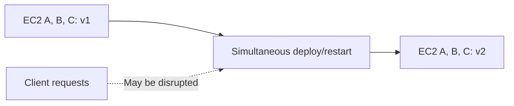
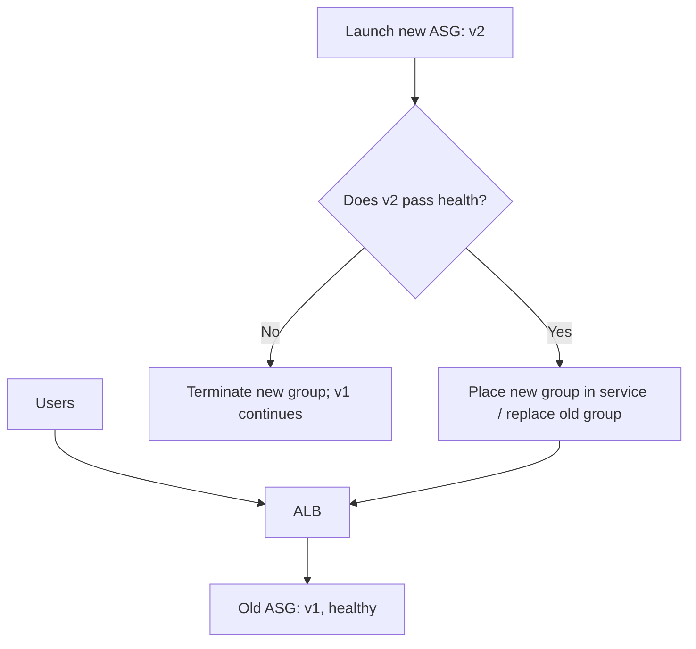
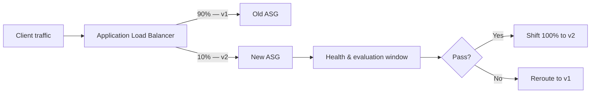
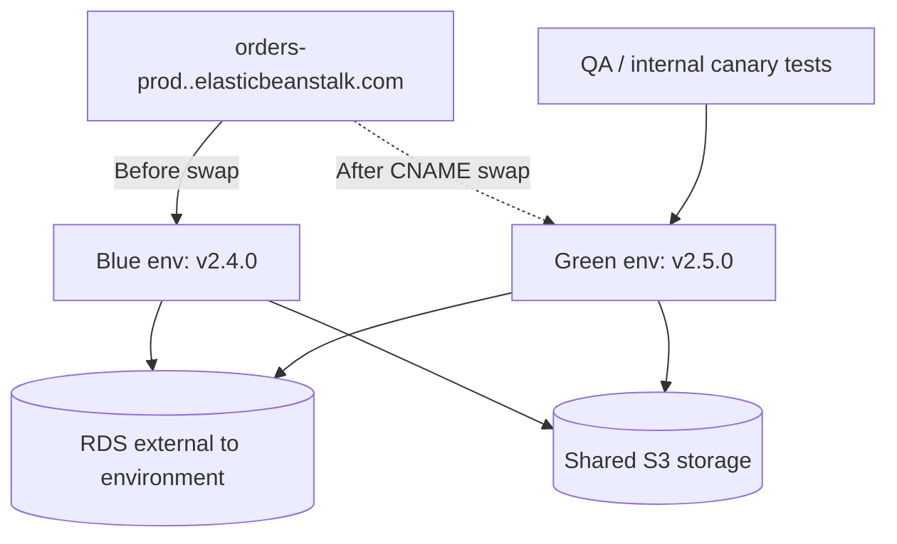
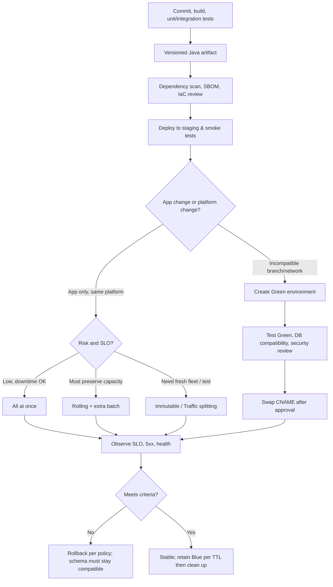

# Elastic Beanstalk Deployment Policies and Environment Replacement

A **Java Spring Boot** development team runs an order application on **AWS Elastic Beanstalk**. They want to release new versions without exposing users to errors, yet the requirements for every release are not the same:

- A minor change in a test environment can tolerate a few minutes of downtime to save time.
- A production API must maintain serving capacity throughout the release.
- A critical feature needs validation against 10% of live traffic before cutting over 100%.
- Upgrading a **platform branch** or changing the network foundation may require a **new environment**, not just an application version update.
- **RDS** data, login sessions, user files, and background jobs **must not be lost** when replacing servers or swapping environments.

To handle each case properly, the operations team must distinguish **deployment policies**, **environment configuration updates**, **managed platform updates**, and **blue/green environment replacement**. These mechanisms have different impacts on availability, rollbacks, resources, and data.

This lesson belongs to the **Managed Application Platforms** chapter of the **CLOUD_PROVIDERS_AWS** module. Learners apply knowledge of AWS Regions/AZs, IAM, VPC, EC2, load balancing, storage, databases, monitoring, resilience, serverless, and cost to choose the right release strategy for a Java application.

> **Note on the two Beanstalk models:** AWS currently offers **Beanstalk Standard** (the classic model on EC2/Auto Scaling) and **Beanstalk Cluster** (running containers on EKS managed by Beanstalk). **The five classic deployment policies** in this lesson apply to **Beanstalk Standard** depending on environment type. **Beanstalk Cluster** has its own option set, covered in Section 13. Do not apply Standard configurations to Cluster.

## 1. Learning Objectives

After this lesson, you will be able to:

1. Distinguish **application version**, **environment**, **platform version**, **deployment policy**, and **environment replacement**.
2. Compare the five deployment policies of **Beanstalk Standard**: **All at once**, **Rolling**, **Rolling with additional batch**, **Immutable**, and **Traffic splitting**.
3. Explain how to configure **batch size**, health thresholds, timeouts, and canary percentages.
4. Distinguish application code updates from **configuration updates** and **managed platform updates**.
5. Design a **blue/green deployment** with two environments, test **green**, and **swap environment URLs/CNAMEs** with a rollback plan.
6. Recognize the differences between **clone**, **rebuild**, **terminate/restore**, and creating a fresh environment.
7. Build a safe release workflow for **Spring Boot + ALB + Auto Scaling + RDS + S3** featuring health checks, schema migrations, externalized state, and data protection.
8. Inspect configurations using the **AWS CLI/EB CLI**, diagnose deployment failures, and evaluate cost/downtime trade-offs.

## 2. Resource Model in Elastic Beanstalk

Elastic Beanstalk is a managed application platform service that helps teams deploy code and operate applications without assembling every infrastructure setup step manually. Nevertheless, underlying resources, access permissions, security, databases, and costs still must be managed.

### 2.1. Commonly Confused Concepts

| Concept | Meaning | Example |
|---|---|---|
| **Application** | Logical object grouping multiple versions and environments of an application | `orders-service` |
| **Application version** | Artifact, source bundle, or image version used by Beanstalk to deploy | `orders-2.4.0` |
| **Environment** | Running application deployment with its own URL, configuration, and resources | `orders-prod-blue` |
| **Platform branch/version** | Runtime stack, OS, and components supported by Beanstalk per model | Corretto Java on Amazon Linux, or Cluster container runtime |
| **Deployment policy** | How Beanstalk rolls a new **application version** into an environment | `Rolling`, `Immutable` |
| **Configuration update policy** | How infrastructure/config changes that replace EC2 instances are rolled out | Rolling, Immutable, or Disabled as selected |
| **Managed platform update** | Beanstalk updates the platform version during a maintenance window | Patch/minor version update |
| **Blue/green** | Two environments running in parallel, shifting traffic by swapping URL/CNAME | `orders-prod-blue` ↔ `orders-prod-green` |
| **Rebuild** | Terminates and recreates the resources of the same environment from its configuration | Recovering a drifted/broken environment, with data risks |

**Updating code** is not the same as **changing VPC/subnets/instance types**, nor is it the same as **switching platform branches**. Deciding which policy to use starts with identifying **what is changing**.

### 2.2. Two Deployment Models

| Criterion | **Beanstalk Standard** | **Beanstalk Cluster** |
|---|---|---|
| Compute | EC2 instances in the environment's Auto Scaling group | Container replicas on a Beanstalk-created/managed EKS cluster, capacity via EKS Auto Mode |
| Artifact | Source bundle, Java JAR/WAR, or Docker per platform | Container image from ECR or service-built image where supported |
| Deployment | All at once, Rolling, Rolling with additional batch, Immutable, Traffic splitting (per conditions) | `RollingUpdate` or `Recreate` |
| Sizing | EC2 instance size, ASG min/max, batches | Container CPU/RAM, replica bounds, `max-surge`/`max-unavailable` |
| Configuration | Namespaces such as `aws:elasticbeanstalk:command` | Namespaces `aws:elasticbeanstalk:eks:*` |
| Blue/green | Create another environment and swap URLs | Also supports URL swaps between environments |

Exercises throughout most of the guide use **load-balanced Beanstalk Standard on EC2** to clarify the five policies and the effects of batching and capacity.

Source: [AWS — Beanstalk Cluster architecture](https://docs.aws.amazon.com/elasticbeanstalk/latest/dg/beanstalk-cluster-concepts.html).

## 3. Five Deployment Policies of Beanstalk Standard

### 3.1. Overview Comparison

| Policy | Rollout Mechanics | Serving Capacity During Deploy | Temporary Resources | On Failure |
|---|---|---|---|---|
| **All at once** | Replaces version on all instances simultaneously | May cause **service downtime** during restart | No new fleet needed | Usually requires manually redeploying the old version |
| **Rolling** | Replaces in batches across existing instances | **Capacity drops** by the batch removed from the LB | No extra instances needed | Can leave **mixed versions**; needs redeploy/recovery plan |
| **Rolling with additional batch** | Launches an extra batch first, then rolls through existing batches | Preserves target capacity if infrastructure capacity allows | One temporary extra batch of EC2s | Mixed-version risk still applies depending on failed batch |
| **Immutable** | Launches a **new group of instances** running the new version and verifies before replacing the old group | Keeps old group serving during verification | Roughly **one extra fleet** | If it fails before cutover, old group remains intact |
| **Traffic splitting** | Launches a new fleet, shifts a percentage of traffic, evaluates, then cuts over | Old group continues serving most requests | Roughly **one extra fleet** | If it fails during evaluation or is aborted, traffic shifts back to old group |

**There is no single best policy for every application.** Faster policies have fewer safety nets; safer policies consume extra EC2 hours, deployment time, and standby capacity.

### 3.2. Support Conditions

| Policy | Load-Balanced Standard | Single-Instance Standard | Notes |
|---|---|---|---|
| All at once | Yes | Yes | Possible downtime |
| Rolling | Yes | No | Needs multiple instances to rotate batches |
| Rolling with additional batch | Yes | No | Requires sufficient instance capacity/quotas |
| Immutable | Yes | Yes | Launches new instances; requires permissions/quotas/resources |
| Traffic splitting | Yes **when using an Application Load Balancer** | No | Canary via ALB |
| Blue/green | Can be designed with separate environments | Can be designed depending on model | **Not** one of the five in-place policies |

Documentation: [AWS — Deploying applications](https://docs.aws.amazon.com/elasticbeanstalk/latest/dg/using-features.deploy-existing-version.html), [Deployment policies and settings](https://docs.aws.amazon.com/elasticbeanstalk/latest/dg/using-features.rolling-version-deploy.html).

## 4. All at Once — Fast but Potentially Disruptive

With **All at once**, Beanstalk deploys the new version to all EC2 instances nearly simultaneously. While servers/proxies restart, all targets may become temporarily unavailable.



**Pros:** simple, fastest, no extra capacity required.

**Cons:** potential outage; a broken artifact can take down the entire fleet; rollback usually means another deployment of the previous version.

**Use when:** dev/test, internal environments with maintenance windows, workloads without strict production availability requirements.

**Do not use by default** for a payment API with a strict SLO merely because it deploys faster.

## 5. Rolling — Batch-by-Batch Updates

In **Rolling**, Beanstalk splits EC2 instances into **batches** and deploys the new version one batch at a time. Each batch is taken out of the load balancer, updated/restarted, health-checked, and returned to service while the remaining batches keep serving the old version.

```text
Environment with 8 instances, BatchSize = 2:

Step 0: [v1 v1] [v1 v1] [v1 v1] [v1 v1]  → 8 available
Step 1: [deploy] [v1 v1] [v1 v1] [v1 v1] → ~6 serving
Step 2: [v2 v2] [deploy] [v1 v1] [v1 v1] → ~6 serving
Step 3: [v2 v2] [v2 v2] [deploy] [v1 v1] → ~6 serving
Step 4: [v2 v2] [v2 v2] [v2 v2] [deploy] → ~6 serving
Step 5: [v2 v2] [v2 v2] [v2 v2] [v2 v2] → 8 available
```

### 5.1. Choosing Batch Size

- **BatchSizeType = Fixed**: fixed number of instances per batch.
- **BatchSizeType = Percentage**: percentage of the fleet.
- Larger batches: faster deployment, but larger temporary capacity loss.
- Smaller batches: lower overload risk, but longer deployment duration and longer mixed-version coexistence.

Example: an app has 8 instances, each handling up to ~200 RPS within SLO, and peak traffic requires 1,100 RPS. Taking 2 instances out at once leaves 6 instances with ~1,200 RPS in theory — **very thin headroom**. Benchmark real capacity and leave safety margin rather than picking a 25% batch just because it looks neat.

### 5.2. Version Compatibility Is Mandatory

During a rolling deployment, **v1 and v2 serve traffic simultaneously** for a period. Therefore:

- API contracts and database schemas must remain compatible with both versions.
- Do not change session serialization in a way that prevents v1 from reading v2 sessions.
- Do not alter message formats/queue consumers in a way that breaks older consumers.
- Do not run destructive column/table migrations before v1 has completely drained.
- Health checks must verify the app is **genuinely ready**, not just that the process started.

**If a batch fails**, the environment may hold a mix of v1 and v2; rollback **should not be assumed to revert automatically to the clean initial state**. Keep the previous version ready along with a redeploy/recovery runbook.

## 6. Rolling with Additional Batch — Preserving Capacity During Deployment

This policy **provisions an extra batch of EC2 instances first** before updating existing batches sequentially, keeping serving capacity at or near the original fleet size.

```text
Initial fleet: 8 instances (v1)
Launch extra batch: +2 instances → temporary total capacity 10
Roll through existing batches, maintaining ~8 serving instances
Complete: terminate extra batch, return to 8 instances (v2)
```

**Pros:** avoids dipping below target capacity; fits APIs that cannot tolerate temporary capacity reductions.

**Trade-offs:** slower than Rolling; requires extra EC2 quota, subnet IPs/ENIs, EBS volumes, egress, and load balancer target registrations. If the account lacks EC2 capacity in an AZ, the deployment may fail to start as expected.

**Not the same as blue/green.** It still deploys in batches with mixed versions running concurrently, and does not provide a CNAME-swap rollback.

## 7. Immutable — Replacing the Entire Fleet After Verifying the New Version

**Immutable deployment** launches a **temporary Auto Scaling group** with fresh EC2 instances running the new application version. The old group keeps serving; once the new group passes health checks, Beanstalk shifts service to the new group and cleans up the old one per service workflow.



**Pros:** a release that fails before cutover leaves existing instances untouched; launching fresh instances tests AMI/bootstrap consistency; reduces half-finished deployment states.

**Cons:** requires nearly **double the instances during transition**, takes longer, and incurs temporary extra EC2/EBS/network costs. Once it succeeds and the old group is terminated, late-appearing business bugs have **no automatic rollback to the old fleet**.

**The application must be stateless** or store state in durable external services. Files stored only on EC2 disks, local sessions, or in-memory queues are lost when instances are replaced.

### 7.1. Resources and Limits to Plan For

- EC2 service quotas, Spot/On-Demand capacity, and instance type availability in each AZ.
- Subnet IPv4 capacity/ENIs and ALB target limits.
- EBS volumes/snapshots/cache warm-up and cost while running two fleets.
- Java runtime warm-up, RDS/Redis connections, and connection pool limits when process count doubles.
- Impact on T-family CPU burst credit balances when instances are replaced.
- Environment variables, IAM instance profile, security groups, certificates, and agent logs must match across instances.

Source: [AWS — Immutable environment updates](https://docs.aws.amazon.com/elasticbeanstalk/latest/dg/environmentmgmt-updates-immutable.html).

## 8. Traffic Splitting — Canarying a Portion of Traffic

**Traffic splitting** is an immutable variant that adds a **live-traffic evaluation phase**:

1. Beanstalk launches a new group of EC2 instances running v2.
2. Once healthy, the load balancer routes **a percentage you specify** of client traffic to v2.
3. Health is monitored for the configured **EvaluationTime**.
4. If healthy and not aborted, the service shifts 100% of traffic to v2 and terminates the old fleet.
5. If v2 fails health checks during evaluation or the deployment is aborted via supported controls, traffic shifts back to v1.



*The 90/10 split is only an example, not an AWS default.*

### 8.1. When Is Traffic Splitting Valuable?

- The new version modifies serializers, caching, JDK, downstream clients, or performance paths.
- You want to validate **p95/p99 latency, 5xx rates, and business errors** under real traffic distribution.
- User flows are varied and cannot be covered solely by synthetic health checks.
- The system can safely operate **two versions concurrently** during the evaluation window.

### 8.2. What Traffic Splitting Does Not Solve

- Does not automatically roll back schema-breaking database migrations.
- Does not validate every business KPI on its own—only configured health criteria and observable signals.
- Does not turn a single-instance environment into an HA cluster.
- Does not guarantee business-level session stickiness unless the application is designed for it.
- Does not work with every load balancer type; **Beanstalk Standard requires an ALB** for this policy.
- Does not enable canarying if the account lacks quota/capacity for the second fleet.

**Tip:** for high-risk business changes, combine canary health checks with Java app telemetry and define abort triggers based on business errors, conversion rates, or SLO latency. If stopping requires custom metrics not evaluated automatically by Beanstalk, operators must have an approved manual/automated abort procedure.

## 9. Scenario-Based Policy Selection Table

| Environment / Scenario | Policy to Consider | Rationale |
|---|---|---|
| Dev, quick code test, downtime acceptable | **All at once** | Fast, minimal resources |
| Low-load production with multiple instances tolerating capacity dip | **Rolling** | Balances speed/cost; requires mixed-version compatibility |
| Production needing full capacity kept during rolling rollout | **Rolling with additional batch** | Adds temporary capacity to prevent shortfall |
| High-risk release needing a fresh instance group | **Immutable** | Tests new version on isolated instances before cutover |
| Measuring a slice of live traffic before 100% | **Traffic splitting** | Canary via ALB |
| Major platform branch/JDK/OS upgrade or incompatible config change | **Blue/green environment replacement** | Test Green separately; swap CNAME when ready |
| Environment broken by config/resource drift | **Rebuild** only with data & downtime plan | Destroys/recreates resources; not a deployment policy |

**These choices are architectural guidelines**, not substitutes for workload testing and platform/Region support checks.

## 10. Configuring Deployment Policies with `.ebextensions`

In **Beanstalk Standard**, application deployment policy options live in the `aws:elasticbeanstalk:command` namespace. You can configure them in the Console or in `.ebextensions/*.config` files inside the source bundle. Manage them through IaC/pipelines to prevent drift across environments.

### 10.1. Rolling 25% per Batch

```yaml
# .ebextensions/01-rolling-deployment.config
option_settings:
  aws:elasticbeanstalk:command:
    DeploymentPolicy: Rolling
    BatchSizeType: Percentage
    BatchSize: 25
```

### 10.2. Rolling with Additional Batch

```yaml
# .ebextensions/02-rolling-additional-batch.config
option_settings:
  aws:elasticbeanstalk:command:
    DeploymentPolicy: RollingWithAdditionalBatch
    BatchSizeType: Fixed
    BatchSize: 2
```

### 10.3. Immutable

```yaml
# .ebextensions/03-immutable-deployment.config
option_settings:
  aws:elasticbeanstalk:command:
    DeploymentPolicy: Immutable
```

### 10.4. Traffic Splitting 10% for 15 Minutes

```yaml
# .ebextensions/04-traffic-splitting.config
option_settings:
  aws:elasticbeanstalk:command:
    DeploymentPolicy: TrafficSplitting
  aws:elasticbeanstalk:trafficsplitting:
    NewVersionPercent: "10"
    EvaluationTime: "15"
```

**Important:** these are **four mutually exclusive alternatives**—**do not** place all four in the same source bundle! Pick **one** policy for the environment and verify it took effect.

**Configuration source note:** The Console and EB CLI can set **recommended option values** that take higher precedence than `.ebextensions`. If a policy file appears ignored, inspect saved configurations, live environment settings, and option precedence rather than assuming editing the file will change production. In the Console, Standard settings appear under **Rolling updates and deployments**.

Source: [Deployment policy option namespaces](https://docs.aws.amazon.com/elasticbeanstalk/latest/dg/using-features.rolling-version-deploy.html).

### 10.5. Health Thresholds, Timeouts, and the Risk of Ignoring Health Checks

Deployment-related options include:

- `BatchSize` / `BatchSizeType`: batch size for rolling updates or batched application restarts.
- `HealthCheckSuccessThreshold`: minimum acceptable health status during evaluation.
- `Timeout`: maximum wait time for a batch/operation.
- `IgnoreHealthCheck`: allows proceeding under configured conditions even if health checks have not passed.

**Never set `IgnoreHealthCheck: true` just to push past a failed deployment.** Doing so can expose broken builds to production; fix the health endpoint, startup, capacity, or networking first.

## 11. Configuration Updates Differ from Application Deployments

In a Standard environment, changing an application version is not the same as updating the **instance type, AMI/platform settings, load balancer, Auto Scaling**, or settings that force EC2 replacement.

**Configuration changes** can require Beanstalk to launch new instances. The infrastructure update policy resides in `aws:autoscaling:updatepolicy:rollingupdate`, with these core modes:

| Update Type | Behavior | Risk |
|---|---|---|
| **Disabled** | Replaces instances without prioritizing availability | Potential downtime |
| **Rolling — Health** | Replaces in batches, waiting for health before advancing | Temporary capacity reduction; requires headroom |
| **Rolling — Time** | Waits a fixed interval between batches | Elapsed time does not prove health/business readiness |
| **Immutable** | Launches a new instance group to verify before replacing the old group | Temporary extra capacity/cost |

Example health-based rolling configuration update for Standard:

```yaml
# .ebextensions/10-rolling-config-update.config
option_settings:
  aws:autoscaling:updatepolicy:rollingupdate:
    RollingUpdateEnabled: true
    RollingUpdateType: Health
    MinInstancesInService: 4
    MaxBatchSize: 2
```

**Adjust instance counts to match reality**: if the environment only has 2 instances, `MinInstancesInService: 4` makes no sense. This example assumes a fleet with sufficient capacity and quota.

Do not confuse `RollingUpdateType` (for **configuration updates**) with `DeploymentPolicy` (for **application versions**). An environment can combine **Immutable** application deploys with **Rolling** configuration updates, provided you understand how each change type and platform behaves.

Source: [AWS — Configuration changes](https://docs.aws.amazon.com/elasticbeanstalk/latest/dg/environments-updating.html), [Rolling environment configuration updates](https://docs.aws.amazon.com/elasticbeanstalk/latest/dg/using-features.rollingupdates.html).

## 12. Managed Platform Updates — Maintenance-Window Platform Updates

AWS releases **Elastic Beanstalk platform updates** to update OS/runtimes, fix bugs, and add capabilities.

**Managed platform updates** let you schedule a weekly maintenance window for **patch** or **minor + patch** updates within the same platform branch (where supported). They do not automatically upgrade across **incompatible/major platform branches**; that kind of change typically requires a separate migration plan and **blue/green**.

### 12.1. Key Points to Remember

- Managed platform updates require **enhanced health reporting**.
- They use **immutable environment updates**, even when you apply a managed update outside the maintenance window.
- You can enable **instance replacement** to proactively refresh instances on schedule even when no new platform update is available.
- When replacing instances, EC2 T-family instances can lose accumulated CPU burst credit balances.
- If an account runs many environments, **stagger maintenance windows** to reduce throttling risk.
- A maintenance window does not guarantee an operation started within it will finish before the window ends.
- Manually changing a platform version can follow **configuration change** policies rather than managed update behavior.

Example enabling **patch** managed updates on Tuesdays at 09:00 UTC:

```yaml
# .ebextensions/20-managed-platform-update.config
option_settings:
  aws:elasticbeanstalk:managedactions:
    ManagedActionsEnabled: true
    PreferredStartTime: "Tue:09:00"
  aws:elasticbeanstalk:managedactions:platformupdate:
    UpdateLevel: patch
    InstanceRefreshEnabled: false
```

**Do not** schedule the update window during peak traffic simply because the engineering team has fewer meetings then. For Java apps, validate JDK/JVM flags, native dependencies, proxies, and security agents prior to updating.

Source: [AWS — Managed platform updates](https://docs.aws.amazon.com/elasticbeanstalk/latest/dg/environment-platform-update-managed.html).

## 13. Beanstalk Cluster: Replica-Based Deployment Without the Five Classic Policies

**Beanstalk Cluster** runs applications as **container images on a Beanstalk-operated Amazon EKS cluster**; multiple environments can share an EKS cluster across a set of VPC subnets. Nodes are managed via EKS Auto Mode.

### 13.1. Two Deployment Strategies in Beanstalk Cluster

| Strategy | Mechanism | Notes |
|---|---|---|
| `RollingUpdate` | Replaces application replicas within surge/unavailable bounds | Default; suitable for production when properly configured and tested |
| `Recreate` | Terminates old replicas before creating new ones | Equivalent to all-at-once; can cause downtime |

Options live in `aws:elasticbeanstalk:eks:environment:deployment`, with `max-surge` and `max-unavailable` in the sub-namespace `...:deployment:strategy:rolling`.

Example configuration values for an EKS-based Cluster:

```text
Namespace: aws:elasticbeanstalk:eks:environment:deployment
  strategy = RollingUpdate

Namespace: aws:elasticbeanstalk:eks:environment:deployment:strategy:rolling
  max-surge = 1
  max-unavailable = 0
```

**`max-unavailable=0`** keeps available replicas at the desired count within scheduler/node capacity limits, while `max-surge` allows launching temporary extra replicas. It **does not guarantee zero downtime** if the app lacks proper readiness/shutdown handling or the cluster lacks resources.

**Do not use** `DeploymentPolicy: TrafficSplitting`, `Immutable`, or `RollingWithAdditionalBatch` from `aws:elasticbeanstalk:command` on Cluster: those belong to Standard. Per current documentation, Cluster **still supports blue/green CNAME swaps** between two environments.

### 13.2. When Do Cluster Config Changes Require a New Environment?

In Beanstalk Cluster, infrastructure parameters such as **VPC subnets**, **cluster role**, **node role**, and **observability role** have restrictions on in-place updates for a running environment. If you need to switch to different subnets or roles, build a properly configured **green environment** and **swap CNAMEs** rather than forcing changes onto an existing environment.

Beanstalk manages the EKS cluster; do not manually edit service-managed EKS resources arbitrarily, as **configuration drift** can cause Beanstalk to stop supporting updates/maintenance on that cluster.

Source: [Beanstalk Cluster architecture](https://docs.aws.amazon.com/elasticbeanstalk/latest/dg/beanstalk-cluster-concepts.html), [Cluster configuration options](https://docs.aws.amazon.com/elasticbeanstalk/latest/dg/command-options-general-eks.html).

## 14. Environment Replacement via Blue/Green Deployment

**Blue/green** is not an in-fleet batch update. You prepare **two independent environments**:

- **Blue:** current production, e.g., version `orders-2.4.0`.
- **Green:** new environment with version `orders-2.5.0`, optionally carrying a new platform/JDK/configuration.

After validating Green, perform **Swap environment URLs** to route production URL traffic to Green. As DNS updates and propagates, users gradually move to Green. Blue is retained temporarily for rollback.



### 14.1. Step-by-Step Execution

1. **Snapshot and inventory Blue's config**: platform branch/version, IAM roles, VPC/subnets, SGs, ALB, TLS certificates, env properties, autoscaling, health URL, and logging.
2. **Create the Green environment**: clone Blue or create a new environment, ensuring the target environment has a verified configuration.
3. Deploy the new application version to Green; prepare dependencies/networking and compatible schema migrations.
4. Access the **Green URL** independently to test API contracts, auth/cookies, readiness, logs, metrics, databases, message queues, and performance.
5. Verify integrations tied to the **production domain**: OAuth redirect URLs, CORS, webhook allowlists, TLS/SNI, signed cookies, and callback URLs.
6. Set a cutover window; ensure both old and new are ready. Run **Swap environment URLs** in the Console or **`eb swap`** via the EB CLI.
7. Monitor response times, 4xx/5xx rates, ALB health, errors, database metrics, and transaction counts.
8. Retain Blue **long enough** for DNS caches to expire and for rollback if needed; terminate Blue only after formal sign-off.

### 14.2. What Is a CNAME Swap?

For Beanstalk environments with domains like:

```text
Blue:  orders-blue.ap-southeast-1.elasticbeanstalk.com
Green: orders-green.ap-southeast-1.elasticbeanstalk.com
```

**Swap environment URLs** exchanges the CNAME mappings between the two environments. **Environment names and IDs are not swapped**; underlying infrastructure and resources remain attached to each environment. After the swap, the URL clients previously used to reach Blue now resolves to Green.

**DNS caching does not flip instantaneously worldwide.** During propagation, some users continue hitting Blue; therefore Blue and Green must remain **mutually compatible** with database/message formats, and Blue must not be destroyed immediately after clicking Swap.

### 14.3. Custom Domains and Route 53

If clients use `api.example.com`:

- If the custom DNS record points to the **environment CNAME**, verify it follows the swapped mapping properly.
- If a Route 53 Alias or another config **points directly to the ALB** or a specific endpoint, **swapping environment URLs does not automatically update those custom records**.
- Check IPv4/IPv6 records, TTLs, and Route 53 health/failover policies if configured.
- With CloudFront, WAF, or third-party DNS in front of Beanstalk, verify the **actual origin target** and maintain a dedicated runbook—never assume a CNAME swap updates every DNS/CDN layer automatically.

### 14.4. Rollback After Swap

Rollback can be performed by **swapping URLs back** so Blue receives production traffic again. Prerequisites:

- Blue is still running with sufficient capacity.
- Database, schemas, and event formats remain compatible with Blue.
- No Green-only data or irreversible side effects were written.
- DNS propagation is monitored; rolling back DNS is not instantaneous for every client either.
- Blue's secrets, certificates, and roles have not been revoked.

**Crucial point:** blue/green protects compute/application routing—**it does not automatically roll back databases**.

Source: [AWS — Blue/Green deployments with Elastic Beanstalk](https://docs.aws.amazon.com/elasticbeanstalk/latest/dg/using-features.CNAMESwap.html).

## 15. Clone, Rebuild, Terminate, and Restore: Not the Same Action

| Action | Behavior | When to Use | Risks |
|---|---|---|---|
| **Clone environment** | Creates a new environment based on an existing environment's configuration | Preparing Green, testing/isolating releases | Must review differences in SGs, secrets, platform version, policies |
| **Rebuild environment** | Destroys and recreates **the same environment's resources** | Attempting to recover a broken/drifted environment | **Downtime and risk of data/resource loss** |
| **Terminate environment** | Destroys the environment and resources managed in its lifecycle | Cleaning up retired Green/Blue | Can impact coupled RDS, DNS, logs, and data |
| **Restore terminated environment** | Recreates an environment from retained metadata within the supported window | Recovering a recently terminated environment | Does not guarantee restoring EC2/RDS data or the old URL |
| **Blue/green + CNAME swap** | Shifts traffic between **two running environments** | Controlled cutover and rollback | DNS propagation, cost of two running environments, DB compatibility |

### 15.1. Clone Does Not Mean 100% Identical Config

Per AWS EB CLI docs, **`eb clone` may select the latest platform version** in the branch when cloning; pass `--exact` when you genuinely need to preserve the exact solution stack version within supported scope.

**Important warning from AWS:** a cloned environment may **not carry over ingress security group settings**, resulting in broader default ingress than expected. After cloning, **re-verify security groups, load balancer listeners, WAF, public exposure, and subnet routes** before putting Green into production. Never expose Green to the public Internet unverified.

### 15.2. Rebuild Can Wipe Data

Rebuilding a running environment **terminates all environment resources and provisions fresh ones** from its configuration. If an RDS database is **coupled** (created by Beanstalk with the environment), rebuilding **can delete the database**; the recreated database will not contain prior data. Always check the **database deletion policy**, snapshots, retention, and restore plan before acting.

**Never use rebuild just to "restart a Java app."** Beanstalk provides a restart application servers action or redeployment, which is far less destructive. Rebuild is a destructive recovery measure requiring business-impact review.

### 15.3. Restore Is Not a Data Backup

AWS provides a **rebuild/restore recently terminated environment** capability within a supported retention window (current docs note **42 days** for certain cases). This primarily restores **configuration and environment identity** while eligible—it is not a backup of EC2 disks or RDS records and does not automatically restore all data.

If another environment claimed the URL, an application version was deleted, or dependent configurations are gone, restore can fail.

Source: [Clone environment](https://docs.aws.amazon.com/elasticbeanstalk/latest/dg/using-features.managing.clone.html), [Rebuild environment](https://docs.aws.amazon.com/elasticbeanstalk/latest/dg/environment-management-rebuild.html).

## 16. Preserving Data and State When Replacing Environments

One of the severest blue/green risks is **accidentally tying production data to an environment's lifecycle**.

### 16.1. Keep RDS Independent of Beanstalk Lifecycles

For production databases, the sounder option is usually an **RDS/Aurora database created and managed independently** of Beanstalk environments:

- Blue and Green connect to the database via authorized endpoints and configs.
- Terminating Blue or rebuilding Green will not cause Beanstalk to delete the database.
- SGs allow connections only from valid application subnets/SGs.
- Secrets and credentials are managed securely; never hard-code passwords in artifacts.
- Backups, PITR, Multi-AZ, and DR follow dedicated plans.

**If a database was created coupled to a Beanstalk environment**, **decouple** it before designing blue/green. When decoupling, the **deletion policy** (`Delete`, `Snapshot`, `Retain`) dictates what happens to the database. Notably, AWS warns **against updating the deletion policy in the same operation as decoupling**, because the policy change may not apply as expected. Save the deletion policy separately, verify it, and only then decouple.

Source: [AWS — Database lifecycle and decoupling](https://docs.aws.amazon.com/elasticbeanstalk/latest/dg/using-features.managing.db.html).

### 16.2. Database Schema Migration: Expand → Migrate → Contract

So Blue v1 and Green v2 can run concurrently during DNS propagation or canarying:

1. **Expand**: add new backward-compatible columns/tables/fields without dropping old fields.
2. **Migrate**: perform controlled backfill or dual-read/dual-write; verify both old and new versions read/write cleanly.
3. **Deploy** Green and test both v1 and v2 against the shared schema.
4. **Cut over** traffic while preserving app rollback capability if business issues arise.
5. **Contract**: only after no legacy consumers remain, drop obsolete columns/fields/code paths in a separate release.

**Never run a drop-column migration before confirming Blue no longer needs that column.** Once a schema change breaks compatibility, swapping the CNAME back can send users to a broken application.

### 16.3. Other Forms of State to Externalize

| Data / State | Appropriate Design | Reason |
|---|---|---|
| User uploads | External S3 bucket with least-privilege IAM | Replacing EC2s will not lose files |
| HTTP sessions | Properly designed stateless JWTs or external session store (e.g., ElastiCache) | Users keep sessions as traffic moves across instances/environments |
| Jobs / event queues | SQS/EventBridge with idempotent consumers | Prevents duplicate side effects while Blue+Green both run |
| Scheduled jobs | Leader election, single external scheduler, or feature flag | Prevents running jobs twice across two environments |
| Logs / metrics | CloudWatch Logs, S3 archival, and alarms | Terminating instances will not destroy needed log history |
| Secrets / config | Secrets Manager/Parameter Store and IAM roles | Avoids baking secrets into AMIs or source bundles |
| Certificates/TLS | ACM on ALB, configured per environment listener | Green must serve valid HTTPS before cutover |

### 16.4. Controlling Concurrent Version Execution

During traffic splitting or blue/green, **both versions may process requests simultaneously**. For SQS consumers, job schedulers, Kafka consumers, or payment gateway callbacks:

- Gate consumers with feature flags or leader election where needed.
- Design idempotency keys for transaction creation.
- Ensure Blue and Green do not send duplicate emails or emit duplicate events for the same record.
- Verify webhook URLs and external integrations across DNS transitions.

## 17. Spring Boot Example: Preparing Readiness and Graceful Shutdown

When Beanstalk runs rolling or immutable deployments, **health checks** and **JVM startup time** determine whether a rollout is safe.

### 17.1. Spring Boot Actuator Template

Example application with the `spring-boot-starter-actuator` dependency:

```yaml
# src/main/resources/application.yml — example
server:
  port: 5000
  shutdown: graceful

spring:
  lifecycle:
    timeout-per-shutdown-phase: 30s

management:
  endpoint:
    health:
      probes:
        enabled: true
  endpoints:
    web:
      exposure:
        include: health,info
```

**Note:** port `5000` is merely an example matching some Java SE reverse-proxy defaults; align **`PORT`**, Nginx upstream, platform branch, ALB target group, and live configuration. Do not assume 5000 is standard across all Docker/Tomcat/Cluster environments.

The readiness path is typically:

```text
/actuator/health/readiness
```

This endpoint should return success only when the app is **ready to handle requests**, not merely once a socket opens. Depending on Spring Boot settings, the path may differ—verify via HTTP in a test environment.

### 17.2. Health Checks Are Not Business Monitoring

A 200 health check can miss:

- Broken authorization or checkout business logic.
- A nearly exhausted database connection pool.
- Third-party payment gateway timeouts.
- A stalled queue consumer.
- A memory leak that surfaces only after several hours.

Therefore, alongside EB enhanced health and ALB health checks, monitor **p95/p99 latency, 5xx rates, order success rate, DB/queue metrics, and JVM GC**.

### 17.3. JVM Warm-Up Time

A Java app may take 60–120 seconds to boot, connect to RDS, warm caches, check dependencies, and JIT-compile hot paths. Overly aggressive deployment timeouts or health thresholds mark targets unhealthy even though the app would stabilize shortly after.

**Right approach:** measure actual startup time and balance health intervals/timeouts, readiness, and graceful shutdown. Avoid setting arbitrarily huge timeouts that let a broken deployment linger undetected.

## 18. Release and Rollback Workflow Diagram



### 18.1. Stop Conditions You Should Define

| Signal | Example Operator-Defined Threshold | Action |
|---|---|---|
| ALB `HTTPCode_Target_5XX_Count` | Error rate breaches error budget vs. baseline | Halt expansion/cutover and investigate |
| p95/p99 latency | Exceeds SLO across multiple observation windows | Hold or roll back traffic |
| EB environment health | Sustained `Severe`/`Degraded` | Stop operation; inspect events/instances |
| `HealthyHostCount` | Drops below defined minimum capacity | Halt deployment; restore target health |
| DB metrics | Unusual spikes in connections/latency/locks | Check both app versions and schema migration |
| Business KPIs | Checkout failures, duplicate jobs, unusual 409/422s | Cut off feature/canary per runbook |
| Costs/capacity | Quota limits or EC2 instance launch failures | Shrink batch/reschedule/evaluate alternative mode |

**Passing health checks does not guarantee 0% errors.** Set concrete SLOs before choosing a policy, combining readiness probes with business validation.

## 19. Inspection and Deployment Tools

### 19.1. Read-Only AWS CLI Commands

Use an authorized account, Region, and test application. ARNs, IDs, and names are examples.

```bash
# List environments in an application
aws elasticbeanstalk describe-environments \
  --application-name orders-service \
  --region ap-southeast-1 \
  --query 'Environments[].{Name:EnvironmentName,Id:EnvironmentId,Status:Status,Health:Health,Version:VersionLabel,CNAME:CNAME}' \
  --output table

# Inspect applied configuration (may include sensitive values)
aws elasticbeanstalk describe-configuration-settings \
  --application-name orders-service \
  --environment-name orders-prod-blue \
  --region ap-southeast-1

# View recent events
aws elasticbeanstalk describe-events \
  --application-name orders-service \
  --environment-name orders-prod-blue \
  --region ap-southeast-1 \
  --max-records 20

# View resource-level health (requires appropriate permissions)
aws elasticbeanstalk describe-environment-health \
  --environment-name orders-prod-blue \
  --region ap-southeast-1 \
  --attribute-names Status HealthStatus Color Causes
```

**Read-only commands** can still return environment properties or connection strings that should not be shared publicly; filter or redact sensitive information before saving inspection outputs.

### 19.2. Checking Status with the EB CLI

```bash
# Inside a project initialized with eb init for the right application/region
eb status orders-prod-blue
eb events orders-prod-blue
eb health orders-prod-blue
```

Depending on platform and permissions, `eb health` may require enhanced health reporting.

### 19.3. State-Changing Commands — Use Only Under Approved Workflows

```bash
# Illustrative example; DO NOT run against production without review.
eb deploy orders-prod-green

# Clone for testing: verify security groups and platform version after cloning
eb clone orders-prod-blue --clone_name orders-prod-green --exact

# Shift production traffic only after Green has been verified
eb swap orders-prod-blue --destination_name orders-prod-green
```

**`eb swap` modifies production DNS routing.** It does not issue certificates, migrate data, or verify business SLOs on its own. Do not treat `eb deploy` or `eb clone` examples in documentation as authorization to run them against live accounts.

### 19.4. Pre-Release JSON/YAML Configuration Checks

- Does `DeploymentPolicy` match Standard vs. Cluster?
- Does `BatchSize` fit ASG min/max and peak load?
- Are the ALB health check path and readiness probe tested?
- Do VPC, subnets, security groups, and instance profiles avoid unintended ingress exposure?
- Can Green reach RDS/S3/Secrets Manager via its IAM role and VPC routes?
- Do custom domains and ACM TLS work with the production URL before cutover?
- Are database migrations backward-compatible?
- Are old-version/Blue rollback, backups/restore, and runbooks ready?

## 20. Logging and Diagnosing Failed Deployments

### 20.1. Observability Sources

| Source | Contents | When to Use |
|---|---|---|
| **Beanstalk Events** | Timeline of deployments, config updates, instance failures, and health transitions | Starting an incident investigation |
| **Beanstalk Deployments tab** | Request ID, policy, timestamps, duration, events, and deployment logs | Pinpointing the exact failing operation |
| **Enhanced health** | Environment/instance states and degradation causes | Explaining why a batch failed thresholds |
| **EC2/Beanstalk logs** | `/var/log/eb-engine.log`, app/proxy logs on supported platforms | Build, startup, permission, or bootstrap failures |
| **ALB metrics/logs** | `HealthyHostCount`, target 5xx, latency, and health checks | Inspecting traffic and target readiness |
| **CloudWatch Logs/metrics** | App logs, JVM GC, exceptions, dashboards | Comparing v1 vs. v2 and diagnosing business errors |
| **CloudTrail** | API calls changing environments/roles/config | Auditing who deployed or edited config |
| **RDS/CloudWatch metrics** | Connections, CPU, locks, latency | Detecting impact from running two fleets concurrently |
| **Cost Explorer/Budgets** | EC2/ELB/RDS/NAT/log charges | Auditing deployment cost and forgotten environments |

Log paths depend on **platform branch** and configuration. `/var/log/eb-engine.log` is common on Amazon Linux 2/2023 Standard environments; do not assume the same path exists on Beanstalk Cluster.

### 20.2. Troubleshooting Table

| Symptom | Possible Cause | What to Check First |
|---|---|---|
| `All at once` makes API unavailable | All instances restart simultaneously | Switch to rolling/immutable, capacity, and maintenance windows |
| Rolling fails on the second batch | App error, readiness failure, DB/schema incompatibility | Deployments tab, per-instance running version, health logs |
| Additional batch fails to launch EC2 | Quota/capacity/subnet IPs/SGs/IAM | EC2 events, ASG, quotas, free IPs per AZ |
| Immutable does not complete | New fleet unhealthy; bootstrap/agent/JDK error | New ASG, instance logs, ALB health path |
| Traffic splitting reports failure | v2 returns errors or fails health during canary | Evaluation time, ALB/Beanstalk events, per-version metrics |
| Green healthy, yet production returns 502 | ALB target group/cert/proxy mismatch; app listening on wrong port | ALB logs, SGs, readiness, HTTPS config |
| After CNAME swap, users still hit Blue | DNS cache or custom domain pointing straight to Blue's ALB | `dig/nslookup`, Route 53 alias/CNAME, TTL, CDN |
| Cannot log in after swap | In-memory sessions, OAuth redirect, cookie domain | External sessions, auth callbacks, app config |
| DB errors after swap | Schema migration broke compatibility; missing SGs/secrets | Migration logs, DB grants, dual-version tests |
| Clone unexpectedly exposed publicly | Ingress SGs not fully carried over or different listener/policy | SGs, public IPs/ALB, WAF, and ingress scan |
| Rebuild wipes data | Coupled RDS, local EBS/instance store | Deletion policy, snapshots, restore plan |
| Managed platform update fails | Runtime/JDK/agent incompatibility or health failure | Managed updates tab, events, enhanced health |
| Deploy succeeds, yet batch jobs run twice | Blue and Green both run schedulers/consumers | Leader election, feature flags, idempotency keys |

### 20.3. Ordered Investigation Workflow

1. **Identify the operation**: application deploy, config change, managed update, swap, or rebuild?
2. **Identify the platform**: Standard EC2 or Cluster EKS?
3. **Check Events/Deployments tab**: start time, policy, batch, and health status.
4. **Check target health/metrics**: network/startup issue or business logic error?
5. **Read app/Beanstalk logs**: JDK/Procfile, dependency downloads, secrets, application port.
6. **Check infrastructure resources**: EC2 quotas, subnet IPs, ALB, SGs, IAM, RDS.
7. **Distinguish rollback paths**: canary failures may auto-revert to v1; rolling/All at once usually need redeploy; blue/green supports swap-back.
8. **Document the root cause** and update pipelines/tests before retrying.

Source: [Deployment logs in Elastic Beanstalk](https://docs.aws.amazon.com/elasticbeanstalk/latest/dg/environments-deployment-logs.html).

## 21. Security and Cost Control Across Multiple Environments

### 21.1. IAM and Networking

- Beanstalk **service role** and **EC2 instance profile** are separate roles; grant only required AWS permissions.
- CI/CD uses temporary IAM roles/federation per company policy; never hard-code access keys.
- Green uses security groups/subnets, ALB listeners, and WAF matching or exceeding Blue's protection level.
- App secrets live in Secrets Manager/Parameter Store; verify how they rotate across environments.
- Environment properties can hold sensitive config details; never dump full config to logs.
- Keep RDS private and restrict SG connections to valid application roles/security groups.
- Encrypt TLS from viewer → ALB, and onward to backends/databases when required by policy.
- Check CloudTrail, AWS Config/Security Hub, and access audits whenever a new environment spins up.

### 21.2. Cost Estimation

```text
Total deploy cost during transition ≈
    Blue fleet compute
  + Green fleet / immutable ASG / additional batch compute
  + Load balancers and capacity-related charges
  + EBS volumes, snapshots, cross-AZ/Region data transfer
  + NAT gateways, VPC endpoints, and public IPv4
  + Shared or duplicated RDS / caches / queues per design
  + Logs, metrics, and deployment tooling
```

Illustrative example:

- A Standard Blue environment runs 6 EC2 instances.
- Running a 6-instance Green environment for 4 hours of testing and cutover adds **24 extra compute instance-hours** compared to Blue alone over that period, before ALB/EBS/network costs.
- Immutable and Traffic splitting also temporarily run nearly double compute capacity.
- Idle running environments with zero traffic still incur EC2, ELB, EBS, and attached resource charges.

**Elastic Beanstalk does not make the overall system free.** Although the orchestration layer itself adds no fee in the standard model, the AWS resources provisioned and operated still appear on your bill. For Beanstalk Cluster, EKS/Auto Mode and related resource charges apply separately per usage and current pricing.

### 21.3. Optimizing Without Sacrificing Safety

- Use **All at once in dev** and safer SLO-aligned strategies in production.
- Keep duplicate Green/Blue environments alive only for the **required testing and rollback window**, then clean up unused environments.
- Size batches small enough to save cost while keeping enough headroom for peak traffic.
- Monitor **AWS Budgets/Cost Explorer** with `environment`, `owner`, and `cost-center` tags.
- Schedule platform updates outside peak hours without skipping validation.
- Do not delete an environment prematurely while DNS caches, webhooks, rollback dependencies, or coupled DBs remain active.

## 22. Scenario Exercises

### Exercise A — Choosing a Deployment Policy

Given a load-balanced Standard environment with 12 EC2 instances requiring at least 10 healthy instances during peak hours.

**Options:**

1. All at once.
2. Rolling batch size 4.
3. Rolling batch size 2.
4. Rolling with additional batch size 4.
5. Immutable.

**Suggested answer:** All at once does not preserve availability. Rolling batch 4 leaves ~8 serving, **insufficient**. Rolling batch 2 leaves ~10, technically meeting the floor with almost zero headroom. Additional batch 4 preserves capacity better if quotas/IPs allow, while Immutable launches a new group with less impact on existing traffic at higher temporary resource cost. Choose based on deploy time, budget, SLO, and operational readiness.

### Exercise B — Canary on ALB

A payment application needs **5% of traffic** routed to a new version for **20 minutes**, shifting to 100% only if health and SLOs pass.

**Hint:** Beanstalk **Standard load-balanced with ALB** using **Traffic splitting**; set `NewVersionPercent=5` and `EvaluationTime=20`. Simultaneously monitor **payment errors, duplicate transactions, and p95/p99 latency**—do not rely solely on a green readiness endpoint.

### Exercise C — Upgrading to an Incompatible Platform Branch

A Java app runs on an older platform. The team wants to upgrade the OS/JDK major version while keeping the API online.

**Answer:** Create a **Green environment** on the target platform branch, verify dependencies/agents/JVM, test schemas, load-test, and run in parallel. Then **swap CNAMEs** once validated. Do not expect managed patch/minor updates to perform cross-branch migrations automatically.

### Exercise D — Environment-Coupled RDS

A production system uses an RDS instance created by Beanstalk alongside Blue. The team plans to **rebuild Blue** or **terminate Blue immediately after swap**.

**Answer:** Halt the plan, inspect the **database deletion policy**, **decouple/retain** data, take snapshots/backups, and verify restores. Rebuilding or terminating can delete a coupled RDS instance; Green does not automatically take ownership of Blue's database.

### Exercise E — Cloning an Environment

A developer runs `eb clone` and sends traffic to Green without inspecting ingress SGs.

**Answer:** Unsafe process. Cloning may omit ingress security group restrictions, widening public exposure. Audit VPC/subnets, SGs, LB listeners, certificates, WAF, IAM, secrets, and platform version before cutover.

### Exercise F — Deployment Policy vs. Configuration Policy

App config:

```yaml
option_settings:
  aws:elasticbeanstalk:command:
    DeploymentPolicy: Immutable
  aws:autoscaling:updatepolicy:rollingupdate:
    RollingUpdateEnabled: true
    RollingUpdateType: Health
```

**Question:** why don't these two policies directly conflict?

**Answer:** One controls **application version deployments**; the other controls **environment configuration changes** that replace instances. Both must be checked against the actual type of change being made.

### Exercise G — Beanstalk Cluster

A team running a Cluster (EKS-based) environment copies this file:

```yaml
option_settings:
  aws:elasticbeanstalk:command:
    DeploymentPolicy: TrafficSplitting
```

**Answer:** Invalid for Beanstalk Cluster. Use `strategy=RollingUpdate` or `Recreate`, with `max-surge` and `max-unavailable`; for blue/green, create two environments and use a CNAME swap. Percentage-based canarying like Standard TrafficSplitting requires a dedicated design, not Standard options.

### Exercise H — DNS After Swap

`api.example.com` points **directly to Blue's ALB**, bypassing the environment URL/CNAME. The team swaps CNAMEs between Blue and Green, yet clients still hit Blue.

**Answer:** Custom DNS records do not update automatically when pointing straight at an ALB. Inspect the DNS chain, Route 53 Alias/third-party DNS/CloudFront, and update via a controlled runbook.

### Review Questions

1. What are the deployment policies of Beanstalk Standard?
2. Why can All at once cause downtime?
3. Does Rolling leave v1 and v2 running concurrently?
4. How does Rolling with additional batch differ from Rolling?
5. Does Immutable deploy the new application version onto existing resources or new instances?
6. Which load balancer type does Traffic splitting require in Standard?
7. Does a green health check guarantee business logic works?
8. Do config updates and application deploys share the same option namespace?
9. Do managed platform updates automatically upgrade across major platform branches?
10. Which update mechanism do managed platform updates use?
11. Can Beanstalk Cluster use `TrafficSplitting` like Standard?
12. How do `RollingUpdate` and `Recreate` differ in Cluster?
13. How does blue/green differ from traffic splitting at the resource/URL level?
14. Should Blue be terminated immediately after a CNAME swap?
15. Is a custom domain pointing straight to an ALB automatically swapped?
16. Why should production RDS be independent of the Beanstalk environment?
17. Why do schema migrations need backward compatibility?
18. Is Rebuild a safe way to restart an app?
19. Does Clone guarantee preserving all ingress SGs?
20. If a production rollout fails business flows while `eb deploy` reports success, what should you inspect?
21. Why shouldn't you use `IgnoreHealthCheck` to "fix" a failing deployment?
22. Why can rolling out two fleets trigger duplicate background jobs?

**Quick answers:** (1) All at once, Rolling, Rolling with additional batch, Immutable, Traffic splitting; (2) all instances restart at once; (3) yes; (4) launches an extra batch to preserve capacity; (5) new instances; (6) ALB; (7) no; (8) no; (9) no; (10) immutable; (11) no; (12) rolling replicas vs. recreate; (13) swaps whole environments/CNAMEs rather than splitting traffic within one Standard environment; (14) no, wait for DNS TTL and rollback safety; (15) not automatically; (16) prevents deletion on rebuild/terminate and supports Green; (17) two versions access the data concurrently; (18) no; (19) no; (20) ALB/application metrics and business KPIs; (21) it can push broken code to production; (22) both Blue and Green run consumers/schedulers.

## 23. Pre-Production Deployment Checklist

- [ ] Confirmed **Beanstalk Standard vs. Beanstalk Cluster**.
- [ ] Identified whether the operation is an **application deploy**, **configuration update**, **managed platform update**, or **environment replacement**.
- [ ] Deployment policy selected based on SLO, peak traffic, rollback needs, and budget.
- [ ] Batch size, health thresholds, timeouts, and canary evaluation time verified.
- [ ] Sufficient EC2/ASG capacity, subnet IPs, ELB targets, and quotas available for temporary instances.
- [ ] Java app exposes an accurate readiness/health endpoint and supports graceful shutdown.
- [ ] CI builds, tests, and scans artifacts; version labels are traceable and restorable.
- [ ] v1 and v2 both work cleanly with the DB schema, session store, and event contracts.
- [ ] RDS/data stores **decoupled from lifecycle** or protected by verified deletion policies.
- [ ] User files stored in S3/external storage, independent of local instance disks.
- [ ] Jobs/consumers enforce idempotency or duplicate prevention during Blue/Green overlap.
- [ ] Green verified for IAM, SGs, VPC, TLS, LB, WAF, and secrets after cloning.
- [ ] Custom DNS/Route 53/Alias/CloudFront paths to production verified before swapping.
- [ ] Rollback runbooks defined per policy, including scenarios where DB changes cannot roll back.
- [ ] Blue retained long enough for DNS propagation and post-cutover SLO verification.
- [ ] Alarms configured for environment health, 5xx rates, p95/p99 latency, JVM, RDS, and cost.
- [ ] Managed platform updates configured with maintenance windows, enhanced health, and notifications.
- [ ] `IgnoreHealthCheck` not enabled recklessly; tested single-AZ failure and scale-out.
- [ ] Accounted for extra batch/fleet/Green costs and scheduled cleanup so environments are not forgotten.
- [ ] Owners/approvals, backup plans, DR, and audit logging in place.

## 24. Summary

**Deployment policies** determine how a new application version rolls out inside Elastic Beanstalk Standard:

- **All at once** is fast but risks downtime.
- **Rolling** reduces disruption while temporarily lowering capacity and running mixed versions.
- **Rolling with additional batch** preserves capacity using temporary instances.
- **Immutable** builds a fresh fleet before switching, isolating early deployment failures.
- **Traffic splitting** tests v2 on a slice of live requests before full cutover.

**Environment replacement** using **blue/green** is a distinct decision: stand up Green on the new platform/config, validate it, **swap CNAMEs**, and keep Blue long enough to roll back. **Clone** prepares Green; **rebuild** destroys and recreates resources with potential data loss; **managed platform update** schedules patch/minor updates; and **Beanstalk Cluster** uses its own `RollingUpdate`/`Recreate` strategies.

For production Java workloads, reliability does not come from a policy alone. It requires combining **readiness checks, graceful shutdown, multi-AZ, least-privilege IAM/VPC, independent RDS, compatible schemas, externalized state, logs/alerts, rollback drills, and cost controls**. Matching the right mechanism to each change lets application teams ship faster while systematically observing, recovering, and protecting data.

### Official AWS Documentation

1. [Elastic Beanstalk deployment policies and settings](https://docs.aws.amazon.com/elasticbeanstalk/latest/dg/using-features.rolling-version-deploy.html)
2. [Deploying applications to environments](https://docs.aws.amazon.com/elasticbeanstalk/latest/dg/using-features.deploy-existing-version.html)
3. [Configuration changes](https://docs.aws.amazon.com/elasticbeanstalk/latest/dg/environments-updating.html)
4. [Rolling configuration updates](https://docs.aws.amazon.com/elasticbeanstalk/latest/dg/using-features.rollingupdates.html)
5. [Managed platform updates](https://docs.aws.amazon.com/elasticbeanstalk/latest/dg/environment-platform-update-managed.html)
6. [Blue/Green deployments](https://docs.aws.amazon.com/elasticbeanstalk/latest/dg/using-features.CNAMESwap.html)
7. [Migrate to a different platform branch](https://docs.aws.amazon.com/elasticbeanstalk/latest/dg/using-features.platform.upgrade.html)
8. [Clone an environment](https://docs.aws.amazon.com/elasticbeanstalk/latest/dg/using-features.managing.clone.html)
9. [Rebuild an environment](https://docs.aws.amazon.com/elasticbeanstalk/latest/dg/environment-management-rebuild.html)
10. [Database lifecycle and decoupling](https://docs.aws.amazon.com/elasticbeanstalk/latest/dg/using-features.managing.db.html)
11. [View Beanstalk deployment logs](https://docs.aws.amazon.com/elasticbeanstalk/latest/dg/environments-deployment-logs.html)
12. [Beanstalk Cluster architecture](https://docs.aws.amazon.com/elasticbeanstalk/latest/dg/beanstalk-cluster-concepts.html)
13. [Beanstalk Cluster configuration options](https://docs.aws.amazon.com/elasticbeanstalk/latest/dg/command-options-general-eks.html)
14. [EB CLI — eb swap](https://docs.aws.amazon.com/elasticbeanstalk/latest/dg/eb3-swap.html)
15. [EB CLI — eb clone](https://docs.aws.amazon.com/elasticbeanstalk/latest/dg/eb3-clone.html)
16. [Elastic Beanstalk pricing](https://aws.amazon.com/elasticbeanstalk/pricing/)
17. [AWS Well-Architected Reliability Pillar](https://docs.aws.amazon.com/wellarchitected/latest/reliability-pillar/welcome.html)
