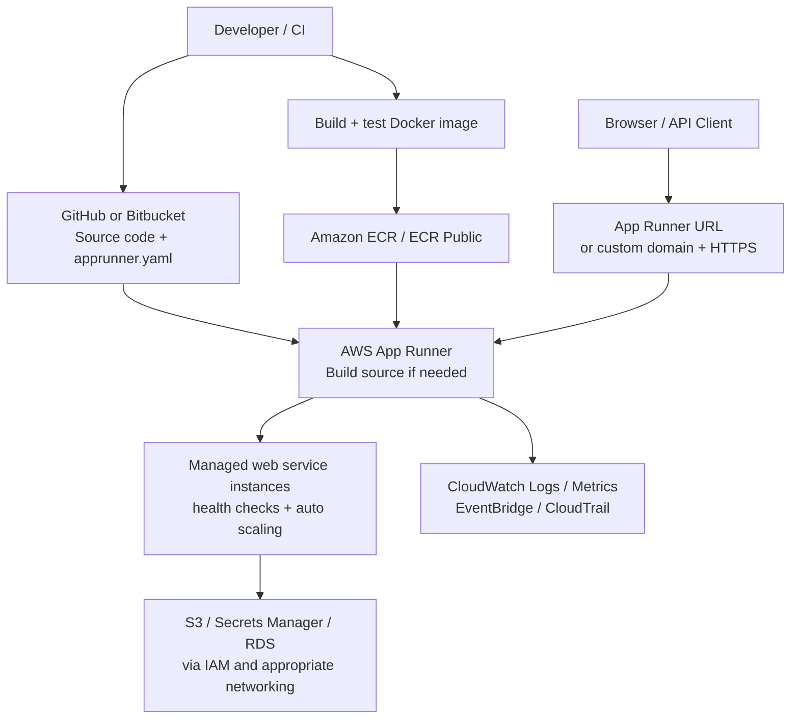
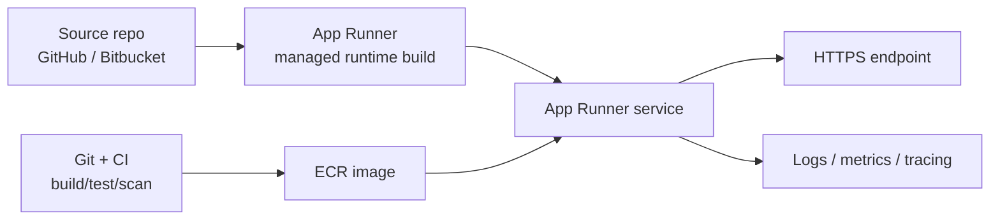
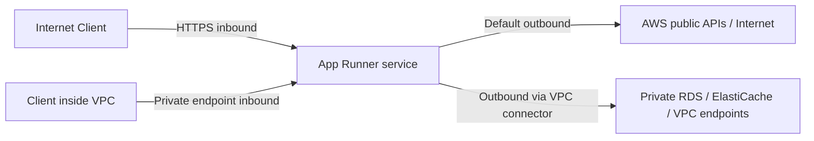

# App Runner Service from Source Code or Container Image

**AWS App Runner** is an AWS service that manages turning a **web/API application** from source code or a container image into an **HTTP(S) service with an accessible endpoint, TLS, load balancing, health checks, and automatic scaling**. With App Runner, a development team does not need to provision EC2 instances, configure an Application Load Balancer (ALB), or operate a Kubernetes cluster just to run a web application.

This lesson belongs to the **Managed Application Platforms** chapter of the **CLOUD_PROVIDERS_AWS** module. Core concepts—IAM, VPC, Regions/AZs, compute, storage, databases, service integration, and monitoring—still matter: App Runner reduces server operations, **not your responsibility for source code, security, data, networking, and costs**.

The lesson focuses on **two deployment paths**:

- **Source code repository**: App Runner connects to GitHub or Bitbucket, uses a compatible **managed runtime** to build code into an image, and deploys it.
- **Container registry**: your team builds the image and pushes it to **Amazon ECR private** or **Amazon ECR Public**; App Runner pulls the prebuilt image and runs it without rebuilding from source.

> **Scope:** This lesson uses a Java HTTP API example. For a modern Spring Boot release requiring **Java 17/21**, the **container image** path is usually more practical: per current official App Runner Java runtime documentation, the **managed Java source runtimes** listed are **Corretto 8 and Corretto 11**—do not assume a `corretto17` or `corretto21` source runtime is provided. Runtime support can change; verify the documentation before creating a service.

## 1. Learning Objectives

After this lesson, you will be able to:

1. Explain the **App Runner service**, **source**, **deployment**, **instance configuration**, **health checks**, **auto scaling**, and **service URL** model.
2. Compare **source-based deployment** vs. **image-based deployment** across runtimes, artifact management, CI/CD, security, and reproducibility.
3. Build a simple Java source example with `apprunner.yaml` and understand managed runtime limits.
4. Package a Java API into an image, push it to ECR, and create a service using that image.
5. Distinguish the **ECR access role** and the **App Runner instance role** when accessing AWS APIs/Secrets Manager/RDS.
6. Design **public/private inbound** and **public/VPC outbound** networking in the right traffic directions.
7. Configure health checks, concurrency, MinSize/MaxSize, deployments, and custom domains.
8. Inspect metrics/logs, analyze startup or connectivity failures, and propose recovery/rollback steps.
9. Choose among App Runner, Lambda, ECS Fargate, EKS, and Elastic Beanstalk for specific requirements.
10. Build a pre-production checklist covering security, resilience, and cost control.

## 2. What Does App Runner Do and What Does It Not Do?

### 2.1. Architecture Overview



An App Runner service consists of an application source, deployment settings, execution resources, and a URL. App Runner provides the infrastructure to accept HTTP(S) traffic and scale instances based on load; AWS operates the underlying hosts. You manage the **code/image, CPU/memory sizing, port configuration, start command, AWS permissions, and external dependencies**.

### 2.2. AWS Responsibilities vs. Application Responsibilities

| Component | Managed by App Runner / AWS | Managed by Dev / Ops Team |
| --- | --- | --- |
| Underlying hosts and HTTP service scale-out | Provisions and operates supporting infrastructure | Chooses auto scaling bounds and resource sizes |
| Source runtime | Provides compatible managed runtimes | Picks supported runtime and updates dependencies |
| Container image | Pulls and runs images from ECR | Builds, scans, patches, and publishes images |
| Inbound TLS | App Runner provides a default HTTPS domain | Custom domain, DNS, and application-level authentication |
| Load balancing, health checks | Executes per configuration | Picks HTTP port/health path and verifies readiness |
| AWS permissions | IAM provides role and policy mechanisms | Assigns proper roles, trust policies, and least privilege |
| Data and backends | AWS provides S3, RDS, DynamoDB, etc. separately | Chooses data services, backups, migrations, RPO/RTO |
| Logs and metrics | Integrates with CloudWatch and observability services | Sets alarms, log retention, correlation IDs, and response runbooks |

**App Runner is not a persistent file store** for user data by default. Never store uploads, sessions, or critical databases on the container's local filesystem: instances can be replaced or scaled, and ephemeral storage offers no persistence guarantees like S3 or RDS.

## 3. Deployment Decision: Source Code or Container Image?

| Criterion | **Source Code Repository** | **Container Image** |
| --- | --- | --- |
| Input location | GitHub/Bitbucket repository and branch | ECR private or ECR Public image URI |
| Who builds the image? | App Runner builds from source code | Team/CI pre-builds; App Runner only deploys the image |
| Runtime | Tied to the supported managed runtimes list | Pick your own JDK, framework, and OS in the Dockerfile |
| Build configuration | Console/API or `apprunner.yaml` | Dockerfile/CI outside App Runner |
| `apprunner.yaml` | **Yes**, placed in the source directory | **Not applicable** |
| Source access permissions | Repository connection | ECR access role for ECR private; not needed for ECR Public |
| Updating versions | Commit/branch in source directory | Push new image/tag or update `ImageIdentifier` |
| Build control | Relatively simple; runtime-dependent | High: dependencies, base image, SBOM, image scanning |
| Best fit | Small APIs, supported runtime, minimal OS needs | Java 17/21, Spring Boot 3+, custom runtimes, security pipelines |
| Base image patching | App Runner manages the runtime in source mode | Team must rebuild images with security patches |

**Do not treat source and image as different service-exposure modes.** Both support public/private endpoints, VPC outbound, scaling, and service URLs per App Runner features. The primary difference is the **source and build/deploy workflow**.

### 3.1. Quick Selection by Scenario

- Small Java 11 app with simple build/start commands: consider **source code**.
- Spring Boot 3 or Java 21 needing native dependencies and signed test/build artifacts: prefer **container image**.
- Image built in CI that must pass ECR scanning before deployment: **container image**.
- Quick prototype directly from a repository on a supported runtime: **source code**.
- App requiring a UDP server, non-HTTP long-running daemon, complex cron batches, or a Kubernetes control plane: look at **ECS, Lambda, Batch, or EKS**—do not pick App Runner merely for the "fully managed" label.

## 4. Service Configuration Concepts

| Concept | Example | Meaning |
| --- | --- | --- |
| **Service name** | `java-api-demo` | Service identifier within a Region |
| **SourceConfiguration** | `CodeRepository` or `ImageRepository` | Describes code/image source and deployment mode |
| **Port** | `8080` | TCP port the application process listens on inside the container |
| **CPU/Memory** | `1 vCPU / 2 GB` | Compute resources allocated per service instance |
| **Instance role** | `AppRunnerJavaApiInstanceRole` | AWS API permissions for the running application |
| **Access role** | `AppRunnerEcrAccessRole` | Permission for App Runner to pull private ECR images |
| **HealthCheckConfiguration** | `HTTP /health` | Checks whether the application is ready |
| **AutoScalingConfiguration** | `MaxConcurrency=50`, `MinSize=1`, `MaxSize=5` | Adjusts capacity based on concurrent requests |
| **EgressConfiguration** | Default or VPC connector | **Outbound** network path from the application |
| **IngressConfiguration** | Public or private endpoint | **Inbound** network reachability to the service |
| **Service URL** | `https://xxxxx.region.awsapprunner.com` | HTTPS URL provisioned by App Runner |

An App Runner service has a **lifecycle**: `CREATING`, `RUNNING`, `PAUSED`, `OPERATION_IN_PROGRESS`, failure states, or deletion depending on operations. Seeing `create-service` return success is **not enough**; wait for `RUNNING`, confirm health, and invoke the live API.

## 5. Path A: Creating App Runner from a Source Code Repository

### 5.1. Prerequisites

You need:

1. A repository on **GitHub** or **Bitbucket** with an authorized branch and source directory.
2. An HTTP web service whose build/start commands fit an App Runner-supported managed runtime.
3. IAM permissions to create an App Runner service and repository connection.
4. A **Repository connection** to the Git provider: the Console guides linking the account/organization, usually via a connector approval step.
5. Defined listening port, environment variables, health check, and estimated costs.

In a **monorepo**, specify the source directory—such as `services/catalog-api`—so App Runner runs build/start commands from the right folder. With automatic deployments, changes **outside the source directory** may not trigger automatic deploys; use CI or manual deployments if shared libraries live elsewhere.

### 5.2. Provided Java Runtime Limits

Per the App Runner Java runtime release list referenced for this lesson, **Corretto 8 (`corretto8`)** and **Corretto 11 (`corretto11`)** are available as managed Java source runtimes. **AWS CodeBuild** runtime lists or Amazon Corretto releases in general are **not** the App Runner runtime list.

Consequences:

- You can use `corretto11` for a Java 11 example if dependencies and build tools are compatible.
- Do not put `runtime: corretto21` into `apprunner.yaml` without verifying App Runner support.
- Spring Boot 3 requires Java 17+, so a **CI-built container image** is usually the cleanest way to guarantee compatibility.
- Java 8/11 may be unsuitable for new production apps if organizational security or support policies disallow them.

**Rule:** Combine **actually AWS-supported runtimes** + **Java framework compatibility** + **patching policy**—never guess.

## 6. Minimal Java 11 Source Example

To illustrate the source workflow, use a Java 11 HTTP server with no Spring Boot dependency. Repository layout:

```text
demo-java-http/
  apprunner.yaml
  src/
    main/
      java/
        example/
          HelloApp.java
```

### 6.1. Java Code

```java
package example;

import com.sun.net.httpserver.HttpExchange;
import com.sun.net.httpserver.HttpServer;
import java.io.IOException;
import java.net.InetSocketAddress;
import java.nio.charset.StandardCharsets;

public class HelloApp {
    public static void main(String[] args) throws IOException {
        // Must match the port declared in App Runner.
        int port = 8080;
        HttpServer server = HttpServer.create(
            new InetSocketAddress("0.0.0.0", port), 0
        );

        server.createContext("/health", exchange -> respond(exchange, 200, "ok"));
        server.createContext("/hello", exchange -> respond(exchange, 200, "hello from App Runner"));
        server.setExecutor(null);
        server.start();

        System.out.println("HTTP server listening on port " + port);
    }

    private static void respond(HttpExchange exchange, int status, String text)
        throws IOException {
        byte[] data = text.getBytes(StandardCharsets.UTF_8);
        exchange.getResponseHeaders().set("Content-Type", "text/plain; charset=utf-8");
        exchange.sendResponseHeaders(status, data.length);
        try (java.io.OutputStream output = exchange.getResponseBody()) {
            output.write(data);
        }
    }
}
```

This is an educational HTTP routing example, **not a production web framework**: it lacks authentication, rate limiting, structured logging, graceful shutdown, and full error handling.

### 6.2. Configuring `apprunner.yaml` for Source

```yaml
version: 1.0
runtime: corretto11

build:
  commands:
    build:
      - mkdir -p build/classes
      - javac -d build/classes src/main/java/example/HelloApp.java

run:
  command: java -cp build/classes example.HelloApp
  network:
    port: 8080
  env:
    - name: APP_ENV
      value: "training"
```

Explanation:

- `version: 1.0` is the **App Runner config schema version**, not the Java version.
- `runtime: corretto11` selects an App Runner-supported Java runtime.
- `build.commands.build` declares compile commands; `pre-build` and `post-build` stages are optional.
- `run.command` launches the HTTP server after the build.
- `run.network.port` must match the port the server actually listens on.
- `run.env` here contains only **non-secret** environment variables.

Place `apprunner.yaml` in the **source directory**, which need not be the repository root in a monorepo. It does **not** set CPU/memory or auto scaling policies; those are configured at the **service level** via the Console, API, or IaC.

### 6.3. Local Testing Before Deployment

Example using a Java 11 JDK installed on your workstation:

```bash
mkdir -p build/classes
javac -d build/classes src/main/java/example/HelloApp.java
java -cp build/classes example.HelloApp
```

In another terminal:

```bash
curl -i http://localhost:8080/health
curl -i http://localhost:8080/hello
```

Expect HTTP **200** with the corresponding response bodies. If local execution fails, fix the code before configuring AWS; App Runner will not fix broken code on its own.

## 7. Creating a Service from Source via the AWS Console

1. Open the [AWS App Runner Console](https://console.aws.amazon.com/apprunner/) in the right **AWS account and Region**.
2. Choose **Create service** → source **Source code repository**.
3. Select **GitHub** or **Bitbucket** and connect the repository provider with required permissions.
4. Select the repository, branch, and exact **Source directory**.
5. Choose **Deployment settings**:
   - **Automatic** if code changes in the source directory should trigger deployments.
   - **Manual** if you need release gates and verification before deploying.
6. Under **Configure build**, select loading settings from `apprunner.yaml` (if using the file above) or declare runtime/build/start settings in the Console/API.
7. Under **Configure service**, set the name, CPU/memory, port `8080`, and an IAM instance role if the app calls AWS APIs.
8. Select **HTTP `/health`** health check instead of the TCP default to confirm the application actually responds.
9. Review inbound/outbound networking, auto scaling, observability, environment variables, secrets, and tags.
10. Review and click **Create & deploy**. Wait for status `RUNNING`.
11. Open the **Default domain**, test `/health` and `/hello` over HTTPS, and check logs.

**Never copy GitHub/Bitbucket access tokens into `apprunner.yaml`.** Use AWS-managed connections and grant least-privilege repository access.

### 7.1. Automatic Source Code Deployments

App Runner monitors repository changes scoped to the source directory:

- When code inside the source directory changes, the service can automatically build and deploy if **Automatic deployment** is enabled.
- If a shared library lives **outside the source directory**, changing that library may not trigger a deployment; consider CI pipelines or manual triggers.
- Auto deployment does not replace CI tests and approvals. For production, enforce branch protection, tests, approvers, and rollback plans.

A frequent mistake is a developer pushing to `feature/x` while App Runner watches `main`. The service never updates because commits land on a different branch.

## 8. Path B: Creating a Service from a Container Image in ECR

### 8.1. When Should You Use an Image?

Use a container image when you want to:

- Run Java 17/21, Spring Boot 3, or a runtime absent from the managed source list.
- Lock framework/JDK versions, binaries, and base OS inside the image.
- Build and test once in CI, then promote the **exact same artifact** across environments.
- Enforce image scanning, SBOMs, artifact signing, and organizational approval gates.
- Control runtime dependencies and application startup precisely.

**App Runner does not build a Dockerfile for ECR image sources.** When supplying an image URI, ensure the image already exists, uses a compatible CPU architecture, and exposes the right port and entrypoint.

### 8.2. Illustrative Dockerfile for Spring Boot with Java 21

Suppose a Maven Wrapper Spring Boot 3 project outputs `target/catalog-api-1.0.0.jar` after packaging. A multi-stage Dockerfile:

```dockerfile
# Stage 1: compile and package the application.
FROM public.ecr.aws/amazoncorretto/amazoncorretto:21 AS build
WORKDIR /workspace
COPY .mvn/ .mvn/
COPY mvnw pom.xml ./
COPY src/ src/
RUN chmod +x mvnw && ./mvnw -B -DskipTests package

# Stage 2: runtime image.
FROM public.ecr.aws/amazoncorretto/amazoncorretto:21
WORKDIR /app
COPY --from=build /workspace/target/catalog-api-1.0.0.jar /app/app.jar
USER 10001
EXPOSE 8080
ENTRYPOINT ["java", "-jar", "/app/app.jar"]
```

In the application, configure:

```properties
# Example Spring Boot application.properties.
server.port=8080
server.address=0.0.0.0
management.endpoints.web.exposure.include=health,info
management.endpoint.health.probes.enabled=true
```

**Prerequisites for this example:** the JAR artifact must match **`catalog-api-1.0.0.jar`**, with all dependencies and entrypoint ready to run. The project must contain the `mvnw` wrapper and `.mvn` folder. If your project builds differently, adapt the Dockerfile accordingly—do not copy a Dockerfile blindly without checking actual build outputs.

For production:

- Pin base images per organizational policy, patch regularly, and scan for vulnerabilities.
- Remove `-DskipTests` in test pipelines—for example, separate **test** and **package** stages so quality checks are never skipped.
- Run as a **non-root user** when supported by the app.
- Never bake secrets into images, Maven arguments, or source repositories.
- Tune JVM heap and memory limits to fit the instance's CPU/memory to avoid `OutOfMemoryError`.

### 8.3. Building and Pushing the Image to ECR

Assume permission to use ECR repository `catalog-api` in Region `ap-southeast-1` and placeholder account `123456789012`:

```bash
# Confirm the active AWS account first.
aws sts get-caller-identity --profile training

# STATE-CHANGING / BILLABLE: create the private ECR repository if it does not exist.
aws ecr create-repository \
  --repository-name catalog-api \
  --region ap-southeast-1 \
  --profile training

# Authenticate Docker to ECR using AWS credentials.
aws ecr get-login-password \
  --region ap-southeast-1 \
  --profile training |
docker login --username AWS --password-stdin \
  123456789012.dkr.ecr.ap-southeast-1.amazonaws.com

# Build an image compatible with the App Runner-supported runtime architecture.
docker build -t catalog-api:1.0.0 .

# Tag the image for ECR.
docker tag catalog-api:1.0.0 \
  123456789012.dkr.ecr.ap-southeast-1.amazonaws.com/catalog-api:1.0.0

# Push the image to ECR.
docker push \
  123456789012.dkr.ecr.ap-southeast-1.amazonaws.com/catalog-api:1.0.0
```

IDs and URIs are **illustrative**—do not run them on accounts you do not own. If `catalog-api` already exists, **skip** creating it again. Build/push actions can create image storage and ECR charges.

**Release tip:** Avoid relying on the `latest` tag in production. Use versioned/commit tags and ECR image immutability where appropriate, and record image digests for exact traceability and rollbacks. Verify beforehand that the image architecture and binaries run on App Runner's supported Linux environment.

### 8.4. Console Steps to Create a Service from an Image

1. App Runner Console → **Create service**.
2. Under **Source**, choose **Container registry**.
3. Choose **Amazon ECR private** or **Amazon ECR Public**.
4. For ECR private, pick the image URI/tag and an appropriate **ECR access role**.
5. Choose **Manual/Automatic deployment** per source capabilities:
   - ECR private **in the same AWS account** can use auto deployment when supported/configured.
   - **ECR Public** does not support App Runner automatic deployment triggers.
   - Cross-account ECR private **does not support App Runner automatic deployment**; use manual or explicit pipeline triggers.
6. Set container port `8080`, CPU/memory, and an instance IAM role if code calls AWS services.
7. Configure an HTTP health check, inbound/outbound networking, min/max scaling, observability, and tags.
8. Click **Create & deploy**; wait for `RUNNING`, then test the service URL.

**An ECR access role is not an instance role.** Granting App Runner permission to pull an image does not give your Java code permission to read S3, DynamoDB, or Secrets Manager.

## 9. Comparing the Two Deployment Paths Across the Lifecycle



| Stage | Source Code | Container Image |
| --- | --- | --- |
| Build | App Runner runs build commands/runtime | CI builds image and pushes to ECR |
| Testing | Repo tests; build can run test commands | CI unit/integration tests and image scanning |
| Deploy | App Runner builds & releases | App Runner pulls image & releases |
| Auto trigger | Commits inside source directory | Pushes to supported ECR repositories |
| Artifact reproducibility | Depends on locked runtime and dependency versions | Can pin immutable image digests |
| Rollback | Redeploy a verified commit/branch version | Redeploy a verified older image tag/digest |
| Operations | Similar health/metric monitoring | Similar health/metric monitoring |

Do not assume **automatic deployment** equals **zero downtime or bug-free releases**. Always maintain health checks, backward-compatible database schemas, and rollback procedures.

## 10. IAM: Three Easily Confused Roles

### 10.1. Deployer Identity

Operators use **IAM Identity Center** or an authorized IAM role to call App Runner APIs; permissions are needed for `apprunner:CreateService`, `apprunner:UpdateService`, `iam:PassRole` on permitted roles, and related actions. Never use the root user or long-lived access keys for routine deployments.

### 10.2. ECR Access Role

The **Access role** allows App Runner to pull images from **ECR private**. Trust policy for the service principal:

```json
{
  "Version": "2012-10-17",
  "Statement": [
    {
      "Effect": "Allow",
      "Principal": {
        "Service": "build.apprunner.amazonaws.com"
      },
      "Action": "sts:AssumeRole"
    }
  ]
}
```

Attach the AWS-managed policy `AWSAppRunnerServicePolicyForECRAccess` when appropriate, or an equivalent least-privilege policy scoped to the target repository.

For **ECR Public**, an ECR private access role is normally unnecessary. Cross-account ECR private requires inspecting both the source registry/account policies and the role permissions.

### 10.3. Instance Role

The **Instance role** is assumed by the running container application to call AWS APIs—such as reading S3 objects. Trust policy:

```json
{
  "Version": "2012-10-17",
  "Statement": [
    {
      "Effect": "Allow",
      "Principal": {
        "Service": "tasks.apprunner.amazonaws.com"
      },
      "Action": "sts:AssumeRole"
    }
  ]
}
```

Example IAM policy granting read-only access to the `catalog/` prefix of an illustrative S3 bucket:

```json
{
  "Version": "2012-10-17",
  "Statement": [
    {
      "Sid": "ReadCatalogObjects",
      "Effect": "Allow",
      "Action": ["s3:GetObject"],
      "Resource": "arn:aws:s3:::example-catalog-data/catalog/*"
    }
  ]
}
```

This is an application **data-plane** permission, not used to pull the container image from ECR. When properly configured, the Java AWS SDK retrieves temporary credentials from the instance role via the default credential provider chain—never hard-code `AWS_ACCESS_KEY_ID` or `AWS_SECRET_ACCESS_KEY` inside the image.

If the bucket uses SSE-KMS, check `kms:Decrypt` and the KMS key policy as well. **An `Allow` statement on the instance role cannot override an explicit `Deny`** in an SCP, bucket policy, or KMS key policy.

### 10.4. Quick Reference Table

| Role | Trusted Principal or Identity | When Needed |
| --- | --- | --- |
| Deployer | IAM role / Identity Center principal | Creating/updating/deleting App Runner services |
| **ECR access role** | `build.apprunner.amazonaws.com` | Pulling **ECR private** images |
| **App Runner instance role** | `tasks.apprunner.amazonaws.com` | App calling S3/RDS IAM auth/Secrets Manager and AWS APIs |

## 11. Secrets and Environment Variables

A Java application may require settings such as:

- `APP_ENV=prod`.
- `SPRING_PROFILES_ACTIVE=prod`.
- `DB_HOST=...`.
- `DB_PASSWORD` or an API token.

**Never store plaintext passwords** in `apprunner.yaml`, Dockerfiles, repositories, or build arguments. App Runner supports referencing **AWS Secrets Manager** and **SSM Parameter Store** when configuring runtime environment secrets.

Illustrative configuration example (source path, in `apprunner.yaml`):

```yaml
version: 1.0
runtime: corretto11
build:
  commands:
    build:
      - mvn -B package
run:
  command: java -jar target/legacy-demo.jar
  network:
    port: 8080
  env:
    - name: APP_ENV
      value: "prod"
  secrets:
    - name: DB_PASSWORD
      value-from: "arn:aws:secretsmanager:ap-southeast-1:123456789012:secret:catalog/db/password-EXAMPLE"
```

This is an **alternative configuration example** and does not apply to the minimal Java HTTP server in Section 6 (which has no Maven build or JAR). The ARN is a placeholder; substitute a real secret and grant the **instance role** `secretsmanager:GetSecretValue` (plus `kms:Decrypt` if using a KMS key requiring explicit permission). For **image-based services**, configure secrets in the App Runner service/API configuration instead of `apprunner.yaml`.

Note on secret rotation: check **when the running process reads the new value** and whether a redeploy/restart is needed per App Runner guidance—do not assume every running instance immediately reloads a rotated secret from Secrets Manager.

## 12. Networking: Inbound and Outbound Are Two Independent Directions

### 12.1. Thinking in Two Arrows



The diagram depicts available **options** (a service picks the relevant settings), not that all inbound and outbound paths are active simultaneously. Specifically, a **VPC connector** controls **outbound application traffic**, whereas a **private endpoint** controls **inbound traffic**.

### 12.2. Default Public Inbound

When **Public endpoint** is selected, App Runner provisions an Internet-accessible HTTPS URL. You must implement application authentication and authorization yourself; having HTTPS does **not** mean internal APIs are protected.

With custom domains, App Runner supports domain ownership validation and TLS via ACM. In Route 53, you can create records per Console/API guidance; for root/apex domains, use an appropriate **Alias** record rather than placing a CNAME at the apex.

### 12.3. Default Outbound

Under **Public access (outgoing)**, the application can send requests to the Internet and public AWS service endpoints per service behavior. That does **not** mean private RDS IPs inside your organization's VPC are reachable: private RDS is reachable only over internal VPC networking, requiring appropriate VPC integration.

### 12.4. Outbound VPC Connector

When a Java API needs to reach private RDS PostgreSQL or ElastiCache:

1. Create a **VPC connector** in the target VPC.
2. Select appropriate **private subnets** with free IPs in App Runner-supported Availability Zones.
3. Attach a security group to the connector to control outbound traffic.
4. Configure the RDS security group to allow inbound port `5432` from the **connector's security group**.
5. Set App Runner **Outgoing network traffic = Custom VPC** and select the connector.
6. Verify DNS resolution, routing, database credentials, TLS, and application timeouts.

**Core point:** Once a VPC connector is enabled, **outbound application traffic** traverses the VPC. Subnets do not inherently grant Internet access. If the app also needs public Internet or public AWS APIs, configure a **NAT Gateway** or **VPC endpoints** with matching routes and SGs.

**Do not place a VPC connector in a public subnet expecting an Internet Gateway to give it Internet access.** VPC connector network interfaces do not carry public IPs to route directly via an IGW; private subnets plus a NAT Gateway or endpoints are typically required.

Configuring a VPC connector for the first time can add a few minutes to startup; factor in provisioning time when changing SGs or subnets.

### 12.5. A VPC Connector Does Not Change Inbound Exposure

It is easy to mistakenly think attaching App Runner to a VPC makes the API private. **It does not.** A VPC connector controls only **egress** from the app. If ingress remains public, users can still reach the service via its public URL.

App Runner provides a **private endpoint for incoming traffic**, implemented via a **VPC interface endpoint (AWS PrivateLink)** and an **App Runner VPC Ingress Connection**. Select **Private endpoint** when only clients inside the VPC may access the service. This carries separate interface endpoint configuration and charges.

**A VPC interface endpoint for the App Runner management API**, **a VPC interface endpoint for private application ingress**, and **a VPC connector for application egress** are three distinct mechanisms. Never confuse one for another.

### 12.6. Example: App Runner Calling PostgreSQL Over a VPC

Suppose:

| Component | Configuration |
| --- | --- |
| App Runner source | ECR container running Java API |
| Inbound | Public HTTPS via App Runner URL |
| Egress | VPC connector across two private subnets |
| Database | RDS PostgreSQL, non-public |
| RDS SG inbound | TCP `5432` from connector SG |
| App IAM role | Secrets Manager permission to fetch DB credentials |
| DNS | RDS endpoint resolves inside the VPC |
| TLS | JDBC enforces TLS per database policy |

**Having valid routes without the right SG still fails**; having the right SG while the DB is stopped or credentials are wrong also fails. Troubleshoot by separating **networking, IAM, TLS, authentication, and application** layers.

## 13. Health Checks and Application Readiness

App Runner defaults to a **TCP** health check: it tests whether a TCP connection succeeds on the configured port. For a web API, an open TCP socket is **not enough** to prove the app can serve business traffic.

### 13.1. Switching to an HTTP Health Check

Example settings:

| Property | Illustrative Value |
| --- | --- |
| Protocol | `HTTP` |
| Path | `/actuator/health/readiness` or `/health` |
| Interval | 5 seconds (default) |
| Timeout | 2 seconds (default) |
| Healthy threshold | 1 (default) |
| Unhealthy threshold | 5 (default) |

**Spring Boot Actuator** only responds on probe paths when configured and exposed appropriately. If `/actuator/health/readiness` requires authentication or is unexposed, health checks receive 401/404 and the service stays unhealthy.

A sensible health endpoint should:

- Return **200** when the app can handle requests.
- Reflect essential readiness without adding brittle dependencies that mark the entire fleet unhealthy during a brief blip in a non-critical downstream service.
- Never leak secrets, SQL connection strings, or PII.
- Have timeouts sized appropriately for JVM startup and health checks.
- Be tested locally/in-container before deployment.

### 13.2. Port Binding

With App Runner, the container must listen on the **exact port** you declare. If App Runner sends traffic to port `8080` while Spring Boot listens on `8081`, deployments can fail or never become healthy.

Also bind to **`0.0.0.0`** inside the container. Binding only to `127.0.0.1` can prevent App Runner from reaching the listener.

## 14. Auto Scaling: Concurrency, MinSize, and MaxSize

App Runner automatically scales a web service based on **concurrent requests in flight** and configured bounds.

| Property | Example | Meaning |
| --- | --- | --- |
| **MaxConcurrency** | 50 | When concurrent requests exceed this per-instance threshold, App Runner can scale out |
| **MinSize** | 1 | Minimum provisioned instances, which may include active and standby capacity |
| **MaxSize** | 5 | Maximum active instances allowed to serve traffic |
| **CPU/Memory** | 1 vCPU, 2 GB | Compute resources per instance |
| **Actual active instances** | 1–5 depending on load | Varies with concurrency and scaling speed |

### 14.1. Sizing Example

Suppose:

- A Java request averages **100 ms**, with P95 around **350 ms**.
- Each App Runner instance has `MaxConcurrency=50`.
- Peak load reaches **150 concurrent requests**.

Rough estimate:

\[
N_{\text{instance}} \gtrsim \left\lceil \frac{150}{50} \right\rceil = 3
\]

This is an **intuitive approximation**, not a guarantee that App Runner runs exactly 3 instances. Scaling reaction time, JVM warm-up, CPU/memory saturation, database connections, and `MaxSize` caps can all become bottlenecks.

If `MaxSize=2`, the service cannot scale active instances to 3 regardless of concurrency. If `MaxConcurrency` is set too high, a single Java instance can accept so many requests that CPU, heap, or DB pools saturate before scaling kicks in.

### 14.2. MinSize and Idle Costs

**MinSize** sets the minimum number of provisioned instances. App Runner keeps reserved capacity ready for fast activation:

- **Provisioned memory** charges apply across all provisioned instances.
- **CPU** charges apply primarily to **active** instances processing work.
- Seeing **`ActiveInstances=0`** in CloudWatch can simply mean **zero incoming traffic**, not that the service has zero provisioned capacity or zero cost.

App Runner can temporarily spin up extra provisioned instances during deployments to transition versions; account for peak costs and quotas during frequent releases.

### 14.3. App Runner Autoscaling vs. EC2 ASG/HPA

| Service | Primary Scaling Unit | Signal |
| --- | --- | --- |
| App Runner | Managed application instances | Concurrent HTTP requests |
| EC2 Auto Scaling | EC2 instances | Metrics, alarms, schedules, target tracking |
| Kubernetes HPA | Pod replicas | Resource/custom/external metrics |
| ECS Service Auto Scaling | ECS tasks | Target tracking/step/scheduled metrics |

There is no Kubernetes `kubectl scale` API for App Runner, and App Runner does not expose fine-grained EC2 instance types or AZ placement like EKS or EC2.

## 15. Deployments: Manual, Automatic, and Rollback

### 15.1. Manual Deployment

**Manual** fits when:

- A branch feeds production and every release needs explicit approval.
- Artifacts must pass testing, scanning, signing, and release notes first.
- Image sources like ECR Public or cross-account ECR do not support App Runner auto triggers.
- You want tight control over deployment timing to avoid peak-hour changes.

In the Console, open the service and click **Deploy**; via the CLI, run `start-deployment` on an eligible service.

### 15.2. Automatic Deployment

**Automatic** fits well in dev/staging:

- Source: commits to the watched branch's source directory.
- Image: updates to a supported private ECR source (typically same-account).
- App Runner detects updates and deploys automatically per service mechanics.

**Automatic deployment is not supported** for images from **ECR Public** or private ECR repositories in a **different AWS account**. For cross-account pipelines, trigger deployments explicitly via CLI/API/IaC rather than assuming a push updates the service.

### 15.3. Rollback

If release v2 fails:

1. Record the `ServiceArn`, deployment/operation status, and v2 commit or image digest.
2. Identify the known-good v1 version compatible with the current database/schema.
3. For source: restore the branch/commit or rebuild the older version via your workflow, then **deploy**.
4. For images: update the source to the verified older image tag/digest and deploy.
5. Monitor status, health, error rates, latency, request logs, and DB connections.
6. Afterward, conduct a postmortem and harden the pipeline.

**Do not assume App Runner retains a one-click rollback to arbitrary historical versions like a full release-management platform.** Your organization must keep image/commit artifacts, version records, and backward-compatible database migrations.

### 15.4. Database Schema Compatibility

When rolling across multiple instances:

- Both v1 and v2 can run concurrently during transition.
- A **breaking schema migration** can break v1 even after rolling back code.
- Use **expand–migrate–contract** migrations, controlled rollouts, and tested backup/restore plans.
- Ensure request retries and idempotency when clients encounter transient transition errors.

## 16. AWS CLI: Inspecting a Service Without Provisioning New Infrastructure

Use AWS CLI v2 with the right IAM Identity Center profile/role and Region. The following commands are **read-only**:

```bash
# Confirm active caller identity.
aws sts get-caller-identity --profile training

# List App Runner services in the Region.
aws apprunner list-services \
  --region ap-southeast-1 \
  --profile training

# Inspect a specific service.
aws apprunner describe-service \
  --service-arn "arn:aws:apprunner:ap-southeast-1:123456789012:service/java-api-demo/EXAMPLE-ID" \
  --region ap-southeast-1 \
  --profile training

# List shared auto-scaling configurations.
aws apprunner list-auto-scaling-configurations \
  --region ap-southeast-1 \
  --profile training

# View deploy/update operations for a service.
aws apprunner list-operations \
  --service-arn "arn:aws:apprunner:ap-southeast-1:123456789012:service/java-api-demo/EXAMPLE-ID" \
  --region ap-southeast-1 \
  --profile training

# List VPC connectors if the service uses custom egress.
aws apprunner list-vpc-connectors \
  --region ap-southeast-1 \
  --profile training
```

ARNs are **placeholders**. If no service appears, verify the **account, Region, and IAM role** before assuming it was deleted.

### 16.1. Manual Deployment via CLI

Once a service exists and has a new source/image ready, this command **updates the application** and can affect traffic:

```bash
aws apprunner start-deployment \
  --service-arn "arn:aws:apprunner:ap-southeast-1:123456789012:service/java-api-demo/EXAMPLE-ID" \
  --region ap-southeast-1 \
  --profile training
```

Requires `apprunner:StartDeployment` permission and a valid ready source/image. The command does not guarantee the deployment succeeds—check operation status and metrics.

## 17. CLI `CreateService` Example from an ECR Image

This is an **input JSON configuration example**. **Do not save it into repositories outside your assigned scope** while only reading this lesson; in an authorized sandbox lab, you can create your own `service.json`.

```json
{
  "ServiceName": "java-api-demo",
  "SourceConfiguration": {
    "ImageRepository": {
      "ImageIdentifier": "123456789012.dkr.ecr.ap-southeast-1.amazonaws.com/catalog-api:1.0.0",
      "ImageRepositoryType": "ECR",
      "ImageConfiguration": {
        "Port": "8080",
        "RuntimeEnvironmentVariables": {
          "APP_ENV": "training"
        }
      }
    },
    "AuthenticationConfiguration": {
      "AccessRoleArn": "arn:aws:iam::123456789012:role/AppRunnerEcrAccessRole"
    },
    "AutoDeploymentsEnabled": false
  },
  "InstanceConfiguration": {
    "Cpu": "1 vCPU",
    "Memory": "2 GB",
    "InstanceRoleArn": "arn:aws:iam::123456789012:role/AppRunnerJavaInstanceRole"
  },
  "HealthCheckConfiguration": {
    "Protocol": "HTTP",
    "Path": "/actuator/health/readiness"
  },
  "NetworkConfiguration": {
    "EgressConfiguration": {
      "EgressType": "DEFAULT"
    },
    "IngressConfiguration": {
      "IsPubliclyAccessible": true
    }
  }
}
```

Requirements for this configuration to work:

- The image URI actually exists in ECR and runs a process listening on port `8080`.
- The **ECR access role** has the right trust principal and permissions policy.
- The **Instance role** exists; if the app does not call AWS APIs, `InstanceRoleArn` can be omitted.
- The Spring Boot readiness endpoint returns **200** when healthy; if the app uses `/health`, update `Path`.
- CPU/memory match an App Runner-supported combination within account quotas.
- No secrets are placed in plaintext `RuntimeEnvironmentVariables`.
- Account, Region, networking, and budget are authorized.

In a sandbox with an authorized JSON file, create the service with:

```bash
# STATE-CHANGING AND BILLABLE: run only in an approved sandbox.
aws apprunner create-service \
  --cli-input-json file://service.json \
  --region ap-southeast-1 \
  --profile training
```

The initial response may return `Status: CREATING`. Use `describe-service` and `list-operations` afterward to confirm `RUNNING` and retrieve the HTTP endpoint.

## 18. Custom Domains, HTTPS, and Inbound Security

App Runner assigns a **default HTTPS URL** for each service. To attach `api.example.com`:

1. Open **Custom domains** on the service.
2. Enter a domain you own/manage.
3. App Runner initiates certificate validation via ACM.
4. With **Route 53**, the Console can help create DNS/validation records; with external DNS providers, add the CNAME/validation records as instructed.
5. Keep **DNS validation records** in place so the certificate renews automatically.
6. Confirm the domain reaches Active status, the TLS certificate is valid, and HTTP requests succeed.

With **Route 53**, subdomains can use aliases or CNAMEs as appropriate; **apex/root domains** require an appropriate Alias record—never blindly place a CNAME at the apex.

### 18.1. AWS WAF for Public App Runner

App Runner supports associating an **AWS WAF web ACL** to block or rate-limit requests by rules. Depending on your needs, apply:

- Managed rules against common web exploits.
- Rate-based rules against abuse.
- Path/header/query-string rules tested against your API.
- Logging and `COUNT` mode testing before switching to `BLOCK` in production.

With an **App Runner private endpoint**, **WAF source IP/CIDR rules are unreliable** because the service does not forward the original client source IP to WAF in the documented private flow. To restrict client IPs accessing a private service, use the **VPC interface endpoint's security group** and network controls instead of WAF source-IP rules.

Even with WAF enabled, the application must handle **authentication**, **authorization**, and user data access checks itself. WAF is not an application IAM role.

### 18.2. Private Ingress for Internal APIs

If an API is strictly for internal applications:

- Choose **Incoming traffic = Private endpoint**.
- Create or select an App Runner **VPC interface endpoint** to connect.
- Verify the endpoint's security group, subnets/AZs, and allowed clients.
- Configure VPC DNS/routing and TLS, and test from an internal client.
- Budget for **AWS PrivateLink endpoint-hours and data processing**.

Do not simply omit a custom domain and assume the default URL is private. **Private endpoint is an explicit network configuration.**

## 19. Logging, Metrics, Tracing, and Alerts

### 19.1. Observability Sources

| Tool | Data Provided | When Needed |
| --- | --- | --- |
| **App Runner operations** | Service creation, deployments, updates, errors | Tracing failed releases |
| **CloudWatch Logs** | Application logs and service/deployment logs | Java exceptions, startup/port errors |
| **CloudWatch Metrics** | Requests, status codes, latency, concurrency, CPU, memory, ActiveInstances | Verifying SLOs and scaling |
| **EventBridge** | Events for App Runner service activity | Automated state/change notifications |
| **CloudTrail** | Management API calls by AWS identities | Auditing who modified services/configs/roles |
| **AWS X-Ray / tracing** | Distributed tracing where integrated/supported | Finding upstream/downstream bottlenecks |
| **Cost Explorer / Budgets** | Compute, NAT, logs, and data transfer spend | Tracking budget |

Key metrics:

- `Requests`: total incoming requests.
- `RequestLatency`: HTTP request processing latency.
- `2xxStatusResponses`, `4xxStatusResponses`, `5xxStatusResponses`: response code groups.
- `Concurrency`: approximate number of concurrent requests being processed.
- `CPUUtilization`, `MemoryUtilization`: compute utilization.
- `ActiveInstances`: number of active instances serving requests.

**`ActiveInstances=0` usually only means no requests are arriving right now**—it does not prove App Runner has released all capacity or stopped charging for provisioned memory.

### 19.2. Alert Examples

| Scenario | Suggested Alert |
| --- | --- |
| Failed release | App Runner operation failed / EventBridge rule |
| Rising HTTP 5XX | CloudWatch `5xxStatusResponses` across consecutive periods |
| Rising P95 latency | Application metrics/tracing or matching latency metric |
| Sustained high CPU/memory | `CPUUtilization` / `MemoryUtilization` |
| Traffic nearing capacity ceiling | `Concurrency` approaching `MaxConcurrency × MaxSize` |
| Rising costs | AWS Budgets by account/service, Cost Explorer |
| Lost RDS connectivity | App logs/connection timeouts + VPC/DB metrics |

Never log plaintext `Authorization` headers, cookies, passwords, or PII; set log retention policies and restrict CloudWatch Logs read access.

## 20. Common Errors and Troubleshooting

| Symptom | Possible Cause | Priority Checks |
| --- | --- | --- |
| Source build failed | Unsupported runtime, wrong source directory, build command, dependency failure | App Runner build logs, `apprunner.yaml`, Java version |
| Java 17/21 fails from source | Managed source runtime lacks that Java version | Use a Java 17/21 container image |
| Image service fails to create | Wrong ECR role/trust/repo policy, missing URI/tag | `build.apprunner.amazonaws.com`, ECR permissions, image URI |
| `RUNNING`, yet returns 404 | Missing route or wrong base path in app | Test `/health`/`/hello`, app logs |
| Service unhealthy | Process on wrong port, bound to `127.0.0.1`, health path returning 401/404 | Container entrypoint, port, and HTTP health config |
| App crashes on startup | JVM memory limit, missing env/secrets, bad config | CloudWatch application logs, CPU/memory |
| New code changes do not deploy | Auto deployments disabled, pushed to wrong branch/source directory | Source settings and operations |
| ECR Public push does not auto-deploy | Image source type does not support automatic deployment | Manual deployment or pipeline trigger |
| App cannot call S3 | Instance role missing permissions, KMS/SCP/bucket policy deny | App Runner instance role, logs, IAM policy |
| App cannot reach private RDS | Missing VPC connector, RDS SG blocks inbound, bad DNS/routes | VPC connector/subnets/SGs, RDS port |
| App loses Internet after adding VPC connector | Egress now routes through VPC without NAT or VPC endpoints | Route tables, endpoints, SGs/NACLs |
| App still public after adding VPC connector | Connector is **outbound only** | Ingress configuration; switch to private endpoint if needed |
| Custom domain stuck Pending | Invalid DNS validation CNAME/CAA, pending propagation | DNS records, ACM validation, Console status |
| Public API overloaded | Concurrency, `MaxSize`, JVM/DB bottleneck | App Runner metrics, DB pool, autoscaling config |
| Private WAF IP filter misfires | Source IP is not forwarded for private endpoints | VPC interface endpoint SG instead of WAF source-IP rules |
| Missing logs/metrics | Wrong account/Region, logging disabled, or retention expired | Service observability configuration |
| No cost savings when traffic hits 0 | `MinSize` provisioned memory is still billed | CloudWatch, Billing/Cost Explorer |

### 20.1. Layered Troubleshooting Workflow

1. **Identity**: right AWS account, Region, and IAM role?
2. **Source**: right Git repo/branch/source directory or ECR URI/tag/digest?
3. **Build**: compatible runtime, dependencies, and container entrypoint?
4. **Service**: App Runner operation state, CPU/memory, port, HTTP health?
5. **Network**: public/private inbound; default/VPC connector outbound; NAT/endpoints?
6. **Security**: ECR access role, instance role, Secrets Manager/KMS, WAF?
7. **Application**: exception logs, database migrations, routes, latency, error rates?
8. **Scaling/Cost**: concurrency, min/max, `ActiveInstances`, CPU/memory, budget?

Never tweak multiple production settings blindly at once "to try your luck." Read logs/metrics, isolate the failing layer, and make controlled changes.

## 21. Security and Resilience Design for a Java API

### 21.1. Stateless Application

Because App Runner can launch and replace instances dynamically:

- **Never store sessions solely in one instance's RAM**; use stateless auth or an appropriate external session store.
- **Never store persistent user uploads on the local filesystem**; use Amazon S3.
- Use RDS/Aurora/DynamoDB for transactional business data as required.
- Design **idempotent** APIs for sensitive writes when clients retry.
- Implement graceful shutdown so in-flight requests can finish during deploys or scale-in.

### 21.2. Durability Depends on Data Services

App Runner scaling and health do not give **your database Multi-AZ, backups, or PITR**. You must:

1. Provision RDS/Aurora with required HA, backups, and replication.
2. Design backward-compatible migrations.
3. Test backup restores and recovery procedures.
4. Define end-to-end RPO/RTO across the entire data path.
5. Verify retries, connection timeouts, and pool sizing when App Runner scales out.

For example, scaling App Runner from 2 to 10 active instances where each JVM keeps 30 DB connections can open up to **300 connections**; the database can choke even while App Runner metrics report healthy scaling. Cap pool sizes and consider RDS Proxy where appropriate.

### 21.3. Securing Source and Artifacts

- Protect branches with code reviews, CI tests, and dependency scanning.
- For images, use private ECR, image scanning, and immutable artifacts.
- Scope `iam:PassRole` so deployers cannot attach overly broad roles.
- Separate **deploy** IAM roles from **runtime** IAM roles.
- Keep secrets outside code/images and plan rotation.
- Use WAF and/or private ingress to match access requirements; never expose admin APIs to the public Internet just because the default URL is public.
- Enable CloudTrail and alerts on changes to services, roles, VPC connectors, and domains.

## 22. App Runner Costs and Estimation

### 22.1. Cost Drivers

| Item | Why Charges Occur | Optimization Notes |
| --- | --- | --- |
| **Provisioned memory** | Memory for provisioned instances | Higher `MinSize` raises the baseline cost |
| **Active CPU/compute** | App Runner instances actively handling requests | Profile peak traffic, concurrency, and active time |
| **Deployment/build** | Build/deploy processing fees per pricing | Deployment frequency and pipeline efficiency |
| **Data transfer** | Inbound/outbound transfer per pricing and topology | Use CloudFront and caching for static content |
| **CloudWatch Logs/metrics/X-Ray** | Log ingestion/retention and tracing | Tune sampling, retention, and PII filtering |
| **ECR** | Image storage, scanning, and requests | Lifecycle policies and cleanup |
| **NAT Gateway/VPC endpoints** | App VPC egress and private endpoints | Remove unused NATs/endpoints that still accrue hourly fees |
| **RDS/S3/Secrets Manager/KMS** | Dependent services outside App Runner | Review total system bill |

App Runner billing is based on **provisioned/active resources** per service rules—**not** simply "a flat single EC2 price." App Runner keeps **provisioned memory** billed even when idle. Leaving a lab service running idle can still generate charges; **pause or delete it per your goal** and check current pricing and behavior.

### 22.2. Simple Estimation Formula

Suppose a service is configured with:

- `MinSize=1`, `MaxSize=5`.
- `1 vCPU`, `2 GB` memory per instance.
- Light traffic most hours, peaking at 3 instances during busy periods.

An illustrative estimation expression (not an exact billing formula):

\[
\text{Total cost} \approx
\text{provisioned memory-hours}
+
\text{active CPU-hours}
+
\text{build/deploy}
+
\text{data transfer}
+
\text{logs/tracing}
+
\text{VPC/ECR/backends}
\]

Calculate using **Regional rates**, CPU/memory sizes, and how App Runner meters active/provisioned usage—never assume one fixed USD price across all Regions. Use [App Runner pricing](https://aws.amazon.com/apprunner/pricing/) and the [AWS Pricing Calculator](https://calculator.aws/).

### 22.3. Ways to Save Cost

- Benchmark real latency/concurrency so `MaxConcurrency` is neither too low (over-scaling) nor too high (overloading one instance).
- Set `MinSize` just high enough for latency/HA targets instead of guessing high.
- Right-size CPU/memory for JVM heap, GC, and request volume.
- Put CloudFront in front for cacheable assets instead of serving static files from the Java backend.
- Clean up unused ECR images and overly long log retention.
- Check **NAT Gateway / VPC interface endpoint** hourly costs before adding a VPC connector or private endpoint.
- Delete lab resources with clear ownership when finished.

## 23. Comparing App Runner with Other AWS Platforms

| Requirement | App Runner | Lambda + API Gateway | ECS on Fargate | EKS | Elastic Beanstalk |
| --- | --- | --- | --- | --- | --- |
| HTTP web/API from code/image | **Very strong fit** | Fits event-driven/API | Strong fit | Strong fit | Strong fit |
| Low infrastructure management | High | High, per function | Medium | Lower; needs Kubernetes | Medium |
| Deep networking / LB customization | Limited | Per integration | Flexible | Very flexible | EC2/ALB config available |
| Custom TCP/UDP server protocols | Not primary use case | Not directly | Strong fit | Strong fit | Depends on config |
| Kubernetes CRDs/controllers | No | No | No | **Yes** | No |
| Long HTTP requests / custom workers | Check service limits | Execution/event timeouts | Flexible | Flexible | Flexible |
| AMI/node/host management | No | No | No with Fargate | Possible | Possible |
| Scale down to minimal capacity | `MinSize` and provisioned memory | Pay-per-invocation (Lambda style) | Task configuration | Pods/nodes configuration | EC2 capacity |
| Modern Java via container image | Yes | Yes | Yes | Yes | Yes |

**Choose App Runner** when the workload is primarily a web API, you want fast deployment from Git/ECR, and the service's networking and scaling model fits. **Choose ECS/EKS** for multi-service orchestration, custom gRPC/TCP/UDP, persistent volumes, or deep topology control. **Choose Lambda** for event-driven functions or APIs fitting serverless limits without maintaining an always-on web server.

## 24. Hands-On Exercise: Designing App Runner for a Java API

**Context:** A team develops a Java application `catalog-api` with HTTP endpoints `/health` and `/products`. Product data lives in private RDS PostgreSQL, images live in S3, and TLS plus centralized logging are required. Two deployment options are under consideration:

- **Option A:** simple Java 11 code in GitHub, built by App Runner's managed runtime.
- **Option B:** Spring Boot 3 with Java 21 as a Docker image in private ECR.

### Task A — Choose the Deployment Source

Fill in the table:

| Criterion | Source Code | Container Image |
| --- | --- | --- |
| Suitable runtime | Corretto 11 for Java 11 example | Java 21 in Dockerfile |
| Build | App Runner | CI/Maven/Docker prior to push |
| Source | GitHub/Bitbucket + branch | Private ECR image URI |
| Build config | `apprunner.yaml` | Dockerfile + CI pipeline |
| ECR access role | N/A for source | Required for private ECR |
| Instance role | Needed if app calls AWS APIs | Needed if app calls AWS APIs |
| Port | 8080 | 8080 |
| Health | HTTP `/health` | HTTP `/actuator/health/readiness` if exposed |
| Deployment trigger | Commit inside source directory | Image push / explicit deploy per ECR type |

Explain why **Java 21 Spring Boot 3** in this scenario cannot simply switch `runtime: corretto11` to `runtime: corretto21` without verifying runtime support first.

### Task B — Design Inbound/Outbound Networking

Requirement: only staff inside the VPC may access the API, and the API must reach private RDS.

1. Choose **Public or Private endpoint** for inbound? Why?
2. Where do you attach the VPC connector? Does it handle inbound or outbound?
3. Which Security Group must allow PostgreSQL port `5432`?
4. If the app must call public AWS APIs after enabling the VPC connector, what NAT or VPC endpoints are needed?
5. Which charges arise from private ingress and outbound network components?

### Task C — Troubleshooting a Deployment Failure

Service creation reports `CREATE_FAILED` or unhealthy status. Given:

- The ECR image tag exists.
- App Runner `Port=8080`.
- Spring Boot log shows: `Tomcat started on port(s): 9090`.
- The Console HTTP health path is `/health`, while the app only exposes `/actuator/health/readiness`.

Answer:

1. How many independent configuration errors exist?
2. Which settings must be fixed in App Runner and in the application?
3. Why won't increasing `MaxSize` resolve the failure?
4. Which logs and metrics prove the service works after the fix?

### Task D — Diagnosing ECR/IAM

App Runner reports it cannot pull the private ECR image:

1. Which AWS service principal must the access role trust?
2. Can the instance role fix an ECR pull error?
3. How should you verify the ECR repository policy, image URI, Region, and `iam:PassRole` permissions?
4. If the image sits in ECR Public or **cross-account** private ECR, is automatic deployment supported?

### Task E — Read-Only Inspection in an Authorized AWS Sandbox

Run only `list-services`, `describe-service`, `list-operations`, and `list-auto-scaling-configurations` from Section 16 when authorized. Fill out a report:

```text
Account / Region: ...
App Runner service name / ARN (redacted): ...
Source type: CodeRepository / ImageRepository
Source provider / branch or ECR image tag: ...
Deployment mode: Manual / Automatic
Managed runtime or image JDK version: ...
Application port / health path: ...
Instance CPU / memory: ...
MaxConcurrency / MinSize / MaxSize: ...
Inbound: Public / Private
Outbound: Default / VPC connector
Access role / Instance role: ...
Status / last operation: ...
Logs / metrics checked: ...
Secrets configuration: ...
RDS connectivity assumptions: ...
Expected cost and cleanup owner: ...
Reviewer / Date: ...
```

**Completion criteria:** learners distinguish code/image sources, IAM roles, and network directions; spot build/port/health errors; and propose autoscaling, logging, security, and total cost plans for the Java API. Simulation/read-only exercises **do not require** creating paid App Runner services or ECR repositories.

## 25. Self-Check Questions

1. At which build stage does an App Runner source deployment differ from an image deployment?
2. Is `apprunner.yaml` used for image-based services? Can that file configure `MinSize`?
3. Why must you check App Runner managed runtimes before choosing source mode for Spring Boot 3 with Java 21?
4. In a monorepo, do changes to a shared library outside the source directory always trigger automatic deployment?
5. For private ECR, how does an **access role** differ from an **instance role**?
6. What are the trust principals for the ECR access role and the instance role respectively?
7. Does the default App Runner URL use HTTP or HTTPS? Does HTTPS replace application-level authentication?
8. Why can an app binding `127.0.0.1:8080` fail even when App Runner's Port is `8080`?
9. How does an HTTP health check differ from a TCP health check in detecting application errors?
10. Does a VPC connector automatically turn an API into a private endpoint? Why or why not?
11. Why can enabling a VPC connector cause an app to lose access to the Internet or AWS APIs?
12. Which component restricts App Runner access exclusively to internal VPC clients?
13. When using WAF with a private App Runner service, why shouldn't you rely on source IP/CIDR rules to restrict clients?
14. What behaviors do `MaxConcurrency`, `MinSize`, and `MaxSize` control?
15. Does `ActiveInstances=0` mean App Runner definitely incurs zero charges?
16. Do ECR Public images support automatic deployments? What about cross-account private ECR?
17. Why is App Runner unsuitable as a default replacement for a TCP/UDP game server requiring host networking?
18. Why doesn't a running Java app automatically mean RDS has Multi-AZ and backups?
19. Which metric/log sources should you inspect when a deployment fails?
20. When rolling back a Java version, what risk can database migrations create?
21. Which image artifact details should be recorded to guarantee reproducible rollbacks?
22. Why won't raising `MaxSize` fix every HTTP 5XX incident?
23. When cleaning up a lab, which supporting resources besides the App Runner service must be checked?

## 26. Official AWS Documentation

1. [What is AWS App Runner?](https://docs.aws.amazon.com/apprunner/latest/dg/what-is-apprunner.html).
2. [Create an App Runner service](https://docs.aws.amazon.com/apprunner/latest/dg/manage-create.html).
3. [App Runner service from source code](https://docs.aws.amazon.com/apprunner/latest/dg/service-source-code.html).
4. [App Runner service from a container image](https://docs.aws.amazon.com/apprunner/latest/dg/service-source-image.html).
5. [Using the Java platform](https://docs.aws.amazon.com/apprunner/latest/dg/service-source-code-java.html).
6. [Java runtime release information](https://docs.aws.amazon.com/apprunner/latest/dg/service-source-code-java-releases.html).
7. [Configure App Runner using apprunner.yaml](https://docs.aws.amazon.com/apprunner/latest/dg/config-file.html).
8. [App Runner configuration file reference](https://docs.aws.amazon.com/apprunner/latest/dg/config-file-ref.html).
9. [Deploy a new application version](https://docs.aws.amazon.com/apprunner/latest/dg/manage-deploy.html).
10. [How App Runner works with IAM](https://docs.aws.amazon.com/apprunner/latest/dg/security_iam_service-with-iam.html).
11. [Reference secrets as environment variables](https://docs.aws.amazon.com/apprunner/latest/dg/env-variable-manage.html).
12. [Configure App Runner automatic scaling](https://docs.aws.amazon.com/apprunner/latest/dg/manage-autoscaling.html).
13. [Configure service health checks](https://docs.aws.amazon.com/apprunner/latest/dg/manage-configure-healthcheck.html).
14. [Enable outgoing VPC access with VPC connector](https://docs.aws.amazon.com/apprunner/latest/dg/network-vpc.html).
15. [Enable private endpoint for incoming traffic](https://docs.aws.amazon.com/apprunner/latest/dg/network-pl.html).
16. [Configure incoming network traffic](https://docs.aws.amazon.com/apprunner/latest/dg/network-incoming.html).
17. [Manage custom domain names](https://docs.aws.amazon.com/apprunner/latest/dg/manage-custom-domains.html).
18. [Associate AWS WAF with an App Runner service](https://docs.aws.amazon.com/apprunner/latest/dg/waf.html).
19. [App Runner CloudWatch metrics](https://docs.aws.amazon.com/apprunner/latest/dg/monitor-cw.html).
20. [App Runner observability](https://docs.aws.amazon.com/apprunner/latest/dg/monitor.html).
21. [AWS CLI: apprunner create-service](https://docs.aws.amazon.com/cli/latest/reference/apprunner/create-service.html).
22. [AWS App Runner pricing](https://aws.amazon.com/apprunner/pricing/).

> **Key Takeaway:** **Source deployment** lets App Runner build from Git using a managed runtime; **image deployment** runs prebuilt artifacts from ECR. Both create HTTPS services with managed scaling, while production still demands **the right Java runtime/port/health check, least-privilege IAM, proper inbound/outbound networking, data backups, observability, and cost/rollback planning**.
