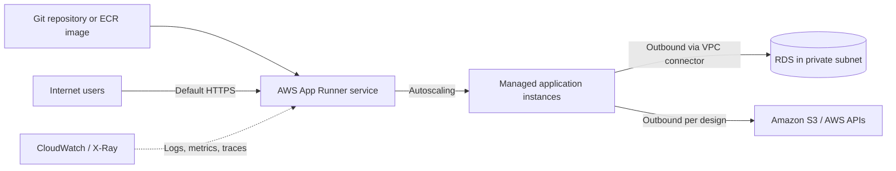
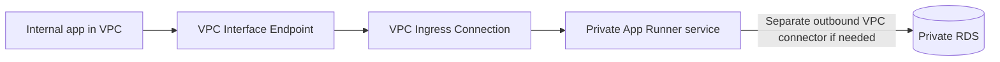
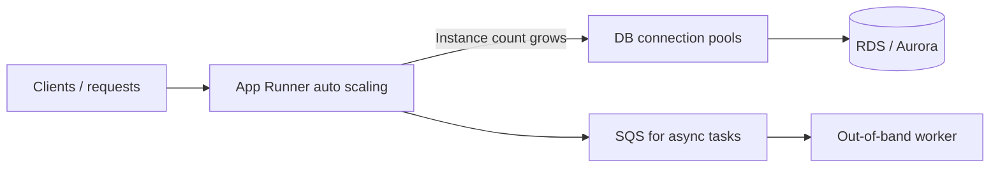
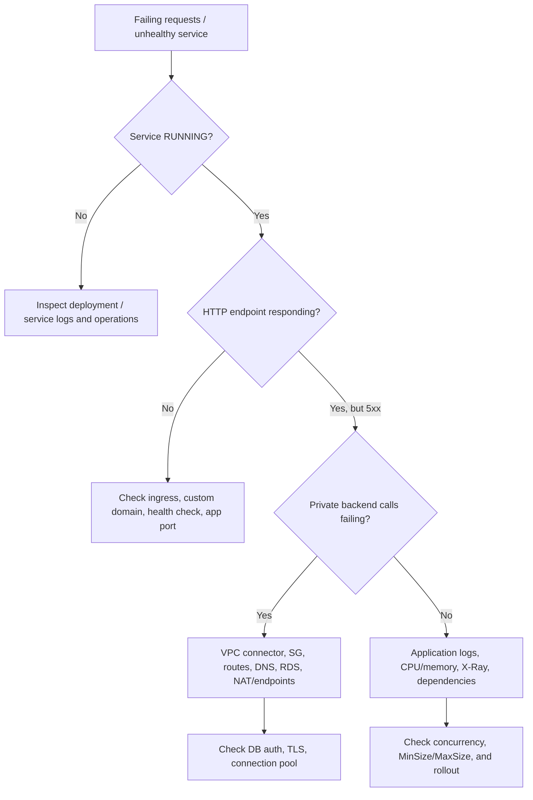

# App Runner VPC Connector, Autoscaling, and Observability

## 1. Context: Running a Web API Without Managing Servers

A retail company runs a containerized order-intake API. The application needs to access **Amazon RDS** in a private subnet, download files from **Amazon S3**, scale out automatically during promotional campaigns, and emit logs, metrics, and traces for troubleshooting. The development team wants to focus on application code rather than managing EC2 instances, Kubernetes, or complex load-balancing infrastructure.

**AWS App Runner** is designed to deploy web applications and HTTP APIs from source code or container images while automatically provisioning an HTTPS endpoint, balancing requests, and scaling instances with load. However, **serverless/managed does not mean skipping VPC, IAM, scalability, and observability design**. For example:

- An App Runner API has a public URL yet **cannot reach a private RDS endpoint** unless proper egress is configured.
- Enabling a VPC connector to reach RDS **breaks calls to public APIs** if the VPC lacks a NAT Gateway or VPC endpoints.
- Sessions are stored in one instance's RAM; when App Runner scales out, users experience inconsistent sessions.
- HTTP requests return 500 errors, yet operators only watch the `RUNNING` service state and miss that the application is failing.

This lesson belongs to the **Managed Application Platforms** chapter of the **CLOUD_PROVIDERS_AWS** track: exploring the AWS ecosystem across Regions/AZs, IAM, VPC, compute, storage, databases, integration, and serverless while practicing service selection, secure deployment, monitoring, recovery, and cost control. The focus is **App Runner VPC connector, autoscaling, and observability**, illustrated with a database-connected API.

> **Service Availability Note (2026 Update):** AWS **closed App Runner to new customers starting April 30, 2026**. Existing App Runner customers can continue operating services and creating new resources; AWS continues supporting security and availability, though no new feature development is planned. For accounts that have never used App Runner or new projects seeking a similar platform, **AWS recommends Amazon ECS Express Mode**. This lesson remains valuable for operating, optimizing, and migrating existing App Runner workloads. Source: [AWS App Runner availability change](https://docs.aws.amazon.com/apprunner/latest/dg/apprunner-availability-change.html).

After this lesson, you will be able to:

- Distinguish an **outbound VPC connector** from a **private inbound endpoint / VPC ingress connection**.
- Design subnets, security groups, NAT Gateways/VPC endpoints, IAM, and secure database access.
- Explain **`MaxConcurrency`, `MinSize`, and `MaxSize`**, along with active vs. provisioned idle instances.
- Set up CloudWatch metrics/logs, X-Ray tracing, EventBridge, and health checks.
- Diagnose RDS connectivity errors, scaling issues, HTTP 5xx spikes, deployment failures, and connector cold starts.
- Compare costs, define SLOs, build runbooks, and plan migrations to ECS Express Mode.

## 2. What Does App Runner Manage vs. What Does the App Team Still Own?

App Runner offers a higher-level deployment abstraction than ECS or EKS: you specify a **source repository or container image**, application port, CPU/memory, configuration variables, IAM roles, autoscaling, and networking. The service runs the web process, exposes an endpoint, and load-balances across instances as they scale.



### 2.1. Division of Responsibilities

| Component | Managed by App Runner | Managed by Application / Cloud Team |
| --- | --- | --- |
| Service compute capacity | Provisions and replaces application instances | Selects CPU/memory, app architecture, state handling, and performance |
| HTTP endpoint | Default URL, TLS, and App Runner inbound path | Custom domain, app logic, user authentication, endpoint testing |
| Code/image deployment | Builds from source or runs image; orchestrates releases | Code/image quality, dependencies, secrets, config, and rollbacks |
| Autoscaling | Adjusts instance count per configuration | Concurrency target, Min/Max, connection pools, SLOs, and load testing |
| Outbound networking | Provides the VPC connector mechanism | Private subnets, security groups, NAT/endpoints, DNS, DB connectivity |
| Observability | Emits service/application logs and metrics | Structured logging, tracing instrumentation, alarms, runbooks, retention |
| Data | Does not back up databases or app files | RDS/S3, backups, encryption, consistency, recovery |

**App Runner is not an EKS control plane**, and it does not let you manage EC2 worker hosts like ECS on EC2. If you need multiple specialized containers/processes, GPUs, custom host networking, complex job scheduling, or Kubernetes resource control, evaluate ECS/EKS or another service.

### 2.2. Related App Runner Resources

| Resource / API Concept | Function |
| --- | --- |
| **Service** | Web application/API with source, runtime, IAM, networking, autoscaling, and URL |
| **VPC connector** | Configures the **outbound path** from application code into a VPC |
| **VPC ingress connection** | Associates an App Runner service with a VPC interface endpoint for **private incoming traffic** |
| **Auto scaling configuration** | Shared versioned resource holding `MaxConcurrency`/`MinSize`/`MaxSize` |
| **Observability configuration** | Shared versioned resource; enables tracing |
| **Access role** | Permission for App Runner to pull images from **private ECR** |
| **Instance role** | Permission for application code to call **AWS APIs** such as S3, DynamoDB, or Secrets Manager |

These resources **do not substitute for one another**: granting `rds-db:connect` does not create a network route to RDS, and attaching a VPC connector does not grant SDK permission to call S3.

## 3. Two Network Directions: Inbound and Outbound

A common mistake is thinking that attaching App Runner to a VPC makes the service internal-only. App Runner has two **independent** settings:

| Direction | Configuration | Effect | What It Does Not Do Automatically |
| --- | --- | --- | --- |
| **Inbound (into the service)** | Public endpoint or private endpoint + **VPC ingress connection** | Determines whether Internet or VPC clients can call the service URL | Does not control how the app calls RDS/S3 |
| **Outbound (from app to backends)** | Default public access or **VPC connector** | Determines the path of **application-generated traffic** to backends | Does not convert a public App Runner endpoint into a private one |

### 3.1. Default: Public Inbound, Public Outbound

If you create a service without configuring private ingress or a VPC connector, App Runner exposes a public inbound URL, and app code can call public endpoints over App Runner's default network. A **non-public** RDS in a private subnet generally cannot be reached merely by knowing its DNS hostname.

### 3.2. A VPC Connector Serves Outbound Only

If an App Runner service keeps a **public incoming endpoint** while attaching a **VPC connector**:

```text
Internet users ---HTTPS---> Public App Runner URL
                                     |
                                     v
                            Running app code
                                     |
                        outbound via VPC connector
                                     |
                   +-----------------+-----------------+
                   |                                   |
                   v                                   v
              Private RDS                      NAT / VPC endpoints
                                            (if public APIs are needed)
```

**Request traffic from the Internet to App Runner remains managed by App Runner and does not traverse the VPC connector.** Specifying private subnets and security groups on the connector **does not block Internet access to the service**.

### 3.3. Private Inbound Is a Separate Feature

If the API must be reachable only from an internal network, select **private endpoint** for incoming traffic. App Runner uses a **VPC interface endpoint (AWS PrivateLink)** and a **VPC ingress connection** to link the App Runner service to your VPC.



Private inbound does not automatically create an outbound VPC connector either. A service may need **both** if internal clients call the API and the API calls RDS. An interface endpoint incurs **hourly and data-processing charges** under AWS PrivateLink; manage endpoint security groups, private DNS, and reachability from connected VPCs/networks.

## 4. VPC Connector and AWS Hyperplane ENIs

A VPC connector is an App Runner resource referencing **subnets and security groups inside a VPC**. When attached to a service, App Runner establishes **Hyperplane ENIs** in those subnets so the app can send traffic into the VPC.

### 4.1. Why Use Hyperplane ENIs?

Hyperplane is an AWS-managed networking technology allowing multiple sessions and instances to share network paths per subnet/security-group configuration. As App Runner scales instances, **there is no fixed "one App Runner instance = one ENI in your subnet" ratio**. This reduces IP address consumption compared to allocating a dedicated ENI per container.

A **VPC connector can be reused across multiple App Runner services** when the subnets/security groups fit and both services share network requirements. However, sharing a connector also shares outbound security posture; do not share if services require distinct network segmentation.

### 4.2. Choosing Private Subnets Correctly

AWS recommends selecting **private subnets** across at least **three Availability Zones** where the Region has enough supported AZs; if fewer exist, use all eligible AZs as appropriate. The subnets must belong to the **same VPC** and share the same IP address type (IPv4 or dual-stack as supported). Some AZs in certain Regions do not support App Runner connector subnets, so verify console/API messages during creation.

**Do not select public subnets for a VPC connector.** App Runner's Hyperplane ENIs **only receive private IPs**, so a public subnet with a default route to an Internet Gateway **does not give the ENI a public IPv4 address**. Service creation or updates may fail if public subnets are used.

| Component | Check Before Creating the Connector |
| --- | --- |
| VPC | Correct Region/account; no CIDR overlap with dependent networks |
| Subnets | Private, inside that VPC, multi-AZ, available IPs, supported AZs |
| Address type | Subnets share IPv4 or dual-stack compatibility per connector rules |
| Security group | Permits **egress** to approved backends, e.g., TCP 5432 |
| Route table | Valid routes to databases, NAT Gateways, or VPC endpoints |
| DNS | Resolves RDS endpoints / private hosted zones per VPC settings |

### 4.3. First-Time Connector Creation Latency

AWS notes that provisioning Hyperplane ENIs for a new subnet/security-group combination can add roughly **2–5 minutes of one-time startup delay**. When reusing an existing VPC connector configuration, this setup step typically does not repeat. This is a **one-time network integration initialization delay**, **not** per-request latency.

A newly created service not turning `RUNNING` immediately after attaching a connector is not necessarily broken; inspect service operations/health and watch for subnet, SG, IP, or AZ errors. Do not confuse this with application cold starts under load.

## 5. Egress from a VPC Connector to RDS, S3, and the Internet

Once an App Runner service enables **custom VPC egress**, **application-generated outbound traffic** flows through the VPC under your route tables and security policies. The app **no longer has implicit access to the public Internet or public AWS APIs**. To reach public endpoints or certain AWS APIs, provision a NAT Gateway or the appropriate VPC endpoints.

### 5.1. Connecting to RDS in a Private Subnet

Suppose:

```text
VPC: 10.20.0.0/16
Connector subnets: private AZ A/B/C
Connector security group: sg-app-outbound
RDS PostgreSQL endpoint: orders-db.xxxx.ap-southeast-1.rds.amazonaws.com
RDS security group: sg-rds
RDS port: TCP 5432
```

Minimum network configuration:

1. Connector SG allows **outbound TCP 5432** to the destination database SG or CIDR per SG best practices.
2. RDS SG allows **inbound TCP 5432 from the VPC connector SG**. Never open 5432 to `0.0.0.0/0` just for testing.
3. The RDS private endpoint resolves properly; VPC DNS, route tables, and NACLs do not block traffic.
4. The app connects to PostgreSQL over TLS where appropriate, pulls credentials from Secrets Manager/IAM DB auth per architecture, and **never hard-codes passwords**.
5. VPC/Subnets/SGs reside in valid reachable networking; cross-VPC databases require VPC peering, Transit Gateway, PrivateLink, or supported connectivity with matching routes and policies.

**A VPC connector does not run RDS inside those subnets.** It provides an egress path from your app to IPs reachable through the VPC. RDS access still requires database credentials and network controls.

### 5.2. Calling S3, Secrets Manager, or AWS APIs

After enabling a VPC connector, an API that previously read S3 via public endpoints may start timing out if the VPC lacks an egress path. Two main options exist:

- **NAT Gateway:** private subnets route to a NAT Gateway in a public subnet with an Internet Gateway to reach public endpoints; incurs hourly and data-processing NAT charges plus potential cross-AZ transfer fees.
- **VPC endpoints:** for supported services—such as an **S3 Gateway endpoint** on route tables or **interface endpoints** for Secrets Manager, CloudWatch Logs, and many AWS APIs—traffic stays on the AWS network, governed by endpoint policies, security groups, and private DNS.

An S3 Gateway endpoint is scoped to specific **route tables and Region**; do not treat it as a universal fix for every AWS service. Interface endpoints carry hourly and per-GB charges, so compare total cost before creating endpoints for dozens of services.

### 5.3. App Runner Management Traffic Does Not Traverse the Connector

AWS separates **application-generated** traffic from **App Runner-managed** traffic. Actions App Runner performs on your behalf—such as **pulling source/images, shipping service logs, and retrieving platform-injected secrets**—**do not go through the VPC connector**. Therefore:

- Successful image pulls **do not prove the app has Internet egress**.
- Normal App Runner service logs **do not prove SDK calls inside your code to S3/Secrets Manager succeed through the VPC**.
- If **your application code calls Secrets Manager/S3 directly**, that is application outbound traffic and needs a NAT Gateway or VPC endpoint once a connector is attached.

This distinction is vital when debugging "deployment succeeded, yet every request hitting the database fails."

## 6. Example: Creating a VPC Connector with the AWS CLI

**The commands below are strictly for existing App Runner customers eligible to use the service.** All IDs and ARNs are placeholders—never run them directly in production without approval and a rollback plan.

### 6.1. Read-Only Preflight Checks

```bash
# Confirm active AWS account and CLI identity
aws sts get-caller-identity

# List existing App Runner services
aws apprunner list-services --region ap-southeast-1

# Inspect subnets and Availability Zones
aws ec2 describe-subnets \
  --subnet-ids subnet-11111111111111111 subnet-22222222222222222 \
  --region ap-southeast-1 \
  --query 'Subnets[*].[SubnetId,VpcId,AvailabilityZone,CidrBlock,AvailableIpAddressCount]'

# List existing VPC connectors to check for reuse
aws apprunner list-vpc-connectors --region ap-southeast-1
```

These commands require read IAM permissions and modify nothing. In production, verify **route table associations, private vs. public subnets, outbound SGs, and subnet AZ support** before creating a connector; seeing "private" in a subnet name tag is not enough.

### 6.2. Create a Connector

Suppose you have three private subnets (in supported AZs) and SG `sg-0123456789abcdef0` allowing only required outbound traffic. Create the connector:

```bash
aws apprunner create-vpc-connector \
  --vpc-connector-name shop-api-outbound \
  --subnets subnet-11111111111111111 subnet-22222222222222222 subnet-33333333333333333 \
  --security-groups sg-0123456789abcdef0 \
  --region ap-southeast-1
```

The command returns `VpcConnectorArn` for attaching to a service. Never fabricate an ARN by guessing revisions or IDs.

```bash
# Check the newly created connector status; substitute the real ARN from the response
aws apprunner describe-vpc-connector \
  --vpc-connector-arn 'arn:aws:apprunner:ap-southeast-1:111122223333:vpcconnector/shop-api-outbound/1/EXAMPLE' \
  --region ap-southeast-1
```

### 6.3. Attach the Connector to an App Runner Service

Save `network-configuration.json` (using the **real** ARN):

```json
{
  "EgressConfiguration": {
    "EgressType": "VPC",
    "VpcConnectorArn": "arn:aws:apprunner:ap-southeast-1:111122223333:vpcconnector/shop-api-outbound/1/EXAMPLE"
  },
  "IngressConfiguration": {
    "IsPubliclyAccessible": true
  },
  "IpAddressType": "IPV4"
}
```

This example **keeps incoming traffic public** to illustrate that an outbound connector **does not make the service private**. If a service already uses private ingress or dual-stack, **preserve its existing configuration** rather than copying `true/IPV4` and accidentally altering public exposure.

```bash
# Inspect current service network config before modifying
aws apprunner describe-service \
  --service-arn 'arn:aws:apprunner:ap-southeast-1:111122223333:service/shop-api/EXAMPLE' \
  --region ap-southeast-1 \
  --query 'Service.NetworkConfiguration'

# Apply config: run only after reviewing and replacing placeholders
aws apprunner update-service \
  --service-arn 'arn:aws:apprunner:ap-southeast-1:111122223333:service/shop-api/EXAMPLE' \
  --network-configuration file://network-configuration.json \
  --region ap-southeast-1
```

After updating, watch `describe-service`, `list-operations`, and send a real request to a route that queries RDS. **A connector status of `ACTIVE` alone does not prove SG rules, ports, DNS, and DB credentials are correct.**

## 7. App Runner Autoscaling: Concurrency, MinSize, and MaxSize

App Runner autoscaling focuses on **concurrent HTTP requests** handled by instances, rather than scaling EC2 worker nodes you manage directly. An **auto scaling configuration** has three main parameters:

| Parameter | Meaning | Documented AWS API Default |
| --- | --- | ---: |
| **MaxConcurrency** | Concurrent HTTP request threshold per instance; above this, App Runner can scale out | **100** |
| **MinSize** | Minimum **provisioned instances** kept ready | **1** |
| **MaxSize** | Maximum active application instances allowed to serve requests | **25** |

These are documented AWS API defaults, **not universal configuration recommendations**. Quotas, limits, and support may vary by account, Region, and CPU/memory configuration—check current documentation before deploying.

### 7.1. Active Instances vs. Provisioned Instances

An **active instance** processes requests using CPU and RAM; a **provisioned inactive instance** is warm standby capacity ready to activate when load rises. Under App Runner's pricing model described by AWS, you pay for **memory on provisioned instances** and **CPU on active instances** per service billing rules.

```text
MinSize = 3                 MaxSize = 12

During low traffic:
  [active] [provisioned idle] [provisioned idle]

During traffic spikes:
  [active] [active] [active] ... up to MaxSize

As traffic drops:
  Active capacity scales down per service mechanics,
  while MinSize provisioned capacity stays reserved.
```

**`MinSize` does not mean exactly `MinSize` requests run in parallel.** It sets the floor of reserved capacity, part of which may remain idle. **`MaxSize` does not guarantee AWS immediately provisions every instance** under sudden load: scale-out reaction time, quotas, and limits still apply.

### 7.2. `MaxConcurrency` Is Neither User Count Nor CPU %

A concurrent request is a request **currently being processed**. It is neither logged-in user count nor requests per second.

Qualitative example:

```text
200 requests/second, average request duration 0.4 seconds
=> Average concurrent requests in flight ≈ 200 × 0.4 = 80

If MaxConcurrency = 40:
  In terms of concurrency headroom, roughly 2 active instances are needed
  to split 80 in-flight requests evenly.
```

This calculation applies Little's Law and is **purely an estimation model**. Bursty traffic, uneven distributions, slow queries, queueing, cold startup, and CPU contention shift the actual instance count. Setting `MaxConcurrency` too high lets each instance queue too many requests, inflating p95/p99 latency or memory; setting it too low causes over-scaling, extra RDS connections, and higher cost.

### 7.3. How `MinSize` and `MaxSize` Affect Availability

- **Low `MinSize`:** saves provisioned memory charges, though adding capacity on traffic spikes takes time.
- **High `MinSize`:** provides headroom for bursts or instance replacement, at higher baseline cost.
- **Low `MaxSize`:** caps cost and DB connection counts, though hitting the ceiling under heavy traffic increases latency and errors.
- **High `MaxSize`:** allows large scale-out, requiring backends like RDS, Redis, and external APIs to have matching capacity.

An API backed by an RDS instance with limited `max_connections` should not set App Runner `MaxSize=100` with 100-connection pools per instance unchecked: at peak, **10,000 connections** can exhaust the database even while App Runner remains healthy.

## 8. Creating and Attaching an Auto Scaling Configuration

### 8.1. Illustrative Configuration

Suppose a stateless HTTP API has p95 latency under 300 ms, needs 2 standby baseline instances, and caps at 10 instances to protect database connection limits:

```bash
aws apprunner create-auto-scaling-configuration \
  --auto-scaling-configuration-name shop-api-autoscaling \
  --max-concurrency 40 \
  --min-size 2 \
  --max-size 10 \
  --region ap-southeast-1
```

Capture the returned `AutoScalingConfigurationArn`. These numbers are **hypothetical for learning**—run load tests and verify quotas and cost. One configuration can be shared across services; recreating the same name produces a **new revision**. Avoid modifying shared configurations without checking which services and revisions depend on them.

### 8.2. Assigning to an Existing Service

```bash
aws apprunner update-service \
  --service-arn 'arn:aws:apprunner:ap-southeast-1:111122223333:service/shop-api/EXAMPLE' \
  --auto-scaling-configuration-arn 'arn:aws:apprunner:ap-southeast-1:111122223333:autoscalingconfiguration/shop-api-autoscaling/1/EXAMPLE' \
  --region ap-southeast-1
```

This is an **asynchronous** service update; monitor the operation and re-read the service. For revisions, always specify the **real** full ARN to avoid inadvertently picking an untested revision.

### 8.3. When to Increase CPU/Memory Instead of Only Autoscaling?

App Runner configures vCPU/memory via **instance configuration**. Concurrency-based autoscaling adds instances when request counts rise; it **does not increase CPU/memory per instance**. If a single request needs large RAM, causes memory pressure, or performs heavy CPU computation, lowering `MaxConcurrency` and adding instances spreads requests, yet you may still need to **resize the instance or optimize algorithms**.

To decide accurately, inspect **`CPUUtilization`, `MemoryUtilization`, `Concurrency`, `RequestLatency`, and `5xxStatusResponses`** together. Requests stalling on an unindexed database query cannot be cured simply by adding instances.

## 9. Designing Applications So Scaling Does Not Break Data

### 9.1. Stateless HTTP Handlers

App Runner applications should be **stateless per instance**:

- Never store login sessions solely in local instance RAM; use an external session store or properly revocable tokens.
- Never store user uploads solely on the local filesystem; persist them in S3 or supported external storage.
- For retried requests, implement **idempotency keys**, transactions, and conditional writes since clients may retry after timeouts.
- Use bounded database connection pools with timeouts; never allocate huge pools per instance.
- Set sensible timeouts on downstream calls to prevent retry storms and handle backpressure.

### 9.2. Backends Must Keep Up with Frontend Scaling



If RDS is near its connection limit, App Runner scaling out can **make database congestion worse**. Consider **RDS Proxy** for eligible workloads, cap per-instance connection pools, add caching, and offload slow tasks to queues and workers on ECS/Fargate, Lambda, or AWS Batch.

### 9.3. Horizontal Scaling Does Not Replace Multi-Region DR

App Runner maintains and replaces instances within a service and Region, yet **it does not replicate databases or build cross-Region standby capacity**. Setting `MinSize=3` secures service-level provisioned capacity, not immunity against RDS failures or Regional outages.

For critical workloads, add backup/restore plans, RDS HA, Regional failover drills aligned with RTO/RPO, and DNS/traffic failover strategies.

## 10. App Runner Observability: Logs, Metrics, Traces, and Events

**Observability** answers three distinct questions:

1. **Metrics:** how much did errors or latency spike, and when?
2. **Logs:** what happened inside a request, container, or deployment?
3. **Traces:** did a request spend its time in App Runner, the database, or a downstream HTTP API?

App Runner integrates with **Amazon CloudWatch**, **AWS X-Ray**, **Amazon EventBridge**, and **AWS CloudTrail**. A strong dashboard tracks both infrastructure health and **user-facing SLOs**.

### 10.1. CloudWatch Metrics in the `AWS/AppRunner` Namespace

| Metric | Level | Usage |
| --- | --- | --- |
| `Requests` | Service | Total HTTP requests in the interval |
| `2xxStatusResponses` | Service | Count of 2xx responses; verifies successful traffic |
| `4xxStatusResponses` | Service | Count of 4xx responses; separate client errors, auth failures, and 404s |
| `5xxStatusResponses` | Service | Server errors; compute error rates and alert |
| `RequestLatency` | Service | HTTP request latency (ms) with appropriate statistics |
| `Concurrency` | Service | Approximate concurrent requests being processed |
| `ActiveInstances` | Service | Number of instances actively processing requests |
| `CPUUtilization` | Service and instance | Percentage of allocated CPU utilized |
| `MemoryUtilization` | Service and instance | Percentage of allocated memory utilized |

**Note:** `ActiveInstances=0` during **zero traffic** does not mean the service was deleted or has zero provisioned instances. That number differs from `MinSize` and should not be used alone to judge readiness.

Several metrics carry multiple dimensions (service/instance). When building CloudWatch alarms or queries, select the right dimensions and statistics—never sum Averages blindly or treat CPU thresholds as MB like legacy guides. AWS currently reports CPU and Memory utilization as **percentages**.

### 10.2. Recommended Alarms

| Alert | Suggested Formula / Signal | Meaning |
| --- | --- | --- |
| Rising 5xx error rate | `5xxStatusResponses / Requests` when request volume is significant | Detects live user-impacting failures |
| Rising p95/p99 `RequestLatency` | CloudWatch statistics + app latency | Backend or network may be degrading |
| Concurrency near operational ceiling | `Concurrency` paired with `ActiveInstances` and `MaxSize` | Risk of running out of headroom |
| Sustained high CPU/MemoryUtilization | Service/instance metrics | Need right-sizing, concurrency tuning, or code optimization |
| Deployment failure | App Runner service events / EventBridge | Requires rollback or investigating image/health |
| Rising DB connections / latency | CloudWatch RDS + app tracing | Autoscaling is pressuring the database |

**Do not apply a single static threshold to every service.** For a checkout API, a 1% 5xx spike for a few minutes can be critical; for a low-traffic test endpoint, a handful of requests is statistically noisy. Pair **synthetic probes** with concrete error budgets and SLOs.

## 11. CloudWatch Logs: Distinguishing Service Logs and Application Logs

App Runner emits two key log groups per service:

| Group | Example Path | Contents |
| --- | --- | --- |
| **Service logs** | `/aws/apprunner/<service-name>/<service-id>/service` | Lifecycle events and deployment/build operations |
| **Application logs** | `/aws/apprunner/<service-name>/<service-id>/application` | Application stdout/stderr output, with per-instance streams |

**Service logs** explain why a build or deployment failed to reach `RUNNING`. **Application logs** reveal runtime exceptions, DB timeouts, request details, and app-emitted latency. The App Runner console aggregates logs, while CloudWatch lets you inspect individual instance streams.

### 11.1. Structured Logging

Illustrative JSON log entry (never log access tokens or passwords):

```json
{
  "timestamp": "2026-11-20T08:15:00Z",
  "level": "ERROR",
  "service": "shop-api",
  "route": "POST /orders",
  "requestId": "req-abc123",
  "status": 503,
  "durationMs": 1650,
  "errorCode": "DB_CONNECTION_TIMEOUT"
}
```

Include a `requestId` or trace ID to correlate metrics ↔ logs ↔ traces. Never log **`Authorization` headers, session cookies, DB passwords, payment card data, PII**, or arbitrary full request bodies. Configure CloudWatch Logs retention, IAM read access, and ingestion/storage cost controls.

### 11.2. Reading Logs with the AWS CLI

Once you know the service name, service ID, and Region:

```bash
# List related log groups
aws logs describe-log-groups \
  --log-group-name-prefix '/aws/apprunner/shop-api/' \
  --region ap-southeast-1

# Substitute the real service ID from the console or API
aws logs tail '/aws/apprunner/shop-api/EXAMPLE_SERVICE_ID/application' \
  --since 15m \
  --region ap-southeast-1
```

If `application` logs are empty and the service fails to start, inspect **service/deployment** logs first. Conversely, if deployment succeeded yet requests fail, inspect application logs, metrics, and traces.

## 12. Distributed Tracing with AWS X-Ray

When requests flow across App Runner → RDS / downstream HTTP / S3, isolated service logs may not pinpoint where latency accumulates. **AWS X-Ray** with **AWS Distro for OpenTelemetry (ADOT)** traces end-to-end request paths where supported by your runtime and instrumentation.

### 12.1. Steps to Enable Tracing

1. **Instrument the application** using runtime-compatible OpenTelemetry/ADOT libraries to emit spans for HTTP requests and downstream calls.
2. Create an **App Runner observability configuration** with `TraceConfiguration.Vendor = AWSXRAY`.
3. Grant X-Ray write permissions to the App Runner service's **instance role** per AWS docs (e.g., managed policy `AWSXRayDaemonWriteAccess` if appropriate and approved).
4. Attach the observability configuration to the service with `ObservabilityEnabled = true`.
5. Send live requests and verify the X-Ray service map, sampling, and request ID correlation.

**Merely enabling the observability configuration does not guarantee every app span appears.** You must instrument the framework properly, configure compatible propagators/exporters, and ensure the IAM role has permissions. App Runner tracing is **disabled by default**.

### 12.2. AWS CLI Example

```bash
aws apprunner create-observability-configuration \
  --observability-configuration-name shop-api-xray \
  --trace-configuration Vendor=AWSXRAY \
  --region ap-southeast-1
```

Save the returned `ObservabilityConfigurationArn`. Example `observability-configuration.json` to attach to a service:

```json
{
  "ObservabilityEnabled": true,
  "ObservabilityConfigurationArn": "arn:aws:apprunner:ap-southeast-1:111122223333:observabilityconfiguration/shop-api-xray/1/EXAMPLE"
}
```

```bash
aws apprunner update-service \
  --service-arn 'arn:aws:apprunner:ap-southeast-1:111122223333:service/shop-api/EXAMPLE' \
  --observability-configuration file://observability-configuration.json \
  --region ap-southeast-1
```

All ARNs are placeholders. Updating the service can trigger a deployment of the new configuration; monitor the service operation and **confirm the instance role has X-Ray permissions** before testing traces.

### 12.3. Tracing Does Not Replace Metrics and Logs

- Tracing shines when identifying whether latency came from the database, an external HTTP API, or business logic.
- Metrics excel at tracking error rates and request volumes across hours or days.
- Logs provide exception stack traces and controlled business-event context.

Do not set 100% trace sampling across every environment just to collect maximum data: traces can capture sensitive details and add cost. Tune sampling and retention to match SLOs, security, and budget.

## 13. EventBridge, CloudTrail, and Health Checks

### 13.1. EventBridge and CloudTrail

**Amazon EventBridge** receives supported App Runner service events, enabling automated alerts or workflows when a service transitions state or a deployment fails. **AWS CloudTrail** records control-plane App Runner API calls, answering who called `UpdateService`, edited settings, or deleted resources.

Example runbook:

```text
Deployment operation fails
   -> EventBridge rule matches App Runner service event
   -> SNS / notification workflow
   -> On-call checks App Runner service/deployment logs
   -> Inspects image, health checks, instance settings, VPC connector
   -> Rolls back config/image if needed; verifies SLO after fix
```

EventBridge and CloudTrail do not replace application logging. A service can stay `RUNNING` at the control plane while returning thousands of HTTP 500s; CloudWatch metrics and traces expose live user impact.

### 13.2. TCP and HTTP Health Checks

App Runner supports health check configuration:

| Option | Meaning | Notes |
| --- | --- | --- |
| **TCP** | Checks whether a connection opens on the app port | Default; misses many application-level failures |
| **HTTP** | Sends an HTTP request to a configured path | Ideal for `/health` or readiness endpoints |
| Interval/Timeout | Check frequency and wait timeout | Size for app startup and normal latency |
| Healthy/Unhealthy thresholds | Consecutive checks required to flip state | Overly sensitive values can cause constant instance churn |

Example API JSON for health checks:

```json
{
  "Protocol": "HTTP",
  "Path": "/health",
  "Interval": 10,
  "Timeout": 3,
  "HealthyThreshold": 2,
  "UnhealthyThreshold": 3
}
```

Keep `/health` lightweight so it reflects policy-defined readiness without overloading dependencies. If a health check queries RDS and RDS blips briefly, every instance could fail health checks and enter a restart loop. Distinguish process **liveness** from application **readiness** in your observability design.

## 14. IAM and Security for App Runner Applications

### 14.1. Access Role vs. Instance Role

| Role | Trusted Principal | Appropriate Permissions |
| --- | --- | --- |
| **Access role** | App Runner build/management service pulling private ECR images | Least-privilege ECR pull authorization and image read |
| **Instance role** | Application code running on App Runner instances | S3/DynamoDB/Secrets Manager/X-Ray and APIs the app genuinely uses |
| **Admin / CI IAM role** | Authenticated users or CI/CD pipelines | `apprunner:CreateService`/`UpdateService`, scoped `iam:PassRole`, resource management |

Example trust policy for an **instance role**:

```json
{
  "Version": "2012-10-17",
  "Statement": [
    {
      "Effect": "Allow",
      "Principal": {
        "Service": "tasks.apprunner.amazonaws.com"
      },
      "Action": "sts:AssumeRole"
    }
  ]
}
```

The trust principal for the **ECR access role** differs from the instance role; use the official App Runner ECR access trust template rather than reusing one role for both just for convenience. Separating roles limits blast radius if application code is compromised.

### 14.2. Secrets, TLS, and Data Permissions

- Store credentials in **AWS Secrets Manager** or Systems Manager Parameter Store as supported by App Runner; scope permissions per secret.
- Enable TLS when calling RDS whenever supported; restrict SG port 5432/3306 and database user privileges rather than making the DB public.
- Never attach `AdministratorAccess` to an App Runner instance role; check S3 bucket policies, KMS key policies, and SCPs when `AccessDenied` occurs.
- Secure CI pipelines and registries, scan images, and enforce controlled deployment/rollback workflows; avoid untagged or mutable production tags.
- For public inbound, App Runner handles HTTPS termination, yet **API authentication/authorization, rate limiting, and business abuse protection** remain the responsibility of your app/edge architecture. Consider WAF or an edge layer where supported.

### 14.3. A VPC Connector Does Not Add an Ingress Firewall

Restricting a VPC connector SG to outbound TCP 5432 **does not block Internet users from calling App Runner's public URL**. If the app is an internal API, configure a **private inbound endpoint** per design. For public APIs, enforce JWT/session validation, authorization checks, and abuse controls at the application/edge layer.

## 15. App Runner Costs and Hidden VPC Costs

Costs depend on Region, CPU/memory, active/provisioned state, uptime, and attached services. Under App Runner's model:

```text
App Runner cost (conceptual)
   ≈ compute for active instances
     + provisioned memory for instances per MinSize policy
     + build/deployment charges where applicable per pricing

Full system cost
   = App Runner + RDS + NAT/VPC endpoints
     + CloudWatch Logs/metrics + X-Ray + data transfer
     + Secrets Manager/KMS + backups + other services
```

Never assume "zero requests means zero total cost": **`MinSize` keeps provisioned memory capacity**, running RDS and NAT Gateways still bill hourly, and retained logs/storage/monitoring keep accruing charges.

### 15.1. Capacity Sizing Exercise (Without Relying on List Prices)

Suppose:

- Average 80 concurrent requests; each App Runner instance targets 40 concurrent requests.
- Operations sets `MinSize=2` and `MaxSize=10`.
- Each instance opens an RDS connection pool of up to 10 connections.

| Component | Illustrative Calculation | Meaning |
| --- | --- | --- |
| Active instances needed for concurrency | `80 / 40 = 2` | Excludes bursts, latency variance, and headroom |
| Maximum active instances possible | `10` | Cap set by `MaxSize`, not a guarantee of instant capacity |
| Max RDS connections if every instance fills its pool | `10 × 10 = 100` | Must stay under the real DB connection budget |
| Baseline provisioned capacity | `MinSize = 2` | Accrues provisioned memory charges per App Runner pricing |

If requests spend most of their time waiting on slow RDS queries, concurrency climbs while CPU stays low. That demonstrates why **relying solely on `CPUUtilization`** to tune `MaxConcurrency` misses backend saturation risks.

### 15.2. Choosing NAT vs. VPC Endpoints

| Option | Benefits | Trade-offs |
| --- | --- | --- |
| NAT Gateway | Simple public outbound path for many APIs/endpoints | Hourly + per-GB charges; requires per-AZ routing/HA |
| S3 Gateway endpoint | Reaches S3 via VPC when routes/policies allow | Covers S3 only, not other services |
| Interface VPC endpoints | Reaches supported AWS APIs via PrivateLink without public Internet | Per-endpoint/AZ/GB charges, plus SG, private DNS, and policy config |
| No NAT/endpoints | Minimizes external egress | App code cannot call public APIs except internal paths |

A VPC connector uses Hyperplane ENIs; **having a connector does not make NAT or VPC endpoints free**. Periodically audit for orphaned connectors, unneeded NAT Gateways, duplicate endpoints, and overly long CloudWatch log retention.

## 16. Troubleshooting Common Failures

| Symptom | Primary Hypothesis | What to Check |
| --- | --- | --- |
| App Runner public URL works, but RDS times out | Missing VPC connector or bad SG/routes/DNS | Egress config, connector subnets/SG, RDS inbound SG |
| Service stays out of `RUNNING` right after connector creation | First-time Hyperplane ENI setup, unsupported subnet/AZ, or real error | Service operations/logs, connector settings; distinguish 2–5 min delay from failure |
| App calls to S3/Secrets Manager fail after adding connector | VPC lacks NAT or matching VPC endpoints | Private subnet route tables, endpoint policy/SG/private DNS, IAM |
| Service still reachable from Internet after picking private subnets | Connector is **outbound only** | Check `IngressConfiguration.IsPubliclyAccessible`; use private endpoint if needed |
| Internal API access via private endpoint fails | Misconfigured VPC interface endpoint, ingress connection, DNS, or SG | VPCE status, App Runner VPC ingress connection, endpoint SG |
| HTTP 5xx rises under load | Insufficient Concurrency/`MaxSize`, app crash, or RDS connection exhaustion | 5xx/Requests/Latency metrics, logs, DB connections |
| Low CPU yet high request latency | Slow DB query, pool contention, or slow downstream API | X-Ray traces, structured logs, RDS metrics |
| `ActiveInstances=0` during idle periods | No incoming requests; zero active instances at observation time | Check `MinSize`/provisioned capacity and test endpoint |
| Missing X-Ray traces | Missing ADOT instrumentation, observability disabled, or missing IAM permissions | Instance role X-Ray policy, tracing config, app instrumentation |
| Build/deploy failure with empty application logs | Service never started a running application | Service/deployment log group and service operations |
| Service hits `AccessDenied` calling S3 | Missing permissions in instance role, bucket policy, KMS, or SCP | CloudTrail, IAM policy, and resource policies |
| API works in dev, fails in prod | Differences in secrets, DB routes/SGs, egress, or env vars | Diff service config, IAM, SGs, and Region |

### 16.1. Layered Diagnostic Flowchart



### 16.2. Read-Only Observation Commands

```bash
# Describe service status and configuration
aws apprunner describe-service \
  --service-arn 'arn:aws:apprunner:ap-southeast-1:111122223333:service/shop-api/EXAMPLE' \
  --region ap-southeast-1

# View recent operations and deployment errors
aws apprunner list-operations \
  --service-arn 'arn:aws:apprunner:ap-southeast-1:111122223333:service/shop-api/EXAMPLE' \
  --region ap-southeast-1

# List auto scaling configurations
aws apprunner list-auto-scaling-configurations \
  --region ap-southeast-1

# List observability configurations
aws apprunner list-observability-configurations \
  --region ap-southeast-1
```

To pinpoint root causes, combine AWS APIs, CloudWatch logs/metrics, RDS telemetry, VPC Flow Logs (for observable traffic), and application logs. Never dump full environments or secrets into chat or logs as a "quick debug" shortcut.

## 17. Production Operations and Controlled Change Management

### 17.1. Before Making Changes

1. Record the service ARN, Region/account, source image revision, and runtime instance settings.
2. Export current network, autoscaling, and observability configs; note ARNs/revisions of shared resources.
3. Verify IAM access/instance roles, database SGs, VPC route tables, NAT/endpoints, and DNS.
4. Capture baselines for `Requests`, p95 latency, error rate, concurrency, instances, RDS connections, and cost.
5. Define rollback triggers and owners if a dependency is impacted.

### 17.2. Roll Out Small Incremental Changes

- First create the VPC connector and test RDS connectivity in a production-like environment.
- Next update the egress configuration and verify the app still reaches required AWS APIs.
- Then tune `MaxConcurrency`/`MinSize`/`MaxSize` via load tests while watching RDS.
- Finally enable tracing/alarms and verify request IDs and added cost.

**Never change SGs, ingress, egress, autoscaling, and the app image all at once**, as isolating which variable broke the system becomes extremely difficult.

### 17.3. After Making Changes

Inspect `describe-service`/operations, send synthetic HTTP requests, and verify RDS queries, S3 access, health checks, CloudWatch logs, 5xx/latency, and X-Ray traces. Monitor across representative traffic windows rather than just the first five minutes. If rollback is needed, restore the **corresponding configuration and image revision** and verify data and traffic.

## 18. Path from App Runner to Amazon ECS Express Mode

Per AWS's 2026 announcement, **App Runner is closed to new customers** while existing services remain supported. AWS recommends **Amazon ECS Express Mode** for new customers and workloads considering migration.

**ECS Express Mode** takes a container image and provisions/manages an **Amazon ECS on AWS Fargate** stack, an **Application Load Balancer**, auto scaling, and networking in your AWS account. It offers a streamlined deployment experience similar to App Runner, while underlying mechanics, configuration, and resource ownership live in ECS/Fargate/ALB rather than App Runner.

| Aspect | Existing App Runner | ECS Express Mode |
| --- | --- | --- |
| 2026 new-customer status | Closed to new customers after Apr 30, 2026 | AWS-recommended path for new deployments |
| Input | Source code or container image as supported | Container image |
| Runtime | App Runner managed application instances | Amazon ECS service on AWS Fargate |
| HTTP endpoint / load balancing | App Runner URL and managed routing | ALB and endpoint managed by ECS Express Mode |
| Auto scaling | App Runner `MaxConcurrency`/`MinSize`/`MaxSize` | ECS/Fargate/ALB scaling configured by Express Mode |
| Networking | VPC connector egress, private endpoint ingress | ECS VPC/subnets/SGs and networking resources |
| Observability | App Runner Logs/Metrics/X-Ray | ECS/ALB/CloudWatch/X-Ray per Express Mode design |
| Migration | Requires a migration plan | Create new service, validate, and cut over traffic |

### 18.1. Migration Checklist

1. **Inventory:** source image/code, service env/secrets, custom domains, network connectors, ingress mode, IAM, scaling, logs, tracing, and dependencies.
2. **Standardize on images:** if App Runner built directly from source code, add CI Docker builds pushing to ECR with controlled tags/digests.
3. **Create the Express Mode service:** prepare the image, IAM roles, and VPC/ALB prerequisites; follow official ECS docs/CLI rather than assuming App Runner schemas carry over.
4. **Map networking:** replace the App Runner egress connector with ECS task networking, subnets, SGs, and NAT/endpoints; replace private App Runner ingress with an internal ALB/networking setup if needed.
5. **Map scaling:** translate `MaxConcurrency`/`MinSize`/`MaxSize` into ECS capacity/scaling targets **based on load tests**, not 1:1 number copying.
6. **Map observability:** build dashboards, error rates, log routing, and traces for ECS/ALB while preserving correlation IDs and shared SLOs.
7. **Data and failover:** maintain DB/secret compatibility, test live requests and sessions, and prepare rollback.
8. **Traffic cutover:** if using a custom domain, shift gradually via DNS/routing and verify TTLs/caches. If using only App Runner's default URL, ECS Express Mode generates a new endpoint—update clients or introduce a unified hostname.

**Never delete the old App Runner service before proving the new system meets SLOs and data consistency.** When migrating transactional APIs, enforce a consistent writer/transaction policy to avoid duplicate writes during overlap.

## 19. Applied Scenarios

### Scenario A — API Connecting to Private PostgreSQL

An App Runner app has a public endpoint and must call RDS PostgreSQL in a private subnet. The team added an IAM role, yet TCP connections still time out.

**Solution:** create a **VPC connector** across supported private subnets with an SG allowing outbound TCP 5432, and allow inbound TCP 5432 on the RDS SG from the connector SG. Verify RDS DNS, TLS, and DB credentials. If the API also calls a public payment gateway, add a **NAT Gateway** via matching subnet routes—never put the connector in a public subnet expecting Internet egress. Validate with live requests and application logs.

### Scenario B — 20x Traffic Spike Exhausts RDS Connections

App Runner scales out instances during a sale campaign, but each instance opens an oversized database pool. HTTP 5xx spikes even though CPU/MemoryUtilization remain moderate.

**Solution:** correlate `Concurrency`, `ActiveInstances`, `5xxStatusResponses`, and RDS `DatabaseConnections`. Cap per-instance pools, evaluate RDS Proxy, caching, or queuing, and tune `MaxConcurrency` and `MaxSize` to match real backend capacity. Do not keep raising `MaxSize` while ignoring connection exhaustion.

### Scenario C — Missing X-Ray Traces

The service created an observability configuration cleanly, yet CloudWatch/X-Ray shows no application traces.

**Solution:** verify `ObservabilityEnabled=true`, the active configuration ARN, X-Ray permissions on the instance role, and ADOT/OpenTelemetry instrumentation inside the runtime. Send synthetic requests and check emitted traces/spans. Working logs and metrics **do not prove X-Ray is fully wired**.

### Scenario D — Organization Newly Adopting AWS in 2026

A development team wants to create its first App Runner service for containers, but the account is ineligible under the availability change.

**Solution:** do not design new projects around App Runner as a prerequisite. Evaluate **Amazon ECS Express Mode** per AWS recommendation, or ECS Fargate/EKS/Lambda if requirements differ. All the principles of VPC egress, NAT/endpoints, IAM, scaling, and observability still transfer cleanly even though CLI commands and schemas differ.

## 20. Self-Check Questions

**Question 1.** Does attaching an App Runner VPC connector to private subnets make a public API private inside the VPC?

**Hint:** No. A connector affects **application outbound** traffic only. For private incoming traffic, configure a private endpoint and VPC ingress connection via AWS PrivateLink.

**Question 2.** Why can an App Runner service pull ECR images and write App Runner logs while application code fails to call the S3 API after enabling a connector?

**Hint:** App Runner management traffic does not traverse the VPC connector, whereas application-generated outbound traffic routes through the VPC. You need a NAT Gateway or S3 endpoint plus IAM/bucket policies.

**Question 3.** Is a public subnet with an Internet Gateway route a good choice for a VPC connector?

**Hint:** No. Connector Hyperplane ENIs only get private IPs; select private subnets, check AZ support, and configure NAT/endpoints if Internet access is needed.

**Question 4.** Does `MaxConcurrency=50` mean the service handles at most 50 requests/second?

**Hint:** No. It is the **concurrent requests per instance** threshold, not RPS. Request duration, bursts, and instance count determine throughput.

**Question 5.** Does `ActiveInstances=0` mean App Runner holds zero provisioned capacity and costs $0?

**Hint:** No. When idle with zero requests, `ActiveInstances` can drop to 0 while the service retains `MinSize` provisioned instances and accrues provisioned memory charges per the pricing model.

**Question 6.** If an App Runner X-Ray configuration is attached, why might application traces still be missing?

**Hint:** You must instrument the runtime with OpenTelemetry/ADOT, enable observability on the service, and grant X-Ray permissions to the instance role.

**Question 7.** When App Runner scales from 2 to 10 instances, which backend constraint should you examine first alongside App Runner CPU/memory?

**Hint:** Database connection budgets/pools, RDS capacity, caches, downstream APIs, networking, and request retries. Horizontal scaling pushes load down into backends.

**Question 8.** Should new AWS customers after April 30, 2026 start new products on App Runner by default?

**Hint:** No. AWS closed App Runner to new customers and recommends ECS Express Mode. Existing App Runner workloads can continue operating and scaling.

## 21. Key Takeaways

An **App Runner VPC connector** lets **outbound application traffic** reach VPC resources via Hyperplane ENIs; it does **not** restrict public inbound access. When private ingress is needed, use a **VPC ingress connection and interface endpoint** over PrivateLink. For connectors, choose **private subnets across multiple AZs**, targeted outbound SGs, and NAT/VPC endpoints for external APIs if required.

**App Runner autoscaling** is concurrency-driven via **`MaxConcurrency`**, keeping a **`MinSize`** baseline and capping scale-out at **`MaxSize`**. It is not an RPS cap and cannot substitute for application or database optimization. **Observability** combines CloudWatch metrics, service/application logs, health checks, EventBridge, CloudTrail, and X-Ray/ADOT tracing with proper IAM permissions. Security and HA still require careful IAM roles, secrets, TLS, durable storage, backups, health checks, runbooks, and cost governance.

**As of November 2026, App Runner serves existing customers only**; new deployments on ineligible accounts should evaluate **Amazon ECS Express Mode** per official guidance. The enduring skill is designing **correct directional networking + backend-aware autoscaling + latency/error observability + reliable recovery**.

### AWS Reference Documentation

- [AWS App Runner — Availability change and migration guide](https://docs.aws.amazon.com/apprunner/latest/dg/apprunner-availability-change.html)
- [AWS Decision Guide — Choosing a modern application strategy](https://docs.aws.amazon.com/decision-guides/latest/decision-guides/modern-apps-strategy-on-aws-how-to-choose.html)
- [AWS App Runner — Architecture and concepts](https://docs.aws.amazon.com/apprunner/latest/dg/architecture.html)
- [AWS App Runner — VPC connector for outbound traffic](https://docs.aws.amazon.com/apprunner/latest/dg/network-vpc.html)
- [AWS App Runner — Private incoming endpoints](https://docs.aws.amazon.com/apprunner/latest/dg/network-pl.html)
- [AWS App Runner — Incoming traffic configuration](https://docs.aws.amazon.com/apprunner/latest/dg/network-incoming.html)
- [AWS App Runner — Manage auto scaling](https://docs.aws.amazon.com/apprunner/latest/dg/manage-autoscaling.html)
- [AWS App Runner — CreateAutoScalingConfiguration API](https://docs.aws.amazon.com/apprunner/latest/api/API_CreateAutoScalingConfiguration.html)
- [AWS App Runner — Observability overview](https://docs.aws.amazon.com/apprunner/latest/dg/monitor.html)
- [AWS App Runner — CloudWatch service metrics](https://docs.aws.amazon.com/apprunner/latest/dg/monitor-cw.html)
- [AWS App Runner — CloudWatch Logs](https://docs.aws.amazon.com/apprunner/latest/dg/monitor-cwl.html)
- [AWS App Runner — Configure observability](https://docs.aws.amazon.com/apprunner/latest/dg/manage-configure-observability.html)
- [AWS App Runner — Tracing with X-Ray](https://docs.aws.amazon.com/apprunner/latest/dg/monitor-xray.html)
- [AWS App Runner — Configure health checks](https://docs.aws.amazon.com/apprunner/latest/dg/manage-configure-healthcheck.html)
- [AWS App Runner — IAM service roles](https://docs.aws.amazon.com/apprunner/latest/dg/security_iam_service-with-iam.html)
- [AWS App Runner — Pricing](https://aws.amazon.com/apprunner/pricing/)
- [Amazon ECS — Express Mode](https://docs.aws.amazon.com/AmazonECS/latest/developerguide/express-mode.html)
