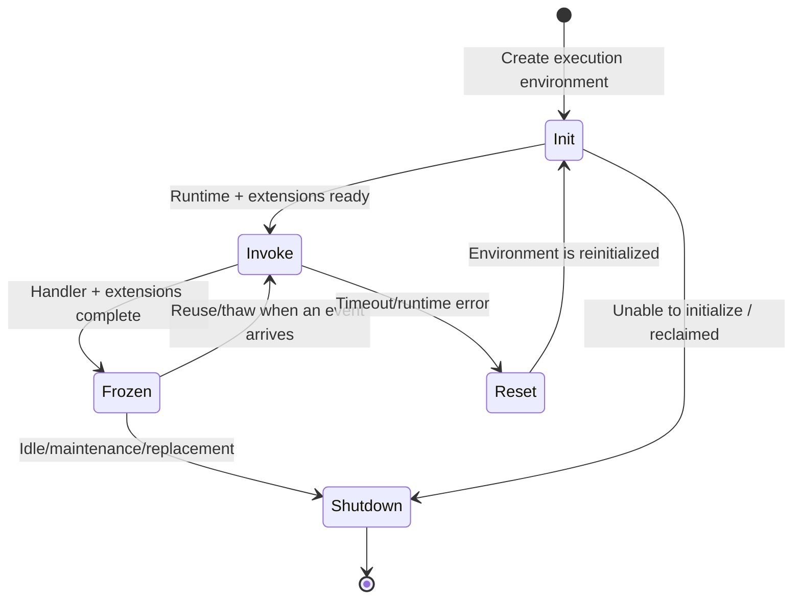
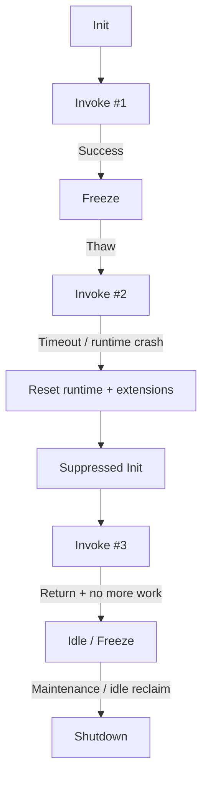
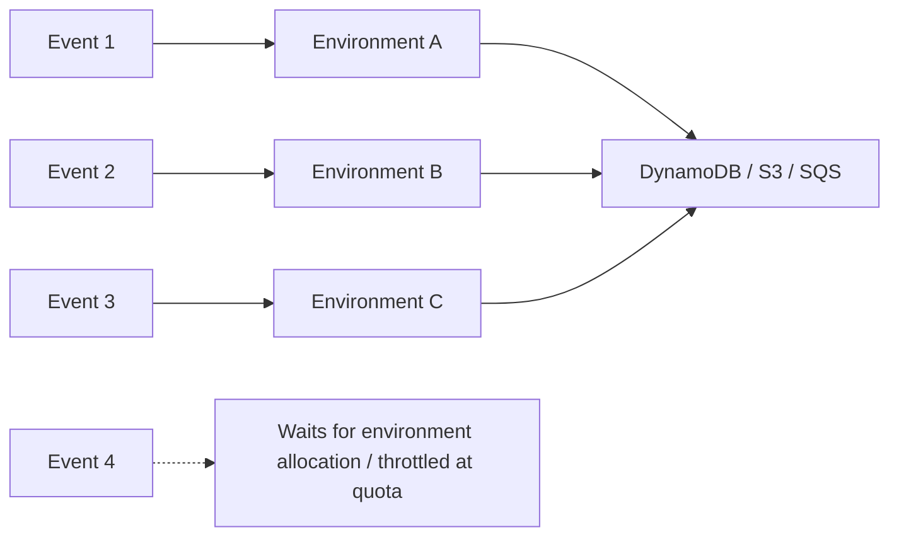
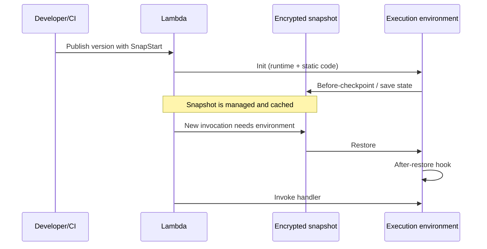
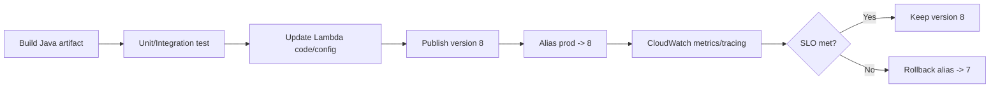
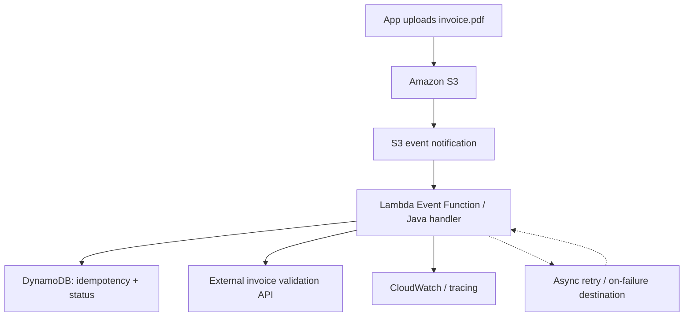

# AWS Lambda Function Execution Model and Lifecycle

> **Chapter:** Lambda Compute  
> **Module:** `CLOUD_PROVIDERS_AWS`  
> **Context:** Explore Amazon Web Services from an architecture perspective that is secure, observable, resilient, and cost-optimized. This lesson focuses on **AWS Lambda Event Functions** — the traditional Lambda model that receives an event and invokes a handler — from code deployment to how Lambda creates an execution environment, runs `Init → Invoke → Shutdown`, reuses environments, scales concurrency, and reclaims resources. The final section introduces newer Lambda variants to avoid confusing execution models.

## Learning Objectives

After this lesson, learners can:

1. Explain the concepts of **function**, **deployment package**, **runtime**, **handler**, **event**, **invocation**, **execution environment**, **version/alias**, and **execution role**.
2. Describe the Lambda Event Function lifecycle across the **Init**, **Invoke**, and **Shutdown** phases; distinguish between cold start, warm start, freeze/thaw, reset, and **suppressed init**.
3. Explain **which state can be reused** (Java static objects, SDK clients, `/tmp`) and why you must not rely on that state to guarantee correctness or store durable data.
4. Distinguish between **synchronous**, **asynchronous**, and **poll-based invocation** via event source mapping; design retries, dead-letter queues/destinations, and duplicate event handling.
5. Estimate **concurrency = request rate × average duration**, and distinguish between reserved concurrency, provisioned concurrency, and SnapStart.
6. Write a Java handler with the AWS SDK, organize safe initialization code, and manage timeouts, memory configuration, logging, IAM, and networking.
7. Use the AWS CLI and CloudWatch Logs/Metrics to inspect configuration, monitor `Init Duration`, `Duration`, `Throttles`, and runtime errors, and interpret real-world scenarios.
8. Identify the differences between **default Lambda Event Functions**, **Lambda Managed Instances**, **Web Functions**, and **Durable Functions** according to current AWS documentation.

## 1. What Is a Lambda Function?

**AWS Lambda** is a serverless compute service: you provide code and configuration, while AWS manages most of provisioning the execution environment, scaling capacity, maintaining infrastructure, and handling invocations. Lambda is especially well-suited for **event-driven** workloads: processing new S3 files, serving APIs, running scheduled jobs, sending notifications, or processing SQS messages or data streams.

A **Lambda Event Function** receives an event, executes a handler, and returns a result. Lambda does not require you to manually provision EC2 servers or manage Docker hosts for the default execution model.

Example order workflow:

```text
Client → API Gateway → Lambda Event Function (orders-api)
                              |
                              +→ DynamoDB: look up/create order
                              +→ SQS: send order event
                              +→ CloudWatch: logs and metrics
```

Events from SQS, S3, EventBridge, or an HTTP request can have different structures. **The handler must understand the exact event contract** of each source; there is no single JSON schema for all triggers.

### 1.1 Distinguishing Entities

| Concept | Meaning | Example |
|---|---|---|
| **Function** | A Lambda resource with code and configuration | `orders-api` |
| **Deployment package** | Code/libraries deployed as a ZIP archive or container image | `orders-api.jar` packaged into a ZIP |
| **Runtime** | Language environment and Runtime API, either AWS-managed or custom-provided | `java21` |
| **Handler** | Entry point for each invocation; receives event/context | `com.example.OrdersHandler::handleRequest` or class name when using `RequestHandler` |
| **Invocation** | One time Lambda calls the handler to process an event | Processing `orderId=O-1001` |
| **Execution environment** | Isolated environment where the runtime, extensions, and code run | An initialized environment for `orders-api` |
| **Execution role** | IAM role assumed by Lambda to provide temporary AWS credentials to the function | Role reading S3 and writing DynamoDB with least privilege |
| **Version** | Immutable snapshot of the function's code/configuration when published | `orders-api:7` |
| **Alias** | Pointer name to a version for releases/rollbacks, optionally supporting traffic splitting per configuration | `orders-api:prod` |
| **Trigger/event source** | How events reach the function | API Gateway, S3 notification, SQS mapping |

**A function is not the same as an execution environment.** One function can have **multiple execution environments** as concurrent load increases; each environment has its own memory, process, and `/tmp`. Changing code/config or publishing a version can lead to creating new environments; do not treat running environments as a single shared JVM or disk.

### 1.2 Lambda Is Not a Continuously Running Server

For Lambda Event Functions in the **default compute model**:

- The function is invoked when an invocation occurs, rather than continuously running a persistent process like an EC2 service.
- Lambda may keep an execution environment after an invocation for reuse, but there is **no guarantee** that the environment will continue to exist.
- A standard execution environment processes **at most one invocation at a time**; concurrency is scaled out using independent environments.
- Lambda may shut down or reinitialize an environment due to lack of traffic, configuration changes, runtime errors, or maintenance.

These statements apply to a **default Lambda Event Function**. **Lambda Managed Instances** use a different model: a single execution environment can process **multiple concurrent invocations**, requiring additional thread-safety discipline. Section 15 explains this boundary.

## 2. Where Does an Invocation Come From?

The event source and invocation type determine how the function receives data, returns results, retries, and handles errors.

### 2.1 Synchronous Invocation

Examples:

- A client calls API Gateway integrated with Lambda in a request/response model.
- A service calls the `Invoke` API with `InvocationType=RequestResponse`.

Flow:

```text
Client → Invoke → Lambda handler → Response/Error → Client
```

The caller waits for Lambda to process the request and receives the result or error according to the integration layer. When the function fails, **Lambda does not automatically retry code errors for a direct synchronous call**. The caller or upstream service must decide on retries, timeouts, backoff, and idempotency.

Note: API Gateway's own timeout and response formatting may differ from Lambda's timeout; you cannot set a long Lambda timeout and assume the HTTP client will wait for the same duration.

### 2.2 Asynchronous Invocation

For example, EventBridge or S3 notifications invoke Lambda asynchronously:

```text
Event source → Lambda async event queue → Execution environment → Handler
                          |
                          └→ Retry or on-failure destination on error
```

Lambda has an internal queue and Lambda-managed retry mechanism. For **errors returned by the handler/runtime**, Lambda by default retries up to **2 times** after the initial attempt (typically around 1 and 2 minutes). For throttling or system errors, the retry/backoff behavior and event lifetime can differ, up to around **6 hours under the default configuration**.

Do not assume every event is processed exactly once: duplicate delivery can happen even when the handler returns successfully. You must design **idempotency** at the business level, such as creating orders by a unique order ID with a conditional write.

### 2.3 Poll-Based Invocation via Event Source Mapping

With SQS, Kinesis, or DynamoDB Streams, Lambda typically uses an **event source mapping** to poll the source, group records into a batch, and invoke the function.

```text
SQS/Kinesis/DynamoDB stream
        ↓
Event source mapping poller
        ↓
Batch records → Lambda handler
        ↓
Success / failure / partial batch response
```

Retry behavior differs by source:

- **SQS:** messages are deleted from the queue when processed successfully per the integration mechanism. On failure, SQS visibility timeout and redrive policy/DLQ affect the next delivery; configuring `ReportBatchItemFailures` lets you return the list of failed messages to avoid reprocessing the entire batch.
- **Kinesis/DynamoDB Streams:** retries and checkpoints are tied to batches/shards, record ordering, and stream rules; a single failing record can block shard progress unless partial failures, batch bisection, or appropriate record age limits are configured.
- **Event source mappings have their own concurrency controls**, which can put pressure on the function's reserved concurrency if configurations are not coordinated.

**Do not apply the “2 retries of the Lambda async queue” rule to every SQS/stream trigger.** Identify the invocation type before diagnosing retries or cost.

### 2.4 Comparison Table of the Three Entry Paths

| Type | Who is responsible for delivering the event? | Response | Retry on error |
|---|---|---|---|
| **Synchronous** | Caller/API integration | Caller receives response/error | Decided by caller/integrating service |
| **Asynchronous** | Lambda async event queue | Caller usually receives acknowledgment that it was queued, not the business result | Lambda retries per async config; supports DLQ/destinations |
| **Poll-based** | Lambda event source mapping | Typically processes batches, does not return a direct response to the producer | Per SQS/stream mapping, visibility/retention/partial failure |

## 3. How Is an Execution Environment Prepared?

Lambda creates an **execution environment** when it needs to handle an invocation and no suitable ready environment is available. Each environment provides the runtime, source code, layers, extensions, memory, corresponding CPU, and a temporary directory.

Important configuration settings:

| Component | Purpose | Lifecycle impact |
|---|---|---|
| **Runtime** | Supported Java/Node.js/Python/.NET or custom runtime | Determines bootstrap/handler loading |
| **MemorySize** | Amount of RAM allocated to the function; CPU is allocated proportionally to memory in the default model | Affects init/invoke speed and GB-second cost |
| **Timeout** | Time limit for processing an invocation | Expiration can fail the invocation and reset the environment |
| **EphemeralStorage** | Capacity of `/tmp` | Temporary per-environment cache; not durable storage |
| **Architecture** | `x86_64` or `arm64` per runtime/package format | Native libraries and cost/performance differ |
| **Execution role** | IAM permissions for the code | Application calls via AWS SDK require appropriate permissions |
| **VPC config** | Subnets/security groups for private network access | Affects DNS, NAT, VPC endpoints, and configuration cold start |
| **Environment variables** | Configuration strings for the function version | Loaded into the environment; should not be used as a dynamic secret store |
| **Layers/extensions** | Shared libraries, agents/tracing/telemetry | Can increase init/invoke/shutdown duration |

The **Lambda service** itself manages the physical/virtualized infrastructure; the **user** remains responsible for code, configuration, IAM least privilege, dependencies, data, and downstream services called.

### 3.1 The Three Standard Phases

The basic lifecycle of a **default Lambda Event Function** has three phases:



**Freeze/thaw is not a guarantee** that the environment will survive across an idle period, and `Shutdown` is not necessarily delivered as a callback into your Java handler so you can save data to a database.

### 3.2 Where Are Init, Invoke, and Shutdown Measured?

- `Init`: prepares the runtime and runs initialization code before the handler.
- `Invoke`: the runtime invokes the handler, code processes the event, and extensions run; completes when the runtime and extensions report ready for the next event.
- `Shutdown`: Lambda stops the runtime/extensions when the environment is reclaimed or reset.

For custom runtimes/extensions, these phases have Runtime API and Extensions API mechanisms to signal ready/complete. With the Java managed runtime, you typically write a class/handler without calling these low-level APIs directly.

## 4. The Init Phase: Where Cold Starts Begin

A **cold start** typically occurs when an invocation requires an environment that is not yet available. Lambda must provision the execution environment, download the package/layers, start the runtime/extensions, and run your code's initialization logic.

The `Init` phase includes:

1. **Extension init:** starts registered extensions.
2. **Runtime init:** bootstraps the runtime, such as the JVM for a Java handler.
3. **Function init:** executes code **outside the handler**: static initializers, instance initializers, creating dependency clients, etc.
4. **Before-checkpoint hooks** if using Lambda SnapStart.

### 4.1 Java Example: What Runs in Init?

```java
package example;

import com.amazonaws.services.lambda.runtime.Context;
import com.amazonaws.services.lambda.runtime.RequestHandler;
import java.util.Map;

public final class LifecycleDemo
        implements RequestHandler<Map<String, Object>, Map<String, String>> {

    // Initialized when the execution environment/JVM is initialized.
    // This is NOT the place to store critical order state.
    private static final String CONFIG =
            System.getenv().getOrDefault("APP_ENV", "dev");

    private static final long INIT_TIME_NANOS = System.nanoTime();

    public LifecycleDemo() {
        // The Java managed runtime creates the handler instance during initialization.
        // Avoid long blocking work or exposing secrets here.
    }

    @Override
    public Map<String, String> handleRequest(
            Map<String, Object> event,
            Context context) {

        String requestId = context.getAwsRequestId();
        Object orderId = event.getOrDefault("orderId", "unknown");

        // Per-invocation data must live in local variables.
        context.getLogger().log(
                "Handling requestId=" + requestId
                + ", orderId=" + orderId + "\n");

        return Map.of("status", "accepted", "environment", CONFIG);
    }
}
```

- **`CONFIG`** and `INIT_TIME_NANOS` are evaluated when the class is initialized. If the environment is reused, they are **not recomputed before each request**.
- `handleRequest` runs for **every invocation**.
- `requestId` and `orderId` are **per-call** data and are not written to static mutable state.
- `INIT_TIME_NANOS` in this example is only a diagnostic marker within one JVM; `System.nanoTime()` is not a global clock comparable across multiple environments.
- With the Lambda Java managed runtime, when implementing `RequestHandler`, the handler is usually configured with the **fully qualified class name**, e.g., `example.LifecycleDemo`. If not implementing the interface, the handler configuration can use the form `package.Class::methodName`.

### 4.2 Init Duration

In the **standard on-demand** model, AWS typically caps Init at **10 seconds**; if Init does not complete within that threshold, Lambda may retry Init at the time of the first invocation subject to the function's timeout limit.

**Important exception:** Provisioned Concurrency, SnapStart, and Lambda Managed Instances have longer Init rules per AWS documentation; do not assume every function shares the same 10-second limit across all scenarios. With those mechanisms, Init limits can extend up to 15 minutes, with configuration-specific timeout rules.

If Java/Spring initialization takes several seconds, measure before simply increasing timeouts. Common sources of slowness include:

- Loading too many classes/dependencies and a heavy dependency injection container.
- Opening network connections to RDS/APIs during init.
- Downloading files or secrets before the handler runs.
- Starting multiple extensions/agents.
- Too little memory resulting in low CPU allocation.

### 4.3 Optimizing Init Safely

- **Package only the dependencies you need.** In Java, avoid pulling in very large frameworks for a small processing function if unnecessary.
- **Reuse AWS SDK clients:** Create clients in static fields/constructors and reuse them when the environment is kept warm.
- **Lazy initialization:** Initialize heavy resources when needed, while weighing the latency impact on the first branch that uses them.
- **Do not fetch rapidly changing business data and pin it forever in static fields.**
- **Do not embed secrets** in source code/packages or init logs.
- **Memory tuning:** Increasing memory can increase CPU and reduce init time, but you must measure total cost.
- **Separation of concerns:** One multi-purpose function loading many unneeded libraries can be slower than several small, focused functions.

## 5. The Invoke Phase: Code Processes the Event

Once the environment is ready, Lambda passes the event to the runtime. The managed runtime calls the corresponding handler. The handler receives the event/context, processes it, and returns a result or error.

### 5.1 Every Invocation Has a Deadline

The function's **`Timeout`** limits the entire `Invoke` phase, including handler execution and extensions running under the Lambda model. The typical maximum timeout for a default Event Function is **900 seconds (15 minutes)**.

Example with a 30-second timeout and a Java handler:

1. Parse event: 2 ms.
2. Read S3: 300 ms.
3. Call REST API: 12 seconds.
4. Write DynamoDB: 30 ms.
5. Extensions flush telemetry: adds relevant time.

If total processing does not finish before the deadline, Lambda can **terminate the invocation and reset the environment**. A Lambda timeout **does not automatically roll back** a `PutItem` or HTTP request that already succeeded on a downstream service.

**Set upstream/downstream timeouts properly:** SDK client timeouts, HTTP connect/read timeouts, API Gateway, SQS visibility timeout, or database statement timeouts must be coordinated. Do not let an HTTP client wait indefinitely near the function timeout and leave a half-completed transaction that is hard to recover.

### 5.2 Using Context to Check Remaining Time

In Java:

```java
@Override
public Map<String, String> handleRequest(
        Map<String, Object> event,
        Context context) {

    int remainingMs = context.getRemainingTimeInMillis();
    if (remainingMs < 2000) {
        throw new IllegalStateException(
                "Not enough execution time to start a new external operation");
    }

    // Only start an operation when enough deadline remains for it.
    return Map.of("status", "ok");
}
```

`getRemainingTimeInMillis()` is useful for refusing to start a new operation too late, but it does not replace retry/backoff, idempotency, or transaction timeouts in downstream services. Do not offload unfinished work to a background thread and return without a mechanism to ensure it completes.

### 5.3 An Invocation Is Not a Long-Lived HTTP Thread

In **default Event Functions**, each execution environment handles only **one invocation at a time**. However:

- A single invocation can use multiple threads inside the JVM if you spawn them.
- Different environments can process invocations concurrently.
- There are no shared static variables **across** environments.
- A single environment can be reused for **sequential invocations**, so static mutable state can cause **data leakage between calls**.
- Handlers must be **idempotent** at the business level because retries/duplicate events can occur.

## 6. Freeze, Thaw, and Warm Starts

When the handler and extensions finish the Invoke phase, Lambda may **freeze the execution environment** to save resources, then **thaw** it when the next event arrives.

A **warm start** means Lambda can reuse an already-initialized environment, skipping most bootstrap and static initialization. However, you **cannot choose or guarantee in advance** which environment an event will run on.

### 6.1 What Can Survive Across a Warm Start?

| Component | Reusable within the same execution environment? | Guaranteed to persist durably? |
|---|---|---|
| Java static fields / singletons | Yes | No |
| AWS SDK clients / HTTP connection pools | Yes, if connections remain valid | No |
| Files in `/tmp` | Yes | No |
| Environment variables of the running version | Same environment/version | Do not use for dynamic config updates |
| Unfinished JVM threads/async callbacks | May be frozen and resume on thaw | **No**; do not rely on them to guarantee work |
| Request ID / event payload | Per-invocation data only | Must not be cached as shared state |
| DynamoDB, S3, RDS | Data stored by services external to Lambda | Yes, per the service's durability/policies |

### 6.2 Why Not Use a Static Variable to Count Orders?

Suppose:

```java
private static int processedOrders = 0;

public String handleRequest(String orderId, Context context) {
    processedOrders++;
    return "processed=" + processedOrders;
}
```

If Lambda creates three separate execution environments, each JVM has its own `processedOrders`. When an environment is reclaimed, the variable disappears; during warm starts in the same JVM, the counter keeps incrementing but does not represent the system-wide order total.

For business counters, use a **DynamoDB atomic counter/conditional write**, an appropriate transaction, or a durable state store — not Lambda memory.

### 6.3 `/tmp`: Temporary Cache, Not Durable Storage

Lambda provides a `/tmp` directory private to each execution environment. The default size is **512 MB**, configurable up to **10,240 MB** for standard Event Functions in 1 MB increments.

You can use `/tmp` to:

- Extract a large ZIP file during processing.
- Cache a non-sensitive model or dictionary.
- Hold intermediate PDF/image files.
- Optimize subsequent invocations in the same environment.

Do not use `/tmp` to hold the sole copy of a transaction, unacknowledged messages, long-lived secrets, or unmanaged personal data. **Files may persist across freeze/thaw and even resets**, but are lost when the environment is replaced. Use invocation-scoped filenames when processing concurrent sub-tasks and proactively clean up sensitive data.

### 6.4 Connections Must Be Checked Before Reuse

An HTTP/JDBC client created during Init can hold a socket for too long:

```text
Init: DB connection is opened
Invoke 1: query succeeds
Freeze: environment pauses
DB/firewall: closes idle TCP connection
Thaw:
Invoke 2: uses old connection → stale connection error
```

Solutions: allow the SDK/client to reconnect, configure timeouts, proper connection health checks, bounded backoff, and careful connection pooling. For Lambda connecting to RDS, consider **RDS Proxy** when concurrent invocations could open a very large number of DB connections.

## 7. Shutdown and Reset: How an Environment Ends

Lambda can stop an execution environment when it is no longer needed, due to maintenance, configuration changes, idleness, or errors. At that point the runtime and extensions are reclaimed.

### 7.1 Shutdown Is Not a Reliable “finally” Block for Saving Data

In the Extensions API, Lambda sends a `Shutdown` event to registered **external extensions**. According to AWS documentation, the phase limit depends on extensions:

- **0 ms** if no extensions are registered.
- **500 ms** with an internal extension registered.
- **2,000 ms** if one or more external extensions are registered.

If the runtime/extension does not finish within the limit, Lambda may terminate the process with `SIGKILL`.

Therefore, do not rely on “every shutting-down environment automatically calling handler cleanup” to commit orders, ACK SQS messages, save files, or flush unique data. **Complete all mandatory side effects before returning from the handler.**

### 7.2 When Invoke Fails, Lambda May Reset

If a handler **times out**, crashes, exits the runtime, or hits an error that leaves the environment unusable, Lambda may reset the execution environment:

1. Terminates the current runtime with Shutdown-like behavior.
2. Sends shutdown to extensions where applicable.
3. If the environment continues to be used, Lambda **reinitializes the runtime + extensions** before the next invocation.
4. Contents of `/tmp` may be preserved across a reset; they are **not** automatically wiped.

This is a subtle pitfall: you may see files in `/tmp` from a previous invocation while Java static state has been reinitialized. Never use a `/tmp` file as proof that a transaction committed completely.

### 7.3 Suppressed Init: Hidden Init Between Two Invocations

After an invoke failure, Lambda may have to reinitialize before the next invocation without showing `INIT` as a separate phase in **standard CloudWatch logs**. AWS calls this **suppressed init**.

Abbreviated log example:

```text
START RequestId: req-A ...
END RequestId: req-A
REPORT RequestId: req-A Duration: ... Status: timeout

START RequestId: req-B ...
END RequestId: req-B
REPORT RequestId: req-B Duration: ... Init Duration: ... 
```

`REPORT` formats vary across Lambda updates, log formats, and configurations; do not write parsers that rely solely on one fixed format. To observe suppressed init more accurately, use the **Lambda Telemetry API**; events such as `INIT_START`, `INIT_RUNTIME_DONE`, and `INIT_REPORT` with `phase=invoke` are useful signals.

### 7.4 Failure Path Diagram



This diagram is illustrative; it does not mean Lambda will always reuse the exact same environment after every error or that a fixed sequential request chain exists.

## 8. Cold Start, Concurrency, and Response Time

### 8.1 One Function Can Have Many Execution Environments

Suppose `orders-api` has:

```text
100 requests/second
Average execution duration = 0.20 second
```

The approximate average concurrency required is:

```text
Concurrency ≈ RPS × AverageDurationSeconds
            ≈ 100 × 0.20
            ≈ 20 concurrent executions
```

When request rate or duration increases:

```text
RPS = 400, Duration = 0.50 s
Concurrency ≈ 400 × 0.50 = 200
```

This is an **average estimate** based on Little's Law, not a guarantee of the exact number of environments required at every millisecond. Bursts, duration variance, timeouts, retries, reserved quotas, RPS quotas, and provisioned concurrency can cause actual demand to differ.

### 8.2 Default Lambda Event Function: One Invocation per Environment



In the default model, Lambda does not run **two handler invocations simultaneously inside one execution environment**. Concurrent invocations generally require separate environments. However, environment A can process Event 5 after finishing Event 1 and being reused.

### 8.3 Concurrency Quotas and Throttling

AWS enforces quotas per **Account/Region**, per function, and on scaling rate. The default Account concurrency quota is commonly **1,000**, though it may vary by Account/granted quota. In addition to concurrency, there are **request-per-second limits**, and Lambda throttles the rate of creating new execution environments during very large bursts.

When quotas are exceeded, invocations may receive **`TooManyRequestsException`/429**, be delayed/retried depending on the event source, or fail to be processed immediately. One saturated function can affect other functions if they share the Account's unreserved concurrency pool.

Check **Service Quotas**, CloudWatch metrics, and real load data rather than treating 1,000 as a guaranteed quota for every account.

## 9. Reserved Concurrency and Provisioned Concurrency

These two similarly named settings solve different problems.

| Criterion | **Reserved Concurrency (RC)** | **Provisioned Concurrency (PC)** |
|---|---|---|
| Goal | Cap and guarantee dedicated capacity for a function | Pre-initialize execution environments to reduce cold starts |
| Pre-initializes runtime? | **No** | **Yes** |
| Can cold starts still occur? | Yes | PC invocations using ready environments avoid cold-start Init |
| Caps max concurrency? | Yes, RC acts as a ceiling for the function | PC is not a hard max if on-demand capacity is permitted |
| Additional configuration cost | No separate charge for reserving concurrency | Provisioned concurrency charges based on duration and related usage |
| When to use | Protect downstream DB/APIs, isolate capacity for critical functions | Interactive workloads sensitive to cold-start p95/p99 |
| Configuration scope | Function | **Published version or alias**, not set directly on `$LATEST` |

### 9.1 Example: Protecting a Database

Function `orders-api` may process quickly, while RDS only tolerates around 50 concurrent connections from Lambda. Setting **`ReservedConcurrentExecutions=30`** can cap concurrency on the function to avoid overloading the backend, assuming the number of connections per invocation is controlled.

However:

- `RC=30` **does not keep 30 environments pre-initialized**.
- It does not guarantee each invocation uses only one database connection.
- With async/SQS triggers, increased throttling/backlog can affect message age, visibility, and DLQ behavior.
- Setting RC to `0` intentionally **throttles** the function; use cautiously in production.

### 9.2 Example: Reducing Cold Starts with PC

A Java API has long cold starts due to loading many classes. If baseline load stays around 20 concurrent executions, you can try **PC=20** on the `prod` alias. Lambda prepares environments ahead of invocations, removing Init from the critical path.

Notes:

- PC takes time to **allocate/initialize**; it does not take effect the instant the configuration command returns.
- If traffic exceeds PC, Lambda can use **on-demand spillover** up to allowed RC/account limits; spillover requests can still hit cold starts.
- PC incurs charges even while environments are idle under its pricing model.
- RC configuration cannot be less than the total PC across the function's versions/aliases per service rules.

### 9.3 Should You Configure Both RC and PC?

Yes, when you need both downstream protection and reduced cold starts. For example, `RC=50`, `PC=20`: 20 concurrency is pre-warmed, with on-demand scaling up to the remaining RC ceiling depending on quotas and limits.

**Do not think of PC as a fixed set of Docker containers that live forever.** AWS still manages environment replacements/checks and initialization exceptions apply; monitor real metrics instead of assuming latency is permanently fixed.

## 10. Lambda SnapStart and the Restore Phase

**Lambda SnapStart** changes the initialization path:

1. When you **publish a function version** with SnapStart enabled, Lambda runs `Init`, including the Java runtime and static initialization.
2. Lambda saves an encrypted snapshot of the initialized execution environment's **memory and disk state**.
3. When an invocation needs a new environment, Lambda **restores the snapshot** instead of running Init from scratch.
4. If an **after-restore hook** is present, it executes at the end of the `Restore` phase.
5. Lambda then transitions to `Invoke`.



### 10.1 Watch Out for Uniqueness

Multiple environments are restored from **the exact same snapshot**. If Init generates:

- A UUID meant to be a **unique identifier per instance**;
- Cryptographic keys/nonces based on random state that is not SnapStart-compatible;
- Short-lived tokens or cached timestamps that never refresh;
- Network connections to a DB assumed to always be valid;

then upon restore you may encounter **duplicate identities, stale credentials, or broken connections**.

Solution: generate unique IDs per **invocation** or after restore, use compatible secure randomness sources, revalidate connections, and refresh short-lived data. AWS provides **before-checkpoint** and **after-restore runtime hooks** for appropriate use cases.

### 10.2 Support and Limitations

According to current AWS documentation, SnapStart supports a set of managed runtimes (including **Java 11+**), with specific requirements by deployment format and runtime; verify details before adopting.

Key limitations:

- SnapStart applies to **published versions and aliases**, not directly to `$LATEST`.
- **Cannot be used simultaneously with Provisioned Concurrency** on the same function configuration.
- Has restrictions with **EFS** and `/tmp` sizes above supported thresholds.
- Each version may have runtime-specific snapshot/cache/retention policies and pricing; do not assume all runtimes share identical SnapStart pricing.
- A version that goes uninvoked for a long period may become **Inactive** per runtime/feature rules and require reinitializing the snapshot.

### 10.3 When to Choose SnapStart vs. PC?

| Scenario | SnapStart | Provisioned Concurrency |
|---|---|---|
| Heavy Java init, bursty traffic | Often worth trying if supported | Can be expensive if idle periods are common |
| API requiring ultra-consistent latency | Cuts Init, still has restore overhead | Better suited when pre-warmed environments are needed |
| Needs EFS or configs unsupported by SnapStart | May not be usable | Check PC and EFS compatibility |
| Need to control idle cost | Depends on runtime/pricing and active version count | Must pay PC charges for configured duration |
| Caches state/unique IDs in init | Must audit SnapStart uniqueness | Does not clone snapshots like SnapStart |

Do not choose based on a single cold-start measurement. Test across multiple load levels, measure `Init Duration`, `Restore Duration`, p95/p99, and total cost alongside application effectiveness.

## 11. Java Lambda: Handler, SDK Reuse, and Per-Invocation Data

This Java example uses the AWS SDK for Java v2. The system receives an event containing `orderId`, checks reference data in S3, and returns a result. The pattern demonstrates **creating clients once per environment** while **not retaining event state** across invocations.

```java
package example;

import com.amazonaws.services.lambda.runtime.Context;
import com.amazonaws.services.lambda.runtime.RequestHandler;
import java.util.Map;
import software.amazon.awssdk.regions.Region;
import software.amazon.awssdk.services.s3.S3Client;
import software.amazon.awssdk.services.s3.model.HeadObjectRequest;

public final class OrderDocumentHandler
        implements RequestHandler<Map<String, String>, Map<String, String>> {

    // Initialized in Init, reusable across warm starts.
    // The SDK obtains temporary IAM credentials from the Lambda execution role.
    private static final S3Client S3 = S3Client.builder()
            .region(Region.AP_SOUTHEAST_1)
            .build();

    private static final String BUCKET =
            System.getenv().getOrDefault(
                    "DOCUMENT_BUCKET", "orders-documents-example");

    @Override
    public Map<String, String> handleRequest(
            Map<String, String> event,
            Context context) {

        String orderId = event.get("orderId");
        if (orderId == null || !orderId.matches("[A-Za-z0-9-]{1,64}")) {
            throw new IllegalArgumentException("Invalid orderId");
        }

        String objectKey = "orders/" + orderId + ".json";

        S3.headObject(HeadObjectRequest.builder()
                .bucket(BUCKET)
                .key(objectKey)
                .build());

        context.getLogger().log(
                "Validated document for requestId="
                + context.getAwsRequestId() + "\n");

        return Map.of(
                "orderId", orderId,
                "status", "document-present");
    }
}
```

This pattern:

- Requires the **`aws-lambda-java-core`** and **`software.amazon.awssdk:s3`** dependencies.
- Assumes the object already exists in S3; otherwise, the SDK throws the appropriate exception.
- Uses **`HeadObject`**, so it needs matching object permissions per `s3:GetObject`/bucket policy behavior; without `ListBucket`, a missing key may return 403 instead of 404.
- Requires an execution role scoped to reading only the `orders/*` prefix.
- Does not store access keys or secrets in code or static variables.
- Validates the input `orderId` to prevent constructing keys outside the expected scope.
- Contains no static mutable counters or per-user business result caches.

### 11.1 Sample IAM Role Policy for S3 Read Access

```json
{
  "Version": "2012-10-17",
  "Statement": [
    {
      "Sid": "ReadOrderDocuments",
      "Effect": "Allow",
      "Action": "s3:GetObject",
      "Resource": "arn:aws:s3:::orders-documents-example/orders/*"
    }
  ]
}
```

If the S3 object is encrypted with a customer-managed KMS key, you also need to evaluate `kms:Decrypt` and the key policy. For logging, the role needs appropriate CloudWatch Logs permissions, typically via AWS-recommended managed policies.

**Do not grant `s3:*` or `AdministratorAccess` just because a function needs to read one object.** If the function is invoked by S3/API Gateway, you must also manage **resource-based Lambda permissions** for callers/triggers where the integration requires them; do not confuse these with the **execution role** that the function uses to call AWS services.

### 11.2 Separating Init Time and Invoke Time

With Java/Spring Boot, consider:

- Init: create SDK clients, shared config/objects, and load required classes.
- Invoke: validate the event, retrieve request ID, execute side effects/transactions, and return the response.
- After invoke: do not run work that must succeed in an unmanaged background thread.
- Before reusing an old connection: validate and reconnect where appropriate.

Frameworks/DI can be used, but you must measure cold-start impact; there is no need to boot an entire HTTP server just to handle a simple event.

## 12. Versions, Aliases, and What Happens When Deploying New Code?

### 12.1 `$LATEST` and Published Versions

`$LATEST` is the unpublished version whose code and configuration can be modified. When you **publish a version**, Lambda creates an **immutable** version of the code and supported version-specific settings.

Example:

```text
orders-api:$LATEST  (unpublished)
orders-api:7        (published version)
orders-api:8        (published version)
orders-api:prod     (alias → version 8)
```

When code or configuration changes, Lambda may spin up new execution environments; do not assume existing environments are “patched” mid-invocation. With aliased deployments, verify which version the alias points to and check routing weights when splitting traffic.

### 12.2 Why Aliases Matter

- Maintain a stable endpoint/integration target for clients.
- Test canary rollouts using weighted aliases (within Lambda limits and rules).
- Roll back quickly to a tested published version.
- Attach Provisioned Concurrency to the appropriate alias/version.
- SnapStart attaches to published versions.

**Rolling back an alias does not roll back data in DynamoDB/S3/RDS** already modified by the new code. Design backward-compatible schemas and idempotent changes before deploying.

### 12.3 Path of a Deployment



When using SnapStart, publishing a version includes an Init/snapshot step; when using PC, wait for allocation to become healthy before shifting traffic according to your strategy.

## 13. Security and Networking in the Lambda Lifecycle

### 13.1 IAM Execution Role

When Lambda code calls S3, DynamoDB, SQS, or Secrets Manager, the function uses **temporary credentials** from the **Lambda execution role**. The role's trust policy allows the Lambda service principal:

```json
{
  "Version": "2012-10-17",
  "Statement": [
    {
      "Effect": "Allow",
      "Principal": {
        "Service": "lambda.amazonaws.com"
      },
      "Action": "sts:AssumeRole"
    }
  ]
}
```

The role policy should allow only the actions and resources genuinely required. A user or CI/CD pipeline deploying the function needs permission to update Lambda and `iam:PassRole` when specifying an execution role; do not confuse those with the SDK permissions used inside the handler.

### 13.2 Secrets: Do Not Treat Env Vars as a Secret Store

Lambda encrypts environment variables at rest per the service, but you **should not** store DB passwords, API tokens, or sensitive credentials as plain env variables when **AWS Secrets Manager** can be used.

When Java fetches secrets at runtime:

- The role needs `secretsmanager:GetSecretValue` on the exact secret ARN.
- A customer-managed KMS key may require `kms:Decrypt` and key policy access.
- Cache short-term where appropriate to reduce latency and API cost.
- Watch out for rotation: a secret fetched during init and held statically forever **will become stale**.
- Do not log or trace secrets or full HTTP headers.

### 13.3 VPC and Internet Egress

Placing a Lambda function in VPC subnets enables connectivity to RDS, ElastiCache, or private services. However:

- Attaching a VPC **does not grant outbound Internet access by default**.
- Private subnets usually need a **NAT Gateway** for Internet/IPv4 endpoints or supported **VPC endpoints** for AWS services.
- Security groups, route tables, NACLs, DNS, ENI/IP capacity, and IAM must all align.
- Lambda uses **Hyperplane ENIs** for VPC connectivity; do not assume each invocation creates its own ENI.
- Network timeouts from VPC misconfiguration can cause handler timeouts and environment resets.

Monitor RDS/API connections, account for NAT/PrivateLink costs, and test connectivity paths before adding a VPC merely because it seems “more secure.”

### 13.4 Extensions and Access Permissions

Lambda extensions can handle telemetry, secret caching, tracing, or security. However, extensions also consume execution environment resources and can affect init/invoke/shutdown times and cost.

Do not use extensions from untrusted sources or grant overly broad roles. Pin layer/extension versions, inspect logs, and measure CPU/memory overhead. A failing extension can break init, restore, or invoke even when handler code has not changed.

## 14. CloudWatch Logs: Reading Lifecycle Traces

Lambda provides default logging and supports advanced logging configurations. For Event Functions, CloudWatch Logs typically records system lines and application logs.

### 14.1 `START`, `END`, and `REPORT` Lines

Illustrative example:

```text
START RequestId: 11111111-2222-3333-4444-555555555555 Version: 8
2026-11-20T00:00:00Z INFO Processing order O-1001
END RequestId: 11111111-2222-3333-4444-555555555555
REPORT RequestId: 11111111-2222-3333-4444-555555555555 Duration: 112.50 ms Billed Duration: 113 ms Memory Size: 512 MB Max Memory Used: 148 MB Init Duration: 681.20 ms
```

Sample data only, not logs from an active account. Lambda continues evolving how system logs/traces are emitted; some functions display fields like `Status: timeout` or different `INIT_REPORT` events depending on runtime/provisioned/SnapStart configuration.

| Log/field | Helps answer |
|---|---|
| `START RequestId` | Which invocation started? |
| `END RequestId` | Did the handler/invocation finish at the Lambda layer? |
| `REPORT Duration` | How long did it take as measured by Lambda? |
| `Billed Duration` | Billable duration under the active compute model and pricing rules |
| `Memory Size / Max Memory Used` | Is memory over- or under-provisioned? |
| `Init Duration` | Was there a cold start or extra init in this measurement? |
| `Status / Error Type` | Timeout, runtime crash, memory error, or reported failure |
| `INIT_REPORT` | Init success/failure per the active mode's logging rules |
| `RESTORE_REPORT` | SnapStart restore and post-restore errors |
| `Telemetry API INIT_*` | Observe suppressed init and detailed phases |

**`REPORT` does not prove business side effects succeeded.** A handler might return 200 after sending an SQS message while a downstream backend later fails; end-to-end tracing and separate metrics are still required.

### 14.2 CloudWatch Metrics to Watch

| Metric | Meaning |
|---|---|
| `Invocations` | Number of times Lambda executes the function |
| `Errors` | Number of failed invocations at the Lambda layer |
| `Duration` | Execution time, inspectable via percentiles |
| `ConcurrentExecutions` | Current concurrent invocations |
| `Throttles` | Calls throttled due to quota/RC/RPS |
| `IteratorAge` | Processing lag for records in certain stream integrations |
| `AsyncEventAge` / `AsyncEventsDropped` | Age/count of async events dropped per supported behavior |
| `ProvisionedConcurrencyUtilization` / spillover metrics | Whether PC capacity is sufficient |
| `DeadLetterErrors` / `DestinationDeliveryFailures` | Failures delivering error records to configured targets |
| `MaxMemoryUsed` in logs | Evaluate OOM risk or memory sizing |

Available metrics depend on invocation type, account, Region, and configuration; do not configure alarms on a metric that is not emitted without verifying the event source.

### 14.3 Using Tracing Effectively

AWS X-Ray / CloudWatch Application Signals / OpenTelemetry can show:

- Init overhead and total latency.
- Which DynamoDB/S3/RDS calls are slow.
- Downstream retried errors.
- p95/p99 distribution between warm and cold invocations.
- Breakdown between time spent in application code, network, and external services.

Avoid recording PII/secrets in trace attributes or request payloads. Observing distributed traces from API Gateway → Lambda → SQS/DB requires proper context propagation and configuration; a single Lambda request ID does not replace an end-to-end trace ID.

## 15. Newer Lambda Models and Important Exceptions

Current AWS documentation distinguishes several compute primitives/compute types. Because this lesson covers the **execution model**, you must understand the scope so you do not misapply earlier statements.

### 15.1 Traditional Lambda Event Functions (Default Compute)

- Receives an event, runs a handler, returns a result.
- A typical execution environment handles **one invocation at a time**.
- Lambda creates additional environments to satisfy concurrency.
- Basic lifecycle `Init → Invoke → Shutdown`, with freeze/thaw on reuse.
- Maximum 15 minutes for a typical invocation; choose another service when workloads exceed this (also check Durable Functions if supported for the use case).

### 15.2 Lambda Managed Instances

AWS provides **Lambda Managed Instances** for Event Functions running on Lambda-managed EC2 capacity providers. Key differences:

- A single execution environment can handle **multiple concurrent invocations**.
- Scales based on resource/capacity signals, **not** strictly “one new invocation → one environment.”
- **Static mutable state must be thread-safe**; do not rely on default Lambda's single-invocation assumption.
- Capacity providers, VPC placement, EC2 instance models, and pricing differ from default Lambda.
- Per current documentation, some asynchronous/event-source-mapping invocations on Managed Instances have duration limits different from the default 15 minutes.
- Incurs instance and management charges; do not assume the same request-only pricing model.

**Example:** A static Map cache that default Lambda code only reads during each invocation may still need synchronization, request-scoped isolation, or removal on Managed Instances because handler threads can run concurrently.

### 15.3 Lambda Web Functions

**Web Functions** serve HTTP server applications using their own model (e.g., a Node.js server with a listener) rather than running every request through an Event Function handler like the Java examples in this lesson. They have their own lifecycle and scaling approach; do not apply all `RequestHandler`/event JSON rules from this lesson to describe a web server.

### 15.4 Durable Functions

**Durable Functions** add state checkpointing and the ability to pause/resume long-running workflows, introducing phases such as **Wait/Resume** alongside Init/Invoke/Shutdown. They fit multi-step workflows, approval/human-in-the-loop flows, and waiting for long-running events where supported by AWS.

**Do not use `/tmp` or static fields to simulate durability.** Durable state must go through supported checkpoint mechanisms or services like AWS Step Functions/DynamoDB/SQS.

### 15.5 Safety Rule When Reading Documentation

If an AWS guide describes `Lambda Event Functions`, `Managed Instances`, `Web Functions`, or `Durable Functions`, keep the scope strictly aligned. Timeout values, concurrency per environment, pricing, SnapStart compatibility, and log formats **can differ** across types. In production, lock down the exact **compute type + runtime + Region + version** before applying parameters.

## 16. AWS CLI: Inspecting the Function Lifecycle (Read-Only First)

> **Prerequisites:** AWS CLI v2, authorized credentials, and the correct Region. ARNs, function names, and request payloads below are examples. Read commands do not modify infrastructure; `invoke` **executes real code and can produce side effects**, so use an authorized test environment.

### 16.1 Check Account and Function Configuration

```bash
aws sts get-caller-identity

aws lambda get-function-configuration \
  --function-name orders-api \
  --region ap-southeast-1 \
  --query '{Name:FunctionName,Runtime:Runtime,Handler:Handler,Memory:MemorySize,Timeout:Timeout,Architecture:Architectures,State:State,LastUpdateStatus:LastUpdateStatus,Role:Role,Version:Version,Ephemeral:EphemeralStorage,SnapStart:SnapStart}' \
  --output json
```

If the function does not exist in that Region or IAM permissions are missing, AWS returns an API error. Some unset or unsupported fields may be omitted; do not assume Lambda is broken.

### 16.2 Check Versions and Aliases

```bash
aws lambda list-versions-by-function \
  --function-name orders-api \
  --region ap-southeast-1 \
  --query 'Versions[].{Version:Version,Runtime:Runtime,Status:State,LastModified:LastModified}' \
  --output table

aws lambda list-aliases \
  --function-name orders-api \
  --region ap-southeast-1 \
  --output json
```

Verify the `prod` alias points to the expected version before testing or rolling back. Even after publishing version 8, do not assume invoking `orders-api` without a qualifier runs version 8: unqualified invocations typically go to `$LATEST` per the API, depending on integration configuration.

### 16.3 Check Reserved/Provisioned Concurrency

```bash
aws lambda get-function-concurrency \
  --function-name orders-api \
  --region ap-southeast-1

aws lambda get-provisioned-concurrency-config \
  --function-name orders-api \
  --qualifier prod \
  --region ap-southeast-1
```

If PC/RC is not configured, the corresponding API may return `ResourceNotFoundException`. Do not mistake this for a deleted function; re-verify the function ARN/config.

### 16.4 Run a Test Invocation

```bash
aws lambda invoke \
  --function-name orders-api \
  --qualifier prod \
  --invocation-type RequestResponse \
  --cli-binary-format raw-in-base64-out \
  --payload '{"orderId":"O-1001"}' \
  --region ap-southeast-1 \
  response.json
```

**Warning:** This command **runs the real handler** and may write to databases, create orders, emit events, or incur charges. Only use test IDs/data against functions in a test environment. `response.json` is a local output filename chosen by the operator; the illustrative commands here were not executed while writing this lesson.

### 16.5 Check Event Source Mapping Triggers

```bash
aws lambda list-event-source-mappings \
  --function-name orders-api \
  --region ap-southeast-1 \
  --query 'EventSourceMappings[].{UUID:UUID,EventSourceArn:EventSourceArn,State:State,BatchSize:BatchSize,LastResult:LastProcessingResult}' \
  --output table
```

Not all triggers are event source mappings: API Gateway, S3 notifications, or EventBridge rules are configured differently. Seeing no mappings **does not mean the function has no triggers**.

### 16.6 Tail CloudWatch Logs

```bash
aws logs tail /aws/lambda/orders-api \
  --region ap-southeast-1 \
  --since 30m \
  --format short
```

Log groups and retention may be configured differently from defaults. To diagnose performance, compare invocations with `Init Duration` against warm starts, while checking CloudWatch `Duration` and `Throttles`. Avoid sending payloads containing secrets/PII when testing logging.

## 17. Design Scenario: Processing Invoices from S3 with Java Lambda

An e-commerce application uploads PDF invoices to S3. When a new object arrives, S3 sends a notification; a Java Lambda reads metadata, calls an invoice validation service, and writes a processing record to DynamoDB.

### 17.1 Diagram



### 17.2 Separating Init and Invoke

**Init:**

- Load Region/bucket configuration.
- Create S3/DynamoDB SDK clients for reuse.
- Initialize the HTTP client with connect/read timeouts.
- Do not generate a “unique” random order ID and store it statically for all events.

**Invoke:**

1. Parse each S3 record; verify bucket/key/version if present.
2. Use a **business idempotency key** combining bucket + key + version/ETag as needed; ETag is not always a unique checksum across all upload mechanisms, so choose a key suited to the business logic.
3. Use a DynamoDB conditional write so only one worker claims processing rights for the record.
4. Perform PDF processing/validation within the timeout limit; if longer processing is required, move to Step Functions, SQS workers, or an appropriate processing model.
5. Record completion status or a retryable error; do not silently ignore duplicate events.
6. Return the result after mandatory side effects are safely persisted.

**Retry:** S3 notifications can arrive more than once; the function is retried on processing errors. Every external action must support idempotency and distinguish transient errors from permanent ones.

### 17.3 Choosing Concurrency to Protect the Backend

If the invoice validation API handles only **20 concurrent requests**, you can start with **RC less than or equal to 20** after measuring outbound requests per invocation. Also watch:

- S3 async queue backlog and retry intervals.
- Event age and DLQ/destination when limits are reached.
- HTTP client timeouts/retries to prevent retry storms.
- Avoid calling the external API dozens of times for the same invoice.
- Memory/CPU and cost during peak upload spikes.

### 17.4 When One Event Needs More Than 15 Minutes

Do not “spawn a background thread after the handler returns” to bypass the limit. Depending on the workload, consider:

- **AWS Step Functions** to orchestrate multiple short tasks, retries, and waiting states.
- **SQS + Lambda** for chunking/batching and checkpointing.
- **AWS Batch, ECS/Fargate, or EC2** for long-running compute or specialized environments.
- **Lambda Durable Functions** where the model and Region support it and long-running checkpoints/workflows are required.

The goal is not to force every workload into default Lambda, but to pick the compute model that meets RTO, reliability, and cost targets.

## 18. Common Operational Pitfalls

| Symptom | Possible design flaw/condition | Remediation |
|---|---|---|
| First invocation slow, subsequent ones fast | Cold start and Java static initialization | Measure Init Duration, trim dependencies, increase memory after benchmarking, consider SnapStart/PC |
| `INIT_REPORT Status: timeout` | Init too long, extension/network blocked | Inspect init code, VPC, secrets/API calls, timeout per compute type |
| `RESTORE_REPORT Status: timeout` | SnapStart after-restore hook/connection took too long | Inspect hooks and restore operations |
| `REPORT Status: timeout` | Handler/extension exceeded deadline | Check downstream timeouts, memory/CPU, reduce workload per invocation |
| Intermittent RDS connection failures | Stale TCP/JDBC connection after freeze | Reconnect/validate, RDS Proxy, bounded retries |
| Static counter resets or is inaccurate | Multiple environments or environment reclaimed | Store counters in DynamoDB or a durable service |
| `/tmp` still has old files from previous event | Warm reuse/reset preserves temporary directory | Use invocation-scoped filenames, clean up, do not assume `/tmp` is isolated across invocations |
| S3 event processed twice | Async retries/duplicate delivery | Conditional idempotency, do not rely on exactly-once delivery |
| SQS message reprocessed | Handler failure, visibility timeout, batch retry | Proper visibility timeout, DLQ, partial batch response |
| Function throttled despite low duration | Account/RC/RPS quota | Check `Throttles`, concurrency, and request rate; request appropriate quotas |
| PC still shows unexpected latency | PC spillover, PC not yet allocated, slow downstream | Inspect provisioned concurrency utilization/spillover and tracing |
| SnapStart produces duplicate unique IDs | Random/ID generated in init before snapshot | Generate after restore/invoke, use runtime hooks, audit uniqueness |
| Lambda in VPC cannot reach Internet | Missing NAT/VPC endpoint, wrong route/SG/DNS | Verify VPC config and per-service connectivity |
| Logs missing | IAM CloudWatch Logs permissions, logging config, log group/retention | Verify execution role, log group, and CloudWatch settings |
| New deployment fails only in production | Alias, published version, runtime/layers differ from staging | Verify version/alias, IAM/VPC/env, and rollout |
| Database overloaded during bursts | Rapid Lambda scaling opens too many connections | RC, RDS Proxy, caching, backpressure, and app-level limits |

### 18.1 Short Diagnostic Sequence

1. Identify **Account, Region, function ARN, alias/version, and compute type**.
2. Identify the **invocation type**: sync, async, or event source mapping.
3. Check whether the failure occurred in **Init, Restore, Invoke**, or **throttling before invoke**.
4. Inspect `REPORT`/`INIT_REPORT`/`RESTORE_REPORT`, CloudWatch Metrics, traces, and request IDs.
5. Check IAM, networking, and downstream SDK timeouts.
6. Distinguish failures affecting **a single event** from those affecting an **execution environment**; check duplicate handling.
7. Verify RC/PC/SnapStart settings and current quotas.
8. Retest with a safe event and measure p95/p99/cost before rolling out to production.

## 19. Cost Optimization and Resilience

### 19.1 Lambda Cost Is Not Just Invocation Count

For **default Lambda Event Functions**, total related cost can include:

- Request count and execution duration billed by configured memory.
- Provisioned Concurrency if enabled.
- SnapStart cache/restore charges where applicable per runtime and pricing policy.
- Ephemeral storage above the free tier, if configured.
- CloudWatch Logs, X-Ray tracing, Secrets Manager, KMS.
- NAT Gateway/VPC endpoints, data transfer, and downstream services (DynamoDB, S3, SQS).
- Version management, container image/storage, or CI/CD artifacts depending on deployment model.

**Reserved concurrency has no separate surcharge**, but it caps the function's capacity and reserves concurrency quota for that function, which can affect other services.

### 19.2 More Memory Can Reduce Total Cost

If 512 MB runs for 1,200 ms while 1,024 MB runs for 450 ms, total memory × duration (excluding requests/extra services) can drop even though memory is higher.

```text
512 MB = 0.5 GiB;  Duration = 1.2 seconds
Compute = 0.5 × 1.2 = 0.60 GiB-second

1024 MB = 1.0 GiB; Duration = 0.45 seconds
Compute = 1.0 × 0.45 = 0.45 GiB-second
```

Illustrative example only. **Measure in practice** with load tests or Lambda Power Tuning on the right version/runtime/architecture; do not increase memory by guesswork.

### 19.3 Resilience Is Not Just Lambda Auto-Scaling

Lambda manages the infrastructure, but business resilience requires:

- Bounded retry/backoff and idempotency.
- Dead-letter queues or on-failure destinations for async flows where supported.
- Monitoring event age/backlog; alerting on sustained failures.
- Keeping durable data in DynamoDB/RDS/S3, never treating `/tmp` as the source of truth.
- Protecting downstream dependencies with RC/backpressure/batching.
- Encryption and IAM least privilege; restricting invoke/function URL permissions.
- Multi-Region backup/failover if Region-level resilience is required.
- Having a version/alias rollback runbook and testing after code/runtime updates.

## 20. Exercises and Self-Check Questions

**Exercise 1 — Entities.** A Java Lambda function receives 200 concurrent requests. Do all requests share the same JVM and the same static fields? When can a static field be reused?

**Exercise 2 — Init Phase.** A Java handler creates an S3 client outside `handleRequest` and loads configuration in a static initializer. When in the lifecycle do those operations run, and how do they affect cold starts?

**Exercise 3 — Suppressed Init.** After a timeout, the next request shows an unusually high `REPORT Duration` without a separate INIT log. What phenomenon might have occurred, and what telemetry source can verify it?

**Exercise 4 — Temporary Storage.** A function writes an intermediate PDF file to `/tmp`. If the same environment is reused, can the file still be there? What if the function runs on a new environment? Should you store unique legal documents here?

**Exercise 5 — Concurrency.** A system receives 150 requests/second with an average duration of 400 ms. Estimate average concurrency. If you set RC=40, what problems might appear?

**Exercise 6 — RC vs PC.** An API has reserved concurrency 100. Does setting PC=20 guarantee zero cold starts for every request? Why doesn't RC=100 alone reduce cold starts?

**Exercise 7 — Retries.** A system receives S3 events asynchronously with retries enabled. The handler writes to DynamoDB successfully but times out before returning. Why could the record be processed again, and what is the business-level solution?

**Exercise 8 — SQS.** An SQS event source mapping pulls a batch of 10 messages, and 1 message fails. If the handler throws an exception, which messages might be reprocessed? Which setting enables reporting only failed items?

**Exercise 9 — SnapStart.** A Java function generates a static UUID in Init and uses it as the transaction ID for every invocation. When SnapStart is enabled, what can go wrong? At which phase should this be fixed?

**Exercise 10 — Timeout.** Lambda timeout is 20 seconds; Java calls an API with no read timeout and starts writing to the DB at second 19. Name two risks and how to redesign this.

**Exercise 11 — Security.** A function needs to read a single S3 prefix, call Secrets Manager, and write logs. What IAM and network considerations apply? Should secrets be stored directly in environment variables?

**Exercise 12 — Newer Models.** A guide states “each Lambda execution environment processes only one request at a time.” Does this apply unaltered to Lambda Managed Instances? Do Web Functions and Durable Functions share the exact same handler API/lifecycle as default Event Functions?

<details>
<summary>Suggested Answers</summary>

1. No. Default Lambda scales using multiple execution environments, each with its own JVM state. Static fields can only be reused across sequential invocations within the same environment.
2. During Function Init, typically before the first invocation. Heavy initialization increases cold starts; reusing SDK clients makes warm invocations faster.
3. Suppressed init after a runtime reset; use the Lambda Telemetry API `INIT_START/INIT_REPORT` events with `phase=invoke`.
4. The file may persist across warm reuse, but it is not guaranteed. New environments have their own `/tmp`. Use S3/EFS/durable services for data that must be retained.
5. `150 × 0.4 = 60` average concurrency. Setting RC=40 can cause throttling and increase queue backlogs or response errors depending on invocation type.
6. No; exceeding 20 PC can spill over to on-demand and incur cold starts. RC only reserves/caps concurrency and does not pre-initialize environments.
7. The event is retried or delivered twice; use an idempotency key and conditional writes/transactions.
8. The entire batch may be retried depending on source behavior. Configure `ReportBatchItemFailures` and return `batchItemFailures` per the contract to reprocess only failed items.
9. The static UUID can be cloned across multiple restored environments. Generate IDs during Invoke or refresh them in an after-restore hook.
10. Mid-side-effect timeout, duplicate processing, and stale connections; set SDK client timeouts below the deadline, check `getRemainingTimeInMillis()`, and enforce idempotency.
11. Least-privilege execution role for S3/Secrets/Logs, KMS permissions if required, NAT/endpoints if in a private VPC. Use Secrets Manager for dynamic secrets instead of hardcoding env values.
12. Not for Lambda Managed Instances, where multiple invocations can run concurrently in one environment. Web Functions and Durable Functions introduce their own models, so consult the documentation for the specific compute primitive.

</details>

## 21. Pre-Production Checklist for Lambda Event Functions

- [ ] Identified the exact **Lambda type**: default Event Function, Managed Instances, Web, or Durable.
- [ ] Understood the event schema, invocation type, retry/duplicate semantics, and trigger source.
- [ ] Handler separates business logic, validates input, and enforces idempotency for side effects.
- [ ] Static/SDK clients are only used for safe resource reuse; no request data or expiring secrets cached indefinitely.
- [ ] Neither `/tmp` nor background threads are used as a source of truth.
- [ ] Measured `Init Duration`, `Duration`, p95/p99 and can distinguish cold/warm/suppressed init.
- [ ] Memory, timeout, and `/tmp` are chosen via benchmarks rather than blindly copying defaults.
- [ ] RC protects backends/quotas, and PC or SnapStart is chosen based on compatibility and cost.
- [ ] If using SnapStart, audited unique IDs, secrets, connections, and runtime hooks.
- [ ] IAM execution role restricts AWS APIs/resources; Lambda invoke permissions match event sources.
- [ ] VPC egress, VPC endpoints/NAT, DNS, and RDS/S3/SQS connectivity have been verified.
- [ ] Logs, traces, and metrics include request correlation without exposing secrets/PII.
- [ ] Async failures have DLQs/destinations or proper handling; SQS/streams have accurate retry/partial failure semantics.
- [ ] Version/alias deployment, canary/rollback, and data backward compatibility checks are in place.
- [ ] Estimated costs for requests, compute, PC/SnapStart, logs, KMS, networking, and downstream services.
- [ ] Tested failure modes including cold starts, timeouts, throttling, network failures, duplicate events, and Region dependencies as needed.

## Official AWS/Kubernetes References

- [AWS Lambda — What is Lambda?](https://docs.aws.amazon.com/lambda/latest/dg/)
- [AWS Lambda — Event Functions](https://docs.aws.amazon.com/lambda/latest/dg/lambda-functions-chapter.html)
- [AWS Lambda — Understanding the execution environment lifecycle](https://docs.aws.amazon.com/lambda/latest/dg/lambda-runtime-environment.html)
- [AWS Lambda — Invocation methods](https://docs.aws.amazon.com/lambda/latest/dg/lambda-invocation.html)
- [AWS Lambda — Async retry behavior](https://docs.aws.amazon.com/lambda/latest/dg/invocation-async-error-handling.html)
- [AWS Lambda — Events from streams and queues](https://docs.aws.amazon.com/lambda/latest/dg/invocation-eventsourcemapping.html)
- [AWS Lambda — Concurrency scaling](https://docs.aws.amazon.com/lambda/latest/dg/lambda-concurrency.html)
- [AWS Lambda — Reserved concurrency](https://docs.aws.amazon.com/lambda/latest/dg/configuration-concurrency.html)
- [AWS Lambda — SnapStart](https://docs.aws.amazon.com/lambda/latest/dg/snapstart.html)
- [AWS Lambda — SnapStart uniqueness](https://docs.aws.amazon.com/lambda/latest/dg/snapstart-uniqueness.html)
- [AWS Lambda — Java function handler](https://docs.aws.amazon.com/lambda/latest/dg/java-handler.html)
- [AWS Lambda — Java function runtime](https://docs.aws.amazon.com/lambda/latest/dg/lambda-java.html)
- [AWS Lambda — Ephemeral storage](https://docs.aws.amazon.com/lambda/latest/dg/configuration-ephemeral-storage.html)
- [AWS Lambda — Environment variables](https://docs.aws.amazon.com/lambda/latest/dg/configuration-envvars.html)
- [AWS Lambda — Extensions](https://docs.aws.amazon.com/lambda/latest/dg/lambda-extensions.html)
- [AWS Lambda — Managed Instances](https://docs.aws.amazon.com/lambda/latest/dg/lambda-managed-instances.html)
- [AWS Lambda — Managed Instances scaling](https://docs.aws.amazon.com/lambda/latest/dg/lambda-managed-instances-scaling.html)
- [AWS Lambda — Web Functions lifecycle](https://docs.aws.amazon.com/lambda/latest/dg/web-functions-env-lifecycle.html)
- [AWS Lambda — AWS CLI reference](https://docs.aws.amazon.com/cli/latest/reference/lambda/index.html)
- [AWS Lambda — Pricing](https://aws.amazon.com/lambda/pricing/)

**Key takeaway:** For **default Lambda Event Functions**, AWS creates the execution environment and orchestrates **Init → Invoke → Shutdown**, optionally **freezing/thawing** to reuse the runtime and caches without guaranteeing state persistence. **Cold start** is the initialization cost; **Concurrency** is served by scaling multiple environments and can be controlled with reserved/provisioned concurrency or optimized with SnapStart when compatible. Reliable systems must design **idempotency, timeouts, IAM, networking, logging, and recovery** to match the exact **invocation type** and **compute model** in use.
