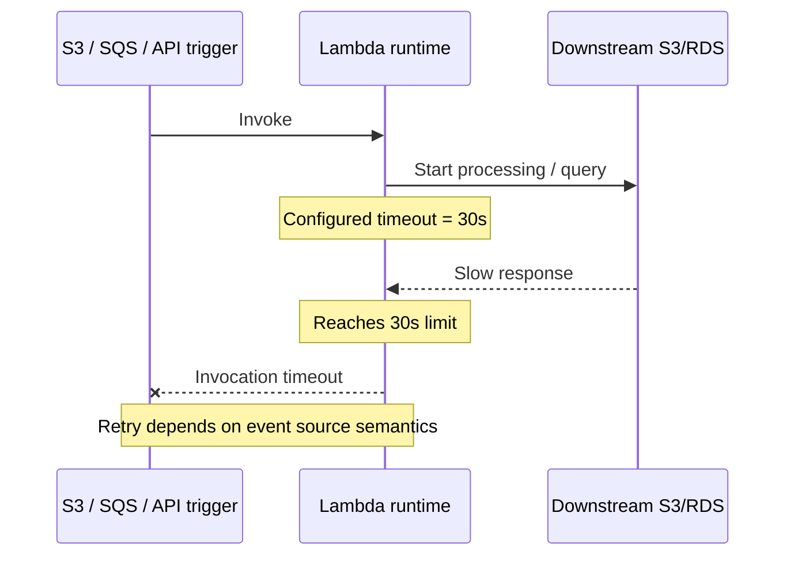
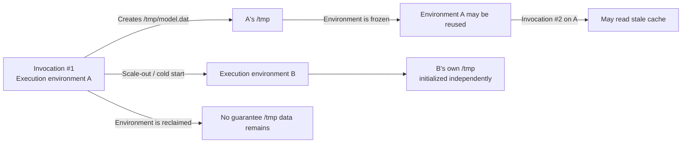
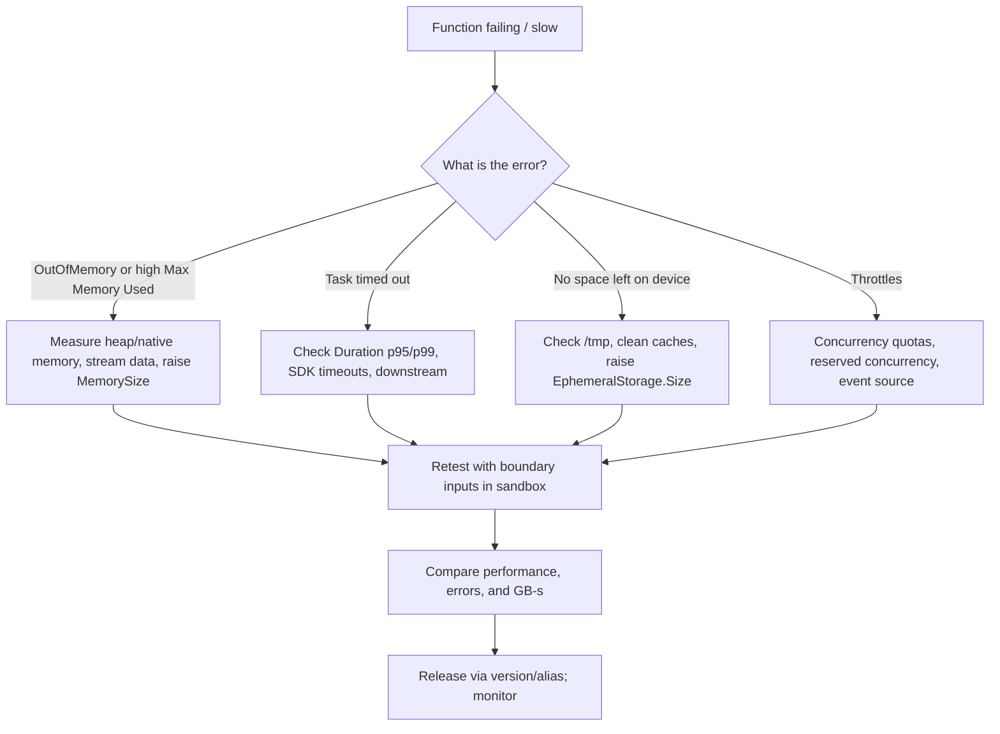

# Memory, CPU, Timeout, and Ephemeral Storage

> **Module:** CLOUD_PROVIDERS_AWS  
> **Chapter:** Lambda Compute  
> **Topic:** Configuring AWS Lambda execution resources, performance optimization, temporary data safety, execution time limits, and cost control.  
> **Audience:** Java/Spring Boot developers and operators running serverless applications on AWS.

> **Scope and timeline:** This lesson focuses on **standard AWS Lambda Event Functions** (the one-invocation-per-execution-environment-at-a-time model). Common limits in this lesson were checked against AWS documentation as of **20/11/2026**. AWS now offers newer models such as **Lambda Managed Instances**, **Lambda Web Functions**, and certain accelerator-enabled configurations, so **do not use standard Event Function limits to draw conclusions for every Lambda product**. For example, certain invocations on Lambda Managed Instances can be configured up to **5,400 seconds (90 minutes)**; specialized accelerator configurations may allow ephemeral storage up to **32,768 MB**. Always check the dedicated documentation and quotas when using those features.

## 1. Problem Statement: Same Lambda Function, Different Resource Configurations

A course management system receives CSV files via Amazon S3. S3 triggers a **Lambda function** written in Java to:

1. Download the file from S3.
2. Decompress and parse the data.
3. Generate a PDF or CSV summary.
4. Upload the result to S3 and update processing status in DynamoDB.
5. Emit logs and metrics to Amazon CloudWatch.

With small datasets, the function finishes in a few seconds. With larger files, one or more failures occur:

- `Runtime.OutOfMemory` or the container is terminated by the system for running out of RAM.
- Parsing takes a long time even though heap usage is low because **CPU is scarce**.
- Invocations fail due to exceeding the **timeout**.
- Writing files to `/tmp` throws `No space left on device` even while the function still has free RAM.
- Increasing memory lowers execution duration, yet it is unclear whether **total cost** went up or down.
- One invocation succeeds due to a cache in `/tmp`, while the next invocation on a fresh environment fails because the code relied on an existing temp file.

To operate effectively, you must understand four **related yet distinct** dimensions.

| Resource | AWS setting | What does it cap or control? |
|---|---|---|
| **Memory** | `MemorySize` | Runtime RAM budget of the execution environment and, indirectly, allocated CPU. |
| **CPU** | Scales with `MemorySize` on standard Lambda Event Functions | Compute processing power; there is no independent `Cpu: 2` field in standard configuration. |
| **Timeout** | `Timeout` | Maximum duration allowed per invocation before Lambda terminates execution. |
| **Ephemeral storage** | `EphemeralStorage.Size` | Writable temporary filesystem capacity at `/tmp`, **not RAM** and not durable storage. |

**Lesson goal:** Choose configurations suited to the workload, benchmark with evidence, protect data, and operate Lambda within AWS infrastructure alongside IAM, VPC, S3, databases, monitoring, retries, and cost control.

## 2. Overview of Standard Lambda Event Function Limits

| Parameter | Default | Supported configuration range | Notes |
|---|---:|---:|---|
| **Memory** | **128 MB** | **128–10,240 MB**, 1 MB increments | CPU scales with memory. |
| **CPU** | Proportional to default memory | Equivalent to roughly **1 vCPU at 1,769 MB**, up to roughly **6 vCPUs at 10,240 MB** | CPU cannot be set independently in standard Event Functions. |
| **Timeout** | **3 seconds** | **1–900 seconds**, 1-second increments | 900 seconds = 15 minutes. |
| **Ephemeral storage** | **512 MB** | **512–10,240 MB**, 1 MB increments | Applies to `/tmp`, encrypted at rest. |
| **Concurrent invocations** | Per account/Region quota | Governed by quotas, reserved/provisioned concurrency, and scaling behavior | Each execution environment has its own `/tmp`. |

**Units:** Lambda documentation and the Console use the label `MB`, while AWS quota docs define `MB` as **1,024 KB**. When calculating cost or capacity, check the exact unit used by the service to avoid mixing **MB, MiB, GB, GiB**, and billing units.

**Newer exceptions:** With **Lambda Managed Instances**, certain asynchronous/event source mapping invocations support timeouts up to 90 minutes, **excluding specific event sources** such as Amazon MQ and Amazon DocumentDB. Those environments configure resources differently. **Lambda Web Functions** also have their own CPU/request timeout modes. From here onward, all sample commands target **standard Event Functions**.

## 3. The Right Mental Model: More Memory Means More CPU

On standard Lambda Event Functions, AWS allocates **CPU power proportionally to configured memory**. Therefore:

- A function using only 150 MB of RAM can still run **very slowly** at 256 MB if it parses JSON, compresses data, or computes cryptographic signatures.
- Raising memory from 512 MB to 2,048 MB adds not only RAM capacity but also allocated CPU.
- More memory can shrink **execution duration**, sometimes reducing **GB-second cost** if the duration drop is large enough.
- More memory will not help by itself if the bottleneck is a database lock, a slow downstream API, waiting on S3/network, or inefficient sequential code.

### 3.1. Reference CPU Milestones

AWS documents that at roughly **1,769 MB**, Lambda provides CPU power equivalent to **one vCPU** (one vCPU-second of compute per second). At **10,240 MB**, a standard Event Function can utilize roughly **6 vCPUs**.

| Configured memory | Accurate interpretation of CPU |
|---:|---|
| 128 MB | Very little CPU power; suited for ultra-lightweight event routing. |
| 512 MB | More CPU than 128 MB, though not guaranteed sufficient for heavy ETL. |
| 1,769 MB | Reference point for roughly **1 vCPU**. |
| 2,048–4,096 MB | More CPU cores/capacity; multi-threaded code can benefit if genuinely parallelizable. |
| 10,240 MB | Highest in the standard range; up to roughly **6 vCPUs**. |

**Do not assume:** Doubling memory **guarantees** application speed doubles. Actual results depend on CPU utilization, I/O, JVM startup, networking, algorithms, thread count, and test data.

### 3.2. Different Bottleneck Types

| Symptom | Likely bottleneck | Where to investigate |
|---|---|---|
| `Max Memory Used` near `Memory Size`, OOM | Insufficient RAM or memory leak | Heap, native memory, buffers, libraries, extensions |
| Plenty of RAM left, yet compression/parsing is slow | Insufficient CPU | Compare duration across multiple `MemorySize` values |
| Increasing memory does not reduce duration | Waiting on I/O or dependencies | S3/RDS latency, retries, VPC connectivity |
| Download is fast, but PDF generation is slow | CPU/libraries/GC | Profiling, CPU/memory tuning |
| Function times out only on large inputs | Input size, algorithm, or downstream | p95/p99 data, max workload, timeouts |
| `No space left on device` in `/tmp` | Insufficient ephemeral disk | Monitor free space, cleanup, increase storage |
| Low memory usage, yet disk is full | RAM and disk must be separated | Increase `EphemeralStorage.Size` or stream data |

### 3.3. Java/Spring Boot and CPU

With Java:

- **Cold starts** may load classes, initialize dependency injection, warm up JVM/JIT, and build clients.
- Excessive libraries increase init time and memory footprint.
- JSON parsing, PDF generation, compression, encryption, and image processing can become CPU-bound.
- `-Xmx` only bounds the Java heap, not total process RAM (metaspace, thread stacks, native allocations, and extensions also consume memory).
- Adding threads will not help if Lambda lacks corresponding CPU allocation or the work has no true parallelism.

**Never set `-Xmx` equal to the entire `MemorySize`**: the runtime still needs native memory, JVM metadata, threads, and AWS extensions. Use memory profiling in the target environment instead of one hard-coded number for every app.

## 4. Choose Memory by Experimentation, Not Guesswork

Suppose a Java function processes a 20 MB CSV file. Measure a set of configurations with the **exact same input and downstream resources**:

| Memory | *Hypothetical* observed duration | *Hypothetical* GB-seconds per invocation | Observation |
|---:|---:|---:|---|
| 512 MB | 9.0 s | 0.5 × 9.0 = **4.5 GB-s** | Slower; CPU may be constrained. |
| 1,024 MB | 5.0 s | 1 × 5.0 = **5.0 GB-s** | Faster, slightly higher GB-s. |
| 2,048 MB | 2.2 s | 2 × 2.2 = **4.4 GB-s** | Fast and potentially cheaper than 512 MB in compute GB-s. |
| 4,096 MB | 1.9 s | 4 × 1.9 = **7.6 GB-s** | Small speed gain relative to the jump in compute GB-s. |

**These numbers are illustrative, not an AWS benchmark.** They simply show why the optimal configuration balances latency and cost. They also exclude request fees, initialization, Provisioned Concurrency, ephemeral storage, networking, S3, or specialized features.

### 4.1. How to Conduct Tuning

1. Define target **p95/p99 latency**, throughput, and cost objectives.
2. Prepare a realistic test suite: small, medium, large, edge-case, and malformed inputs.
3. Run a baseline at current memory; record duration, errors, memory, cold starts, GB-s, and downstream impact.
4. Test multiple settings (e.g., 512, 1,024, 2,048, 3,008, 4,096 MB); change one variable group at a time.
5. Compare cost per invocation, p95/p99, OOMs, and timeouts — not average duration alone.
6. Pick a configuration that **meets SLOs** at an acceptable cost, leaving headroom for growth.
7. Track configurations in CI/CD/IaC, monitor post-deploy, and re-benchmark whenever code or dependencies change.

The open-source [AWS Lambda Power Tuning](https://github.com/alexcasalboni/aws-lambda-power-tuning) tool uses Step Functions to test memory allocations. **Caution:** It actually invokes your function in your AWS account, which can call APIs and incur side effects/costs. Run it only against sandbox data, idempotent tasks, or mocked dependencies.

### 4.2. When to Increase Memory Instead of Timeout

- **CPU-bound:** Increasing memory can speed up processing and reduce timeout risk.
- **Memory-bound:** Increasing memory prevents OOMs; also fix leaks or adopt streaming/buffering where needed.
- **I/O-bound:** Configure HTTP/database timeouts and handle retries; raising memory alone may fix nothing.
- **Data-bound:** If payloads exceed what fits cleanly in a single invocation, split into smaller batches, use SQS, Step Functions, or AWS Batch/ECS rather than maxing out memory and timeout.

## 5. Timeout: Maximum Duration of One Invocation

**Timeout** is the maximum duration AWS Lambda allows an invocation to run before stopping it. For standard Event Functions:

- Default: **3 seconds**.
- Configurable range: **1–900 seconds**, in 1-second increments.
- 900 seconds = **15 minutes**.
- When exceeded, the invocation ends with a **timeout error**, which may trigger retries or failure handling depending on the caller.

### 5.1. Timeline When a Function Times Out



A timeout error **does not mean external operations were rolled back**. For instance, Lambda may have written an RDS record successfully and then timed out while updating status. If the event is retried, the function may write duplicates unless guarded by an **idempotency key, unique constraint, or transaction**.

### 5.2. Estimating a Reasonable Timeout

Do not see an 8-second average duration and set a 9-second timeout. Account for:

- Realistic large input sizes and p95/p99 distributions.
- Cold starts and library initialization in the relevant environments.
- Maximum acceptable latency of downstream S3/RDS/HTTP calls.
- AWS SDK and HTTP client retry counts and backoff delays.
- Time needed to upload results, commit transactions, and clean up.
- Caller limits (API Gateway, ALB, client timeouts, SQS visibility, Step Functions).

For example, if a job typically runs in 15–20 seconds but can reach 45 seconds on large inputs, testing a **60–90 second** timeout is a reasonable hypothesis to benchmark, not a guarantee. For synchronous APIs, clients may time out sooner than Lambda and consider the request failed even while Lambda keeps running.

### 5.3. Timeouts Across Layers

| Layer | Timeout or deadline | Risk if ignored |
|---|---|---|
| Lambda function | `Timeout` | Runtime terminated when exceeded. |
| HTTP client / AWS SDK | Connect/read/API call timeout | One stalled DB/API request consumes the entire invocation budget. |
| API Gateway or ALB | Integration/idle timeout per integration type | Users receive a timeout before Lambda finishes. |
| Database | Statement/transaction/connect timeout | Locks or slow queries linger. |
| SQS | Message visibility timeout | Message becomes visible again before Lambda finishes processing. |
| Step Functions | Task timeout/heartbeat per workflow | Workflow handles timeouts/retries differently from Lambda. |
| Browser/mobile client | Request timeout and retry policy | Can submit duplicate requests if idempotency is missing. |

**Avoid assuming a single fixed HTTP timeout** across all API Gateway/ALB setups, as limits vary by API type, integration mode, and active quotas. Check the exact service documentation before designing multi-minute endpoints.

### 5.4. Using Remaining Time Budget in Java

The AWS Lambda Java `Context` provides `getRemainingTimeInMillis()` so the application knows how much time remains before expiration.

Example:

```java
long remainingMs = context.getRemainingTimeInMillis();

if (remainingMs < 5_000) {
    // Do not start new work without enough remaining time budget.
    throw new IllegalStateException("Not enough time to start another step");
}
```

For multi-step pipelines, enforce an **internal deadline** ahead of the AWS timeout so you still have time to upload checkpoints or record state. Still, **never assume `finally` will always run on a hard timeout**: the platform can terminate the invocation before cleanup finishes.

## 6. Ephemeral Storage: `/tmp` Is Neither RAM Nor S3

AWS Lambda provides a temporary **`/tmp`** filesystem for each **execution environment**.

- Default **512 MB**, configurable up to **10,240 MB** on standard Event Functions.
- Configurable in **1 MB** increments.
- Storage is **disk space**, not Java heap or memory allocation.
- Data in `/tmp` is **encrypted at rest using AWS-managed keys**.
- Different execution environments **do not share the same `/tmp` directory**.
- Data may **persist into the next invocation if Lambda reuses the same environment**, but long-term persistence is **not guaranteed**.

### 6.1. `/tmp` Lifecycle Diagram



**Key rule:** *Warm reuse may preserve temporary files; cold starts or another environment cannot assume those files exist.* For caches, always implement **cache miss → reload/rebuild from a trusted source**.

### 6.2. Usage Examples

| Workload | Temporary files in `/tmp` | Where durable data should live |
|---|---|---|
| Read 1 GB CSV, compute aggregates | Temp input, intermediate files | S3 input and output |
| Generate PDF reports | Images, fonts, temp PDF | S3 output |
| Image/video processing | Frames, resized images, audio segments | S3 originals and results |
| Small ML inference | Model cache or tokenizer | S3 or managed model repository |
| Extract archives | Temporary files while unzipping | S3, or EFS if shared access is needed |
| Logs/audit trails | Short-lived flush buffer | CloudWatch Logs/S3/logging service |
| Secrets/API tokens | **Avoid writing to temp files** | Secrets Manager/SSM Parameter Store, IAM roles |

### 6.3. `/tmp` Is Not Container Image or Deployment Package Size

For **container image Lambdas**, the image filesystem is mostly read-only at runtime; `/tmp` is the standard writable scratch space. **Increasing `EphemeralStorage.Size` does not raise container image or ZIP package limits**, nor does it enlarge the Java heap.

Distinguish these resources:

- **Lambda function code/layers:** supplied via deployment, not scratch space for outputs.
- **Memory:** runtime RAM.
- **`/tmp`:** local scratch space isolated per execution environment.
- **Amazon EFS:** networked, shared, persistent filesystem per configuration; requires matching VPC/access points/IAM/networking.
- **Amazon S3:** object storage for durable inputs/outputs; accessed via API rather than treated as a local block disk.

## 7. How Much Ephemeral Storage Should You Provision?

For a typical job, total scratch required is often larger than the raw input size:

```text
Estimated scratch capacity
= downloaded input
+ extracted files
+ intermediate/sort/temporary files
+ output before upload
+ buffers and safety margin
```

**Illustrative estimate** example:

| Component | Assumed size |
|---|---:|
| Compressed input from S3 | 300 MiB |
| Extracted data | 1,100 MiB |
| Intermediate sort files | 700 MiB |
| Pre-upload output | 150 MiB |
| Margin | 500 MiB |
| **Projected total** | **2,750 MiB** |

In that scenario, `EphemeralStorage.Size=3072` or higher is a candidate to test in sandbox; you still must verify real maximum input sizes, concurrent open files, libraries, runtime duration, and cost. Do not blindly assign 10,240 MB to every Lambda “just in case” when unnecessary.

### 7.1. Distinguishing Disk-Full from Out-of-Memory

| Error | Diagnostic hint |
|---|---|
| `No space left on device` | `/tmp` filesystem is full; check `Files.getFileStore(...).getUsableSpace()`; inspect leftover/cache files. |
| `java.lang.OutOfMemoryError: Java heap space` | Java heap exhausted or leaking; increase memory appropriately, use streaming/chunking. |
| Runtime exited / out of memory | Total runtime + extension memory exceeded limit; not necessarily just heap. |
| `Permission denied` writing file | Wrong path/permissions; write only to supported writable locations. |
| File missing on next invocation | New environment or cleared cache; must regenerate/re-fetch data. |
| Stale file from prior invocation | Environment reuse; scope filenames by invocation, clean up, never mix tenant data. |

### 7.2. Concurrency and `/tmp`

With standard Event Functions, each concurrent invocation uses its own execution environment.

Suppose:

- `EphemeralStorage.Size=5120` MB per environment.
- Lambda scales to **100 concurrent invocations**.

The platform spins up **100 environments each with independent `/tmp` space**, rather than one shared 5 GiB volume across all 100 invocations. There is no guarantee all 100 environments already hold a pre-loaded model cache; each environment may download the model separately from S3.

Consequences:

1. Warm-up time and S3 GET counts can spike as concurrency rises.
2. The same model file may be downloaded repeatedly across many environments.
3. Never use `/tmp` to coordinate locks or shared state across concurrent invocations.
4. If multiple processes/threads inside **one environment** write files, guard against race conditions.

## 8. Java Example: Using `/tmp` Safely and Checking Remaining Time

The example below uses the **AWS Lambda Java runtime** with `RequestHandler`. It creates a temp file, checks remaining disk space, avoids hardcoded credentials, and cleans up the file along normal success/error paths.

```java
package com.example.lambda;

import com.amazonaws.services.lambda.runtime.Context;
import com.amazonaws.services.lambda.runtime.RequestHandler;

import java.io.IOException;
import java.io.UncheckedIOException;
import java.nio.charset.StandardCharsets;
import java.nio.file.Files;
import java.nio.file.Path;
import java.util.Map;

public final class ScratchHandler
        implements RequestHandler<Map<String, Object>, Map<String, Object>> {

    private static final Path SCRATCH = Path.of("/tmp");

    @Override
    public Map<String, Object> handleRequest(
            Map<String, Object> event, Context context) {

        if (context.getRemainingTimeInMillis() < 5_000) {
            throw new IllegalStateException(
                "Too little time remaining to process event");
        }

        Path tempFile = null;

        try {
            long usableBytes = Files.getFileStore(SCRATCH).getUsableSpace();
            if (usableBytes < 20L * 1024 * 1024) {
                throw new IllegalStateException(
                    "Insufficient scratch space in /tmp");
            }

            // Unique name per invocation to avoid overwriting old caches/files.
            tempFile = Files.createTempFile(
                SCRATCH, "request-" + context.getAwsRequestId() + "-", ".txt");

            Files.writeString(
                tempFile,
                "temporary report output\n",
                StandardCharsets.UTF_8);

            long bytes = Files.size(tempFile);
            context.getLogger().log("scratch.bytes=" + bytes);

            // Production: upload output to S3, verify result,
            // only then report job success.
            return Map.of(
                "requestId", context.getAwsRequestId(),
                "outputBytes", bytes,
                "remainingMs", context.getRemainingTimeInMillis());

        } catch (IOException io) {
            throw new UncheckedIOException(io);

        } finally {
            if (tempFile != null) {
                try {
                    Files.deleteIfExists(tempFile);
                } catch (IOException cleanupError) {
                    context.getLogger().log(
                        "Failed to clean scratch file: "
                        + cleanupError.getClass().getSimpleName());
                }
            }
        }
    }
}
```

**Build requirements:** The Java project needs **`com.amazonaws:aws-lambda-java-core`** and a deployment packaging setup matching the runtime. If using Maven, verify the Java version and artifact layout. The code above is a minimal business example, **not a complete Maven project**.

**Safety notes:**

- `finally` runs during normal control flow, **not reliably when Lambda forcefully terminates on timeout, OOM, or crash**.
- When execution environments are reused, old files can remain; enforce age/size/job-scoped naming and cleanup policies.
- Never log personal data or secrets; the example logs only byte count.
- If an output file must be durable, upload it to S3/EFS before returning success.
- Never pass unvalidated S3 keys or user-supplied filenames straight into `/tmp` paths without normalization/validation, to prevent path traversal.
- Application memory and disk space are independent resources.

### 8.1. Java Patterns for Processing Large S3 Objects

When reading a 500 MiB S3 object, **do not always `getObject()` into one giant `byte[]`** held in Java heap. Two approaches work better:

1. **Streaming:** Use AWS SDK for Java 2.x `ResponseInputStream<GetObjectResponse>` and process in chunks.
2. **Scratch file:** Download to `/tmp/input-<request-id>` if a library requires random file access, generate output, and upload to S3.

In both cases, ensure:

- The IAM execution role grants `s3:GetObject`/`s3:PutObject` on the required prefix.
- Object size and available scratch space are checked before downloading.
- SDK read/connect timeouts stay well below remaining Lambda time budget.
- Checksums, byte counts, or manifests are verified if business logic requires them.
- Download success is never treated as job success until results are written to a durable destination.

### 8.2. Never Mix Tenant Data in Caches

Execution environments can be reused across invocations. If a handler serves multiple tenants, avoid:

- Hardcoding `/tmp/input.csv` and reading it back without verifying owner/data identity.
- Assuming data is wiped clean just because the handler returned.
- Reading stale caches lacking versions, checksums, or TTLs.
- Writing tokens, passwords, or user content into global static variables or unisolated temp caches.

Safer approach: use controlled tenant/job-scoped keys, verify source checksums/versions, restrict permissions, delete on completion, and keep durable state in purpose-built datastores.

## 9. Configuring All Three Parameters via AWS Console

A sandbox workflow for an **Event Function**:

1. Open **AWS Lambda Console → Functions** and select the right Region.
2. Choose an existing function you are authorized to modify.
3. Open **Configuration → General configuration → Edit**.
4. Set **Memory**, e.g., `2048 MB`.
5. Set **Timeout** to `120 seconds`.
6. Set **Ephemeral storage** to `3072 MB`.
7. Review cost and configuration impact before clicking **Save**.
8. Wait for Lambda to finish updating configuration; confirm update success.
9. Run sandbox invocations with small, medium, and large inputs and inspect CloudWatch Logs/metrics.
10. Record results and tune based on measurements rather than leaving experimental values in place forever.

**Never test maximum 10 GiB RAM and 10 GiB `/tmp` directly in production just to test the API.** Config changes affect runtime/cost/latency; teams should use aliases and controlled release pipelines.

### 9.1. Changing Memory Can Alter Execution Duration

If an API calls Lambda synchronously, after changing memory:

- Observe cold-start times and warm durations.
- Verify there are no RAM, GC, or native library errors.
- Check API Gateway/ALB/client deadlines.
- Inspect concurrent invocations, errors, and downstream behavior.
- Compare cost **per successful request**, not just the price of a higher memory tier.

## 10. AWS CLI: Reading and Updating Configuration

The commands below must only target functions you are authorized to manage. Names are illustrative.

### 10.1. Read Current Configuration (Read-Only)

```bash
aws sts get-caller-identity

aws lambda get-function-configuration \
  --function-name course-report-worker \
  --region ap-southeast-1 \
  --query '{Memory:MemorySize,Timeout:Timeout,TempMB:EphemeralStorage.Size,Runtime:Runtime,Status:LastUpdateStatus}' \
  --output json
```

Reading configuration reveals active settings. If the function serves traffic via a **published version/alias**, inspect the actual version being triggered; **do not assume `$LATEST` configuration is what Production runs**.

### 10.2. Update Memory, Timeout, and `/tmp`

Example for **POSIX/bash shells** (note that JSON quoting in PowerShell may need adjustment):

```bash
aws lambda update-function-configuration \
  --function-name course-report-worker \
  --memory-size 2048 \
  --timeout 120 \
  --ephemeral-storage '{"Size":3072}' \
  --region ap-southeast-1
```

Then:

```bash
aws lambda wait function-updated \
  --function-name course-report-worker \
  --region ap-southeast-1

aws lambda get-function-configuration \
  --function-name course-report-worker \
  --region ap-southeast-1 \
  --query '{Memory:MemorySize,Timeout:Timeout,TempMB:EphemeralStorage.Size,Update:LastUpdateStatus}' \
  --output table
```

Do not fire back-to-back `update-function-configuration` calls while an update is still in progress. Watch for errors such as invalid config, quota exceeded, or insufficient IAM permissions.

### 10.3. Impact on Versions and Aliases

Lambda **published versions** store code and most configuration **immutably**, including memory, timeout, and ephemeral storage. CLI updates normally modify **`$LATEST`**, not the published version currently pointed to by a Production alias.

Standard workflow:

1. Update code/config on `$LATEST`.
2. Test the unpublished version or a sandbox environment.
3. **Publish a new version** once results meet expectations.
4. Shift the **alias** or update the event source to target the new version per your deployment strategy.
5. Monitor metrics and keep a rollback plan to the prior stable version.

**Do not expect** changing memory on `$LATEST` to automatically update invocations routed via an alias to an older published version.

## 11. AWS SAM: Configuring Resources with Infrastructure as Code

AWS SAM lets you declare function configuration in source control, reducing Console vs. CI/CD drift.

Sample `template.yaml` for a Java function:

```yaml
AWSTemplateFormatVersion: '2010-09-09'
Transform: AWS::Serverless-2016-10-31
Description: Course report worker example

Resources:
  CourseReportWorker:
    Type: AWS::Serverless::Function
    Properties:
      FunctionName: course-report-worker
      CodeUri: .
      Handler: com.example.lambda.ScratchHandler::handleRequest
      Runtime: java21
      Architectures:
        - arm64
      MemorySize: 2048
      Timeout: 120
      EphemeralStorage:
        Size: 3072
      Environment:
        Variables:
          APP_MODE: demo
```

This is a **configuration template for a project with appropriate Maven/Gradle/packaging**, not a complete source project. Some native Java dependencies must be compiled for `arm64`. Using the SDK, CloudWatch, or S3 in practice also requires properly scoped IAM roles/policies and triggers — never admin roles.

Typical deployment flow:

```bash
# Run at the project root containing template.yaml and the build tool.
sam validate
sam build
sam deploy --guided
```

**Note:** `sam local invoke`/Docker helps verify business logic, but **does not accurately emulate real AWS Lambda CPU, cold starts, timeouts, or costs**. Benchmarks require invocations in an actual AWS environment using non-sensitive data.

### 11.1. Choosing CPU Architecture

AWS Lambda Event Functions support architectures such as `x86_64` and `arm64`. Choose based on:

- Whether native libraries (JNI, image/PDF processing) are built for the target architecture.
- Real CPU throughput for your workload.
- GB-second pricing for each architecture by Region and feature.
- Compatibility with runtimes, layers, extensions, and container images.

**Do not switch architectures and compare durations directly if code or native dependencies differ.** Test both correctness and performance.

## 12. CloudWatch: Telling Whether RAM, CPU, or Time Is Scarce

AWS Lambda automatically sends standard metrics to **Amazon CloudWatch**, including:

| Metric | What to inspect |
|---|---|
| `Invocations` | Number of invokes; not equal to unique events if retries happen. |
| `Duration` | Invocation execution time; watch p95/p99 and Max. |
| `Errors` | Failed invocations (including runtime errors and timeouts). |
| `Throttles` | Invocations rejected due to concurrency/scaling limits. |
| `ConcurrentExecutions` | Concurrency usage per account/function across dimensions. |
| `AsyncEventAge` or event source mapping metrics | Queue/async processing lag, analyzed by invocation source. |

Beyond standard metrics, **REPORT** lines in CloudWatch Logs typically include:

- `Duration`
- `Billed Duration`
- `Memory Size`
- `Max Memory Used`
- Optionally `Init Duration` or `Status: timeout/error` depending on runtime/log format.

**Illustrative log line** example (not live output):

```text
REPORT RequestId: example-request-id Duration: 1680.25 ms Billed Duration: 1681 ms Memory Size: 1024 MB Max Memory Used: 910 MB Init Duration: 420.00 ms
```

**Interpretation:** `Max Memory Used` of 910 MB against a 1024 MB `Memory Size` shows narrow RAM headroom. Still, a single line does not prove whether CPU is constrained or a memory leak exists; examine multiple invocations and trends over time.

### 12.1. Logs Insights: Inspecting Memory and Duration

On Lambda log groups with **auto-discovered REPORT fields**:

```sql
fields @timestamp, @duration, @billedDuration, @memorySize, @maxMemoryUsed
| filter @type = "REPORT"
| sort @timestamp desc
| limit 50
```

To inspect duration trends:

```sql
filter @type = "REPORT"
| stats count(*) as invokes,
        avg(@duration) as avgDurationMs,
        pct(@duration, 95) as p95DurationMs,
        max(@duration) as maxDurationMs
  by bin(5m) as timeBucket
| sort timeBucket asc
```

Auto-discovered fields can vary by log format and function type; if a query returns nothing, inspect `@message` and actual field names rather than assuming Lambda stopped logging.

### 12.2. Are `/tmp` Disk Metrics Built In?

There is no default standard CloudWatch metric reporting **free `/tmp` bytes** for every Lambda function. If a workload needs scratch space monitoring, the application can emit custom metrics or use Lambda Insights/telemetry configured accordingly.

Java example:

```java
long freeBytes = Files.getFileStore(Path.of("/tmp")).getUsableSpace();
context.getLogger().log("tmp.free.bytes=" + freeBytes);
```

To turn logs into alarms, use CloudWatch Logs metric filters, Embedded Metric Format (EMF), or cost-controlled custom metrics. Never emit high-cardinality dimensions (like per-request `requestId`), as that spikes cost and complicates management.

### 12.3. Alerts Worth Designing

- `Errors > 0` or sustained error rate above baseline.
- `Duration p95/p99` approaching the configured timeout.
- `Max Memory Used` consistently close to the limit across invocations.
- `ConcurrentExecutions` high relative to quota or any `Throttles` appearing.
- `/tmp free bytes` dropping below a safe threshold on large batches.
- DLQ/on-failure destination accumulating unprocessed events.
- Unexpected spikes in Lambda, logging, or data transfer costs after config changes.

## 13. Runbook When Lambda Hits Timeouts or OOM



### 13.1. When `Max Memory Used` Approaches MemorySize

1. Confirm whether it happens for all inputs or only specific ones.
2. Inspect heap, buffers, native libraries, extensions, and thread counts.
3. Use streaming/chunking instead of loading huge payloads into a single `byte[]`.
4. Test raising memory moderately; measure p95, GC, OOMs, and cost.
5. Check for memory leaks across warm reuse; static caches can grow unbounded.

### 13.2. When Invocations Time Out

1. Check `Duration` and see if timeouts correlate with cold starts or large inputs.
2. Measure latency to S3/RDS/external APIs and retry counts.
3. Set internal deadlines on SDK HTTP/database clients.
4. Set timeout reasonably above worst-case duration — **do not blindly set 900 seconds on every function**.
5. For unusually long jobs, split into smaller batches or move to Step Functions/ECS/Batch.
6. Ensure idempotency so retried events do not create duplicate writes.

### 13.3. When `/tmp` Fills Up

1. Check current `EphemeralStorage.Size`.
2. Measure bytes downloaded, extracted, written as output, and left behind.
3. Clean up unneeded files in `finally` under normal execution paths.
4. Cap maximum input size and stream/chunk whenever possible.
5. Increase `/tmp` if the workload genuinely requires larger scratch space within Lambda's range.
6. If a large, shared, or persistent workspace is needed, evaluate **Amazon EFS or S3**.

**Warning:** Do not try to format or manually mount underlying infrastructure block devices as if Lambda were EC2. AWS Lambda manages the runtime and `/tmp`; applications simply use the provided writable space.

## 14. Timeouts and Event Source Semantics

Resource settings must match the **invocation source**. Events are not retried identically across all triggers.

| Invocation source | Behavior to watch | Design consideration |
|---|---|---|
| API Gateway / ALB / sync invoke | Client sees an error on integration timeout or Lambda timeout. | Cap response time, set deadlines, offload long work to async jobs. |
| S3 Event Notifications | Asynchronous processing, duplicate delivery possible. | Idempotency by object key/version/ETag, destinations/DLQ where suitable. |
| SQS event source mapping | Receives batches, message visibility timeout, and retries. | Tune batch size, visibility, partial batch failures, and DLQ. |
| DynamoDB Streams / Kinesis | Batch/iterator age, per-shard ordering, and retries. | Manage checkpoints, batching windows, and idempotency. |
| EventBridge | Retries/delivery depend on target and event bus config. | DLQ/retry policies, duplicate event handling. |
| Step Functions | Workflow has its own retries, catches, and deadlines. | Break big jobs into small steps; persist state in workflow or durable stores. |

### 14.1. Crucial Example: SQS Visibility Timeout

Per AWS guidance, when an **SQS queue feeds a Lambda Event Function**, set the queue's visibility timeout to **at least 6 times the Lambda function timeout**, plus the batching window if configured.

Example:

```text
Lambda Timeout             = 120 seconds
Maximum batching window    = 0 seconds
SQS visibility timeout     >= 6 × 120 = 720 seconds
```

If the batching window is 30 seconds, the recommended minimum becomes **750 seconds** in this illustrative setup.

**Explanation:** That buffer accommodates Lambda retrying batches after throttling. If visibility is too short, messages can reappear while an earlier invocation is still running. **Even with proper configuration, idempotency remains mandatory**, because event sources have *at-least-once* semantics.

### 14.2. Tasks Longer Than 15 Minutes

Unless using a specialized Lambda feature with higher limits, **a standard Event Function cannot run a single 30-minute invocation**. Options:

- Break work into small steps with **Step Functions**.
- Push jobs to **SQS** and process in small checkpointed batches.
- Use **ECS/Fargate, AWS Batch, or EC2** for long continuous compute.
- Evaluate **Lambda Managed Instances** if the workload fits the newer model/requirements and has clear justification; verify invocation source limits and deployment mechanics.

Never chain infinite self-invoking Lambda loops and call that a durable workflow; store state, deadlines, retry counts, and completion status in a proper orchestration or persistence layer.

## 15. Cost: Memory and `/tmp` Are Two Separate Components

In standard Lambda pricing, total cost typically considers:

1. **Requests:** invocation counts billed under account/tier terms.
2. **Compute duration:** billed duration × configured memory, typically measured in **GB-seconds** with variations by architecture, feature, and Region.
3. **Additional ephemeral storage:** capacity configured **above the 512 MB free baseline** × execution duration, also billed in **GB-seconds**.
4. **Provisioned concurrency / SnapStart / other features if enabled:** separate pricing models.
5. **CloudWatch Logs, X-Ray, S3, DynamoDB, NAT/VPC endpoints, and data transfer:** billed separately by each service.

### 15.1. GB-Second Example for Memory

Suppose a function uses **2,048 MB (2 GiB)**, runs for an average of **3 seconds**, and is invoked **100,000 times**:

```text
Compute (converted to GiB-seconds for illustration)
= 2 GiB × 3 seconds × 100,000
= 600,000 GiB-seconds
```

This is a **hypothetical compute volume**, not a USD dollar figure. Real billing depends on AWS billed duration rounding, feature-specific init billing, free tier, tiered pricing, and Region/architecture rates.

### 15.2. GB-Second Example for `/tmp`

The same function configures **5,120 MB (5 GiB) of ephemeral storage**. The baseline **512 MB (0.5 GiB)** is included at no extra storage fee.

```text
Additional ephemeral storage
= 5 GiB - 0.5 GiB
= 4.5 GiB

Additional ephemeral storage usage
= 4.5 GiB × 3 seconds × 100,000
= 1,350,000 GiB-seconds
```

The GB-second unit rate for ephemeral storage **differs** from the compute GB-second rate; do not multiply storage by the compute rate. The calculation above also excludes differences if invocations have distinct billed durations or init billing.

**Increasing `/tmp` without increasing `MemorySize`** expands scratch capacity without adding CPU or RAM. **Increasing `MemorySize` without increasing `/tmp`** can speed up parsing while still running out of disk when unpacking large archives.

### 15.3. Three Common Cost Mistakes

- **Mistake 1:** Assuming lowest memory is always cheapest. A CPU-bound function at low memory can run so long that its GB-s exceeds a higher-memory setting.
- **Mistake 2:** Assuming 10 GiB `/tmp` is free because it is temporary. AWS charges for **configured storage beyond 512 MB** multiplied by billed duration at the applicable rate.
- **Mistake 3:** Counting only Lambda charges while ignoring S3 requests, network/NAT, CloudWatch ingestion, EFS, databases, and retries.

Compare **cost per successful job**, factoring in retry rates and target latency. Use the AWS Pricing Calculator, Cost Explorer, and Cost and Usage Reports with real metrics.

## 16. Security and Reliability When Scaling Resources

### 16.1. IAM Least Privilege

Increasing memory, timeout, or `/tmp` **does not grant AWS API permissions**. Functions rely on a dedicated **execution role** to read/write S3, DynamoDB, KMS, Secrets Manager, or CloudWatch Logs.

Example policy allowing reads from one prefix and writes to another:

```json
{
  "Version": "2012-10-17",
  "Statement": [
    {
      "Sid": "ReadInputs",
      "Effect": "Allow",
      "Action": "s3:GetObject",
      "Resource": "arn:aws:s3:::course-data-demo-123456789012/input/*"
    },
    {
      "Sid": "WriteReports",
      "Effect": "Allow",
      "Action": "s3:PutObject",
      "Resource": "arn:aws:s3:::course-data-demo-123456789012/output/*"
    }
  ]
}
```

ARNs are illustrative. If objects use SSE-KMS, check matching KMS/key policies; if listing buckets or reading Secrets Manager, add only the genuinely required actions and resources. Never attach `AdministratorAccess` as a quick fix for permission errors.

### 16.2. Sensitive Data in `/tmp`

Data in `/tmp` is encrypted at rest by AWS using AWS-managed keys, yet:

- A later invocation in the same environment **may see leftover files**.
- Another process/library running in the same environment can access the filesystem within its OS permissions.
- Never use `/tmp` as long-term storage for private information.
- Clean up files, scope names by job/tenant, validate inputs, and keep secrets out of logs.
- Data requiring backups/auditing must live in S3/RDS/CloudWatch or another durable store.

### 16.3. VPC Placement Does Not Change `/tmp`

Placing Lambda into private subnets to reach RDS/ElastiCache **does not turn `/tmp` into EBS or EFS**. The runtime still uses Lambda ephemeral storage.

Networking still must be designed properly:

- Security groups allowing TCP from Lambda ENIs to the database.
- Routes, DNS, and NAT/VPC endpoints to reach AWS APIs per the architecture.
- When a function sits inside a VPC without an outbound path, S3/API calls can time out even with a valid IAM role.
- EFS integration requires mount targets, access points, and its own permissions; it is a separate option for persistent/shared file storage.

### 16.4. Timeouts Must Be Paired with Idempotency

If a function writes partial data and then times out, downstream state can be left half-updated. Always:

1. Assign a unique job ID / idempotency key.
2. Check job state before reprocessing.
3. Write outputs to temporary keys or job-versioned prefixes.
4. Mark `COMPLETED` only after durable output is confirmed.
5. Maintain bounded retries and DLQ/on-failure destinations where supported by the event source.
6. Test host/runtime failures, timeouts, OOMs, and disk-full conditions.

## 17. Lab: Optimizing a Lambda Generating Reports from S3

**Scenario:** A Java Lambda parses CSV files and generates reports. The input suite consists of three hypothetical files:

- `small.csv` — 1 MiB.
- `medium.csv` — 50 MiB.
- `large.csv` — 400 MiB, expanding to 1,200 MiB when decompressed.

Requirements: finish successfully in **under 120 seconds on the large input**, never treat temporary storage as a source of truth, contain costs, and capture logs/metrics to explain results.

### 17.1. Lab Checklist

1. Create or use a **sandbox** function from Java source/ZIP/SAM whose execution role can only read `input/` and write `output/` in S3.
2. Read the current configuration via `get-function-configuration`; note memory, timeout, `/tmp`, and Region.
3. Run a baseline with `MemorySize=512` MB, `Timeout=30` seconds, and `EphemeralStorage.Size=512` MB on small/medium inputs; skip large input if you already know it will trigger disk-full.
4. Collect `Duration`, `Max Memory Used`, errors, input size, and remaining `/tmp` space.
5. Test `MemorySize=1024` or `2048` MB while keeping timeout/storage unchanged if the input allows, to isolate CPU impact.
6. Increase `EphemeralStorage.Size=3072` MB and test the large input in sandbox.
7. Raise timeout to `120` seconds when justified by benchmarks; verify SDK timeouts and S3 throughput.
8. Calculate GB-seconds from measured numbers; compare p95, success rate, and cost.
9. Scale concurrency safely and observe that each environment has its own `/tmp`; do not share files across invocations.
10. Intentionally induce failures in sandbox: low timeout, insufficient disk, or application exceptions; verify retries/idempotency do not produce duplicate outputs.
11. Deploy the new version through an alias/staging and monitor CloudWatch.
12. Clean up test resources or bring them back within budget per team process.

### 17.2. Results Recording Table

| Run | Input | Memory MB | Timeout s | `/tmp` MB | Duration p95 | Max Memory Used | Result | GB-s |
|---|---|---:|---:|---:|---:|---:|---|---:|
| A | small | 512 | 30 | 512 | Measure actual | Measure actual | Pass/Fail | Compute |
| B | medium | 512 | 30 | 512 | Measure actual | Measure actual | Pass/Fail | Compute |
| C | medium | 2,048 | 30 | 512 | Measure actual | Measure actual | Pass/Fail | Compute |
| D | large | 2,048 | 120 | 3,072 | Measure actual | Measure actual | Pass/Fail | Compute |
| E | large | 4,096 | 120 | 3,072 | Measure actual | Measure actual | Pass/Fail | Compute |

Never enter fabricated benchmark numbers into the table. Calculate cost from **actual billed duration and configuration**, never using laptop runtime as Lambda duration.

### 17.3. An Investigation Scenario

After increasing memory from 512 MB to 2,048 MB, p95 dropped from 18 seconds to 6 seconds, yet 2% of invocations still time out.

The team should investigate:

1. Do timeouts fall on large inputs or periods of slow RDS responses?
2. Are retries happening during S3 downloads or external API calls?
3. Are Java heap or native memory approaching limits?
4. Is `/tmp` filling up or accumulating leftover files from warm reuse?
5. How does performance differ between cold starts and warm starts?
6. Would raising the timeout address the root cause or merely hide a bug?
7. Did timed-out jobs write partial data to S3/DynamoDB?
8. Should long-running workloads move to Step Functions/ECS/Batch?

## 18. Self-Check Questions

**1. If Lambda has 512 MB memory, does `/tmp` also mean 512 MB of RAM?**  
No. Memory is the RAM budget; `/tmp` is temporary disk storage configured separately.

**2. Does changing `MemorySize` from 512 to 2,048 MB affect CPU?**  
Yes. On standard Event Functions, AWS allocates CPU proportionally to memory.

**3. Can you request exactly 2 vCPUs while keeping `MemorySize` at 128 MB via a separate CPU setting?**  
Not in the standard Event Functions model. Other Lambda modes have their own configuration mechanisms and require reading their documentation.

**4. Can a standard Lambda Event Function have a timeout of 1,800 seconds?**  
No. The standard range is 1–900 seconds. Certain Lambda Managed Instances have exceptions up to 5,400 seconds for supported invocations.

**5. Is `/tmp` shared across 20 concurrent invocations of a standard Event Function?**  
No. Each execution environment has its own `/tmp`; never use `/tmp` as a shared datastore.

**6. When a function is invoked again after 5 minutes, is a file in `/tmp` guaranteed to still exist?**  
No. The file may survive if the same warm environment is reused, but it is never guaranteed.

**7. Why can increasing `MemorySize` sometimes reduce compute GB-s cost?**  
If execution duration drops **by a greater ratio than memory increased**, the product `memory × duration` can become smaller.

**8. If code fails with `No space left on device`, will raising `MemorySize` alone reliably fix it?**  
No. You must inspect and increase ephemeral disk or reduce scratch needs via streaming.

**9. Since `/tmp` is encrypted, can you store secrets there for subsequent invocations to reuse indefinitely?**  
No. Encryption at rest does not turn `/tmp` into a durable secret store; use IAM/Secrets Manager/SSM appropriately.

**10. Does updating `$LATEST` configuration automatically change the memory of a published version pointed to by a production alias?**  
No. Published versions have immutable configuration; you must publish a new version and update the alias/deployment.

**11. Is setting the SQS visibility timeout equal to the Lambda timeout a good recommendation?**  
No. AWS recommends at least roughly **6 × Lambda timeout**, plus any configured batching window.

**12. How should a 45-minute job be handled if you are using standard Lambda Event Functions?**  
Redesign as a split workflow with queues/checkpoints, or move to ECS/Batch; evaluate specialized Managed Instances if eligible and appropriate.

**13. Can `Max Memory Used` around 50% be taken as proof that CPU is not bottlenecked?**  
No. RAM and CPU are linked in configuration, but a CPU bottleneck must be proven with duration comparisons, benchmarks, or profiling.

**14. Does increasing ephemeral storage from the 512 MB default to 5,120 MB incur charges for the extra space?**  
Yes, under Lambda's pricing model for **configured capacity above 512 MB** multiplied by billed duration.

## 19. Summary and Official References

For **standard AWS Lambda Event Functions**, *memory* controls both **RAM and CPU**, *timeout* caps invocation duration, and *ephemeral storage* provides temporary disk space in `/tmp`. Choosing good defaults requires **measuring duration, memory, errors, disk usage, concurrency, and cost**, rather than maxing out every setting. Applications must handle timeouts, retries, idempotency, and cleanup; all critical data belongs in **S3, EFS, databases, or an appropriate durable store**.

### AWS Documentation

- [AWS Lambda — Configure function memory](https://docs.aws.amazon.com/lambda/latest/dg/configuration-memory.html)
- [AWS Lambda — Configure function timeout](https://docs.aws.amazon.com/lambda/latest/dg/configuration-timeout.html)
- [AWS Lambda — Configure ephemeral storage](https://docs.aws.amazon.com/lambda/latest/dg/configuration-ephemeral-storage.html)
- [AWS Lambda — Quotas](https://docs.aws.amazon.com/lambda/latest/dg/gettingstarted-limits.html)
- [AWS Lambda — Execution environment lifecycle and reuse](https://docs.aws.amazon.com/lambda/latest/dg/lambda-runtime-environment.html)
- [AWS Lambda — Configuration troubleshooting](https://docs.aws.amazon.com/lambda/latest/dg/troubleshooting-configuration.html)
- [AWS Lambda — Best practices](https://docs.aws.amazon.com/lambda/latest/dg/best-practices.html)
- [AWS Lambda — Function versions and aliases](https://docs.aws.amazon.com/lambda/latest/dg/configuration-versions.html)
- [AWS Lambda — Monitoring metrics](https://docs.aws.amazon.com/lambda/latest/dg/monitoring-metrics-types.html)
- [AWS Lambda — Lambda with SQS event source mapping](https://docs.aws.amazon.com/lambda/latest/dg/services-sqs-configure.html)
- [AWS Lambda — Concurrency and scaling](https://docs.aws.amazon.com/lambda/latest/dg/lambda-concurrency.html)
- [AWS Lambda — Using Amazon EFS](https://docs.aws.amazon.com/lambda/latest/dg/configuration-filesystem.html)
- [AWS Lambda — AWS SAM templates for Lambda](https://docs.aws.amazon.com/serverless-application-model/latest/developerguide/sam-resource-function.html)
- [AWS Lambda — Pricing including additional ephemeral storage](https://aws.amazon.com/lambda/pricing/)
- [AWS Lambda — Lambda Managed Instances overview](https://docs.aws.amazon.com/lambda/latest/dg/lambda-managed-instances.html)
- [AWS Lambda — Lambda Web Functions](https://docs.aws.amazon.com/lambda/latest/dg/web-functions.html)

> **Takeaway:** **Memory ≠ `/tmp`.** Increasing memory adds CPU; increasing `/tmp` only expands temporary file space. Timeouts must align with real execution times, callers, retry behavior, and recovery goals. Persist important outputs in durable stores, never depend on warm caches, and optimize using real workload measurements.
