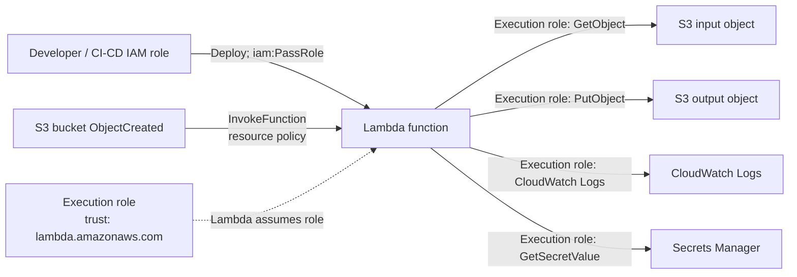
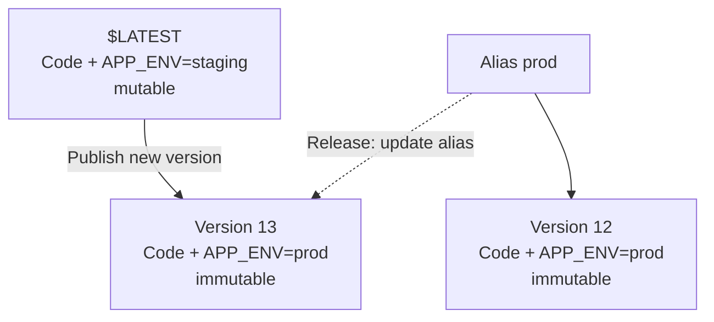
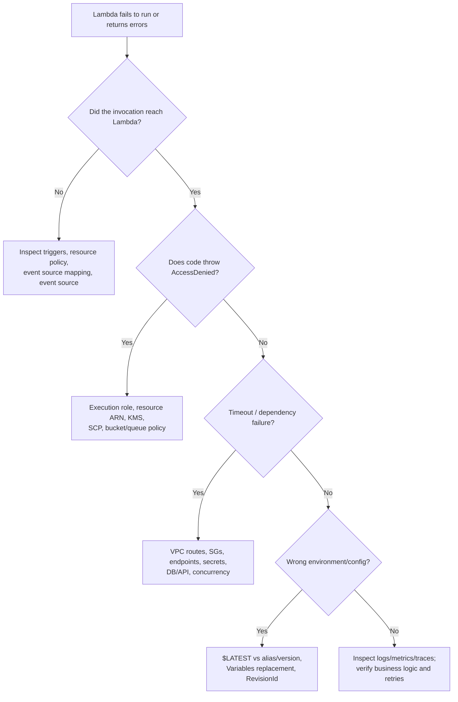
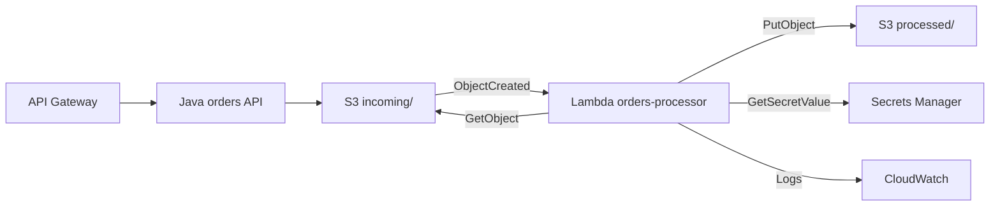

# Execution Role, Resource Policy, and Environment Configuration

## Learning Objectives

After this lesson, you can:

1. Distinguish between **execution role**, **trust policy**, **identity-based permissions policy**, **resource-based policy**, and **deployer permissions** in AWS Lambda.
2. Explain Lambda invocation flows from APIs, S3, EventBridge, SNS, SQS, DynamoDB Streams, and cross-account principals; identify **who needs invoke permission** and **who needs permission to read the event source**.
3. Create a **least-privilege** execution role allowing CloudWatch Logs writes, access to a single S3 prefix, and Secrets Manager/KMS usage when needed, avoiding `AdministratorAccess`.
4. Grant invoke permissions using a function resource policy, scoping `SourceArn` and `SourceAccount`, and distinguish policies at the **function**, **version**, and **alias** levels.
5. Configure **environment variables** within the 4 KB UTF-8 rule, understand the risk of full-map `Variables` replacement, secure them with KMS, and choose Secrets Manager/SSM Parameter Store appropriately.
6. Use the AWS CLI to read, update, and verify roles, policies, and configurations, test a function in a lab environment, and diagnose `AccessDenied`, timeouts, or missing logs.
7. Build a safe deployment plan for Java/serverless applications covering `dev/staging/prod` environments, IAM, monitoring, resilience, and cost.

## 1. Why Does Lambda Need Multiple Permission Layers?

An e-commerce service uses Lambda to process order files:

1. A user uploads `orders/incoming/order-001.json` to S3.
2. Amazon S3 emits an `ObjectCreated` event to **invoke Lambda**.
3. Lambda reads the object, writes the processed output to `orders/processed/`, and logs to CloudWatch.
4. The application needs to connect to a database inside a VPC and occasionally retrieve passwords from Secrets Manager.

These actions require **independent permissions**:

- **Can S3 invoke Lambda?** The Lambda **resource-based policy** must allow `s3.amazonaws.com` to invoke the function from that bucket.
- **Can Lambda read/write S3?** The **execution role** must grant `s3:GetObject`/`s3:PutObject` on the matching object ARNs.
- **Can Lambda write logs?** The execution role needs appropriate CloudWatch Logs permissions.
- **Can Lambda connect to a VPC?** Requires subnet/SG configuration and permissions to manage Hyperplane ENIs during setup.
- **Can Lambda retrieve secrets?** The execution role needs `secretsmanager:GetSecretValue` plus KMS permissions if the secret uses a customer-managed key.
- **Who can change the role, code, or function configuration?** The deploying principal needs administrative IAM permissions such as `lambda:UpdateFunctionConfiguration` and `iam:PassRole` within allowed boundaries.

**No single policy replaces all of these layers.** Confusing “who calls Lambda” with “what Lambda is allowed to do” is a frequent cause of `AccessDeniedException`.

### Permission Layers Diagram



The dashed line represents the **Lambda service assuming the role**, not the function arbitrarily picking an IAM role at runtime. When function code uses the AWS SDK, the SDK automatically obtains temporary credentials provided by Lambda for the execution role.

## 2. Key IAM Vocabulary

| Term | Question answered | Example |
| --- | --- | --- |
| **Execution role** | Which AWS APIs can Lambda code call while running? | Role `orders-processor-exec-role`. |
| **Role trust policy** | Which principal can **assume** the role? | `Service: lambda.amazonaws.com`. |
| **Identity-based policy** | Which actions on which resources is the role/user allowed to perform? | `s3:GetObject` on `arn:aws:s3:::company-orders-dev/incoming/*`. |
| **Resource-based policy** | Who can invoke or act upon the Lambda function? | `s3.amazonaws.com` granted `lambda:InvokeFunction` from a specific S3 bucket. |
| **Deployment role** | Who can create/modify Lambda and attach an execution role to it? | CI role with `lambda:UpdateFunctionCode`, `lambda:UpdateFunctionConfiguration`, `iam:PassRole`. |
| **Function version/alias** | Which release revision do configuration and permissions apply to? | Alias `prod` pointing to version `42`. |
| **KMS key policy** | Who or which service can use the encryption key? | Lambda and authorized principals permitted to encrypt/decrypt environment variables. |

**Two questions to remember:**

- **Execution role** answers “**Which resources can Lambda access?**”
- **Function resource policy** answers “**Who or which service is allowed to invoke Lambda?**”

In many setups, a request must also pass **multiple layers**: IAM identity policies, resource policies, AWS Organizations SCPs, permissions boundaries, explicit `Deny` statements, KMS key policies, VPC networking, and target service permissions.

## 3. Execution Role: Trust Policy and Permissions Policy

Every Lambda function must have an **execution role**. AWS Lambda **assumes that role via AWS Security Token Service (STS)** and supplies temporary credentials to your code. In practice, the SDK picks up these credentials automatically, so access keys never belong in environment variables.

### 3.1. Trust Policy: Allowing Lambda to Assume the Role

Example file `lambda-trust.json`:

```json
{
  "Version": "2012-10-17",
  "Statement": [
    {
      "Effect": "Allow",
      "Principal": {
        "Service": "lambda.amazonaws.com"
      },
      "Action": "sts:AssumeRole"
    }
  ]
}
```

The trust policy states that the **Lambda service** can assume the role; it **does not** by itself grant access to S3, DynamoDB, Secrets Manager, or CloudWatch Logs.

In AWS Lambda, an execution role should be used **only by the function**, not assumed directly by regular users. If multiple functions share a role, analyze the combined permission scope carefully; typically, **each function or tight group of functions should have its own purpose-built role** to minimize blast radius.

### 3.2. Permissions Policy: What Is Lambda Allowed to Do?

Example where Lambda only reads objects from one S3 prefix and writes outputs to another prefix, using illustrative bucket `company-orders-dev-7c4f9e2a`:

```json
{
  "Version": "2012-10-17",
  "Statement": [
    {
      "Sid": "ReadIncomingOrders",
      "Effect": "Allow",
      "Action": "s3:GetObject",
      "Resource": "arn:aws:s3:::company-orders-dev-7c4f9e2a/incoming/*"
    },
    {
      "Sid": "WriteProcessedOrders",
      "Effect": "Allow",
      "Action": "s3:PutObject",
      "Resource": "arn:aws:s3:::company-orders-dev-7c4f9e2a/processed/*"
    }
  ]
}
```

This is an identity-based policy attached to the execution role, **not a bucket policy**. It does not grant permission to list the entire bucket, delete objects, or read other prefixes. If the app calls `ListObjectsV2`, you must separately grant `s3:ListBucket` on the **bucket ARN** with an appropriate `s3:prefix` condition.

If the bucket has an **explicit Deny** policy, or objects are encrypted with SSE-KMS using a customer-managed key, the policy above may still **not be sufficient**; evaluate bucket, KMS, and other layers as well.

### 3.3. CloudWatch Logs: Minimum Permissions for Logging

The AWS-managed policy `AWSLambdaBasicExecutionRole` grants permissions to create log groups/streams and write log events to CloudWatch Logs. When creating a function in the Lambda console with a default role, AWS typically attaches this policy.

```text
logs:CreateLogGroup
logs:CreateLogStream
logs:PutLogEvents
```

Lambda usually logs to `/aws/lambda/<function-name>`. The log group name can differ when custom logging is configured. For tighter IAM scoping, pre-create the log group, grant create-stream/put-events only on that specific log group, and verify each action's ARN.

**A running function does not guarantee logs are being written:** if the role lacks logging permissions, the code can still execute while CloudWatch Logs stays empty — making incidents hard to diagnose.

### 3.4. Deployment Permissions vs. Runtime Permissions

A user or CI/CD role assigning `orders-processor-exec-role` to a function needs `iam:PassRole` scoped to that role, in addition to Lambda actions such as `CreateFunction` or `UpdateFunctionConfiguration`.

Conversely, Lambda runtime code **does not need `iam:PassRole` just to read an object**. Adding broad `iam:*` or `sts:AssumeRole` permissions to an execution role is risky and usually unnecessary.

| Principal | Reasonable permissions in this example | Should not be granted |
| --- | --- | --- |
| CI/CD deploy role | `lambda:CreateFunction`/`UpdateFunctionCode`/`UpdateFunctionConfiguration`, `iam:PassRole` on allowed execution roles. | `iam:PassRole` on `*` or `AdministratorAccess`. |
| Lambda execution role | S3 read/write on specific prefixes, CloudWatch Logs. | `s3:*` across all buckets. |
| S3 service principal | `lambda:InvokeFunction` scoped to bucket ARN and account. | DynamoDB read or IAM admin rights. |
| Direct cross-account caller | `lambda:InvokeFunction` in its own identity policy plus function resource policy allowance. | Permission to modify the function or assume its execution role. |

### 3.5. VPC Networking: ENI Permissions Are Not Network Reachability

By default, Lambda runs in a Lambda-managed VPC, not your customer VPC. To reach RDS/ElastiCache/private resources inside **your VPC**, attach VPC subnets + Security Groups and grant Lambda permission to create/manage **Hyperplane ENIs**.

The AWS-managed policy `AWSLambdaVPCAccessExecutionRole` is commonly used during setup and includes:

```text
ec2:CreateNetworkInterface
ec2:DescribeNetworkInterfaces
ec2:DescribeSubnets
ec2:DeleteNetworkInterface
ec2:AssignPrivateIpAddresses
ec2:UnassignPrivateIpAddresses
```

These permissions could potentially be invoked by Lambda code **since they sit on the execution role**, so consider constraining them with IAM conditions such as `lambda:SourceFunctionArn` or narrowing the role per AWS guidance. AWS notes that ENI permissions are required for **creation/configuration**, not on every individual invocation.

**Having IAM EC2 permissions does not mean the network has a route to the Internet or RDS.** When attaching a VPC:

- Subnets need routes to a NAT Gateway or appropriate VPC endpoints if Lambda requires Internet or AWS API access.
- Security Groups and NACLs must allow Lambda to reach the database and receive return traffic.
- Verify DNS resolution, IP capacity, DB credentials, and TLS connectivity.

Attaching Lambda to a **public subnet** does not automatically give it a public IPv4 address for Internet access. If connecting to private RDS, never make the database public just because a function timed out.

## 4. Resource-Based Policy: Who Can Invoke Lambda?

Lambda lets you attach a policy directly to a function to grant permissions to an **AWS service**, another account, or another principal. Policies can be scoped to a function, **version**, or **alias**.

### 4.1. Push Path: S3/SNS/EventBridge Invoking Lambda

Example: S3 delivering `ObjectCreated` events from `company-orders-dev-7c4f9e2a`:

```json
{
  "Version": "2012-10-17",
  "Statement": [
    {
      "Sid": "AllowS3FromSpecificBucketAndAccount",
      "Effect": "Allow",
      "Principal": {
        "Service": "s3.amazonaws.com"
      },
      "Action": "lambda:InvokeFunction",
      "Resource": "arn:aws:lambda:ap-southeast-1:111122223333:function:orders-dev-processor",
      "Condition": {
        "ArnLike": {
          "AWS:SourceArn": "arn:aws:s3:::company-orders-dev-7c4f9e2a"
        },
        "StringEquals": {
          "AWS:SourceAccount": "111122223333"
        }
      }
    }
  ]
}
```

Values are illustrative, not live resources. An **S3 bucket ARN** **does not contain an account ID**; since bucket names can be deleted and re-registered across namespaces, combine **SourceArn** and **SourceAccount** to prevent confused-deputy abuse.

- `Principal.Service`: which AWS service performs the invocation.
- `Action=lambda:InvokeFunction`: permission to invoke the function, not to modify code.
- `Resource`: the function ARN or specific alias/version ARN.
- `AWS:SourceArn`: ARN of the source resource (bucket, SNS topic, EventBridge rule).
- `AWS:SourceAccount`: account owning the source resource, especially important for S3.

**A Lambda resource policy alone does not create the trigger.** You must also configure the **S3 bucket notification**, SNS subscription, or EventBridge rule/target pointing to the exact Lambda ARN. Both sides must align.

### 4.2. AddPermission and Full Policies

You can add a single statement with `aws lambda add-permission` or manage the full JSON policy using the newer `put-resource-policy` API/CLI.

| Management method | Characteristics | Caveats |
| --- | --- | --- |
| **`add-permission`** | Adds **one Allow statement** at a time; supports common conditions like `SourceArn`, `SourceAccount`, `PrincipalOrgID`. | Cannot express arbitrary IAM conditions or explicit `Deny`. |
| **`remove-permission`** | Removes the exact statement matching `StatementId`. | Check whether other statements still permit invocation. |
| **Full JSON resource policy** (`put-resource-policy`) | Supports multiple principals/conditions and explicit `Deny`; max policy size **20 KB**. | **Replaces the entire existing policy**; read and diff before updating so valid permissions are not wiped out. |

**Never copy an overly broad `Principal: "*"` policy to production** just to get a trigger working. Grant permissions per verified service, resource, and account.

### 4.3. Function, Alias, and Version

```text
orders-dev-processor               (function ARN)
orders-dev-processor:$LATEST       (unpublished version, mutable)
orders-dev-processor:12            (published immutable version)
orders-dev-processor:prod          (alias ARN -> published version 12)
```

If you attach a policy to the **`prod` alias**, callers must invoke using the exact **qualified ARN** of that alias. The alias can later shift from version 12 to version 13 without changing the trigger target; the alias policy continues to apply.

Example:

```bash
aws lambda add-permission \
  --function-name orders-dev-processor \
  --qualifier prod \
  --statement-id AllowOrdersS3Prod \
  --action lambda:InvokeFunction \
  --principal s3.amazonaws.com \
  --source-arn arn:aws:s3:::company-orders-prod-7c4f9e2a \
  --source-account 111122223333 \
  --region ap-southeast-1
```

Then the S3 notification must target the **`:prod` alias ARN**. If the notification targets the **unqualified** function ARN, a policy attached only to the alias will not authorize that invocation.

Lambda does not support attaching policies directly to **`$LATEST`** using the `$LATEST` qualifier in `AddPermission`. For production releases, use published versions and aliases instead of triggering mutable code directly.

### 4.4. Cross-Account Invocation

If an IAM role in account B invokes a function in account A:

1. The caller in account B needs identity-based `lambda:InvokeFunction` on the target function ARN.
2. The function resource policy in account A must allow that specific principal or account B.
3. Any SCP, permissions boundary, explicit Deny, or higher-level policy can still block the call.

By contrast, a principal in the **same account** can invoke via a sufficient identity-based policy without needing a separate Lambda resource policy. AWS service principals like S3/SNS still require a resource policy so Lambda accepts their push events.

## 5. Distinguishing Push Events from Event Source Mappings

Not every trigger **calls Lambda directly** from the source service. For queues and streams, **Lambda polls the source** through an event source mapping.

| Event source | Who fetches/delivers records? | Primary permissions needed |
| --- | --- | --- |
| **Amazon S3 ObjectCreated** | S3 **pushes** notifications to Lambda. | Function resource policy for `s3.amazonaws.com`; execution role needs S3 API permissions if the function reads objects. |
| **Amazon SNS topic** | SNS **pushes** messages. | Function resource policy for `sns.amazonaws.com`, scoped to topic ARN. |
| **EventBridge rule** | EventBridge **pushes** events. | Function resource policy for `events.amazonaws.com`, scoped to rule ARN. |
| **Amazon SQS queue** | Lambda **polls** the queue via event source mapping. | Execution role needs `sqs:ReceiveMessage`, `sqs:DeleteMessage`, `sqs:GetQueueAttributes`; queue policy/KMS if cross-account or encrypted. |
| **Kinesis/DynamoDB Streams** | Lambda event source mapping **polls** streams. | Execution role needs stream/shard read and checkpoint permissions as supported; not just `InvokeFunction` on the function. |
| **API Gateway** | API Gateway **pushes** invocations. | Lambda resource policy for `apigateway.amazonaws.com` with matching `execute-api` source ARN. |

### A Wrong vs. Right SQS Example

**Wrong:** adding a resource-policy statement for `sqs.amazonaws.com` to invoke the function and waiting for Lambda to read the queue automatically.

**Right:** create an event source mapping and grant the **execution role** permissions to read and delete messages:

```bash
aws lambda create-event-source-mapping \
  --function-name orders-dev-processor \
  --event-source-arn arn:aws:sqs:ap-southeast-1:111122223333:orders-dev-queue \
  --batch-size 10 \
  --region ap-southeast-1
```

The function and SQS queue must be in the **same Region**; cross-account is possible under supported conditions. When using a queue encrypted with a customer-managed KMS key, the Lambda execution role also needs `kms:Decrypt` per the key policy. For retryable workloads, design **idempotency**, visibility timeouts, DLQs, and partial batch failure handling to prevent duplicate processing.

## 6. Environment Variables: Separating Configuration from Code

Lambda lets you define **string key/value pairs** in function configuration; the runtime exposes them to your code, for example:

```text
APP_ENV=dev
ORDERS_BUCKET=company-orders-dev-7c4f9e2a
PROCESSED_PREFIX=processed/
LOG_LEVEL=INFO
FEATURE_FLAG_V2=false
```

In Java:

```java
String env = System.getenv().getOrDefault("APP_ENV", "dev");
String bucket = System.getenv("ORDERS_BUCKET");
if (bucket == null || bucket.isBlank()) {
    throw new IllegalStateException("ORDERS_BUCKET is required");
}
```

You do not need to recompile the JAR just to change configuration values on `$LATEST`; however, when you **publish a version**, env vars and many other settings are **frozen into that version**.

### 6.1. Limits and Constraints

| Rule | Meaning |
| --- | --- |
| Keys start with a **letter** and are at least **2 characters** long. | `APP_ENV` is valid; `1_ENV` or `X` is invalid. |
| Only **letters, digits, and underscores `_`** are allowed. | Never use `db.password` or `APP-ENV`. |
| Cannot use Lambda **reserved keys**. | `AWS_REGION`, `AWS_LAMBDA_FUNCTION_NAME`, `_HANDLER`, and other runtime keys are supplied by Lambda. |
| Total size of **all env vars must not exceed 4 KB**. | Counts both keys and values; never cram large JSON configs or certificates here. |
| Values are **literal strings**, not auto-expanded. | `S3_URL=s3://$ORDERS_BUCKET/incoming` will not interpolate `$ORDERS_BUCKET`. |
| Configuration belongs to a function **version**. | Published versions are immutable; updating `$LATEST` does not alter already-published versions. |
| Updating via AWS CLI **replaces `Variables` wholesale**. | Sending only one key deletes all existing keys omitted from the request. |

Lambda-provided env vars also include `AWS_EXECUTION_ENV`, `AWS_LAMBDA_FUNCTION_VERSION`, `TZ`, etc.; values vary by runtime, version, and initialization mode. **Never put static access key IDs/secret keys into env vars** since the SDK already receives temporary credentials from the execution role.

### 6.2. `$LATEST`, Published Versions, and Aliases



An alias simply points to a **published version** and does not hold its own separate set of environment variables. If `dev` and `prod` need **different configurations** without interfering during updates, teams typically use **separate functions per environment** or publish versions with matching config and manage aliases carefully.

When you change an environment variable on `$LATEST`, the `prod` alias still runs the older published version until the alias is updated. This protects rollouts, though it can surprise anyone expecting production traffic to pick up an `$LATEST` edit immediately.

## 7. Securing Environment Variables and Secrets

By default, Lambda **encrypts environment variables at rest** using an AWS-managed KMS key. You can select a **customer-managed KMS key** if your organization needs control over key permissions, rotation, auditing, and compliance constraints.

### 7.1. KMS Does Not Make Env Vars a Proper Secret Store

Encrypting environment variables at rest **does not guarantee** they cannot be read by code, users authorized to inspect configuration, or error logs:

- Lambda code can read every env var present in the execution environment.
- Principals with permission to view function configuration and decrypt with KMS can read them under those policies.
- Values can leak if an application dumps the entire environment or prints debug output.
- Rotating a secret would require updating function config, publishing a new version, and redeploying.

AWS recommends storing **database credentials, API keys, and tokens** in **AWS Secrets Manager** instead of plaintext environment variables. **SSM Parameter Store (SecureString)** can also be used where appropriate.

### 7.2. Pattern: Referencing Secrets by ARN

Instead of:

```text
DB_PASSWORD=my-secret-password
```

use:

```text
DB_SECRET_ARN=arn:aws:secretsmanager:ap-southeast-1:111122223333:secret:orders/dev/db-ABC123
```

The function fetches the secret on demand via the AWS SDK using an execution role granted:

```json
{
  "Version": "2012-10-17",
  "Statement": [
    {
      "Sid": "ReadOnlyOneDbSecret",
      "Effect": "Allow",
      "Action": "secretsmanager:GetSecretValue",
      "Resource": "arn:aws:secretsmanager:ap-southeast-1:111122223333:secret:orders/dev/db-ABC123"
    }
  ]
}
```

If the secret is encrypted with a **customer-managed KMS key**, the role/key policy must permit `kms:Decrypt`. To support secret rotation, cache secrets inside the execution environment **with a reasonable TTL**, refresh on authentication failure, and never log sensitive values. Secrets Manager incurs API charges and quotas, so avoid calling `GetSecretValue` on **every single** business request unnecessarily.

**Never** place real secret values in examples, shell command history, Git repositories, CloudFormation templates, or CloudWatch logs. Execution role, KMS, subnets/SGs, and credential rotation must work together cleanly.

### 7.3. KMS Permissions for Environment Variables

With the **default AWS-managed key**, AWS handles default encryption permissions transparently; you do not need to grant KMS permissions to the role just to read normal env vars.

When using a **customer-managed key** for Lambda environment variables:

- Principals configuring the key need permissions such as `kms:CreateGrant` and `kms:Encrypt` per AWS requirements.
- Principals viewing or editing encrypted environment variables need matching `kms:Decrypt` access.
- If using **console encryption helpers** to client-side encrypt values before storage, Lambda code must decrypt them itself and needs `kms:Decrypt` specifically for that step.

**Distinguish** Lambda's server-side encryption (where the service decrypts env vars before handing them to the runtime) from **client-side encrypted values** (which your code decrypts). Never grant `kms:*` across all keys just because a function uses env vars.

## 8. AWS CLI Practice: Creating a Least-Privilege Execution Role

This lab assumes you have permission to create IAM roles and Lambda functions in a **sandbox/test account**. Names, account IDs, buckets, and ARNs are illustrative:

```text
Account:       111122223333
Region:        ap-southeast-1
Function:      orders-dev-processor
Execution role: orders-dev-lambda-exec
S3 bucket:     company-orders-dev-7c4f9e2a
Runtime:       nodejs22.x (short code used here to keep focus on IAM/config)
```

**Read before running:** The CLI commands below create AWS resources and may incur charges. Do not run them in production or on shared IAM roles. Replace account/bucket names with resources **you actually own**; the role, bucket, and function may not exist yet.

### 8.1. Verify Account and Region

```bash
aws sts get-caller-identity
aws configure get region
```

Confirm the account ID matches your lab environment before modifying IAM. AWS IAM is global within a partition; Lambda functions are created in a specific Region.

### 8.2. Create the Execution Role

Save the trust policy `lambda-trust.json` exactly as in Section 3.1, then run:

```bash
aws iam create-role \
  --role-name orders-dev-lambda-exec \
  --assume-role-policy-document file://lambda-trust.json \
  --description "Execution role for orders dev Lambda"
```

Attach the basic logging policy:

```bash
aws iam attach-role-policy \
  --role-name orders-dev-lambda-exec \
  --policy-arn arn:aws:iam::aws:policy/service-role/AWSLambdaBasicExecutionRole
```

Save the S3 policy from Section 3.2 as `orders-s3-permissions.json`, then run:

```bash
aws iam put-role-policy \
  --role-name orders-dev-lambda-exec \
  --policy-name OrdersS3Restricted \
  --policy-document file://orders-s3-permissions.json
```

Verify:

```bash
aws iam get-role --role-name orders-dev-lambda-exec
aws iam list-attached-role-policies --role-name orders-dev-lambda-exec
aws iam get-role-policy \
  --role-name orders-dev-lambda-exec \
  --policy-name OrdersS3Restricted
```

A newly created role may require brief **IAM propagation** before Lambda can create a function with it. If `CreateFunction` reports that Lambda cannot assume the role right after creation, verify the trust policy and role ARN and wait for propagation; do not attach `AdministratorAccess` “just to test.”

### 8.3. Sample Code Reading Env Vars Only

Create `index.js` with simple code that **never writes tokens or secrets to logs**:

```javascript
"use strict";

exports.handler = async (event) => {
  const environment = process.env.APP_ENV ?? "unknown";
  const bucket = process.env.ORDERS_BUCKET;
  if (!bucket) {
    throw new Error("Missing ORDERS_BUCKET configuration");
  }

  console.log(JSON.stringify({
    message: "orders processor invoked",
    environment,
    hasOrderId: Boolean(event?.orderId)
  }));

  return {
    statusCode: 200,
    body: JSON.stringify({
      environment,
      accepted: Boolean(event?.orderId)
    })
  };
};
```

This function validates **configuration and logging**; it **does not actually read or write S3 yet**. Implementing S3 processing in Java or Node.js requires adding the AWS SDK and business logic. The IAM permissions are already prepared for that next step.

Package inside the folder containing `index.js`:

```bash
zip -j lambda.zip index.js
```

In Windows PowerShell, you can create an equivalent ZIP with `Compress-Archive`; avoid nesting a parent directory inside the zip, which would prevent Lambda from finding `index.handler`.

### 8.4. Declare Environment Variables

Create `env.json`:

```json
{
  "Variables": {
    "APP_ENV": "dev",
    "ORDERS_BUCKET": "company-orders-dev-7c4f9e2a",
    "PROCESSED_PREFIX": "processed/",
    "LOG_LEVEL": "INFO"
  }
}
```

Keep only **non-sensitive configuration** in this file. In IaC, this file can live in version control provided it contains no secrets, access keys, or tokens.

### 8.5. Create the Lambda Function

```bash
aws lambda create-function \
  --function-name orders-dev-processor \
  --runtime nodejs22.x \
  --handler index.handler \
  --role arn:aws:iam::111122223333:role/orders-dev-lambda-exec \
  --zip-file fileb://lambda.zip \
  --timeout 15 \
  --memory-size 256 \
  --environment file://env.json \
  --region ap-southeast-1
```

**Note:** `--role` is the execution role ARN, not the account root ARN or CI/CD role. The caller running this command needs `iam:PassRole` on that specific role along with `lambda:CreateFunction`.

Wait for the function to become active and read its configuration:

```bash
aws lambda wait function-active-v2 \
  --function-name orders-dev-processor \
  --region ap-southeast-1

aws lambda get-function-configuration \
  --function-name orders-dev-processor \
  --region ap-southeast-1 \
  --query '{Name:FunctionName,State:State,Runtime:Runtime,Role:Role,Environment:Environment.Variables,LastUpdate:LastUpdateStatus,RevisionId:RevisionId}'
```

Output containing `Environment.Variables` shows configuration values: **avoid pasting full output into public chats, tickets, or logs** if a real environment holds sensitive data.

### 8.6. Test-Invoke the Function via AWS CLI

```bash
aws lambda invoke \
  --function-name orders-dev-processor \
  --cli-binary-format raw-in-base64-out \
  --payload '{"orderId":"lab-001"}' \
  --region ap-southeast-1 \
  response.json
```

This command writes `response.json` with the function's response body; CLI metadata may show `StatusCode` and `FunctionError`. If `FunctionError` appears, HTTP `StatusCode` 200 from the Invoke API **does not prove the code succeeded**: inspect `response.json` and CloudWatch logs for the error.

Note: Bash quote characters may need adjustment in PowerShell. You can also pass `--payload fileb://event.json` with a local JSON file to avoid shell quoting differences.

## 9. Granting S3 Invoke Permission via Resource-Based Policy

On your lab function, first inspect the existing policy:

```bash
aws lambda get-policy \
  --function-name orders-dev-processor \
  --region ap-southeast-1
```

If no resource policy exists yet, the API may return `ResourceNotFoundException`; that does not mean the function is missing. Lacking a resource policy **does not prevent same-account principals** with valid identity permissions from invoking Lambda directly.

### 9.1. Grant Permission to the Exact S3 Bucket

```bash
aws lambda add-permission \
  --function-name orders-dev-processor \
  --statement-id AllowOrdersDevBucket \
  --action lambda:InvokeFunction \
  --principal s3.amazonaws.com \
  --source-arn arn:aws:s3:::company-orders-dev-7c4f9e2a \
  --source-account 111122223333 \
  --region ap-southeast-1
```

Verify the policy now includes the new statement:

```bash
aws lambda get-policy \
  --function-name orders-dev-processor \
  --region ap-southeast-1
```

**Adding permission does not automatically enable S3 notifications.** You still must create/update **S3 Event Notifications** selecting `ObjectCreated` and the matching Lambda ARN. Before modifying notifications, **read the existing configuration** so you do not overwrite other triggers: `put-bucket-notification-configuration` replaces the entire notification configuration.

If the input bucket is also where Lambda writes outputs, use **distinct prefixes** (e.g., events only on `incoming/`, outputs written only to `processed/`) to avoid infinite invocation loops, runaway bills, and data corruption.

### 9.2. Check the Scope of the Statement

For functions invoked through an alias such as `:prod`:

```bash
aws lambda get-policy \
  --function-name orders-dev-processor \
  --qualifier prod \
  --region ap-southeast-1
```

Function-level and alias-level policies can differ. **Do not paste an unqualified function ARN** into an S3 notification and expect a permission scoped only to `:prod` to authorize it.

### 9.3. Revoke Test Permissions

Once you no longer need the lab trigger and have **removed the corresponding S3 notification**, delete the added statement:

```bash
aws lambda remove-permission \
  --function-name orders-dev-processor \
  --statement-id AllowOrdersDevBucket \
  --region ap-southeast-1
```

Be careful not to delete statements belonging to other triggers if the function is shared. `StatementId` must match the live policy; `remove-permission` removes only that statement and does not automatically remove S3 Event Notifications.

## 10. Updating Environment Variables Without Losing Existing Keys

### 10.1. Always Read Current Configuration Before Modifying

```bash
aws lambda get-function-configuration \
  --function-name orders-dev-processor \
  --region ap-southeast-1 \
  --query '{RevisionId:RevisionId,Variables:Environment.Variables,LastUpdateStatus:LastUpdateStatus}'
```

Suppose the function currently has `APP_ENV`, `ORDERS_BUCKET`, `PROCESSED_PREFIX`, and `LOG_LEVEL`. If you run:

```bash
# RISKY example: drops all other existing variables from the configuration
aws lambda update-function-configuration \
  --function-name orders-dev-processor \
  --environment "Variables={LOG_LEVEL=DEBUG}" \
  --region ap-southeast-1
```

Lambda **replaces the entire `Variables` map**; `APP_ENV` and `ORDERS_BUCKET` are wiped out. This command is not a “patch one field” operation.

### 10.2. Controlled Update Workflow

Prepare `env-updated.json` containing **all** existing keys to retain, changing only the intended values:

```json
{
  "Variables": {
    "APP_ENV": "dev",
    "ORDERS_BUCKET": "company-orders-dev-7c4f9e2a",
    "PROCESSED_PREFIX": "processed/",
    "LOG_LEVEL": "DEBUG"
  }
}
```

Retrieve the **actual** `RevisionId` from `get-function-configuration`, then run:

```bash
aws lambda update-function-configuration \
  --function-name orders-dev-processor \
  --environment file://env-updated.json \
  --revision-id "<real-revision-id>" \
  --region ap-southeast-1
```

`RevisionId` provides **optimistic concurrency**: if someone else or another CI job modified the configuration, your request will not silently overwrite their changes. On mismatch, re-read the config and reconcile; **do not strip `RevisionId` to force the update**.

Wait for completion:

```bash
aws lambda wait function-updated-v2 \
  --function-name orders-dev-processor \
  --region ap-southeast-1

aws lambda get-function-configuration \
  --function-name orders-dev-processor \
  --region ap-southeast-1 \
  --query '{Status:LastUpdateStatus,Environment:Environment.Variables,Revision:RevisionId}'
```

### 10.3. Publishing a Version

```bash
aws lambda publish-version \
  --function-name orders-dev-processor \
  --description "Validated orders processor with dev configuration" \
  --region ap-southeast-1
```

Record the `Version` returned by AWS. The published version captures a snapshot of **code + env vars + version-specific settings** at publish time. To point alias `dev` to the new version, create or update the alias after testing:

```bash
# Example only when the actual returned version has been verified as 1
aws lambda create-alias \
  --function-name orders-dev-processor \
  --name dev \
  --function-version 1 \
  --region ap-southeast-1
```

If the alias already exists, use `update-alias` instead of `create-alias`. In production, use IaC/SAM/CDK or deployment pipelines to keep code, environment config, IAM, aliases, and alarms synchronized as an auditable release.

## 11. Function URLs and Commonly Missed Permissions

A Lambda function URL provides a direct HTTPS endpoint for the function. There are two auth types:

- `AWS_IAM`: requests from viewers must be **SigV4 signed** and the principal must hold the required invoke permissions.
- `NONE`: Lambda does not require IAM authentication from viewers, though **the resource-based policy still applies**; it can expose a public endpoint if the policy allows it.

**Since October 2025, new function URLs require both permissions** — `lambda:InvokeFunctionUrl` **and** `lambda:InvokeFunction` — for URL invocations. Granting only one of the two can yield HTTP 403.

### 11.1. Example: Private URL Using `AWS_IAM`

```bash
aws lambda create-function-url-config \
  --function-name orders-dev-processor \
  --auth-type AWS_IAM \
  --region ap-southeast-1
```

For principals **within the same account**, an identity-based policy granting both actions on that function can suffice. When granting access to an IAM principal in **another account** (e.g., `444455556666`), you need policies in the caller's account **and** the function's resource policy. Example adding two statements (one action per call):

```bash
aws lambda add-permission \
  --function-name orders-dev-processor \
  --statement-id PartnerInvokeFunctionURL \
  --action lambda:InvokeFunctionUrl \
  --principal 444455556666 \
  --function-url-auth-type AWS_IAM \
  --region ap-southeast-1

aws lambda add-permission \
  --function-name orders-dev-processor \
  --statement-id PartnerInvokeFunctionViaURL \
  --action lambda:InvokeFunction \
  --principal 444455556666 \
  --invoked-via-function-url \
  --region ap-southeast-1
```

The caller must sign requests with **SigV4** against the function URL and hold both corresponding permissions in its identity policy. Notice `--invoked-via-function-url` scopes the second permission strictly to invocations arriving through the function URL.

### 11.2. Why Be Careful with `NONE`?

If you set `AuthType=NONE` and the resource policy grants `Principal="*"` both `InvokeFunctionUrl` and `InvokeFunction` (with URL conditions), **anyone with the URL can invoke the function**. That may be intentional for a public endpoint, but it is unsafe for internal APIs handling sensitive data without an authentication layer.

Never create a public URL to “test quickly” in production. Choose `AWS_IAM`, API Gateway with an authorizer, WAF, or an appropriate authentication layer. Function URL creation **does not create** resource policies uniformly across all deployment tools; the Console/SAM and CLI/CloudFormation differ in auto-generated permissions.

**CORS is not authorization**: CORS only instructs browsers on cross-origin response sharing; it does not block `curl` or requests from other backend applications.

### 11.3. Inspect Function URL Config and Policy

```bash
aws lambda get-function-url-config \
  --function-name orders-dev-processor \
  --region ap-southeast-1

aws lambda get-policy \
  --function-name orders-dev-processor \
  --region ap-southeast-1
```

If a resource policy allows unintended public access, inspect the exact statement as well as SCPs and IAM Access Analyzer. Do not merely flip `AuthType` and forget leftover permissions.

## 12. Monitoring IAM, Runtime Errors, and Configuration Changes

Lambda health signals are not limited to whether **code returned a value**. They reflect invoke permissions, downstream access permissions, concurrency limits, execution duration, and deployment configuration.

### 12.1. CloudWatch Metrics to Monitor

| Source/metric | What it reflects | Action on anomaly |
| --- | --- | --- |
| **Lambda Invocations** | Number of times the function was invoked. | If dropping suddenly: inspect triggers, permissions, and event sources. |
| **Lambda Errors** | Runtime/code invocation failures. | Cross-check logs, IAM `AccessDenied`, timeouts, and dependencies. |
| **Lambda Duration** | Execution time. | Check cold starts, VPC networking, DB/Secrets latency, memory/timeout settings. |
| **Lambda Throttles** | Invocations capped by concurrency limits. | Check reserved concurrency, account quotas, spikes, and retry semantics. |
| **ConcurrentExecutions** | Number of concurrent invocations. | Compare against reserved/provisioned concurrency, scaling, and cost. |
| **AsyncEventsDropped** | Async events discarded per retry/age policy. | Configure on-failure destinations/DLQs as needed; investigate root errors. |
| **CloudWatch Logs** | Exceptions, timeouts, business-level latency. | Use structured logs; never log secrets or entire env dumps. |
| **CloudTrail** | Role/policy/config changes and recorded invoke API calls. | Audit unexpected operations and permission changes. |

**Trigger failures can happen without `Invocations` increasing**: if S3 lacks permission to invoke, Lambda's CloudWatch metrics will show neither a successful invocation nor a handler error. Inspect source permissions, service delivery notifications, and trigger configurations.

### 12.2. Diagnosing Issues with CLI

```bash
# Function configuration and role
aws lambda get-function-configuration \
  --function-name orders-dev-processor \
  --region ap-southeast-1 \
  --query '{Role:Role,LastUpdate:LastUpdateStatus,State:State,Reason:StateReason,Errors:LastUpdateStatusReason}'

# Resource policy, if attached
aws lambda get-policy \
  --function-name orders-dev-processor \
  --region ap-southeast-1

# Managed and inline policies on the execution role
aws iam list-attached-role-policies \
  --role-name orders-dev-lambda-exec
aws iam list-role-policies \
  --role-name orders-dev-lambda-exec

# Associated event source mappings
aws lambda list-event-source-mappings \
  --function-name orders-dev-processor \
  --region ap-southeast-1
```

To investigate CloudWatch Logs, inspect `/aws/lambda/orders-dev-processor`, failure timestamps, `RequestId`, trace IDs (if enabled), and AWS SDK operations returning `AccessDenied`. From the AWS CLI, `aws logs describe-log-streams` and `filter-log-events` can be used when your IAM principal has permission.

### 12.3. AWS CloudTrail and IAM Access Analyzer

IAM Access Analyzer detects resource policies granting cross-account or public access; always review function URLs and function resource policies that permit `Principal: "*"` or external accounts.

CloudTrail helps audit who called `UpdateFunctionConfiguration`, `AddPermission`, `RemovePermission`, `PutResourcePolicy`, and `PassRole` indirectly during deployments, plus other APIs per logging settings. Distinguish **control plane management events** from **data events** such as `Invoke`: individual invocations are not logged by default under management event trails and carry separate configuration and cost.

### 12.4. Security Configuration Across Environments

| Component | Development | Production |
| --- | --- | --- |
| Function | `orders-dev-processor`. | `orders-prod-processor` or `prod` alias with release controls. |
| Execution role | Read/write only dev buckets/prefixes. | Read/write only prod buckets/prefixes. |
| Trigger policy | Dev buckets/rules and matching account. | Production `SourceArn`/`SourceAccount`. |
| Environment variables | `APP_ENV=dev`, dev bucket, dev secret ARN. | `APP_ENV=prod`, prod bucket, prod secret ARN. |
| Secrets | Non-production secrets, dev IAM access. | Customer-managed key, rotation, and auditing as required. |
| Observability | Logs, integration tests, and sensible quotas. | Alarms, SLO dashboards, concurrency safeguards, and on-call. |

Sharing one execution role between dev and prod means a single over-broad role change or misconfigured function can let dev touch production data. **Separating accounts, roles, and resources** shrinks blast radius even when sharing identical source code or packages.

## 13. Troubleshooting: Pinpointing the Failing Layer

| Symptom | Common root cause | How to verify |
| --- | --- | --- |
| `The role defined for the function cannot be assumed by Lambda` | Trust policy missing `lambda.amazonaws.com`, wrong ARN, recent IAM change not yet propagated. | `iam get-role` and trust policy, wait for consistency, check account/role. |
| `AccessDeniedException: s3:GetObject` in handler | Execution role missing S3 read, wrong object ARN/prefix, explicit bucket deny, or missing KMS permission. | Role policy `Resource`, bucket policy, KMS key, object key. |
| S3 `ObjectCreated` does not invoke Lambda | Missing `InvokeFunction` resource policy or notification not targeting the function. | `lambda get-policy`, S3 notification, `SourceArn`/`SourceAccount`, Region. |
| SNS/EventBridge does not invoke | Missing function resource policy, wrong principal, or mismatched `SourceArn`/rule/target. | Check SNS subscription/EventBridge targets and Lambda policy. |
| SQS messages sit in queue while Lambda stays idle | Missing event source mapping, role lacks SQS read, queue policy/KMS issue, or disabled mapping. | `list-event-source-mappings`, queue state, execution role, `EventSourceMapping.LastProcessingResult`. |
| `AccessDenied` from Secrets Manager | Missing `GetSecretValue`, wrong ARN/Region, KMS key policy denies decrypt. | Role, secret ARN, KMS, and VPC connectivity. |
| Logging code runs but CloudWatch Logs are empty | Missing logs permissions, wrong log group, logging config, or looking in wrong account/Region. | `AWSLambdaBasicExecutionRole`, log group/stream, role, Region. |
| Lambda in VPC times out calling Internet/AWS APIs | Missing NAT Gateway/VPC endpoint, wrong route/SG/NACL/DNS — not purely IAM. | VPC config, subnets, SGs, endpoints, flow logs. |
| An env var disappears after deploy | `update-function-configuration` replaced the entire `Variables` map. | Diff release config, `RevisionId`, pipeline/IaC. |
| Updated env vars yet `prod` alias still sees old values | Alias points to an immutable published version. | `GetAlias`, `GetFunctionConfiguration --qualifier`, publish new version. |
| `InvalidParameterValueException` setting env vars | Invalid/reserved key, exceeds 4 KB, bad value or JSON syntax. | Check key naming, reserved `AWS_REGION`, byte size, and JSON structure. |
| Function URL returns `403 Forbidden` | Missing `InvokeFunctionUrl` or `InvokeFunction`, invalid SigV4, blocked by resource policy or SCP. | `AuthType`, identity + resource policies, both permissions, signatures. |
| `NONE` Function URL is unexpectedly public | Public `Principal: "*"` policy paired with `AuthType=NONE`. | Tighten auth, public policies, Access Analyzer, guardrails. |
| `iam:PassRole` denied when updating function | Deployer lacks `PassRole` on target role or blocked by SCP/boundary. | Deployment role policy, role ARN, `iam:PassedToService` condition. |
| Trigger causes loop and spikes bill | Function writes objects back into the same bucket/prefix generating notifications. | S3 notification filters, separate input/output prefixes, idempotency. |

### Layer-by-Layer Triage Flow



Never swap in `AdministratorAccess` or set `Principal: "*"` just to “check if it's a permissions issue” in production. Use CloudTrail, IAM Policy Simulator where supported, and isolated test environments to narrow down the cause.

## 14. Safe Change Runbook: IAM and Lambda Configuration

Even a small change such as adding a bucket ARN or secret reference can halt Lambda processing if it hits the wrong policy or version.

### Pre-Deployment

1. Confirm **AWS account, Region, function name, alias**, deploying principal, and change ticket.
2. Read the current **trust policy**, execution role policies, function resource policy, event source mappings, and environment variables.
3. Cross-check IAM actions/resources against actual code; grant only the API operations used.
4. Review S3 `SourceArn`/`SourceAccount`, SQS queue policies, KMS grants, and IAM trust boundaries.
5. Verify **no plaintext secrets** appear in env vars, outputs, CI logs, or repositories.
6. Check `RevisionId`, current version/alias, and prepare a deployment rollback plan.
7. Prepare integration tests covering real triggers, retry/idempotency, and DB/Secrets connectivity.

### During Deployment

1. Update role/bucket/KMS permissions in an order that avoids downtime.
2. Update function config with the **complete** `Variables` map, retaining all keys still in use.
3. Wait for `LastUpdateStatus=Successful`; confirm the runtime reads non-sensitive values properly.
4. Apply or adjust the Lambda resource policy before enabling source triggers.
5. Publish the new function version and shift the alias per the reviewed rollout strategy.
6. Route live traffic/events only after logs, IAM, and dependencies are verified ready.

### Post-Deployment

1. Run smoke/integration tests: trigger → invoke → S3/DynamoDB/DB → logs → output.
2. Check CloudWatch `Errors`, `Duration`, `Throttles`, queue depth/DLQ, and business metrics.
3. Run **IAM Access Analyzer** to check for unintended public or cross-account access.
4. Verify event delivery/retries; confirm no S3 trigger loops occur.
5. Record changed ARNs/roles/versions/revisions and keep rollback steps ready for both IAM and aliases.

**Rolling back code via an alias does not automatically roll back IAM role or secret changes.** Because IAM roles, resource policies, and KMS permissions have independent lifecycles, a full rollback may also require restoring permission settings and external dependencies.

## 15. Multi-Environment System Design

Suppose a Java Spring Boot system receives order creation requests via API Gateway, writes S3 objects, and uses Lambda to normalize files:



### 15.1. Recommended Configuration

| Decision | Choice | Rationale |
| --- | --- | --- |
| Execution role | Dedicated role for `orders-processor`, trusting `lambda.amazonaws.com`. | Function does not need CI/CD or Java API permissions. |
| S3 identity permissions | `GetObject` on `incoming/*`, `PutObject` on `processed/*`. | Avoids broad access across other buckets. |
| S3 resource permission | Grant `s3.amazonaws.com` with exact bucket `SourceArn`/`SourceAccount`. | Only the intended bucket can send events to Lambda. |
| Env vars | `APP_ENV`, `ORDERS_BUCKET`, `PROCESSED_PREFIX`, and secret ARN. | Separates config cleanly per environment and version. |
| Secrets | Secrets Manager + KMS policy where needed. | Supports rotation and limits credential exposure. |
| VPC | Attach only if private DB access is needed; matching subnets/SGs, NAT/endpoints. | Avoids unnecessary network complexity when not needed. |
| Trigger | S3 `ObjectCreated` scoped **only to `incoming/` prefix**. | Prevents recursively reprocessing `processed/` outputs. |
| Deployment | IaC + versions/aliases across dev/staging/prod stages. | Auditable, testable, and easy to roll back. |
| Monitoring | CloudWatch Lambda errors/throttles, S3 event volume, SQS DLQ if buffered via queue. | Detects failures early and controls costs. |

Under heavy event spikes or when controlled retries/dead-lettering are needed, consider **S3 → EventBridge/SQS → Lambda**. In that topology, authorization changes: S3/EventBridge needs permission to publish to the queue, while the **Lambda execution role** needs SQS permissions alongside an event source mapping — rather than copying the old push resource policy.

### 15.2. Event-Driven Permission Review Checklist

Ask these questions before deploying:

- Is the S3 event configured with the exact **bucket/prefix/suffix** and target function/alias ARN?
- Does the Lambda resource policy specify `Principal=s3.amazonaws.com`, `SourceArn`, and `SourceAccount`?
- Does the execution role have exact permissions to **read real inputs** and **write outputs** without bleeding into other prod/dev data?
- Do SSE-KMS encrypted objects require `kms:Decrypt` and dedicated key policy allowances?
- Which version does the active alias point to, and are `APP_ENV`/`ORDERS_BUCKET` correct for it?
- If Lambda fails partway through processing, will retries and idempotency protect against duplicate side effects?

## 16. Case Study Exercise

**Scenario:** A company runs `dev` and `prod` environments in Singapore. Both include a Lambda function `invoice-processor` handling JSON invoice files uploaded to S3. Production reads DB credentials from Secrets Manager and writes records to a private database; after a recent deployment, the system throws `AccessDenied` errors and several files are processed twice.

### Tasks

1. Sketch the two distinct permission paths: **S3 → Lambda invoke** and **Lambda → S3/Secrets Manager**.
2. Design an **execution role policy** limited to reading `incoming/*` and writing `processed/*` in the exact prod bucket.
3. Write a **Lambda resource policy** or `add-permission` command restricted to the prod S3 bucket (and owning account).
4. Propose env vars free of plaintext secrets and explain how the function locates DB credentials.
5. State the exact bug caused by running `update-function-configuration --environment "Variables={APP_ENV=prod}"` on a function with multiple existing variables.
6. Design a way to prevent S3 event loops and enforce **idempotency** across retries/duplicate events.
7. Explain the networking conditions required for Lambda to reach private RDS and Secrets Manager.
8. Propose post-deploy verification checks and a safe rollback procedure.

### Sample Solution Approach

**Step A — Permissions and invocation path:** S3 is the principal **invoking Lambda**; attach a resource policy on Lambda for `s3.amazonaws.com` + prod bucket `SourceArn` + `SourceAccount`. The function accesses S3/Secrets Manager via its **execution role**. Keep the deployment IAM role separate.

**Step B — Scope:** Give the execution role only `s3:GetObject` on `prod-bucket/incoming/*`, `s3:PutObject` on `prod-bucket/processed/*`, and `secretsmanager:GetSecretValue` on the exact secret ARN; add KMS permissions only where required.

**Step C — Config:** Use `DB_SECRET_ARN` and `APP_ENV` instead of raw passwords; update the **full env map** with `RevisionId`. Publish a new version, update the `prod` alias, and verify the active version.

**Step D — VPC:** Place Lambda in private subnets with routes to RDS, matching Security Groups, and a NAT Gateway or VPC endpoints to reach Secrets Manager from the VPC; ensure Hyperplane ENI permissions exist during configuration.

**Step E — Anti-duplication:** Filter S3 notifications to the `incoming/` prefix only and write outputs to `processed/`; use object key + version ID/ETag or business event ID as an idempotency key, storing processed state in DynamoDB/DB as needed.

**Step F — Verification:** Test real events, role/KMS/DB connectivity, confirm logs contain no secrets, and watch CloudWatch errors/concurrency, DLQ/retries, and output data. If rolling back the alias, still audit roles, bucket policies, and env settings outside the version.

## 17. Common Pitfalls

**Pitfall 1: “The execution role lets S3 invoke Lambda.”** False. The role lets **Lambda call resources**; S3 invokes Lambda via the function's **resource-based policy**.

**Pitfall 2: “A trust policy with `lambda.amazonaws.com` is enough to read S3.”** False. Trust only lets Lambda assume the role; you still need identity permissions like `s3:GetObject` on the exact objects.

**Pitfall 3: “Running `add-permission` for S3 turns on the trigger automatically.”** False. You also must configure the bucket notification pointing to the exact function/alias ARN.

**Pitfall 4: “Every event source requires `add-permission` for the source service.”** False. SQS/Kinesis/DynamoDB Streams normally use **event source mappings** and **source-read permissions on the execution role**, unlike push services.

**Pitfall 5: “Running `--environment Variables={X=Y}` just appends one variable.”** False. The entire `Variables` map is replaced, deleting any omitted variables.

**Pitfall 6: “Environment variables are encrypted, so storing passwords there is secure enough.”** False. Code and authorized principals can inspect them; Secrets Manager with proper access controls is far better for credentials.

**Pitfall 7: “The role needs `AdministratorAccess` for the AWS SDK to work.”** False. Scope to the exact API actions and resources needed, checking explicit denies and key policies.

**Pitfall 8: “Changing variables on `$LATEST` updates the `prod` alias immediately.”** False. Published versions freeze env vars; the alias must point to a newly published version.

**Pitfall 9: “A Function URL with `AuthType=NONE` is still private by default.”** False. If the policy allows public invocation, anyone with the URL can call it; `NONE` disables IAM authentication.

**Pitfall 10: “A Function URL only needs `lambda:InvokeFunctionUrl`.”** No longer true for newer function URLs: **both `InvokeFunctionUrl` and `InvokeFunction`** are required.

**Pitfall 11: “Putting Lambda in a public subnet gives it Internet access automatically.”** False. Lambda ENIs inside a VPC require proper routes/NAT or VPC endpoints.

**Pitfall 12: “A single `SourceArn` is enough for all S3 triggers.”** For S3, combine **SourceArn and SourceAccount** to guard against bucket name reuse.

**Pitfall 13: “Switching an alias rolls everything back.”** False. Alias rollback does not restore modified IAM policies, KMS keys, Secrets Manager secrets, data, or networking.

## 18. Self-Check Questions

**Question 1.** How do an execution role and a resource-based policy differ?

**Answer:** The execution role controls **which APIs/resources Lambda can access while running**; the resource policy controls **which principals can invoke or act on the function**.

**Question 2.** Why does the role trust policy need `lambda.amazonaws.com`?

**Answer:** Because the Lambda service must be allowed to assume the role via STS to provide temporary credentials to the runtime.

**Question 3.** S3 has an `ObjectCreated` notification configured, yet Lambda is never invoked. What should you check?

**Answer:** `SourceArn`/`SourceAccount` in the function policy, principal `s3.amazonaws.com`, notification target ARN/qualifier, Region, bucket notification filters, and source configuration.

**Question 4.** Why might Lambda read S3 successfully yet fail to write `processed/*`?

**Answer:** The role may only grant `GetObject` and miss `PutObject` on the output prefix, or a bucket/KMS policy blocks it; verify the resource ARN.

**Question 5.** What bug does updating env vars with only `APP_ENV=prod` cause?

**Answer:** Lambda replaces the **entire `Variables` map**, deleting all omitted variables. Always read current config, merge all keys, and pass `RevisionId`.

**Question 6.** Why shouldn't users define `AWS_REGION` as a custom env variable?

**Answer:** It is a reserved variable supplied by Lambda; use a custom key like `APP_REGION` if a business-specific region value is needed.

**Question 7.** Is storing DB passwords in default encrypted env vars as good as using Secrets Manager?

**Answer:** No. Env vars are encrypted at rest, but lack rotation lifecycles, fine-grained auditing, and least-privilege secret access; store the secret ARN and fetch at runtime.

**Question 8.** Does SQS require adding `sqs.amazonaws.com` to the Lambda resource policy like S3 does?

**Answer:** Normally no. Lambda polls SQS via an event source mapping; the execution role needs SQS receive/delete/get-attributes permissions plus KMS/queue policies if applicable.

**Question 9.** Which permissions are required for an `AWS_IAM` Function URL accessed from another account?

**Answer:** Both `lambda:InvokeFunctionUrl` **and** `lambda:InvokeFunction` across the matching identity and resource policies, a SigV4-signed request, and no explicit denies.

**Question 10.** After publishing version 12, you edit env vars on `$LATEST` and invoke the `prod` alias pointing to version 12. Which variables does `prod` use?

**Answer:** The variables frozen in **version 12**. You must publish a new version and update the alias to change production configuration.

## Official AWS References

- [AWS Lambda — Managing permissions](https://docs.aws.amazon.com/lambda/latest/dg/lambda-permissions.html)
- [AWS Lambda — Execution role](https://docs.aws.amazon.com/lambda/latest/dg/lambda-intro-execution-role.html)
- [AWS Lambda — Resource-based policies](https://docs.aws.amazon.com/lambda/latest/dg/access-control-resource-based.html)
- [AWS Lambda — Granting AWS services permission to invoke functions](https://docs.aws.amazon.com/lambda/latest/dg/permissions-function-services.html)
- [AWS Lambda — Using aliases with event sources and permissions](https://docs.aws.amazon.com/lambda/latest/dg/using-aliases.html)
- [AWS Lambda — Working with environment variables](https://docs.aws.amazon.com/lambda/latest/dg/configuration-envvars.html)
- [AWS Lambda — Securing environment variables](https://docs.aws.amazon.com/lambda/latest/dg/configuration-envvars-encryption.html)
- [AWS Lambda — Giving a function access to VPC resources](https://docs.aws.amazon.com/lambda/latest/dg/configuration-vpc.html)
- [AWS Lambda — Function URL permissions](https://docs.aws.amazon.com/lambda/latest/dg/urls-auth.html)
- [AWS Lambda — SQS event source mapping](https://docs.aws.amazon.com/lambda/latest/dg/services-sqs-configure.html)
- [AWS Lambda — S3 event notifications](https://docs.aws.amazon.com/lambda/latest/dg/with-s3.html)
- [AWS CLI — AddPermission](https://docs.aws.amazon.com/cli/latest/reference/lambda/add-permission.html)
- [AWS CLI — UpdateFunctionConfiguration](https://docs.aws.amazon.com/cli/latest/reference/lambda/update-function-configuration.html)
- [AWS CLI — GetFunctionConfiguration](https://docs.aws.amazon.com/cli/latest/reference/lambda/get-function-configuration.html)
- [AWS IAM — Pass a role to an AWS service](https://docs.aws.amazon.com/IAM/latest/UserGuide/id_roles_use_passrole.html)

**Takeaway:** With AWS Lambda, always clarify **who invokes the function** (resource policy / caller identity), **what the function can do at runtime** (execution role), **who can deploy or assign roles** (deployer IAM + `PassRole`), and **which configuration belongs to the active serving version** (env vars, aliases). Combine **`SourceArn`/`SourceAccount`**, least privilege, Secrets Manager/KMS, `RevisionId`, monitoring, and end-to-end testing to build serverless systems that are secure, resilient, and cost-controlled.
