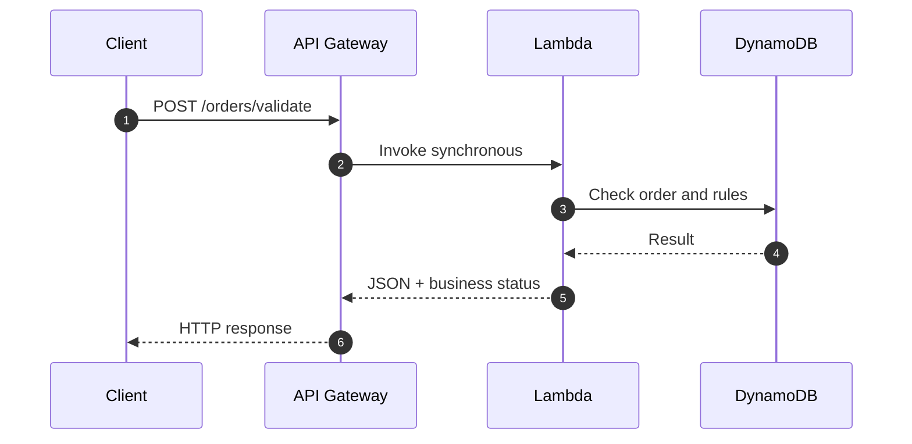
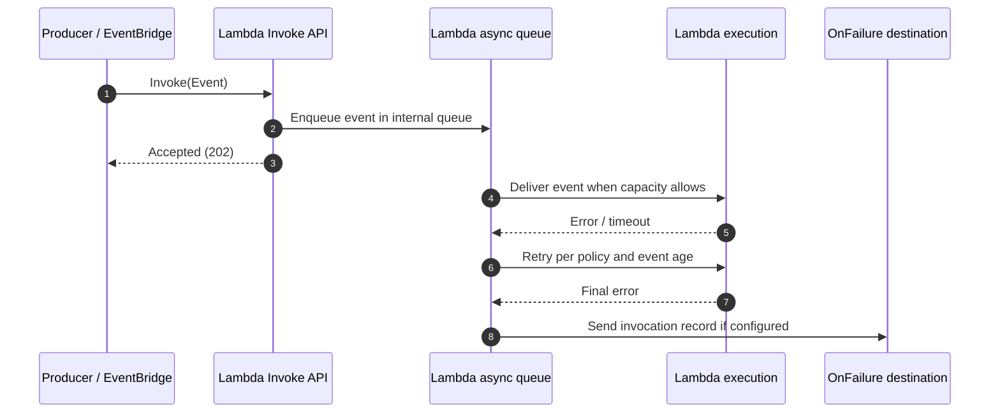
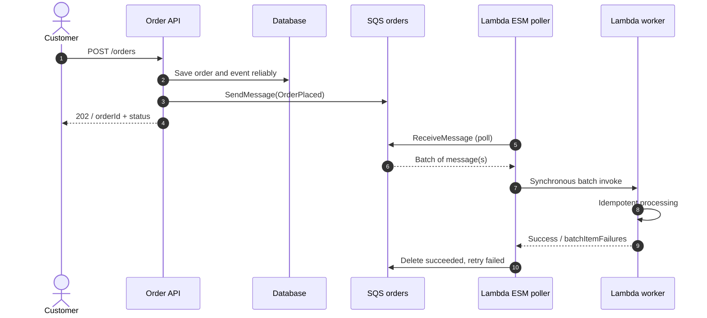
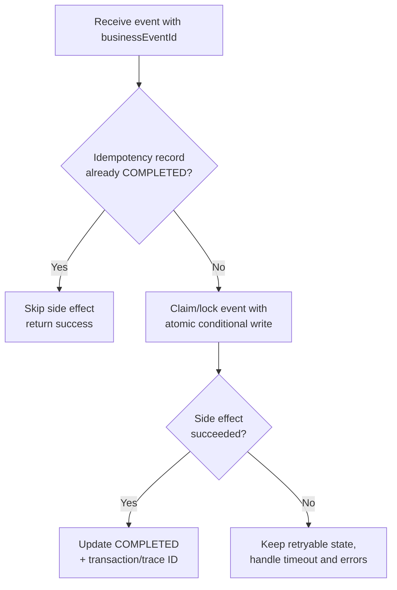
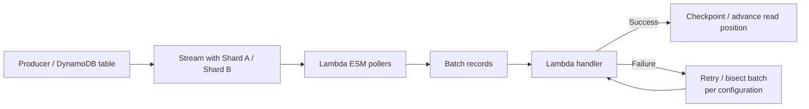
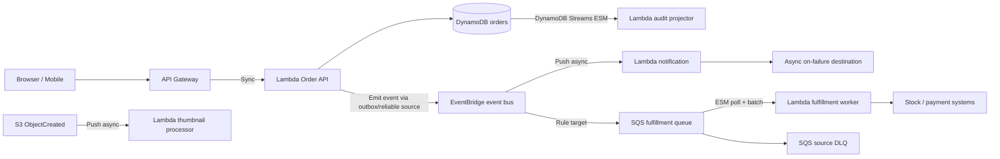
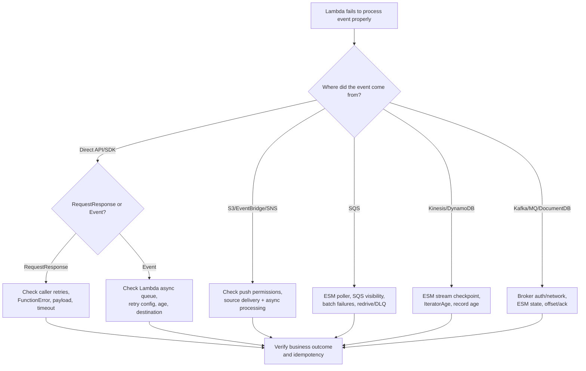

# Synchronous, Asynchronous, and Event Source Mapping Invocations in AWS Lambda

**AWS Lambda** runs code on events without requiring development teams to manage servers. A single function can receive HTTP requests from API Gateway, process messages from Amazon SQS, react to new files on Amazon S3, or consume data from Kinesis. However, these paths do not share the same delivery semantics, response timing, or error-handling policies.

The three core concepts of this lesson are **synchronous invocation**, **asynchronous invocation**, and **event source mapping**. Confusing them easily leads to serious bugs: an API returning success before work actually finishes, SQS messages being processed multiple times, a single failing record stalling an entire batch, or events expiring without anyone receiving an alert.

This lesson belongs to the **Lambda Compute** chapter, module **CLOUD_PROVIDERS_AWS**. Within an AWS ecosystem spanning Regions/Availability Zones, IAM, VPC, compute, storage, databases, integration, and serverless services, learners must pick Lambda invocation mechanisms based on **response requirements, event durability, ordering, throughput, resilience, security, and cost**. Examples use an e-commerce system with an order API, SQS, S3, EventBridge, and DynamoDB.

## 1. Learning Objectives and Running Scenario

After this lesson, learners can:

1. Clearly distinguish **who triggers Lambda**, **who waits for the response**, **where events are buffered**, and **who owns retries**.
2. Use `InvocationType=RequestResponse`, `InvocationType=Event`, and understand `DryRun` via the Lambda Invoke API.
3. Distinguish **direct push event** sources from **pull-based sources via event source mapping**.
4. Configure an SQS event source mapping: batch size, batching window, visibility timeout, concurrency, per-record failure handling, and DLQs.
5. Contrast Lambda asynchronous invocation retries/destinations with retries in **SQS**, **Kinesis/DynamoDB Streams**, and upstream event sources.
6. Design idempotency, ordering, timeouts, logging, IAM, and monitoring tailored to each flow.
7. Select the right architecture for fast-response APIs, background processing, stream processing, and high-throughput systems.

**Context:** A user places an order on the Shop website. The API must validate input and return a response immediately, whereas sending emails, calculating loyalty points, and syncing inventory can run in the background. Orders also emit events consumed independently by multiple teams. A reliable application knows what must run **before responding** versus what belongs in **durably stored messages** processed later.

## 2. Core Concepts: The Three Ways to Invoke Lambda

| Criterion | Synchronous | Asynchronous | Event source mapping |
|---|---|---|---|
| Who sends the event? | Callers such as AWS SDK, API Gateway, Step Functions | Callers or push services such as S3/EventBridge/SNS | Lambda poller reading a queue/stream such as SQS, Kinesis, DynamoDB Streams |
| Does the caller wait for code to finish? | **Yes** | **No** | The source does not wait for a direct app response; the poller handles batches |
| AWS Lambda Invoke API | `InvocationType=RequestResponse` | `InvocationType=Event` | ESM invokes Lambda itself; not called directly with `Event` |
| Response to caller | Payload/result or error from the function once done | Event acceptance ACK, typically HTTP 202 via Invoke API | No direct HTTP response returned to the original producer |
| Where backlog lives | Typically at the caller/upstream system | Lambda's internal queue for async invocations | The **source** SQS/stream/Kafka/broker holds messages/records |
| Primary retry owner | Decided by **caller/upstream** | **Lambda async processing** retries per error type/config | **ESM and source policies** retry batches/records |
| Final error handling | Response/exception back to caller | On-failure destination or function DLQ per config | SQS redrive/DLQ; stream retries/record age/on-failure destination as supported |
| Delivery semantics | Each Invoke call is one request; caller may retry | **At-least-once**; duplicates possible | **At-least-once**; duplicates possible |
| Best fit | Order validation, price lookup, tasks needing immediate output | Sending emails, thumbnailing on push events, background side effects | SQS workers, DynamoDB Streams, Kinesis, Kafka |

**Do not confuse “asynchronous” queue architecture with `InvocationType=Event`.** When SQS triggers Lambda, the ESM **polls the queue and invokes the function synchronously for each batch**. The overall system is asynchronous from the producer's perspective, but the invocation mechanism between ESM and Lambda is not Lambda's internal async queue.

### 2.1. Diagram of the Three Flows

```mermaid
flowchart TB
    subgraph SYNC["1. Synchronous"]
      C["API / SDK caller"] -->|"Invoke RequestResponse"| L1["Lambda handler"]
      L1 -->|"Result / function error"| C
    end
    subgraph ASYNC["2. Asynchronous"]
      S["S3 / EventBridge / SDK"] -->|"Push event"| QI["Lambda internal async queue"]
      QI -->|"Invoke when capacity allows"| L2["Lambda handler"]
      L2 -->|"Success / OnFailure destination"| D["SQS / SNS / EventBridge / Lambda"]
    end
    subgraph ESM["3. Event source mapping"]
      P["Producer"] --> Q["SQS / stream / broker"]
      POLL["Lambda event poller"] -->|"Poll / Read batch"| Q
      Q -->|"Records"| POLL
      POLL -->|"Synchronous batch invoke"| L3["Lambda handler"]
      L3 -->|"Batch result"| POLL
      POLL -->|"Ack / delete / checkpoint per source"| Q
    end
```



Arrows represent logical flow. For some push sources like S3, event delivery travels through the source service and Lambda asynchronous invocation; for streams and brokers, poller placement, connectivity controls, and offset/checkpoint handling vary by source type.

## 3. Synchronous Invocation: Getting a Result Before Moving On

In **synchronous invocation**, the caller sends an event and waits for Lambda to finish and return a response. In the Lambda Invoke API, `InvocationType` is `RequestResponse` (the default for Invoke). Integrations such as API Gateway Lambda proxy use this pattern when an immediate response is required.

### 3.1. Processing Flow



**Limitation:** callers/upstream proxies have their own timeouts, which may be **shorter than Lambda's timeout**. If processing runs too long, the client times out even though Lambda may have completed part or all of the side effects. Avoid synchronous requests for multi-minute operations where the caller must hold open a connection unless specifically justified and supported by integration settings.

### 3.2. Synchronous Invocation via AWS CLI

Suppose you have a test event file `order-event.json`:

```json
{
  "orderId": "ORD-1001",
  "customerId": "CUS-42",
  "amount": 125000,
  "currency": "VND"
}
```

Invoke:

```bash
aws lambda invoke \
  --function-name shop-validate-order \
  --invocation-type RequestResponse \
  --payload fileb://order-event.json \
  --region ap-southeast-1 \
  sync-response.json
```

Input/output files in these examples are learner lab files, not files created by this worker. In AWS CLI v2, `fileb://` passes a raw binary payload without CLI JSON string conversion.

CLI metadata response may look like:

```json
{
  "StatusCode": 200,
  "ExecutedVersion": "$LATEST"
}
```

**Crucial:** `StatusCode: 200` from the **Lambda Invoke API** only confirms the Invoke API call succeeded at the protocol level. The function itself can still throw an exception; in that case, the response typically includes `FunctionError` and the output payload contains error details. Always inspect **both `FunctionError` and the response payload**, not just `StatusCode`.

### 3.3. Java Caller Example Using AWS SDK v2

A Java application on EC2/ECS can invoke Lambda directly when its IAM role has `lambda:InvokeFunction`:

```java
import software.amazon.awssdk.core.SdkBytes;
import software.amazon.awssdk.regions.Region;
import software.amazon.awssdk.services.lambda.LambdaClient;
import software.amazon.awssdk.services.lambda.model.InvokeRequest;
import software.amazon.awssdk.services.lambda.model.InvokeResponse;
import software.amazon.awssdk.services.lambda.model.InvocationType;

public class SyncLambdaCaller {
    public static void main(String[] args) {
        String payload = "{\"orderId\":\"ORD-1001\",\"amount\":125000}";

        try (LambdaClient client = LambdaClient.builder()
                .region(Region.AP_SOUTHEAST_1)
                .build()) {
            InvokeResponse response = client.invoke(InvokeRequest.builder()
                    .functionName("shop-validate-order")
                    .invocationType(InvocationType.REQUEST_RESPONSE)
                    .payload(SdkBytes.fromUtf8String(payload))
                    .build());

            if (response.statusCode() != 200 || response.functionError() != null) {
                throw new IllegalStateException(
                        "Lambda failed: " + response.payload().asUtf8String());
            }
            System.out.println(response.payload().asUtf8String());
        }
    }
}
```

This example uses AWS SDK for Java v2, the default credentials provider chain, and the Singapore Region. In production, the caller needs timeouts, circuit breakers, bounded retries, and correlation IDs; avoid logging full payloads containing sensitive data.

### 3.4. Retries and Timeouts in Synchronous Mode

With synchronous invocation, Lambda **does not automatically rerun your handler when code throws an exception** simply because the caller used `RequestResponse`. The caller/upstream system decides whether to retry or return an error.

| Situation | Who handles it? | Reasonable action |
|---|---|---|
| Function returns a business error (e.g., invalid amount) | Caller | Do not retry endlessly; return a business 4xx response |
| Function hits a transient database error | Caller or workflow | Bounded retries, exponential backoff/jitter, idempotency |
| Lambda Invoke API is throttled | SDK/caller | Backoff and rate limiting; tune concurrency |
| Client disconnects after sending request | Caller and backend | Use request ID / idempotency key before retrying |
| Handler takes too long | Architecture team | Offload background work to SQS/async, tune timeouts |

A simple HTTP request through API Gateway needs a response per the API contract. Different API integrations enforce different timeout caps; **do not assume Lambda's 15-minute limit means an HTTP client can always wait that long**.

### 3.5. `InvocationType=DryRun`

The Lambda Invoke API also supports `InvocationType=DryRun` to pre-check parameter validity and permissions **without running the handler**. It does not prove database connectivity, networking, or business logic will succeed.

```bash
aws lambda invoke \
  --function-name shop-validate-order \
  --invocation-type DryRun \
  --region ap-southeast-1 \
  dryrun-response.json
```

## 4. Asynchronous Invocation: Accept the Event, Process Later

In **asynchronous invocation**, the caller submits an event and Lambda acknowledges receipt by placing it onto Lambda's **internal asynchronous event queue**. Through the Lambda Invoke API, `InvocationType=Event` typically returns `StatusCode: 202` once accepted. That **does not mean the handler has executed or succeeded**.

Example SDK/CLI call:

```bash
aws lambda invoke \
  --function-name shop-send-receipt \
  --invocation-type Event \
  --payload fileb://order-event.json \
  --region ap-southeast-1 \
  async-ack.json
```

The API response only shows the event was accepted; the handler's return value is not sent back to the caller in this model.

### 4.1. Push Event Sources

Common sources using asynchronous push to Lambda include:

- **Amazon S3 Event Notifications**, e.g., upon object upload.
- **Amazon EventBridge rules**, e.g., an `OrderPlaced` event.
- **Amazon SNS notifications** delivered to a Lambda subscriber.
- SDK/CLI calls to Lambda Invoke with `InvocationType=Event`.

**Do not lump all triggers together:** API Gateway and Function URLs are HTTP request-response flows and should not be treated as async simply because they trigger Lambda. **Amazon SQS does not push events directly into Lambda's internal async queue**; Lambda uses an event source mapping to poll SQS.

### 4.2. Accepting a Request Is Not Processing Success



Success at step 3 does not guarantee step 5 completes. The application needs its own **job status**, logs, tracing, and reconciliation/error reporting if users need to know whether the receipt email was actually sent.

## 5. Retries for Asynchronous Invocation

Lambda manages re-reading events from its internal async queue with different policies depending on failure cause.

| Failure | Default/typical behavior | How to manage |
|---|---|---|
| **Function error/timeout** after handler runs | Lambda normally retries up to **2 additional times** (up to 3 total attempts) | Configure `MaximumRetryAttempts` from 0 to 2 |
| **Throttling (429)** or 5xx system errors | Lambda retries with backoff while within allowed event age | Reduce load, raise concurrency, monitor event age |
| **Expired event age** | Lambda discards the event from the internal queue | Set `MaximumEventAgeInSeconds` and on-failure destination |
| **Succeeded, yet event delivered twice** | Possible under at-least-once delivery | Keep handlers idempotent |
| **Producer sends duplicates** | Two independent business events with the same intent | Deduplicate by business event ID |

Default maximum event retention in the async queue can be up to **6 hours** per AWS guidance; configure explicit limits aligned with your SLA rather than relying blindly on defaults. AWS caps these values, such as `MaximumEventAgeInSeconds` up to 21,600 seconds and `MaximumRetryAttempts` up to 2 for function errors.

### 5.1. Example: Limiting Retries and Event Age

```bash
aws lambda put-function-event-invoke-config \
  --function-name shop-send-receipt \
  --maximum-retry-attempts 1 \
  --maximum-event-age-in-seconds 1800 \
  --destination-config '{"OnFailure":{"Destination":"arn:aws:sqs:ap-southeast-1:111122223333:receipt-failures"}}' \
  --region ap-southeast-1
```

The command above **creates/sets the asynchronous invocation configuration** for the function; if one already exists, use the appropriate update operation after reading current settings so other fields are not unintentionally overwritten. Lambda's execution role must have permission to send messages to the destination and use KMS if the destination is encrypted with a custom key.

**Key takeaway:** `MaximumRetryAttempts` and `MaximumEventAgeInSeconds` in **async function invocation** config **do not directly control** SQS event source mapping retries. For SQS, the queue's visibility timeout, message retention, and redrive policy govern retries.

### 5.2. How Destinations Differ from Dead-Letter Queues

| Mechanism | What it receives | When to use |
|---|---|---|
| **Lambda async on-success destination** | Invocation record after successful execution | Auditing or triggering downstream steps as needed |
| **Lambda async on-failure destination** | Invocation record containing request context, payload, and error state | Investigation/replay when async processing fails or events are dropped |
| **Function dead-letter queue (DLQ) for async** | Primarily stores the **original event** plus limited metadata | Retaining failed events for reprocessing |
| **SQS source queue DLQ** | SQS messages redriven after exceeding max receive count | Capturing poison messages from an **SQS event source mapping** |

**Do not confuse a Lambda function's async DLQ with an SQS source queue's DLQ.** They serve completely different event paths. Stream ESMs also have their own **mapping-level on-failure destination**, rather than inheriting the function's async invoke config.

### 5.3. Additional Upstream Responsibility

When EventBridge, SNS, or another service pushes events to Lambda, **the source service may have its own retry policy and DLQ** if delivery to Lambda fails. Once Lambda accepts the event, Lambda applies its own internal async queue and retry behavior.

Consequently, a single event can be retried across **multiple layers**. Never naively add retry counts together to promise an exact execution count; track the event ID end-to-end from producer to handler, enforce idempotency, and define business validity windows.

## 6. Event Source Mapping: Lambda Actively Polls Queues/Streams

An **event source mapping (ESM)** is a Lambda resource connecting a **queue, stream, or broker source** to a Lambda function. Lambda manages **event pollers** (or equivalent readers), groups records into batches, and invokes the handler.

Common ESM sources:

| Source | Data model | Operational practices |
|---|---|---|
| **Amazon SQS Standard/FIFO** | Message queue | Poll, visibility timeout, delete on success, DLQ/redrive |
| **Amazon Kinesis Data Streams** | Ordered stream by shard/partition key | Checkpoints, iterator age, record retention, per-shard processing |
| **Amazon DynamoDB Streams** | Item changes as stream records | Consume ordered records per shard, retention, and retries |
| **Amazon MSK / self-managed Apache Kafka** | Broker/topic partitions | Polling, offset management, broker networking/authentication |
| **Amazon MQ** | Message broker | Poll/consume batches, broker ack and retry semantics per broker |
| **Amazon DocumentDB change streams** | Change stream | Database connectivity, batching, and checkpoints per supported docs |

**Do not create an ESM for API Gateway, S3 Event Notifications, or EventBridge rules.** Those are push integrations/triggers. In the Lambda console, the UI groups many sources under “triggers,” yet a **trigger** is not automatically an **event source mapping** under the hood.

### 6.1. ESMs Have Independent UUIDs and Settings

An ESM can configure:

- `EventSourceArn` or matching source configuration.
- `FunctionName` or supported function ARN/alias/version.
- `BatchSize` and `MaximumBatchingWindowInSeconds`.
- `FilterCriteria` for supported source types.
- `FunctionResponseTypes` such as `ReportBatchItemFailures` where applicable.
- `ScalingConfig` or provisioned pollers where supported.
- `DestinationConfig`/retry options for certain stream sources.
- `State` and `LastProcessingResult` for diagnostics.

Each source type supports a **different parameter set**. Never copy Kinesis options straight to SQS or Kafka without checking the AWS API and Service Quotas.

### 6.2. Batching and Latency

Pollers can group multiple records into a single invocation to amortize startup overhead, though larger batches mean:

- Each invocation needs more CPU, memory, and processing time.
- On failure, more records may need to be retried.
- Longer batching windows add latency under low traffic.
- Batch payloads can hit size limits before reaching `BatchSize`.

**Selection rule:** set batch size and batching window based on **record size, per-record processing time, throughput, latency tolerance, and source semantics**, then measure on representative workloads.

### 6.3. Event Filtering

Some ESMs support `FilterCriteria` so Lambda forwards only matching records to the handler — for instance, processing `OrderPlaced` events while ignoring `ProductViewed` on a supported stream.

Note: filtering runs inside the **poller**; a filtered-out record is not preserved for another function sharing that same ESM. With SQS, messages that fail the filter can be **deleted from the queue** by ESM behavior; with streams, skipping records does not alter retention policies. Always check exact source behavior, filter syntax, and consequences before enabling in production.

## 7. SQS + Lambda Event Source Mapping: The Common Background Pattern

In an order system, the HTTP API should complete only the essential synchronous transaction and send an `OrderPlaced` message to SQS for emails, inventory syncing, or steps that do not need immediate user feedback.



**Business integrity note:** this diagram illustrates logical flow; if the API writes to the database and crashes before `SendMessage` succeeds, the event can be lost. For critical workflows, use a **transactional outbox**, DynamoDB Streams, or another guaranteed change-data event publisher rather than two separate DB/SQS calls assumed to be atomic.

### 7.1. Message Lifecycle in SQS

1. The producer sends a message. SQS persists it according to its retention policy.
2. The ESM polls SQS, receives a batch, and messages temporarily turn **invisible** for the **visibility timeout**.
3. The ESM invokes the Lambda worker **synchronously** with the batch.
4. On success, Lambda deletes the corresponding messages from SQS.
5. On error, undeleted messages become visible again after the visibility timeout and can be reprocessed.
6. If a **redrive policy** is configured and receive count exceeds the threshold, SQS moves the message to the **SQS DLQ**.

Thus, SQS holds unprocessed messages — not Lambda's internal async queue. A **function async on-failure destination** will not automatically capture SQS ESM failures if you only configured async invocation destinations on the function.

### 7.2. Designing SQS Visibility Timeout

AWS recommends setting the **SQS visibility timeout to at least six times the Lambda function timeout**, plus any batching window. Example:

| Setting | Illustrative value |
|---|---|
| Lambda timeout | 30 seconds |
| Maximum batching window | 5 seconds |
| Reference threshold | 6 × 30 + 5 = **185 seconds** |
| Chosen SQS visibility timeout | **210 seconds** |
| SQS message retention | Per SLA, e.g., long enough for incident investigation/replay |
| SQS redrive | DLQ with tested `maxReceiveCount` (AWS commonly suggests 5 or more) |

**Why not set visibility timeout to exactly 30 seconds?** While a batch is still running, messages can become visible again prematurely, causing another worker to pick up duplicates and increasing retries and costs. Longer timeouts slow down retries for failed messages, so balance latency against safety.

Visibility timeout is not message lifetime. **Message retention** governs how long messages stay in the queue; the DLQ has its own retention. Where in-flight processing genuinely needs extra time, `ChangeMessageVisibility` can be used cautiously, while keeping ESM delete/retry ownership in mind.

### 7.3. Standard Queues vs. FIFO Queues

| Characteristic | SQS Standard | SQS FIFO |
|---|---|---|
| Throughput | High throughput; duplicates possible | Supports per-message-group ordering and deduplication within SQS scope |
| Ordering | No strict ordering guarantee | Strict ordering **within a single `MessageGroupId`** |
| Batching behavior | Can batch arbitrary messages | Must preserve ordering within each group |
| Batch size via Lambda ESM | Up to 10,000 with valid settings; often starts smaller | Maximum 10 |
| Batching window | Supported within defined limits | Not supported the same way as Standard |
| Concurrent invokes | Scales with capacity/concurrency | Bounded by active `MessageGroupId` count and concurrency limits |
| Use cases | Emails, images, notifications, independent events | State transitions for the same `orderId`, strict per-group ordering |

**FIFO does not give you exactly-once processing at the application layer.** Messages can still be retried; Lambda handlers must remain idempotent. Choosing `MessageGroupId=orderId` preserves ordering per order while allowing different orders to process in parallel.

## 8. Configuring an SQS Event Source Mapping with AWS CLI

Assume you already have:

- Lambda function `shop-order-worker` in Region `ap-southeast-1`.
- Standard queue `arn:aws:sqs:ap-southeast-1:111122223333:orders-standard`.
- Lambda execution role with `sqs:ReceiveMessage`, `sqs:DeleteMessage`, `sqs:GetQueueAttributes`, and required read permissions (you can start from `AWSLambdaSQSQueueExecutionRole` and scope down).
- Matching KMS permissions if the queue is encrypted with a customer-managed key.
- IAM permissions for the operator to create/update ESMs and inspect queue policies.

AWS CLI:

```bash
aws lambda create-event-source-mapping \
  --function-name shop-order-worker \
  --event-source-arn arn:aws:sqs:ap-southeast-1:111122223333:orders-standard \
  --batch-size 10 \
  --maximum-batching-window-in-seconds 5 \
  --function-response-types ReportBatchItemFailures \
  --scaling-config MaximumConcurrency=5 \
  --enabled \
  --region ap-southeast-1
```

Creating the mapping returns a **UUID**. `MaximumConcurrency=5` is the **concurrency cap for this specific SQS ESM** in standard polling mode, not reserved concurrency for the entire function.

### 8.1. Inspecting the Mapping After Creation

```bash
aws lambda list-event-source-mappings \
  --function-name shop-order-worker \
  --region ap-southeast-1

aws lambda get-event-source-mapping \
  --uuid "<EVENT_SOURCE_MAPPING_UUID>" \
  --region ap-southeast-1
```

Check `State`, `StateTransitionReason`, `LastProcessingResult`, `BatchSize`, `MaximumBatchingWindowInSeconds`, `FunctionResponseTypes`, and `ScalingConfig`. Creating the mapping does not prove worker code handles business logic properly; send test messages and verify final state.

### 8.2. Updating and Pausing Polling

```bash
# Example: temporarily pause polling during a severe processing incident.
aws lambda update-event-source-mapping \
  --uuid "<EVENT_SOURCE_MAPPING_UUID>" \
  --no-enabled \
  --region ap-southeast-1

# Re-enable only after confirming the root cause is fixed.
aws lambda update-event-source-mapping \
  --uuid "<EVENT_SOURCE_MAPPING_UUID>" \
  --enabled \
  --region ap-southeast-1
```

While disabled, messages remain in SQS only until retention expires; **it is not an infinite hold button**. For streams, retention likewise limits replay; do not disable a mapping for days assuming all records will still be there.

### 8.3. Concurrency for SQS Mappings

Limits that must work together:

| Layer | Setting | Effect |
|---|---|---|
| AWS account/Region | Account concurrency quota | Shared ceiling across functions in the Region |
| Lambda function | **Reserved concurrency** | Reserves/caps concurrent executions for the function |
| SQS ESM | **Maximum concurrency** | Caps concurrent invokes from one SQS mapping in standard polling mode |
| SQS ESM | **Provisioned poller mode** | Allocates min/max poller resources to adjust scaling speed/latency |
| Workload | DB pools, rate limits, downstream quotas | Often a tighter real bottleneck than Lambda quotas |

**Do not configure `MaximumConcurrency` and provisioned poller mode simultaneously on the same SQS ESM**: AWS specifies these two polling/scaling controls are mutually exclusive. If a function has multiple SQS mappings, ensure the sum of their max concurrencies fits safely inside reserved concurrency to avoid self-inflicted throttling.

For FIFO queues, even if maximum concurrency is 10, having only three active `MessageGroupId`s bounds actual concurrency to at most three parallel groups.

## 9. Handling Individual Message Failures in an SQS Batch

When a batch of 10 messages contains 1 bad message, the **default** behavior retries the entire batch after the visibility timeout. That causes duplicate computation, duplicate emails, or corrupted state if the handler is not idempotent.

To report only failed messages, set `FunctionResponseTypes=["ReportBatchItemFailures"]` on the ESM and return:

```json
{
  "batchItemFailures": [
    {
      "itemIdentifier": "message-id-that-failed"
    }
  ]
}
```

For SQS, `itemIdentifier` is the failed record's **`messageId`**, not `orderId` or `receiptHandle`.

### 9.1. Illustrative Python Handler

```python
import json
import logging

logger = logging.getLogger()
logger.setLevel(logging.INFO)


def lambda_handler(event, context):
    failures = []
    for record in event.get("Records", []):
        message_id = record["messageId"]
        try:
            order_event = json.loads(record["body"])
            order_id = order_event["orderId"]

            # Replace with real idempotent processing transaction.
            # Example performs minimal schema and validity checks.
            if not isinstance(order_id, str) or not order_id:
                raise ValueError("Invalid orderId")

            logger.info("Validated messageId=%s", message_id)
        except Exception:
            logger.exception("Failed messageId=%s", message_id)
            failures.append({"itemIdentifier": message_id})

    return {"batchItemFailures": failures}
```

This snippet **only demonstrates handler shape and partial batch responses**; it does not send emails, write to a database, or implement business idempotency. In production, replace processing with retry-safe operations and avoid logging PII.

**Important:** if the handler lets an unhandled exception escape instead of returning this structure, Lambda treats the **entire batch as failed**. `ReportBatchItemFailures` must also be enabled on the ESM; returning this JSON without enabling it on the mapping will not produce partial batch handling.

### 9.2. Preserving Ordering with SQS FIFO

In FIFO queues, when a message fails, the handler must **stop processing subsequent messages per ordering rules** and return **both the failed message and all unprocessed subsequent messages** in `batchItemFailures`. Continuing past a failure and marking later messages successful breaks per-group ordering guarantees.

For batches spanning multiple message groups, follow AWS guidance to preserve ordering per group; a simpler conservative approach stops the entire batch at the first failure at the cost of throughput.

### 9.3. DLQs and Poison Messages

A message with a permanent data defect such as a missing `orderId` can be re-received repeatedly, wasting money and delaying healthy messages. You need:

- An SQS **redrive policy** pointing to a matching-type DLQ (Standard or FIFO).
- A `maxReceiveCount` large enough for transient errors without retrying forever.
- Alarms on DLQ message count and age.
- A runbook to triage bad data, patch handlers, replay, or reject with an audit trail.
- Access controls for reading/writing/redriving the DLQ and KMS encryption if data is sensitive.

**Do not route SQS ESM errors into a Lambda async destination thinking that handles the DLQ.** Messages are still managed by SQS; inspect and configure the queue's real redrive policy.

## 10. Idempotency Is Mandatory in Event Processing

**Idempotency** means processing the same event multiple times produces the same business outcome as processing it once. Since SQS, streams, async Lambda, and caller retries can all produce duplicates, never rely on “delivered only once” promises.

### 10.1. Choosing Meaningful Idempotency Keys

| Scenario | Recommended key | Why |
|---|---|---|
| Order created | `orderId + eventType/version` | Prevents duplicate emails/loyalty points for the same event |
| S3 `ObjectCreated` | `bucket + key + versionId` or appropriate sequencer | The same object key can be overwritten across versions |
| EventBridge business event | Producer-managed `eventId` | End-to-end pipeline deduplication |
| DynamoDB Stream record | Appropriate event ID / sequence number | Identifies whether a change record was already applied |
| HTTP payment request | API-defined `Idempotency-Key` bound to user & payload | Timeout retries do not double-charge |

**SQS `messageId` is not a business event ID.** If a producer resends the same business event as a new message, SQS assigns a brand-new `messageId`. For critical side effects like payments, key off a trusted business identifier rather than `messageId` alone.

### 10.2. A Pattern for Persisting Idempotency State



A DynamoDB implementation can use a **conditional write** to claim an event with a TTL and `IN_PROGRESS`/`COMPLETED` status. Still, **claiming successfully before the external side effect fails** must be handled carefully: marking “processed” before calling the external system risks losing work, while marking only after calling risks duplicates if the process crashes in between.

Solutions depend on the side effect:

- Use a **transaction** if state tracking and the business write live in the same datastore.
- Use an **outbox/inbox** pattern and leased/expiring locks to manage multi-step work.
- Forward the idempotency key to downstream APIs (such as payment gateways supporting idempotency) so the downstream system blocks duplicate transactions.
- Record trace/correlation IDs and enforce bounded retries with jitter.

AWS Lambda Powertools offers an **Idempotency** utility for several languages to reduce boilerplate, though you still must choose the business key and failure model.

## 11. Stream Event Source Mapping: Kinesis and DynamoDB Streams

Unlike SQS (where messages are deleted once processed), Kinesis and DynamoDB Streams retain **records for a retention window** while the ESM tracks read position/checkpoints.

### 11.1. Per-Shard Processing Model



Ordering is guaranteed **within a shard/partition key** provided by the source, not globally across all shards. With `ParallelizationFactor` greater than 1 (on supported sources), multiple batches within the same shard can run concurrently while preserving partition-key order; verify exact behavior before building order-sensitive transactions.

### 11.2. Handling Failing Records in a Stream

| Option | Meaning | When to consider |
|---|---|---|
| `MaximumRetryAttempts` | Caps function error retries in supported stream ESMs | Prevent infinite stalls from a poison record |
| `MaximumRecordAgeInSeconds` | Caps record age eligible for retry | Avoid spending forever on stale data |
| `BisectBatchOnFunctionError` | Splits a failing batch in half to isolate the bad record | Mixed batches with good and bad records |
| `ReportBatchItemFailures` | Reports failing record/position per source schema | Avoid reprocessing already-succeeded records |
| `DestinationConfig.OnFailure` | Sends discarded batch/record metadata to a supported destination | Controlled investigation and replay |
| `ParallelizationFactor` | Processes multiple batches per shard concurrently where supported | Boost throughput while monitoring ordering and downstream load |

**Do not apply SQS's “delete message from queue” mental model to Kinesis.** An ESM advances by checkpointing and can **block records behind a failing record** until retry or max-age policies resolve it. If stream retention expires before recovery, records may be permanently lost for replay.

### 11.3. Monitoring `IteratorAge`

For stream sources, a continuously climbing `IteratorAge` means the ESM is falling behind incoming records — typically due to slow handlers, persistent batch errors, insufficient concurrency, throttling, or downstream overload. Investigate systematically:

1. Check Lambda `Duration`, `Errors`, `Throttles`, concurrency, and logs.
2. Check source shards/throughput, record retention, and reader limits.
3. Inspect failure handling, max record age, DLQs, or on-failure destinations if supported.
4. Evaluate raising batch size or parallelization without breaking business ordering.

With DynamoDB Streams, retention is fixed rather than freely configurable like SQS; check the source retention period and keep fast incident response procedures so data does not expire.

## 12. Kafka, Amazon MQ, and DocumentDB via Event Source Mapping

For broker and change-stream sources, Lambda provides event pollers, though network connectivity and authentication can be more involved than SQS.

| Source | Prerequisites | Key cautions |
|---|---|---|
| **Amazon MSK** | Kafka cluster/topic, auth, network access, Lambda mapping & role | Topic partitions, consumer group/offsets, consumer lag, broker availability |
| **Self-managed Kafka** | Bootstrap brokers, credentials/certs, VPC/network, mapping | Connectivity from AWS to brokers, TLS, security groups, retries |
| **Amazon MQ** | ActiveMQ/RabbitMQ broker, Secrets Manager credentials, network access | Backpressure/ack/retry semantics depend on broker/queue type |
| **Amazon DocumentDB** | Change stream enabled, DB credentials/network, and ESM | Latency, checkpoints, retention/collections, and feature support |

Do not assume **every** Kinesis/DynamoDB stream error-handling option exists for Kafka, MQ, or DocumentDB. Check each event source's parameter table along with Region availability, quotas, IAM, Secrets Manager/KMS, VPC endpoints, and poller costs.

### 12.1. Kafka Offsets vs. SQS Deletes

In Kafka, brokers/topics hold records per retention settings and consumer group offsets advance during processing; the ESM handles reads and commits via its integration. There is no `DeleteMessage` equivalent like SQS. When handling failures, verify whether the mapping retries the batch, advances the offset, holds, or skips records under policy to avoid silent data loss or endless backlog.

### 12.2. DocumentDB and Data Changes

Change streams let you react to database mutations, but do not automatically replace transactional outbox patterns for every business invariant. Verify supported features in your DocumentDB version, credential retrieval, VPC reachability, database load impact, and batch/retry limits.

## 13. Comparing Push Triggers and Event Source Mappings by Example

| Scenario | Typical mechanism | Why |
|---|---|---|
| Client validates a promo code and needs final total immediately | API Gateway → Lambda **synchronous** | Client waits for response |
| S3 receives an image and must generate a thumbnail seconds later | S3 Event Notification → Lambda **async** | S3 pushes event; file processed asynchronously |
| EventBridge receives `OrderPlaced` | EventBridge rule → Lambda **async** | Fan-out across consumers via event bus |
| SQS holds orders needing queued processing and retries | **SQS ESM** → Lambda batch | SQS holds backlog, manages visibility/DLQ |
| DynamoDB table changes must sync to a search index | **DynamoDB Streams ESM** → Lambda | Reads change stream with checkpoints/retries |
| Kinesis receives high-rate clickstream events | **Kinesis ESM** → Lambda | Batched by shard and throughput |
| Existing corporate Kafka stores events | **Kafka ESM** → Lambda | Connects to brokers, polls, manages offsets |

**Source name alone does not dictate invocation mode for every service.** For example, Step Functions supports multiple integration patterns; a single Lambda task inside a workflow may wait synchronously for a response, even while the overall state machine is started asynchronously from elsewhere. Always inspect the **actual integration/task configuration** rather than assuming “workflow” means sync or async.

## 14. Combined Architecture for an Order System

An e-commerce platform can combine all three patterns without creating overlapping retry storms:



This is a reference logical architecture, not a single atomic transaction guaranteed automatically by AWS. EventBridge, SQS, and the database combine with a **transactional outbox or change stream** and explicit business states so an order is never saved without its downstream event.

### 14.1. Step 1 — HTTP Request Must Return an Accurate Response

The client calls `POST /orders`; Lambda Order API validates, authenticates, and writes the order to the DB. The API should return:

```json
{
  "orderId": "ORD-1001",
  "status": "RECEIVED",
  "trackingUrl": "/orders/ORD-1001"
}
```

Status `RECEIVED` confirms **the order was recorded per the API contract** — not that emails were sent or inventory was picked. If the client needs confirmation of downstream completion, provide a status endpoint, push notifications, or workflow orchestration.

### 14.2. Step 2 — Fan-Out Events to Multiple Consumers

EventBridge receives `OrderPlaced` and routes it:

- One rule to the notification Lambda via asynchronous push.
- One rule to an SQS queue for slower fulfillment work needing durable buffering.
- Another rule to analytics as needed.

**Never rely on a single direct async Lambda invoke as long-term storage for millions of unlosable jobs.** Lambda's internal async queue has a maximum event age; if a downstream system can be down longer than that window, use SQS or a log/stream with appropriate retention.

### 14.3. Step 3 — Worker Uses SQS ESM and Updates State

The fulfillment worker receives messages via SQS ESM. For each order:

1. Check business event ID and idempotency state.
2. Validate that the order is still eligible, check inventory rules, and verify downstream access.
3. Call the inventory service with timeouts, retry/jitter, and an idempotency key.
4. Update status to `FULFILLED` or a retryable error state.
5. Return partial batch failures for failing records.

If a message repeatedly fails, the SQS DLQ holds it for investigation; landing in the DLQ **does not fix data** or update order status automatically. Maintain a runbook so customers are not left seeing “Processing” indefinitely.

### 14.4. Step 4 — Event Source Mapping from DynamoDB Streams

When an order record changes state, a DynamoDB Streams ESM can update a search index or build an audit projection. The handler uses `eventID`, sequence metadata, and idempotency to avoid duplicate writes. If a consumer lags past stream retention, you must have a **reconciliation/backfill** process from the source of truth.

### 14.5. Choosing Synchronous Responses vs. Background State Properly

| Operation | Business characteristic | Recommended mechanism |
|---|---|---|
| Check price, tax, purchase limits | Needs immediate response | Sync Lambda |
| Create order database record | Must confirm success/failure before acknowledging receipt | Sync transaction in API |
| Send confirmation email | Can be slower, retryable | EventBridge async push or SQS worker |
| Complex inventory deduction transaction | Needs controlled retries, idempotency, and ordering | SQS ESM / Step Functions or dedicated transactional domain service |
| Generate image thumbnails | Triggered after object upload | S3 async event → Lambda |
| Sync search index on DB changes | Change stream, eventual consistency acceptable | DynamoDB Streams ESM |

## 15. When to Choose Async Lambda vs. SQS

Both free the caller from waiting for the handler to finish, yet backlog control differs sharply.

| Requirement | Direct async Lambda | SQS + Lambda ESM |
|---|---|---|
| Fast operation, moderate traffic, no long backlog needed | Reasonable | Extra queue may be unnecessary |
| Must retain messages for days during downstream outage | Poor fit due to internal event age cap | SQS with configurable retention and DLQ |
| Need to pause consumer while preserving backlog | Hard to control internal queue directly | Disable ESM; queue retains messages per retention |
| Multiple independent consumers | Possible via EventBridge/SNS fan-out | Give each consumer its own queue per semantics |
| Strict ordering per `orderId` | No ordering guarantee | SQS FIFO with appropriate `MessageGroupId` |
| Visibility into backlog / oldest message | Async metrics on event age/drops | SQS queue depth/age + Lambda metrics |
| Throttle rate toward a slow DB | Reserved concurrency can stall async and raise event age | ESM max concurrency while queue buffers backlog |
| Per-record failure isolation | One event = one invoke; async retry policy | SQS partial batch response and DLQ |
| Deliver events to many systems | EventBridge/SNS + async consumers | EventBridge/SNS fan-out to multiple queues |

A strong default for critical business work is **producer → SQS → Lambda ESM**, especially when downstream systems have quotas, require controlled replay/investigation, or cannot lose messages. For small, fast events without long retention needs, direct async invocation keeps moving parts fewer.

**Caveat:** SQS does not automatically make processing exactly-once; you still need idempotency, DLQ operations, tuned visibility timeouts, retention, and monitoring. Adding queues without operational discipline increases complexity and can hide silent backlogs.

## 16. Timeouts, Concurrency, and Backpressure

### 16.1. What Is Concurrency?

**Concurrency** is the number of active Lambda executions running simultaneously. For steady workloads, approximately:

```text
Required concurrency ≈ request rate (invocations/second)
                       × average duration (seconds/invocation)

Example:
  100 invocations/second × 0.2 seconds = 20 concurrent executions
```

This is an approximation, not a substitute for measuring duration distributions, cold starts, bursts, and downstream calls. Adjusting memory/CPU changes duration; the true bottleneck is often a database connection pool or downstream API quota rather than Lambda's quota.

### 16.2. Reserved Concurrency

**Reserved concurrency** allocates and caps capacity for one function. Set to 20, the function never runs more than 20 concurrent executions regardless of whether requests come from a sync API, the async internal queue, or an SQS ESM.

| Source type | When the function runs out of concurrency | Consequence |
|---|---|---|
| Sync Invoke | Caller receives throttling errors and must handle them | Client/API latency, retries, and error rate |
| Async invoke | Events wait in the internal queue and retry as capacity opens | `AsyncEventAge` grows; events may expire |
| SQS ESM | Poller gets throttled; messages return to queue per visibility behavior | SQS backlog and oldest message age climb |
| Kinesis/DynamoDB Streams ESM | Batches slow down / checkpoints lag | `IteratorAge` rises; risk of record expiration |

**Setting reserved concurrency = 0** is often used as an emergency brake to block executions, but it is not always a harmless “pause”: for async/streams/queues, events still accumulate or expire. Always pair it with backlog monitoring and a recovery plan.

### 16.3. Provisioned Concurrency vs. Event Poller Provisioned Mode

| Concept | What is pre-allocated | Goal |
|---|---|---|
| **Lambda provisioned concurrency** | Execution environments for a function version/alias | Reduce cold-start latency and stabilize responses |
| **SQS ESM provisioned pollers** | Polling resources reading from SQS | Speed up queue scaling/invocations and control poller capacity |

These are distinct features with separate pricing and limits, not interchangeable. A latency-sensitive sync API may need provisioned concurrency, whereas an SQS ESM handling huge backlogs may benefit from tuned poller capacity.

### 16.4. Backpressure to Protect Downstream Systems

Suppose RDS only sustains around 15 heavy concurrent transactions. Setting SQS ESM maximum concurrency to 100 can trigger a connection storm:

```text
Large SQS backlog
  -> Lambda scales too fast
  -> too many RDS connections
  -> timeouts and retries
  -> backlog grows even faster
```

The fix is **capping concurrency**, reusing DB connections properly, evaluating RDS Proxy where appropriate, optimizing batches/transactions, and letting the queue buffer load. Never crank up concurrency just to push down visible message counts when the backend lacks capacity.

### 16.5. Impact of Startup Time

- **Sync:** cold starts and dependency initialization directly add to caller latency.
- **Async:** cold starts do not delay the 202 ACK, though they delay business completion.
- **ESM:** cold starts, batching windows, and poller behavior affect end-to-end event age.

Reduce cold starts using measurements. For example, Java Lambdas can leverage **SnapStart** on compatible runtimes/versions, or provisioned concurrency where justified; verify feature constraints and cost trade-offs before enabling.

## 17. IAM, Resource Policies, and VPC per Invocation Type

### 17.1. Who Is Permitted to Invoke Lambda?

| Flow | Controlling permissions/mechanism |
|---|---|
| Direct AWS SDK/CLI invoke | Caller has `lambda:InvokeFunction` on function/version/alias via IAM, plus resource policy if cross-account |
| API Gateway → Lambda | Integration permission and Lambda resource policy for the service principal and matching source ARN |
| S3/SNS/EventBridge push to Lambda | Lambda resource policy for service principal/source ARN/source account where supported, plus source config |
| SQS → ESM → Lambda | Operator creates ESM; **Lambda execution role** has SQS poll/delete permissions and KMS access |
| Kinesis/DynamoDB Streams → ESM | Execution role has stream read permissions plus KMS/network access |
| Kafka/Amazon MQ/DocumentDB → ESM | Broker/database connectivity, credentials, VPC, and service-specific policies |

**SQS ESM does not require opening a public HTTP endpoint on Lambda.** Polling runs over AWS service infrastructure; queue-read permissions are what matter. Do not grant `lambda:InvokeFunction` to arbitrary IAM principals just to support an SQS trigger.

### 17.2. Sample Identity Policy for a Synchronous Caller

```json
{
  "Version": "2012-10-17",
  "Statement": [
    {
      "Sid": "InvokeValidationOnly",
      "Effect": "Allow",
      "Action": "lambda:InvokeFunction",
      "Resource": "arn:aws:lambda:ap-southeast-1:111122223333:function:shop-validate-order:prod"
    }
  ]
}
```

This illustrative policy grants invoke access strictly to the **`prod` alias**, without permission to create or edit the Lambda function. Callers need separate IAM permissions to read metadata or write logs if they call other APIs. For cross-account callers, the Lambda resource-based policy must also permit the caller/source.

### 17.3. Sample SQS Read Permissions for a Lambda Execution Role

```json
{
  "Version": "2012-10-17",
  "Statement": [
    {
      "Sid": "ConsumeOrdersQueue",
      "Effect": "Allow",
      "Action": [
        "sqs:ReceiveMessage",
        "sqs:DeleteMessage",
        "sqs:GetQueueAttributes"
      ],
      "Resource": "arn:aws:sqs:ap-southeast-1:111122223333:orders-standard"
    }
  ]
}
```

If using SSE-KMS, ensure `kms:Decrypt` and matching KMS key policy access. The function also needs separate logging permissions (e.g., writing to CloudWatch Logs). If producers sit in another account, configure the queue policy and role trust properly. AWS supports an SQS source queue and Lambda function in the **same Region** even across different accounts.

### 17.4. Does Lambda Need to Be Placed Inside a VPC?

**Not every Lambda needs VPC configuration.** Only attach a function to a VPC when it must reach private resources such as RDS in private subnets, or follow corporate outbound network policies.

A VPC-attached Lambda still receives events through the Lambda service; sitting in a private subnet **does not change how it receives SQS events**. However, code inside the function calling the Internet, S3, Secrets Manager, or a DB must have matching **routes, NAT/VPC endpoints, DNS, and security groups**.

| Requirement | Approach |
|---|---|
| Lambda only processes events and calls public AWS APIs | No VPC needed unless required by private network policy |
| Lambda must call private RDS/Aurora | Matching VPC subnets/SGs; DB auth/KMS/Secrets Manager |
| VPC Lambda must call S3/Secrets Manager | NAT Gateway or VPC endpoints per service/Region and policy |
| Lambda invoked by API Gateway | Check integration permissions; function does not need a public IP |
| Lambda reads SQS via ESM | Execution role needs SQS permissions; code VPC networking is separate |

### 17.5. Security Boundaries Go Beyond IAM

In an e-commerce platform:

- Never log raw events containing emails, street addresses, payment tokens, or PII.
- Validate inputs from HTTP, SQS, EventBridge, and S3 since any source can deliver untrusted data.
- Use separate IAM roles per function and environment; never attach `AdministratorAccess`.
- Protect secrets with Secrets Manager / Parameter Store, KMS, and rotation.
- Restrict queue producer permissions, event bus rules, function resource policies, and DLQ replay access.
- If a handler writes to a database, authorize the owner/tenant/business action rather than blindly trusting `orderId`.

## 18. Monitoring: Measure Both ACKs and Processing Outcomes

### 18.1. Metrics by Invocation Type

| Flow type | Metrics to track | What they indicate |
|---|---|---|
| Sync | Lambda `Invocations`, `Errors`, `Duration`, `Throttles`, API 4xx/5xx/p95 latency | Actual speed and errors experienced by callers |
| Async | `AsyncEventsReceived`, `AsyncEventAge`, `AsyncEventsDropped`, destination delivery failures | Health of internal queue ingestion and delivery |
| SQS ESM | `ApproximateNumberOfMessagesVisible`, `ApproximateAgeOfOldestMessage`, DLQ depth | Backlog size and wait time |
| Streams ESM | `IteratorAge`, failures, retries, Lambda Duration/Errors | Processing lag relative to new records |
| All types | `ConcurrentExecutions`, Logs, cold starts, cost, downstream health | Capacity and overall reliability |

**An HTTP 202 from an async Invoke does not mean business success.** Likewise, CloudWatch `Invocations` does not tell you how many orders actually succeeded. Emit application metrics such as `orders_fulfilled_success`, `orders_failed_permanent`, and `receipts_sent`, correlated with event ID and order ID.

### 18.2. Logs and Tracing

A useful structured log record might look like:

```json
{
  "timestamp": "2026-11-20T03:30:00Z",
  "service": "shop-order-worker",
  "eventId": "evt-1001",
  "orderId": "ORD-1001",
  "messageId": "sqs-message-abc",
  "attempt": 2,
  "result": "RETRYABLE_ERROR",
  "errorCategory": "INVENTORY_TIMEOUT"
}
```

This example contains no secrets or sensitive PII. Combine CloudWatch Logs, structured JSON logging, and AWS X-Ray/OpenTelemetry with correlation IDs across API Gateway → Lambda → EventBridge/SQS → workers. Asynchronous tracing requires **explicitly propagating trace context/event IDs** rather than assuming one HTTP span automatically connects everything.

### 18.3. Three-Layer Dashboards

1. **Ingestion:** requests/events received, 4xx/429/202 rates, queue depth.
2. **Processing:** handler latency, success/error counts, retry counts, cold starts, concurrency.
3. **Business completion:** orders reaching `FULFILLED`, confirmation emails sent, inventory synced, jobs needing manual intervention.

If dashboards only watch Lambda `Errors`, a worker might silently swallow invalid payloads and report success; track **business outcome metrics** and audits.

### 18.4. Recommended Alerts

- **Sync:** API p95 latency/5xx rising; Lambda throttles or duration approaching timeout.
- **Async:** `AsyncEventAge` nearing policy limit, `AsyncEventsDropped > 0`, OnFailure/DLQ receiving events, destination delivery failures.
- **SQS:** `ApproximateAgeOfOldestMessage` breaching SLA, visible messages rising steadily, `DLQ > 0`, unexpected disabled ESM.
- **Streams:** `IteratorAge` approaching retention, per-shard function errors, records sent to failure destination.
- **System:** DB connection saturation, KMS `AccessDenied`, missing IP/subnet endpoints, unusual log/invoke cost spikes.

Every alert needs an owner, threshold, and runbook. Never bump retries higher just to hide `Errors` while work keeps failing.

## 19. Cost, Quotas, and Operational Limits

Lambda eliminates server patching, yet **is not free under high event volume or retry loops**. Evaluate these cost components in every design:

| Component | Related cost/limits | Optimization hint |
|---|---|---|
| Lambda invocations | Execution count, including retries | Deduplicate events, prevent loops, isolate poison records |
| Lambda duration/memory | Allocated resources × processing time | Benchmark memory/CPU/duration, optimize I/O and batches |
| Provisioned concurrency | Pre-allocated capacity + duration/requests per pricing | Use only for latency-sensitive workloads backed by data |
| SQS | API requests, message volume, retention/storage, and DLQs | Batch sensibly, avoid excessive polling, clean DLQs cleanly |
| Kinesis/Kafka/DocumentDB | Streams/brokers/partitions/read throughput/retention | Match batching and parallelization to source |
| EventBridge/SNS | Published/matched/delivered events per pricing | Tight rules, event filtering, avoid useless fan-out |
| Logs/tracing | CloudWatch ingestion/retention, X-Ray/OTel | Structured logging, sampling, appropriate retention |
| Network/data | NAT Gateway, VPC endpoints, data transfer | Pick proper network paths; don't add NAT out of trigger misconceptions |
| KMS | Encrypt/decrypt API calls and key usage per service | Sensible caching/policies, estimate call volume |
| Storage/DR | DLQs, event archives, backups, replay/reconciliation | Align retention to RTO/RPO and SLAs |

### 19.1. Example: Cost Impact of Retries

Suppose 100,000 async events arrive daily, 5% fail on the first attempt, and all failing events retry twice:

```text
Initial events:         100,000
First-attempt failures:   5,000
Extra retry runs:        10,000
Total invocations:      110,000  (illustrative)
```

In practice, some events succeed on the first retry, so the extra count may be smaller; throttling/system errors follow separate rules. Still, the math highlights that **retries cost money and add downstream load**. Blindly raising concurrency when errors stem from an overloaded database makes matters worse.

### 19.2. Payload and Timeout Limits

With standard AWS Lambda Invoke API calls, payload limits depend on invocation type: for instance, **synchronous request/response** has a larger payload limit than **asynchronous events** in the baseline model — typically **1 MiB** max for async vs. **6 MiB per direction** for standard synchronous request/response. Lambda also offers **response streaming** for supported scenarios with separate quotas.

**Never transfer large files by stuffing raw bytes into Lambda events.** Upload files to S3 and pass **bucket/key/version/checksum** in the event so the handler reads the object on demand. In event source mappings, batch size limits also include source metadata, not just business payloads.

Standard Lambda execution timeout normally caps at **15 minutes**; newer platforms/modes may impose different limits per compute model. For long-running jobs, evaluate **Step Functions, ECS, AWS Batch**, or an appropriate service instead of always cranking timeout to the max.

Pricing and quotas vary by Region and platform. When budgeting, check current **AWS Lambda Pricing, Service Quotas, and AWS Pricing Calculator** instead of hardcoding static numbers into deployment docs.

### 19.3. Bigger Batch Sizes Are Not Always Cheaper

Suppose each message takes 100 ms to process and a batch of 10 messages incurs 200 ms of startup/per-invoke overhead:

```text
10 separate invocations:
  10 × (200ms startup overhead + 100ms processing) ≈ 3,000ms total compute time

1 batched invocation:
  200ms startup overhead + 10 × 100ms processing ≈ 1,200ms total compute time
```

This is a **simplified model** and does not reflect every nuance of Lambda billing; real runtimes depend on parallelization, warm reuse, I/O, memory/cold starts, and retries. Larger batches reduce overhead while magnifying the blast radius of a single bad record, making **partial batch responses and idempotency** essential.

## 20. Safe Deployment, Rollbacks, and Incident Response

### 20.1. Deploy with Versions and Aliases

A sound deployment workflow for Lambda processing:

1. Build and test the deployment package or container image, scan dependencies, and sign/control artifacts per policy.
2. Publish a Lambda function **version**, using `dev`/`staging`/`prod` aliases per architecture.
3. Test **synchronous invoke** in dev across happy paths, error paths, and malformed payloads.
4. Test **asynchronous invoke** in lab with retries, destinations, and short event ages.
5. Test **SQS ESM** using mixed batches of good and bad messages, verifying partial batch responses and DLQ routing.
6. Roll out via canary/weighted alias or controlled rollout, monitoring business success and downstream metrics.
7. Roll back the alias/version on regression, **while** handling events/messages already processed under the bad version.

**Rolling back code does not automatically undo side effects** such as sent emails, charged cards, or database mutations. That is why idempotency, transactions/outboxes, and compensation workflows matter for critical actions.

### 20.2. When an Async Function Fails Repeatedly

1. Inspect Lambda `Errors`, `Throttles`, `AsyncEventAge`, and `AsyncEventsDropped`.
2. Separate **function code errors** from **capacity/system errors**.
3. Check retry count, maximum event age, and OnFailure destination/DLQ settings.
4. Fix the bug, notify owners, and decide on replay after confirming idempotency.
5. If events expired and were dropped, recover from the original data source, event archive, or reconciliation — never assume Lambda still holds them.

If the function calls a failing downstream service, do not just max out retries. Apply circuit breakers, DLQs, backoff, and data recovery plans before replaying.

### 20.3. When SQS Backlog Grows Steadily

1. Check visible message count, oldest message age, and DLQ depth.
2. Inspect ESM `State`/`LastProcessingResult`; was the mapping disabled?
3. Check Lambda errors/timeouts/throttles, reserved concurrency, and ESM maximum concurrency.
4. Check downstream DB/API rate limits and connection pools.
5. Verify visibility timeout, message retention, and redrive policy are not trapping messages in loops.
6. If poison messages exist, fix the handler/schema and replay safely; never purge the queue just to “clear the backlog.”

### 20.4. When Stream Iterator Age Climbs

- First inspect long-failing records/batches and source stream retention.
- Evaluate retry attempts, max record age, batch bisection, partial failures, and on-failure destinations per source type.
- Raise concurrency/parallelization when genuinely capacity-starved; inspect shard distribution to eliminate hot partitions.
- If records exceed retention, backfill from DB exports/snapshots or upstream sources.

### 20.5. When S3 → Lambda Triggers Itself in a Loop

For example, a function handles `s3:ObjectCreated` on bucket `shop-photos` and writes thumbnails **back into the same prefix**. Every write emits a new event, causing an invocation loop and surging bills.

Remediation:

- Separate buckets or distinct `incoming/` and `processed/` prefixes.
- Configure exact event notification filters for upload sources.
- Have the handler detect already-processed objects and exit safely.
- Set metrics/alarms on invocation counts, S3 writes, and billing budgets.
- Remember filename filters are **risk reduction**, not a replacement for idempotency and non-cyclic data flow design.

### 20.6. Recovery and Replay Governance

A system with a DLQ and no one handling it is just **archiving failures**. Your runbook should specify:

- Who can read and redrive messages, and who can trigger event replays.
- Criteria distinguishing transient errors from permanent business validation failures.
- How to avoid duplicate side effects during replay when earlier steps partly succeeded.
- Record retention limits and data deletion policies.
- How to reconcile against databases, order statuses, and audit logs.
- When to notify customers if an order is stuck or failed.

## 21. Quick Error Diagnostic Table

| Symptom | Related mechanism | Likely root cause | First thing to check |
|---|---|---|---|
| `Invoke StatusCode 200` yet output shows error | Sync | Handler exception, `FunctionError` | Inspect response metadata + payload/logs |
| API Gateway times out yet DB updated | Sync | Client integration timeout shorter than processing time, missing idempotency | Trace request/orderId and DB state |
| `Invoke Event` returns 202 yet no email arrives | Async | Event queued, handler failed, destination/queue issue | `AsyncEventAge`, `Errors`, OnFailure destination |
| Async events dropped | Async | Event age expired or retries exhausted | `AsyncEventsDropped`, config, logs, DLQ |
| Lambda function DLQ never receives SQS worker failures | ESM | Confused function async DLQ with SQS redrive | Queue redrive policy and ESM config |
| SQS messages processed repeatedly | ESM SQS | At-least-once delivery, short visibility timeout, batch failure | Idempotency key, visibility timeout, partial response |
| One SQS poison message slows many messages | ESM SQS | Entire batch retried; missing partial failure handling | `ReportBatchItemFailures`, DLQ |
| SQS queue grows despite low Lambda `Errors` | ESM SQS | ESM disabled, missing IAM/network, insufficient concurrency, stalled handler | ESM state, queue age, scaling |
| SQS FIFO runs sequentially despite high concurrency | ESM SQS FIFO | Too few active `MessageGroupId`s | Group ID distribution and max concurrency |
| Failing Kinesis record pushes `IteratorAge` up | ESM stream | Retrying one batch endlessly, blocking the shard | Retry config, record age, stream logs |
| Kafka ESM cannot read topic | ESM Kafka | Broker auth, VPC routing, trust/networking | ESM state, credentials, broker connectivity |
| EventBridge rule does not trigger Lambda | Push async | Missing target permission, rule pattern, bus/Region mismatch | EventBridge rule/target metrics, Lambda resource policy |
| Newly VPC-attached function cannot reach public service | Any type | Missing route/NAT/VPC endpoints/SG/DNS | VPC egress, DNS, network tests |
| Lambda slows down under high request volume | Any type | Cold starts, downstream latency, concurrency limits | `Duration`, `ConcurrentExecutions`, DB metrics |

### 21.1. Source-Driven Triage Flow



Never fix issues by opening IAM `Action:*` or blindly raising reserved concurrency. Start from **source, invoke mode, permissions, batch state, timeouts, and metrics**, then apply the narrowest fix.

## 22. Hands-On Lab: Comparing All Three Invocation Types on AWS

Run this lab in a **sandbox account**, using test resources without sensitive data, with AWS Budgets or billing alerts enabled and scoped IAM permissions. Resource-modifying commands below are instructional only; **never run them in production** without an owner and change approval.

### Part A — Testing Synchronous Invocation

**Setup:** Lambda `shop-validate-order` accepts JSON input and returns a valid result; caller has IAM `lambda:InvokeFunction`.

1. Create a test event with valid `orderId` and `amount`.
2. Run `aws lambda invoke --invocation-type RequestResponse`.
3. Inspect `StatusCode`, `FunctionError` (if present), response payload, and logs.
4. Send a payload missing `orderId`; confirm the business error or handler exception.
5. Retry with the same `Idempotency-Key` if the API has side effects; business state must not duplicate.

**What to prove:** callers must handle both SDK/Invoke API errors and errors returned by the **handler**. Never equate upstream API HTTP status with Lambda Invoke API `StatusCode`.

### Part B — Testing Asynchronous Invocation

**Setup:** Lambda `shop-send-receipt` emits JSON logs and has an approved OnFailure destination (SQS).

1. Invoke with `--invocation-type Event`; observe the typical `202` ACK.
2. Submit one valid event and one event intentionally triggering a transient error.
3. Configure small retry and max event age limits in lab (do not reuse these lab numbers as production SLAs).
4. Inspect `Invocations`, `Errors`, `AsyncEventAge`, and the OnFailure destination.
5. Compare the ACK timestamp against the “receipt sent” log timestamp.

**What to prove:** the ACK only reflects request acceptance; real business status comes from downstream logs, databases, or events.

### Part C — Testing SQS Event Source Mapping

**Setup:** SQS Standard queue, SQS DLQ, Lambda worker with queue permissions, and properly sized timeout/visibility.

1. Attach an ESM with `BatchSize=5` and `ReportBatchItemFailures` enabled.
2. Send five messages: four valid, one missing `orderId`.
3. Observe the handler processing each record and returning `batchItemFailures` with the exact `messageId`.
4. Verify whether succeeded messages were reprocessed; if so, verify idempotency and batch behavior.
5. Let the failing message redrive to the DLQ per redrive policy and watch message count/age.
6. Fix the input or handler, perform a controlled replay from the DLQ, and verify final business state.

**What to prove:** Lambda ESM polls SQS; **SQS holds the backlog**, and function async retry settings do not replace queue redrive policies.

### Part D — Testing Concurrency and Backpressure

Generate only small authorized load in the lab:

1. Set worker reserved concurrency as needed and ESM maximum concurrency at or below a safe threshold.
2. Temporarily send messages faster than processing speed.
3. Watch SQS visible messages and oldest message age climb.
4. Speed up processing or raise concurrency carefully and watch backlog drain.
5. Verify downstream systems never exceed DB/API quotas.

**What to prove:** growing backlog is **not automatically a bug**; it can be expected buffering. However, oldest age approaching SLA or retention requires action.

### Part E — Testing Shard-Based Streams (Optional)

In a lab account with Kinesis or DynamoDB Streams:

1. Create an ESM for a supported source with an appropriate starting position.
2. Produce records across two partition keys or two items.
3. Force one record to fail and watch retries and `IteratorAge`.
4. Evaluate `BisectBatchOnFunctionError`, `MaximumRetryAttempts`, and the source's on-failure destination.
5. Fix the handler and confirm checkpoints advance normally again.

**What to prove:** streams advance by **position/checkpoint** rather than deleting messages like SQS; every design must account for record retention.

## 23. Self-Assessment Exercises and Suggested Answers

### Exercise 1 — Picking the Right Mechanism for Each Workload

| Requirement | Suggested answer | Rationale |
|---|---|---|
| API checks product stock and must return result immediately | Synchronous | Caller needs immediate response |
| S3 receives photo and generates thumbnail seconds later | S3 async push → Lambda | Uploader needs no direct processing response |
| Process tens of thousands of orders while protecting DB from overload | SQS ESM | Queue buffers backlog; worker caps concurrency |
| Process clickstream per shard | Kinesis ESM | Stream poll, batching, and checkpoints |
| Sync search index when DynamoDB items change | DynamoDB Streams ESM | Tracks change events |
| Existing corporate Kafka stores events | Kafka ESM | Preserves topics/partitions/offsets |

### Exercise 2 — Interpreting `StatusCode` 200 and 202

A developer sees:

```text
Call A: InvocationType=RequestResponse, StatusCode=200, FunctionError=Unhandled
Call B: InvocationType=Event, StatusCode=202
```

**Question:** Which call succeeded in processing?

**Hint:** In A, the function returned an **error** even though the Lambda Invoke API succeeded at the transport layer; read the error payload. In B, Lambda only **accepted the event**, with no proof the handler finished. Neither result alone proves business processing succeeded.

### Exercise 3 — Why Doesn't SQS Use Lambda Async Retries?

A team sets `MaximumRetryAttempts=0` on Lambda's async invoke config assuming failed SQS messages won't be retried. Yet the worker still receives the message again.

**Hint:** SQS event source mappings process batches and retry based on the queue's **visibility timeout, message retention, and redrive policy**, not Lambda's internal async queue. To control retries, configure SQS DLQ, visibility, and partial batch responses alongside idempotency.

### Exercise 4 — Calculating an Appropriate Visibility Timeout

A Lambda worker has:

```text
Lambda timeout: 45 seconds
SQS batch window: 10 seconds (Standard queue)
Current SQS visibility timeout: 60 seconds
```

**Question:** What is the risk, and how should it be configured?

**Hint:** AWS's reference threshold is `6 × 45 + 10 = 280 seconds`. A 60-second visibility timeout is far too short for retries/throttling/batching, risking messages reappearing while still in flight. Choosing **300 seconds** in lab (adjusted to SLA) while checking message retention and retry delays is much safer.

### Exercise 5 — Handling a 5-Message Batch with One Failure

An SQS Standard batch contains messages `m1`, `m2`, `m3`, `m4`, `m5`. The handler succeeds on all except `m3`.

**Question:** What is the proper response if partial failures are enabled on the mapping?

```json
{
  "batchItemFailures": [
    {
      "itemIdentifier": "m3"
    }
  ]
}
```

Requirements: `m3` is the real `messageId`, the handler does not throw an uncaught exception, and the four succeeded operations are genuinely idempotent. Never put `orderId` inside `itemIdentifier`.

### Exercise 6 — Ordering with SQS FIFO

A FIFO queue holds messages sharing `MessageGroupId=ORD-1001`: `Created` → `Paid` → `Shipped`. The handler fails on `Paid`, yet continues to process `Shipped` and reports success.

**Hint:** this is an ordering design bug. To preserve per-group ordering, stop processing subsequent records on the first error and report **both the failed and unprocessed messages** in the batch response; separate groups or enforce state-machine version checks where required.

### Exercise 7 — System “Ran 3 Times” Yet Sent No Email

EventBridge pushes an event to Lambda asynchronously. The handler receives it three times, fails due to a downstream timeout, and no email is ever sent.

**Hint:** Lambda exhausted function-error retries; check the OnFailure destination/DLQ, destination delivery failures, logs, and business record state. Make email sending **idempotent** so replays do not duplicate already-sent emails. Also check EventBridge source-level retries in case initial delivery failed.

### Exercise 8 — Preventing Lost Events Between DB and Queue

Order API writes to DynamoDB successfully but crashes right before `sqs:SendMessage`.

**Hint:** two separate calls cannot guarantee atomicity. A solid pattern is a **transactional outbox** (persisting the outbox event in the same transaction as the order where supported), followed by a reliable publisher moving events to SQS and marking them published. Alternatively, use DynamoDB Streams to emit events from data mutations, paired with idempotency and reconciliation.

### Exercise 9 — Choosing a Mechanism for Multi-Day Retention

The system must retain report generation requests for at least three days during backend outages and allow failure replays.

**Hint:** direct async Lambda cannot retain multi-day backlogs due to internal event age limits. Use an **SQS queue** with retention, DLQ, and an ESM worker, or another workflow/data source supporting equivalent retention and replay per SLA.

### Exercise 10 — Scoping Permissions for an ESM Flow

A developer wants a worker Lambda to read the Orders team's SQS queue, but the execution role lacks queue permissions. They propose attaching `AdministratorAccess` and opening a public Lambda Function URL.

**Hint:** both are unnecessary and dangerous. Grant `sqs:ReceiveMessage`, `sqs:DeleteMessage`, and `sqs:GetQueueAttributes` on the exact queue ARN, plus KMS/trust/resource policies if needed. An ESM polling SQS does not need a public Lambda Function URL.

## 24. Production Checklists by Source Type

### Before Choosing a Mechanism

- [ ] Determined whether the caller needs an **immediate** response.
- [ ] Distinguished synchronous, Lambda internal async queue, and ESM queue/stream polling.
- [ ] Identified where events are stored, retention period, retry owner, and acceptable loss/duplication bounds.
- [ ] Defined ordering requirements per key/group/shard and maximum acceptable latency.
- [ ] Chosen a business-level idempotency key rather than relying solely on message transport IDs.
- [ ] Estimated throughput, concurrency, downstream capacity, and cost.

### For Synchronous Invocation

- [ ] Caller IAM has `lambda:InvokeFunction` on the exact alias/version, plus resource policy if cross-account.
- [ ] Caller inspects `StatusCode`, `FunctionError`, and payload at the proper layer.
- [ ] Client/API integration timeouts and Lambda timeout are aligned.
- [ ] Retries are bounded with exponential backoff and idempotency keys.
- [ ] Circuit breakers and fallback responses handle downstream outages cleanly.
- [ ] Metrics track p95 latency, errors, and traces into APIs/databases.

### For Asynchronous Invocation

- [ ] Caller/push service has resource-based permission scoped to the exact source.
- [ ] `MaximumRetryAttempts` and `MaximumEventAgeInSeconds` match SLAs.
- [ ] Appropriate OnFailure destination or function DLQ is configured, with IAM/KMS verified.
- [ ] Alerts exist for `AsyncEventAge`, `AsyncEventsDropped`, and destination delivery failures.
- [ ] Business status/notifications track completion rather than treating a 202 ACK as done.
- [ ] Replay runbook exists and duplicate delivery is handled safely.

### For SQS Event Source Mapping

- [ ] Lambda and SQS queue share the same Region, with IAM read/delete scoped to the exact queue ARN.
- [ ] Function timeout, batching window, and SQS visibility timeout are calculated properly.
- [ ] Batch size fits payload size, throughput, and per-message execution time.
- [ ] `ReportBatchItemFailures` is enabled when returning partial batch responses.
- [ ] Handler returns exact `messageId`s for failed records without accidentally throwing and failing the whole batch.
- [ ] For FIFO queues, code preserves ordering and message group boundaries.
- [ ] SQS redrive policy, DLQ, retention, alerts, and replay runbook are tested.
- [ ] ESM maximum concurrency fits within function/downstream limits and is not combined with unsupported provisioned poller settings.
- [ ] Dashboards cover oldest message age, visible messages, Lambda errors/throttles, and business completion.

### For Stream/Broker Event Source Mapping

- [ ] Identified shard/partition key/offset semantics and checkpoint storage.
- [ ] Configured starting position, batching, retry/max record age/bisect per source capabilities.
- [ ] Alerts watch `IteratorAge` or broker lag approaching retention limits.
- [ ] On-failure destination and backfill/replay strategy exist where appropriate.
- [ ] IAM/Secrets Manager/KMS/VPC routes/broker auth satisfy poller connectivity.
- [ ] Verified ordering and idempotency when increasing parallelization.

### Security, Cost, and Operations

- [ ] No `AdministratorAccess` or unnecessary public invoke permissions.
- [ ] Secrets, logs, traces, and DLQs are encrypted, access-controlled, and retained per policy.
- [ ] Payloads are validated and PII/tokens are kept out of unprotected logs.
- [ ] Budgets cover Lambda invocations/duration, queues, streams, logs, KMS, and networking.
- [ ] Canary deploys, versions/aliases, rollbacks, and remediation for events processed by a faulty version are in place.
- [ ] End-to-end tests cover timeouts, throttling, bad records, duplicates, downstream outages, and event expiration.
- [ ] Every DLQ/destination has an owner, handling SLA, alerts, and scheduled replay drills.

## 25. Knowledge Summary

Remember **three questions** before designing a Lambda flow:

**1. Who waits for the result?** If the caller needs a payload/result immediately, prefer **synchronous invocation** with clear timeouts, retries, and idempotency.

**2. Where is the event queued?** If the caller simply emits an event and moves on, **Lambda asynchronous invocation** buffers it in an internal queue with bounded event age and retries. If you need durable backlogs, retention, or active replay, use **SQS or a stream/broker**.

**3. Who reads records and confirms completion?** With **event source mapping**, a Lambda poller reads **batches** from SQS, Kinesis, DynamoDB Streams, or supported brokers; error handling, checkpoints/deletes, and retries must obey **the source's semantics**.

```text
Caller needs immediate result?
  Yes -> Lambda RequestResponse (sync)
           -> caller handles response, FunctionError, retries

  No  -> Does source push events to Lambda?
            Yes -> Lambda Event (async)
                    -> internal queue, retries, event age, destinations

         Is source SQS/stream/broker?
            Yes -> Event source mapping
                    -> poll + batch + partial failures / checkpoints / DLQ

All paths: least-privilege IAM + idempotency + observability + cost + recovery
```

In the **CLOUD_PROVIDERS_AWS** module, this is a foundational serverless design skill: connecting API Gateway, Lambda, IAM, SQS, S3, DynamoDB, Kinesis, and EventBridge into a system that **responds accurately, processes background work durably, traces failures, recovers events, and controls cost**.

### AWS Reference Documentation

- [AWS Lambda — Understanding invocation methods](https://docs.aws.amazon.com/lambda/latest/dg/lambda-invocation.html)
- [AWS Lambda — Invoke synchronously](https://docs.aws.amazon.com/lambda/latest/dg/invocation-sync.html)
- [AWS Lambda — Invoke asynchronously](https://docs.aws.amazon.com/lambda/latest/dg/invocation-async.html)
- [AWS Lambda — Error handling and retries for asynchronous invocation](https://docs.aws.amazon.com/lambda/latest/dg/invocation-async-error-handling.html)
- [AWS Lambda — Configure asynchronous invocation error handling](https://docs.aws.amazon.com/lambda/latest/dg/invocation-async-configuring.html)
- [AWS Lambda — Capturing records of asynchronous invocations](https://docs.aws.amazon.com/lambda/latest/dg/invocation-async-retain-records.html)
- [AWS Lambda — Event source mappings](https://docs.aws.amazon.com/lambda/latest/dg/invocation-eventsourcemapping.html)
- [AWS Lambda — Using Lambda with Amazon SQS](https://docs.aws.amazon.com/lambda/latest/dg/with-sqs.html)
- [AWS Lambda — Creating an SQS event source mapping](https://docs.aws.amazon.com/lambda/latest/dg/services-sqs-configure.html)
- [AWS Lambda — Handling errors for an SQS event source](https://docs.aws.amazon.com/lambda/latest/dg/services-sqs-errorhandling.html)
- [AWS Lambda — SQS mapping scaling behavior](https://docs.aws.amazon.com/lambda/latest/dg/services-sqs-scaling.html)
- [AWS Lambda — Lambda SQS event source mapping parameters](https://docs.aws.amazon.com/lambda/latest/dg/services-sqs-parameters.html)
- [AWS Lambda — Working with Kinesis events](https://docs.aws.amazon.com/lambda/latest/dg/with-kinesis.html)
- [AWS Lambda — DynamoDB Streams with Lambda](https://docs.aws.amazon.com/lambda/latest/dg/with-ddb.html)
- [AWS Lambda — Event filtering](https://docs.aws.amazon.com/lambda/latest/dg/invocation-eventfiltering.html)
- [AWS Lambda — Configuring concurrency](https://docs.aws.amazon.com/lambda/latest/dg/configuration-concurrency.html)
- [AWS Lambda — Monitoring metrics](https://docs.aws.amazon.com/lambda/latest/dg/monitoring-metrics-types.html)
- [AWS Lambda — Best practices](https://docs.aws.amazon.com/lambda/latest/dg/best-practices.html)
- [AWS Lambda pricing](https://aws.amazon.com/lambda/pricing/)
- [Amazon SQS — Visibility timeout](https://docs.aws.amazon.com/AWSSimpleQueueService/latest/SQSDeveloperGuide/sqs-visibility-timeout.html)
- [Amazon SQS — Dead-letter queues](https://docs.aws.amazon.com/AWSSimpleQueueService/latest/SQSDeveloperGuide/sqs-dead-letter-queues.html)
