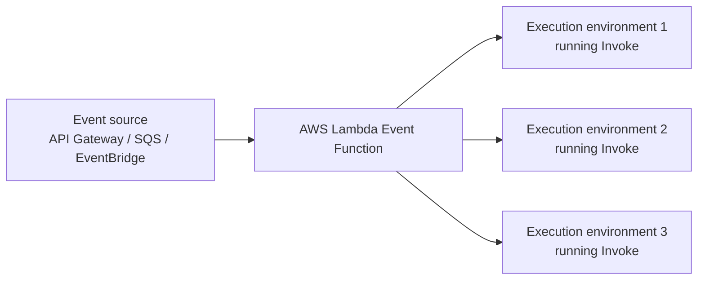
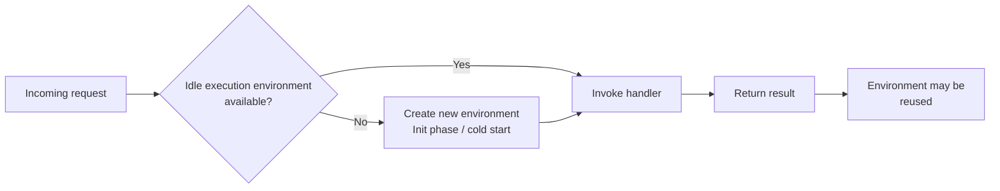
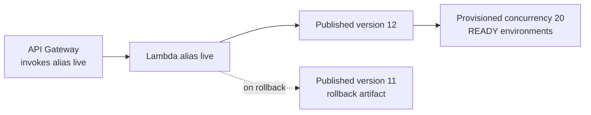
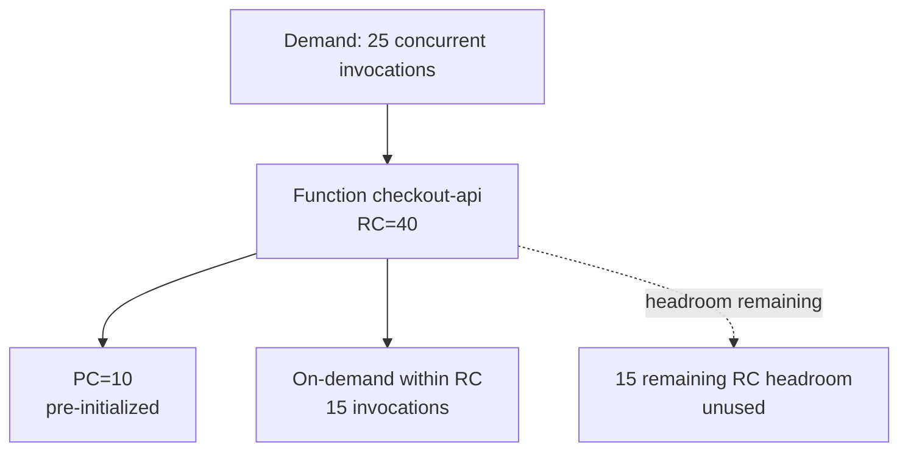
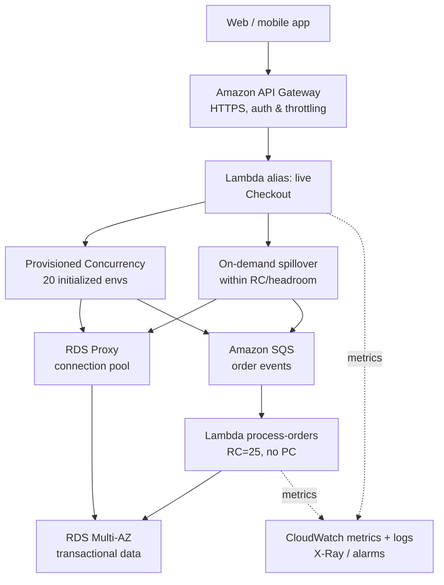
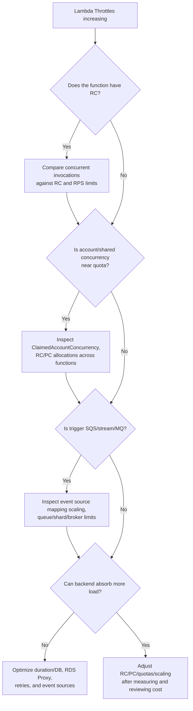

# Reserved Concurrency and Provisioned Concurrency in AWS Lambda

> **Chapter:** Lambda Compute  
> **Module:** CLOUD_PROVIDERS_AWS  
> **Goal:** understand and choose correctly between AWS Lambda's two concurrency controls, calculate limits from real traffic, protect downstream dependencies, reduce cold starts for latency-sensitive apps, monitor throttling, and estimate operating cost.
>
> **Scope:** focuses on Lambda **Event Functions** with standard invocation models within the context of Regions, IAM, VPC, API Gateway, SQS, DynamoDB/RDS, CloudWatch, and version/alias deployments. Newer compute modes have separate scaling models; do not mechanically apply Event Function parameters to every Lambda compute type.

## 1. Problem Statement: Fast APIs Without Overloading the Database

An e-commerce company deploys two Lambda functions in Region `ap-southeast-1`:

- **`checkout-api`:** receives requests from Amazon API Gateway, reads cart data, and writes orders. Users interact directly and expect low **p95 latency**, even after several minutes of sparse traffic.
- **`process-orders`:** receives message batches via Amazon SQS and calls a database with limited connection capacity. A promotion spike can grow the queue sharply; if Lambda scales without limits, the database gets overloaded.

Both needs sound alike — “managing concurrency” — yet target different problems:

1. For `process-orders`, you want to **cap the maximum number of concurrent invocations** to protect downstream systems. This is a classic use case for **reserved concurrency**.
2. For `checkout-api`, you want **pre-initialized execution environments ready**, cutting cold-start time on the synchronous request path. This is a classic use case for **provisioned concurrency**.
3. A single function may need **both**: a concurrency ceiling to protect the database, plus a pool of pre-warmed capacity for interactive traffic.

**Conclusion upfront:** **reserved concurrency does not “keep instances warm”**; **provisioned concurrency does not mean “never throttled.”** The two mechanisms solve different problems and are both governed by account/Region quotas.

### 1.1. Questions Learners Should Be Able to Answer

After this lesson, you will be able to answer:

- How does concurrency differ from requests per second (RPS)?
- When does a function draw from shared/unreserved concurrency?
- Does `reserved concurrency = 20` mean the function always keeps 20 instances running?
- With `provisioned concurrency = 10`, what happens when 25 concurrent requests arrive?
- Why must provisioned concurrency attach to a **published version or alias**, never `$LATEST`?
- Why can a function still experience cold starts or throttles even with provisioned concurrency enabled?
- How do you balance latency, RDS safety, account limits, and billing?
- Which CloudWatch metrics tell you whether your configuration is under-sized or wasteful?

## 2. What Is Concurrency in Lambda?

**Concurrency** is the number of **invocations executing simultaneously at a given moment**. For a Lambda Event Function, each execution environment handles one invocation at a time; an environment can then be **reused** for subsequent sequential invocations.



If three invocations are running at the observed instant, **concurrency = 3**. Over a minute, a function can handle thousands of invocations as each environment processes multiple requests sequentially.

### 2.1. Basic Estimation Formula

For a relatively steady request stream, the standard rule of thumb is:

\[
C \approx R \times D
\]

Where:

- \(C\): concurrency required to serve average load.
- \(R\): requests per second, commonly called RPS.
- \(D\): average execution duration of one invocation in **seconds**.

Example 1:

\[
100\ \text{requests/second} \times 0.2\ \text{seconds/request}
=20\ \text{concurrent invocations}
\]

Example 2: An API receives 500 RPS with an average execution time of 400 ms:

\[
C \approx 500 \times 0.4 = 200
\]

**Do not confuse 200 concurrency with 200 requests/second.** At 400 ms duration, 200 execution environments can serve roughly 500 RPS on average under steady conditions without hitting other limits.

### 2.2. The Formula Is Only a Starting Point

In practice:

- Traffic can spike within individual seconds; 5-minute RPS averages hide short peaks.
- Duration has a distribution: p95/p99 are slower than the mean due to DBs, external APIs, timeouts, and retries.
- One API Gateway request can fan out into multiple Lambda invocations across different functions.
- Synchronous request rates are also bounded by **requests-per-second quotas**, separate from the concurrency ceiling.
- During sudden spikes, Lambda enforces a **function scaling rate** that limits how fast new execution environments spin up.

Therefore, sizing must rely on **CloudWatch metrics, p95/p99 latency, load testing, and real traffic**, never just picking a number from the average formula.

### 2.3. Concurrency and Throughput Are Not the Same

| Scenario | RPS | Average duration | Estimated concurrency |
|---|---:|---:|---:|
| Fast API | 200 | 50 ms | 10 |
| Normal API | 200 | 500 ms | 100 |
| API slowed by DB | 200 | 2 s | 400 |
| Background jobs | 20 | 10 s | 200 |

At the exact same **200 RPS**, if a slow database pushes duration from 50 ms to 2 seconds, required concurrency jumps from ~10 to 400. Thus **cutting duration** and optimizing database access can be far more effective than simply raising concurrency quotas.

## 3. Execution Environments, Cold Starts, and Warm Reuse

### 3.1. Lifecycle of One Invocation

When an Event Function needs a new environment, Lambda runs the **Init phase**: preparing the runtime, loading code/libraries, executing initialization outside the handler, and setting up connections. Lambda then runs the **Invoke phase** to process the event.



A **cold start** happens when Lambda must initialize a fresh environment. Initialization duration depends on runtime, package size, dependency initialization, VPC/network setup, extensions, and code outside the handler.

**Warm reuse** reuses an already-initialized environment, though AWS **makes no guarantee to keep an idle environment alive forever**. Lambda can recycle environments for maintenance, invocation failures, or capacity shifts.

### 3.2. Where Do Reserved and Provisioned Concurrency Act?

- **Reserved concurrency (RC):** guarantees and caps *concurrency slots* for a function; **does not pre-warm individual environments**.
- **Provisioned concurrency (PC):** Lambda **pre-creates and pre-initializes** the requested number of execution environments so invocations can use them immediately once ready.

Both are **concurrency controls**, yet only **PC** directly addresses cold starts caused by lacking warm environments. PC can still experience init overhead if Lambda resets/recycles an environment; it is not an absolute SLA on end-to-end latency.

## 4. Concurrency Quotas per Account and AWS Region

Lambda enforces an **account-level concurrency quota per Region** for Event Functions. Accounts commonly default to **1,000 concurrent executions/Region**, though AWS may grant a different limit; **always verify Service Quotas and live account APIs**.

### 4.1. Shared/Unreserved Pool

If a function has no reserved concurrency configured, it draws from the **unreserved concurrency pool** shared with other functions in the same account and Region. A burst on one function can exhaust the pool and throttle other functions.

Hypothetical example with an account quota of 1,000:

```text
Account/Region concurrency quota: 1,000
├── Function A: reserved concurrency 300
├── Function B: reserved concurrency 200
└── Shared/unreserved pool remaining: 500
    ├── Function C (no RC)
    ├── Function D (no RC)
    └── other functions
```

Functions A and B reserve a combined 500 units even if zero invocations are running right now. The remaining 500 pool is shared by unreserved functions and other allocations per allocation rules.

**AWS requires keeping at least 100 units unreserved** for functions without reserved concurrency. With a 1,000 quota, you cannot assign all 1,000 to reserved concurrency; the typical maximum allocatable reservation is 900 before factoring in other allocations.

### 4.2. What Changes When a Higher Quota Is Granted?

If AWS raises the account limit from 1,000 to 2,000 concurrent executions, maximum allocatable reserved concurrency rises in principle to 1,900 while still keeping **100 unreserved**. However:

- A higher quota does not mean your code or database can survive that load.
- Function scaling rate and RPS limits still apply.
- Some event sources such as Amazon MQ or SQS enforce separate concurrency caps.
- When many functions configure RC/PC, total allocations still need governance.

**A quota is an infrastructure ceiling**, not a business performance guarantee.

## 5. Reserved Concurrency: Reserving Slots and Capping a Function

### 5.1. Exact Definition

**Reserved concurrency** does two things simultaneously:

1. **Reservation:** concurrency capacity is set aside **exclusively for that function**. Other functions cannot consume it.
2. **Limit:** the function itself **cannot exceed** its RC setting, even if shared account concurrency remains available.

**Reserved concurrency applies to the function as a whole**, spanning `$LATEST`, all published versions, and all aliases. It is **not a separate RC cap per alias**.

Example setting:

```text
Function: process-orders
Reserved concurrency: 30
```

If 25 concurrent invocations arrive, the function serves them within the 30-unit cap (barring other limits). If demand suddenly hits 38 concurrent invocations, the 8 invocations above the ceiling are **throttled** or handled via event-source retries/queuing as appropriate.

**Setting RC=30 does not create 30 warm instances.** The function can still hit cold starts whenever new environments must be initialized.

### 5.2. RC Incurs No Direct Reservation Fee

AWS **charges no extra fee solely for configuring reserved concurrency**. You still pay for:

- Request charges where applicable.
- Compute duration and memory per Lambda pricing.
- CloudWatch, VPC/NAT, RDS, SQS, KMS, or related service costs.

Because RC does not pre-initialize environments, there is no separate **pre-warmed capacity** charge like PC.

### 5.3. When Should You Choose RC?

| Problem | Why RC helps |
|---|---|
| Protect RDS from too many connections | Caps concurrent Lambda invocations that can hold DB connections |
| Prevent batch jobs from starving critical APIs | Dedicates concurrency to APIs or caps batch functions |
| Control burst cost/risk | Places a relative throughput ceiling, avoiding slamming fragile services |
| Isolate critical functions in an account | Function A's RC cannot be consumed by Function B |
| Temporarily halt a function | Setting RC = 0 throttles new invocations |

**Exercise caution with RC=0:** it **does not disable event sources** and does not guarantee events are retained forever. Sync calls receive throttles; for async/SQS/streams, behavior depends on queues, retries, event age, DLQs, and retention. Never use RC=0 as a substitute for a controlled consumer pause runbook.

### 5.4. In Practice, RC Is Both a “Protected Floor” and a “Ceiling”

AWS documentation describing RC as a “minimum” means the allocation is **protected from being taken by other functions**, not that Lambda actively keeps that many environments running.

If Function A has RC=50 while idle:

- It can have **0 running invocations**.
- It does not automatically hold 50 warm environments.
- Those 50 units are still subtracted from the shared pool available to other functions.

Over-provisioning RC therefore creates **quota waste**, even without direct RC billing.

## 6. Provisioned Concurrency: Keeping Pre-Initialized Execution Environments Ready

### 6.1. Exact Definition

**Provisioned concurrency** is the number of execution environments Lambda **pre-initializes and keeps ready** for a **published function version** or **alias**. When a request arrives and a provisioned environment is idle, the invocation avoids the usual cold start.

Example:

```text
Function: checkout-api
Published version: 12
Alias: live -> version 12
Provisioned concurrency on alias live: 20
```

Lambda allocates up to 20 initialized execution environments to serve invocations targeting alias `live` once allocation completes.

**Non-negotiable rules:**

- PC **cannot be configured on `$LATEST`**.
- Triggers must invoke the **exact alias/version** with PC; calling the unqualified function ARN routes to `$LATEST` and **bypasses PC**.
- PC allocation is **not instantaneous**; status stays `IN_PROGRESS` before becoming `READY`.
- PC incurs **capacity charges for the entire duration it is allocated**, even with zero requests.
- PC does not alter event-source limits or fix database bottlenecks.

### 6.2. Does PC Mean “Zero Cold Starts Ever”?

PC is built to sharply reduce cold starts when sufficient provisioned capacity exists, yet claiming **“PC enabled = every request is guaranteed fast”** is wrong:

- Traffic exceeding PC can **spill over** into on-demand capacity, where cold starts can occur.
- Lambda can reset/recycle provisioned environments after errors or during maintenance, introducing init activity on some invocations.
- Provisioned capacity must reach **`READY`** before you can rely on it.
- Traffic accidentally routed to `$LATEST` or another alias **does not use** the configured alias's allocation.
- Even without cold starts, handlers can still stall on RDS locks, DynamoDB throttling, third-party APIs, networking, or serialization.

**End-to-end latency** still requires testing and monitoring real p95/p99 metrics.

### 6.3. PC Allocation Takes Time

After requesting PC, Lambda provisions and initializes the environments. AWS notes that PC creation takes preparation time; larger allocations require planning ahead of peaks.

Sample API response:

```json
{
  "RequestedProvisionedConcurrentExecutions": 20,
  "AllocatedProvisionedConcurrentExecutions": 0,
  "Status": "IN_PROGRESS"
}
```

**Do not shift production traffic immediately** just because the API call succeeded. Wait for `Status = READY` and `AllocatedProvisionedConcurrentExecutions` to match the target, then verify traffic routes through the alias.

### 6.4. Versions and Aliases

A Lambda function has:

- `$LATEST`: unpublished mutable code/config.
- Published versions such as `10`, `11`, `12`: immutable snapshots of code/config at publish time.
- Aliases such as `dev`, `staging`, `live`: stable names pointing to a published version, optionally supporting weighted routing.

Recommended pattern:



**Common mistake:** configuring PC on alias `live`, while API Gateway integrates with the **unqualified** ARN. API Gateway then invokes `$LATEST` and gets zero benefit from PC; always verify the actual integration/permission ARN.

## 7. Direct Comparison: Reserved vs. Provisioned Concurrency

| Criterion | **Reserved concurrency** | **Provisioned concurrency** |
|---|---|---|
| Primary goal | **Protect and cap concurrent invocations** | **Cut cold starts using pre-initialized environments** |
| Configuration scope | **Entire function**, across versions/aliases | **Published version or alias**, never `$LATEST` |
| Reserves quota? | Yes, RC sets aside units for the function | Yes, PC consumes concurrency from the applicable pool |
| Pre-initializes environments? | **No** | **Yes** |
| Can cold starts occur? | **Possible** | Greatly reduced within PC; possible on spillover/resets |
| When traffic exceeds limit | Exceeding **RC** → throttling | Exceeding **PC** → may spill to on-demand; exceeding RC/account/RPS → throttling |
| Idle fee | **No** | **Yes**: provisioned capacity charges |
| Typical uses | Protect DB, isolate functions, cap batch jobs | Interactive APIs, mobile/web backends, latency-sensitive paths |
| Auto-scaling | Manage RC via IaC/automation if needed | Application Auto Scaling with scheduled or target tracking |
| `RC = 0` / `PC = 0` | `RC=0` blocks invocations | PC is not a throttle switch; removing PC only drops pre-warmed capacity |

**Quick rule:** if the question is “this function must never exceed 30 concurrent invocations” → **RC**. If the question is “when users call, environments must already be initialized for the first 10 concurrent requests” → **PC**.

## 8. Combining RC and PC: Reading Every State Accurately

A function can configure both RC and PC. When RC is set, **total PC allocated across all versions/aliases of the function cannot exceed RC**.

### 8.1. Example A — `RC=40, PC=10`

```text
Function checkout-api:
Reserved concurrency = 40
Provisioned concurrency (alias live) = 10

Concurrent demand = 8:
  8 served by PC, 2 PC idle.

Demand = 25:
  10 served by PC.
  Remaining 15 run on-demand within RC (subject to cold starts).

Demand = 45:
  At most 40 concurrent invocations allowed by RC.
  5 excess invocations are throttled or retried depending on source.
```



**Common misconception:** `PC=10` **does not add 10 on top of `RC=40`**. PC sits **inside** the RC cap, not creating a total of 50.

### 8.2. Example B — `RC=10, PC=10`

If total PC across all versions/aliases equals `RC=10`:

- All ten units are dedicated to provisioned concurrency.
- Traffic above PC has zero RC headroom left for on-demand execution.
- Excess invocations are throttled.
- **`$LATEST`** has no capacity left to run if 100% of RC is allocated to PC, per AWS's allocation model.

This can be intentional if you want to **run strictly on pre-warmed capacity**, yet it easily surprises developers testing `$LATEST` or hitting bursts past 10 concurrent requests.

### 8.3. Example C — Only `PC=20`, No RC

A function has `PC=20` on alias `live`, with **no reserved concurrency**:

- 20 environments are pre-initialized once allocation reaches `READY`.
- Above 20 concurrent requests, Lambda scales into **available on-demand/shared concurrency**.
- The function only throttles if **account quota, scaling rate, or RPS limits** are reached.
- PC still counts against account capacity allocations and shrinks the pool available to other functions.

**PC by itself does not cap concurrency at 20.** If your goal is protecting a database, never set `PC=20` thinking the function cannot reach 100 concurrent invocations.

### 8.4. Example D — One Function with Two Aliases

Suppose:

```text
Function: payment-handler
Function-wide reserved concurrency: 40
Alias live -> version 12: PC=25
Alias canary -> version 13: PC=5

Total allocated PC: 30
Remaining RC headroom: 10
```

Constraint:

\[
PC_{\text{live}} + PC_{\text{canary}} \leq RC_{\text{function}}
\]

Raising canary PC to 25 while `live` stays at 25 sums to 50, exceeding `RC=40`; the configuration request will fail. During blue/green or weighted alias routing, always sum **all allocations** alongside real traffic splits.

### 8.5. RPS Limits Are Another Dimension

Lambda Event Functions enforce **requests-per-second limits**. AWS documents a rate limit of **10 requests/second per concurrency unit** in applicable synchronous invocation scenarios, including per-PC-alias/version bounds.

For example, with `PC=20`, a function serving 2,000 requests/second at an ultra-fast 5 ms each:

\[
R \times D = 2{,}000 \times 0.005 = 10\ \text{average concurrency}
\]

Even though average concurrency (10) is below `PC=20`, **the RPS cap corresponding to `PC=20` is only about 200 requests/second** where that limit applies. Traffic beyond that rate can spill over to on-demand or hit other throttles.

**Never size PC purely from $C = R \times D$** when durations are tiny and RPS is huge; check the **RPS quota = 10 × allocated concurrency** as well as account/on-demand limits.

## 9. Throttling Behavior Depends on Invocation Type and Event Source

### 9.1. Synchronous Invocations

API Gateway, the Lambda Invoke API, or `RequestResponse` callers normally wait for results:

- When exceeding RC/account/RPS limits, Lambda returns **`TooManyRequestsException` (HTTP 429)** on the invoke API.
- Depending on API Gateway/ALB mappings, clients may see different HTTP codes; inspect integration logs.
- The **client** or upstream service owns retries using exponential backoff/jitter to avoid retry storms.
- For order/payment mutations, retries must include an **idempotency key**.

RC and PC never fix an API that was not designed to be idempotent.

### 9.2. Asynchronous Invocations

With `InvocationType=Event` from async-capable services:

- Lambda places the event onto its **internal queue** and processes it asynchronously.
- On function code errors, Lambda retries per configuration (default up to 2 retries for function errors).
- On **throttles** or system errors, Lambda applies backoff/retries while the event remains within its max event age and source policies.
- Configure an **on-failure destination** or DLQ to capture events after final failure.

Thus `RC=0` does not immediately discard every event, nor does it preserve them indefinitely. If the queue backs up, events exceeding `MaximumEventAgeInSeconds` are dropped per policy.

### 9.3. SQS Event Source Mapping

**Amazon SQS → Lambda** uses Lambda **polling batches** from the queue — unlike simple direct async push events. Reducing RC:

- Caps concurrent invocations.
- Increases message backlog and `ApproximateAgeOfOldestMessage`.
- Triggers Lambda poller backoff/retry logic alongside SQS visibility timeouts and redrive policies.
- Requires DLQs, idempotent consumers, and partial batch responses where appropriate.

An SQS event source mapping also has its own **`MaximumConcurrency`**. That is a **per-event-source cap**, whereas **reserved concurrency** caps the **entire function**.

| Mechanism | Scope | Purpose |
|---|---|---|
| **Lambda reserved concurrency** | Entire function | Concurrency ceiling across all invocations of the function |
| **SQS mapping `MaximumConcurrency`** | Single SQS event source mapping | Stops one queue from driving too many concurrent invokes |
| **SQS ESM Provisioned Mode** | Pollers of the SQS mapping | Keeps pollers pre-allocated to scale ingestion throughput |
| **Lambda provisioned concurrency** | Function version/alias | Keeps **execution environments** pre-initialized |

**Important:** **SQS Provisioned Mode is not Lambda Provisioned Concurrency.** One keeps **event pollers** ready; the other keeps **execution environments** warm. They have separate support rules and pricing.

When setting `MaximumConcurrency` across multiple SQS mappings feeding one function, AWS recommends **function reserved concurrency ≥ sum of `MaximumConcurrency`** across those mappings; otherwise throttling still occurs. For FIFO queues, the number of active message group IDs also bounds concurrency.

### 9.4. Streams and Amazon MQ

- **Kinesis/DynamoDB Streams:** parallelism depends on shards, batching, parallelization factor, source mappings, and ordering; raising RC does not create extra shards.
- **Amazon MQ:** mapping concurrency has broker-type-specific limits that AWS documents as lower than standard concurrency quotas; RC/PC cannot bypass source limits.
- **Synchronous APIs:** p95 latency usually matters far more than for background queue workers, so PC is more commonly prioritized there.

**No concurrency setting replaces understanding the scaling mechanics of each specific event source.**

## 10. Sizing Reserved Concurrency Based on Downstream Capacity

Suppose `process-orders` reads SQS and writes to RDS. The database can safely sustain about **60 active connections for this workload**, leaving headroom for other apps. Current code may open **up to two DB connections** per invocation.

Rough upper bound:

\[
RC \leq \left\lfloor \frac{60\ \text{connections}}{2\ \text{connections/invocation}} \right\rfloor = 30
\]

You might start at **RC=20–25** for safety margin after verifying connection pooling and real traffic.

**This is only a simplified model:** a warm Lambda environment can hold idle connections across invocations; real connection counts may not equal concurrent invocations times a constant. Watch:

- RDS `DatabaseConnections`, CPU, locks, and latency.
- Connection reuse across warm environments.
- Transaction duration, pool size, and retry behavior.
- Connections to Secrets Manager/KMS/VPC endpoints and database limits.
- Adopting **Amazon RDS Proxy** for proper connection pooling and failover handling.

### 10.1. RC Is a Throttle Valve, Not a Load Balancer

If the function throttles under rising load, RC is doing its job as a cap. The questions to ask are:

1. Can downstream systems handle higher load?
2. Should the database or proxy be scaled before raising RC?
3. Can duration or batch size be optimized to process the same throughput with lower RC?
4. Are queue retention and visibility timeouts large enough for queuing delays?
5. Are backlog and oldest-message-age alerts configured?

Cranking RC from 20 to 200 just because `Throttles` appeared can turn **manageable throttling** into a **full database outage**.

## 11. Sizing Provisioned Concurrency for Latency-Sensitive APIs

### 11.1. Start from Real Data

Suppose `checkout-api` has:

- Peak average from 09:00–11:00: 150 RPS.
- Average warm duration: 120 ms.
- p95 duration: 280 ms.
- Users are sensitive to Java runtime cold starts.
- Low latency is critical only 2 hours/day, 5 days/week.

Estimated average concurrency at peak:

\[
C \approx 150 \times 0.12 = 18
\]

A sensible starting point is **PC ≈ 20** (with buffer), then verify against live metrics. AWS suggests **roughly a 10% buffer** above typical concurrency demand as a general rule of thumb, not a universal formula.

To handle spikes, you might:

- Set **RC=40** to allow headroom up to 40 while still protecting RDS.
- Set **PC=20–25** during peak hours.
- Accept on-demand spillover for requests above PC with matching retry/latency SLOs.
- If every peak request requires strict latency, raise PC according to the actual load distribution and cost budget.

### 11.2. Evaluating Duration Properly

With PC, do not assume the **Invoke phase** itself speeds up. PC eliminates initialization overhead, not slow SQL queries or JSON serialization. Measure:

- **Cold/warm init duration** before enabling PC.
- Real HTTP p50, p95, and p99 latency.
- Lambda `Duration` and time spent in API Gateway/ALB.
- `ProvisionedConcurrencySpilloverInvocations` during peaks.
- `ProvisionedConcurrencyUtilization` to spot over-allocation.

### 11.3. Watch the RPS Quota

For ultra-short requests, $R \times D$ concurrency can look tiny while the **10×PC RPS limit** hits first. For 3,000 RPS at 10 ms duration:

\[
C_{\text{average}} = 3{,}000 \times 0.01 = 30
\]

`PC=35` covers average concurrency, yet its corresponding RPS threshold is only around **350 RPS** at the 10×PC limit. Plan PC/on-demand capacity and verify request-rate quotas; bumping PC to 35 alone will not serve 3,000 RPS without spillover.

## 12. Reference Architecture: Low-Latency API + Stable Queue



Key decisions:

- **API Gateway:** handles auth, routing, and edge throttling without replacing Lambda concurrency controls.
- **Alias `live`:** pins integration to a published version with PC, enabling clean deploys and rollbacks.
- **PC:** keeps warm capacity for interactive traffic; scaled to traffic patterns.
- **Checkout RC:** caps total DB pressure if many invocations surge together.
- **RDS Proxy:** avoids excessive direct connections and handles pooling; still requires proper retries, transactions, and DB limits.
- **SQS:** decouples background processing and absorbs bursts when the worker hits its RC cap.
- **Worker RC:** shields RDS and stops queue consumers from exhausting the account pool.
- **CloudWatch:** tracks p95 latency, errors, throttles, PC spillover, utilization, and queue age.

**Availability:** Lambda is a Regional service with AWS-managed HA infrastructure, but VPC dependencies like NAT/VPC endpoints, RDS subnet groups, database failover, Route 53, and KMS keys still require **Multi-AZ** design. Enabling PC/RC does not create multi-Region disaster recovery.

## 13. AWS Console Configuration and Safe Deployment Flow

### 13.1. Configuring RC

In the AWS Lambda console:

1. Select the **Lambda Event Function** whose concurrency you want to control.
2. Open **Configuration → Concurrency**.
3. Under **Reserved concurrency**, select **Reserve concurrency**.
4. Enter the target concurrency, e.g., `40`.
5. Save and verify account-wide metrics once the reservation takes effect.

**Do not set unnecessarily high RC out of habit**, because it locks up slots other functions cannot use.

### 13.2. Configuring PC

Conceptual workflow:

1. Build and test code/config, then **publish a version**.
2. Create or update an **alias** such as `live` pointing to that version.
3. Under **Configuration → Concurrency → Provisioned concurrency**, add config targeting the **alias or version** — never `$LATEST`.
4. Choose the PC count; ensure it does not exceed the function's RC (if set) or account allocation limits.
5. Wait for allocation status **`READY`** before expecting traffic to hit warmed capacity.
6. Confirm **API Gateway, event source mappings, or callers** invoke the **PC-configured alias/version**, not the bare unqualified function ARN.
7. Monitor CloudWatch `ProvisionedConcurrencyInvocations`, spillover, and latency.

### 13.3. Pre-Cutover Production Checklist

- Confirm the new function version uses the proper IAM role, secrets, VPC, timeout, and memory.
- Test-invoke via the **qualified ARN** so calls do not fall back to `$LATEST`.
- Confirm PC allocation is `READY` and KMS/secrets/init code succeed cleanly.
- If using weighted-alias traffic shifting, provision enough PC across both active and new versions.
- Enable alarms on throttles, errors, and p95 latency.
- Prepare alias rollback to the prior version and ensure the old artifact remains intact.
- Confirm database schemas are backward-compatible.
- Estimate quota and cost overlap while two versions hold PC simultaneously during rollout.

## 14. AWS CLI: Read-Only Inspection Commands

All commands in this section are **read-only** and neither create nor modify resources. They require AWS CLI v2, read permissions for Lambda/CloudWatch/Application Auto Scaling, and the target Region.

### 14.1. Inspect Account Concurrency Quotas

```bash
aws lambda get-account-settings \
  --region ap-southeast-1 \
  --query 'AccountLimit.{TotalConcurrency:ConcurrentExecutions,AllocatableUnreserved:UnreservedConcurrentExecutions}' \
  --output json
```

**Note on fields:** `AccountLimit.ConcurrentExecutions` is the account-level quota. `AccountLimit.UnreservedConcurrentExecutions` shows remaining allocatable concurrency, **not the number of currently running invocations**. To observe live running concurrency, inspect CloudWatch `ConcurrentExecutions` and `UnreservedConcurrentExecutions`.

### 14.2. Inspect a Function's Reserved Concurrency

```bash
aws lambda get-function-concurrency \
  --region ap-southeast-1 \
  --function-name checkout-api \
  --output json
```

When RC is configured, the output includes `ReservedConcurrentExecutions`. If no RC is configured, the response omits that value; do not misinterpret absence as `RC=0`. **`RC=0`** is an explicit configuration that throttles invocations.

### 14.3. List Versions and Aliases

```bash
aws lambda list-versions-by-function \
  --region ap-southeast-1 \
  --function-name checkout-api \
  --query 'Versions[].[Version,FunctionArn,LastModified]' \
  --output table

aws lambda list-aliases \
  --region ap-southeast-1 \
  --function-name checkout-api \
  --query 'Aliases[].[Name,FunctionVersion,AliasArn]' \
  --output table
```

Verify which version `live` currently points to, especially after deploys or rollbacks.

### 14.4. Inspect Provisioned Concurrency

```bash
aws lambda list-provisioned-concurrency-configs \
  --region ap-southeast-1 \
  --function-name checkout-api \
  --output json
```

When targeting a known alias:

```bash
aws lambda get-provisioned-concurrency-config \
  --region ap-southeast-1 \
  --function-name checkout-api \
  --qualifier live \
  --query '{Requested:RequestedProvisionedConcurrentExecutions,Allocated:AllocatedProvisionedConcurrentExecutions,Status:Status,Reason:StatusReason}' \
  --output json
```

Expect `Status = READY` once allocation finishes. If `IN_PROGRESS`, do not assume full capacity is warmed yet. If `FAILED`, read `StatusReason` and check quotas, init code, runtime, and IAM/KMS.

### 14.5. Inspect Function Configuration and Alias Integration

```bash
aws lambda get-function-configuration \
  --region ap-southeast-1 \
  --function-name checkout-api \
  --query '{Runtime:Runtime,MemorySize:MemorySize,Timeout:Timeout,Role:Role,VpcConfig:VpcConfig,State:State}' \
  --output json

aws lambda get-alias \
  --region ap-southeast-1 \
  --function-name checkout-api \
  --name live \
  --output json
```

With API Gateway or SQS mappings, inspect the actual trigger ARN to verify it invokes **alias `live`**. Never assume it does just by seeing “live” in the console without checking the integration ARN.

### 14.6. Inspect SQS Event Source Mappings

```bash
aws lambda list-event-source-mappings \
  --region ap-southeast-1 \
  --function-name process-orders \
  --query 'EventSourceMappings[].[UUID,EventSourceArn,State,ScalingConfig.MaximumConcurrency]' \
  --output table
```

`MaximumConcurrency` is a **mapping-level setting**, not function RC or PC. For SQS Provisioned Mode, inspect the full JSON and fields supported by your current API version.

### 14.7. Inspect Application Auto Scaling Targets

```bash
aws application-autoscaling describe-scalable-targets \
  --region ap-southeast-1 \
  --service-namespace lambda \
  --scalable-dimension lambda:function:ProvisionedConcurrency \
  --output json

aws application-autoscaling describe-scaling-policies \
  --region ap-southeast-1 \
  --service-namespace lambda \
  --scalable-dimension lambda:function:ProvisionedConcurrency \
  --output json
```

Use these to see which aliases/versions have managed PC scaling, min/max bounds, and target tracking policies. If PC unexpectedly drops after an admin raised it manually, check Application Auto Scaling first.

## 15. Mutating Configuration Commands (For Learning Only)

**The commands below modify live resources and can cause throttling or billing charges; DO NOT run them in production without change approval.** They are shown to illustrate the APIs, not as instructions to run against a live account.

### 15.1. Set, Delete, or Temporarily Block Reserved Concurrency

```bash
# Set RC=40 across the entire function
aws lambda put-function-concurrency \
  --region ap-southeast-1 \
  --function-name checkout-api \
  --reserved-concurrent-executions 40

# Temporarily throttle the function with RC=0 (impacts invocations!)
aws lambda put-function-concurrency \
  --region ap-southeast-1 \
  --function-name checkout-api \
  --reserved-concurrent-executions 0

# Remove RC config so the function returns to the shared pool (not RC=0)
aws lambda delete-function-concurrency \
  --region ap-southeast-1 \
  --function-name checkout-api
```

**Setting `RC=0` vs. deleting RC** have opposite effects. Deleting RC lets the function scale back into the shared pool, potentially putting fresh pressure on downstream systems.

### 15.2. Publish a Version and Configure Provisioned Concurrency

```bash
# Publish a new version after testing code/config
aws lambda publish-version \
  --region ap-southeast-1 \
  --function-name checkout-api

# Assume alias live exists and points to a published version.
# Allocate 20 PC on alias live (incurs capacity charges while allocated).
aws lambda put-provisioned-concurrency-config \
  --region ap-southeast-1 \
  --function-name checkout-api \
  --qualifier live \
  --provisioned-concurrent-executions 20

# Deleting PC stops capacity charges for that config
# but may reintroduce cold starts for subsequent traffic.
aws lambda delete-provisioned-concurrency-config \
  --region ap-southeast-1 \
  --function-name checkout-api \
  --qualifier live
```

Never create PC on `$LATEST`. If the alias does not exist yet, create it pointing to the verified published version per your release process. When deleting PC, monitor latency afterward and avoid deleting artifacts/versions still serving live traffic.

### 15.3. Declaring Infrastructure with IaC

An **AWS CloudFormation** snippet illustrating the structure:

```yaml
Resources:
  CheckoutFunction:
    Type: AWS::Lambda::Function
    Properties:
      FunctionName: checkout-api
      Runtime: java21
      Handler: example.CheckoutHandler::handleRequest
      Role: arn:aws:iam::111122223333:role/checkout-lambda-role
      MemorySize: 1024
      Timeout: 15
      ReservedConcurrentExecutions: 40
      Code:
        S3Bucket: example-deploy-artifacts
        S3Key: checkout/build-123.zip

  CheckoutVersion:
    Type: AWS::Lambda::Version
    Properties:
      FunctionName: !Ref CheckoutFunction

  LiveAlias:
    Type: AWS::Lambda::Alias
    Properties:
      Name: live
      FunctionName: !Ref CheckoutFunction
      FunctionVersion: !GetAtt CheckoutVersion.Version
      ProvisionedConcurrencyConfig:
        ProvisionedConcurrentExecutions: 20
```

**This is an illustrative template sketch, not a ready-to-deploy CloudFormation stack:** the role ARN and S3 artifact are placeholders; function code must actually exist with a compatible handler. In CI/CD pipelines, manage a **distinct version logical resource** per release alongside permissions and alias traffic shifting rather than expecting a static Version resource to auto-publish on every code change.

With **AWS SAM**, higher-level properties like `AutoPublishAlias` and `ProvisionedConcurrencyConfig` simplify this; check your template specification and how SAM manages versions and aliases.

## 16. Application Auto Scaling for Provisioned Concurrency

Running fixed PC 24/7 can get expensive if an API is busy only a few hours a day. **Application Auto Scaling** can adjust PC on a schedule or by utilization.

### 16.1. Scheduled Scaling

An API serving business hours:

| Illustrative window | Demand | PC target |
|---|---|---:|
| 00:00–07:30 | Very light traffic | 2 |
| 07:30–09:00 | Traffic ramping up | 10 |
| 09:00–18:00 | Peak hours | 25 |
| 18:00–24:00 | Traffic tapering off | 3 |

**Timezone note on schedules:** Application Auto Scaling supports a timezone field on scheduled actions per current features; verify cron expressions and DST if operating across timezones. Never hardcode GMT+7 without verifying the actual timezone setting.

Scheduled scale-ups **must run ahead of the peak** so Lambda has time to allocate PC. Never bump PC at the exact second a campaign starts expecting 100% warmed capacity instantaneously.

### 16.2. Target Tracking Scaling

You can use **`LambdaProvisionedConcurrencyUtilization`** in a target tracking scaling policy — for instance, targeting 70% utilization:

- If utilization stays consistently above target, Application Auto Scaling raises PC within bounds.
- If utilization stays low for a sustained period, it scales PC down to save money.
- Supporting CloudWatch alarms are created and managed by the policy.
- Min/Max bounds must fit within RC and account quotas.

Target tracking does not react instantaneously to multi-second bursts; account for **scale-out latency** and pick an appropriate buffer.

### 16.3. Initial Configuration Requirement

AWS recommends **setting an initial PC value** before attaching Application Auto Scaling to manage PC. Only then register the `lambda:function:ProvisionedConcurrency` scalable target and scaling policy; otherwise auto scaling may not behave cleanly per documentation.

A scalable target uses a resource ID formatted as:

```text
function:checkout-api:live
```

Never use `function:checkout-api:$LATEST`, as PC does not support `$LATEST`.

## 17. Metrics, Alarms, and Pinpointing Bottlenecks

### 17.1. Key CloudWatch Metrics

| Metric | Scope/meaning | Typical statistic |
|---|---|---|
| **`ConcurrentExecutions`** | Number of invocations currently running | `Maximum` |
| **`UnreservedConcurrentExecutions`** | Invocations consuming the shared pool | `Maximum` |
| **`ClaimedAccountConcurrency`** | Capacity slots claimed by reserved/provisioned allocations plus active unreserved usage | `Maximum` |
| **`Throttles`** | Invocation attempts throttled | `Sum` |
| **`Invocations`** | Total invocations | `Sum` |
| **`Duration`** | Function processing time | Average, p95/p99 where available |
| **`Errors`** | Invocations ending in error | `Sum`, compute error rate |
| **`ProvisionedConcurrentExecutions`** | Number of **provisioned environments actively running invocations** | `Maximum`, distinct from allocated PC |
| **`ProvisionedConcurrencyInvocations`** | Invocations served by provisioned environments | `Sum` |
| **`ProvisionedConcurrencySpilloverInvocations`** | Invocations falling back to on-demand when PC is full | `Sum` |
| **`ProvisionedConcurrencyUtilization`** | Fraction of PC currently busy | `Maximum` |
| **`ProvisionedConcurrencySpilloverInvocations`** + `Throttles` | Distinguish insufficient warm capacity from hitting concurrency caps | Inspect per alias/version over time |

**Common mistake:** `ProvisionedConcurrentExecutions=5` does not mean only **5 environments were allocated** when PC=20. It shows how many **provisioned environments were busy** during that period; the other 15 were warm and idle.

### 17.2. Why `ClaimedAccountConcurrency` Matters

`ConcurrentExecutions` measures active executions, so it **does not show reserved-but-idle quota**. AWS tracks **`ClaimedAccountConcurrency`**:

\[
\text{ClaimedAccountConcurrency} =
\text{UnreservedConcurrentExecutions}+
\text{AllocatedConcurrency}
\]

Where allocated concurrency:

- Adds **reserved concurrency** of functions with RC.
- Adds **PC of functions without RC**.
- **Does not double-count PC nested inside RC** on the same function.

For example, with account quota 1,000, Function A has `RC=500` (running only 10 invocations), Function B (no RC) has `PC=200`, and shared functions run 100 on-demand invocations. `ClaimedAccountConcurrency` is roughly:

\[
500+200+100=800
\]

Meanwhile, **actual running concurrent invocations** may be much lower. Looking solely at low execution counts and assuming “the account still has tons of quota” can misjudge how much capacity remains allocatable.

### 17.3. Alarm Patterns

| Alarm | When to investigate | Appropriate response |
|---|---|---|
| `Throttles > 0` on critical APIs | Any unexpected throttling | Check RC/account/RPS limits and caller retries |
| `ProvisionedConcurrencySpilloverInvocations` rising | PC too low for traffic or alias routing misconfigured | Compare `ConcurrentExecutions`, PC `READY` status, and alias |
| `ProvisionedConcurrencyUtilization` stuck near 100% | Warm capacity near ceiling | Increase PC carefully if cost and quotas allow |
| `ProvisionedConcurrencyUtilization` stuck near 0% | Wasted warm capacity | Lower PC or schedule down off-peak |
| `ClaimedAccountConcurrency` near account quota | Allocations consuming available capacity | Reclaim unused RC/PC or request a quota increase |
| SQS `ApproximateAgeOfOldestMessage` high | Consumer falling behind queue | Check RC, function duration, DB, and batch retries |
| RDS `DatabaseConnections` high | Too many Lambda environments opening connections | Check RC, RDS Proxy, and pooling |
| API p95/p99 latency rising | Not always cold starts | Inspect traces, `Duration`, `Init Duration`, DB/networking |

CloudWatch has metric delivery latency and granularity limits; combine metrics with application logs, AWS X-Ray/traces where deployed, and synthetic checks rather than relying on one metric alone.

### 17.4. Verifying an Environment Really Used PC

Inside code or controlled debug logs, Lambda exposes the environment variable:

```text
AWS_LAMBDA_INITIALIZATION_TYPE = provisioned-concurrency
or
AWS_LAMBDA_INITIALIZATION_TYPE = on-demand
```

Use it to verify how the execution environment was initialized. This value **never changes during an environment's lifetime**. Never dump all environment variables when troubleshooting, as that can expose secrets.

For init timing, inspect `Init Duration` in logs/Telemetry API per runtime and log format; do not confuse pre-request init with end-to-end request latency.

## 18. Cost: What Does “Pre-Warmed” Cost?

### 18.1. Reserved Concurrency Has No Reservation Fee

**`RC=100`** by itself does not generate a “100 environments × hours” bill. Real invocations still incur standard Lambda request/duration charges, logs, and downstream service costs.

### 18.2. PC Incurs Charges Even with Zero Requests

With **provisioned concurrency**, cost components include:

1. **Provisioned concurrency capacity:** environments × memory (GB) × **seconds PC is allocated**.
2. **Compute duration on invoke:** invocations × processing duration × memory GB, at PC execution rates.
3. **Request charges.**
4. **Initialization billing** or init-related fee components per current pricing rules.
5. **On-demand spillover:** requests exceeding PC are billed at standard on-demand compute rates.
6. **Downstream/supporting services:** API Gateway, VPC NAT/PrivateLink, CloudWatch Logs, RDS Proxy/RDS, KMS, SQS.

**Unit prices vary by Region, active pricing structure, and runtime characteristics; never hardcode USD/GB-second rates in long-lived reference docs.** Always consult the live AWS Lambda pricing page when estimating budgets.

### 18.3. Peak-Hours PC Usage Example

Suppose:

- `checkout-api` uses **1 GiB memory**.
- PC is set to **20 environments**.
- PC runs **10 hours/day** across 22 workdays.
- Excluding request/duration fees and weekends to isolate **PC capacity** alone:

Provisioned concurrency capacity GB-seconds:

\[
20\times1\text{ GiB}\times10\text{ hours/day}\times22\text{ days}\times3{,}600
=15{,}840{,}000\ \text{GB-seconds}
\]

If left running 24 hours/day for 30 days:

\[
20\times1\times24\times30\times3{,}600
=51{,}840{,}000\ \text{GB-seconds}
\]

In this example, 24/7 capacity usage is roughly **3.27 times** larger. Monetary cost equals GB-seconds × active unit rate, plus request/duration and related charges.

**Do not flip PC on/off casually at the exact start of a campaign:** PC allocation takes time, so scheduled scaling must build in a pre-peak buffer.

### 18.4. When Is PC Not Economical?

- Functions invoked only a few times per hour with no cold-start-sensitive SLO.
- Queue-backed workers that can absorb startup latency.
- Workloads where cold starts can be cut via code/dependency trimming, memory tuning, or eligible **Lambda SnapStart**.
- Workloads where real latency sits in databases/networking rather than Init.
- Unpredictable traffic that spikes massively for just seconds, requiring prohibitively high static PC to cover.

In those cases, **on-demand + appropriate RC + code/architecture tuning** can be far more cost-effective.

## 19. SnapStart and Provisioned Concurrency: Comparing Alternatives

**Lambda SnapStart** cuts startup latency by taking an encrypted snapshot of the execution environment when a version is published and restoring it rapidly on demand.

Per current AWS documentation, SnapStart supports designated runtimes such as **Java 11+, Python 3.12+, and .NET 8+**, subject to deployment format, Region, and feature rules. Always check the latest compatibility matrix before enabling.

### 19.1. Why Can't PC and SnapStart Share the Same Version?

AWS **does not support SnapStart and provisioned concurrency simultaneously on the same function version**. They offer distinct trade-offs:

| Criterion | Provisioned concurrency | SnapStart |
|---|---|---|
| Mechanism | Keeps pre-initialized environments running | Saves snapshot and restores quickly on demand |
| Primary effect | Sharply cuts cold starts within warm allocation | Cuts startup latency of newly spun-up environments |
| Cost | Warm capacity charges over time plus invoke charges | Pricing depends on runtime and config; do not assume all runtimes are free |
| Scope | Published version or alias | Published versions and aliases targeting supported versions |
| Compatibility | Cannot coexist with SnapStart on the same version | Cannot coexist with PC; has EFS/ephemeral storage and runtime restrictions |
| Best fit | Strict low-latency APIs with predictable load windows | Cutting cold starts without paying continuously for warm environments |

SnapStart imposes requirements around **uniqueness/random state, pre-snapshot connections, lifecycle hooks, and sensitive data**. For Java, follow AWS guidelines on post-restore reinitialization; never assume snapshot restoration is risk-free.

### 19.2. Choosing Between PC and SnapStart

- If ultra-low p95/p99 is mandatory and traffic is steady during peak windows, evaluate **PC**.
- If a Java/Python/.NET runtime is supported and the goal is lower cold starts without paying for idle warm capacity, **SnapStart** can be compelling.
- If the function is not cold-start sensitive, you may need neither.
- Load-test realistically: backend DBs, VPC networking, and dependencies often dominate total latency once init is optimized.

## 20. Common Operational Pitfalls and How to Investigate

| Symptom | Possible cause | First check |
|---|---|---|
| `RC=30` enabled yet cold starts still happen | RC does not pre-initialize environments | Check init logs; evaluate PC/SnapStart |
| `PC=20` configured yet metrics show zero PC invocations | API Gateway invokes `$LATEST` or another alias | Match integration/qualified function ARN |
| PC config stuck in `IN_PROGRESS` | Allocation not finished yet | Wait for `READY`; inspect `StatusReason` |
| `PC=10` yet peak hits 25 concurrent with cold starts | **Spillover** to on-demand | Check `ProvisionedConcurrencySpilloverInvocations` |
| `PC=RC=20`, function throttles despite spare account capacity | Function capped by RC, cannot borrow shared pool | Inspect RC/PC config and `Throttles` |
| Function has no RC yet PC consumes lots of account pool | PC allocations count against account concurrency | Inspect `ClaimedAccountConcurrency`, `get-account-settings` |
| Very fast function throttles even at low concurrency | **10×concurrency RPS** limit likely hit | Check RPS, duration, request-rate quota |
| Setting PC on `$LATEST` is rejected | PC requires a published version or alias | Publish a version and create an alias |
| Costs rise despite almost zero invocations | PC bills by allocated time | Check PC configured hours and Cost Explorer |
| Alias updated yet traffic still sees init | Allocation not `READY`, weighted split, spillover, resets | Check alias version/weights, PC metrics, logs |
| PC changes unexpectedly | Application Auto Scaling manages capacity | Check scalable targets, scaling policies, scheduled actions |
| SQS backlog grows after lowering RC | Consumer throttled or DB slow | Check RC, source mapping max concurrency, queue age |
| SQS mapping Provisioned Mode does not eliminate cold starts | Provisioned pollers **differ** from provisioned execution environments | Check mapping settings vs. Lambda PC |
| RDS still sees too many connections despite low RC | Each environment holds multiple connections; app retry/pool bugs | Check RDS Proxy, DB metrics, connection management |
| PC enabled yet p99 remains high | Handler/dependency latency, retries, or spillover | Check X-Ray, DB/APIGW latency, and `Duration` |
| `RC=0` used as pause yet events expire | Source-specific retry/age/retention | Check async event age, DLQ, SQS retention |
| SnapStart and PC fail to configure together | Incompatible on the same function version | Pick one mechanism; verify runtime/Region |
| Account limit suddenly impacts multiple functions | Over-allocated RC/PC | Check `ClaimedAccountConcurrency` and quotas |

### 20.1. Decision Tree When Throttles Appear



**Never blindly raise all quotas** at the first sign of throttling: sometimes throttling is the safety valve protecting an overloaded database until the root cause is resolved.

## 21. Common Misconceptions

| Statement | True or false? |
|---|---|
| “`Reserved concurrency = 50` means 50 warm Lambda environments are ready.” | **False.** RC reserves slots and sets a ceiling; it does not pre-initialize. |
| “`Provisioned concurrency = 20` caps the function at 20.” | **False without RC.** Excess traffic can spill over to on-demand. |
| “With `RC=40` and `PC=10`, the function can run up to 50 concurrently.” | **False.** PC sits inside RC; the cap remains 40. |
| “Enable PC on `$LATEST` so every caller benefits.” | **False.** PC only applies to published versions and aliases. |
| “A function with `PC=20` guarantees 100% of requests never hit cold starts.” | **Not strictly guaranteed.** Spillover, resets, and allocation delays still exist. |
| “Reserved concurrency bills hourly, while provisioned concurrency is free.” | **Backwards.** RC has no reservation fee; PC charges for capacity while active. |
| “RPS and concurrency are the same metric.” | **False.** They relate via duration, and separate RPS quotas apply. |
| “Raising RC always lowers latency.” | **False.** Raising RC lifts the ceiling, which can overload and slow down a DB. |
| “SQS Provisioned Mode keeps the Lambda function warm.” | **False.** Provisioned pollers differ from Lambda PC. |
| “If PC fills up, all extra requests immediately throttle.” | **Not always.** They can spill over to on-demand if RC/account/RPS capacity remains. |
| “Setting RC equal to PC leaves `$LATEST` with its own shared pool.” | **False under Lambda's allocation rules.** PC consumes 100% of RC. |
| “Adding PC directly speeds up API business logic.” | **False.** It mainly trims init delay, not SQL queries or app code. |
| “Once PC is enabled, you can drop CloudWatch alerts.” | **False.** Still monitor errors, throttles, spillover, latency, and cost. |
| “Enable both PC and SnapStart on the same version for best results.” | **False.** The two features are incompatible on the same version. |

## 22. Practice Scenarios with Answers

### Exercise 1 — Concurrency from RPS

An API receives **120 RPS** with an average duration of **250 ms**. What is the estimated concurrency?

**Answer:** \(120 \times 0.25 = 30\). This is an average estimate; add buffer for peaks and duration tails.

### Exercise 2 — Database Limit

A database can only spare **80 connections** for workers; each invocation may open **4 connections**. Roughly what is the highest RC to start evaluating?

**Answer:** Rough math: \(80/4 = 20\). Keep safety margin and measure actual connections; evaluate RDS Proxy where appropriate.

### Exercise 3 — Is RC Free?

A function has `RC=100` and receives zero requests all day. Is there a reserved concurrency fee?

**Answer:** **No.** However, those 100 units stay reserved out of the shared pool; Lambda invoke and supporting resource charges still apply when invocations occur.

### Exercise 4 — Idle PC

A function holds `PC=25` for 10 hours with zero invocations. Are PC charges incurred?

**Answer:** **Yes.** Provisioned capacity bills by allocated memory × duration regardless of request volume.

### Exercise 5 — Combining RC and PC

A function has **`RC=30, PC=10`**, and demand hits **24 concurrent invocations**. What is the conceptual split?

**Answer:** Up to 10 invocations use provisioned environments; 14 run on-demand inside the remaining 20 RC headroom. Spillover may hit cold starts; total stays capped at `RC=30`.

### Exercise 6 — Demand Exceeding RC

A function has **`RC=30, PC=10`**, and demand hits **45 concurrent invocations**. What is the function ceiling?

**Answer:** **30** concurrent invocations; 15 excess invocations are throttled or retried/queued per the event source.

### Exercise 7 — Without RC

A function has **`PC=15`** on alias `live` and no RC. Demand reaches 25 concurrent requests; will the 10 requests above PC necessarily throttle?

**Answer:** **Not necessarily.** They can run on-demand from the shared pool if account, scaling rate, and RPS limits allow.

### Exercise 8 — Misconfigured Alias

`PC=20` is attached to alias `live`, yet API Gateway invokes the function ARN without `:live`, hitting `$LATEST`.

**Answer:** Requests bypass provisioned capacity. Update the integration to invoke the qualified alias/version ARN after testing and verifying permissions.

### Exercise 9 — Setting PC Higher Than RC

A function has `RC=50`, `PC live=30`, and `PC canary=25`. Is this valid?

**Answer:** No, because total `PC=55 > RC=50`. Lower PC or raise RC within allowed quotas.

### Exercise 10 — `RC=0`

Operations sets `RC=0` on an async event worker assuming every event will be held indefinitely.

**Answer:** False. Source retries, max event age, and queue retention still apply. Pair with DLQs/on-failure destinations and a safe consumer-pause runbook.

### Exercise 11 — SQS Mapping vs. Function

Two SQS queues feed one function; mapping A has `MaximumConcurrency=10`, B has `15`, and the function has `RC=12`.

**Answer:** Risk of throttling because combined mapping maxima (`25`) exceed `RC=12`. Coordinate RC with mapping caps and DB capacity rather than confusing the two layers.

### Exercise 12 — RPS vs. Concurrency

A function handles 1,000 RPS at 10 ms per request. `PC=20`, yet spillover occurs despite average concurrency being only ~10.

**Answer:** Likely hitting the **10×PC ≈ 200 RPS limit**, not concurrency saturation. Inspect RPS quotas, alias routing, and overall scaling.

### Exercise 13 — Distinguishing Metrics

`PC=40` is configured, yet `ProvisionedConcurrentExecutions` peaks at 12. Does that mean only 12 environments were provisioned?

**Answer:** No. That metric reports **active busy** provisioned environments, not allocated ones. Run `GetProvisionedConcurrencyConfig` to confirm requested vs. allocated counts.

### Exercise 14 — Cold Starts After Enabling PC

PC reports `READY`, yet API Gateway still sees occasional slow requests. What could cause this?

**Answer:** Traffic spillover, misrouted alias calls, RPS limits, Lambda environment resets, or slow backends/DBs. Inspect `ProvisionedConcurrencySpilloverInvocations`, `AWS_LAMBDA_INITIALIZATION_TYPE`, and traces before simply raising PC.

### Exercise 15 — Choosing Mechanisms for API vs. Batch

An interactive Java API needs low p99 latency; an SQS-backed Lambda ETL job can tolerate queue wait time and must protect RDS.

**Answer:** For the API, evaluate **PC** or eligible SnapStart (plus RC if a ceiling is needed). For the ETL job, use **RC** and source mapping caps; PC is rarely a priority if cold starts do not impact business goals.

### Exercise 16 — Scheduled PC

An API gets busy at 08:00; an operator schedules PC to scale up at exactly 08:00.

**Answer:** Scale up **ahead** of peak because allocation takes time. Check scheduled action timezones, `READY` status, and CloudWatch latency.

### Exercise 17 — Estimating Usage

A 2 GiB function runs `PC=10` for **6 hours/day × 20 days**. How many GB-seconds of provisioned capacity is that?

**Answer:** \(10\times2\times6\times20\times3{,}600=8{,}640{,}000\) GB-seconds, excluding request/duration charges and extras.

### Exercise 18 — Account Quota

Account quota is 1,000, Function A has `RC=500`, Function B has `PC=200` with no RC, and C/D run 150 shared concurrent executions. What is the estimated `ClaimedAccountConcurrency`?

**Answer:** \(500+200+150=850\). This differs from active invocations because RC/PC capacity stays claimed even when idle.

### Exercise 19 — PC and SnapStart

A Java Lambda version has SnapStart enabled, and the team wants to add PC to the same version.

**Answer:** Not supported on the same version. Pick one approach after benchmarking latency, compatibility, and cost.

### Exercise 20 — Release Workflow

New version `13` is ready, while alias `live` has PC and points to version `12`. The team flips the alias before verifying PC allocation on the target version.

**Answer:** Cold starts or spillover can occur during cutover. Verify alias weights, `READY` PC allocations, multi-version quota headroom, and rollback readiness before shifting production traffic.

## 23. Pre-Production Checklist

1. **Clarify the goal:** do you need a concurrency ceiling, downstream protection, or lower cold starts?
2. **Measure load:** RPS, average/p95 duration, peak concurrency, throttles, init duration, and queue backlog.
3. **Verify quotas:** Regional account concurrency, minimum 100 unreserved pool, function scaling rate, and RPS limits.
4. **Reserved concurrency:** pick an RC that protects the function and downstream systems without starving the unreserved pool.
5. **Provisioned concurrency:** size PC for latency goals, buffer, traffic patterns, and budget.
6. **Qualifier discipline:** always use published versions/aliases; confirm triggers invoke the exact qualifier.
7. **Coordinate RC/PC:** total PC across versions/aliases must not exceed RC; PC sits inside RC, not outside it.
8. **Allocation status:** wait for `READY` before cutover; alert on `FAILED`/`IN_PROGRESS`.
9. **Event semantics:** understand sync/async/SQS/stream behavior, retries, event age, DLQs, and idempotency.
10. **Scaling:** use scheduled/target-tracking PC with pre-peak lead time and bounded min/max limits.
11. **Data path:** check RDS Proxy, DB connections, VPC subnets, network endpoints, DynamoDB capacity, and secrets.
12. **Security:** least-privilege IAM for deployers, execution role, KMS, and resource-based invoke policies.
13. **Observability:** `ConcurrentExecutions`, `ClaimedAccountConcurrency`, `Throttles`, PC utilization/spillover, API latency, and logs.
14. **Releases:** immutable artifacts/images, aliases, weighted rollouts, rollbacks, and backward-compatible databases.
15. **Cost:** PC GB-seconds over active hours, invoke duration/requests, spillover, logs, and downstream services.
16. **Alternatives:** benchmark **SnapStart** where supported; never enable alongside PC on the same version.
17. **Chaos/load drills:** test traffic bursts, RC caps, PC spillover, and database throttling in non-prod environments.
18. **Periodic review:** reclaim unused RC/PC, track AWS quota/pricing/feature updates, and revisit SLOs.

**Final takeaway:** **Reserved concurrency** is both a **dedicated capacity reservation and hard ceiling** across an entire Lambda function, without keeping environments warm or adding reservation fees. **Provisioned concurrency** provides **pre-initialized environments** for a specific version/alias, cutting cold starts while billing by allocated time and allowing spillover if RC/account capacity permits. Sound designs evaluate **concurrency, RPS, duration, event sources, databases, monitoring, availability, and cost** together.

## AWS Reference Documentation

- [Understanding Lambda Event Function scaling — AWS Lambda](https://docs.aws.amazon.com/lambda/latest/dg/lambda-concurrency.html)
- [Configuring reserved concurrency](https://docs.aws.amazon.com/lambda/latest/dg/configuration-concurrency.html)
- [Configuring provisioned concurrency](https://docs.aws.amazon.com/lambda/latest/dg/provisioned-concurrency.html)
- [Monitoring concurrency metrics](https://docs.aws.amazon.com/lambda/latest/dg/monitoring-concurrency.html)
- [Lambda scaling behavior and scaling rate](https://docs.aws.amazon.com/lambda/latest/dg/scaling-behavior.html)
- [Lambda quotas and requests-per-second limits](https://docs.aws.amazon.com/lambda/latest/dg/gettingstarted-limits.html)
- [Troubleshoot Lambda invocation issues](https://docs.aws.amazon.com/lambda/latest/dg/troubleshooting-invocation.html)
- [Lambda invocation retry behavior](https://docs.aws.amazon.com/lambda/latest/dg/invocation-retries.html)
- [Lambda asynchronous invocation error handling](https://docs.aws.amazon.com/lambda/latest/dg/invocation-async-error-handling.html)
- [SQS event source mapping scaling](https://docs.aws.amazon.com/lambda/latest/dg/services-sqs-scaling.html)
- [Using Lambda with SQS](https://docs.aws.amazon.com/lambda/latest/dg/with-sqs.html)
- [Improving startup performance with Lambda SnapStart](https://docs.aws.amazon.com/lambda/latest/dg/snapstart.html)
- [Application Auto Scaling for provisioned concurrency](https://docs.aws.amazon.com/lambda/latest/dg/provisioned-concurrency.html#managing-provisioned-concurency)
- [AWS Lambda pricing](https://aws.amazon.com/lambda/pricing/)
