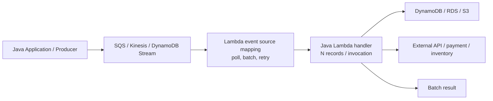
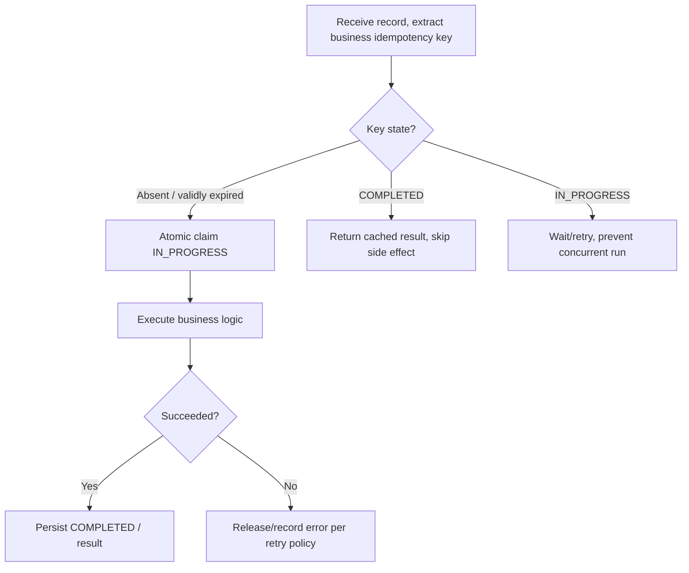

# Batch Processing, Partial Failures, and Idempotency on AWS Lambda

A **Java Spring Boot** service accepts orders and publishes events to **Amazon SQS**. An **AWS Lambda** function reads 10 messages concurrently, writes to **Amazon DynamoDB**, updates an inventory system, and logs progress. Out of those 10 messages, 9 succeed while 1 call to the inventory API times out.

If Lambda throws an exception for the **entire batch**, all 10 messages can reappear after the SQS **visibility timeout**, risking duplicate processing of the 9 messages that already succeeded. If code swallows the exception and always returns success, the failed message can be deleted from the queue despite unfinished business work. If code returns a proper **partial batch failure response**, Lambda can return only the failed message to SQS for retry. Even then, partial failure responses **do not guarantee exactly-once business processing**; you still must design **idempotency**.

This lesson belongs to the **Lambda Compute** chapter of module **CLOUD_PROVIDERS_AWS**. Building on IAM, VPC, SQS, DynamoDB, Kinesis, serverless, and CloudWatch, you will design a Java consumer that survives retries, isolates per-record failures, keeps data consistent, stays observable, and controls cost.

## 1. Learning Objectives

After this lesson, you can:

1. Distinguish **batch**, **event source mapping**, **visibility timeout**, **retry**, **partial batch response**, and **idempotency**.
2. Explain how a **single-message failure** differs from an **entire-invocation failure** when Lambda reads SQS.
3. Configure `ReportBatchItemFailures` and return `batchItemFailures` properly for **SQS Standard and FIFO**.
4. Understand differences for **Kinesis Data Streams** and **DynamoDB Streams**: checkpointing by `sequenceNumber`, suffix reprocessing, and `BisectBatchOnFunctionError`.
5. Write a **Java Lambda handler** returning succeeded/failed records and use Powertools Batch Processor where appropriate.
6. Design **idempotency keys** and persist state safely with DynamoDB conditional writes or Powertools Idempotency.
7. Distinguish **SQS DLQ/redrive policies** and **stream on-failure destinations** from Lambda asynchronous invocation DLQs.
8. Select batch size, retries, visibility timeout, concurrency, logging, and alarms to meet SLOs.
9. Test duplicates, poison messages, timeouts, infrastructure failures, and rollback/replay flows.

## 2. How Does Lambda Receive Batches?

An **event source mapping (ESM)** is an AWS Lambda resource that polls/reads records from a source and invokes a function. For sources like **SQS**, **Kinesis**, or **DynamoDB Streams**, Lambda can group multiple records into one **event** and invoke the handler **once** for the whole batch.



### 2.1. Core Vocabulary

| Concept | Definition | Impact |
|---|---|---|
| **Record/message** | One item inside a batch | Unit of business processing and idempotency |
| **Batch** | Multiple records delivered in one invocation | Cuts overhead, yet groups failure risk without partial failures |
| **Event source mapping** | Configuration for polling, batch size, concurrency, and error handling | Determines real retry mechanics |
| **Invocation** | One call to the Lambda handler | Has timeout, memory, duration, logs, and billing |
| **Partial batch response** | List of failed records returned by the handler | Cuts unnecessary retries depending on source |
| **At-least-once** | One event may be delivered or processed multiple times | Must guard against repeated side effects |
| **Idempotency** | Repeating the same logical operation creates no extra side effects | Safe under retries and duplicate delivery |
| **Poison message** | Record with bad data or permanent error that always fails | Needs quarantine/DLQ instead of endless retries |
| **Backpressure** | Throttling consumer speed so downstream is not overwhelmed | Balances concurrency, batch size, and queue age |

### 2.2. Does a Batch Always Contain Exactly `N` Records?

**No.** `BatchSize` is an **upper bound**; Lambda can receive fewer records when the queue empties, batching windows expire, payload caps trigger, partitions/shards split, or platform conditions vary.

For **SQS Standard**, batch size can go up to **10,000**, though single-invocation payload caps still apply and metadata takes part of the budget. For **SQS FIFO**, max batch size is **10**. For SQS Standard batch sizes above 10, you must set a batching window of at least 1 second. These are ESM limits — not a recommendation for a Java function to load 10,000 records into heap by default.

Source: [Creating an SQS event source mapping](https://docs.aws.amazon.com/lambda/latest/dg/services-sqs-configure.html).

## 3. Delivery Semantics: Why Lambda Must Tolerate Duplicates

Suppose a message says “confirm payment for `order-123`”:

```text
T0: Lambda receives message order-123.
T1: Java handler writes transaction to DynamoDB successfully.
T2: Java handler calls downstream service successfully.
T3: Lambda times out or crashes before reporting batch success.
T4: SQS visibility timeout expires.
T5: Message order-123 is delivered again.
```

At T5, processing a second time can create **two transactions**, send **two emails**, or deduct **inventory twice** unless idempotency is implemented.

Crucial facts:

- Lambda with SQS/streams exhibits **at-least-once** semantics in normal operation; duplicate delivery can still occur **even with partial batch responses enabled**.
- **Exactly-once delivery** across the entire chain SQS → Lambda → database → third-party API is never guaranteed by a single checkbox.
- SQS FIFO provides queue-level **deduplication** and ordering within `MessageGroupId`, yet queue deduplication has a finite window and **does not replace** idempotency of downstream side effects.
- Event ID, SQS `messageId`, stream `sequenceNumber`, and **business operation ID** are not necessarily the same identifier.

**Rule:** record “already processed” at the **business level**, keyed by an identifier controlled by the producer/backend, with concurrency handling for parallel calls.

## 4. SQS + Lambda: Polling, Visibility, and Retries

When an ESM reads SQS:

1. Lambda polls the queue and receives a batch.
2. Messages **remain in the queue but stay hidden** for the visibility timeout.
3. The ESM invokes the Lambda handler with the received batch.
4. If the batch succeeds, Lambda **deletes messages** from SQS.
5. If the handler fails, messages are **not deleted** and become visible again after the visibility timeout.
6. After failing up to the SQS redrive policy threshold, messages move to the **dead-letter queue (DLQ)**.

### 4.1. Visibility Timeout Is Not Function Timeout

| Setting | Configured on | Role |
|---|---|---|
| `Timeout` | Lambda function | Maximum runtime of one invocation |
| `VisibilityTimeout` | SQS source queue | Duration a received message stays hidden from other consumers |
| `MaximumBatchingWindowInSeconds` | Lambda ESM | Wait window to gather more messages before invoking |
| `BatchSize` | Lambda ESM | Maximum messages per invocation |
| `maxReceiveCount` | SQS redrive policy | Receive attempts before moving to DLQ per policy |
| `MaximumConcurrency` | SQS ESM standard mode | Max concurrent invocations for this specific source mapping |

**AWS recommends** setting SQS `VisibilityTimeout` to **at least 6 times the Lambda function timeout**, plus any batching window. This is an **operational recommendation to leave headroom for retries/throttling**, not an identity that fits every workload blindly.

Example:

```text
Lambda timeout = 30 seconds
Batch window   = 5 seconds
Starting visibility timeout to consider >= 6 × 30 + 5 = 185 seconds
```

Adjust to actual SLA needs alongside retention and redrive policies. If visibility timeout is too short, messages can reappear **while the first invocation is still running**, increasing concurrent duplicate executions. If too long, retries after failure slow down and queue age grows.

Source: [Configure Lambda SQS event source mapping](https://docs.aws.amazon.com/lambda/latest/dg/services-sqs-configure.html).

### 4.2. How Do SQS Standard and FIFO Differ?

| Characteristic | **Standard queue** | **FIFO queue** |
|---|---|---|
| Ordering | No strict ordering guarantee | Strict ordering per **`MessageGroupId`** under FIFO rules |
| Duplicates | Redelivery possible | Queue-level deduplication, yet Lambda processing still needs idempotency |
| Max batch size | 10,000 | 10 |
| Batching window | Configurable | No supported batching window like Standard |
| Partial failure | Report each failed `messageId` | **Stop on first error and report all unprocessed records too** to preserve ordering |
| Concurrency | Scales broadly per queue/ESM | Bounded by active `MessageGroupId` count and mapping/concurrency settings |

**A single FIFO batch can span multiple message groups.** A simple safe rule is to **stop processing the batch on the first failure**, reporting both the failed record and all unprocessed subsequent records. Never continue applying side effects to later records just because “they have different message IDs” without a proven group-ordering strategy.

## 5. Full-Batch Failure When Partial Responses Are Disabled

Consider a batch:

```text
Records:   M1   M2   M3   M4   M5
Outcome:    ✓    ✓    ✗    ✓    ✓
```

If the handler **throws** after M3:

- Lambda treats the **invocation as failed**.
- No records are deleted from SQS (including M1 and M2, whose side effects already ran).
- Once visibility timeout expires, messages return for redelivery — not necessarily grouped into the same batch.
- Side effects for M1 and M2 risk executing twice.

If instead the handler **catches every error and returns an empty success**:

- Lambda deletes M3 even though M3 never finished.
- That causes **lost work** or **corrupted state**, not proper error handling.

**Right approach:** on SQS source mappings, enable `ReportBatchItemFailures`, process each message, and **return the failed message IDs** — paired with idempotency and a DLQ.

## 6. How SQS Partial Batch Responses Work

When the ESM sets:

```text
FunctionResponseTypes = [ReportBatchItemFailures]
```

the handler can return:

```json
{
  "batchItemFailures": [
    { "itemIdentifier": "id-M3" }
  ]
}
```

Result:

- `M1`, `M2`, `M4`, and `M5` are treated as succeeded and deleted by the ESM from the queue.
- `M3` stays in the queue for retry once visibility timeout/retry logic allows.
- The retry attempt may arrive in a **different batch**, not necessarily the original grouping.

**You must return the exact SQS `messageId`**, never a business `orderId` or receipt handle as `itemIdentifier`. For SQS responses, `itemIdentifier` must match a message ID from the delivered batch.

### 6.1. Rules for Valid Responses

| Handler output | How Lambda interprets it |
|---|---|
| `{"batchItemFailures": []}` | Entire batch succeeded |
| List of valid message IDs from the batch | Only listed messages are retried |
| Empty/null/non-existent `itemIdentifier` | **Entire batch may be treated as failed** |
| `itemIdentifier` not in the delivered batch | **Entire batch fails** |
| Malformed schema / invalid JSON response | **Entire batch fails** |
| Handler throws an unhandled exception | **Entire batch fails**, even with partial responses enabled |

**Crucial:** if code returns `batchItemFailures` while the **ESM has not enabled `ReportBatchItemFailures`**, Lambda ignores the failure list; returning normally causes failed messages to be deleted! Always verify both **function code** and **ESM configuration**.

### 6.2. Polling Does Not Back Off on Partial Failures

Per AWS, with SQS partial batch responses enabled, Lambda **does not automatically slow polling when invocations report partial failures** the way it backs off on full-invocation errors. This preserves throughput when isolated messages fail, yet **can trigger a retry storm** if every message fails.

Pair it with DLQs/redrive policies, backpressure/concurrency caps, error classification, and downstream circuit breakers.

Source: [Handling SQS errors and partial batch responses](https://docs.aws.amazon.com/lambda/latest/dg/services-sqs-errorhandling.html).

## 7. Java Lambda Handler: Partial Failures for SQS Standard

Example using the **AWS Lambda Java runtime API** and `aws-lambda-java-events`. AWS SDK for Java v2 (for DynamoDB/S3) is a separate dependency; do not confuse the two libraries.

```java
import com.amazonaws.services.lambda.runtime.Context;
import com.amazonaws.services.lambda.runtime.RequestHandler;
import com.amazonaws.services.lambda.runtime.events.SQSEvent;
import com.amazonaws.services.lambda.runtime.events.SQSBatchResponse;

import java.util.ArrayList;
import java.util.List;

public final class OrdersSqsHandler
        implements RequestHandler<SQSEvent, SQSBatchResponse> {

    @Override
    public SQSBatchResponse handleRequest(SQSEvent event, Context context) {
        List<SQSBatchResponse.BatchItemFailure> failures = new ArrayList<>();

        for (SQSEvent.SQSMessage message : event.getRecords()) {
            try {
                processOrderEvent(message.getBody());
            } catch (Exception exception) {
                // Log message ID and error class; never log sensitive payloads.
                context.getLogger().log(
                    "Failed messageId=" + message.getMessageId()
                    + " type=" + exception.getClass().getSimpleName()
                );
                failures.add(
                    new SQSBatchResponse.BatchItemFailure(message.getMessageId())
                );
            }
        }
        return new SQSBatchResponse(failures);
    }

    private void processOrderEvent(String body) {
        if (body == null || body.isBlank()) {
            throw new IllegalArgumentException("Empty body");
        }

        // TODO: deserialize, validate schema, apply business idempotency,
        // and perform a durable business operation.
        // DO NOT treat logging or body.isBlank() checks as completed business work.
    }
}
```

**Requirements for this example:**

- Include `com.amazonaws:aws-lambda-java-core` and `com.amazonaws:aws-lambda-java-events` versions compatible with your Java runtime.
- Configure the handler class in Lambda and package all dependencies.
- Enable `ReportBatchItemFailures` on the event source mapping.
- `processOrderEvent` is a **skeleton**, not complete production order logic.
- Never include succeeded records in `failures`; handle runtime exceptions without leaking data.
- Never perform side effects after marking a message failed under the assumption it won't retry.

### 7.1. Why Must Each Record Have Its Own `try/catch`?

Wrapping the entire loop in one `try/catch` lets an exception on M3 skip checking M4/M5 in a Standard queue and leaves partial results incomplete. Letting an exception escape the handler makes the ESM mark the **whole batch failed**.

For **Standard queues** with independent records, attempting each record and returning the failed list makes sense. For **FIFO**, use the ordering-safe pattern below.

### 7.2. Never Swallow Global Errors That Compromise Reliability

If a global dependency fails so the handler cannot reliably process any record (e.g., unreachable idempotency store or broken security config), letting the **entire batch fail** can be safer than returning false partial success. Classify failures and never return success without durable persistence.

## 8. Java Handler for FIFO: Stop on the First Error

To preserve FIFO ordering, stop processing upon hitting a failing record and return **the failed record plus every unprocessed subsequent record** in `batchItemFailures`.

```java
import com.amazonaws.services.lambda.runtime.Context;
import com.amazonaws.services.lambda.runtime.RequestHandler;
import com.amazonaws.services.lambda.runtime.events.SQSEvent;
import com.amazonaws.services.lambda.runtime.events.SQSBatchResponse;

import java.util.ArrayList;
import java.util.List;

public final class OrderedSqsHandler
        implements RequestHandler<SQSEvent, SQSBatchResponse> {

    @Override
    public SQSBatchResponse handleRequest(SQSEvent event, Context context) {
        List<SQSBatchResponse.BatchItemFailure> failures = new ArrayList<>();
        boolean stop = false;

        for (SQSEvent.SQSMessage message : event.getRecords()) {
            if (stop) {
                failures.add(
                    new SQSBatchResponse.BatchItemFailure(message.getMessageId())
                );
                continue;
            }

            try {
                processInOrder(message.getBody());
            } catch (Exception error) {
                stop = true;
                context.getLogger().log(
                    "FIFO processing stopped at " + message.getMessageId()
                );
                failures.add(
                    new SQSBatchResponse.BatchItemFailure(message.getMessageId())
                );
            }
        }
        return new SQSBatchResponse(failures);
    }

    private void processInOrder(String body) {
        // Validate, apply idempotency and perform one durable operation.
        if (body == null || body.isBlank()) {
            throw new IllegalArgumentException("Invalid message");
        }
    }
}
```

**Why add unprocessed records?** If you return only the failed record's ID and omit subsequent IDs, Lambda marks those subsequent records as **successfully processed** even though you never ran business logic for them — causing **silent data loss**.

Example:

```text
FIFO batch: A1, A2, A3, A4
A1: success
A2: fail
A3, A4: unprocessed

Response:
{
  "batchItemFailures": [
    {"itemIdentifier": "A2"},
    {"itemIdentifier": "A3"},
    {"itemIdentifier": "A4"}
  ]
}
```

**Additional rule:** never casually run `parallelStream()` over an ordered FIFO batch. Any parallelization must respect partition/`MessageGroupId` boundaries so events within the same group never reorder.

## 9. How Do Stream Batches Differ from SQS Batches?

When Lambda reads **Kinesis Data Streams** or **DynamoDB Streams**, the ESM consumes ordered stream records per shard and maintains a **checkpoint**. A failing record can hold back the checkpoint and delay later records on that shard.

| Difference | **SQS** | **Kinesis / DynamoDB Streams** |
|---|---|---|
| Retry unit | Message reappears in queue | Records from checkpoint/sequence onward |
| `itemIdentifier` | **SQS `messageId`** | **Record `sequenceNumber`** |
| Partial success | Deletes exact succeeded messages | Advances checkpoint to failure point; **suffix** may be reprocessed |
| Ordering | FIFO per `MessageGroupId` | Per shard/partition logic and sequential handling |
| Poison record | SQS DLQ/redrive | Retry/age limits, bisect, on-failure destination |
| Lag metric | SQS oldest message age | Lambda `IteratorAge` / stream lag and pipeline metrics |

**Never copy SQS `messageId` code verbatim for DynamoDB Streams.** Change the event type, output type, and checkpoint identifier.

### 9.1. Stream Checkpoint Example

Suppose one shard delivers a batch:

```text
Sequence:  100   101   102   103   104
Outcome:    ✓     ✓     ✗     ?     ?
```

If record `102` fails and the handler returns:

```json
{
  "batchItemFailures": [
    { "itemIdentifier": "102" }
  ]
}
```

Lambda advances the checkpoint just before `102` and retries starting from record `102` onward (per configuration). **Records `103` and `104` in the suffix can also be replayed**; never read a response containing `102` as “retry strictly one isolated record” like SQS.

If multiple IDs are returned, AWS checkpoints at the **lowest sequence number**. Therefore, in sequential processing, **reporting the first failing record and stopping** is clear, preserves ordering, and minimizes duplicate side effects.

Sources: [DynamoDB Streams partial batch failure](https://docs.aws.amazon.com/lambda/latest/dg/services-ddb-batchfailurereporting.html), [Kinesis partial batch failure](https://docs.aws.amazon.com/lambda/latest/dg/services-kinesis-batchfailurereporting.html).

## 10. Java Handler for DynamoDB Streams

Java example using `DynamodbEvent` and `StreamsEventResponse`:

```java
import com.amazonaws.services.lambda.runtime.Context;
import com.amazonaws.services.lambda.runtime.RequestHandler;
import com.amazonaws.services.lambda.runtime.events.DynamodbEvent;
import com.amazonaws.services.lambda.runtime.events.StreamsEventResponse;

import java.util.List;

public final class OrderChangesHandler
        implements RequestHandler<DynamodbEvent, StreamsEventResponse> {

    @Override
    public StreamsEventResponse handleRequest(
            DynamodbEvent event, Context context) {

        for (DynamodbEvent.DynamodbStreamRecord record : event.getRecords()) {
            String sequenceNumber = record.getDynamodb().getSequenceNumber();

            try {
                processChange(record);
            } catch (Exception error) {
                context.getLogger().log(
                    "Stream failure sequence=" + sequenceNumber
                );
                return new StreamsEventResponse(
                    List.of(new StreamsEventResponse.BatchItemFailure(
                        sequenceNumber
                    ))
                );
            }
        }

        return new StreamsEventResponse();
    }

    private void processChange(DynamodbEvent.DynamodbStreamRecord record) {
        // TODO: handle INSERT/MODIFY/REMOVE; use sequenceNumber/business ID
        // for idempotency of each actual side effect.
    }
}
```

This example stops on the first failure so the stream ESM retries the suffix from that checkpoint. `ReportBatchItemFailures` must be enabled on the stream ESM just like SQS, though semantics differ from SQS. Also verify **event source type**, sequence numbers, retry/max-age settings, and IAM stream-read permissions.

### 10.1. `BisectBatchOnFunctionError`

Kinesis/DynamoDB Streams ESMs can enable:

```text
BisectBatchOnFunctionError = true
```

When an invocation fails, Lambda can **split the batch in half** and retry each half to isolate the bad record. When combined with `ReportBatchItemFailures`, AWS uses the reported failing sequence number to determine the range to retry under stream semantics.

This **does not repair a corrupt source record**: you still need error handling, bounded retries, and a failure destination for discarded records. Splitting batches also increases invocation counts and can prolong shard catch-up.

### 10.2. Retry Limits and Record Age

Key stream ESM parameters:

- `MaximumRetryAttempts`: caps invocation error retries.
- `MaximumRecordAgeInSeconds`: caps record age before discarding.
- `BisectBatchOnFunctionError`: isolates failing batch segments.
- `DestinationConfig.OnFailure`: captures discarded batch/record metadata in a supported destination.
- `ParallelizationFactor`: increases per-shard concurrency where supported; preserve partition-key order and watch downstream capacity.

**Never leave infinite retries/unlimited age defaults blindly without understanding source retention and business SLAs.** A poison record can stall shard progress, drive up iterator age, and delay or expire newer records.

Source: [Kinesis ESM parameters](https://docs.aws.amazon.com/lambda/latest/dg/services-kinesis-parameters.html).

## 11. DLQs, On-Failure Destinations, and Where Errors Go

Three commonly confused mechanisms:

| Mechanism | Attached to | Effect |
|---|---|---|
| **SQS redrive policy + DLQ** | **Source SQS queue** | Moves messages exceeding `maxReceiveCount` receives to the DLQ |
| **Stream ESM on-failure destination** | Kinesis/DynamoDB Streams ESM | Writes metadata/records discarded after retry/age limits to a supported target |
| **Lambda async invocation DLQ / on-failure destination** | **Async invokes** (e.g., direct async invokes) | Captures failed async invoke events; **does not replace SQS redrive policy** |

**SQS ESM invokes functions synchronously internally**; a function's default Lambda async DLQ **will not** capture failed messages from an SQS trigger. To quarantine SQS failures, configure a **DLQ on the SQS source queue**.

### 11.1. Example SQS Redrive Policy

```json
{
  "deadLetterTargetArn": "arn:aws:sqs:ap-southeast-1:111122223333:orders-dlq",
  "maxReceiveCount": "5"
}
```

`5` is an example aligned with AWS's recommendation of **at least 5 receives** to give transient issues room to clear. Also verify:

- Source queue and DLQ share compatible Standard vs. FIFO type.
- DLQ retention is long enough for investigation; SQS age semantics differ by queue config.
- IAM/KMS policies permit polling and DLQ operations.
- Alarms fire when messages hit the DLQ; **never treat moving to a DLQ as business success**.
- Redriving back to the source after fixes still relies on idempotency.

### 11.2. Poison Messages vs. Transient Failures

| Failure type | Examples | Handling approach |
|---|---|---|
| **Transient** | DB throttling, downstream 503, network timeout | Retry with backoff/circuit breaker and adequate visibility timeout |
| **Permanent data error** | Missing required JSON field, invalid schema | Quarantine/DLQ, fix producer, never retry forever |
| **Permission/config** | IAM `AccessDenied`, wrong secret, missing KMS policy | Urgent alert, fix infrastructure; retries only build backlog |
| **Resource capacity** | Exhausted RDS connections, concurrency throttling | Lower ESM concurrency and batch size; optimize pooling and scale |
| **Unknown outcome** | Payment API timed out after provider accepted request | **Idempotency key** downstream + reconciliation; never retry blindly |

**Never mark permanent data errors as succeeded just to clear the queue.** If business rules allow dropping invalid events, record an explicit quarantine/audit status under approved policy.

## 12. What Does Idempotency Mean at the Business Level?

An operation `f` is **idempotent** if repeating it with the same business intent creates no extra side effects:

```text
f(f(x)) = f(x)    (in observable business state)
```

In order processing:

- Message `orderId=ORD-123, operation=ReserveInventory` may arrive multiple times.
- Inventory should be deducted at most once for that **operation ID**.
- Subsequent deliveries return the stored outcome or “already processed” without deducting again.

**Idempotency does not mean “ignore every message with the same customer ID.”** A customer can legitimately place multiple orders. Keys must identify **one exact operation**: e.g., `tenantId + orderId + actionVersion` or `paymentIntentId`.

### 12.1. Distinguishing Key Types

| Key | When usable? | Risks |
|---|---|---|
| `SQS messageId` | Deduplicating the same message across redeliveries | Producer resending the same operation creates a **new `messageId`** |
| `Kinesis/DynamoDB sequenceNumber` | Identifying a stream record across checkpoint retries | Does not identify the operation across sources or replays |
| Producer-issued `eventId` | Good if producer keeps it stable and unique per event | Fails if producer generates a fresh `eventId` on business retry |
| `tenantId:orderId:operation` | Usually strong for a single business action | Define versioning for legitimate re-runs |
| Hash of full JSON body | Viable for small immutable events | Metadata, timestamps, or field ordering changes alter the hash |
| `customerId` | Almost always **insufficient** | Blocks distinct legitimate transactions for the same customer |

### 12.2. Sizing the Idempotency Window

Deduplication state must survive long enough to cover:

- SQS retention + backlog/DLQ triage time + redrive schedule.
- Producer retry windows, payment settlement, and reconciliation.
- Stream replays, data backfills, or incident recovery.

A **1-hour TTL** may suffice for a short-lived event cache yet **is far too short** for payment processing needing double-charge protection across days. Size TTL for **business correctness**; some flows require long-lived records or permanent unique constraints.

## 13. DynamoDB Conditional Writes: Atomic Idempotency for One Side Effect

A foundational pattern is **recording a new business outcome once in DynamoDB** using `ConditionExpression`.

Suppose table `OrderResults` has primary key `operationId`. Two concurrent Lambda invocations handle the same operation and both attempt to insert:

```text
PK = ORDER#ORD-123#ReserveInventory
status = RECORDED
```

A **DynamoDB conditional put** guarantees only one invocation succeeds when the key does not exist; the loser receives `ConditionalCheckFailedException`. After verifying the existing record matches the same business operation, the caller can treat the duplicate safely as success.

### 13.1. Java SDK v2 Example: Atomic Insert

```java
import java.time.Instant;
import java.util.Map;

import software.amazon.awssdk.services.dynamodb.DynamoDbClient;
import software.amazon.awssdk.services.dynamodb.model.AttributeValue;
import software.amazon.awssdk.services.dynamodb.model.ConditionalCheckFailedException;
import software.amazon.awssdk.services.dynamodb.model.PutItemRequest;

public final class OrderRecorder {
    private final DynamoDbClient ddb;
    private final String table;

    public OrderRecorder(DynamoDbClient ddb, String table) {
        this.ddb = ddb;
        this.table = table;
    }

    public void recordOnce(String operationId, String result) {
        String pk = "OP#" + operationId;

        PutItemRequest request = PutItemRequest.builder()
            .tableName(table)
            .item(Map.of(
                "operationId", AttributeValue.fromS(pk),
                "result", AttributeValue.fromS(result),
                "createdAt", AttributeValue.fromS(Instant.now().toString())
            ))
            .conditionExpression("attribute_not_exists(operationId)")
            .build();

        try {
            ddb.putItem(request);
        } catch (ConditionalCheckFailedException duplicate) {
            // Treat as success ONLY if the stored record genuinely
            // matches the same expected payload/operation.
            // Production code must read & validate the stored result.
            throw duplicate;
        }
    }
}
```

**This snippet only illustrates atomic insert**, not a complete idempotency handler: the `catch` block intentionally **does not swallow** the exception because production code must read the existing record and compare tenant/payload/outcome. In production, read with `GetItem` (strongly consistent if needed), verify a business payload fingerprint, and return the stored result — or raise a **conflict** if the same key arrived with a different payload.

**Crucial boundary:** an atomic DynamoDB write **does not automatically make external payment APIs, S3, or SQS atomic**. Writing “DONE” before calling an external API risks losing work on a crash; calling the API first and writing “DONE” second leaves a window where a crash causes two API calls.

### 13.2. Approaches for Multiple Side Effects

- Pass a **downstream idempotency key** where third-party APIs support it (e.g., payment providers returning the original charge for a repeated key).
- Use **DynamoDB transactions/conditional updates** when all affected data lives in DynamoDB.
- Use a **transactional outbox/inbox** when coupling database commits with queue publishing.
- Track **`IN_PROGRESS` / `COMPLETED` / `FAILED`** states with locks/leases, timeouts, expiry, and reconciliation so two workers do not race on uncertain outcomes.
- Use **Step Functions** or durable workflows for multi-step orchestration with compensation — keeping each step idempotent.

**Never assume a DynamoDB lock alone delivers end-to-end exactly-once semantics** without handling crashes/timeouts after external side effects.

## 14. Powertools for AWS Lambda (Java): Batch Processor and Idempotency

AWS provides **Powertools for AWS Lambda (Java)** to reduce boilerplate for retries, partial batches, and idempotency.

### 14.1. What Does Batch Processor Provide?

- Consumes SQS, DynamoDB Streams, and Kinesis event envelopes for supported types.
- Invokes your per-record handler and tracks successes/failures.
- Generates properly formatted `batchItemFailures` / `StreamsEventResponse` payloads.
- Supports sequential or parallel processing per API.
- Provides logging/metric hooks and FIFO/order-preservation options depending on version.

Reference Java skeleton per Powertools documentation:

```java
import com.amazonaws.services.lambda.runtime.Context;
import com.amazonaws.services.lambda.runtime.RequestHandler;
import com.amazonaws.services.lambda.runtime.events.SQSEvent;
import com.amazonaws.services.lambda.runtime.events.SQSBatchResponse;

import software.amazon.lambda.powertools.batch.BatchMessageHandlerBuilder;
import software.amazon.lambda.powertools.batch.handler.BatchMessageHandler;

public class OrdersBatchWithPowertools
        implements RequestHandler<SQSEvent, SQSBatchResponse> {

    private final BatchMessageHandler<SQSEvent, SQSBatchResponse> handler;

    public OrdersBatchWithPowertools() {
        handler = new BatchMessageHandlerBuilder()
            .withSqsBatchHandler()
            .buildWithMessageHandler(this::processOrder, OrderCommand.class);
    }

    @Override
    public SQSBatchResponse handleRequest(SQSEvent event, Context context) {
        return handler.processBatchInParallel(event, context);
    }

    private void processOrder(OrderCommand command, Context context) {
        // TODO: business validation + idempotent durable side effect.
    }

    public static class OrderCommand {
        public String operationId;
    }
}
```

**Use parallel batch processing only for SQS Standard when records are independent.** For FIFO or ordered streams, use the ordering-safe API/config that **preserves order and stops on first failure** per your Powertools version; never copy `processBatchInParallel` into a FIFO handler blindly.

This snippet requires matching Powertools Batch, Jackson, and runtime-events dependencies plus proper deserialization setup for `OrderCommand`. It is a **structural example**, not a complete business application.

Source: [Powertools Java Batch Processing](https://docs.aws.amazon.com/powertools/java/latest/utilities/batch/).

### 14.2. Idempotency Utility

**Powertools Java Idempotency** stores state in DynamoDB, derives an idempotency key from the event or a subset, and guards against duplicate runs while caching completed results for a **configured time window**.

Logic flow:



You can use `@Idempotent` or the functional API with `DynamoDBPersistenceStore`. For multi-record batches, apply idempotency **per individual business record/operation** — never mark an **entire batch** as idempotent if individual items can partially fail.

**Understand timeout states:** Powertools handles expired `IN_PROGRESS` records so retries can proceed; however, an external service side effect may still have completed right before Lambda timed out. Combine with downstream idempotency keys or reconciliation.

Source: [Powertools Java Idempotency](https://docs.aws.amazon.com/powertools/java/latest/utilities/idempotency/).

## 15. The Three States and Mid-Step Timeout Risks

A simple state machine:

| State | Meaning | When the same key arrives again |
|---|---|---|
| **ABSENT** | Key never claimed or expired | Atomically create claim |
| **IN_PROGRESS** | Another invocation is actively processing | Do not run side effect concurrently; wait/retry per lease/timeout |
| **COMPLETED** | Business transaction committed durably | Return stored result or confirm duplicate |
| **FAILED / RECONCILIATION** | Outcome uncertain; needs retry or audit | Never assume replay is safe without checking external state |

### 15.1. Failure Windows

```text
A. Claim key -> crash before side effect:
   Safe to retry once lock expires; no side effect occurred.

B. Claim key -> side effect succeeds -> crash before COMPLETED:
   External outcome already occurred. Retry needs downstream idem key / reconciliation.

C. COMPLETED -> Lambda response lost:
   Subsequent retry sees COMPLETED and skips repeating side effect.

D. Two invocations arrive simultaneously:
   Only one claim wins; the loser must not run the side effect.
```

This is why idempotency is a **distributed systems** problem, not merely an `if exists then return` check in local cache.

**Never store sole idempotency state in Java `static` variables or in-memory `Set`s inside Lambda**: Lambda creates multiple execution environments, scales horizontally, restarts, and drops state. Local caches can speed up lookups only when backed by a durable shared store or idempotent storage operation as the source of truth.

## 16. Designing Concurrency and Backpressure

### 16.1. SQS ESM Scaling

SQS Standard ESM scales concurrent invocations up automatically as backlog grows. To protect downstream systems:

- Set **`MaximumConcurrency`** on the mapping in standard polling mode.
- Set **reserved concurrency** on the function and keep it ≥ the **sum of limits** across SQS mappings sharing that function.
- Tune batch size according to CPU, memory, and DB connection limits.
- For high throughput and low latency, evaluate **SQS provisioned mode** for event pollers where supported and budgeted; note this option **cannot be used together** with ESM `MaximumConcurrency`.
- If downstream fails broadly, cut concurrency / trip a circuit breaker and monitor queue age — never raise invocations just to shrink visible queue depth.

**ESM limits do not override account/function Lambda concurrency quotas.** Real concurrency depends on source type, queue type, quotas, function reserved concurrency, and polling mode.

### 16.2. FIFO and Message Groups

With FIFO, the number of **active `MessageGroupId`s** caps how many groups process in parallel. Using one single group ID for all orders bottlenecks throughput even if you raise concurrency limits. Pick group keys along real business ordering boundaries (e.g., `tenantId:aggregateId`) rather than collapsing everything into one ID for convenience.

### 16.3. Sizing Example

Suppose:

- Steady input: 2,000 messages/second.
- Average per-message work: 20 ms combined CPU/IO.
- Batch size: 10; sequential batch invocation duration ~200 ms (excluding cold starts/overhead).
- Theoretical throughput per concurrent invocation: ~50 messages/second.
- Theoretical minimum concurrency: `2,000 / 50 = 40` concurrent invocations.

**This is only a back-of-the-envelope calculation.** Real sizing depends on p95/p99, throttling, downstream rate limits, networking, cold starts, lock contention, and retry rates; leave headroom and benchmark against a realistic system. If 40 Lambda instances open `40 × N` RDS connections, you may need RDS Proxy or a lower concurrency cap.

Source: [Scaling for SQS event source mappings](https://docs.aws.amazon.com/lambda/latest/dg/services-sqs-scaling.html).

## 17. IAM, VPC, Security, and Data Protection

### 17.1. Lambda Execution Role

An SQS consumer typically needs minimum permissions for the ESM to poll the queue:

- `sqs:ReceiveMessage`
- `sqs:DeleteMessage`
- `sqs:GetQueueAttributes`
- Matching KMS permissions if the queue uses SSE-KMS with a customer-managed key.
- `logs:CreateLogGroup`, `logs:CreateLogStream`, `logs:PutLogEvents` for CloudWatch Logs per configuration.
- DynamoDB/S3/Secrets Manager/SNS permissions strictly for actual business side effects.

The AWS-managed policy `AWSLambdaSQSQueueExecutionRole` grants baseline SQS rights, though it may be broader than necessary for production; prefer policies scoped to exact ARNs.

**Consumer IAM permissions do not grant producers permission to call `SendMessage`.** Keep sender and consumer roles separate under least privilege.

### 17.2. Lambda Inside a VPC

Lambda calls AWS APIs directly outside a customer VPC by default. When attaching Lambda to **private subnets** to reach RDS or ElastiCache:

- Configure VPC routes/SGs/NACLs to the database.
- To call AWS APIs from inside the VPC, add **NAT or VPC interface/gateway endpoints**; private subnets do not grant Internet egress automatically.
- KMS, STS, DynamoDB, S3, and Secrets Manager offer VPC endpoints per service and architecture.
- **Event source mapping polling SQS** runs on the Lambda service plane; you do not strictly need an SQS VPC endpoint just to receive triggers. However, **code inside the function** calling the SQS API from a private subnet needs an AWS API network path.

### 17.3. Sensitive Data and Schema Validation

- Define explicit JSON schemas/event versions, e.g., `eventType`, `eventId`, `tenantId`, `occurredAt`.
- Validate payload sizes, field types, and allowed operations.
- Never log raw payment payloads, access tokens, or sensitive identifiers.
- Use KMS and TLS for data at rest/in transit with least-privilege IAM conditions.
- Manage secrets in Secrets Manager/Parameter Store — never embed secrets in message bodies.
- Keep unnecessary PII out of message bodies; pass S3 object references with access controls for large payloads.
- Never let one tenant choose an idempotency key that collides with another tenant.

## 18. Observability: Measure Message Failures, Not Just Lambda `Errors`

**An SQS invocation returning a valid partial failure response is counted as a succeeded invocation by Lambda.** Therefore Lambda's `Errors` metric **does not reflect** how many messages inside batches failed.

### 18.1. Minimum Dashboard

| Metric/signal | Purpose |
|---|---|
| **SQS `ApproximateAgeOfOldestMessage`** | Growing lag, poison messages, and slow downstream |
| **SQS `ApproximateNumberOfMessagesVisible`** | Queue backlog waiting for processing |
| **SQS `ApproximateNumberOfMessagesNotVisible`** | Messages currently hidden/in flight |
| **SQS DLQ visible message count** | Records quarantined after exhausting retries |
| **SQS `NumberOfMessagesDeleted`** | Deleted messages; anomalies can hint at broken partial responses |
| **Lambda `Invocations`/`Errors`/`Duration`/`Throttles`** | Invocation health, runtime behavior, and concurrency |
| **Business metrics: processed/failed/duplicate** | **Mandatory addition** when using partial responses |
| **DynamoDB conditional check failures** | Duplicate claims or data conflicts |
| **Kinesis/DDB Streams `IteratorAge`** | Stream/checkpoint processing lag |
| **External API latency/5xx/rate limits** | Bottlenecks and retry-storm triggers |
| **CloudWatch Logs / X-Ray tracing** | Correlated triage by correlation ID, message ID, business ID |

**`NumberOfMessagesDeleted` does not accurately count successful business operations.** SQS and event sources have distinct metric semantics; one queue delete does not always map 1:1 to one business action under all conditions.

### 18.2. Per-Record Structured Logging

Safe structured log example:

```json
{
  "level": "WARN",
  "event": "sqs_record_failed",
  "messageId": "id-M3",
  "operationId": "tenant-A:order-123:reserve",
  "errorType": "DownstreamTimeout",
  "retryable": true
}
```

Never log full message bodies, security tokens, or secrets. Propagate correlation IDs across producers, SQS messages, Lambda, and downstream services.

### 18.3. Essential Alerts

- `DLQ ApproximateNumberOfMessagesVisible > 0` over a meaningful window.
- Oldest message age climbing continuously without backlog draining.
- Batch failure ratio or per-record failure ratio above baseline.
- Lambda `Throttles` rising or `Duration` p95 approaching timeout.
- Function/system failures causing whole-batch retries despite partial response expectations.
- Unusual spikes in DynamoDB conflicts or stale `IN_PROGRESS` leases.
- Sustained growth in stream `IteratorAge`.
- Processed message count diverging from expected business event reconciliation.

## 19. Cost, Throughput, and Trade-Offs

Larger batches generally reduce invocation counts and per-record overhead. Yet oversized batches can:

- Increase duration/memory and trigger Lambda timeouts.
- Stretch message dwell time and end-to-end latency.
- Force longer visibility timeouts, slowing down error retries.
- Without partial responses, cause one bad record to retry many healthy ones.
- Inflate deserialization cost or blow up Java heap.
- Spike burst writes into RDS or DynamoDB.

Too-small batches raise invocation counts, SQS polling overhead, and per-record cost — especially with Java cold starts/warm-up.

### 19.1. Cost Model

```text
Total batch processing cost per period ≈
    Lambda requests + GB-seconds / compute
  + SQS API requests / queue storage / DLQ
  + DynamoDB reads/writes for idempotency state
  + CloudWatch logs/metrics/traces
  + NAT/VPC endpoints/data transfer if applicable
  + downstream (RDS/S3/third-party APIs)
  + reprocessing, poison messages, and operational overhead
```

Never judge cost efficiency solely by **Lambda invocation count**: lacking idempotency or retrying entire batches can multiply downstream business costs far more. **DynamoDB idempotency checks** add read/write cost too, yet are usually well worth protecting critical actions.

### 19.2. Quantitative Illustration

Assume 100,000 messages per day processed in batches of 10:

- Ideal case: roughly **10,000 invocations** if every batch is full.
- If **10% of batches** hit one bad record without partial responses, a single retry reprocesses roughly **10,000 records** (1,000 batches × 10), most of which already succeeded.
- With partial responses, a retry reprocesses only **about 1,000 failed messages** under this simplified model.
- Real figures vary due to batch regrouping, visibility timing, concurrent duplicate deliveries, multiple retry rounds, and partial batches.

**Idempotency remains mandatory** in both cases, because partial responses cut redundant retries without eliminating duplicate deliveries.

## 20. Safe Deployment Workflow

### Phase A — Contract and Idempotency Design

1. Define the unique business operation and **idempotency key**.
2. Define schema, versioning, validation, and retryable vs. permanent errors.
3. Design atomic effects or state machines/reconciliation for external side effects.
4. Pick a TTL covering retries, backlog, DLQ replay, and compliance.
5. Define consistency and ordering guarantees for FIFO/streams.

### Phase B — Event Source Configuration

1. Provision the SQS source queue and DLQ/redrive policy if using SQS.
2. Size `BatchSize`, batching window, and visibility timeout relative to Lambda timeout.
3. Create the queue/stream ESM and **enable `FunctionResponseTypes=[ReportBatchItemFailures]`**.
4. Configure `MaximumConcurrency` or polling mode within function quotas.
5. For streams, set `MaximumRetryAttempts`, `MaximumRecordAgeInSeconds`, bisection, and on-failure destination as needed.
6. Scope least-privilege IAM, KMS, and VPC network paths.

### Phase C — Java Handler Implementation

1. Deserialize and validate each record.
2. Extract the business key and check/claim idempotency state.
3. Persist outcomes durably, forwarding idempotency keys downstream where supported.
4. Return partial failures using the exact identifier (**SQS `messageId`**, **stream `sequenceNumber`**).
5. Enforce FIFO stop-on-first-error and stream suffix semantics.
6. Emit structured logs/metrics without sensitive data.

### Phase D — Pre-Production Testing

- 100% success → empty batch response; messages deleted / checkpoint advances.
- Single failing record in batch → only expected records/suffix retry per source.
- Unknown identifier / invalid JSON response → full-batch failure detected and alerted.
- Timeout immediately after external side effect → retry does not double-charge or duplicate events.
- Two concurrent invocations sharing a business key → at most one side effect executes.
- FIFO middle-record failure → subsequent records are not falsely marked succeeded.
- DLQ / stream on-failure works; post-fix replay remains idempotent.
- Real ESM config verifies `ReportBatchItemFailures`, not just handler unit tests.
- Downstream throttled heavily → concurrency/backpressure protects SLOs.
- Observability and alarms detect **record failures even when Lambda `Errors` = 0**.

## 21. AWS CLI and IaC Examples

### 21.1. Read-Only AWS CLI

Names, Regions, and ARNs below are **examples**. Run in an account granting `lambda:ListEventSourceMappings`, `lambda:GetEventSourceMapping`, `sqs:GetQueueAttributes`, and related read permissions.

```bash
# List mappings for a function
aws lambda list-event-source-mappings \
  --function-name orders-batch-worker \
  --region ap-southeast-1 \
  --query 'EventSourceMappings[].{UUID:UUID,State:State,BatchSize:BatchSize,ResponseTypes:FunctionResponseTypes,Source:EventSourceArn}'

# Inspect a specific mapping
aws lambda get-event-source-mapping \
  --uuid 11111111-2222-4333-8444-555555555555 \
  --region ap-southeast-1

# Inspect queue visibility timeout, retention, and redrive policy
aws sqs get-queue-attributes \
  --queue-url https://sqs.ap-southeast-1.amazonaws.com/111122223333/orders-queue \
  --attribute-names VisibilityTimeout MessageRetentionPeriod RedrivePolicy \
  --region ap-southeast-1

# Inspect Lambda timeout, memory, and runtime config
aws lambda get-function-configuration \
  --function-name orders-batch-worker \
  --region ap-southeast-1 \
  --query '{Timeout:Timeout,Memory:MemorySize,Runtime:Runtime,State:State}'
```

These commands **do not modify AWS resources**. Ensure your CLI profile/credentials are configured properly and never dump raw queue messages for debugging.

### 21.2. CloudFormation Fragment: Enabling Partial Batch Responses

```yaml
# Configuration example; substitute real ARNs, FunctionName, and queue resources.
Resources:
  OrdersQueueEventSourceMapping:
    Type: AWS::Lambda::EventSourceMapping
    Properties:
      EventSourceArn: arn:aws:sqs:ap-southeast-1:111122223333:orders-queue
      FunctionName: orders-batch-worker
      BatchSize: 10
      MaximumBatchingWindowInSeconds: 1
      FunctionResponseTypes:
        - ReportBatchItemFailures
```

For SQS FIFO, batching windows like this Standard example are typically omitted/not used. Queue and function names here are placeholders; real IaC must add roles, queue policies, redrive policies, encryption, scaling, and monitoring per environment.

### 21.3. Updating a Mapping via CLI (Mutating — Do Not Run Carelessly)

```bash
# ILLUSTRATIVE ONLY for write operations; requires approval and rollback plan.
aws lambda update-event-source-mapping \
  --uuid 11111111-2222-4333-8444-555555555555 \
  --function-response-types ReportBatchItemFailures \
  --region ap-southeast-1
```

**Re-read** `get-event-source-mapping` afterward and test with a batch containing an intentionally failing record. Updating handler code without enabling the ESM setting **is a severe bug that can silently drop data**.

## 22. Diagnosing Real-World Scenarios

| Symptom | Likely root cause | How to verify |
|---|---|---|
| Failing message vanishes instead of entering DLQ | Handler caught error and returned success; ESM lacks partial responses | Check return value and `FunctionResponseTypes` |
| 9 healthy messages rerun because 1 failed | Handler threw exception across whole batch | Enable partial response + idempotency |
| Trailing FIFO messages silently dropped | Code stopped on first error without reporting unprocessed IDs | Report failed + all unprocessed IDs |
| Stream reprocesses records after failing sequence | Standard stream checkpoint semantics | Expected behavior; enforce idempotency |
| `Lambda Errors=0` while SQS backlog climbs | Partial failures return valid JSON without incrementing `Errors` | Per-record business metrics, queue age, DLQ |
| Same message runs concurrently twice | Visibility too short, duplicate delivery, or broken idempotency lock | Compare duration vs. visibility, DynamoDB state, timestamps |
| DLQ grows continuously | Poison messages, downstream outage, or IAM failure | Classify errors, fix source/sink, run controlled redrive |
| Raising Lambda concurrency crashes DB | Downstream pool/connection saturation and retry storms | Lower `MaximumConcurrency`, shrink batch size, use RDS Proxy |
| Invalid `itemIdentifier` | Used `orderId` instead of SQS `messageId` or wrong stream sequence | Compare input event IDs against returned response |
| 403 from DynamoDB/KMS | Role missing `dynamodb:PutItem` or KMS permissions | Check IAM policy, key policy, VPC endpoints |
| Java times out after DB write | Oversized batch, GC/cold start, or slow I/O | Inspect duration/GC/downstream; shrink batch, enforce idempotency |
| External API runs twice despite saved key | Marked `DONE` at wrong step or API ignores idempotency key | Reconciliation, transactional outbox/inbox, vendor support |
| Data corrupted when replaying DLQ much later | Idempotency TTL expired or schema/version drift | Contract versioning, retention alignment, replay testing |

### 22.1. Investigation Sequence

1. Identify the **source**: SQS Standard/FIFO, Kinesis, or DynamoDB Streams?
2. Identify **error scope**: single record or whole-invocation exception?
3. Inspect **ESM configuration**: `ReportBatchItemFailures`, batch size, retry/age/concurrency?
4. Match **returned identifier** against input records.
5. Inspect **business idempotency state** and verify whether side effects already committed.
6. Inspect **visibility timeout / stream checkpoint**, DLQ/on-failure destination, and backlog age.
7. Correlate **Lambda metrics + per-record metrics**, CloudWatch Logs, IAM, and networking.
8. Fix the root cause and run a canary replay before bulk redriving.

## 23. Practice Exercises

### Exercise A — SQS Standard Partial Batch

Input batch contains `m1,m2,m3,m4,m5`. `m2` and `m5` hit transient errors while the rest succeed.

**Task:** write the output and explain the behavior.

**Answer:**

```json
{
  "batchItemFailures": [
    { "itemIdentifier": "m2" },
    { "itemIdentifier": "m5" }
  ]
}
```

With `ReportBatchItemFailures` enabled on the ESM, succeeded messages are deleted while `m2` and `m5` return for retry. **Never substitute business IDs** for SQS message IDs.

### Exercise B — FIFO Failure Mid-Batch

A FIFO batch contains `A1, A2, A3, A4` sharing one `MessageGroupId`; `A2` fails.

**Answer:** process `A1` successfully, stop at `A2`, and report `A2`, `A3`, and `A4` as failed/unprocessed. Never process `A3`/`A4` and claim FIFO order stayed intact.

### Exercise C — DynamoDB Stream

Records have sequences `500,501,502,503`. Record `501` fails. The handler returns:

```json
{
  "batchItemFailures": [
    { "itemIdentifier": "501" }
  ]
}
```

**Question:** can `502`/`503` be retried?

**Answer:** **Yes.** Stream checkpoints roll back to the failed position so suffix records may be replayed. Downstream side effects must be idempotent.

### Exercise D — Payment Double Charge

A Lambda calls a payment API successfully yet times out before writing `COMPLETED` to DynamoDB. The message is retried.

**Task:** propose a safe design.

**Hint:** pass a **deterministic idempotency key** to the payment provider if supported, store the provider transaction ID mapping, reconcile uncertain states, manage `IN_PROGRESS` with lock expiry, and never blindly create a brand-new charge on retry.

### Exercise E — ESM Partial Response Not Enabled

A developer returns properly formatted `batchItemFailures`, unit tests pass, yet after deployment failed records disappear.

**Answer:** inspect `FunctionResponseTypes` on the ESM. Without `ReportBatchItemFailures`, Lambda does not trigger partial retries; the function returns normally and the ESM deletes the entire batch.

### Exercise F — Choosing Batch Size and Visibility

Function timeout is 20 seconds, SQS Standard batching window is 3 seconds, batch size is 10.

**Question:** roughly what initial visibility timeout does AWS recommend?

**Answer:** AWS recommends **at least `6 × 20 + 3 = 123 seconds`** before factoring in extra headroom, retry policies, and SLA needs. Never set 10 seconds, as that invites concurrent duplicate processing.

### Exercise G — A DLQ Does Not Solve Business Errors

A system has `maxReceiveCount=5` and a permanently failing item hits the DLQ after 5 receives.

**Question:** has the data been handled properly?

**Answer:** **No.** The DLQ is a quarantine area requiring alarms, triage, root-cause fixes, and controlled redrives. Business dashboards must track unprocessed/reconciled events rather than counting DLQ moves as success.

### Exercise H — Separating Transient vs. Permanent Errors

Classify four cases: (1) HTTP 429, (2) malformed JSON schema, (3) KMS `AccessDenied`, (4) external payment timeout.

**Hint:** (1) retry/backoff/concurrency control; (2) quarantine/DLQ and fix producer; (3) fix IAM/key policy and alert urgently — blind retries won't help; (4) unknown outcome, so use provider idempotency keys and reconciliation.

### Review Questions

1. Why can an SQS Standard Lambda process a message twice even when code uses `try/catch`?
2. What happens when Lambda throws an exception in a batch without partial responses enabled?
3. Where is `ReportBatchItemFailures` configured?
4. Should SQS `itemIdentifier` be `messageId` or `orderId`?
5. With FIFO, why must you report all unprocessed records after a failure?
6. Why must streams use `sequenceNumber` instead of `messageId`?
7. When a stream returns one failing sequence number, can trailing suffix records retry?
8. Does `BisectBatchOnFunctionError` replace idempotency?
9. How does an SQS DLQ differ from a Lambda asynchronous invocation DLQ?
10. How does visibility timeout relate to function timeout?
11. Why can `Lambda Errors` stay 0 while many records fail?
12. Does SQS FIFO deduplication guarantee exactly-once side effects?
13. Is `customerId` sufficient as an idempotency key for all orders?
14. Why can writing a DynamoDB marker before calling an external API lose business work?
15. Why do two simultaneous invocations require an atomic claim?
16. Does Powertools Batch Processor replace business validation and idempotency?
17. What principle guides choosing concurrency relative to database SLOs?
18. Why shouldn't payment message bodies be logged casually?
19. Does a DLQ require a replay runbook?
20. What factors determine the TTL of an idempotency record?

**Quick answers:** (1) at-least-once delivery and timeouts/visibility expiry; (2) the entire batch can retry; (3) on the event source mapping; (4) `messageId`; (5) to avoid losing unexecuted records and preserve order; (6) stream checkpoints; (7) yes; (8) no; (9) source queue redrive vs. async invoke mechanism; (10) must exceed function timeout with headroom — AWS recommends ≥6× timeout plus batching window; (11) valid partial responses count as succeeded invocations; (12) no; (13) no; (14) crashing after writing the marker skips the external side effect; (15) to prevent duplicate execution; (16) no, it only reduces boilerplate; (17) cap concurrency to protect downstream rather than blindly draining backlog; (18) sensitive data and compliance; (19) yes; (20) retry/backlog/replay duration and business correctness.

## 24. Pre-Production Checklist

- [ ] Verified exact source type: SQS Standard/FIFO or Kinesis/DynamoDB Streams.
- [ ] Defined event schemas/versions and business idempotency keys scoped properly by tenant/operation.
- [ ] Confirmed ESM enables `FunctionResponseTypes=[ReportBatchItemFailures]` whenever the handler returns partial responses.
- [ ] SQS handlers return **`messageId`**; stream handlers return **`sequenceNumber`** matching schema.
- [ ] Errors are never swallowed to return success when business side effects failed.
- [ ] FIFO handlers stop on first error and report all remaining unprocessed records.
- [ ] Stream checkpoints, suffix retries, and bisection behavior are understood and tested.
- [ ] DynamoDB conditional idempotency, Powertools, or equivalent atomic persistence is implemented.
- [ ] Handled duplicate invocations, concurrent claims, timeouts, and unknown external API outcomes.
- [ ] Idempotency TTL covers retries, retention, DLQ replay, and business requirements.
- [ ] SQS visibility timeout aligns with function timeout and batching window.
- [ ] Batch size, concurrency, and downstream limits have been load-tested.
- [ ] Configured SQS DLQ/redrive policy or stream on-failure destination as appropriate.
- [ ] Configured alerts for queue age, DLQ depth, `IteratorAge`, Lambda `Errors`/`Throttles`, and **per-record failure rate**.
- [ ] IAM/VPC/KMS/Secrets follow least privilege without overly broad permissions.
- [ ] Logs exclude PII, raw payment payloads, and credentials.
- [ ] Tested malformed schemas, partial failures, batch timeouts, post-side-effect crashes, and replays.
- [ ] Estimated costs across Lambda, SQS, DynamoDB, CloudWatch, and networking.
- [ ] Documented SOPs for poison messages and business-reconciled DLQ redrives.

## 25. Summary

**AWS Lambda batch processing boosts throughput and cuts overhead**, but requires distinguishing **per-record failures** from **whole-invocation failures**.

- For **SQS**, enable `ReportBatchItemFailures` and return **SQS `messageId`s** so only failed messages retry. For **FIFO**, stop processing at the first failure and return all unprocessed records too.
- For **Kinesis/DynamoDB Streams**, partial responses return **`sequenceNumber`** and govern the **checkpoint**, meaning trailing suffix records can still be replayed.
- **Partial failure handling is not exactly-once**: pair business-key idempotency, atomic state/conditional writes, and downstream idempotency/reconciliation.
- **DLQs, retry limits, visibility timeouts, concurrency controls, and observability** prevent poison records from stalling pipelines, losing data, or overloading downstream systems.
- In Java, start cleanly with `aws-lambda-java-events` and explicit handlers, then adopt **Powertools Batch Processor/Idempotency** where standardized patterns help.

Combining these principles with IAM, VPC, DynamoDB, SQS, CloudWatch, and cost discipline produces a Java serverless consumer that **scales reliably, handles failures cleanly, and stays safe under redelivery**.

### Official AWS Documentation

1. [Using AWS Lambda with Amazon SQS](https://docs.aws.amazon.com/lambda/latest/dg/with-sqs.html)
2. [Create and configure an SQS event source mapping](https://docs.aws.amazon.com/lambda/latest/dg/services-sqs-configure.html)
3. [Handle errors for SQS event sources](https://docs.aws.amazon.com/lambda/latest/dg/services-sqs-errorhandling.html)
4. [SQS partial batch response — Java example](https://docs.aws.amazon.com/lambda/latest/dg/example_serverless_SQS_Lambda_batch_item_failures_section.html)
5. [Scale SQS event source mappings](https://docs.aws.amazon.com/lambda/latest/dg/services-sqs-scaling.html)
6. [DynamoDB Streams partial batch failures](https://docs.aws.amazon.com/lambda/latest/dg/services-ddb-batchfailurereporting.html)
7. [Kinesis Data Streams partial batch failures](https://docs.aws.amazon.com/lambda/latest/dg/services-kinesis-batchfailurereporting.html)
8. [Kinesis event source mapping parameters](https://docs.aws.amazon.com/lambda/latest/dg/services-kinesis-parameters.html)
9. [Lambda event source mappings overview](https://docs.aws.amazon.com/lambda/latest/dg/invocation-eventsourcemapping.html)
10. [Powertools for AWS Lambda (Java) — Batch Processing](https://docs.aws.amazon.com/powertools/java/latest/utilities/batch/)
11. [Powertools for AWS Lambda (Java) — Idempotency](https://docs.aws.amazon.com/powertools/java/latest/utilities/idempotency/)
12. [Prescriptive guidance: partial batch response best practices](https://docs.aws.amazon.com/prescriptive-guidance/latest/lambda-event-filtering-partial-batch-responses-for-sqs/best-practices-partial-batch-responses.html)
13. [Amazon SQS dead-letter queues](https://docs.aws.amazon.com/AWSSimpleQueueService/latest/SQSDeveloperGuide/sqs-dead-letter-queues.html)
14. [DynamoDB condition expressions](https://docs.aws.amazon.com/amazondynamodb/latest/developerguide/Expressions.ConditionExpressions.html)
15. [AWS Lambda pricing](https://aws.amazon.com/lambda/pricing/)
16. [Amazon SQS pricing](https://aws.amazon.com/sqs/pricing/)
