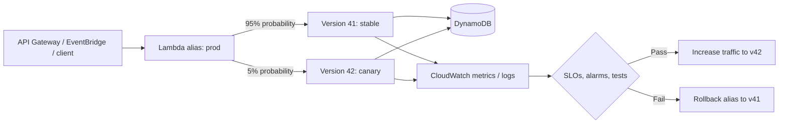
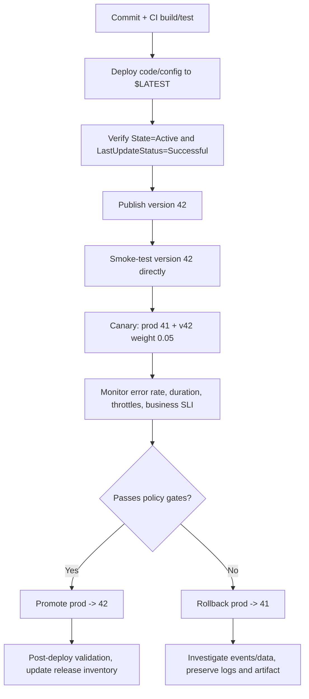
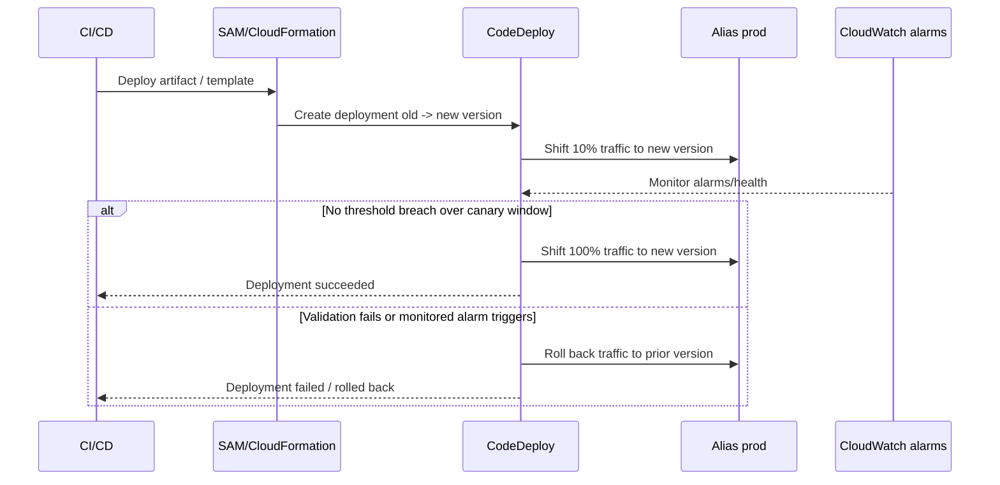
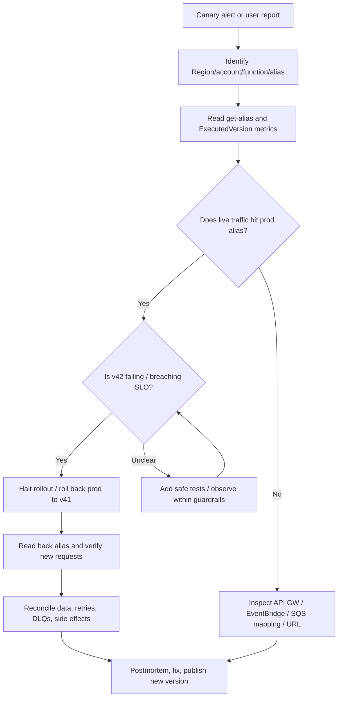

# Lambda Versions, Aliases, Canaries, and Rollbacks

> **Chapter:** Lambda Compute · **Module:** `CLOUD_PROVIDERS_AWS`

## 1. Problem Statement: Releasing a New Lambda Version While Protecting Users

An order API uses **AWS Lambda** to persist orders in Amazon DynamoDB, emit events via Amazon EventBridge, and log to CloudWatch. The engineering team prepares a new build with Java performance improvements, yet cannot be certain it handles every production edge case cleanly. If you overwrite the live production function and route 100% of users to the new code at once, a rare bug can impact every transaction.

A **Lambda version** creates a release milestone with frozen code and most configuration; an **alias** is a stable name like `prod` that can shift from an old version to a new version. By configuring a **weighted alias**, you can send a small slice of invocations to the new version (*canary*), watch error rates and latency, and increase the percentage if healthy. If an incident occurs, a **rollback** routes subsequent invocations back to the stable version.



This is a logical diagram; `95%` and `5%` are **per-invocation probability distributions**, not a guaranteed exact ratio in every short window. Rolling back an alias **does not undo data already written** to DynamoDB, messages already sent, or in-flight requests; data schemas and handlers must tolerate multiple versions coexisting.

Within module `CLOUD_PROVIDERS_AWS`, Lambda release engineering intersects with **IAM, AWS Regions, VPC, API Gateway/ALB, DynamoDB/RDS/SQS, CloudWatch, availability, recovery, concurrency control, and cost**. The goal is not merely knowing the alias update command, but building a release pipeline that is observable, tested, and genuinely reversible.

**After this lesson, learners can:**

1. Distinguish `$LATEST`, published versions, qualified ARNs, unqualified ARNs, and aliases.
2. Publish versions and create/update aliases via Console/AWS CLI, using `RevisionId` to prevent race conditions.
3. Design 95/5 → 90/10 → 100/0 weighted alias rollouts, understanding sampling variance and limits.
4. Use AWS SAM + CodeDeploy to automate canary/linear deployments with CloudWatch alarms and validation hooks.
5. Observe traffic via `ExecutedVersion`, Logs/X-Ray, calculate error rates, and make rollback decisions.
6. Ensure triggers actually invoke the alias, and understand permissions, retries, idempotency, and data impact.
7. Manage cold starts/concurrency, version retention, cost, and security throughout the release lifecycle.

## 2. Fundamentals: `$LATEST`, Published Versions, and Aliases

### 2.1. `$LATEST`: The Mutable Working Area

When you update code or editable properties on a Lambda function, changes apply to the **unpublished** version called `$LATEST`. When a client invokes the function with an **unqualified ARN** (an ARN without a version/alias suffix), Lambda normally invokes `$LATEST`.

```text
arn:aws:lambda:ap-southeast-1:111122223333:function:orders-handler
                                                      ^ unqualified

arn:aws:lambda:ap-southeast-1:111122223333:function:orders-handler:$LATEST
                                                      ^ unpublished
```

Never treat `$LATEST` as a stable production environment: any new code or configuration edit immediately changes invocations hitting it. For production, configure **API Gateway, EventBridge rules, Lambda Function URLs, or event source mappings** to use a **qualified reference** to an alias where supported.

### 2.2. Published Version: Immutable Snapshot of a Release

When you **publish a version**, Lambda creates an incrementing version number like `41` or `42` from the current code and **most of the configuration** of `$LATEST`.

| Property | On a published version | Why it matters during rollback |
| --- | --- | --- |
| **Code/handler/runtime** | Included in the published snapshot. | Pointing the alias back to the old version restores its code and handler. |
| **Environment variables** | Locked to the published version. | Two versions can hold different values, though external secrets/endpoints can still change over time. |
| **Memory, timeout, architecture** | Tied to the version. | Canaries must be benchmarked with real per-version settings. |
| **Layers, VPC config, DLQ, tracing, logging settings** | Many attributes are snapshotted into the version. | Older versions may differ in networking or behavior from newer ones. |
| **Reserved concurrency** | A function-level operational setting, not snapshotted per version. | Rolling back code does not automatically revert concurrency caps. |
| **External IAM policies, database schemas, bucket policies** | Live outside the version snapshot and continue evolving. | Alias rollback **does not roll back these resources**. |

Lambda publishes a new version only when code or eligible configuration changed since the last published version; calling `publish-version` repeatedly without valid changes will not produce duplicate copies. **The published version number is not the same as a Git release tag**: track the mapping between Lambda version ↔ Git SHA / build ID / artifact checksum in your pipeline.

Example version ARNs:

```text
arn:aws:lambda:ap-southeast-1:111122223333:function:orders-handler:41
arn:aws:lambda:ap-southeast-1:111122223333:function:orders-handler:42
```

A published version keeps code/config largely immutable, yet **Lambda service/runtime patches** and external dependencies can still affect runtime behavior. “Immutable” does not mean the AWS platform, credentials, secret versions, DNS, or external data are frozen forever.

### 2.3. Alias: A Stable Pointer to a Version

An alias is an **updatable pointer**, such as `dev`, `staging`, `prod`, or `live`:

```text
arn:aws:lambda:ap-southeast-1:111122223333:function:orders-handler:prod
```

An alias **cannot point to another alias**, cannot point to `$LATEST`, and must point to a **published version** of that same function. Alias names cannot be purely numeric like `42` to avoid confusion with numeric version qualifiers.

Example states:

| Stage | Alias `prod` | Behavior |
| --- | --- | --- |
| Pre-release | `41` | 100% of calls via the alias hit v41. |
| Canary | Base `41`, additional `42` weight `0.05` | ~95% v41, ~5% v42 across sufficient volume. |
| Promote | Base `42`, no additional routing | 100% of new calls via the alias hit v42. |
| Rollback | Base `41`, no additional routing | New calls via the alias return to v41. |

**Key point:** If a client still invokes the **unqualified function ARN**, updating alias `prod` will **have zero effect on that client**. Audit every trigger and permission scope before relying on aliases for production releases.

### 2.4. Quick Comparison

| Entity | Directly updated? | ARN suffix | Best suited for |
| --- | --- | --- | --- |
| `$LATEST` | Code/config edited in place. | `:$LATEST` or unqualified ARN. | Development, building, and pre-publish testing. |
| Published version | Code and most config immutable. | `:41`, `:42`. | Replay/rollback, traceability, deterministic runs. |
| Alias | Target version/weights updated. | `:prod`, `:staging`. | Stable entry point, canaries, and rollbacks. |

## 3. Designing a Versioned Release Workflow

Minimal release pipeline:



### 3.1. Scope of a “Release”

A sound release tracks more than just the Lambda version number:

- Commit SHA, CI job/build ID, artifact checksum, and dependencies/SBOM.
- Runtime, handler, architecture, memory, timeout, layer versions, VPC, and environment variables.
- IAM execution role, API Gateway/SQS/EventBridge access policies, Secrets Manager/KMS, and downstream permissions.
- Alias base/additional versions, weights, and traffic-shifting policy.
- CloudWatch dashboards/alarms, baseline error rate/latency, smoke tests, and approvers.
- Compatible data schemas, event formats, idempotency, and rollback instructions.

**Multiple versions execute simultaneously** during a canary, so APIs and database schemas must support both v41 and v42 at the same time. For example, never drop a DynamoDB/RDS column that v41 still reads. Follow **expand → migrate → contract** for schema changes so a rollback never causes data failures.

### 3.2. Pre-Checks Before Shifting an Alias

1. Verify v41 is genuinely **known-good** and still exists in Lambda.
2. Verify v42 is published, invocable, and passed standalone smoke tests.
3. Confirm live traffic actually hits alias `prod`, not `$LATEST` or hardcoded version ARNs.
4. Verify role/DLQ compatibility for weighted routing (both versions must share the same execution role and DLQ config).
5. Check concurrency, throughput, code/storage quotas, downstream capacity, and cost.
6. Prepare alarm thresholds, a sufficient observation window, approvals, and rollback commands.

Never update an alias manually in parallel with a **CodeDeploy/SAM** deployment managing that same alias. That causes race conditions and drift; choose **one owner** for alias state and check for active deployments first.

## 4. Creating Versions and Aliases via AWS CLI

The commands below illustrate running on **AWS CLI v2** (e.g., AWS CloudShell/Bash) in an authorized lab account. **Update, publish, and create commands mutate live resources**, can shift traffic, and incur charges. Never run them verbatim in production without change approval. Assume function `orders-handler` exists with valid code/role in Region `ap-southeast-1`.

### 4.1. Inspect Identity and State (Read-Only)

```bash
aws sts get-caller-identity

aws lambda get-function-configuration \
  --region ap-southeast-1 \
  --function-name orders-handler \
  --query '{Name:FunctionName,Version:Version,Runtime:Runtime,State:State,LastUpdateStatus:LastUpdateStatus,RevisionId:RevisionId,CodeSha256:CodeSha256}' \
  --output json

aws lambda list-versions-by-function \
  --region ap-southeast-1 \
  --function-name orders-handler \
  --query 'Versions[].{Version:Version,Description:Description,LastModified:LastModified,CodeSha256:CodeSha256}' \
  --output table

aws lambda list-aliases \
  --region ap-southeast-1 \
  --function-name orders-handler \
  --output json
```

Look specifically for `State=Active` and `LastUpdateStatus=Successful` before publishing. If an update is still `InProgress`, wait via status checks or waiters instead of publishing an unready snapshot.

### 4.2. Publish a Version from `$LATEST`

Once CI pushes the tested artifact and config to `$LATEST`:

```bash
aws lambda publish-version \
  --region ap-southeast-1 \
  --function-name orders-handler \
  --description 'orders release git-a1b2c3d' \
  --output json
```

The output returns `Version` (e.g., `42`), `FunctionArn`, `CodeSha256`, and configuration fields. **Never hardcode an assumption that the next version is 42**: capture the actual number returned by AWS. In concurrent CI/CD pipelines, pass `--code-sha256` and/or `--revision-id` from the verification step to avoid publishing code/config overwritten by another job.

Publishing a new version does not automatically move alias `prod`. That separation lets you test and approve the release before production sees traffic.

### 4.3. Create the Initial Stable Alias

You only create an alias once per function; if `prod` already exists, **do not call `create-alias` again**:

```bash
aws lambda create-alias \
  --region ap-southeast-1 \
  --function-name orders-handler \
  --name prod \
  --function-version 41 \
  --description 'Production traffic'
```

If the alias already exists, read it back:

```bash
aws lambda get-alias \
  --region ap-southeast-1 \
  --function-name orders-handler \
  --name prod \
  --query '{AliasArn:AliasArn,BaseVersion:FunctionVersion,Routing:RoutingConfig,RevisionId:RevisionId}' \
  --output json
```

`RevisionId` changes every time the alias is updated. Pass `--revision-id` during updates for **optimistic concurrency** so you never overwrite a concurrent alias change made between your read and write.

## 5. Weighted Aliases: Manual Canaries with 5%, 10%, and 100%

### 5.1. Traffic Distribution Mechanics

A Lambda alias has a **base version** and can optionally specify **one additional version** with `AdditionalVersionWeights`. With:

```json
{
  "FunctionVersion": "41",
  "RoutingConfig": {
    "AdditionalVersionWeights": {
      "42": 0.05
    }
  }
}
```

Lambda routes invocations through the alias with approximate probability **95% v41** and **5% v42**. Weights in the API/CLI use decimals like **`0.05`**, not `5`. An alias supports **at most two published versions** at once, where:

- Both must belong to the **same Lambda function**.
- Both versions must share the **same execution role**.
- Both versions must share the **same dead-letter queue (DLQ) configuration** (or neither has a DLQ).
- The alias must **never** point to `$LATEST`.

If v42 changes the IAM execution role or DLQ compared to v41, creating the weighted alias will be rejected. When such changes are required, split them into compatible multi-step rollouts or use an alternate reviewed routing layer (such as API Gateway or Step Functions); never remove security controls or DLQs just to force a canary to work.

### 5.2. Route 5% Traffic to v42

On Bash/CloudShell, pass routing config as JSON:

```bash
aws lambda update-alias \
  --region ap-southeast-1 \
  --function-name orders-handler \
  --name prod \
  --function-version 41 \
  --routing-config '{"AdditionalVersionWeights":{"42":0.05}}'
```

Read back state and save `RevisionId`/deployment metadata:

```bash
aws lambda get-alias \
  --region ap-southeast-1 \
  --function-name orders-handler \
  --name prod \
  --query '{BaseVersion:FunctionVersion,Weights:RoutingConfig.AdditionalVersionWeights,RevisionId:RevisionId}' \
  --output json
```

If you shift weights without watching metrics per **executed version**, a 100% failure rate in v42 can hide behind v41's 95% success rate. At low volume, v42 receives very few invocations; **5% is a statistical expectation, not a guarantee of exactly 5 invocations out of any 100 calls**.

### 5.3. Raise Canary to 10%

After passing initial checks and collecting enough samples:

```bash
aws lambda update-alias \
  --region ap-southeast-1 \
  --function-name orders-handler \
  --name prod \
  --function-version 41 \
  --routing-config '{"AdditionalVersionWeights":{"42":0.10}}'
```

Pass **`--revision-id`** in multi-operator/pipeline environments to detect concurrent modifications. A successful alias update call does not mean dashboards reflect telemetry immediately; monitor for a sufficient window broken down by **executed version**.

### 5.4. Promote 100% to v42

Once approved, update the base version and **clear additional routing weights**:

```bash
aws lambda update-alias \
  --region ap-southeast-1 \
  --function-name orders-handler \
  --name prod \
  --function-version 42 \
  --routing-config '{"AdditionalVersionWeights":{}}'
```

Updating `--function-version` alone while leaving stale routing weights behind can keep splitting traffic unexpectedly or fail validation. Always verify **both `FunctionVersion` and `RoutingConfig`** after **promote** or **rollback**.

### 5.5. Fast Rollback to v41

If error rates or business metrics breach thresholds, shift new traffic back to the stable version:

```bash
aws lambda update-alias \
  --region ap-southeast-1 \
  --function-name orders-handler \
  --name prod \
  --function-version 41 \
  --routing-config '{"AdditionalVersionWeights":{}}'
```

**This redirects future alias traffic; it does not undo code executions or data writes.** In-flight v42 invocations can still finish, and previously processed events and side effects remain. For async/stream/SQS flows, also check backlogs, retries, DLQs, and records already handled (or about to retry) by v42.

### 5.6. Why Manual Canaries Are Not Enough for Production

Manual weight adjustments force operators to:

1. Shift alias weights on schedule.
2. Check errors, timeouts, throttles, and latency per version.
3. Verify canary traffic volume is statistically meaningful.
4. Halt/roll back when CloudWatch alarms or tests fail.
5. Record audit history, actions, permissions, evidence, and post-deploy validation.

Without continuous attention, teams may promote to 100% before noticing regressions. In production, prefer **AWS CodeDeploy** integrated with **AWS SAM/CDK/CloudFormation** or pipelines enforcing alarm gates, automated rollbacks, and clear ownership.

## 6. Verifying Exactly Which Version Was Executed

### 6.1. Alias vs. Executed Version

Alias `prod` is the entry point; actual execution may hit v41 or v42. Therefore, seeing `...:prod` in trigger configuration **does not prove which version served a request**.

Lambda provides clear signals:

- **CloudWatch Logs:** `START` lines usually include `Version: 41` or `Version: 42`.
- **Synchronous Invoke API:** response header `x-amz-executed-version` reports the executed version.
- **CloudWatch metrics:** dimension **`ExecutedVersion`** combined with `Resource` isolates metrics for a single version invoked via an alias.
- **Application logs/traces:** emit `awsRequestId`, app release ID, version, and correlation IDs cleanly without logging secrets.

Sample log lines:

```text
START RequestId: example-req-001 Version: 42
... application log with traceId=example-trace-001 ...
END RequestId: example-req-001
REPORT RequestId: example-req-001 Duration: ...
```

This is an illustrative structure, not a real request ID. Log format and fields vary depending on JSON vs. plain-text logging settings.

### 6.2. Invoke an Alias via AWS CLI

From a lab environment granted `lambda:InvokeFunction` on the alias:

```bash
# --cli-binary-format is needed in AWS CLI v2 for raw JSON payloads.
aws lambda invoke \
  --region ap-southeast-1 \
  --function-name orders-handler \
  --qualifier prod \
  --cli-binary-format raw-in-base64-out \
  --payload '{"action":"health-check","requestId":"lab-001"}' \
  --log-type Tail \
  --query '{StatusCode:StatusCode,FunctionError:FunctionError,ExecutedVersion:ExecutedVersion}' \
  --output json \
  response.json
```

`response.json` is an output file **created by the learner when running the command in a lab**, not a file created in this lesson's repository. `--log-type Tail` works on synchronous invocations and returns Base64-encoded log tails in `LogResult`. An API output of `StatusCode=200` only means **the Invoke API accepted and returned a response**, **not** that business logic succeeded; inspect `FunctionError` and the payload.

If `orders-handler` does not support `{"action":"health-check"}`, never use this command as a production smoke test: smoke events must be **harmless, handler-supported events**. Invoking with unsuitable inputs can mutate real data or trigger emails.

### 6.3. Per-Version Metrics

In CloudWatch namespace `AWS/Lambda`:

| Metric | What it measures | Canary decision |
| --- | --- | --- |
| `Invocations` | Number of function invocations. | Is the v42 sample large enough yet? |
| `Errors` | Invocations failing in handler or runtime. | v42 error rate vs. v41. |
| `Duration` | Execution duration (watch statistics/percentiles). | Did v42 raise p95/p99 latency? |
| `Throttles` | Invocations throttled by concurrency/quotas. | Is the canary starving capacity? |
| `ConcurrentExecutions` | Concurrent executions per supported dimension. | Approaching reserved/account concurrency? |
| `IteratorAge` | Record processing lag on Kinesis/DynamoDB Streams (if used). | Is the canary falling behind on streams? |
| `AsyncEventAge`, `DeadLetterErrors`, `DestinationDeliveryFailures` | Health of async processing where configured. | Growing backlog, retries, or failed DLQ/destination deliveries? |
| `ProvisionedConcurrencySpilloverInvocations` | Invocations spilling beyond provisioned warm capacity. | Cold starts caused by canary or uneven routing? |

Pick the right dimension:

| Dimension | Scope |
| --- | --- |
| `FunctionName` | Aggregate across the whole function (all aliases/versions). |
| `Resource` | Scoped to the matching version or alias. |
| **`ExecutedVersion`** | Exact version **executed** when invoked via an alias; isolates v41 vs. v42. |

**A metric across the whole `prod` alias can mask v42 failures**: if 5% canary traffic fails 100% of the time, overall alias error rate looks like ~5% (under steady assumptions) while v42's own metric is 100%. Alert on the new executed version and business SLIs, not just function totals.

### 6.4. Avoid False Alarms When Canary Traffic Is Low

With a 5% weight and only 20 requests/minute, v42 averages **~1 invocation/minute**. A single error yields a 100% error rate in that minute; conversely, zero errors in one minute proves very little. You should:

- Require a **minimum sample size** or observation duration before promoting.
- Watch both absolute `Errors` counts and error rates without dividing by zero invocations.
- Inspect latency distributions/percentiles once volume is sufficient.
- Run safe **synthetic/smoke traffic** covering critical code paths rather than relying purely on random live traffic.
- Tie alarm severity and rollback decisions to real business risk and impact.

### 6.5. Application Metrics and Traces

In Java handlers, attach request IDs and trace IDs to logs/traces across API Gateway → Lambda → DynamoDB/RDS/SQS. AWS X-Ray or OpenTelemetry helps separate init time, downstream call time, and Java processing time. Protect logs: never print access tokens, payment details, or sensitive request bodies. Runtime updates and cold starts can make v42 latency differ from v41 even with similar logic, so watch **`Init Duration`** in logs/traces alongside traffic patterns.

## 7. Rollback Is a Process, Not Just a Command

### 7.1. Classifying Rollback Scenarios

| Incident | Does flipping the alias suffice? | What else must be handled? |
| --- | --- | --- |
| v42 throws exceptions on a rare input. | Usually stops **new calls** from hitting v42. | Inspect failed events and retries. |
| v42 writes bad data to DynamoDB. | **Does not** undo written data. | Compensating transactions, audits, reconciliation, controlled restores. |
| v42 sends duplicate emails or SQS events. | Does not recall already-sent messages. | Idempotency keys, deduplication, duplicate handling procedures. |
| v42 changed DB schema incompatibly with v41. | Rollback may leave v41 **unable to run**. | Expand-contract migrations, safe schema recovery. |
| v42 changed IAM role and DLQ. | Weighted aliases require matching role/DLQ. | Stage policy/config changes separately; test old/new; consider alternate rollout patterns. |
| Trigger still invokes `$LATEST`. | Flipping the alias **has no effect**. | Point event source mappings/integrations/permissions to the alias. |
| v42 throttles from higher concurrency/cold starts. | Shifting traffic back can relieve pressure. | Re-evaluate provisioned/reserved concurrency, quotas, and downstream capacity. |
| v42 already started running before rollback. | **Does not abort in-flight invocations.** | Monitor in-flight runs and side effects; verify drain and retries. |

### 7.2. Emergency Procedure When a Canary Goes Bad

1. **Confirm the incident:** check v42 error rate/latency, business SLIs, `ExecutedVersion`, time window, and release SHA.
2. **Assess blast radius:** API Gateway? EventBridge? SQS/streams? Which triggers actually invoke the alias?
3. **Stop new traffic to v42:** revert the alias to v41 with empty routing weights (or halt/roll back via CodeDeploy per ownership rules).
4. **Verify alias state:** run `get-alias` to confirm base version `41` and empty routing config.
5. **Monitor trailing effects:** in-flight executions, async backlogs, stream iterator age, queues/DLQs, and downstream writes; never treat the alias flip as the end of the incident.
6. **Verify user health:** run safe smoke tests, check CloudWatch/ALB/API metrics, confirm error rate drops, and verify business transactions.
7. **Preserve evidence:** CloudWatch Logs/X-Ray, CloudTrail, CodeDeploy deployment ID, version metadata, and incident timeline.
8. **Fix root cause:** publish a brand-new fixed version — never try to “edit v42 in place” expecting to reuse its ARN.

### 7.3. Do Not Try to Roll Back Data by Deleting v42

Deleting published version `42` or deleting code in `$LATEST` never reverses:

- Emitted EventBridge events or sent SQS messages.
- Written DynamoDB/RDS records.
- Queued Lambda asynchronous retries or advanced stream checkpoints.
- Changed secrets, IAM permissions, network routes, or external API side effects.

Worse, deleting v42 prematurely can **destroy forensic traceability and release reproducibility**. Before pruning old versions, check alias references, event source mappings, rollback retention windows, active incidents, and AWS code storage quotas.

### 7.4. Reduce Risk with Idempotency and Compatibility

Suppose Lambda processes `OrderCreated` events. Version 42 writes an order and times out before returning, causing the trigger to **retry** the same event. If the handler executes an unconditional `PutItem`, duplicate side effects occur.

Design guidelines:

1. Use a stable **event ID / idempotency key** backed by DynamoDB conditional writes or a reviewed deduplication store.
2. Pass idempotency tokens to external APIs (payments/emails/partners) or support reconciliation.
3. Keep message and DB schemas compatible across both v41 and v42 simultaneously.
4. Log release ID and correlation ID in every version without leaking secrets.
5. Maintain tested event replay, dead-letter, and reconciliation runbooks.

This matters more than a “10-second rollback”: a fast alias flip leaves hours of cleanup if bad data was written.

## 8. Automated Canaries and Rollbacks with AWS CodeDeploy + AWS SAM

In production, gradually shifting weights and reacting to CloudWatch alarms belongs in a **deployment controller**, not on someone staring at dashboards manually. **AWS CodeDeploy** orchestrates alias-based Lambda deployments natively with **AWS Serverless Application Model (AWS SAM)**, supporting canary, linear, and all-at-once shifts alongside alarms and lifecycle hooks.

### 8.1. Traffic-Shifting Strategies

| Strategy | Example SAM/CodeDeploy Lambda config | Meaning |
| --- | --- | --- |
| **Canary** | `Canary10Percent5Minutes` | Shifts 10% first, then shifts the remaining 90% after ~5 minutes if healthy. |
| **Canary** | `Canary10Percent10Minutes` | Sends 10% traffic to the new version for ~10 minutes before full promotion. |
| **Linear** | `Linear10PercentEvery1Minute` | Adds 10 percentage points every minute until reaching 100%. |
| **Linear** | `Linear10PercentEvery10Minutes` | Steps up evenly over a longer observation window. |
| **All-at-once** | `AllAtOnce` | Shifts 100% immediately with no intermediate canary window. |

These are **`DeploymentPreference.Type` names in AWS SAM**; CodeDeploy uses corresponding deployment config names such as `CodeDeployDefault.LambdaCanary10Percent10Minutes`. Do not confuse them with **ECS canary** configs or arbitrary custom names that have not been created. Custom deployment configs can be defined within CodeDeploy limits if needed.



**Automatic rollbacks only fire on configured conditions.** Without properly scoped alarms or validation hooks, CodeDeploy will happily promote a version that **corrupts business data while still returning HTTP 200**. Design real monitoring and hooks covering critical behavior.

### 8.2. AWS SAM: Configuring Function, Alias, and Deployment Preference

Abbreviated example for a **Java 21 Lambda** with an existing artifact and handler, intended for lab/design study:

```yaml
AWSTemplateFormatVersion: '2010-09-09'
Transform: AWS::Serverless-2016-10-31
Description: Orders Lambda with versioned canary deployment

Resources:
  OrdersFunction:
    Type: AWS::Serverless::Function
    Properties:
      CodeUri: build/orders-lambda.jar
      Handler: com.example.orders.Handler::handleRequest
      Runtime: java21
      MemorySize: 1024
      Timeout: 20
      AutoPublishAlias: prod
      DeploymentPreference:
        Type: Canary10Percent10Minutes
        Alarms:
          - !Ref OrdersAliasErrorAlarm
      Policies:
        - AWSLambdaBasicExecutionRole

  OrdersAliasErrorAlarm:
    Type: AWS::CloudWatch::Alarm
    Properties:
      AlarmDescription: Roll back if prod alias reports errors
      Namespace: AWS/Lambda
      MetricName: Errors
      Statistic: Sum
      Period: 60
      EvaluationPeriods: 1
      Threshold: 1
      ComparisonOperator: GreaterThanOrEqualToThreshold
      TreatMissingData: notBreaching
      Dimensions:
        - Name: FunctionName
          Value: !Ref OrdersFunction
        - Name: Resource
          Value: !Sub '${OrdersFunction}:prod'
```

**Requirements for this example to work:** `build/orders-lambda.jar` and the handler class are **illustrative placeholders**; substitute a real built Java Lambda artifact, valid handler, and downstream IAM policies. This snippet **does not create API Gateway**; add SAM events or an external integration invoking alias `prod`. With API Gateway, define SAM `Events` or integration permissions appropriately.

The alias-wide alarm shown above is simple enough as a quick signal, yet **is not a complete production canary strategy**: a single error could stem from the old version, low canary traffic can lack samples, and `TreatMissingData: notBreaching` treats zero traffic as healthy. Add alarms scoped to the **new version's `ExecutedVersion`**, metric math for error rate with a minimum invocation count, latency, throttles, and business SLIs; when referencing SAM auto-generated versions, inspect generated CloudFormation resources to wire metrics cleanly.

**First-deployment note:** CodeDeploy needs a **previous version** to shift traffic from. Per AWS SAM guidance, deploy the initial baseline with `AutoPublishAlias` first, then enable `DeploymentPreference` once a baseline version exists. Never treat the very first deploy with no prior version as a real canary.

### 8.3. CloudWatch Alarms Must Measure Real Risk

Alarms should cover:

- Lambda `Errors` and error rate for the **new executed version**.
- `Duration` p95/p99, `Throttles`, timeouts, concurrency, and provisioned concurrency spillover.
- API Gateway/ALB 5xx and end-to-end latency when Lambda backs an API.
- Business SLIs: failed transactions, duplicate processing, lost orders, DLQ counts/queue age.
- Minimum canary invocation counts or synthetic checks so “no data” isn't mistaken for healthy.

Set thresholds from your product's **SLOs and benchmarks**, rather than copying a generic “any 1 error” rule everywhere. Verify alarm permissions and non-insufficient-data state before deploying, and confirm CodeDeploy monitors the **exact alarm ARNs**.

### 8.4. Validation Hooks: `PreTraffic` and `PostTraffic`

AWS SAM `DeploymentPreference.Hooks` lets you attach Lambda validation functions:

```yaml
# Example snippet inside OrdersFunction DeploymentPreference
DeploymentPreference:
  Type: Canary10Percent10Minutes
  Alarms:
    - !Ref OrdersAliasErrorAlarm
  Hooks:
    PreTraffic: !Ref OrdersPreTrafficValidation
    PostTraffic: !Ref OrdersPostTrafficValidation
```

This is an **illustrative fragment** without the two validation functions defined, so it is not a standalone template. Validation hooks are invoked by CodeDeploy during lifecycle phases and must **report pass/fail back to CodeDeploy** using the `PutLifecycleEventHookExecutionStatus` API with matching permissions and lifecycle IDs; simply returning a JSON object like a normal business Lambda **is not enough**. Hooks can invoke the new version with a side-effect-free test event, verify schemas/contracts, and check dependency health — never run real payment charges in smoke tests.

### 8.5. CodeDeploy Rollbacks and Ownership

CodeDeploy automatically stops and rolls back a deployment when a hook fails or a monitored alarm enters `ALARM` (per auto-rollback settings). Reverting to an older revision creates a **new deployment with a new deployment ID**, rather than erasing failed deployment history. During an incident:

1. Inspect **CodeDeploy deployment status, events, alarms, and validation hook logs**.
2. Distinguish in-progress rollouts, stopped deployments, rollbacks in progress, and completed rollbacks.
3. Avoid calling `aws lambda update-alias` manually while CodeDeploy is actively shifting traffic; if emergency manual intervention is unavoidable, follow an explicit takeover procedure so future deployments don't overwrite it.
4. Re-read the alias and verify live per-version traffic after rollback rather than trusting deployment status alone.
5. Preserve logs, alarms, and deployment IDs, hold an incident review, and strengthen hooks/alarms if regressions slipped through.

**AWS SAM cannot repair bad data written by v42.** You still need the idempotency, replay/reconciliation, and schema compatibility practices from Section 7.

### 8.6. When to Choose Canary, Linear, or All-at-Once?

| Scenario | Reasonable choice | Rationale |
| --- | --- | --- |
| High-traffic API with high release risk. | Canary or linear + alarms. | Catches bugs early and limits blast radius. |
| Very low-traffic API. | Canary **plus synthetic tests and longer windows**. | Small percentages may receive too few real calls to evaluate. |
| Infrequent batch/backfill jobs. | Staging/replay testing, controlled alias switch, possibly all-at-once. | Weighted routing may not split representative business batches cleanly. |
| Emergency patch for a critical bug. | Time-boxed risk decision, occasionally all-at-once. | Weighs delay risk against new-release risk. |
| Breaking schema/contract change. | Multi-step expand/contract ahead of canary. | Coexisting versions would otherwise corrupt data or protocols. |

No single deployment strategy fits every workload. Choose based on traffic volume, failure impact, data sensitivity, RTO/RPO, latency, and observability.

## 9. Triggers, Qualified ARNs, and IAM Policies

### 9.1. Point Every Trigger to the Alias

AWS Lambda can be invoked by:

- **API Gateway** (HTTP API / REST API) with an integration URI pointing to the alias ARN.
- **Application Load Balancer** with a Lambda target group/permission targeting the alias where supported.
- **Amazon EventBridge** rules/schedules or services invoking the function directly.
- **Event source mappings** for SQS, Kinesis, DynamoDB Streams, MSK, and other supported poll sources.
- **Lambda Function URLs** attached to the function or alias per feature support.
- **AWS SDK/CLI** calls using a qualified ARN or `--qualifier`.

If a mapping or rule uses an **unqualified function ARN**, it invokes `$LATEST` and bypasses alias canaries and rollbacks. If a source hardcodes a **numeric version ARN** like `:41`, it also ignores alias updates. Check `FunctionArn` on event source mappings, target ARNs on EventBridge rules, and integration URIs/stages on API Gateway.

### 9.2. Inspect Event Source Mappings (Read-Only)

```bash
aws lambda list-event-source-mappings \
  --region ap-southeast-1 \
  --function-name orders-handler \
  --query 'EventSourceMappings[].{UUID:UUID,State:State,FunctionArn:FunctionArn,Source:EventSourceArn}' \
  --output table
```

This only lists **event source mappings**, not push triggers like API Gateway, EventBridge rules, or Function URLs. Inventory every trigger across IaC, service configs, or the Console. Updating a mapping to point to an alias modifies production traffic and requires proper permissions and review.

### 9.3. Alias Invoke Permissions and Resource-Based Policies

Lambda permissions can be scoped at the **function, version, or alias** level. Example allowing an EventBridge rule to invoke **only the `prod` alias**:

```bash
# Modifies resource-based policy; ILLUSTRATIVE ONLY.
aws lambda add-permission \
  --region ap-southeast-1 \
  --function-name orders-handler \
  --qualifier prod \
  --statement-id AllowOrdersRuleInvokeProd \
  --action lambda:InvokeFunction \
  --principal events.amazonaws.com \
  --source-arn arn:aws:events:ap-southeast-1:111122223333:rule/orders-rule
```

Account ID and rule ARN are placeholders. `--qualifier prod` attaches the permission specifically to the alias without granting direct invocation of `:41`, `:42`, or the unqualified ARN under that statement. This enforces a **single stable entry point** across version transitions.

**Security:** restrict `lambda:UpdateAlias`, `lambda:PublishVersion`, `lambda:UpdateFunctionCode`, and resource-policy edits to appropriate roles. Anyone allowed to update alias `prod` can shift 100% of traffic to another version regardless of code review. Combine CloudTrail, pipeline approvals, least-privilege IAM, and `RevisionId` checks.

### 9.4. VPC and IAM Execution Role Do Not Automatically Follow the Alias Name

Published versions snapshot settings such as the execution role, VPC subnets/security groups, and environment variables. Canaries can break when:

- A new version changes VPC configuration, yet the private subnets lack NAT/VPC endpoints to reach Secrets Manager, DynamoDB, or S3.
- The role or KMS key policy lacks permissions (and weighted routing requires both versions to share the same execution role).
- Security groups cause RDS timeouts, or VPC networking changes initialization behavior.
- An external secret rotates outside the code snapshot, causing both v41 and v42 to read updated values.

Do not equate rolling back a code version with rolling back all infrastructure. When a release alters IAM, VPC, or secret schemas, use multi-step migrations, compatibility testing, and versioned IaC.

## 10. Canaries with Synchronous, Asynchronous, and Stream Events

### 10.1. Synchronous Invocations

Examples: API Gateway → Lambda or SDK `Invoke(RequestResponse)`. The alias routes each request to v41 or v42 according to weights, and the caller receives the response or error directly. If v42 fails, only a fraction of requests see errors, though impact still depends on **side effects** and client retry behavior.

### 10.2. Asynchronous Invocations

With asynchronous invocation (`InvocationType=Event`), Lambda places events on an internal queue and retries per configuration; **receiving an accepted status does not mean the handler succeeded**. Lambda can retry function errors and deliver duplicates. After flipping an alias, inspect queued, in-flight, and retrying events per **source and Lambda async handling rules** — do not assume every already-queued event automatically switches to the old version after rollback.

Include:

- `AsyncEventAge`, `AsyncEventsDropped`, `DeadLetterErrors`/destination delivery metrics, and retry tracking.
- `OnFailure` destinations or DLQs as appropriate, plus safe replay procedures.
- Idempotent handlers (DynamoDB conditional writes, partner API idempotency keys).
- Alarms on queue age/backlog and business outcomes, not just Lambda `Errors`.

### 10.3. SQS and Stream-Based Event Source Mappings

With **SQS event source mappings**, Lambda polls messages and invokes the referenced function/alias; batch failures retry according to queue visibility timeouts and redrive policies. With **Kinesis/DynamoDB Streams**, batch failures can stall shards and push `IteratorAge` up. Both behave very differently from a sync client receiving HTTP 500.

During a stream canary:

1. Check source settings, batch size/window, partial batch responses, and retry strategies.
2. Monitor stream lag, DLQ/on-failure destinations, and duplicate processing.
3. Never expect a 5% weighted alias to send **5% of records** if one invocation carries hundreds of records; weights apply per **function invocation**, not per record inside a batch.
4. Keep v41 and v42 compatible on event schemas, partition ordering, and idempotency.
5. After rollback, verify backlog drainage and eventual processing rather than just watching `Errors` drop.

### 10.4. A Healthy Canary Can Still Fail Under Real Load

A new version can pass small payloads yet fail under large payloads, concurrency bursts, downstream quotas, or Java warm-up spikes. Build a test matrix covering:

| Dimension | Test examples |
| --- | --- |
| Input | Valid, malformed, oversized, duplicate, missing fields. |
| Concurrency | 1, 10, 100 concurrent calls within lab quotas and targets. |
| Dependencies | DynamoDB throttling, RDS timeouts, Secrets Manager unavailable. |
| Runtime | Cold/warm starts, Java heap/GC, timeouts, architecture/layer compatibility. |
| Business | Idempotency on retries, transactional side effects, backward-compatible schemas. |
| Recovery | Alias rollback, DLQ/queue backlog draining, app/data smoke tests. |

Never use production canaries as your primary tool to catch bugs that unit, integration, and load tests should find beforehand.

## 11. Concurrency, Cold Starts, and Java SnapStart During Traffic Shifts

### 11.1. What Is Concurrency?

Lambda concurrency is the number of invocations running **simultaneously**. For steady workloads, roughly:

\[
\text{Approximate concurrency} \approx \text{Requests/second} \times \text{Execution duration (seconds)}
\]

For example, 200 requests/second averaging 0.2 seconds runs around **40** concurrent executions under simplified steady assumptions. This does not cover spikes, retries, or latency tails. If a canary slows v42 to 1 second vs. v41's 0.2s, v42 consumes far more concurrency than its **request percentage** alone suggests.

### 11.2. Reserved Concurrency and Provisioned Concurrency

| Mechanism | Scope and role | Impact during canary/rollback |
| --- | --- | --- |
| **Reserved concurrency** | Reserves and caps concurrency for the **function** against quotas, not per published version. | Stops one function from exhausting account capacity, yet v41 and v42 still compete inside the function's cap. |
| **Provisioned concurrency** | Pre-initializes execution environments for a **published version or alias** to cut cold starts. | Weighted aliases can increase **spillover** risk if provisioned capacity doesn't match actual distribution. |
| **On-demand concurrency** | Lambda scales environments per traffic, quotas, and scaling rates. | New environments incur cold starts, especially on newly introduced low-traffic versions. |

Reserved concurrency **does not pre-warm runtimes**. Provisioned concurrency incurs **extra capacity charges** and takes time to allocate before reaching `READY`. During traffic shifts, watch `ProvisionedConcurrencySpilloverInvocations`, `ProvisionedConcurrentExecutions`, `Throttles`, and cold-start latency.

Lambda distributes weighted aliases **probabilistically**, not evenly across provisioned pools. At low traffic or uneven bursts, actual splits vary widely; provision buffer if avoiding cold starts/spillover is critical. Crucially, never remove v41's provisioned concurrency as soon as v42 receives 5% traffic — a rollback requires v41 to remain ready to serve.

### 11.3. Java SnapStart and Published Versions

**Lambda SnapStart** cuts startup latency by snapshotting the initialized execution environment; on supported configs, SnapStart creates snapshots when you **publish a version** and restores them when invoking **published versions/aliases** (not `$LATEST`). It is well worth evaluating for Java handlers with heavy init times.

Checklist:

- Verify runtime, package architecture, and Region support SnapStart.
- SnapStart **cannot be combined with provisioned concurrency** per AWS feature rules.
- SnapStart snapshots can freeze **randomness, unique IDs, cached timestamps, or network connections** from init. Guarantee uniqueness and connection validity after restore rather than assuming pre-snapshot sockets/credentials stay valid.
- While a newly published version is still initializing its snapshot, **do not shift the alias** before it is active and ready.
- On rollback, verify the older version is still Active and its snapshot/runtime dependencies work; an idle old version isn't always “warm.”

Example inspecting a version's SnapStart status:

```bash
aws lambda get-function-configuration \
  --region ap-southeast-1 \
  --function-name orders-handler \
  --qualifier 42 \
  --query '{Version:Version,State:State,SnapStart:SnapStart,MemorySize:MemorySize,Runtime:Runtime,LastUpdateStatus:LastUpdateStatus}' \
  --output json
```

Do not assume SnapStart works if your Java function uses EFS, provisioned concurrency, or other incompatible settings. Consult [Lambda SnapStart](https://docs.aws.amazon.com/lambda/latest/dg/snapstart.html) and test uniqueness, KMS, DB reconnects, and post-restore behavior. SnapStart pricing can vary by runtime/configuration; check current pricing tables.

### 11.4. Old Versions Do Not Keep Warm Capacity Forever

An old version uninvoked for a long time can hit cold starts or snapshot re-initialization when rolled back to. If your service's RTO is latency-sensitive:

1. Define cold-start SLOs per alias/version.
2. Keep capacity allocated for the prior version during the rollout window if fast rollback is required.
3. Audit runtime updates, caches/connection init, and IAM/VPC settings.
4. Test rollback with real or authorized synthetic traffic — never rely solely on `get-alias`.
5. Weigh provisioned concurrency/snapshot retention costs against downtime impact.

## 12. Diagnostics: Why Are Customers Still Seeing Errors After Changing the Alias?

### 12.1. Symptoms and Causes Table

| Symptom | Possible cause | Evidence to inspect |
| --- | --- | --- |
| Flipped `prod` to v41 yet new requests still run v42. | Source doesn't use the alias, CodeDeploy re-updated the alias, telemetry lag, or requests started before rollback. | `get-alias`, source integration ARN, CloudTrail, `START Version` logs, `ExecutedVersion`. |
| Weighted alias update rejected. | v41 and v42 differ in execution role or DLQ, version unpublished, or invalid routing JSON. | `get-function-configuration --qualifier` on both versions, AWS error message. |
| `UpdateAlias` fails with `PreconditionFailedException`. | `RevisionId` no longer matches due to another writer. | Re-read `get-alias`, compare revisions, confirm deployment owner. |
| Canary sees 0 invocations after a minute. | Too little traffic; random sampling missed v42; source actually calls another version. | Invocations per executed version, source ARN, total request count. |
| Canary v42 has high p95 latency despite `Errors=0`. | Cold starts, Java init/GC, slow DynamoDB/RDS, concurrency spillover. | Duration distributions, X-Ray, init logs, concurrency metrics, downstream latency. |
| CodeDeploy failed to auto-roll back. | Alarms/hooks not wired, alarm never entered `ALARM`, controller watching wrong resource. | Deployment group, CloudWatch alarm state/dimensions, CodeDeploy events. |
| CodeDeploy rolled back yet data is corrupted. | Rollback only changes future invokes, never undoes side effects. | DynamoDB audits/events, DLQs, trace IDs, business reconciliation. |
| Function URL / API Gateway returns 403 after alias switch. | Integration/resource policy lacks alias invoke permission or different IAM/authorizer. | `get-policy --qualifier prod`, API integrations, CloudTrail, access logs. |
| `publish-version` didn't create a new version. | `$LATEST` had no publish-eligible changes since last publish. | `CodeSha256`, config, `list-versions-by-function`, CI artifacts. |
| New version throttles while old version didn't. | Higher duration/concurrency, provisioned spillover, quotas, or traffic variance. | `Throttles`, `ConcurrentExecutions`, provisioned metrics, release diff. |
| Async failures keep climbing after rollback. | Retry queue, backlogs, already-received records, or independent downstream outage. | `AsyncEventAge`, SQS queue age, stream `IteratorAge`, DLQs, side effects. |
| Rollback version fails to run. | Old version was deleted, runtime/snapshot or external dependency broke, or invoke permissions changed. | `list-versions-by-function`, config state, IAM/KMS/VPC, runtime logs. |

### 12.2. Pre- and Post-Rollback Investigation Runbook



**Investigation steps:**

1. **Verify sources:** account/Region/alias, API Gateway stage/integration ARN, EventBridge targets, Lambda URLs, event source mappings.
2. **Read the alias:** base version, additional weights, `RevisionId`; check CloudTrail `UpdateAlias` / CodeDeploy deployment timeline.
3. **Break down failures by executed version:** `Invocations`, `Errors`, `Throttles`, `Duration`, X-Ray traces, and request IDs.
4. **Inspect handler logs:** code exceptions, Java OOM/timeouts, secrets, IAM `AccessDenied`, VPC DNS, downstream DBs.
5. **Act through a single owner:** direct alias rollback or CodeDeploy stop/redeploy per policy.
6. **Confirm recovery:** alias readback, safe synthetic test, fresh metrics, and business transaction health.
7. **Preserve and reconcile:** logs/alarms/deployment IDs, async DLQs, duplicate events, external side effects, and data repair if needed.

### 12.3. Never Confuse API Status with Handler Success

On synchronous AWS Lambda `Invoke`, `StatusCode=200` confirms the Invoke API succeeded at the transport layer while the handler may still have thrown an exception; always check `FunctionError` and the payload. On `InvocationType=Event`, `StatusCode=202` means the event was accepted for async processing — **not that the business transaction succeeded**. Use CloudWatch Lambda `Errors` and application-level metrics to judge real outcomes.

### 12.4. Confirm Rollbacks with Strong Evidence

| Evidence | How to check | What it still does not prove |
| --- | --- | --- |
| Alias `prod` base=`41`, empty routing. | `aws lambda get-alias`. | That every trigger actually uses the alias, or that all events finished. |
| `ExecutedVersion=42` drops to zero after switch. | CloudWatch metrics over a sufficient window. | That zero in-flight v42 runs or queue retries remain. |
| Version 41 smoke test passes. | Invoke alias with a harmless event; check response and effect. | That all real business inputs pass. |
| Business 5xx/error rate returns to baseline. | API + DB/SQS dashboards, logs/traces. | That no bad records were written earlier. |
| DLQ/backlog handled. | SQS/stream metrics and replay/reconciliation. | That prior side effects were undone unless checked separately. |

Rollback aims to **stop ongoing impact and restore service**, not erase traces of the faulty release. Preserve the audit timeline to trace exactly which version failed, when, and which events need reconciliation.

## 13. Security, IAM, and Release Cost Controls

### 13.1. Separate Administrative Permissions from Execution Permissions

| IAM principal | What should be allowed? | Should not have by default |
| --- | --- | --- |
| **Developer** | Read lab configs/logs; publish through controlled pipelines. | `lambda:UpdateAlias` on prod or `iam:PassRole` for arbitrary roles. |
| **CI/CD deploy role** | Upload artifacts, publish versions, update aliases/CodeDeploy per environment & approvals. | Full account admin or altering IAM/KMS outside release scope. |
| **CodeDeploy service role** | Orchestrate deployments, shift/roll back alias traffic, read alarms per policy. | Modifying Lambda functions outside the application. |
| **Lambda execution role** | Handler calls DynamoDB/SQS/Secrets Manager/CloudWatch as needed. | `lambda:UpdateAlias` or permissions to redeploy itself. |
| **On-call incident role** | Read metrics/logs; authorized emergency stop/rollback per runbook. | Unbounded privileges without audit/approval in production. |
| **Source service** | Invoke **the exact alias** via resource-based policy scoped by source/ARN. | Invoking arbitrary versions or functions when only `prod` is needed. |

Deployment policies can scope by IAM resource ARNs, condition keys, and **tag-based access control** where supported. Actions like `iam:PassRole` are especially sensitive: if CI can attach a privileged execution role to another Lambda, pipeline least privilege collapses. In production, separate **artifact build**, **approval**, **deploy**, **verification**, and **emergency rollback**.

### 13.2. Secrets and Versioned Releases

Environment variables are snapshotted per published version, yet **raw passwords and API keys must never be placed** in IaC templates or source repositories. Use AWS Secrets Manager or SSM Parameter Store `SecureString` with IAM/KMS:

- Grant the execution role access only to the specific secret ARN, never `secretsmanager:*` on `*`.
- Enforce TLS and use VPC endpoints/NAT properly for VPC-attached Lambdas.
- During secret rotation, verify which credentials/schemas both v41 and v42 consume during the canary/rollback window.
- Never write secret values, `Authorization` headers, or customer data to CloudWatch Logs/traces.
- If rotating KMS keys, resource policies, or IAM roles in the same release, verify the older version can still roll back **before** revoking permissions v41 needs.

**A Lambda alias can roll back code, but cannot roll back external secret rotations or IAM policy edits.** Coordinate changes across application, IAM/security, and data owners.

### 13.3. Auditing and Change Governance

AWS CloudTrail lets you audit API calls such as:

- `UpdateFunctionCode`, `UpdateFunctionConfiguration`, `PublishVersion`.
- `CreateAlias`, `UpdateAlias`, `DeleteAlias`.
- `AddPermission`/`RemovePermission`, IAM execution role edits.
- CodeDeploy deployment configuration and rollout operations.

Log artifact IDs, deployment IDs, alias `RevisionId`, actor identity, timestamps, tickets/approvals, and rollback decisions. Do not merely save a Console screenshot after deploying: retain data proving **which version actually received traffic**.

### 13.4. Costs Across Multiple Versions and Canaries

| Cost item | When it accrues | How to control |
| --- | --- | --- |
| **Lambda requests and duration** | Both v41 and v42 serve traffic; requests, memory, and duration per pricing. | Cut errors/retries, tune CPU/memory and runtime; measure cost per request. |
| **Provisioned concurrency** | Keeps pre-warmed capacity on versions/aliases to cut cold starts. | Size to SLOs, monitor spillover and utilization, clean up post-rollout. |
| **SnapStart** | Snapshot/cache/restore pricing can vary by runtime and configuration. | Check compatibility and Regional pricing; prune unused versions. |
| **CloudWatch Logs/alarms/metrics** | Log ingestion/storage, custom metrics, alarms, and Logs Insights scans. | Structured logging, retention caps, low cardinality, sensible log levels. |
| **X-Ray/OpenTelemetry** | Trace ingestion/storage and collector infrastructure if used. | Sampling and collecting diagnostic spans selectively. |
| **VPC networking** | Interface endpoints, NAT, and traffic when Lambda calls APIs/DBs. | Choose endpoints wisely; avoid unnecessary NAT traffic. |
| **Code storage** | Published versions and layers consume Lambda Regional code storage quota. | Inventory old versions/layers, keep rollback windows, prune with approval. |
| **Downstream** | Extra DynamoDB/RDS/SQS/third-party calls from canaries, tests, and retries. | Idempotency, retry limits, caching, capacity planning, safe test payloads. |

Published Lambda versions accumulate against the Regional code storage quota. **Never delete every old version blindly just to save quota or cost**, because those are your rollback artifacts. Use a retention policy aligned with release inventories, compliance, and rebuildability. Real pricing and quotas change; check [Lambda pricing](https://aws.amazon.com/lambda/pricing/) and [Service quotas](https://docs.aws.amazon.com/lambda/latest/dg/gettingstarted-limits.html) rather than assuming fixed universal figures.

### 13.5. Canary FinOps Goes Beyond Lambda Invocations

If v42 increases duration from 100 ms to 2 seconds, concurrency and billed duration climb even at 5% traffic. If v42 also retries DynamoDB 10 times, downstream charges jump too. Beyond `Errors`, monitor:

1. Cost per successful transaction, compute duration, and retries.
2. DynamoDB consumed capacity, RDS connection pools, and SQS message counts.
3. Provisioned concurrency utilization/spillover and cold starts.
4. CloudWatch/X-Ray log and trace volume.
5. Estimated cost of holding two versions' capacity simultaneously during rollbacks.

A release with “zero code errors” can still fail on **performance, resilience, or cost**.

## 14. Practice Exercises and Interview Scenarios

The exercises below can be completed with architecture plans and illustrative CLI commands if you lack an AWS lab. **Only create or modify real resources in authorized accounts with budgets and change approvals.**

### Exercise 1 — Explaining Versions and Aliases

A Lambda `orders-handler` has:

```text
$LATEST -> new code currently being edited
version 41 -> stable release
version 42 -> tested release
alias prod -> version 41
```

Answer:

1. Which code does a client invoking the unqualified ARN normally run?
2. Which version does a client invoking `...:prod` run?
3. Does editing `$LATEST` after publishing alter v41 or v42?
4. Can an alias point to another alias or to `$LATEST`?
5. Why record the release commit SHA and artifact digest/checksum alongside the Lambda version number?

### Exercise 2 — Creating a Weighted Alias

Write the CLI commands for this progression:

```text
Before:   prod -> 41 (100%)
Step 1:   prod -> 41 (95%), 42 (5%)
Step 2:   prod -> 41 (90%), 42 (10%)
Step 3:   prod -> 42 (100%)
Rollback: prod -> 41 (100%)
```

Requirements:

- Use `aws lambda update-alias` with valid decimal JSON routing configs.
- After each step, run `get-alias` to verify base version, weights, and `RevisionId`.
- Explain why `0.05` does not guarantee exactly 5 invocations out of every 100 calls.
- If another CI job modifies the alias between your read and write, how does `RevisionId` handle it?
- State the IAM execution role and DLQ constraints between the two versions.

### Exercise 3 — Low-Traffic Canary Window

An API receives only **40 requests/hour**, with a 5% canary running for 10 minutes.

1. Estimate the expected number of requests reaching v42 in 10 minutes.
2. Can you declare v42 safe if zero errors are logged?
3. Design harmless synthetic tests / contract checks to generate reliable signal.
4. Explain how to watch `ExecutedVersion`, `Errors`, `Duration`, and minimum invocation thresholds.
5. When should you extend the canary or rely on staging/replay rather than promoting to 100% on a timer?

**Hint:** Expected traffic to v42 is only **~0.33 invocations** in 10 minutes assuming even load. Many windows see **0 invocations** on v42, making “0 errors” meaningless.

### Exercise 4 — Choosing a CodeDeploy Deployment Type

A system must route 10% traffic to v42 for 10 minutes before deciding on 100% cutover. Do the following:

1. Pick the matching `DeploymentPreference.Type` in AWS SAM.
2. Explain the role of `AutoPublishAlias`.
3. Write a template fragment using `Alarms` and (optionally) `Hooks`.
4. Explain why the very first deployment without a prior stable version may require **two steps**.
5. Point out which alarms should filter by the new `ExecutedVersion` and why alias-wide alarms fall short.
6. Describe how CodeDeploy rolls back on failed hooks or breached alarms while data investigation still remains necessary.

### Exercise 5 — IAM and Event Sources

In an app, API Gateway integrates with the unqualified Lambda ARN, while an EventBridge rule targets alias `prod`. When shifting `prod` from v41 to v42:

1. Which source changes version with the alias? Which does not?
2. How do you inspect the API Gateway integration and EventBridge rule target ARN?
3. What does `add-permission --qualifier prod` accomplish?
4. Why do caller IAM permissions differ from the Lambda execution role?
5. If v42 needs a different execution role from v41, what blocks a 95/5 weighted alias?

### Exercise 6 — SQS and Data Rollback

An SQS queue triggers Lambda alias `prod` with batch size 10. Version 42 processes a batch, writes 6 orders to DynamoDB, and then times out. A retry reprocesses records.

Describe:

- Why 5% of **invocations** does not equal 5% of messages.
- What happens when a version already wrote 6 orders before the invocation failed.
- How idempotency keys, conditional writes, and partial batch responses apply.
- Whether rolling back the alias deletes those 6 written orders.
- Which metrics and logs to inspect: queue age, Lambda `Errors`, DLQ, duplicate events, and business outcomes.

### Exercise 7 — Java SnapStart and Provisioned Concurrency

Two Java versions have:

| Version | Cold start | Memory | Concurrency |
| --- | --- | --- | --- |
| v41 | Provisioned concurrency configured on alias. | 1,024 MB | Steady traffic. |
| v42 | New runtime, long initialization time. | 1,024 MB | 10% canary. |

Answer:

1. Why can v42 exhibit high p95 latency despite zero `Errors`?
2. How do provisioned concurrency and reserved concurrency differ?
3. Why can weighted routing trigger provisioned concurrency spillover?
4. When does SnapStart fit Java, and can it run simultaneously with provisioned concurrency?
5. If init code generates random IDs or caches network connections, what must snapshot/restore handle?
6. Evaluate cost impacts and rollback readiness back to v41.

### Exercise 8 — Complete Incident Runbook

During a 10% canary, v42 begins sending duplicate payment requests to a partner. CloudWatch `Errors=0` because the handler returns success, yet business metrics alert on rising double charges.

Write a runbook covering:

1. Confirming the release/version via `ExecutedVersion` and correlation IDs.
2. Who is authorized to stop CodeDeploy / roll back the alias, and under what approval/emergency rules?
3. After switching the alias back to v41, can v42 invocations or async retries still run?
4. How to reconcile duplicate payments, issue refunds, and coordinate safely with the partner.
5. Which business SLIs, hooks, and idempotency tests to add to prevent recurrence.
6. Why “zero Lambda Errors” is an insufficient signal.

### Self-Check Questions

1. How does `$LATEST` differ from a published version?
2. Why can an unqualified ARN bypass a canary alias?
3. How many published versions can a Lambda alias route to at most?
4. Why must two versions share the same execution role and DLQ to use a weighted alias?
5. What does `AdditionalVersionWeights: 0.05` mean?
6. How must routing config be cleared when promoting or rolling back 100% of traffic?
7. Why can a 5% canary ratio fluctuate heavily under low traffic?
8. How does `ExecutedVersion` differ from `Resource` in CloudWatch Lambda metrics?
9. When `aws lambda invoke` returns `StatusCode` 200, is the handler guaranteed to have succeeded?
10. How do `Canary10Percent10Minutes` and `Linear10PercentEvery1Minute` differ?
11. Why must `AutoPublishAlias` precede `DeploymentPreference`?
12. Which API must CodeDeploy validation hooks call to report their status?
13. Should you edit an alias manually while CodeDeploy is managing traffic?
14. Why doesn't rolling back an alias undo DynamoDB writes or SQS messages?
15. Does an SQS batch size of 10 mean a 10% weighted alias routes 1 record per batch to the new version?
16. When should you monitor `IteratorAge` and `AsyncEventAge`?
17. How does provisioned concurrency differ from reserved concurrency?
18. Does SnapStart apply to `$LATEST` or published versions?
19. Why keep the prior code version after promoting v42?
20. Which changes outside Lambda code require separate rollback or compensation?

## 15. Official AWS References

AWS features and pricing can vary by **Region, runtime, function type, invocation method, and deployment configuration**. Before production rollout, verify current official documentation and CLI/SDK versions.

### Lambda Versions, Aliases, and Invocations

- [AWS Lambda — Manage function versions](https://docs.aws.amazon.com/lambda/latest/dg/configuration-versions.html)
- [AWS Lambda — Create an alias](https://docs.aws.amazon.com/lambda/latest/dg/configuration-aliases.html)
- [AWS Lambda — Canary deployments using weighted aliases](https://docs.aws.amazon.com/lambda/latest/dg/configuring-alias-routing.html)
- [AWS Lambda — Aliases in event sources and permissions policies](https://docs.aws.amazon.com/lambda/latest/dg/using-aliases.html)
- [AWS Lambda — Invoke API](https://docs.aws.amazon.com/lambda/latest/api/API_Invoke.html)
- [AWS Lambda — PublishVersion API](https://docs.aws.amazon.com/lambda/latest/api/API_PublishVersion.html)
- [AWS Lambda — UpdateAlias API](https://docs.aws.amazon.com/lambda/latest/api/API_UpdateAlias.html)
- [AWS Lambda — Configure asynchronous invocation errors and retries](https://docs.aws.amazon.com/lambda/latest/dg/invocation-async-error-handling.html)
- [AWS Lambda — Event source mapping invocation processing](https://docs.aws.amazon.com/lambda/latest/dg/invocation-eventsourcemapping.html)

### CodeDeploy, AWS SAM, and Monitoring

- [AWS CodeDeploy — Lambda deployment configurations](https://docs.aws.amazon.com/codedeploy/latest/userguide/deployment-configurations.html)
- [AWS CodeDeploy — Deployments on the Lambda compute platform](https://docs.aws.amazon.com/codedeploy/latest/userguide/deployment-steps-lambda.html)
- [AWS CodeDeploy — Redeploy and roll back deployments](https://docs.aws.amazon.com/codedeploy/latest/userguide/deployments-rollback-and-redeploy.html)
- [AWS SAM — DeploymentPreference property](https://docs.aws.amazon.com/serverless-application-model/latest/developerguide/sam-property-function-deploymentpreference.html)
- [AWS SAM — Deploy serverless apps gradually](https://docs.aws.amazon.com/serverless-application-model/latest/developerguide/automating-updates-to-serverless-apps.html)
- [AWS Lambda — Viewing metrics, including ExecutedVersion](https://docs.aws.amazon.com/lambda/latest/dg/monitoring-metrics-view.html)
- [AWS Lambda — CloudWatch metrics reference](https://docs.aws.amazon.com/lambda/latest/dg/monitoring-metrics-types.html)
- [AWS Lambda — Troubleshoot deployment issues](https://docs.aws.amazon.com/lambda/latest/dg/troubleshooting-deployment.html)

### Performance, Security, and Cost

- [AWS Lambda — Reserved and provisioned concurrency](https://docs.aws.amazon.com/lambda/latest/dg/lambda-concurrency.html)
- [AWS Lambda — SnapStart](https://docs.aws.amazon.com/lambda/latest/dg/snapstart.html)
- [AWS Lambda — Environment variables and Secrets Manager](https://docs.aws.amazon.com/lambda/latest/dg/configuration-envvars.html)
- [AWS Lambda — Function URLs](https://docs.aws.amazon.com/lambda/latest/dg/urls-configuration.html)
- [AWS Lambda — Pricing](https://aws.amazon.com/lambda/pricing/)
- [AWS Lambda — Quotas](https://docs.aws.amazon.com/lambda/latest/dg/gettingstarted-limits.html)

**Key takeaway:** `$LATEST` is the mutable workspace, a **published version** is an immutable code/config milestone, and an **alias** is a stable entry point that routes traffic. Safe canaries require **triggers targeting the alias, monitoring by `ExecutedVersion`, sufficient sample volume, validation hooks/alarms, idempotency, and a data handling plan**. Alias rollback protects future calls without automatically reversing prior side effects — so design releases and recovery as a complete process, not a single CLI command.
