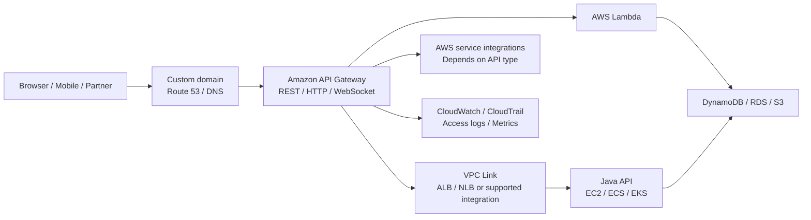
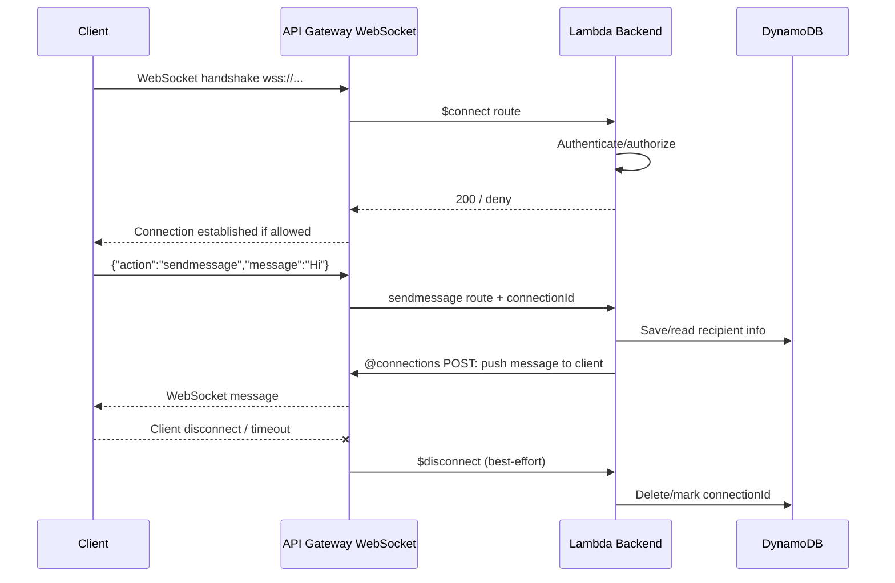
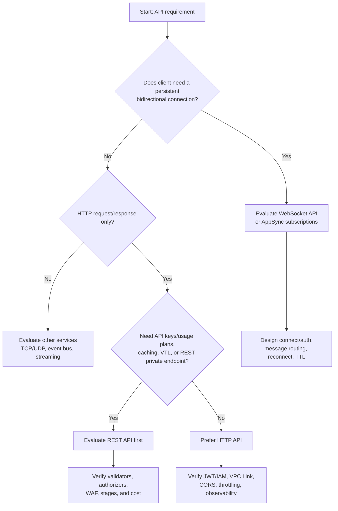
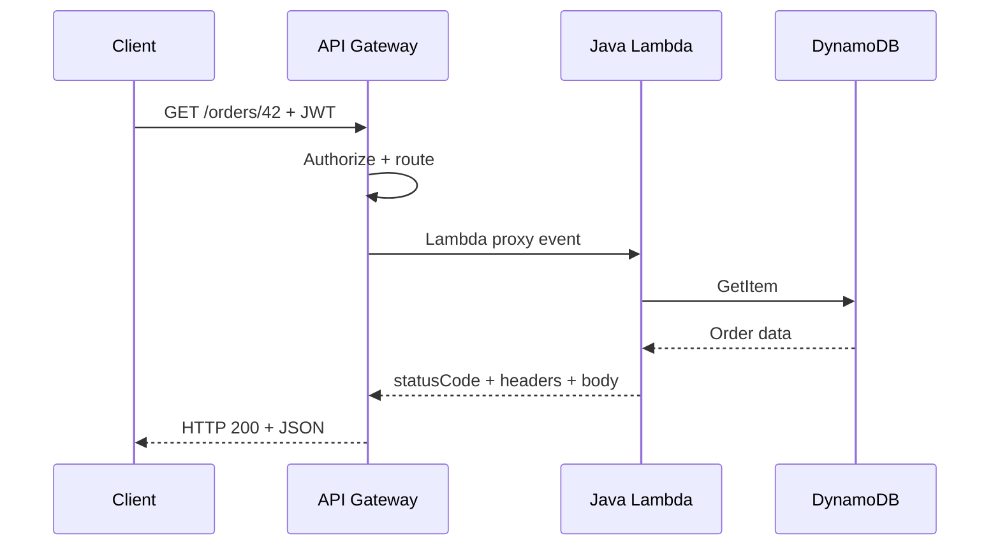
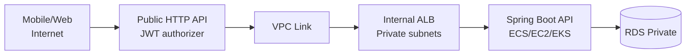
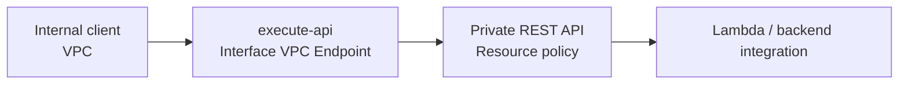

# Choosing Between REST API, HTTP API, and WebSocket API

When building a system on AWS, a **Java Spring Boot** application, AWS Lambda function, or service inside a VPC often needs a stable entry point for browsers, mobile apps, and partner systems. **Amazon API Gateway** provides a managed API service with three main types: **REST API**, **HTTP API**, and **WebSocket API**. Their names sound similar, but they differ in protocols, backend integrations, access control, deployment, operations, and cost.

Choosing the wrong API type can force a team to build extra components to compensate for missing features, or pay extra money and operational overhead for capabilities they do not use. This lesson focuses on **making a well-reasoned decision**, then verifying it through several configuration examples.

This lesson belongs to the **API Gateway and AppSync** chapter of the **CLOUD_PROVIDERS_AWS** module. The concepts connect Regions/Availability Zones, IAM, VPC, EC2/ECS/EKS/Lambda, databases, AWS integrations, monitoring, resilience, and cost control. **AWS AppSync** also appears in the architecture selection section to distinguish GraphQL subscriptions from WebSocket APIs, though the primary focus remains the **three API Gateway API types**.

## 1. Learning Objectives

After this lesson, you will be able to:

1. Distinguish between **REST API**, **HTTP API**, and **WebSocket API** by connection type, API routes, backends, authorization, and pricing model.
2. Choose **REST API** when you need advanced API management features such as usage plans, API keys, request validation, mapping templates, caching, or private REST endpoints.
3. Choose **HTTP API** when primarily serving HTTP(S) requests, needing JWT/OIDC authorization or proxying to Lambda or ALB/NLB, and preferring simpler configuration.
4. Choose **WebSocket API** for long-lived bidirectional connections, and describe the `$connect` lifecycle, custom routes, `$disconnect`, and the `@connections` API.
5. Explain why an **API key is not authentication**, and choose the appropriate IAM, JWT, Cognito, or Lambda authorizer.
6. Distinguish between **private integration via VPC Link** and a **private REST API endpoint**.
7. Identify the differences between **Lambda proxy payload format 1.0 and 2.0**, CORS, caching, and CloudWatch logs.
8. Design an API structure for a Java application, inspect it using the Console/CLI, and troubleshoot 4XX/5XX errors, WebSocket connections, and deployments.
9. Set throttling limits, monitor latency/usage, and estimate request/message/connection costs.
10. Explain when to use **AWS AppSync** or another service instead of forcing every workload into API Gateway.

## 2. Big Picture: Where Does API Gateway Fit?

API Gateway often serves as the **entry point** in front of several types of backends:



**API Gateway does not replace the backend**: an HTTP API or REST API receives a request, enforces policies at the gateway, and forwards it to the configured integration. A WebSocket API maintains connection state at the gateway layer, while message-processing logic and connection metadata typically live in Lambda or your application.

Core concepts:

| Concept | Meaning | Example |
| --- | --- | --- |
| **API** | A collection of deployed routes/resources | `orders-api` |
| **Route / Method** | Defines how a request is matched and handled | `GET /orders` or `$connect` |
| **Integration** | The backend receiving the request | Lambda, HTTP endpoint, VPC Link |
| **Authorizer** | Verifies identity/access permissions at the gateway | JWT, Lambda, IAM |
| **Stage** | Deployment name/environment | `dev`, `prod`, or `$default` |
| **Deployment** | Snapshot of API configuration published to a stage | Deployed configuration version |
| **Custom domain** | Client-facing hostname | `api.example.com` |
| **Throttling** | Rate/connection limiting | Rate and burst |
| **Access logs** | Records request metadata for operations | Status, latency, requestId |

**The three API types are three distinct API Gateway resource types**, not three modes you can switch between with a checkbox. Replacing a REST API with an HTTP API or WebSocket API requires reviewing routes, payloads, authentication, domains, logging, and client compatibility, then migrating in a controlled manner.

## 3. Quick Selection: REST API, HTTP API, and WebSocket API Matrix

| Question | **REST API** | **HTTP API** | **WebSocket API** |
| --- | --- | --- | --- |
| Primary client protocol | HTTP/HTTPS | HTTP/HTTPS | WebSocket over `wss://` or `ws://` |
| Communication pattern | Request → response | Request → response | Bidirectional connection, client/server send messages |
| API Gateway resources | Resources + Methods | Routes by method/path | Routes by message and connection events |
| Lambda integration | Yes | Yes | Yes |
| HTTP backend | Yes | Yes | Yes, via supported integration types |
| Built-in JWT/OIDC authorizer | Not like HTTP API's JWT authorizer; has Cognito user pool/Lambda | **Yes** | No built-in JWT authorizer equivalent to HTTP API |
| IAM authorization | Yes | Yes | Yes on `$connect` |
| Lambda authorizer | Yes | Yes | Yes on `$connect` |
| API keys + usage plans | **Yes** | **No** | Not via the REST usage plan model |
| API Gateway-managed stage caching | **Yes** | **No** | Not suited to HTTP response caching |
| Advanced request validation/models | **Yes** | Not equivalent to REST API | Not via REST request validation |
| Full VTL mapping templates | **Yes** | Supports simple parameter mapping, not equivalent to REST VTL | Has its own mapping/integration mechanisms |
| Private API endpoint in a VPC | **Yes**, REST Private endpoint | **No** REST Private API equivalent | No REST Private API equivalent |
| VPC Link to private backends | Yes | Yes | Depends on integration type; verify support |
| Direct AWS WAF attachment to API stage | Supported for REST API | Not directly supported under the REST stage model | Not directly supported under the REST stage model |
| Primary billing model | Requests + additional features/resources | Requests + data transfer/additional features | **Messages + connection minutes** |
| Typical use cases | Partner APIs, quota governance, transformation | Web/mobile HTTP APIs and Lambda proxy | Chat, live dashboards, collaboration |

**Pragmatic rule:** If you only need HTTP request/response, **evaluate HTTP API first**. Only choose REST API if you have **specific requirements that HTTP API does not satisfy**. If the requirement is for the **server to actively push updates to clients over a persistent connection**, evaluate WebSocket API; also compare it against **Server-Sent Events, polling, or AppSync subscriptions** depending on the application.

> **Terminology distinction:** A "RESTful API design" can be implemented on **both REST API and HTTP API** in API Gateway. The product name **REST API** does not mean HTTP API cannot be used for HTTP REST endpoints.

## 4. REST API: When Advanced API Control Is Needed

**API Gateway REST API** is the more mature product with extensive tools for governing requests, integrations, and traffic. It is the right fit when you need one or more of its specialized capabilities.

### 4.1. Key Strengths

- **API keys** paired with **usage plans** to identify application clients and enforce rate/burst/quota limits under the supported model.
- **Request validation** based on parameters or API models.
- **Mapping templates** using **Velocity Template Language (VTL)** for complex request/response transformations.
- **Stage caching** to reduce backend invocations for cacheable responses.
- **Resource policies** to restrict source IPs, principals, or VPCs/VPC endpoints depending on endpoint type.
- **Private REST API** accessed from a VPC via an interface endpoint when configured.
- Direct **AWS WAF** integration at the REST API stage, plus advanced traffic management and observability features provided by the service.
- **Regional**, **Edge-optimized**, and **Private** endpoint types tailored to specific scenarios.

Using REST API does not mean you must enable every one of these features. Choosing REST API should have a **clear cost or business justification**, because simpler workloads can often be implemented more leanly with HTTP API.

### 4.2. B2B Partner API Example

A bank exposes `/v1/reports` to multiple partners:

- Each partner has a managed daily request quota and rate/burst limits.
- Usage must be tracked per API key.
- Certain traffic sources must be blocked and WAF must be applied.
- Certain requests must be validated before invoking Lambda/backend services.
- Several legacy clients require body/header transformations.

**REST API** is a strong candidate because of usage plans, API keys, request validation, and mapping templates.

**Important:** An API key is only for **client identification, usage metering, and per-client throttling**—it is **not a secure authentication or authorization mechanism**. Partners still need IAM, OAuth2/OIDC via an authorizer, or another strong authentication mechanism. Never allow access to sensitive data solely because a client sends `x-api-key`.

### 4.3. Resource + Method Configuration

A REST API defines a resource tree:

```text
/
└── orders
    ├── GET     /orders
    ├── POST    /orders
    └── {orderId}
        ├── GET    /orders/{orderId}
        └── DELETE /orders/{orderId}
```

Each method can be configured with:

- Method request: parameters, authorization, and request validator.
- Integration request: Lambda/HTTP/AWS service, plus mapping templates if needed.
- Integration response/method response for the appropriate integration type.
- Deployment to a stage, along with stage variables, caching, logging, and usage plans.

After modifying a REST API configuration, **you typically must create a new deployment to a stage** for clients to see the changes. Edits made in the console that have not been deployed will not affect the `prod` endpoint.

### 4.4. Regional, Edge-Optimized, and Private

| REST API endpoint type | Key characteristic | When to use |
| --- | --- | --- |
| **Regional** | API resides in one Region; clients access the Regional endpoint | Clients in the same Region, or when placing your own CloudFront distribution in front |
| **Edge-optimized** | Optimizes global access using a CloudFront distribution managed by API Gateway | Globally distributed clients when this endpoint type's behavior is needed |
| **Private** | API is only accessible through a **VPC interface endpoint** for execute-api, paired with policies | Internal APIs scoped to designed VPC access boundaries |

**Regional does not automatically mean private.** A Regional REST API has a public default `execute-api` endpoint unless supported restrictions are configured. A **Private REST API** is a dedicated endpoint type, not simply using a VPC Link for backend integration.

## 5. HTTP API: Simple and Fast for Building HTTP APIs

**API Gateway HTTP API** focuses on deploying HTTP APIs with fewer configuration steps and typically lower per-request costs than REST API under standard pricing scenarios. It fits web/mobile APIs, Lambda proxy backends, private HTTP backends via VPC Link, and JWT authentication from OIDC/Cognito.

### 5.1. Capabilities That Are Usually Sufficient

- Routes such as `GET /orders`, `POST /orders`, `ANY /{proxy+}`, or `$default`.
- **Lambda proxy integration** and HTTP proxy integration.
- **Private integrations** to services inside a VPC via **VPC Link**, such as ALB, NLB, or AWS Cloud Map where supported.
- **JWT authorizers** for OAuth2/OIDC tokens, including issuer, audience, and authorization scopes.
- **Lambda authorizers** when custom identity/authorization checks are needed.
- **AWS IAM authorization** for clients using SigV4.
- **CORS** managed directly on the HTTP API.
- The `$default` stage and optional **auto-deploy** for a smooth development loop.
- Custom domains, TLS, and logging/CloudWatch metrics as supported.

### 5.2. Limitations to Keep in Mind

HTTP API **does not include** several REST API features, for example:

| Feature | HTTP API |
| --- | --- |
| **API keys + usage plans + per-key quotas** | Not supported like REST API |
| **API Gateway stage cache** | Not supported |
| **Full VTL mapping templates and request validation models** | Not equivalent to REST API |
| **REST Private API endpoint type** | Not supported |
| **Direct WAF integration on an API Gateway REST stage** | Not under the REST API model |
| **REST API Edge-optimized endpoint type** | Not supported |

HTTP API does provide **parameter mapping** for headers, query strings, and paths within service limits; you should not assume HTTP API cannot modify requests or responses at all.

If you need HTTP content caching, you can consider placing **CloudFront** in front of HTTP API, provided you carefully design cache keys, TTLs, and access control. If you must have API keys/usage plans or complex VTL request mapping, revisit REST API instead of building a custom replacement system.

### 5.3. Suitable Example

A team has a Java 21 Lambda handling `GET /catalog` and `POST /catalog`, and clients use JWTs issued by Amazon Cognito or an OIDC IdP.

A sensible design could use:

- API Gateway **HTTP API** with a JWT authorizer.
- Lambda proxy integration with **payload format version 2.0**.
- CORS restricted to the frontend origin (when browsers access it cross-origin).
- Access logs, CloudWatch metrics, and throttling limits.
- DynamoDB or RDS as the data layer, with an IAM execution role separate from the authorizer.

Do not use a JWT authorizer **just to check that a token is present**; configure the **issuer, audience, signature validation, expiry, and scopes** appropriate for each route. Resource-level authorization must still be enforced in the backend whenever object-level or tenant-level permissions apply.

## 6. WebSocket API: Real-Time Bidirectional Communication

**WebSocket API** provides a managed WebSocket entry point through API Gateway. Clients open a `wss://` connection and keep it open to **send and receive messages** without establishing a separate HTTP request for every message.

Good use cases:

- Chat or collaborative editing.
- Dashboards pushing order status or workflow progress updates.
- Real-time notifications from backend to client.
- Devices/clients needing a persistent bidirectional message channel within service quotas.

**You do not need WebSocket** just because a frontend refreshes every 30 seconds. An HTTP API with polling or **Server-Sent Events (SSE)** via a supporting backend is sometimes simpler. For GraphQL clients needing subscriptions, consider **AWS AppSync**.

### 6.1. Connection Lifecycle



The diagram illustrates one pattern using a Lambda backend. `$disconnect` is not guaranteed to fire every time; if tracking presence, the backend must use **TTLs, heartbeats, or stale-connection cleanup**.

### 6.2. Three Special Routes

| Route key | When it runs | Purpose |
| --- | --- | --- |
| **`$connect`** | Client opens a WebSocket connection | Validate permissions, persist initial session state |
| **`$disconnect`** | When the connection closes via disconnect notification | Clean up session, remove mappings |
| **`$default`** | No matching route or message lacks the configured action field | Handle fallback/errors |

You can define **custom routes** such as `sendmessage` or `subscribe`. API Gateway selects a route using the **route selection expression**, commonly:

```text
$request.body.action
```

When a client sends:

```json
{
  "action": "sendmessage",
  "roomId": "support-42",
  "message": "Hello"
}
```

API Gateway selects the `sendmessage` route if configured; if there is no match, it can route to `$default`.

### 6.3. WebSocket Authorization

API Gateway WebSocket APIs support IAM or Lambda authorizers on the **`$connect` route**. **There is no built-in JWT authorizer like HTTP API** evaluated on every WebSocket message.

Implications:

1. Authenticate and authorize during the `$connect` handshake.
2. Bind the user/tenant to the **`connectionId`** in your backend (for example, in DynamoDB).
3. **Check permissions for each sensitive message/action** in the backend; do not trust a `userId` sent by the client without verification.
4. Restrict `execute-api:ManageConnections` permissions to the component responsible for sending messages.
5. For browsers, inspect the **Origin header** during the handshake and enforce allowed-origin policies. WebSockets do not use standard HTTP `fetch` CORS preflight mechanisms.

Avoid putting access tokens in the URL or query string if a safer option exists; URLs can appear in logs. Because the browser WebSocket API restricts custom HTTP headers during the handshake, design authentication to fit your client constraints without logging secrets.

### 6.4. Connection ID and Server Push

API Gateway manages the socket connection, but the backend must store the **`connectionId`** if it needs to message the client later. A simple schema:

```text
DynamoDB table: SocketConnections
  PK: connectionId
  userId
  roomId
  connectedAt
  expiresAt (TTL)
```

When Lambda processes an event (such as an order status change), the backend looks up the recipient's connection and calls the **API Gateway Management API**:

```text
POST https://{api-id}.execute-api.{region}.amazonaws.com/{stage}/@connections/{connectionId}
```

In AWS SDK for Java v2, use **`ApiGatewayManagementApiClient`** to call `PostToConnection`, with **`endpointOverride`** pointing to the management API endpoint for the specific API/stage or configured custom domain. The relevant IAM permission is `execute-api:ManageConnections` scoped to the appropriate ARN.

If a connection has already closed, the callback typically returns **`410 GoneException`**; the application should delete the stale record. If the backend pushes a message **before the connection handshake completes**, it can also receive a Gone error; wait for the proper lifecycle phase instead of pushing immediately inside `$connect` before the client is connected.

### 6.5. Quotas and Compensation Strategies

Common API Gateway WebSocket API quotas include:

- **Maximum message payload of 128 KiB**, and maximum frame size of **32 KiB**; larger messages may require chunking or another mechanism.
- **Idle timeout around 10 minutes**, and **maximum connection duration around 2 hours** per published service quotas.
- **Binary payloads are not handled directly** as native WebSocket binary frames by API Gateway WebSocket APIs; if you need to transfer binary data, consider base64 encoding or storing objects in S3 and sending a URL with appropriate access control.
- Limits on new connection rate, concurrent connections, integration timeouts, and other account/Region quotas.

Because of timeouts, clients need **reconnect logic with exponential backoff + jitter**, **message IDs** to prevent duplicate processing, and a mechanism to fetch missed state via an HTTP API or database.

**WebSocket does not inherently guarantee exactly-once delivery or persist message history.** That responsibility belongs to your backend and durable storage.

## 7. Decision Flowchart by Requirements



This diagram is only an **initial starting point**. You must still verify quotas, integration constraints, new AWS capabilities, compliance requirements, Regional pricing, and backend architecture.

### 7.1. Real-World Scenarios

| Problem | Starting choice | Rationale |
| --- | --- | --- |
| Mobile API calling Lambda with JWT | **HTTP API** | Built-in JWT authorizer, minimal setup |
| B2B partner needing per-API-key quotas | **REST API** | Usage plans, API keys |
| Java Spring Boot REST backend behind an internal ALB | **HTTP API** with VPC Link | HTTP routing to a private backend |
| API accessible only from a VPC via interface endpoint | **Private REST API** | Private endpoint type, resource policy |
| Service requiring legacy VTL validation/mapping | **REST API** | Request validation/models and VTL |
| Chat app needing server push at any time | **WebSocket API** | Long-lived connections and `@connections` callback |
| GraphQL with multiple data sources and subscriptions | **AppSync** | Managed schema, GraphQL resolvers, subscriptions |
| Uploading large files directly to S3 | **Presigned S3 URL** + auth API | Avoids proxying entire files through API Gateway |
| Workers processing long-running event-driven jobs | **SQS/EventBridge/Step Functions + Lambda/ECS** | Decouples request latency from long-running work |

## 8. Integrations: How Does API Gateway Call Backends?

### 8.1. Lambda Proxy

With Lambda proxy integration, API Gateway passes the request as an **event payload**, Lambda processes it, and returns a response conforming to the integration contract.



**API Gateway authorization** determines whether the request is allowed to reach the backend; **Lambda's IAM execution role** determines whether Lambda can read DynamoDB, S3, or RDS. These are two separate permission boundaries.

### 8.2. HTTP Proxy Integration to a Java Backend

If your Java API runs behind an ALB or NLB:

- With **HTTP API**, you can use an HTTP proxy integration or a **VPC Link private integration** targeting an ALB, NLB, or AWS Cloud Map where supported.
- With **REST API**, VPC Link and private integrations are also supported, but the **VPC Link type, version, and compatible backend targets** differ from HTTP API; verify the documentation for your specific REST endpoint type.
- For public HTTP(S) backends, verify TLS, DNS, IP allowlisting, WAF, and the risk of clients bypassing API Gateway.

**A VPC Link allowing API Gateway to connect *to a backend* does not make a public API endpoint private.** If clients must not reach the API from the Internet, design a private endpoint, resource policy, or equivalent ingress controls.

### 8.3. AWS Service Integrations

Both REST and HTTP APIs offer integrations with AWS services according to **each API type's capabilities**. REST API provides `AWS` / `AWS_PROXY` integrations with mapping templates; HTTP API supports **first-class AWS integrations** such as SQS, EventBridge, or Step Functions in supported configurations.

If the goal is simply to receive a webhook and enqueue a message into SQS, consider a direct service integration instead of always creating an intermediate Lambda function. However, you must verify:

- Does the **API type** you chose support that service integration?
- Does API Gateway need an IAM role to invoke the target service?
- How will payloads be transformed and responses returned to the client?
- Are retries, idempotency, DLQs, and monitoring in place?

Do not attach an arbitrary AWS service name to an "HTTP API integration" and assume it behaves like Lambda proxy.

## 9. Lambda Payload Format 1.0 vs. 2.0

An important difference when migrating from REST API to HTTP API is the **event payload shape**.

### 9.1. REST API Lambda Proxy — Payload 1.0

For REST API Lambda proxy, the event contains fields such as:

```json
{
  "resource": "/orders/{id}",
  "path": "/orders/42",
  "httpMethod": "GET",
  "headers": {
    "accept": "application/json"
  },
  "pathParameters": {
    "id": "42"
  },
  "queryStringParameters": {
    "verbose": "true"
  },
  "requestContext": {
    "requestId": "example-request-id"
  },
  "body": null,
  "isBase64Encoded": false
}
```

This is a **simplified example**; real events contain additional metadata, headers, identity/authorizer context, and configuration-dependent fields.

### 9.2. HTTP API Lambda Proxy — Payload 2.0

When HTTP API uses payload format **2.0**, the event shape differs:

```json
{
  "version": "2.0",
  "routeKey": "GET /orders/{id}",
  "rawPath": "/orders/42",
  "rawQueryString": "verbose=true",
  "headers": {
    "accept": "application/json"
  },
  "pathParameters": {
    "id": "42"
  },
  "queryStringParameters": {
    "verbose": "true"
  },
  "requestContext": {
    "http": {
      "method": "GET",
      "path": "/orders/42"
    },
    "requestId": "example-request-id"
  },
  "isBase64Encoded": false
}
```

**Common migration pitfall:** `event.httpMethod` (REST proxy 1.0) is not `event.requestContext.http.method` (HTTP API 2.0). Other differences include cookies, multi-value headers/query parameters, path/base path mapping, and how authorizer context is structured.

HTTP API can be configured with **payload format 1.0 or 2.0** for Lambda proxy integrations to maintain compatibility. Therefore, do not infer the payload shape solely from the service name; inspect the actual integration configuration.

### 9.3. Simple Java Lambda Handler

Java example handling an **HTTP API 2.0** event using AWS Lambda Java Core `RequestHandler`. This code illustrates structure only; in production projects, use proper model types, validation, and a JSON library:

```java
package example;

import com.amazonaws.services.lambda.runtime.Context;
import com.amazonaws.services.lambda.runtime.RequestHandler;

import java.util.Map;

public final class OrdersHandler
        implements RequestHandler<Map<String, Object>, Map<String, Object>> {

    @Override
    public Map<String, Object> handleRequest(
            Map<String, Object> event, Context context) {

        Object requestContext = event.get("requestContext");
        String method = "";

        if (requestContext instanceof Map<?, ?> ctx) {
            Object http = ctx.get("http");
            if (http instanceof Map<?, ?> httpInfo) {
                method = String.valueOf(httpInfo.get("method"));
            }
        }

        if (!"GET".equals(method)) {
            return response(405, "{\"error\":\"method_not_allowed\"}");
        }

        return response(200, "{\"orders\":[{\"id\":\"42\"}]}");
    }

    private static Map<String, Object> response(int status, String body) {
        return Map.of(
            "statusCode", status,
            "headers", Map.of("content-type", "application/json"),
            "body", body,
            "isBase64Encoded", false
        );
    }
}
```

Use a supported version of the `aws-lambda-java-core` Maven dependency; no `pom.xml` is included here since this is documentation rather than a full sample repository.

**Never check only the HTTP method before executing real business logic.** The backend must also validate the route/path, input payload, identity, tenant ownership, and error handling. Even with IAM/JWT at the gateway, the backend receives claims/authorizer context and must still authorize access to specific resources.

## 10. Authorization: Key Differences Across the Three API Types

### 10.1. Common Mechanisms

| Option | REST API | HTTP API | WebSocket API |
| --- | --- | --- | --- |
| **AWS IAM / Signature Version 4** | Supported for method auth | Supported for route auth | Supported on `$connect` |
| **Lambda authorizer** | TOKEN/REQUEST per configuration | Request authorizer, supported payload formats | Only on `$connect` |
| **Cognito user pool authorizer** | Dedicated native integration | Uses JWT authorizer with Cognito issuer | No equivalent authorizer integration |
| **Native JWT/OIDC authorizer** | Not the same built-in HTTP API JWT mechanism | **Yes** | No |
| **API key + usage plan** | **Yes** | No | Not like REST |
| **Application authorization** | Still needed in backend | Still needed in backend | Needed in backend per action/message |

### 10.2. HTTP API JWT Authorizer

With a Cognito User Pool or OIDC issuer, an HTTP API JWT authorizer configures:

- **Issuer URL** to verify tokens from a trusted issuer.
- Expected **Audience** of the application/client.
- Optional **authorization scopes** attached to routes.
- API Gateway validates signature, algorithm, issuer, audience/`client_id`, expiration, and claims per the rules.

Example:

```text
Route: GET /orders
Authorization: JWT
Issuer: https://cognito-idp.ap-southeast-1.amazonaws.com/ap-southeast-1_EXAMPLE
Audience: [my-api-client-id]
Scopes: [orders.read]
```

This is a **logical configuration**, not a real token. Specify the proper **access token** and scopes per your IdP, and reject tokens not meant for this API. For authorization by `orderId`, the backend must still verify whether the user is permitted to read that specific order—a valid JWT **does not mean** the user can read every order.

### 10.3. Lambda Authorizer for Custom Policies

A Lambda authorizer may be required when:

- Clients send custom tokens, mTLS identities, or legacy schemes.
- You need to evaluate identity alongside policy configuration.
- Built-in JWT authorizer claims/scopes are insufficient.

Notes:

- Lambda authorizers add processing latency and can incur Lambda costs.
- Authorization caching depends on the API type, payload format, and identity sources; verify the **cache key** so decisions are never leaked across users or tenants.
- Avoid heavy synchronous database queries on every request when token claims or lightweight policies can suffice.
- Do not confuse a Lambda **authorizer** with a Lambda **backend integration**; the two functions have separate roles and permissions.

### 10.4. IAM Authorization

For internal AWS server-to-server calls, IAM authorization uses **SigV4 signed requests**, fitting IAM roles on Lambda/EC2/ECS when fine-grained AWS policies are required.

Verify:

- `execute-api:Invoke` permission on the target API ARN/method/route.
- Downstream buckets/databases still enforce their own policies if called by the backend.
- The client actually signs the request rather than sending an "IAM role name" as a custom HTTP header.

## 11. Throttling, Quotas, and API Keys

### 11.1. Difference Between Throttling and Quotas

- **Throttling**: Limits request rate/burst, typically returning `429 Too Many Requests` when thresholds are exceeded.
- **Quota**: Limits total usage over a time period, typically per client/usage plan in REST API.
- **Lambda concurrency**: The number of simultaneous backend invocations, which is a separate limit.
- **Business-level rate limiting**: May require blocking by user, tenant, IP, or action, which API Gateway does not handle completely on its own.

REST API supports **usage plans** paired with API keys; HTTP API supports route/stage-level throttling, but has no usage plans for API keys.

### 11.2. Partner API Limits Example

```text
Partner A:
  API key: identifies usage plan, not authentication
  Throttling: 100 requests/second
  Burst: 200
  Quota: 100,000 requests/day
  Authorization: IAM or appropriate authorizer

Partner B:
  API key: different key
  Quota: 20,000 requests/day
```

All values are **examples** and must be checked against AWS account-level, stage/method-level, and client-level limits. API Gateway throttling and quotas are **best-effort** traffic-control targets, not strictly exact hard limits suitable for billing or transactional accounting.

**Never treat an API key as a password.** API keys can be exposed if embedded in a frontend/browser; any application requiring user authentication must implement real authentication.

### 11.3. Implementing Reliability Requirements

Clients should:

1. Handle `429` responses with **exponential backoff + jitter**.
2. Design retries with idempotency keys for write operations.
3. Avoid aggressive retry storms that further overload API Gateway or databases.
4. Distinguish client `4XX` errors from backend `5XX` errors and timeouts.
5. Monitor quota consumption and alert before user experience degrades.

## 12. CORS for Browser HTTP and WebSocket Origin

### 12.1. HTTP API CORS

When a frontend at `https://app.example.com` calls `https://api.example.com` from a browser, **CORS** governs browser origin checks.

HTTP API provides built-in **CORS configuration** to manage:

- `Access-Control-Allow-Origin`.
- Allowed methods, headers, and exposed headers.
- `Access-Control-Allow-Credentials` when using cookies or matching credential modes.
- `OPTIONS` preflight requests.

Illustrative configuration example:

```text
Allowed origin: https://app.example.com
Allowed methods: GET, POST, OPTIONS
Allowed headers: content-type, authorization
Allow credentials: false (unless truly required)
```

**CORS is not authentication or authorization.** `curl`, mobile apps, and server-to-server clients are not restricted by browser CORS the way frontend JavaScript is. The API must still authenticate users and authorize resources.

### 12.2. REST API CORS

REST API requires configuring `OPTIONS`/preflight handling and CORS headers on both success and error responses via the appropriate integration and gateway responses.

If a proxy Lambda returns `500` without `Access-Control-Allow-Origin`, the browser may surface a CORS error instead of showing the underlying HTTP error; inspect both the API response and CORS headers.

### 12.3. WebSocket Origin

The HTTP handshake for WebSockets carries an `Origin` header in many browser clients, but **does not use standard `fetch` CORS preflight**. Do not assume enabling CORS on an HTTP API automatically protects a WebSocket API.

In the `$connect` Lambda authorizer or backend, validate `Origin` against an allowlist as needed and authenticate the session/token. Because non-browser clients can spoof the `Origin` header, **Origin validation does not replace authorization**.

## 13. Networking: Public Endpoints, Private REST APIs, and VPC Links

Three scenarios must be distinguished:

### 13.1. Public API → Public Lambda/HTTP Integration

The API has a public endpoint accessible from the Internet; the Lambda backend can run outside or inside a VPC depending on requirements. Running Lambda inside a VPC **does not make the API Gateway endpoint private**.

### 13.2. Public API → Private Backend via VPC Link

An HTTP API can have a public endpoint while integrating privately with a Java backend running behind an internal ALB in a VPC:



This is a **private backend integration**, **not a private client endpoint**. The gateway layer can still receive Internet traffic unless additional ingress controls are applied.

Requirements:

- VPC Link configured in the correct Region, account, subnets, and security groups.
- ALB/NLB/Cloud Map integration matching the resource listener and supported API type.
- ALB Security Group allowing traffic from the VPC Link ENIs/Security Groups.
- Proper VPC routing/DNS, TLS to the backend, and target group health checks.
- JWT/IAM authorizer, application authorization, and logging.

### 13.3. Private REST API Endpoint → VPC Clients

With the **Private** REST API endpoint type, authorized clients inside a VPC connect through an **interface VPC endpoint (PrivateLink) for `execute-api`**, governed by the VPC endpoint policy, API resource policy, and related security controls.



**HTTP API does not support this Private REST API endpoint type.** If you require a genuinely private client entry point, consider a Private REST API or another network architecture that meets your requirements. Do not build an HTTP API + VPC Link and call it a "private HTTP API".

### 13.4. Choosing the Right Security Boundary

| Requirement | Approach to consider |
| --- | --- |
| Backend is an internal ALB | HTTP API + VPC Link |
| Clients are only inside a VPC, API must not be public | Private REST API + interface endpoint/resource policy |
| Clients are on the Internet, but backend is private | Public API + VPC Link + auth |
| Clients call from EC2 with an IAM role | IAM/SigV4 at the Gateway where appropriate |
| Browsers use JWTs | HTTP API JWT authorizer or corresponding REST solution |
| Custom TCP/UDP protocols | Do not use API Gateway HTTP/REST as a TCP proxy; evaluate NLB/Global Accelerator |

## 14. Stages, Deployments, and Custom Domains

### 14.1. REST API Deployment

REST APIs typically follow:

```text
API resource/method changes
       ↓
Create deployment
       ↓
Deploy to stage prod
       ↓
https://{api-id}.execute-api.{region}.amazonaws.com/prod/orders
```

If you forget to deploy after changing routes or integrations, clients continue receiving responses from the previous deployment.

### 14.2. HTTP API Stages

HTTP APIs typically support a **`$default` stage** and **auto-deploy**, resulting in shorter URLs:

```text
https://{api-id}.execute-api.{region}.amazonaws.com/orders
```

If you use a named stage such as `prod`, the path may include `/prod/orders`. Check how base path mappings and the HTTP API `rawPath` payload field behave when configuring custom domains and stage mappings.

### 14.3. WebSocket API Stages

WebSocket clients connect to:

```text
wss://{api-id}.execute-api.{region}.amazonaws.com/prod
```

Route or integration changes must be **deployed to a stage** if auto-deployment is disabled. Already-open connections also have their own lifecycle; changing a deployment does not force existing connected clients to recreate their sessions.

### 14.4. Custom Domain + TLS

All three API types support custom domains as documented. For Regional APIs, use an ACM certificate in the matching Region; for REST Edge-optimized endpoints, CloudFront requires the certificate in **`us-east-1`**.

When hosting multiple REST or HTTP APIs under the same domain, you can use base path or API mappings within service limits and supported API types. When migrating a domain between two API types, verify routing mappings, DNS TTLs, certificates, authorization, CORS, and client caching.

## 15. Hands-On HTTP API: Java Lambda + JWT

Java 21 application design example:

- SPA frontend hosted at `https://app.example.com`.
- Users sign in via Amazon Cognito or an OIDC IdP.
- `GET /orders/{id}` invokes a Java Lambda function.
- Lambda checks whether the user is authorized for `orderId` and reads from DynamoDB.

### 15.1. Console Workflow

1. Open the [API Gateway Console](https://console.aws.amazon.com/apigateway/) and select the Region.
2. Choose **Create API → HTTP API**.
3. Add a Lambda integration pointing to the existing Java Lambda function.
4. Create the route `GET /orders/{id}`.
5. Configure a **JWT authorizer** with the appropriate issuer, audience, and scopes, and attach it to the route.
6. Configure CORS restricted to the frontend origin.
7. Use the `$default` stage with auto-deploy for a sandbox, or a `prod` stage with a controlled production release process.
8. Enable JSON access logging while excluding sensitive data.
9. Test with a valid token, an expired token, and a user who lacks permission for the target order.
10. Inspect CloudWatch metrics/logs and resolve 401/403/429/500 issues before production launch.

**If you lack a valid JWT token or IdP during testing, never temporarily remove the authorizer in production just to test.** Use a sandbox environment and mock or temporary authorized test users.

### 15.2. Example Route/Auth Rules

| Method/path | Authorization | Backend | Notes |
| --- | --- | --- | --- |
| `GET /health` | May be public within allowed scope | Health Lambda | Do not expose internal details |
| `GET /orders/{id}` | JWT + scope `orders.read` | Java Lambda | Check resource ownership |
| `POST /orders` | JWT + scope `orders.write` | Java Lambda | Idempotency key |
| `GET /admin/metrics` | IAM or stricter auth | Internal backend | Do not expose publicly |

An API Gateway authorizer does not solve ownership checks by itself. For `GET /orders/42`, the backend must verify that order 42 belongs to the calling tenant or user.

## 16. AWS CLI: Inspecting All Three API Types

Use AWS CLI v2 with a profile provisioned via IAM Identity Center or an IAM role. These commands are **read-only**:

```bash
# Confirm account/role identity.
aws sts get-caller-identity --profile training

# List REST APIs (separate control plane).
aws apigateway get-rest-apis \
  --region ap-southeast-1 --profile training

# List HTTP and WebSocket APIs (API Gateway v2 control plane).
aws apigatewayv2 get-apis \
  --region ap-southeast-1 --profile training

# Filter only HTTP APIs from v2 results.
aws apigatewayv2 get-apis \
  --query "Items[?ProtocolType=='HTTP'].{Name:Name,Id:ApiId,Endpoint:ApiEndpoint}" \
  --region ap-southeast-1 --profile training

# Filter only WebSocket APIs from v2 results.
aws apigatewayv2 get-apis \
  --query "Items[?ProtocolType=='WEBSOCKET'].{Name:Name,Id:ApiId,Endpoint:ApiEndpoint}" \
  --region ap-southeast-1 --profile training

# Inspect routes of an HTTP/WebSocket API ID.
aws apigatewayv2 get-routes \
  --api-id a1b2c3d4 \
  --region ap-southeast-1 --profile training

# Inspect integrations and stages of a v2 API.
aws apigatewayv2 get-integrations \
  --api-id a1b2c3d4 \
  --region ap-southeast-1 --profile training

aws apigatewayv2 get-stages \
  --api-id a1b2c3d4 \
  --region ap-southeast-1 --profile training
```

`ApiId` is a placeholder. **API Gateway REST** uses the `apigateway` CLI namespace; **HTTP API and WebSocket API** use `apigatewayv2`. This distinction reflects the control plane API, not the HTTP protocol version on the wire.

### 16.1. Minimal HTTP API Creation Command (Authorized Sandbox Only)

API Gateway v2 supports **quick create** with a Lambda target:

```bash
# MODIFIES AWS RESOURCES AND MAY INCUR CHARGES.
# Replace the Lambda ARN with an authorized, existing function.
aws apigatewayv2 create-api \
  --name demo-orders-http \
  --protocol-type HTTP \
  --target arn:aws:lambda:ap-southeast-1:123456789012:function:demo-orders-java \
  --region ap-southeast-1 \
  --profile training
```

Quick create provisions basic components such as a default route, integration, and stage where supported, but it does not automatically add a JWT authorizer, CORS, or **permission for API Gateway to invoke Lambda** in every context. Check `aws lambda get-policy` and configure a resource-based `lambda:InvokeFunction` permission with a **narrowly scoped** source ARN.

**Warning:** The command above is for illustration only; creating a default public API can open a new attack surface. Do not run it in production without configuring auth, throttling, and logging.

### 16.2. Inspecting REST API Configuration

```bash
# Replace REST_API_ID with an authorized ID.
aws apigateway get-resources \
  --rest-api-id REST_API_ID \
  --region ap-southeast-1 --profile training

aws apigateway get-stages \
  --rest-api-id REST_API_ID \
  --region ap-southeast-1 --profile training
```

If the resource/route list looks correct in the Console but clients cannot reach the route on `prod`, inspect the deployment and stage before modifying the backend.

## 17. Hands-On WebSocket: Designing a Simple Notification Chat

### 17.1. Architecture

```mermaid
flowchart TB
    Clients["WebSocket Clients"] --> WS["API Gateway WebSocket"]
    WS --> Connect["Lambda $connect\nAuth + store connection"]
    WS --> Msg["Lambda sendmessage\nValidate + route message"]
    WS --> Disc["Lambda $disconnect\nBest-effort cleanup"]
    Connect --> DB[("DynamoDB\nConnections + TTL")]
    Msg --> DB
    Msg --> API["API Gateway Management API\n@connections"]
    API --> Clients
    Event["Order status change\nEventBridge / Lambda"] --> API
```



Implementation steps:

1. Create a WebSocket API with the **route selection expression `$request.body.action`**.
2. Create `$connect`, `$disconnect`, `$default`, and `sendmessage`.
3. Attach Lambda integrations and grant appropriate resource-based invocation permissions.
4. Protect `$connect` with an IAM or Lambda authorizer according to client requirements.
5. Persist **`connectionId` → `userId`/`tenantId`** after authentication, along with a timestamp/TTL.
6. On `sendmessage`, validate sender/room permissions and recipient before calling the Management API.
7. Handle `410 Gone` responses by deleting stale connection mappings.
8. Deploy to a stage, test client connect/send/reconnect flows, and verify logs.

### 17.2. Testing from a Client

With a WebSocket-capable client tool, connect to a URL of the form:

```text
wss://a1b2c3d4.execute-api.ap-southeast-1.amazonaws.com/dev
```

After connecting successfully, send a payload:

```json
{
  "action": "sendmessage",
  "roomId": "demo-room",
  "message": "Hello"
}
```

**Do not expect the backend Lambda return body to automatically stream back to WebSocket clients** across every integration type. For server-push workflows, call the **`@connections` Management API** or configure route responses/integration responses as supported by API Gateway.

### 17.3. Sample Java Handler for Routes

With AWS Lambda Java Core, you can dispatch WebSocket routes using `requestContext.routeKey`:

```java
package example;

import com.amazonaws.services.lambda.runtime.Context;
import com.amazonaws.services.lambda.runtime.RequestHandler;
import java.util.Map;

public final class SocketRouteHandler
        implements RequestHandler<Map<String, Object>, Map<String, Object>> {

    @Override
    public Map<String, Object> handleRequest(
            Map<String, Object> event, Context context) {

        Object rawContext = event.get("requestContext");
        String routeKey = "$default";
        String connectionId = null;

        if (rawContext instanceof Map<?, ?> metadata) {
            Object route = metadata.get("routeKey");
            if (route != null) {
                routeKey = String.valueOf(route);
            }
            Object conn = metadata.get("connectionId");
            if (conn != null) {
                connectionId = String.valueOf(conn);
            }
        }

        switch (routeKey) {
            case "$connect":
                // Validate identity from a trusted authorizer/context.
                // Persist userId -> connectionId if allowed.
                return Map.of("statusCode", 200);
            case "$disconnect":
                // Best effort cleanup; TTL handles missed disconnects.
                return Map.of("statusCode", 200);
            case "sendmessage":
                // Validate body, authorization, and recipient.
                // Use ApiGatewayManagementApiClient postToConnection.
                return Map.of("statusCode", 200);
            default:
                context.getLogger().log(
                    "Unsupported route; conn=" + (connectionId != null)
                );
                return Map.of("statusCode", 400);
        }
    }
}
```

This is an **illustrative skeleton**, not a production chat server. The example returns `200` on `$connect` **without performing authentication**, so it is for simulation only; in a real system, **you must configure an authorizer and enforce permissions**. Sending messages requires the AWS SDK v2 `apigatewaymanagementapi` module, proper endpoint configuration, and error/retry handling.

### 17.4. Handling Disconnections

Clients should:

- Detect socket closes/errors and reconnect with backoff.
- Fetch or refresh a valid token before each handshake.
- Re-send subscription state after reconnecting.
- Fetch missed events from an HTTP API or data store.
- Use sequence numbers or message IDs to avoid double-applying updates.
- Never assume an old `connectionId` remains valid; the backend updates and prunes records.

## 18. Monitoring and Logs by API Type

### 18.1. Log and Telemetry Sources

| Source | Useful for inspecting | Notes |
| --- | --- | --- |
| **Access logs** | Request ID, status, route, latency, non-sensitive client metadata | Stage/format configuration depends on API type |
| **Execution logs** | Detailed REST API execution/integration steps where supported | Specific to REST API; differs from HTTP API access logging |
| **CloudWatch Metrics** | Request count, latency, integration latency, 4XX/5XX, WebSocket connection/message metrics | Verify metric names, dimensions, and stages |
| **Lambda logs** | Exceptions, invocation timeouts, downstream errors | Application logs may contain PII if uncontrolled |
| **CloudTrail** | Who created/modified APIs, stages, authorizers, resource policies | Control-plane auditing; does not replace access logs |
| **AWS WAF logs** | Blocked/allowed/challenged requests on associated resources | Only present if WAF is in the architecture |
| **X-Ray/Tracing** | Backend duration and downstream dependencies per supported integrations | Granularity differs by API type |

**HTTP API** does not have the same execution logging or stage caching system as REST API; to debug HTTP APIs, rely primarily on **access logs + Lambda/backend logs + CloudWatch metrics**.

### 18.2. Suggested JSON Access Log Format

A stage can emit JSON logs using supported context variables:

```json
{
  "requestId": "$context.requestId",
  "ip": "$context.identity.sourceIp",
  "routeKey": "$context.routeKey",
  "status": "$context.status",
  "responseLatency": "$context.responseLatency",
  "integrationError": "$context.integrationErrorMessage"
}
```

This is a **reference format example**. Valid `$context` variables vary across **REST/HTTP/WebSocket APIs** and stage types; verify the exact variables before deploying. Never log access tokens, `Authorization` headers, cookies, passwords, or request bodies containing personal data or secrets.

### 18.3. Diagnosing 4XX/5XX Errors

| Error | Common cause | How to check |
| --- | --- | --- |
| **401** | Missing token / unauthenticated | `Authorization` header / authorizer configuration |
| **403** | IAM / resource policy / authorizer denial | IAM SigV4, resource policy, identity/claims |
| **404** | Wrong route, wrong stage, or backend returned Not Found | URL, route mapping, stage, integration status |
| **429** | Exceeded throttling/quota or policy-based overload limit | API Gateway limits, usage plan, client retries |
| **500/502** | Backend exception, malformed Lambda proxy response schema, integration/config error | Lambda logs, response format, integration |
| **504** | Integration timeout or slow backend | Latency, VPC networking, DB, backend logs |
| **WebSocket 410 Gone** | `connectionId` no longer active or handshake not yet complete | Connection lifecycle, callback timing |
| **Frequent WebSocket disconnects** | Idle/lifetime timeout, client network drop, auth/reconnect issue | Connection duration, ping/pong/retry behavior |

A 4XX/5XX response does not always originate from API Gateway itself. Distinguish between a **gateway response** and an **integration/backend response** using logs, metrics, and tracing.

## 19. Cost and Resource Control

### 19.1. Pricing Models

| API type | Primary billable dimensions | Indirect costs |
| --- | --- | --- |
| **REST API** | API calls (and data transfer), plus cache capacity if enabled | Lambda, VPC Link, CloudWatch Logs, transfer |
| **HTTP API** | API calls (and data transfer) | Lambda, VPC Link, logs/metrics, transfer |
| **WebSocket API** | **Messages** and **connection minutes** | Lambda/backend, DynamoDB connection state, logs/transfer |
| **All three** | Pricing varies by Region, usage tiers, and quotas | KMS, RDS/S3/SQS, WAF/CloudFront if used |

**Do not apply a single fixed price across all Regions.** Consult [Amazon API Gateway pricing](https://aws.amazon.com/api-gateway/pricing/) and the [AWS Pricing Calculator](https://calculator.aws/).

### 19.2. Back-of-the-Envelope Estimation Exercise

Suppose you are comparing two options for an application:

**Application A:** 10 million HTTP requests/month, Lambda backend returning compact JSON. No API keys, stage cache, or REST private endpoint needed.

- Calculate request costs for **HTTP API** and **REST API** using the current Regional pricing tiers.
- Add Lambda invocation/duration costs, logs, and data transfer.
- If placing CloudFront in front, only count cache hit ratios appropriate for your security and data characteristics; do not assume every request is cacheable.

**Application B:** 20,000 WebSocket clients; each client stays connected an average of 30 minutes/day and exchanges 20 messages/day.

Approximate **connection minutes/month** (30 days):

\[
20{,}000 \times 30 \times 30 = 18{,}000{,}000\ \text{connection minutes}
\]

Approximate **messages/month**:

\[
20{,}000 \times 20 \times 30 = 12{,}000{,}000\ \text{messages}
\]

This is only a **logical volume** example; AWS message metering also involves message size increments, rounding rules, and specific pricing tiers. If fanning out messages to many clients, account for **outbound pushed messages** and backend processing, not just inbound client messages.

### 19.3. When a Cheaper HTTP API Does Not Mean a Cheaper System

If HTTP API lacks a REST API feature that you are forced to rebuild using:

- Custom Lambda authorizer/request transformation on every request.
- Complex external caching (CloudFront/ElastiCache).
- A bespoke quota and usage-tracking system.

then total build and operational costs can exceed the difference in per-call pricing. Choose services based on **TCO and security/feature requirements**, not a single row in a pricing table.

## 20. Security, Resilience, and Production Operations

### 20.1. Security Checklist

- **AuthN/AuthZ**: Use IAM, JWT/Cognito, or Lambda authorizers; enforce resource ownership in the backend.
- **Least privilege**: Grant `execute-api:Invoke` and `ManageConnections` only to roles that require them, scoped by API/stage/route.
- **HTTPS/WSS**: Enforce TLS, verify custom domains/certificates, and disallow `ws://` when encryption is required.
- **API keys**: Never treat them as passwords or hardcode them in frontend code.
- **Resource policy/WAF**: Use REST API features or equivalent layers where required by architecture; do not assume every API type supports them directly.
- **Data validation**: Validate body, path, query parameters, size, format, and identity; for HTTP API, enforce schema validation in the backend/schema layer.
- **CORS/Origin**: Browser CORS does not replace auth; verify WebSocket `Origin` during the handshake as needed.
- **Secrets**: Store secrets in Secrets Manager or Parameter Store; never log raw credentials.
- **Observability**: Enable CloudWatch access/application logs and alert on 4XX/5XX spikes, latency, and client connection failures.
- **DDoS/Abuse**: Apply throttling, WAF where supported, clear API boundaries, and AWS Shield as required.

### 20.2. Resilience Checklist

- API Gateway is a Regional service by endpoint architecture; your application still depends on **Lambda concurrency, EC2/ECS/EKS/ALB, DynamoDB/RDS**, and downstream services.
- For Multi-AZ availability, ensure multi-AZ backends/ALB target health, RDS Multi-AZ, or properly designed replication.
- Use retries with jitter and idempotency to avoid duplicate orders or payments.
- For WebSockets, ensure clients reconnect, restore subscriptions, and fetch missed data.
- Never treat a WebSocket `connectionId` or gateway cache as durable storage; persist state in DynamoDB/S3/RDS as needed.
- If full-Region failover is required, design multi-Region API/domain failover along with data replication and RPO/RTO targets. API Gateway itself does not replicate databases.

### 20.3. Controlled API Changes

- Manage APIs via OpenAPI/IaC and explicit versioning.
- Test compatibility before changing auth modes, stages, payload formats, or custom domains.
- Do not delete an active REST stage simply because you created a new HTTP API.
- Maintain a migration path for older client versions.
- Use supported canary/staging/deployment strategies alongside error monitoring.
- When migrating WebSockets, plan for clients needing to reconnect and re-establish connection state.

## 21. Lab Exercise: Choosing API Types for a Sales System

### 21.1. Scenario

A system has four functional groups:

1. **Mobile Orders API**: `GET /orders/{id}`, `POST /orders` using Cognito JWTs; Java Lambda backend, 5 million requests/month.
2. **Partner Reporting API**: Partners require per-key quotas, strict request schema validation, and WAF; Java backend on EC2/ALB.
3. **Live Order Dashboard**: Staff view order status in real time; the backend needs to push updates proactively.
4. **Internal Admin API**: Only workloads inside specific VPCs may call it, with no public endpoint.

### 21.2. Task A — Choose the API Type

Complete the table:

| Function | Suggested API type | Rationale |
| --- | --- | --- |
| Mobile Orders API | **HTTP API** | JWT authorizer, Lambda proxy, request-response |
| Partner Reporting API | **REST API** | Usage plans, request validation, WAF |
| Live Order Dashboard | **WebSocket API** or AppSync subscriptions if GraphQL | Server push, bidirectional |
| Internal Admin API | **Private REST API** | VPC interface endpoint, resource policy |

**Question:** If Partner Reporting dropped the requirement for per-key quotas/API keys and body transformation, could HTTP API become a better fit? Explain the cost and security criteria behind that decision.

### 21.3. Task B — Distinguish Event Payloads

Given Java backend code that reads the HTTP method via:

```java
String method = (String) event.get("httpMethod");
```

You migrate the integration from REST API Lambda proxy to HTTP API payload 2.0. Explain:

1. Why can `method` become `null`?
2. Which field holds the method in HTTP API 2.0?
3. What other changes to headers, cookies, path, and authorizer context must be checked?
4. Can you select payload format 1.0 on HTTP API to reduce migration effort? What are the trade-offs?

### 21.4. Task C — Choose VPC Architecture

A Spring Boot backend sits behind an internal ALB and must only accept traffic from the gateway:

1. If clients connect from the Internet, why is **HTTP API + VPC Link** appropriate?
2. If clients must reside only in a VPC and a public API endpoint is unacceptable, why is VPC Link **not enough**?
3. Which Security Group must allow traffic between the VPC Link and the ALB?
4. If REST API uses a Private endpoint, through which type of VPC endpoint do clients connect?
5. What test is needed to detect backend bypass if the ALB were accidentally made public?

### 21.5. Task D — WebSocket Chat and Security

A dashboard has 2,000 concurrent connected clients using `$connect`, `sendmessage`, and `$disconnect`:

1. Where should you attach an authorizer to block unauthorized connections?
2. After `$connect` succeeds, why must the `sendmessage` route still verify user/room permissions?
3. Where should `connectionId` be stored and when should it be cleaned up?
4. When calling `@connections` returns `410`, how should the backend handle it?
5. Why does the system need retry/reconnect logic and missed-data recovery?
6. Why is a WebSocket client insufficient to replace a database or chat history?
7. If the requirement is merely polling status once per minute, could HTTP polling or SSE be simpler?

### 21.6. Task E — Read-Only Inspection of Existing AWS Resources

If you have sandbox permissions, run the read-only commands in Section 16 and record:

```text
AWS Account / Region: ...
API type: REST / HTTP / WEBSOCKET
API name / ID (redacted): ...
Endpoint type / invoke URL: ...
Stages / auto-deploy: ...
Routes / resources / methods: ...
Integrations: Lambda / HTTP / VPC Link / AWS service
Payload format 1.0 or 2.0: ...
Authorizer type: JWT / Lambda / IAM / Cognito / None
CORS or WebSocket Origin controls: ...
Throttling / quota / usage plans: ...
Resource policy / WAF status: ...
Access logs / CloudWatch metrics: ...
Backend health / deployment state: ...
Estimated request/message/connection cost: ...
Owner / Reviewer / Date: ...
```

**Completion criteria:** Explain why each API type fits a given set of requirements; accurately identify payload, auth, and network boundaries; build an operational cost breakdown; perform no operations that create APIs, modify authorizers, delete stages, or provision resources outside the sandbox.

## 22. Self-Check Questions

1. Do "RESTful API" and the **API Gateway REST API** product mean the same thing?
2. Why should a simple Java HTTP API using Lambda + JWT usually evaluate HTTP API first?
3. Which features make REST API more suitable than HTTP API for B2B partners?
4. Is an API key a sufficient authentication mechanism to protect account data?
5. HTTP API supports a built-in JWT authorizer; what corresponding authorizer types does REST API support?
6. Why can differences between Lambda proxy event 1.0 and 2.0 cause backend code to misread the HTTP method?
7. Do changes to a REST API resource/method always take effect immediately in `prod` without a deployment?
8. What benefits do the HTTP API `$default` stage and auto-deploy provide?
9. How does a VPC Link differ from a Private REST API endpoint?
10. Can HTTP API work with an internal ALB to front a Java API running in private subnets?
11. Does CORS protect an API against `curl` or server-to-server clients?
12. Under what circumstances do WebSocket `$connect`, `$disconnect`, and `$default` execute?
13. From which part of the JSON message is the WebSocket route `sendmessage` selected?
14. Why does WebSocket API not have a built-in JWT authorizer like HTTP API for every message?
15. When does the backend use `@connections`, and which IAM permission is required?
16. What can cause a `410 GoneException`?
17. Does WebSocket API automatically store chat history or guarantee exactly-once delivery?
18. When a system needs GraphQL subscriptions, what advantages does AppSync have over manually building WebSocket routes?
19. Which metrics and logs help distinguish a `401` from an authorizer versus a `502` from a Lambda proxy response?
20. Why does using an API Gateway endpoint not automatically ensure a database has Multi-AZ or backups?
21. Do API Gateway throttling and Lambda reserved concurrency mean the same thing?
22. How does WebSocket billing differ from REST/HTTP API request-based pricing?

## 23. Where Does AppSync Fit in the Decision?

**AWS AppSync** is an API service for **GraphQL** (along with real-time capabilities under its service model) featuring schemas, resolvers, data sources, and subscriptions. It is especially useful when diverse clients need to query different fields, aggregate multiple data sources, or subscribe to schema-driven updates.

| Requirement | Option to consider |
| --- | --- |
| Simple REST endpoints with minimal management | HTTP API |
| Partner APIs needing quotas/API keys/validators | REST API |
| Custom WebSocket protocol for chat/games | WebSocket API |
| GraphQL queries/mutations/subscriptions | AppSync |
| Business event routing across AWS services | EventBridge/SNS/SQS |
| Transferring large objects | S3 presigned URLs |

Do not force a **GraphQL subscriptions** requirement into manual WebSocket routes when AppSync already provides an appropriate schema and resolver model. Conversely, if clients use a custom WebSocket protocol rather than GraphQL, API Gateway WebSocket API offers more flexibility in message routing.

## 24. Official AWS Documentation

- [Choose between REST APIs and HTTP APIs in API Gateway](https://docs.aws.amazon.com/apigateway/latest/developerguide/http-api-vs-rest.html).
- [REST APIs in Amazon API Gateway](https://docs.aws.amazon.com/apigateway/latest/developerguide/apigateway-rest-api.html).
- [Create an HTTP API](https://docs.aws.amazon.com/apigateway/latest/developerguide/http-api-develop.html).
- [Develop a WebSocket API in API Gateway](https://docs.aws.amazon.com/apigateway/latest/developerguide/apigateway-websocket-api-overview.html).
- [WebSocket routes and route selection](https://docs.aws.amazon.com/apigateway/latest/developerguide/apigateway-websocket-api-route-keys-connect-disconnect.html).
- [Use `@connections` to send WebSocket messages](https://docs.aws.amazon.com/apigateway/latest/developerguide/apigateway-how-to-call-websocket-api-connections.html).
- [WebSocket API quotas](https://docs.aws.amazon.com/apigateway/latest/developerguide/apigateway-execution-service-websocket-limits-table.html).
- [HTTP API Lambda payload format](https://docs.aws.amazon.com/apigateway/latest/developerguide/http-api-develop-integrations-lambda.html).
- [Control access to HTTP APIs with JWT authorizers](https://docs.aws.amazon.com/apigateway/latest/developerguide/http-api-jwt-authorizer.html).
- [Control access to HTTP APIs with Lambda authorizers](https://docs.aws.amazon.com/apigateway/latest/developerguide/http-api-lambda-authorizer.html).
- [Configure CORS for HTTP APIs](https://docs.aws.amazon.com/apigateway/latest/developerguide/http-api-cors.html).
- [Private integrations for HTTP APIs](https://docs.aws.amazon.com/apigateway/latest/developerguide/http-api-private-integration.html).
- [Private REST APIs in API Gateway](https://docs.aws.amazon.com/apigateway/latest/developerguide/apigateway-private-apis.html).
- [REST API usage plans and API keys](https://docs.aws.amazon.com/apigateway/latest/developerguide/api-gateway-api-usage-plans.html).
- [REST API caching](https://docs.aws.amazon.com/apigateway/latest/developerguide/api-gateway-caching.html).
- [Set up WebSocket integrations](https://docs.aws.amazon.com/apigateway/latest/developerguide/apigateway-websocket-api-integrations.html).
- [Access logging for HTTP APIs](https://docs.aws.amazon.com/apigateway/latest/developerguide/http-api-logging.html).
- [Amazon API Gateway pricing](https://aws.amazon.com/api-gateway/pricing/).
- [AWS AppSync overview](https://docs.aws.amazon.com/appsync/latest/devguide/what-is-appsync.html).

> **Key takeaway:** **HTTP API** is the sensible starting choice for most simple HTTP Lambda/Java proxy APIs; **REST API** is necessary when you need governance, transformations, quotas, caching, or a **Private REST API**; **WebSocket API** is built for long-lived bidirectional communication and server push. All three require properly designed **authentication, authorization, VPC/network boundaries, observability, resilience, and cost controls**.
