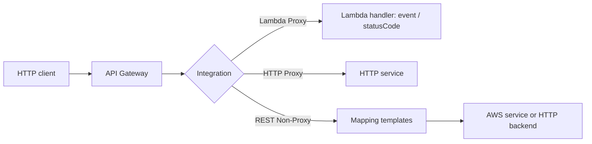
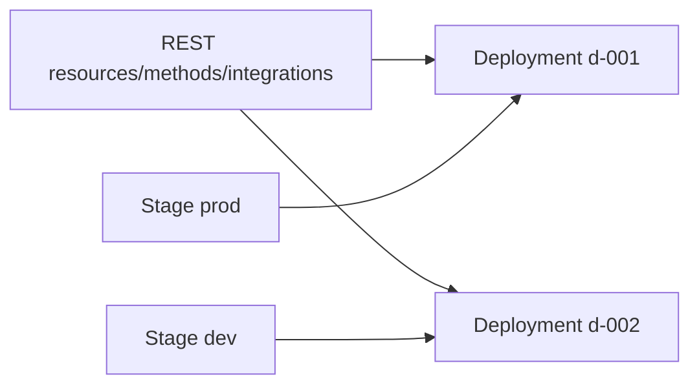
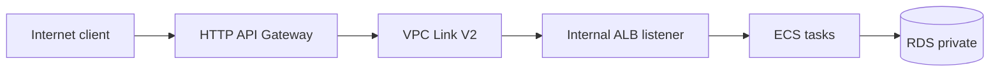
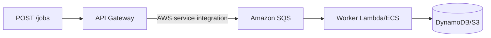
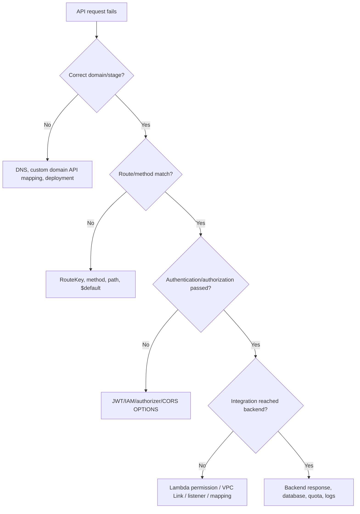

# Routes, Methods, Stages, and Backend Integrations

## 1. Context: An API for an E-Commerce System on AWS

A company needs to expose an ordering API for web and mobile clients: `GET /orders/123` to read an order, `POST /orders` to create an order, and `DELETE /orders/123` to cancel it when permitted. The backend consists of **AWS Lambda**, containerized services on **Amazon ECS** behind an internal **Application Load Balancer**, and data stored in DynamoDB/RDS. The organization wants `dev` and `prod` environments, JWT authorization, HTTPS, logging, latency monitoring, and traffic control. If clients call multiple backends directly, each backend has to solve numerous network-boundary and API-management concerns on its own.

**Amazon API Gateway** provides a managed entry point for HTTP requests. It uses **routes/resources/methods** to match requests, **integrations** to invoke backends, **deployments/stages** to publish configurations, and built-in capabilities for authentication, observability, throttling, and custom domain mapping depending on the API type.

This lesson belongs to the **API Gateway and AppSync** chapter in the **CLOUD_PROVIDERS_AWS** track. The track explores Regions/AZs, IAM, VPC, compute, storage, databases, integration, and serverless services so you know how to choose services, deploy securely, monitor, recover, and optimize cost. The direct focus here is **Routes, methods, stages, and backend integrations** in API Gateway; the final section compares them against AppSync GraphQL schemas and resolvers.

After this lesson, you will be able to distinguish REST API and HTTP API, create methods/routes/stages, configure Lambda proxy, HTTP proxy, and VPC Link integrations, inspect configurations via the CLI, understand IAM and Lambda invoke permissions, troubleshoot CORS and 401/403/404/429/5xx errors, monitor CloudWatch metrics, and evaluate real-world integration choices.

## 2. How Does API Gateway Process a Request?

```mermaid
flowchart LR
    C[Web / Mobile Client] -->|HTTPS| G[Amazon API Gateway]
    G --> R{Stage + Route/Method + Authorization}
    R -->|GET /orders/{id}| L[AWS Lambda]
    R -->|POST /orders| Q[SQS / Backend API]
    R -->|ANY /catalog/{proxy+}| V[VPC Link V2]
    V --> ALB[Internal ALB]
    ALB --> E[ECS tasks]
    L --> DB[(DynamoDB / RDS)]
    E --> DB
    G -. API metrics / access logs .-> CW[Amazon CloudWatch]
```

Typical request flow: client sends request → API Gateway resolves stage → selects route/method → checks authorizer/policies → invokes integration → backend processes request → returns status, headers, and body → API Gateway responds to client and emits telemetry. Different components can fail at each step.

| Component | Question it answers | Example |
| --- | --- | --- |
| **API** | Which product owns this collection of HTTP endpoints? | REST API or HTTP API `shop-orders` |
| **Resource/path** | Which URL path is served? | `/orders/{orderId}` |
| **Method** | Which HTTP method is accepted? | `GET`, `POST`, `DELETE` |
| **Route** (HTTP API) | Which method and path map to which backend? | `GET /orders/{orderId}` |
| **Integration** | Where does API Gateway forward the request? | Lambda ARN, public HTTP URL, VPC Link |
| **Deployment** | Which configuration snapshot has been published? | Deployment revision for a stage |
| **Stage** | Which environment/API version is being invoked? | `dev`, `prod`, `$default` |
| **Custom domain/API mapping** | Which hostname/path maps to which API/stage? | `api.example.com/orders` |

**Creating a route does not automatically produce a callable API.** You also need an integration, an appropriate stage/deployment, and sufficient permissions to invoke the backend. Conversely, creating a Lambda function does not automatically expose an HTTP route either.

## 3. REST API and HTTP API Are Two Distinct Products

| Criterion | API Gateway REST API | API Gateway HTTP API |
| --- | --- | --- |
| How paths are modeled | Tree of **Resources** and **Methods** | **Routes** consisting of method + path |
| AWS CLI | `aws apigateway ...` | `aws apigatewayv2 ...` |
| Publishing | Deployment snapshot, Stage points to deployment; usually requires **redeploy** | Stage/deployment, supports **AutoDeploy** |
| `$default` stage/route | Does not follow the HTTP API model | Has `$default` stage and `$default` route |
| Lambda proxy / HTTP proxy | Yes | Yes |
| Private backend integration | VPC Link, now includes V2 support for ALB/NLB | VPC Link V2 to ALB/NLB/AWS Cloud Map |
| API keys / usage plans | Yes | Not via the REST mechanism |
| Request validation/VTL body mapping | Yes, depending on integration type | Does not include the same REST feature set |
| Built-in JWT authorizer | IAM/Cognito/JWT options depending on feature | Has native JWT authorizer for OAuth 2.0/OIDC |
| REST private API endpoint | Yes | No REST-style private API endpoint; still supports private **integrations** |
| WAF integration and stage caching | Available on REST API where supported | Does not include the same REST WAF/stage cache model |
| Execution logs, API Gateway X-Ray | Yes | Does not have the same gateway execution logs/X-Ray; has access logs/metrics |
| Pricing | Broader feature set; evaluate per-request pricing | Typically lower cost for simple HTTP use cases |

**When to choose HTTP API:** Clients only need HTTP routes to Lambda or HTTP backends, JWT auth, CORS, and simpler cost. **When to choose REST API:** You need API keys/usage plans, API request validation/transformations, direct WAF attachment, REST private APIs, response caching, or specialized deployment governance.

**Distinction:** A **private API endpoint** controls how clients reach API Gateway from a VPC via REST API capabilities; a **private integration** controls how API Gateway calls a private backend inside a VPC. A public HTTP API can accept Internet clients while calling an **internal ALB** over VPC Link.

## 4. HTTP API Routes: Method, Path, and Precedence

HTTP API uses a **route key** combining an HTTP method and path:

| Route key | Matching requests | Role |
| --- | --- | --- |
| `GET /orders` | GET list | Read/list |
| `POST /orders` | POST create order | Create |
| `GET /orders/{orderId}` | GET `/orders/123` | Path variable |
| `DELETE /orders/{orderId}` | DELETE `/orders/123` | Mutation requiring authorization |
| `ANY /catalog/{proxy+}` | Any valid HTTP method to subpaths under catalog | Greedy proxy |
| `$default` | Requests that do not match any specific route | Catch-all |

In `GET /orders/{orderId}?include=items`, `orderId` is a **path parameter**, and `include=items` is a **query string**. A header such as `Authorization: Bearer ...` carries authentication credentials when using JWTs. The integration's payload format determines where the backend reads each of these fields.

HTTP API route matching precedence: **exact method + specific path match** → **greedy `{proxy+}` route match** → **`$default` route**. If `GET /orders/{orderId}` exists, a GET request for an order ID will not fall through to `$default`. If no route matches, the API returns `404`.

```text
GET  /orders/123         -> GET /orders/{orderId}
POST /orders             -> POST /orders
GET  /catalog/books/7    -> ANY /catalog/{proxy+}
GET  /not-defined        -> $default route if created
```

**`ANY /{proxy+}` does not completely replace `$default`.** A greedy variable captures matching subpaths, whereas `$default` catches unmatched requests, including URLs outside any greedy path. For sensitive APIs, declare explicit methods and routes to clearly enforce permissions, input validation, and logging.

## 5. REST API: Resource + Method + Integration

REST API organizes a tree of resources, where each resource can define multiple HTTP methods:

```text
REST API
└── / (root)
    ├── /orders
    │   ├── GET       -> Lambda listOrders
    │   ├── POST      -> Lambda createOrder
    │   └── /{orderId}
    │       ├── GET    -> Lambda getOrder
    │       └── DELETE -> Lambda cancelOrder
    └── /health
        └── GET       -> Lambda or MOCK
```

A REST **Method** can declare authorization, method request parameters, request models/validation, and an integration. With **Lambda proxy**, most of the request flows directly to the handler, and the handler determines the response. With **non-proxy** integrations, API Gateway supports request/response mapping (such as VTL) and method/integration responses per the configuration.

When using the **`ANY` method** or a `/{proxy+}` resource, the backend can handle its own routing, but you must ensure unauthorized operations are not exposed. A REST method `GET /orders` and an HTTP API route `GET /orders` serve similar HTTP functions, but differ in **management APIs and deployment models**.

## 6. Integration Types: How to Connect Backends

| REST integration type | Backend | Effect |
| --- | --- | --- |
| `AWS_PROXY` | Lambda invocation | Converts HTTP request into a Lambda proxy event; uses Lambda's response |
| `AWS` | AWS service/custom Lambda | Non-proxy; supports mapping templates and integration credentials |
| `HTTP_PROXY` | HTTP/HTTPS server | Straightforward request/response forwarding |
| `HTTP` | HTTP/HTTPS server | Non-proxy; customizable request/response mapping |
| `MOCK` | No backend call | Returns a simulated response for testing or matching conditions |

**HTTP API** has its own set of integration types: `AWS_PROXY` for Lambda and supported AWS service actions, `HTTP_PROXY` for HTTP endpoints (public or private), plus `payloadFormatVersion` or `integrationSubtype` depending on the target. **Do not assume REST `MOCK`, custom VTL templates, or arbitrary AWS API actions copy over identically to HTTP API**.



Choose **proxy integration** when the backend owns the API contract and you want minimal mapping at the gateway. Choose **REST non-proxy** when you must transform request/response formats or invoke AWS service actions with custom contracts. Extra flexibility increases the risk of mappings returning wrong HTTP statuses or dropping headers.

## 7. Lambda Proxy Integration: Understanding Events and Responses

**HTTP API Lambda proxy** uses `payloadFormatVersion` **1.0** or **2.0**. In CLI/IaC definitions, specify the version explicitly; do not assume the event always matches REST API Lambda proxy.

| Property | Payload 1.0 | Payload 2.0 |
| --- | --- | --- |
| Method | `httpMethod` | `requestContext.http.method` |
| Path | `path` | `rawPath`, `requestContext.http.path` |
| Duplicate query/header values | Separate `multiValue...` fields | Merged into standard fields |
| Cookies | Typically in headers/multi-values | Dedicated `cookies` field |
| Response | Follows proxy 1.0 schema | Infers simple responses, though explicit structure is recommended |

Abbreviated **HTTP API payload 2.0** example:

```json
{
  "version": "2.0",
  "routeKey": "GET /orders/{orderId}",
  "rawPath": "/orders/123",
  "rawQueryString": "include=items",
  "headers": { "content-type": "application/json" },
  "pathParameters": { "orderId": "123" },
  "queryStringParameters": { "include": "items" },
  "requestContext": {
    "stage": "$default",
    "http": { "method": "GET", "path": "/orders/123" }
  },
  "isBase64Encoded": false
}
```

An illustrative Python Lambda returning JSON status/body without accessing real data:

```python
import json

def handler(event, context):
    order_id = (event.get("pathParameters") or {}).get("orderId")
    if not order_id or not order_id.isdigit():
        return {
            "statusCode": 400,
            "headers": {"content-type": "application/json"},
            "body": json.dumps({"error": "invalid_order_id"})
        }

    # Learning example: real-world systems require authorization and secure DB queries.
    return {
        "statusCode": 200,
        "headers": {"content-type": "application/json"},
        "body": json.dumps({"orderId": order_id, "status": "accepted"}),
        "isBase64Encoded": False
    }
```

With payload 2.0 and **custom domain API mappings**, `rawPath` omits the mapping prefix in some scenarios. If the backend needs the full path including the API mapping prefix, evaluate payload format **1.0** and the `path` field per AWS documentation.

**Two-layer IAM:** Having permission to configure API Gateway does not mean API Gateway is allowed to invoke Lambda. The function needs a **resource-based policy** granting principal `apigateway.amazonaws.com` with `source-arn` scoped to the API/stage/method where appropriate; the handler needs a separate IAM **execution role** if it calls DynamoDB or S3.

## 8. Deployments and Stages: Publishing APIs to the Right Environment

A **Deployment** is a snapshot of API configuration. A **Stage** is the named environment/release clients invoke, such as `dev`, `staging`, or `prod`.

```text
API ID: abc123

HTTP API $default stage:
  https://abc123.execute-api.ap-southeast-1.amazonaws.com/orders/123

HTTP API dev stage:
  https://abc123.execute-api.ap-southeast-1.amazonaws.com/dev/orders/123

REST API prod stage:
  https://xyz987.execute-api.ap-southeast-1.amazonaws.com/prod/orders/123
```

IDs and URLs above are placeholders. With a **custom domain**, API mappings can replace or hide the stage prefix.

### 8.1. REST API Usually Requires Creating a New Deployment



If you add `POST /orders` to a REST API while the `prod` stage still points to an older deployment ⇒ requests can return `404`. You must create a **new deployment** and point the stage to it. This is a key difference from HTTP API with AutoDeploy enabled.

### 8.2. HTTP API Supports AutoDeploy

An **HTTP API stage** can set `AutoDeploy=true`, automatically deploying API changes to that stage. When AutoDeploy is off, create a deployment and assign the stage manually. In production, manage changes via CI/CD and IaC rather than leaving unapproved AutoDeploy enabled on critical environments by default.

**`$default` stage vs. `$default` route:**

- **`$default` stage:** Used when clients omit a stage name in the URL; sits at the API base path.
- **`$default` route:** Catches requests that do not match any other route.

Having a `$default` stage **does not require** having a `$default` route. API Gateway resolves the stage **before** matching a route.

### 8.3. Stage Variables and Environment Isolation

REST APIs can use **stage variables** in supported integrations; these are configuration values, **not secret storage**. A `dev` stage pointing to the same production Lambda or database can cause data leaks even with a different URL. When strong isolation is required, use separate AWS accounts/services/resources for dev and prod, proper IAM boundaries, and controlled pipelines.

## 9. CLI Lab: HTTP API GET Route to Lambda

The following sequence illustrates **API → integration → route → stage → permission**. All IDs/ARNs are placeholders; **do not run against production** without reviewing IAM/costs and verifying an existing Lambda function and appropriate AWS CLI permissions.

### 9.1. Create the API and Integration

```bash
aws sts get-caller-identity

aws apigatewayv2 create-api \
  --name shop-orders-http \
  --protocol-type HTTP \
  --region ap-southeast-1

# Replace API_ID_HERE with the actual returned ApiId.
aws apigatewayv2 create-integration \
  --api-id API_ID_HERE \
  --integration-type AWS_PROXY \
  --integration-uri 'arn:aws:lambda:ap-southeast-1:111122223333:function:get-order' \
  --integration-method POST \
  --payload-format-version 2.0 \
  --region ap-southeast-1
```

`create-integration` returns an `IntegrationId`. **`--integration-method POST`** is the HTTP method API Gateway uses to call the Lambda Invoke API—it **does not change** the client-facing `GET` method on the route.

### 9.2. Create the Route and `$default` Stage

```bash
aws apigatewayv2 create-route \
  --api-id API_ID_HERE \
  --route-key 'GET /orders/{orderId}' \
  --target 'integrations/INTEGRATION_ID_HERE' \
  --region ap-southeast-1

aws apigatewayv2 create-stage \
  --api-id API_ID_HERE \
  --stage-name '$default' \
  --auto-deploy \
  --region ap-southeast-1
```

If a stage or route with the same name already exists, do not create a duplicate; inspect existing resources first and update as needed. Some **quick create** workflows automatically create the `$default` stage.

### 9.3. Grant API Gateway Permission to Invoke Lambda

```bash
aws lambda add-permission \
  --function-name get-order \
  --statement-id allow-api-gateway-get-order \
  --action lambda:InvokeFunction \
  --principal apigateway.amazonaws.com \
  --source-arn 'arn:aws:execute-api:ap-southeast-1:111122223333:API_ID_HERE/*/GET/orders/*' \
  --region ap-southeast-1
```

Verify the actual API ARN, stage, and path. This example uses a scoped wildcard for the path parameter; in production, tighten `source-arn` by API/stage/method/route whenever possible instead of allowing any API to invoke the function. If the function uses an alias, adjust the resource policy and invocation ARN accordingly.

### 9.4. Inspect and Test with an HTTP Request

```bash
aws apigatewayv2 get-api --api-id API_ID_HERE --region ap-southeast-1
aws apigatewayv2 get-routes --api-id API_ID_HERE --region ap-southeast-1
aws apigatewayv2 get-integrations --api-id API_ID_HERE --region ap-southeast-1
aws apigatewayv2 get-stages --api-id API_ID_HERE --region ap-southeast-1

curl -i 'https://API_ID_HERE.execute-api.ap-southeast-1.amazonaws.com/orders/123'
```

If the route returns an error, **do not inspect only Lambda code**: stage, API mapping, route target, invoke permission, and payload 2.0 format can all be the root cause. Enable access logs in your learning environment to retrieve the request ID.

## 10. REST API Specifics: Resource / Method / Deployment

**REST API uses the `aws apigateway` CLI**, not `apigatewayv2`.

```bash
aws apigateway create-rest-api \
  --name shop-orders-rest \
  --endpoint-configuration types=REGIONAL \
  --region ap-southeast-1

# Retrieve the root ResourceId of the newly created API
aws apigateway get-resources \
  --rest-api-id REST_API_ID_HERE \
  --region ap-southeast-1

# Create the /orders path
aws apigateway create-resource \
  --rest-api-id REST_API_ID_HERE \
  --parent-id ROOT_RESOURCE_ID_HERE \
  --path-part orders \
  --region ap-southeast-1

# NONE is only for sandboxes without sensitive data
aws apigateway put-method \
  --rest-api-id REST_API_ID_HERE \
  --resource-id ORDERS_RESOURCE_ID_HERE \
  --http-method GET \
  --authorization-type NONE \
  --region ap-southeast-1
```

**Security note:** `--authorization-type NONE` does not authenticate callers at API Gateway. Use it only for learning on test resources; production endpoints must configure IAM/Cognito/Lambda authorizers or equivalent mechanisms along with backend resource-level authorization.

Attach Lambda proxy:

```bash
aws apigateway put-integration \
  --rest-api-id REST_API_ID_HERE \
  --resource-id ORDERS_RESOURCE_ID_HERE \
  --http-method GET \
  --type AWS_PROXY \
  --integration-http-method POST \
  --uri 'arn:aws:apigateway:ap-southeast-1:lambda:path/2015-03-31/functions/arn:aws:lambda:ap-southeast-1:111122223333:function:list-orders/invocations' \
  --region ap-southeast-1

# After granting Lambda invoke permission for the REST API:
aws apigateway create-deployment \
  --rest-api-id REST_API_ID_HERE \
  --stage-name dev \
  --description 'Deploy GET orders' \
  --region ap-southeast-1
```

Easy-to-miss detail: REST Lambda proxy URIs use **`arn:aws:apigateway:...:lambda:path/.../functions/.../invocations`**, unlike the plain Lambda ARN used in HTTP API integrations. A REST `GET` method still calls Lambda's invocation API via `POST` at the integration layer.

Sample invoke URL: `https://REST_API_ID_HERE.execute-api.ap-southeast-1.amazonaws.com/dev/orders`. After editing a method or integration, create a **new deployment**; the `dev` stage does not automatically pick up changes the way an HTTP API stage with AutoDeploy does.

## 11. Public HTTP Backends

For a backend that already exposes an HTTPS endpoint, HTTP API can use `HTTP_PROXY`. For example:

```bash
aws apigatewayv2 create-integration \
  --api-id API_ID_HERE \
  --integration-type HTTP_PROXY \
  --integration-method ANY \
  --integration-uri 'https://backend.example.com/orders' \
  --payload-format-version 1.0 \
  --region ap-southeast-1
```

Then attach a route to the returned `IntegrationId`. A public HTTP integration **does not mean the backend is already protected**: the backend still needs request validation, authentication/TLS, rate limiting, and data protection. Do not rely on a static guessable header in place of strong authentication.

In REST API, `HTTP_PROXY` forwards HTTP/HTTPS fairly directly; `HTTP` non-proxy supports mapping when the client contract differs from the backend. Test how paths, query strings, headers, bodies, encoding, and status codes are forwarded.

**Avoid proxy loops:** `backend.example.com` must never accidentally route back to the same API Gateway endpoint, causing infinite request forwarding.

## 12. Private Integrations via VPC Link

When an ECS service runs solely behind an **internal ALB**, API Gateway can expose a public HTTPS endpoint while routing traffic into the VPC without exposing the ALB directly to the Internet.



### 12.1. HTTP API and VPC Link V2

HTTP API supports private integrations via VPC Link V2 to an **ALB/NLB listener** or **AWS Cloud Map service** within supported limits. A VPC Link selects VPC subnets and security groups; the integration references the VPC Link ID and target ARN. Under standard AWS constraints, the HTTP API, VPC Link, and target reside in the **same AWS account**; cross-account connectivity requires additional architecture.

```bash
aws apigatewayv2 create-vpc-link \
  --name orders-vpc-link \
  --subnet-ids subnet-11111111111111111 subnet-22222222222222222 \
  --security-group-ids sg-0123456789abcdef0 \
  --region ap-southeast-1

# Wait for the VPC Link to become AVAILABLE, then substitute real IDs and ALB listener ARN.
aws apigatewayv2 create-integration \
  --api-id API_ID_HERE \
  --integration-type HTTP_PROXY \
  --integration-method ANY \
  --connection-type VPC_LINK \
  --connection-id VPC_LINK_ID_HERE \
  --integration-uri 'arn:aws:elasticloadbalancing:ap-southeast-1:111122223333:listener/app/orders-alb/LOAD_BALANCER_ID/LISTENER_ID' \
  --payload-format-version 1.0 \
  --region ap-southeast-1
```

You must supply the **ALB listener ARN**, not just the ALB DNS name, target group ARN, or `LoadBalancerArn` in the corresponding HTTP API VPC Link configuration. Inspect VPC Link status, network routes/SGs, ALB listener/healthy targets, and backend logs.

### 12.2. Stage Prefix in Private Integrations

An HTTP API private integration can include the **stage name** in the path sent to the backend: if the client calls `/test/orders/123`, the backend receives `/test/orders/123`. If the backend only expects `/orders/123`, configure parameter mapping:

```text
overwrite:path = $request.path
```

Always inspect ALB access logs and application responses before modifying mappings; some backends intentionally rely on the stage prefix.

### 12.3. REST API Support for VPC Link V2

Older documentation notes **REST VPC Link V1** only targeted NLBs. AWS now supports **VPC Link V2 for REST APIs** with ALB/NLB and recommends V2 for new integrations; V1 is legacy. REST uses `put-integration` with `connection-type VPC_LINK`, `connection-id`, and the **integration target** per V2 configuration—do not copy HTTP API commands verbatim.

**Private integration vs. private API endpoint:** A public Regional REST API can call a private ALB via VPC Link; if **clients must only call the gateway from inside a VPC**, you need a REST private API endpoint, interface VPC endpoint, resource policy, and appropriate DNS.

## 13. Direct Integrations with AWS Services

Not every request needs Lambda. For example, `POST /jobs` might simply **push a message to Amazon SQS**, while a downstream worker processes it asynchronously and writes results to S3.



**REST API** `AWS` integrations can invoke AWS service actions using request/response mapping templates and IAM integration credentials. **HTTP API** supports a specific set of **AWS service integration subtypes** (such as certain SQS, Step Functions, and EventBridge actions), not every action of every AWS service. Read the action/subtype documentation before choosing this pattern.

For any direct service integration:

- The API must enforce **authorization and input validation** for state-changing requests.
- The IAM integration role/resource policy must follow **least privilege**, e.g., `sqs:SendMessage` scoped to a single queue.
- Requests should carry an idempotency key/contract to prevent duplicates on client retries.
- An HTTP `202 Accepted` response only means the request/job was accepted, **not that processing succeeded**. Provide job status tracking, DLQs, retries, and observability.

## 14. Request Validation, Mapping, and HTTP Responses

**API Gateway does not automatically turn a syntactically valid HTTP request into a valid business transaction.** For `POST /orders`, distinguish:

- **Protocol validation:** HTTP method, path, headers, content type, body size.
- **Contract validation:** JSON schema, required product/quantity fields, allowed values.
- **Business validation:** Customer is permitted to order, inventory is available, pricing is valid, duplicate submissions are prevented.

REST API supports **request models/validators**, VTL mapping templates in non-proxy integrations, and method/integration responses. HTTP API supports **parameter mapping** for supported headers, query parameters, and paths, but lacks REST's **VTL body transformation** suite. With HTTP API Lambda proxy, put contract/business validation in your handler or application library, and use OpenAPI/IaC to define and test the contract.

### 14.1. Sample API Contract

| Endpoint | Success | Key errors | Controls |
| --- | --- | --- | --- |
| `GET /orders/{orderId}` | `200` JSON | `400` invalid ID, `403` forbidden, `404` not found | JWT, object ownership |
| `POST /orders` | `201` JSON + Location | `400` invalid payload, `409` conflict | Idempotency key, payload validation |
| `DELETE /orders/{orderId}` | `204` or contract status | `403`, `404`, `409` | Role/scope and order state |
| `POST /jobs` | `202` + job ID | `400`, `429`, `503` | Queue, DLQ, and status endpoint |

### 14.2. Gateway vs. Backend Status Codes

| Code | Typical meaning | Where to investigate |
| --- | --- | --- |
| **200/201/202** | Success / created / accepted | Backend contract and actual state |
| **400** | Invalid input or format | Request validation, handler |
| **401** | Missing or invalid credentials | JWT/IAM/authorizer |
| **403** | Insufficient permissions or policy block | Authorizer, resource policy, IAM, WAF |
| **404** | Stage, route, resource, or backend object missing | API mapping, route key, backend |
| **409** | State conflict | Business logic/idempotency |
| **429** | Throttling or quota exceeded | API Gateway or backend limits |
| **500/502** | Gateway, integration, or backend response error | Lambda logs, response format, permissions |
| **504** | Gateway timed out waiting for backend | `IntegrationLatency`, backend duration, network |

Do not blame every `502` on "Lambda crashed." A malformed Lambda proxy response format, missing invoke permissions, or an HTTP backend returning an invalid response can all trigger `502`; verify via logs and metrics. Likewise, `404` can happen **before the backend is ever invoked** due to a mismatched stage or route.

## 15. Authentication, Authorization, and CORS

### 15.1. Choosing an Authentication Mechanism

| Mechanism | HTTP API | REST API | Notes |
| --- | --- | --- | --- |
| **AWS IAM/SigV4** | Yes | Yes | Service-to-service or AWS identities |
| **JWT authorizer** | Yes, for OAuth/OIDC JWTs | JWT/Cognito options depending on current features | Verify issuer, audience, expiry, and scopes |
| **Lambda authorizer** | Yes | Yes | Custom rules; manage caching and policies |
| **API keys + usage plans** | Not via the REST feature set | Yes | Usage metering; **does not replace strong auth** |
| **REST resource policy** | Not via the REST capability | Yes | Restrict sources/principals |
| **AWS WAF directly on API Gateway stage** | Not via the REST model | Yes, where supported | Filters unwanted traffic |

Even after API Gateway validates a JWT, the handler must enforce **resource-level authorization**. For example, a token with scope `orders:read` only grants permission to read the resource type; the application must verify user A **owns or is authorized to read order 123**. Skipping this check lets callers swap path parameters and read other users' data.

**An API key is not a password or identity authorization.** Using an API key to identify a usage tier does not adequately protect sensitive data. Never configure an IAM authorizer or Lambda permission with account-wide wildcards when only a single route needs access.

### 15.2. CORS Is Strictly a Browser Mechanism

A frontend at `https://shop.example.com` calling `https://api.example.com` is a **cross-origin request**. The browser may send an `OPTIONS` preflight request to ask whether the API allows the method and headers.

```http
OPTIONS /orders HTTP/1.1
Origin: https://shop.example.com
Access-Control-Request-Method: POST
Access-Control-Request-Headers: authorization,content-type
```

HTTP API provides API-level **CORS configuration**. When CORS is enabled, API Gateway handles preflight responses and adds configured CORS headers, while **ignoring CORS headers returned by the backend** for those CORS requests. If a `$default` route has an authorizer attached, you may need an unauthenticated `OPTIONS /{proxy+}` route so preflight requests are not rejected by the catch-all route. For REST API, configure `OPTIONS` methods/integration responses or console-assisted CORS depending on proxy vs. non-proxy setup.

**CORS is not a firewall or authentication.** `curl` and server-to-server clients are unaffected by browser CORS restrictions. Even with perfectly configured CORS, the API still requires JWT/IAM/authorizer checks and business validation.

### 15.3. Additional Controls

- Restrict CI/CD permissions and `iam:PassRole` when provisioning integrations.
- Enforce HTTPS, custom domains with valid ACM certificates, and TLS to HTTP backends where appropriate.
- Never log JWT/access tokens, credentials, cookies/sessions, or unnecessary PII.
- Configure throttling and WAF/edge controls where supported by the API type and architecture.
- Isolate critical environments across accounts/stages, and protect rollback artifacts, IaC state, and secrets.

## 16. Custom Domains, DNS, and Stage Mapping

API Gateway provides default invoke URLs containing `execute-api`. Organizations typically prefer a domain such as `https://api.example.com`.

```text
HTTP API + $default:
  https://abc123.execute-api.ap-southeast-1.amazonaws.com/orders/123

REST API + prod:
  https://xyz987.execute-api.ap-southeast-1.amazonaws.com/prod/orders/123

Custom domain + API mapping:
  https://api.example.com/orders/123
```

Implementation steps:

1. Create a **custom domain** matching the API Gateway endpoint type.
2. Provision/attach an **ACM certificate** for the hostname. For edge-optimized REST custom domains, the certificate must be in `us-east-1`; Regional endpoints require a certificate in the API's Region.
3. Create an **API mapping / base path mapping** pointing to the right API and stage.
4. Create a DNS Alias/CNAME record per your DNS provider and supported target.
5. Verify TLS, hostname, stage, route key, and authorizer, confirming which environment receives traffic.

**Valid DNS can still yield API 404s**: the API mapping might point to the wrong stage, the stage might be undeployed, or the route key might not match. Do not tweak DNS if `dig` already resolves to the right endpoint and the fault lies in the mapping.

## 17. Observability: API Gateway, Lambda, and HTTP Backends

### 17.1. Access Logs and Request Correlation

For both HTTP APIs and REST APIs, configure **stage access logs** to investigate requests. Sample JSON log format (verify supported context variables for your API type):

```json
{
  "requestId": "$context.requestId",
  "routeKey": "$context.routeKey",
  "status": "$context.status",
  "responseLatency": "$context.responseLatency",
  "integrationLatency": "$context.integrationLatency",
  "integrationError": "$context.integrationErrorMessage"
}
```

REST API can use `$context.resourcePath`/`$context.httpMethod` depending on configuration; HTTP API uses its supported route variables. Do not copy a single log template blindly and expect every field to populate in both API types. **`requestId`** correlates API Gateway logs with Lambda/application logs when propagated and logged properly.

**REST API** supports execution logging and gateway-level AWS X-Ray tracing where enabled. **HTTP API** provides access logs and CloudWatch metrics without the same gateway execution logs/X-Ray tracing. You can still instrument **Lambda and ECS backends** with X-Ray or OpenTelemetry to trace business flows.

### 17.2. Metrics to Monitor

| Metric | What it reveals |
| --- | --- |
| `Count` | Total request volume |
| `4XXError` and `5XXError` | Client, gateway, and backend error rates |
| `Latency` | Total request latency observed by the gateway |
| `IntegrationLatency` | Integration/backend latency |
| Throttling / HTTP `429` | Quota limits, traffic spikes, retry storms |
| Lambda `Errors` / `Duration` / `Throttles` | Function errors, timeouts, concurrency pressure |
| ALB `TargetResponseTime`, HTTP 5xx, target health | Slow or unhealthy ECS/ALB backend |
| SQS backlog/age, Step Functions failures | Failures in asynchronous workflows |

If `IntegrationLatency` spikes, investigate databases, downstream services, or backend compute. If `Latency` rises while integration latency stays low, inspect authorization, gateway processing, or other overhead. For production, define **SLOs on p95/p99 latency, 5xx rate, 429 rate, and availability**, measured via synthetic client probes rather than CPU alone.

### 17.3. Log Protection and Cost Control

CloudWatch ingestion/storage, high-resolution metrics, traces, and dashboards incur charges. Set retention policies, appropriate sampling, and strict IAM read permissions, and avoid logging raw bodies containing PII or bearer tokens. Separate logs by stage so failing environments are easy to isolate.

## 18. Throttling, Retries, and Asynchronous Design

API Gateway, Lambda, ALB/ECS, and databases each have **independent** quotas and capacities:

```text
Client
  -> API Gateway request rate/burst throttle
  -> Authorizer/Integration
  -> Lambda concurrency or ECS/ALB healthy capacity
  -> Database connection limits / SQS throughput / external API quota
```

Raising the API Gateway throttle quota will not fix an RDS instance that has run out of connections. Clients receiving `429` should retry with **exponential backoff + jitter** and honor `Retry-After` when provided, while **side-effecting `POST` calls must use idempotency keys** so orders are never created twice.

For long-running jobs, avoid holding an HTTP connection open until completion if it risks hitting integration timeouts. One pattern:

```mermaid
flowchart LR
    C[Client] -->|POST /jobs| API[API Gateway]
    API -->|AWS service integration or Lambda| Q[SQS]
    Q --> W[Async Worker]
    W --> DB[(Job status database)]
    C -->|GET /jobs/{id}| API
```

Return **202 Accepted + job ID** once the job is queued, and let clients poll `GET /jobs/{id}`. Workers need retries, DLQs, idempotency, and telemetry. Pair with AWS Step Functions when you need multi-step workflows, timeout/retry policies, and explicit orchestration state.

### 18.1. Total Cost Breakdown

| Item | Costs to examine |
| --- | --- |
| API Gateway | Requests/messages/data transfer by API type and Region |
| Lambda | Invocations, duration/compute, concurrency, and logs |
| ECS/ALB/VPC Link | Compute, load balancing, networking, VPC resources |
| CloudWatch/X-Ray | Logs, metrics, traces, and retention |
| WAF/Secrets/KMS | Security and supporting service fees |
| SQS/Step Functions/DB | Queue operations, workflows, backend compute/storage |

HTTP API generally offers lower per-request pricing than REST API when REST-specific features are unnecessary, but **per-request pricing does not reflect total cost**. Compare total cost per **successful request/job meeting SLOs**, not just gateway cost per million calls.

## 19. Common Errors and Runbook

| Symptom | Likely cause | Verification steps |
| --- | --- | --- |
| HTTP API returns 404 immediately | Wrong stage, route, method, or custom-domain mapping | `get-routes`, `get-stages`, URL, mapping |
| REST API method updated, but `prod` still returns 404 | Missing new deployment | `get-deployments`, `get-stage` |
| `401` from gateway | Missing or invalid JWT/authorizer token | Issuer, audience, token expiry/scope |
| `403` from gateway | IAM authorization, resource policy, WAF, or authorizer deny | Access logs, identity, explicit deny |
| `500/502` on Lambda proxy | Missing resource-based invoke permission, bad payload/response format, or Lambda exception | Lambda function policy, logs, integration URI |
| `504` | Backend timeout or slow network | `IntegrationLatency`, backend duration, routes/SG |
| `429` | Gateway or backend throttling/quota | CloudWatch, retry storm, usage plan |
| Backend `404` on HTTP API private integration | Stage prefix prepended to path | ALB logs, `overwrite:path = $request.path` |
| CORS preflight gets `401/403` | `OPTIONS` hitting `$default` authorizer or misconfigured CORS | Test `Origin` / `Access-Control-Request-Method` |
| DNS resolves properly, but HTTPS/mapping fails | ACM cert, domain mapping, or stage issue | Certificate, custom domain, API mapping |
| AppSync GraphQL field error | Schema/resolver/data source mismatch (unlike HTTP routes) | AppSync logs, GraphQL errors |



### 19.1. Read-Only Verification Commands

```bash
aws sts get-caller-identity

# HTTP API
aws apigatewayv2 get-api --api-id API_ID_HERE --region ap-southeast-1
aws apigatewayv2 get-routes --api-id API_ID_HERE --region ap-southeast-1
aws apigatewayv2 get-integrations --api-id API_ID_HERE --region ap-southeast-1
aws apigatewayv2 get-stages --api-id API_ID_HERE --region ap-southeast-1

# REST API
aws apigateway get-resources --rest-api-id REST_API_ID_HERE --region ap-southeast-1
aws apigateway get-deployments --rest-api-id REST_API_ID_HERE --region ap-southeast-1
aws apigateway get-stage --rest-api-id REST_API_ID_HERE --stage-name prod --region ap-southeast-1

# Lambda permission
aws lambda get-policy --function-name get-order --region ap-southeast-1
```

These commands make no modifications, though they require valid AWS credentials and read permissions in the right account. When seeing a `502`, never make an internal ALB public or grant `AdministratorAccess` "just to test": isolate the failing layer first.

## 20. Comparison with AWS AppSync GraphQL

**AWS AppSync** is typically used to build **GraphQL APIs** based on schemas, fields, and resolvers. It **does not use REST route keys like `GET /orders/{id}` as API Gateway does**; GraphQL generally receives queries, mutations, and subscriptions at a single endpoint and dispatches resolvers by field.

| Aspect | API Gateway REST/HTTP | AppSync GraphQL |
| --- | --- | --- |
| How logic is dispatched | HTTP method + path | Schema field such as `Query.getOrder` |
| Client contract | Resource paths, HTTP status codes, headers/body | GraphQL schema, query/mutation/selection set |
| Backend | Lambda/HTTP/VPC Link/AWS service integration | Data source + unit/pipeline resolver (e.g., Lambda/DynamoDB/HTTP) |
| Environments | API Gateway stages/deployments | Schema/resolvers/endpoints managed via AppSync/IaC; no 1:1 stage equivalent |
| Real-time | Requires WebSocket API or separate solution | GraphQL subscriptions supported by AppSync |

Illustrative GraphQL schema example:

```graphql
type Order {
  id: ID!
  status: String!
}

type Query {
  getOrder(id: ID!): Order
}

type Mutation {
  createOrder(id: ID!): Order
}
```

Client sends:

```graphql
query {
  getOrder(id: "123") {
    id
    status
  }
}
```

To execute this, AppSync needs a **resolver** for `Query.getOrder`—either a **unit resolver** or a **pipeline resolver** using **APPSYNC_JS** or VTL per configuration. The data source can be DynamoDB, Lambda, an HTTP endpoint, or another supported source. AppSync GraphQL can invoke an API Gateway HTTP endpoint via an **HTTP data source**, though you must still configure the GraphQL schema, resolvers, and access permissions.

**Choose API Gateway** when HTTP resource/method contracts and integrating multiple HTTP backends are central. **Choose AppSync GraphQL** when clients need schema-driven field selection, data-source aggregation, and supported subscriptions.

## 21. Architectural Scenarios

### Scenario A — Lambda Ordering API

A small team has `listOrders`, `getOrder`, and `createOrder` Lambda functions backed by DynamoDB. They do not need REST API usage plans or VTL mapping.

**Recommendation:** HTTP API with explicit routes, Lambda proxy payload 2.0, a JWT authorizer, and a Lambda resource-based invoke policy. The backend enforces ownership, input validation, and idempotency on `POST`. Use the `$default` stage in sandbox and controlled deployment/auto-deploy in production.

### Scenario B — Container API in a Private Subnet

An ECS service only accepts traffic through an internal ALB, and partners need an authenticated public HTTPS endpoint.

**Recommendation:** HTTP API with VPC Link V2 targeting the **ALB listener ARN**; verify VPC subnets, SGs, routing, target health, stage prefix handling, and TLS. Never expose the ALB directly to the Internet just to wire up API Gateway.

### Scenario C — Partner API Requiring Usage Plans, WAF, and Validation

Partners are issued API keys to meter usage and enforce per-plan throttling; the gateway needs request validation, WAF, and custom mappings.

**Recommendation:** REST API with the required features enabled. API keys track usage **and do not replace JWT/IAM authentication**. Create a new deployment and only promote the `prod` stage after testing.

### Scenario D — Frontend Wanting GraphQL and Real-Time Updates

A web app needs to fetch orders, users, and promotions with flexible selection sets, plus receive status updates via subscriptions.

**Recommendation:** AppSync GraphQL with appropriate schemas, resolvers/data sources, and authorization. If HTTP APIs already exist for parts of the backend, an AppSync HTTP resolver can integrate with them without rewriting the entire application at once.

## 22. Production Checklist

1. Decide between **REST API and HTTP API** based on actual required features, not just product names.
2. Design methods/paths, request/response contracts, versioning, and route matching; avoid overly broad `ANY`/`$default` routes.
3. Configure **authorization** and backend resource-level ownership checks for all sensitive data.
4. Select the right integration: Lambda proxy payload version, public HTTP, AWS service subtype, or VPC Link.
5. Verify Lambda resource-based invoke policies, backend IAM roles, and resource policies.
6. For VPC Link: verify subnets, SGs, listener ARN, private routing, healthy targets, and stage path behavior.
7. Manage **deployments/stages**: redeploy REST APIs explicitly; control HTTP API AutoDeploy via CI/CD policies.
8. Configure custom domains, ACM certificates, DNS records, and API mappings per environment.
9. Test CORS/`OPTIONS`, JWTs, 4xx/5xx handling, throttling, `429` retries, timeouts, and idempotency.
10. Enable access logs/metrics/alarms, request ID correlation, and scrub tokens/PII from logs.
11. Estimate costs across gateway, compute, VPC, ALB, CloudWatch, and backends, and verify quotas.
12. Test rollbacks, failover, and data/backend recovery against RTO/RPO targets; routes and stages alone do not provide DR.

## 23. Self-Check Questions

**Question 1.** An HTTP API has `GET /orders/{orderId}` and a `$default` route. A client calls `GET /orders/123`—which route takes precedence?

**Hint:** The specific route `GET /orders/{orderId}`. `$default` is the catch-all.

**Question 2.** How does the `$default` stage differ from the `$default` route?

**Hint:** The stage provides a base URL without a stage prefix; the route catches requests that match no other route.

**Question 3.** You added a new `POST` method to a REST API, yet `prod` still returns `404`. Why?

**Hint:** Check whether a new deployment was created and the stage pointer updated, along with resource/method and URL; REST does not auto-publish every edit.

**Question 4.** A Lambda function works when invoked directly, but HTTP API returns `500/502`. What should you check?

**Hint:** Check gateway route/integration configuration, Lambda resource-based permission, payload format and response structure, logs, and timeouts.

**Question 5.** Can a public HTTP API call an internal ALB without exposing the ALB to the Internet?

**Hint:** Yes, using a private integration via VPC Link V2 with the proper listener ARN, SGs, and routes.

**Question 6.** Why might a backend receive `/test/orders/123` instead of `/orders/123` over a private integration?

**Hint:** The stage prefix can be forwarded to the backend; check `overwrite:path = $request.path` per the docs and contract.

**Question 7.** Once a JWT authorizer passes, can user A automatically read any `orderId`?

**Hint:** No; the backend must still check object-level ownership and permissions.

**Question 8.** Can HTTP API use REST `MOCK` integrations and VTL body templates identically?

**Hint:** No. Their feature sets differ; consider REST API or handle transformations in the backend.

**Question 9.** Does configuring browser CORS to allow an origin mean the API is secured against `curl` and bots?

**Hint:** No. CORS is solely browser-enforced behavior; you still need authentication, IAM, throttling, and data protection.

**Question 10.** Does AppSync GraphQL use the same routes, methods, and stages as API Gateway HTTP API?

**Hint:** No. AppSync uses GraphQL schemas, fields, resolvers, and data sources, with a different deployment and staging model.

## 24. Key Takeaways

**HTTP API** uses route keys of **method + path**, supports a `$default` route, `$default` stage, and **AutoDeploy** when enabled. **REST API** builds **resources + methods + integrations** published via **deployment snapshots → stages**, where changes typically require redeployment. **Integrations** determine whether the backend is Lambda, an HTTP endpoint, an AWS service action, or a private resource via VPC Link.

Remember the boundaries of responsibility: **routes match requests; stages select the published release; authorization gates access; integrations connect backends; backends own business logic, data, and fine-grained permissions**. Monitoring must span both the gateway and backends, and production readiness requires HTTPS, least-privilege IAM, accurate CORS, throttling, retries/idempotency, logs, cost awareness, and rollback plans.

**AppSync GraphQL** differs from API Gateway by using **schemas, resolvers, and data sources** rather than HTTP resources and methods as the primary contract. Choose services based on client needs and integration/security requirements, not merely the word "API" in the name.

### AWS Reference Documentation

- [Amazon API Gateway — Choose between REST APIs and HTTP APIs](https://docs.aws.amazon.com/apigateway/latest/developerguide/http-api-vs-rest.html)
- [API Gateway — Create HTTP API routes](https://docs.aws.amazon.com/apigateway/latest/developerguide/http-api-develop-routes.html)
- [API Gateway — Develop HTTP APIs](https://docs.aws.amazon.com/apigateway/latest/developerguide/http-api-develop.html)
- [API Gateway — Stages for HTTP APIs](https://docs.aws.amazon.com/apigateway/latest/developerguide/http-api-stages.html)
- [API Gateway — Lambda proxy for HTTP APIs](https://docs.aws.amazon.com/apigateway/latest/developerguide/http-api-develop-integrations-lambda.html)
- [API Gateway — REST Lambda proxy integration](https://docs.aws.amazon.com/apigateway/latest/developerguide/set-up-lambda-proxy-integrations.html)
- [API Gateway — Integration types for REST APIs](https://docs.aws.amazon.com/apigateway/latest/developerguide/api-gateway-api-integration-types.html)
- [API Gateway — HTTP API private integrations](https://docs.aws.amazon.com/apigateway/latest/developerguide/http-api-develop-integrations-private.html)
- [API Gateway — REST private integrations and VPC Links V2](https://docs.aws.amazon.com/apigateway/latest/developerguide/private-integration.html)
- [API Gateway — Set up REST private integrations](https://docs.aws.amazon.com/apigateway/latest/developerguide/set-up-private-integration.html)
- [API Gateway — Configure CORS for HTTP APIs](https://docs.aws.amazon.com/apigateway/latest/developerguide/http-api-cors.html)
- [API Gateway — HTTP API access logs](https://docs.aws.amazon.com/apigateway/latest/developerguide/http-api-logging.html)
- [API Gateway — Monitor HTTP APIs](https://docs.aws.amazon.com/apigateway/latest/developerguide/http-api-monitor.html)
- [AWS AppSync — Resolver components](https://docs.aws.amazon.com/appsync/latest/devguide/resolver-components.html)
- [AWS AppSync — Attaching data sources](https://docs.aws.amazon.com/appsync/latest/devguide/attaching-a-data-source.html)
- [AWS AppSync — HTTP resolvers](https://docs.aws.amazon.com/appsync/latest/devguide/tutorial-http-resolvers-js.html)
- [Amazon API Gateway pricing](https://aws.amazon.com/api-gateway/pricing/)
