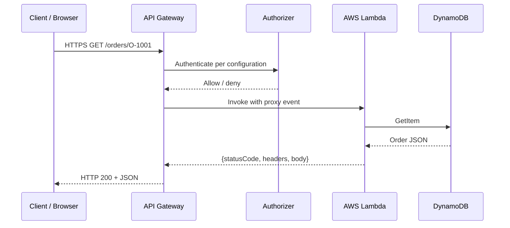
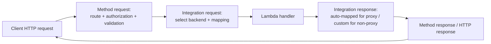

# Lambda Proxy Integration and Request/Response Mapping in Amazon API Gateway

> **Chapter:** API Gateway and AppSync  
> **Module:** `CLOUD_PROVIDERS_AWS`  
> **Context:** Building an HTTP API for a Java/AWS Lambda application with a secure, observable, resilient, and cost-controlled architecture. This lesson focuses on how Amazon API Gateway transforms an HTTP request into a Lambda event, how Lambda returns an HTTP response, and when to use mapping templates. AWS AppSync is compared at the end so REST/HTTP protocols are not confused with GraphQL.

## Learning Objectives

After this lesson, you will be able to:

1. Distinguish **HTTP API**, **REST API**, **Lambda proxy integration**, and **Lambda non-proxy/custom integration** in Amazon API Gateway.
2. Read and inspect **event payload 1.0** and **payload 2.0**, including method, path, query string, headers, cookies, authorizer context, body, and `isBase64Encoded`.
3. Construct a valid **Lambda proxy response**: `statusCode`, `headers`, `multiValueHeaders` (where supported), `cookies`, `body`, and the binary encoding flag.
4. Explain when API Gateway maps events/responses automatically and when **REST API non-proxy integration** requires VTL mapping templates and integration/method responses.
5. Distinguish **HTTP API parameter mapping**, REST API VTL mapping, and **AppSync GraphQL resolver mapping**.
6. Write a Java handler that returns contract-compliant status codes and JSON bodies, enforces 400/404/500 error handling, performs validation, and avoids leaking sensitive information.
7. Analyze CORS, Lambda invoke permissions, IAM authorization, binary payloads, stages/custom domains, timeouts, and throttling.
8. Use AWS CLI, `curl`, and CloudWatch logs to inspect integrations, reproduce `502 Bad Gateway` errors, and verify requests/responses end-to-end.

## 1. Where Does API Gateway Sit in a Serverless Architecture?

**Amazon API Gateway** provides the API entry point for clients. It receives HTTP requests, authenticates or authorizes callers, enforces quotas/throttling where supported, routes requests, and invokes backends such as Lambda.

A common flow:



API Gateway is **not** the Lambda runtime and does not replace business logic. Lambda must validate inputs, execute business logic, handle errors, and build properly formatted responses.

### 1.1 Distinguishing Products and Features

| Concept | Purpose | Key points to remember |
|---|---|---|
| **API Gateway REST API** | Feature-rich API for request/response governance, VTL mapping, API keys/usage plans, caching, and advanced capabilities | Has `Method request → Integration request → Integration response → Method response` |
| **API Gateway HTTP API** | Simpler HTTP API, typically lower latency and cost than REST API for supported use cases | Lambda proxy `payloadFormatVersion 1.0/2.0`; route/stage configuration differs from REST API |
| **Lambda proxy integration** | API Gateway turns the HTTP request into a standardized Lambda event contract | Backend controls status, headers, and body; API Gateway performs minimal transformation |
| **Lambda non-proxy/custom integration** | Actively transforms requests/responses using REST API mappings | Uses VTL templates/response mappings; can hide HTTP contracts from Lambda |
| **HTTP proxy integration** | Forwards to an HTTP backend rather than generating a Lambda event | Do not confuse with Lambda proxy despite both having "proxy" in the name |
| **AWS AppSync** | GraphQL API with schemas/resolvers and real-time subscriptions | Lambda resolvers receive **GraphQL resolver context/payloads**, not API Gateway proxy events by default |

### 1.2 Proxy Is a Data Contract, Not Just a Console Label

When configuring Lambda proxy:

- API Gateway builds an **event JSON matching the payload version**.
- Lambda reads the event and returns a conforming **response envelope**.
- API Gateway translates that response envelope into HTTP status, headers, and body.
- You normally do not build custom REST API integration response VTL templates to override status codes for Lambda proxy.
- Formatting mistakes in the response can produce **`502 Bad Gateway`** even when the handler itself returned normally.

**Note:** `AWS_PROXY` is an integration type value in API Gateway; it does not mean HTTP headers, binary data, CORS, or permissions pass through "as-is" without rules.

## 2. Four Steps from HTTP Request to HTTP Response

In a REST API, the logical flow can be viewed as:



In a **proxy integration**, integration request/response handling uses a standardized contract instead of custom full VTL mappings. In a **non-proxy REST integration**, you can configure detailed transformations on body, headers, and status codes on both ends.

With **HTTP API**, resource and configuration structures differ from REST API: you configure routes, integrations, stages, and optional parameter mappings rather than the four-stage method/integration screens of REST API.

### 2.1 Example HTTP Request

```http
GET /orders/O-1001?expand=items&expand=payments HTTP/1.1
Host: api.example.com
Accept: application/json
X-Correlation-Id: corr-123
Authorization: Bearer <access-token>
```

Path through the system:

1. API Gateway matches a route, e.g., `GET /orders/{orderId}`.
2. The authorizer runs if configured; unauthorized requests can be rejected before Lambda is invoked.
3. API Gateway constructs the Lambda event containing `pathParameters.orderId`, headers, query parameters, and `requestContext`.
4. Lambda reads `orderId`, validates syntax, queries data, and returns a response envelope.
5. API Gateway returns the HTTP status, headers, and JSON body to the client per the contract.

Never place real tokens into sample requests, CloudWatch logs, test documentation, or shell commands captured in CI logs.

## 3. REST API Lambda Proxy Integration: Payload Format 1.0

REST API Lambda proxy uses the **v1.0** event structure with fields such as:

- `resource`: configured resource path in the API.
- `path`: actual request path.
- `httpMethod`: GET/POST/PUT/DELETE, etc.
- `headers`, `multiValueHeaders`: HTTP headers.
- `queryStringParameters`, `multiValueQueryStringParameters`: query parameter values.
- `pathParameters`: path variables.
- `requestContext`: stage, request ID, identity/authorization, and metadata.
- `stageVariables`: stage variables if configured.
- `body`: payload string or `null`.
- `isBase64Encoded`: indicates whether `body` requires Base64 decoding.

### 3.1 Illustrative Event JSON

```json
{
  "resource": "/orders/{orderId}",
  "path": "/orders/O-1001",
  "httpMethod": "GET",
  "headers": {
    "accept": "application/json",
    "x-correlation-id": "corr-123"
  },
  "multiValueHeaders": {
    "accept": ["application/json"],
    "x-correlation-id": ["corr-123"]
  },
  "queryStringParameters": {
    "expand": "payments"
  },
  "multiValueQueryStringParameters": {
    "expand": ["items", "payments"]
  },
  "pathParameters": {
    "orderId": "O-1001"
  },
  "stageVariables": null,
  "requestContext": {
    "requestId": "rest-request-001",
    "stage": "prod",
    "resourcePath": "/orders/{orderId}"
  },
  "body": null,
  "isBase64Encoded": false
}
```

This is an **abbreviated sample** to illustrate the contract; real `requestContext` payloads contain many more fields and vary by authorizer type, API/stage, and enabled features. Do not write a Java deserializer that fails if optional fields are absent or extra fields appear.

### 3.2 Repeated Query Parameters: Prefer Multi-Value When All Values Matter

Request:

```text
GET /orders/O-1001?expand=items&expand=payments
```

In REST API proxy v1.0, `multiValueQueryStringParameters.expand` preserves **the list of values**. `queryStringParameters.expand` holds only a single representative value; do not use the single-value map if your logic needs every value.

Similarly, when returning multiple `Set-Cookie` headers or repeated header names, use the multi-value mechanism of payload 1.0 to avoid losing values.

**Do not assume API Gateway preserves parameter ordering when mapping into the event.** If request signatures or business rules depend on exact byte order or raw encoded query strings, handle them according to protocol rules.

### 3.3 Proxy Resource `ANY /{proxy+}`

In REST API, `ANY` combined with the greedy path `/{proxy+}` lets a single Lambda handle multiple paths and methods. For example:

```text
GET    /orders/O-1001
POST   /orders
DELETE /orders/O-1001
GET    /orders/O-1001/items
```

Advantage: minimal route configuration, with routing handled in backend code. Trade-off: the app must parse paths itself, validate every input, enforce per-route authorization, and log clearly. Do not use `ANY /{proxy+}` to implicitly allow every sensitive method or operation.

## 4. HTTP API Lambda Proxy: Payload Format 2.0

When creating a Lambda integration for **HTTP API**, you configure `payloadFormatVersion` as `1.0` or `2.0`. Some Console workflows default to 2.0; when creating integrations via AWS CLI or IaC, **declare the version explicitly**.

Payload 2.0 differs from REST API v1 and is generally more compact.

### 4.1 Key Fields in v2.0

| Field | Role |
|---|---|
| `version` | Usually the string `"2.0"` |
| `routeKey` | Matched route, e.g., `GET /orders/{orderId}` or `$default` |
| `rawPath` | Request path in the event; note custom domain API mapping behavior |
| `rawQueryString` | Query string closely matching the incoming request |
| `cookies` | Array of request cookie values when present |
| `headers` | Map of headers with lowercase normalized keys |
| `queryStringParameters` | Query map; duplicate keys are comma-joined |
| `pathParameters` | Named path variables |
| `requestContext.http.method` | Actual HTTP method |
| `requestContext.http.path` | Path in HTTP context |
| `requestContext.requestId` | API Gateway request ID |
| `requestContext.authorizer` | Authorizer claims/context when configured |
| `body` and `isBase64Encoded` | Request body and Base64 flag |

### 4.2 Illustrative v2.0 Event

```json
{
  "version": "2.0",
  "routeKey": "GET /orders/{orderId}",
  "rawPath": "/orders/O-1001",
  "rawQueryString": "expand=items&expand=payments",
  "headers": {
    "accept": "application/json",
    "host": "api.example.com",
    "x-correlation-id": "corr-123"
  },
  "queryStringParameters": {
    "expand": "items,payments"
  },
  "pathParameters": {
    "orderId": "O-1001"
  },
  "requestContext": {
    "accountId": "111122223333",
    "apiId": "a1b2c3d4",
    "requestId": "http-request-001",
    "stage": "$default",
    "http": {
      "method": "GET",
      "path": "/orders/O-1001",
      "protocol": "HTTP/1.1",
      "sourceIp": "192.0.2.10",
      "userAgent": "example-client"
    }
  },
  "body": null,
  "isBase64Encoded": false
}
```

IP addresses, IDs, and domains are illustrative values. Depending on the request, `cookies` or other fields may be omitted. Do not rely on `routeKey` for the actual HTTP method on a `$default` route: read `requestContext.http.method` when you need the original method.

### 4.3 Differences Between v1.0 and v2.0

| Aspect | Payload 1.0 | Payload 2.0 |
|---|---|---|
| HTTP method | `httpMethod` | `requestContext.http.method` |
| Path | `path`, `resource` | `rawPath`, `requestContext.http.path` |
| Route key | No v2-style `routeKey` structure | `routeKey` |
| Multi-value headers | `multiValueHeaders` | Omitted; duplicates comma-joined |
| Multi-value query | `multiValueQueryStringParameters` | Omitted; duplicates comma-joined |
| Raw query | No equivalent `rawQueryString` field | `rawQueryString` |
| Cookies | Read from headers | Dedicated `cookies`; response supports `cookies` array |
| Response envelope | Requires proxy response format | Can infer 200 JSON when returning valid JSON without `statusCode` |
| With custom domain API mapping | `path` can retain mapping prefix | `rawPath` **excludes the API mapping value** |

**Two easy mistakes:**

1. HTTP API payload 2.0 **does not include** `multiValueQueryStringParameters`. If a query parameter value itself can contain commas, splitting the comma-joined string will not always reconstruct the original values. Consider parsing `rawQueryString` with proper URL decoding or using payload 1.0 when preserving multi-value arrays is required.
2. When using a custom domain with API mappings (base paths), v2.0 `rawPath` **does not include the API mapping prefix**. If your logic requires the full mapped path, evaluate payload 1.0 and its `path` field per the documentation.

### 4.4 When to Use 1.0 on HTTP API

HTTP API still supports payload 1.0. It is useful when:

- Existing applications already read REST-style `httpMethod` and `multiValue*` fields.
- You need duplicate query/header values preserved as arrays.
- You need access to the custom domain API mapping value via `path`.
- You want to migrate REST API → HTTP API with minimal handler changes, after verifying any remaining field differences.

**Never switch from 1.0 to 2.0 without updating handlers and regression tests.** A single payload-version change can cause Java code reading `event.httpMethod` to receive `null` and fail with `500`.

## 5. Lambda Proxy Response: What Does API Gateway Expect?

With **proxy integration**, Lambda controls the HTTP status and response body, but must adhere to the contract. The JSON returned by Lambda **is not always the literal body sent to the client**.

### 5.1 Response Format 1.0

```json
{
  "statusCode": 200,
  "headers": {
    "Content-Type": "application/json",
    "Cache-Control": "no-store",
    "X-Correlation-Id": "corr-123"
  },
  "multiValueHeaders": {
    "Set-Cookie": [
      "session=abc; Secure; HttpOnly; SameSite=Lax; Path=/",
      "theme=dark; Secure; SameSite=Lax; Path=/"
    ]
  },
  "isBase64Encoded": false,
  "body": "{\"orderId\":\"O-1001\",\"status\":\"PAID\"}"
}
```

`body` is a **JSON string** containing serialized JSON text, **not** a nested JSON object directly inside the response envelope.

API Gateway returns to the HTTP client something like:

```http
HTTP/1.1 200 OK
Content-Type: application/json
X-Correlation-Id: corr-123

{"orderId":"O-1001","status":"PAID"}
```

The v1.0 structure supports both `headers` and `multiValueHeaders`. If the same header appears in both, API Gateway applies merge rules and may prioritize `multiValueHeaders`; best practice is to avoid defining duplicates with ambiguous precedence.

### 5.2 Response Format 2.0

Explicit response example for HTTP API v2:

```json
{
  "statusCode": 201,
  "headers": {
    "content-type": "application/json",
    "location": "/orders/O-1002"
  },
  "cookies": [
    "checkout=ok; Secure; HttpOnly; SameSite=Lax; Path=/"
  ],
  "isBase64Encoded": false,
  "body": "{\"orderId\":\"O-1002\",\"status\":\"CREATED\"}"
}
```

In payload 2.0, API Gateway converts each item in the response `cookies[]` array into a separate **`set-cookie`** header. Never concatenate multiple `Set-Cookie` values with commas into a single header.

### 5.3 Why Format 2.0 Sometimes Works Without `statusCode`

HTTP API payload 2.0 supports **inferred responses**: if Lambda returns valid JSON **without `statusCode`**, API Gateway can infer:

```json
{
  "statusCode": 200,
  "headers": {
    "content-type": "application/json"
  },
  "isBase64Encoded": false,
  "body": "{\"message\":\"hello\"}"
}
```

For instance, if Lambda simply returns:

```json
{
  "message": "hello"
}
```

then HTTP API can convert it into a `200` JSON response. This behavior **does not apply identically to REST API proxy v1.0**.

Even though v2 allows inferred responses, production APIs should **return an explicit response envelope** whenever you must control status codes like `201/400/404`, headers, caching, binary payloads, or cookies. Avoid accidental status shifts caused by someone changing the handler's return type.

### 5.4 Very Common Error Matrix

| Lambda returns | Proxy 1.0 | HTTP API proxy 2.0 |
|---|---|---|
| `{"statusCode":200,"body":"ok"}` | Valid | Valid |
| `{"statusCode":400,"body":"..."}` | Client receives `400` if envelope is valid | Client receives `400` if envelope is valid |
| `{"message":"ok"}` | **Invalid** proxy response envelope; can return `502` | Can be inferred as HTTP `200` JSON |
| `{"statusCode":200,"body":{"id":1}}` | Invalid `body` type: not a string | When using explicit envelope, `body` must match contract |
| Java handler throws exception | Integration error, not automatic HTTP `400` | Integration error, typically `5xx` |
| Function timeout | API Gateway returns gateway/integration error | API Gateway returns gateway/integration error |

## 6. Status Codes: Returning 400 vs. Throwing an Exception

This is the single most common design mistake in Lambda HTTP handlers.

**Wrong when signaling invalid client input:**

```java
throw new IllegalArgumentException("orderId is invalid");
```

If an exception goes unhandled, the Lambda invocation is marked a **failure**; API Gateway normally returns a `5xx` integration error instead of inferring HTTP `400`.

**Right for proxy integration:**

```json
{
  "statusCode": 400,
  "headers": {
    "content-type": "application/json"
  },
  "body": "{\"code\":\"INVALID_ORDER_ID\",\"message\":\"orderId is invalid\"}"
}
```

### 6.1 Error Classification

| Scenario | Typical HTTP status | Handling |
|---|---|---|
| Missing `orderId` or malformed JSON | `400` | Validate, return standard error code |
| Unauthenticated / no valid token | `401` per auth scheme | Authorizer / API Gateway or backend |
| Authenticated but forbidden from viewing order | `403` | Enforce user/tenant authorization |
| Order does not exist | `404` | Avoid leaking data from other tenants |
| Duplicate idempotency key or state conflict | `409` | Return business error code |
| Rate limit exceeded | `429` | Throttling; client backoff with jitter |
| Transient downstream DB/API failure | `503` or `500` per contract | Bounded retries; never leak stack traces |
| Malformed Lambda response schema | `502` | Fix response serialization contract |
| Lambda or integration timeout | `504` or gateway error per integration | Investigate latency, timeouts, and retries |

Do not assume every HTTP `403` comes from Lambda IAM—API Gateway can reject requests before invoking the backend due to authorizers, resource policies, API keys, or endpoint settings. Before editing code, distinguish **Gateway-generated** vs. **Lambda-generated** status codes.

### 6.2 No Automatic HTTP Status Mapping from `errorMessage` in Proxy Mode

In a REST API **non-proxy Lambda custom integration**, API Gateway can use a regex `selectionPattern` to map Lambda errors to `400`/`500` method responses. That is a **different mechanism**.

With **Lambda proxy**, the standard approach is for the handler to catch business errors and return the appropriate `statusCode`. Do not try to use integration response selection patterns on a proxy integration as if it were non-proxy.

## 7. Java Handler for HTTP API Payload 2.0

Example Java Lambda serving `GET /orders/{orderId}`, reading a v2.0 event, validating the path parameter, and returning a JSON response envelope.

This example uses:

- `aws-lambda-java-core` for `RequestHandler`/`Context`.
- `com.fasterxml.jackson.core:jackson-databind` to serialize JSON safely (avoiding unescaped string concatenation).
- Java 21 runtime or compatible runtime.
- Mock order data to keep the focus on the **request/response contract**; real systems query DynamoDB/RDS using an IAM role.

### 7.1 Java Handler

```java
package example.api;

import com.amazonaws.services.lambda.runtime.Context;
import com.amazonaws.services.lambda.runtime.RequestHandler;
import com.fasterxml.jackson.core.JsonProcessingException;
import com.fasterxml.jackson.databind.ObjectMapper;
import java.util.LinkedHashMap;
import java.util.Map;

public final class GetOrderHandler
        implements RequestHandler<Map<String, Object>, Map<String, Object>> {

    private static final ObjectMapper JSON = new ObjectMapper();

    @Override
    public Map<String, Object> handleRequest(
            Map<String, Object> event, Context context) {

        if (event == null || !"2.0".equals(event.get("version"))) {
            return response(400, Map.of(
                "code", "UNSUPPORTED_EVENT",
                "message", "Expected HTTP API payload format 2.0"));
        }

        Map<String, Object> pathParameters = asMap(event.get("pathParameters"));
        String orderId = asString(pathParameters.get("orderId"));

        if (orderId == null || !orderId.matches("[A-Za-z0-9-]{1,64}")) {
            return response(400, Map.of(
                "code", "INVALID_ORDER_ID",
                "message", "orderId must contain 1-64 letters, digits or hyphens"));
        }

        Map<String, Object> requestContext = asMap(event.get("requestContext"));
        Map<String, Object> http = asMap(requestContext.get("http"));

        if (!"GET".equals(asString(http.get("method")))) {
            return response(405, Map.of(
                "code", "METHOD_NOT_ALLOWED",
                "message", "Only GET is supported"));
        }

        // Mock data to illustrate the API contract.
        if (!"O-1001".equals(orderId)) {
            return response(404, Map.of(
                "code", "ORDER_NOT_FOUND",
                "message", "Order not found"));
        }

        // Log request ID; do not log the Authorization header or token.
        context.getLogger().log(
            "requestId=" + context.getAwsRequestId()
            + " orderId=" + orderId + "\n");

        Map<String, Object> order = Map.of(
            "orderId", orderId,
            "status", "PAID"
        );
        return response(200, order);
    }

    @SuppressWarnings("unchecked")
    private static Map<String, Object> asMap(Object value) {
        if (!(value instanceof Map<?, ?>)) {
            return Map.of();
        }
        return (Map<String, Object>) value;
    }

    private static String asString(Object value) {
        return value instanceof String ? (String) value : null;
    }

    private static Map<String, Object> response(int code, Object payload) {
        try {
            Map<String, Object> result = new LinkedHashMap<>();
            result.put("statusCode", code);
            result.put("headers", Map.of(
                "content-type", "application/json; charset=utf-8",
                "cache-control", "no-store"
            ));
            result.put("isBase64Encoded", false);
            result.put("body", JSON.writeValueAsString(payload));
            return result;
        } catch (JsonProcessingException e) {
            throw new IllegalStateException("Response serialization failed", e);
        }
    }
}
```

**Handler configuration:** `example.api.GetOrderHandler`, because the class implements `RequestHandler`. If using `Class::method` handler syntax, declare the method accordingly.

This snippet is a **contract sample**: it omits identity authentication, per-order authorization, real DB queries, caching, tracing, and resilience policies; do not deploy it verbatim to a public production API.

### 7.2 Why Return a `Map` Instead of Raw Order JSON?

`RequestHandler` serializes the return value into the Lambda result. Returning directly:

```json
{"orderId":"O-1001","status":"PAID"}
```

allows HTTP API payload 2.0 to **infer** a `200` JSON response, but cannot explicitly specify status codes or headers. In v1.0, that return shape violates the proxy envelope. Building an **explicit response map** as shown enforces the contract and avoids bugs when sharing handlers across payload versions.

### 7.3 Supporting Both Payload 1.0 and 2.0 in the Same Codebase

Build an adapter that branches on version:

```text
if event.version == "2.0":
    method = event.requestContext.http.method
    path = event.rawPath
else:
    method = event.httpMethod
    path = event.path

normalize(method, path, pathParameters, query, headers, body)
    -> business handler
    -> explicit proxy response envelope
```

This is **pseudocode**, not compilable Java. If you must preserve duplicate query values, the adapter should not flatten v1.0 `multiValueQueryStringParameters` into a single string. In v2, parse `rawQueryString` per URL-encoding rules and your business contract.

### 7.4 Do Not Test an API Gateway Handler Directly Without the Event Wrapper

If you test the Lambda in the AWS Console with:

```json
{"orderId":"O-1001"}
```

and the handler expects payload 2.0, it returns `UNSUPPORTED_EVENT`. The problem is the **test event shape**, not a broken API Gateway.

To unit-test the handler, supply a minimal v2.0 event containing `version`, `requestContext.http.method`, and `pathParameters`; for true integration testing, send requests through the API Gateway URL.

## 8. Request Body, JSON Parsing, and Base64

### 8.1 `body` Is Normally a String

For a `POST` request:

```http
POST /orders HTTP/1.1
Content-Type: application/json

{"sku":"P-01","quantity":2}
```

The Lambda proxy event typically contains:

```json
{
  "body": "{\"sku\":\"P-01\",\"quantity\":2}",
  "isBase64Encoded": false
}
```

**Wrong:** Casting `body` directly to a `Map` in Java. **Right:** Read it as a `String`, parse JSON using Jackson/Gson/JSON-B, and validate the schema and business constraints.

### 8.2 Handling Binary Payloads

If `isBase64Encoded=true`, `body` is Base64-encoded text and must be decoded into bytes before processing:

```java
import java.nio.charset.StandardCharsets;
import java.util.Base64;
import java.util.Map;

static byte[] requestBytes(Map<String, Object> event) {
    Object raw = event.get("body");
    if (!(raw instanceof String)) {
        return new byte[0];
    }
    String body = (String) raw;

    if (Boolean.TRUE.equals(event.get("isBase64Encoded"))) {
        return Base64.getDecoder().decode(body);
    }
    return body.getBytes(StandardCharsets.UTF_8);
}
```

Only parse JSON when the content type matches; for images, PDFs, or binary payloads, store or stream the raw bytes appropriately. On REST API, **binary media types** and the `Accept` header affect binary conversion behavior. HTTP API generally determines text vs. binary automatically based on content type and sets `isBase64Encoded` accordingly.

### 8.3 Returning Binary Responses

Example Lambda returning a PNG image as a buffered proxy response:

```json
{
  "statusCode": 200,
  "headers": {
    "content-type": "image/png",
    "cache-control": "private, max-age=60"
  },
  "body": "iVBORw0KGgoAAAANSUhEUgAAAAEAAAAB...",
  "isBase64Encoded": true
}
```

`body` here is just an illustrative Base64 snippet, not a complete image. On REST API, you must **configure compatible binary media types** (such as `*/*` when appropriate) and check the browser `Accept` header. Without proper configuration, clients may receive raw Base64 text or a corrupted response.

**Optimization:** For large files, consider returning an **S3 presigned URL** or serving via CloudFront rather than routing entire files through Lambda + API Gateway; factor in payload limits, Base64 overhead, cost, and URL security. API Gateway/Lambda enforce payload size limits, and supported **response streaming** options follow a separate contract; do not apply buffered response examples to streaming without adapting them.

## 9. Lambda Non-Proxy Integration: REST API Mapping Templates

With a **REST API Lambda custom integration** (`Integration type: AWS`, not `AWS_PROXY`), API Gateway does not pass the entire HTTP request as a standard proxy event. You explicitly design how the **method request** maps to the **integration request**.

This is useful when:

- The public API contract must stay stable even if backend formats evolve.
- You only want to forward selected fields to Lambda rather than all headers and `requestContext`.
- You need custom mapping for request headers, query strings, paths, or bodies.
- You need to transform responses or errors at the Gateway before returning to clients.

Trade-off: heavier configuration, and VTL templates can be harder to test, version, and maintain.

### 9.1 Request VTL: From POST JSON to a Lean Lambda Payload

Suppose the client sends:

```http
POST /orders/O-1001/confirm HTTP/1.1
Content-Type: application/json
X-Client-Version: 2

{"approved":true,"reason":"customer-request"}
```

The REST API route has path variable `orderId`, and the Lambda backend only wants:

```json
{
  "orderId": "O-1001",
  "payload": {
    "approved": true,
    "reason": "customer-request"
  },
  "requestId": "api-request-abc"
}
```

An `application/json` request mapping template can be written as:

```velocity
{
  "orderId": "$util.escapeJavaScript($input.params('orderId')).replaceAll("\\'","'")",
  "payload": $input.json('$'),
  "requestId": "$context.requestId"
}
```

Explanation:

- `$input.params('orderId')` searches path, query, and header parameters per VTL lookup rules; if a parameter name appears in multiple places, understand the precedence order.
- `$util.escapeJavaScript(...)` escapes strings embedded in JSON. Per AWS documentation, it escapes single quotes as `\'`, which is invalid in JSON strings, so `.replaceAll("\\'","'")` is commonly added as shown.
- `$input.json('$')` inserts the JSON body into the JSON structure **without wrapping it in extra quotes**.
- `$context.requestId` is supplied by API Gateway and is helpful for log correlation.
- This template assumes **the request body is valid JSON**. If empty bodies, XML, or other content types are permitted, add corresponding validation and mappings.

**Warning:** Mapping templates do not replace Lambda validation or authorization. You can add REST API request validators and JSON schema models, but the backend must still validate inputs and enforce identity-based permissions.

### 9.2 Response VTL: Transforming Backend Body to Public Contract

Suppose a non-proxy Lambda returns:

```json
{
  "internalId": "db-998",
  "state": "CONFIRMED",
  "eventVersion": 2
}
```

And the public API should return:

```json
{
  "orderId": "db-998",
  "status": "CONFIRMED"
}
```

`application/json` response mapping template:

```velocity
{
  "orderId": "$util.escapeJavaScript($input.path('$.internalId')).replaceAll("\\'","'")",
  "status": "$util.escapeJavaScript($input.path('$.state')).replaceAll("\\'","'")"
}
```

Configure **integration responses + method responses** for HTTP `200`, `Content-Type`, and any required headers. In non-proxy mode, Lambda can return the business JSON directly (without a `statusCode`/`body` envelope), because the API Gateway mapping builds the HTTP response.

### 9.3 Error Mapping with `selectionPattern`

When a non-proxy Lambda **throws an exception**, API Gateway receives a standard Lambda error payload containing fields like `errorMessage`. You can define integration responses with regex patterns to map errors:

| Backend error message | Regex example | Configured HTTP status |
|---|---|---|
| Starts with `ValidationError:` | `ValidationError:.*` | `400` |
| Starts with `OrderNotFound:` | `OrderNotFound:.*` | `404` |
| All other errors | Default integration response | `500` |

Each status code must first be declared as a **method response** before configuring the integration response. Regexes are Java-style per AWS and can be affected by newlines inside error messages.

**Important note:** In Lambda non-proxy mode, if only a default `200` integration response is configured with no error mappings, Lambda execution errors can be returned to clients as **HTTP `200`**. That is why you must **design explicit error mappings**, and never build regexes around sensitive stack traces or unstable exception text as a public API contract.

### 9.4 Pass-Through Behavior and Content Types

REST API mapping templates are keyed by MIME type such as `application/json`. If a request arrives with a different `Content-Type`, `passthroughBehavior` decides whether API Gateway passes the raw body through or rejects it when no matching template exists.

Do not test only `application/json` and assume `application/json; charset=utf-8`, `application/x-www-form-urlencoded`, or binary uploads will automatically hit the right template. For public APIs, define supported content types explicitly and test `415`/`400` responses for unsupported formats.

### 9.5 When Should You Avoid VTL?

If the backend already owns the HTTP business contract, your team prefers testing Java over VTL, and the Gateway does not need to conceal backend schemas, **Lambda proxy** is usually simpler.

If the organization must transform multiple payload versions, enforce a decoupled upstream contract, or integrate legacy backends, non-proxy mappings can reduce coupling at the cost of extra template testing and deployment complexity.

## 10. HTTP API Parameter Mappings Are Not REST API VTL

HTTP APIs offer **parameter mappings** to modify supported parts of requests and responses, typically:

- Request: headers, query strings, and path.
- Response: headers and status code per supported integration/configuration.
- Value sources: request, response, context, stage variables, and static values.

**This is not equivalent to REST API's full-body VTL mapping.** API Gateway HTTP API does not provide a REST-style VTL request/response body transformation engine for every Lambda proxy route.

### 10.1 HTTP API Parameter Mapping Syntax Examples

Example map-style configuration per the documentation:

```json
{
  "overwrite:header.x-correlation-id": "$context.requestId",
  "append:querystring.source": "gateway"
}
```

For responses, a mapping can look like:

```json
{
  "overwrite:header.x-api-version": "v2",
  "overwrite:statuscode": "200"
}
```

**These structures are syntax examples, not universal templates for every Lambda integration.** Supported behavior depends on the HTTP API integration type, route configuration, and API version. In particular, `requestParameters` on `AWS_PROXY` with **`integrationSubtype`** is primarily used for **AWS service integrations** (such as SQS/EventBridge); do not copy them onto a Lambda integration and expect to rewrite event bodies freely.

When you need full body transformation in an HTTP API Lambda proxy, the reliable practice is to handle it inside the Lambda handler/adapter or use a dedicated transformation layer rather than trying to force REST-style VTL onto HTTP API.

### 10.2 Comparison of Mapping Approaches

| Case | Request transformation | Response transformation |
|---|---|---|
| REST API Lambda proxy | API Gateway builds v1.0 event; Lambda parses it | Lambda returns proxy envelope |
| HTTP API Lambda proxy 1.0 | API Gateway builds v1.0 event | Lambda returns v1.0 proxy envelope |
| HTTP API Lambda proxy 2.0 | API Gateway builds v2.0 event | Lambda returns envelope or inferred response |
| REST API Lambda non-proxy | VTL request mapping + parameter mapping | Integration/method response + VTL/`selectionPattern` |
| HTTP API HTTP/AWS service integration | Parameter mapping per supported features | Header/status parameter mapping per integration type |
| AWS AppSync GraphQL Lambda resolver | GraphQL context / `APPSYNC_JS` / VTL resolver | GraphQL typed result/error mapping |

## 11. CORS: A Frequently Misunderstood Mapping Issue

**CORS** is a browser security policy governing cross-origin requests. A passing `curl` command does not guarantee a browser will be allowed to call your API.

### 11.1 REST API Lambda Proxy

With REST API proxy, Lambda normally returns CORS headers in the proxy response:

```json
{
  "statusCode": 200,
  "headers": {
    "access-control-allow-origin": "https://shop.example.com",
    "access-control-allow-credentials": "true",
    "content-type": "application/json"
  },
  "body": "{\"ok\":true}"
}
```

Besides the actual response, browsers may send an **`OPTIONS` preflight** request. You need a matching `OPTIONS` route or CORS/Mock integration for preflight. Gateway-generated error responses (authorizer failures, gateway responses) may also require separate CORS configuration because Lambda is never invoked to return headers.

### 11.2 HTTP API CORS Managed by API Gateway

HTTP API has API-level CORS settings: `allowOrigins`, `allowMethods`, `allowHeaders`, `allowCredentials`, and `maxAge`. When enabled, API Gateway handles preflight requests and injects CORS headers on matching responses.

**Important:** When CORS is configured on an HTTP API, API Gateway **ignores CORS headers returned by the backend integration**. Modifying Java code to change `Access-Control-Allow-Origin` will have no effect; inspect the API-level CORS configuration instead.

Never combine `Access-Control-Allow-Origin: *` with credentialed browser requests; list explicit origins and configure credentials carefully. CORS **does not** replace authentication/authorization or protect cookie-based sessions against CSRF.

### 11.3 Headers, Cookies, and Caching

- Multiple `Set-Cookie` headers may be needed; payload 2.0 uses `cookies[]`.
- Do not blindly allow `Cache-Control` caching for responses containing user-specific data.
- `Vary: Origin` can be critical when serving multiple allowed origins behind a CDN.
- Never log raw `Authorization` headers or session cookies containing tokens.
- Browser CORS errors do not prove the API is returning `500`; inspect the network tab, `OPTIONS` preflight, origin, and response headers.

## 12. Authentication, Authorization, and `requestContext` Data

API Gateway can perform authentication **before invoking Lambda**, such as:

- **IAM authorization** with SigV4.
- **JWT authorizer** for HTTP API using a configured issuer and audience.
- **Lambda authorizer** for REST/HTTP API with its own event and caching model.
- **Cognito user pool authorizer** for REST API where supported.

Upon successful authentication, API Gateway populates `requestContext.authorizer` or identity fields. The exact schema depends on the API type and authorizer.

### 12.1 Never Trust Client-Supplied `x-user-id` Headers

A request like:

```http
GET /orders/O-1001 HTTP/1.1
X-User-Id: admin
```

is not proof that the caller is `admin`. `x-user-id` is a header **any client can spoof** if the backend trusts it directly.

**Do:** Read the verified identity from the authorizer context, enforce tenant/order ownership inside Lambda or the backend authorization layer, and apply IAM/resource policies where appropriate.

**Do not:** Treat `requestContext.requestId` as a credential or rely on `sourceIp` as the sole authentication control. Request IDs are for correlation, and source IPs are for observability or network policy—neither proves business authorization.

### 12.2 Auth Context in Payload 1.0 vs. 2.0

- REST v1.0 typically provides `requestContext.authorizer.claims` or `principalId`, depending on the authorizer type.
- HTTP v2.0 with a JWT authorizer typically provides `requestContext.authorizer.jwt.claims` and `scopes`.
- Lambda authorizer context shapes vary by `payloadFormatVersion` and configuration.
- AWS may add new fields to `requestContext` over time; avoid strict deserialization schemas that reject valid events simply because an extra field appears.

### 12.3 API Gateway Invoke Permission vs. Lambda Execution Role

API Gateway needs permission to invoke Lambda—typically via a **resource-based policy on the Lambda function** granting `apigateway.amazonaws.com` with a `SourceArn` scoped to the API/stage/route.

Conversely, when Java code inside Lambda accesses DynamoDB or S3, it uses the **Lambda execution role**:

```text
Client
  └→ API Gateway (permitted by Lambda resource policy to invoke)
          └→ Lambda execution role (handler calls DynamoDB/S3)
```

Do not add `dynamodb:*` to a Lambda resource-based policy to "let API Gateway read the DB," and do not attach `lambda:InvokeFunction` to the Lambda execution role just so API Gateway can call the function.

## 13. AWS CLI: Inspecting HTTP API and REST API (Read-Only)

All API and function names below are **illustrative**. Use AWS CLI v2 with the right Account/Region and an authorized role. The `get/list/describe` commands in this section **make no resource changes**.

### 13.1 Identify Account and List HTTP APIs

```bash
aws sts get-caller-identity

aws apigatewayv2 get-apis \
  --region ap-southeast-1 \
  --query 'Items[].{ApiId:ApiId,Name:Name,ProtocolType:ProtocolType,Endpoint:ApiEndpoint}' \
  --output table
```

`apigatewayv2` manages **HTTP APIs** (and WebSocket APIs), whereas REST APIs use the `apigateway` namespace. Do not mix up API IDs between the two.

### 13.2 Inspect Routes, Integrations, and Stages of an HTTP API

```bash
aws apigatewayv2 get-routes \
  --api-id a1b2c3d4 \
  --region ap-southeast-1 \
  --query 'Items[].{Id:RouteId,Key:RouteKey,Target:Target,Auth:AuthorizationType}' \
  --output table

aws apigatewayv2 get-integrations \
  --api-id a1b2c3d4 \
  --region ap-southeast-1 \
  --query 'Items[].{Id:IntegrationId,Type:IntegrationType,Uri:IntegrationUri,Payload:PayloadFormatVersion}' \
  --output table

aws apigatewayv2 get-stages \
  --api-id a1b2c3d4 \
  --region ap-southeast-1 \
  --query 'Items[].{Stage:StageName,AutoDeploy:AutoDeploy}' \
  --output table
```

When `IntegrationType` is `AWS_PROXY` and the URI points to Lambda, inspect the exact `PayloadFormatVersion` (**1.0 or 2.0**) to confirm which Java event parser is needed.

### 13.3 Inspect REST API Methods and Integrations

```bash
aws apigateway get-rest-apis \
  --region ap-southeast-1 \
  --query 'items[].{Id:id,Name:name,Endpoint:endpointConfiguration.types}' \
  --output table

aws apigateway get-resources \
  --rest-api-id z9y8x7w6 \
  --region ap-southeast-1 \
  --query 'items[].{Id:id,Path:path,Methods:resourceMethods}' \
  --output json
```

Once you know the **resource ID** and HTTP method:

```bash
aws apigateway get-integration \
  --rest-api-id z9y8x7w6 \
  --resource-id r1e2s3 \
  --http-method GET \
  --region ap-southeast-1 \
  --query '{Type:type,Uri:uri,RequestTemplates:requestTemplates,IntegrationResponses:integrationResponses}' \
  --output json
```

- `type=AWS_PROXY`: REST Lambda proxy.
- `type=AWS` with a Lambda URI and mapping templates: Lambda custom/non-proxy.
- `type=HTTP_PROXY`: HTTP backend proxy, not a Lambda event.
- Method/integration edits do not take effect for clients until you **deploy the REST API stage** per your workflow.

### 13.4 Check Lambda Permissions and Configuration

```bash
aws lambda get-policy \
  --function-name orders-api \
  --region ap-southeast-1 \
  --output json

aws lambda get-function-configuration \
  --function-name orders-api \
  --region ap-southeast-1 \
  --query '{Name:FunctionName,Runtime:Runtime,Handler:Handler,Timeout:Timeout,Memory:MemorySize,Role:Role,Version:Version}' \
  --output json
```

The Lambda resource-based policy should specify `Principal=apigateway.amazonaws.com` and an appropriate `Condition.AWS:SourceArn`. If the API invokes a function alias or version, verify the policy on the matching **qualifier** targeted by the integration.

## 14. Creating an HTTP API Lambda Integration via CLI (Mutating Operations)

> **Warning:** The following commands create or modify integrations, routes, or permissions and may incur charges. Run them only in a **sandbox** account or through an approved change process. Replace all IDs, ARNs, stages, and function names with real resources.

### 14.1 Create a Lambda Integration with Format 2.0

Assuming HTTP API `a1b2c3d4` and Lambda function `orders-api` already exist:

```bash
aws apigatewayv2 create-integration \
  --api-id a1b2c3d4 \
  --integration-type AWS_PROXY \
  --integration-uri arn:aws:lambda:ap-southeast-1:111122223333:function:orders-api \
  --payload-format-version 2.0 \
  --region ap-southeast-1
```

The command returns an `IntegrationId` (e.g., `i1n2t3`). When creating via API/CLI, **explicitly specify the payload format version** to prevent v1/v2 handler mismatches.

### 14.2 Attach a Route to the Integration

```bash
aws apigatewayv2 create-route \
  --api-id a1b2c3d4 \
  --route-key 'GET /orders/{orderId}' \
  --target 'integrations/i1n2t3' \
  --region ap-southeast-1
```

An HTTP API can define a `$default` route. While useful as a fallback, explicit routes like `GET /orders/{orderId}` make authorization, monitoring, and API contracts much clearer.

### 14.3 Grant Invoke Permission to API Gateway

```bash
aws lambda add-permission \
  --function-name orders-api \
  --statement-id allow-orders-http-api \
  --principal apigateway.amazonaws.com \
  --action lambda:InvokeFunction \
  --source-arn 'arn:aws:execute-api:ap-southeast-1:111122223333:a1b2c3d4/*/GET/orders/*' \
  --region ap-southeast-1
```

**Principle:** Scope `SourceArn` by API, stage, method, and resource path whenever possible. If the integration targets an alias like `prod`, configure the policy on the appropriate qualifier; AWS documentation provides patterns for both `$default` and specific routes.

`add-permission` does not create a Lambda execution role or grant business data permissions—it solely allows the specified principal to invoke the function within the declared scope.

### 14.4 Stages and Deployments

With HTTP API, if a stage has **AutoDeploy=true**, route/integration edits deploy automatically according to HTTP API rules. Otherwise, create a deployment and assign it to the stage manually.

**REST API** usually requires `create-deployment` after changing method/integration mappings so the stage picks up the changes. Avoid testing an old deployment and assuming a mapping template is broken.

## 15. End-to-End Testing with `curl` and Lambda Test Events

### 15.1 Happy-Path Check

```bash
curl -i \
  'https://a1b2c3d4.execute-api.ap-southeast-1.amazonaws.com/orders/O-1001' \
  -H 'Accept: application/json' \
  -H 'X-Correlation-Id: corr-123'
```

Expected output from the Java handler in Section 7:

```http
HTTP/2 200
content-type: application/json; charset=utf-8
cache-control: no-store

{"orderId":"O-1001","status":"PAID"}
```

If the API enforces JWT or IAM auth, attach valid credentials to the request; otherwise it will fail with `401` or `403` before Lambda is ever invoked.

### 15.2 Testing an Invalid Path Parameter

```bash
curl -i \
  'https://a1b2c3d4.execute-api.ap-southeast-1.amazonaws.com/orders/invalid%20id'
```

The test should confirm that your handler or gateway validation returns **`400`** per the business contract rather than `502` or `500`. API Gateway can normalize path/URL encoding, so test with realistic clients.

### 15.3 Testing `404`

```bash
curl -i \
  'https://a1b2c3d4.execute-api.ap-southeast-1.amazonaws.com/orders/O-9999'
```

The sample handler returns `404` with `ORDER_NOT_FOUND` without disclosing order details. In multi-tenant applications, enforce authorization checks so callers cannot probe whether another tenant's orders exist.

### 15.4 Testing CORS Preflight

```bash
curl -i -X OPTIONS \
  'https://a1b2c3d4.execute-api.ap-southeast-1.amazonaws.com/orders/O-1001' \
  -H 'Origin: https://shop.example.com' \
  -H 'Access-Control-Request-Method: GET' \
  -H 'Access-Control-Request-Headers: authorization'
```

To simulate a browser, inspect `Access-Control-Allow-Origin`, `Allow-Methods`, and `Allow-Headers` against your configuration. If CORS headers are missing while a direct `curl` `GET` succeeds, the issue is in the browser-to-Gateway contract, not necessarily a failing Lambda.

### 15.5 Direct Lambda Invocation Does Not Replace Gateway Integration Tests

Running `aws lambda invoke` with a mock event **skips**:

- API Gateway route selection.
- API Gateway JWT/IAM authorizers and invoke permissions.
- CORS/preflight handling.
- Custom domain API mappings and integration payload versions.
- Binary handling and Gateway response serialization.

Combine **handler unit tests**, **mock Lambda invocations**, and **end-to-end requests through API Gateway**.

## 16. CloudWatch Logs, Metrics, and `502 Bad Gateway`

### 16.1 First Determine Where the 502 Originates

An HTTP `502` can occur because:

- The Lambda function returned a response **violating the proxy envelope**.
- The backend runtime crashed/threw an unhandled exception or failed to invoke.
- The integration or invoke permissions are misconfigured.
- An upstream HTTP integration returned `502` (different from Lambda proxy).
- Timeouts, quotas, or network issues along the integration path.

Never "fix" a `502` by forcing `statusCode=200` everywhere. Inspect logs at both **API Gateway** and **Lambda** to isolate the fault.

### 16.2 HTTP API Access Logs

For HTTP API, configure stage access logging to CloudWatch with fields such as:

```json
{
  "requestId": "$context.requestId",
  "routeKey": "$context.routeKey",
  "status": "$context.status",
  "integrationStatus": "$context.integration.status",
  "integrationErrorMessage": "$context.integrationErrorMessage",
  "responseLatency": "$context.responseLatency"
}
```

This is a **log format expression**, not a Lambda JSON event. Configure the stage log destination and permissions, and verify which context variables are supported for your API type and Region.

AWS recommends `$context.integrationErrorMessage` when troubleshooting HTTP API Lambda integration errors. You can also include `$context.error.message` or `$context.error.responseType` as needed.

Never log `Authorization` headers, raw request bodies, passwords, tokens, or PII in access logs. Use `requestId` as the correlation key between Gateway and Lambda/application logs.

### 16.3 Lambda Logs

```bash
aws logs tail /aws/lambda/orders-api \
  --region ap-southeast-1 \
  --since 30m \
  --format short
```

Look for:

- `START/END/REPORT` lines for the matching request ID.
- Java exceptions and stack traces in **internal logs** (never returned to clients).
- Lambda `Duration`, `Init Duration`, and timeout messages.
- IAM, Secrets Manager, DynamoDB, or VPC networking errors.

If the Gateway returns `502` while **Lambda logs show zero invocations**, check invoke permissions, routes, integration URI, alias/qualifier, stage deployment, and throttling first—not just the Java handler code.

### 16.4 Key Metrics

| Metric / signal | Source | Meaning |
|---|---|---|
| `4XXError` / `5XXError` | API Gateway (varies by API type) | Client, gateway, and backend HTTP errors |
| `Latency` | API Gateway | Total end-to-end time observed by API Gateway |
| `IntegrationLatency` | API Gateway (varies by feature/API type) | Time spent in the integration backend |
| `Count` | API Gateway | Request count |
| `Invocations` | Lambda | Number of Lambda invocations |
| `Errors` | Lambda | Runtime or unhandled handler errors |
| `Duration` | Lambda | Handler and runtime execution time |
| `Throttles` | Lambda | Concurrency/quota throttling events |
| `ConcurrentExecutions` | Lambda | Function concurrency |
| Access log `requestId` | API Gateway | Request correlation key |

**Example:** If the Gateway returns `400` due to an authorizer or missing route, Lambda `Invocations` will not increase—so it is not a validation bug inside your Java handler. Conversely, if Lambda invocations increase and the function returns a valid `statusCode: 400`, Lambda `Errors` stays `0` because the runtime completed cleanly.

### 16.5 `502` Troubleshooting Procedure

1. Identify the API **type**: REST or HTTP? Is the integration truly `AWS_PROXY` to Lambda?
2. For HTTP API, verify `PayloadFormatVersion` (`1.0` vs. `2.0`).
3. Inspect the request ID, `integrationErrorMessage`, and status in access logs.
4. Check Lambda `START/REPORT` entries and handler logs for the same timestamp.
5. Verify Lambda returns a numeric `statusCode` and a **string** `body` when using an explicit envelope.
6. Check Java serialization (`Map`/`ObjectMapper`), null fields, headers, and the Base64 flag.
7. Check API Gateway → Lambda invoke permissions, alias/qualifier, throttling, and timeouts.
8. Send a small secret-free test request to confirm end-to-end success and ensure the error does not recur.

## 17. Throttling, Timeouts, Retries, and Cost Control

### 17.1 Synchronous Request/Response

API Gateway Lambda proxy integrations for standard HTTP requests are **synchronous**: the client waits for the Gateway to return a response. If the Gateway times out before Lambda finishes, the caller receives an error even though Lambda may still finish executing and writing to downstream databases.

Design your system to:

- Align timeouts across API Gateway, Lambda, and HTTP clients/SDKs.
- Require an **idempotency key** on `POST /orders` if clients can retry.
- Avoid returning `500` after business state has already committed: persist transaction state in the DB so retries return consistent results.
- Attach request/trace IDs for diagnostics without treating them as secrets.
- For long-running work, return `202 Accepted` with a job ID and offload processing to SQS/Step Functions rather than holding HTTP connections open.

### 17.2 Two-Layer Throttling

API Gateway enforces throttling/quotas by API/stage/route, while Lambda enforces **reserved/account concurrency**, burst, and RPS quotas. Not hitting a limit at one layer does not prevent throttling at the other.

Example:

```text
API Gateway: 500 RPS allowed
Average Lambda latency/timeout: 1 second
Lambda reserved concurrency: 100
Load: 300 RPS → creates ~300 concurrent execution demand
```

Lambda will throttle even while API Gateway accepts requests. Clients receive errors and need backoff with jitter, circuit breaking, shorter execution durations, or carefully tuned concurrency. Raising API Gateway or Lambda quotas without checking DynamoDB/RDS capacity simply shifts the bottleneck to the database.

### 17.3 Cost Components to Account For

| Component | Cost drivers |
|---|---|
| API Gateway HTTP/REST API | Request count, data transfer, add-on features by API type |
| Lambda | Invocation count, GB-seconds compute, provisioned concurrency/SnapStart if used |
| CloudWatch Logs | Ingestion, retention, log queries/metrics |
| X-Ray / tracing | Tracing, storage, and analysis per configuration |
| Custom domain / Route 53 / ACM | DNS queries, certificates/edge features per pricing |
| WAF and security layers | When integrated with supported API types |
| DynamoDB/RDS/S3 | Backend reads/writes, storage, and networking |
| NAT Gateway / VPC endpoints | When Lambda/backends require VPC egress or private AWS API access |

HTTP API generally differs in pricing and simplicity from REST API, yet **neither API type is universally cheaper or better in every case**. Compare caching, API keys/usage plans, request transformations, auth, private APIs, and actual required features before deciding.

## 18. API Gateway Mapping vs. AWS AppSync Resolver Mapping: How Do They Relate?

This chapter covers both **API Gateway and AppSync**. Both can invoke Lambda, but their contracts are completely different.

### 18.1 AppSync Is GraphQL, Not a REST API Proxy

A GraphQL client might send:

```graphql
query GetOrder {
  getOrder(orderId: "O-1001") {
    orderId
    status
  }
}
```

AWS AppSync authenticates the request, selects the field resolver (e.g., `Query.getOrder`), invokes the data source (such as Lambda or DynamoDB), and shapes the response to match the GraphQL schema.

**An AppSync Lambda resolver does not receive by default:**

```json
{
  "version": "2.0",
  "requestContext": {
    "http": {
      "method": "GET"
    }
  }
}
```

Instead, the resolver passes **GraphQL arguments, identity, source, and info** via the resolver context/payload.

### 18.2 VTL Request Mapping for an AppSync Lambda Resolver

Here is an example of **AppSync VTL** (not API Gateway VTL):

```json
{
  "version": "2018-05-29",
  "operation": "Invoke",
  "payload": {
    "field": "getOrder",
    "arguments": {
      "orderId": "O-1001"
    }
  }
}
```

In AppSync, the corresponding dynamic template is:

```velocity
{
  "version": "2018-05-29",
  "operation": "Invoke",
  "payload": {
    "field": "getOrder",
    "arguments": $util.toJson($ctx.arguments)
  }
}
```

Lambda receives a payload shaped by the configured resolver rather than API Gateway's `requestContext.http`. Response mapping template:

```velocity
#if($ctx.error)
  $util.error($ctx.error.message, $ctx.error.type)
#end
$util.toJson($ctx.result)
```

GraphQL `getOrder` must return fields matching the declared GraphQL type. A Lambda resolver **does not need** to return `{"statusCode":200,"body":"..."}` like API Gateway proxy unless you intentionally build a custom contract and unwrap it in the resolver.

### 18.3 `APPSYNC_JS` and Direct Lambda Resolvers

AWS AppSync documentation now favors the **`APPSYNC_JS` runtime** for resolvers and functions. Alongside VTL, AppSync supports:

- **JavaScript resolvers** with `request(ctx)` and `response(ctx)` on the `APPSYNC_JS` runtime.
- **Direct Lambda resolvers** that omit request/response VTL templates, with AppSync passing a default context and forwarding the returned result.
- **`BatchInvoke`**, which invokes Lambda with a batched resolver payload; the response list must match **the exact count and order** of the input items.

If a tutorial mentions a "mapping template" using `$ctx.arguments`, `$util.toJson`, and `operation: Invoke`, it is an **AppSync Lambda resolver mapping**, not an API Gateway REST Integration Request.

### 18.4 Comparison Table

| Aspect | API Gateway Lambda proxy | AppSync Lambda resolver |
|---|---|---|
| API protocol | HTTP/REST-style routes | GraphQL schema and fields |
| Input | HTTP event 1.0/2.0 | Resolver context/payload |
| Output | HTTP status/headers/body envelope | GraphQL typed field result/error |
| Mapping | Proxy contract; separate REST non-proxy VTL | `APPSYNC_JS` / VTL / direct resolver |
| Business errors | Explicit HTTP 4xx/5xx | GraphQL errors and nullable schema fields |
| Batching | Custom request/batch design | Built-in `BatchInvoke` for field resolvers |
| When to choose | Public REST APIs, webhooks, HTTP endpoints | Clients querying/mutating via GraphQL, field selection, and data aggregation |

## 19. End-to-End Scenario: Java Order Management API

Suppose a team is designing:

- `GET /orders/{orderId}`: read an order.
- `POST /orders`: create an order.
- `GET /orders/{orderId}/receipt`: return a PDF receipt download link.
- SPA frontend at `https://shop.example.com`.
- Java Lambda backend reading DynamoDB/S3, secured with Cognito/JWT authentication.
- Heavy PDF invoice generation offloaded to SQS/Step Functions.

### 19.1 Contract Design

| Route | Event/input | Success | Business errors |
|---|---|---|---|
| `GET /orders/{orderId}` | `orderId` path param; JWT subject/tenant from authorizer | `200` JSON order | `400/403/404` |
| `POST /orders` | JSON body + `Idempotency-Key` | `201` JSON order + `Location` | `400/409/429` |
| `GET /orders/{orderId}/receipt` | `orderId` path param + identity | `200` JSON presigned URL or redirect | `403/404/503` |

Recommended approach: **HTTP API Lambda proxy 2.0** if HTTP API features satisfy all requirements. You do not need non-proxy VTL just to extract `orderId`; the handler reads `pathParameters`.

If the organization requires heavy legacy contract transformations, response selection patterns, or REST-only features absent from HTTP API, evaluate **REST API non-proxy** and test the mappings thoroughly.

### 19.2 Security and Observability

- The JWT authorizer validates the token; **Lambda still checks** that the user is authorized to access that specific order.
- Execution roles grant only `dynamodb:GetItem/PutItem` on the specific table and `s3:GetObject` on the appropriate prefix.
- CORS is restricted to `https://shop.example.com`; never use wildcards with credentialed requests.
- Never log `Authorization` headers, cookies, PII, or raw PDF payloads.
- Return `X-Correlation-Id` and log request IDs consistently.
- Configure CloudWatch alarms for `5xx` errors, p95/p99 latency, Lambda errors/throttles, and queue age.
- Use rate limits and idempotency keys to prevent duplicate orders and runaway downstream costs.

### 19.3 Maintaining Backward Compatibility During Deployment

For a public API, switching an API Gateway integration `PayloadFormatVersion` from `1.0` → `2.0` **is a breaking change to Lambda's input contract**. Deploy in sequence:

1. Write tests covering both 1.0/2.0 events and the response envelope.
2. Publish a Lambda version supporting the new format or create a separate integration.
3. Test on a staging route/custom domain, checking duplicate query params, cookies, bodies, and auth.
4. Roll out via canary/alias where appropriate.
5. Monitor `4xx`/`5xx` error rates and request IDs.
6. Remove the old 1.0 adapter only after confirming no API integration still sends 1.0 events.

Likewise, changing a REST non-proxy request mapping template alters the backend's input even if Lambda code stays untouched. Manage both **API Gateway configuration and Lambda code** together in IaC/version control with unified reviews and rollbacks.

## 20. Exercises and Self-Check Questions

**Exercise 1 — Distinguishing APIs.** An HTTP API uses Lambda `AWS_PROXY` payload 2.0. The Java Lambda handler only reads `event.get("httpMethod")`. What happens, and which field should it read instead?

**Exercise 2 — Malformed Response.** A REST API proxy Lambda returns:

```json
{"statusCode":200,"body":{"message":"ok"}}
```

Why might the client receive `502`? How do you fix the response?

**Exercise 3 — Inferred Responses.** A Lambda returns `{"message":"ok"}` without `statusCode`. What is the key difference between REST API proxy v1.0 and HTTP API v2.0?

**Exercise 4 — Duplicate Query Values.** A client calls `?tag=java&tag=aws`. In payload 1.0, which field preserves both values? In payload 2.0, what can go wrong if an actual value contains a comma?

**Exercise 5 — Binary Payloads.** A Lambda returns a Base64-encoded PNG image but forgets `isBase64Encoded=true`. On REST API, what other configuration must you verify?

**Exercise 6 — CORS.** A frontend calls an HTTP API and gets a CORS error. The team updates Lambda to return `Access-Control-Allow-Origin`, yet it has no effect because HTTP API CORS is enabled. Why?

**Exercise 7 — Non-Proxy.** A custom Lambda integration throws `ValidationError: bad quantity`. If you do not define a `selectionPattern` and `400` method/integration responses, what can happen?

**Exercise 8 — IAM.** API Gateway returns `{"message":"Internal Server Error"}`, and Lambda logs show zero invocations. Which permission should you inspect? Should you immediately broaden Lambda's DynamoDB permissions?

**Exercise 9 — Custom Domains.** An HTTP API with payload 2.0 uses an API mapping `/shop`. Why might a handler reading `rawPath` not see `/shop`? How can you handle this?

**Exercise 10 — Status Codes.** A Java handler catches invalid input and returns a properly formatted `400` response. Does the CloudWatch Lambda `Errors` metric increase? Why or why not?

**Exercise 11 — AppSync.** An AppSync GraphQL resolver invokes Lambda with `operation=Invoke`. Must Lambda return `statusCode`, `headers`, and `body` like an API Gateway proxy?

**Exercise 12 — API Design.** An order-creation API can be retried by clients on timeout after Lambda already wrote to DynamoDB but failed to return a response. Propose two ways to protect business correctness.

**Exercise 13 — Debugging.** After editing a REST API VTL template, tests still receive the old event shape. Aside from Lambda code, which deployment step should you check?

**Exercise 14 — HTTP Parameter Mapping.** Why can you not copy a REST VTL body mapping template and treat it as general configuration for an HTTP API Lambda proxy?

<details>
<summary>Answer Hints</summary>

1. Payload 2.0 does not place `httpMethod` at the top level; read `requestContext.http.method`.
2. An explicit proxy `body` must be a string; return `"body":"{\"message\":\"ok\"}"`.
3. REST v1 requires the proxy envelope; HTTP API v2 can infer `200`/JSON when `statusCode` is omitted.
4. V1: `multiValueQueryStringParameters.tag`. V2: `queryStringParameters` joins duplicates with commas; parse `rawQueryString` or use payload 1.0.
5. Set `isBase64Encoded=true` and configure binary media types and `Accept` handling on REST API.
6. When HTTP API CORS is enabled, the Gateway enforces its own CORS configuration and ignores CORS response headers returned by Lambda.
7. The backend error may default to `200` or fail on unmapped response configuration; configure explicit error status mappings.
8. Inspect the Lambda resource-based invoke policy for `apigateway.amazonaws.com` and the exact `SourceArn`, integration URI/alias/stage. DynamoDB permissions affect runtime code, not Gateway invocation.
9. V2 `rawPath` excludes the custom domain API mapping prefix; evaluate v1 `path` or design routes/paths without prefix dependency.
10. Usually no: the Lambda handler completed normally; HTTP `400` is a business response, not a Lambda runtime failure.
11. No. AppSync Lambda resolvers return results matching the GraphQL type and resolver mapping, not an API Gateway HTTP response envelope.
12. Use idempotency keys, conditional writes/transactions, and return the previously committed result when querying transaction state on retry.
13. Check **REST API stage deployment** and confirm the active stage/custom domain mapping, as integration edits may not be published to the stage yet.
14. HTTP API parameter mapping has a different scope than REST custom VTL integrations; Lambda proxy events/responses must follow `payloadFormatVersion`.

</details>

## 21. Production Readiness Checklist

- [ ] Clearly chose **REST API or HTTP API** based on feature, cost, and operational requirements.
- [ ] Chose **Lambda proxy** or **REST non-proxy mapping** based on required payload transformations.
- [ ] For HTTP API Lambda proxy, pinned `payloadFormatVersion` (`1.0`/`2.0`) and tested the matching adapter.
- [ ] Handler validates method, path, query/header values, body, Base64 flag, and input schemas.
- [ ] Proxy responses always return a contract-compliant status/body/headers envelope with `body` serialized as a **string**.
- [ ] Tested duplicate query strings, multi-value headers, and `cookies[]` where applicable.
- [ ] If binary payloads are needed, tested Base64, `Content-Type`, REST binary media types, and `Accept` headers.
- [ ] Separated `400` business responses from Lambda exceptions and `5xx` integration errors.
- [ ] If using non-proxy, tested VTL request/response templates, content types, passthrough behavior, and `selectionPattern`.
- [ ] Verified IAM and Lambda resource-based policy for `apigateway.amazonaws.com` with narrowly scoped `SourceArn`.
- [ ] Configured JWT/IAM/Lambda authorizers and **tenant/resource-level authorization** in the backend.
- [ ] Configured CORS appropriately for the API type; never used wildcards with credentialed requests.
- [ ] Tested custom domains, API mappings, stages, and deployments against real client URLs.
- [ ] Enabled access logs with request IDs and Lambda logs while excluding secrets and PII.
- [ ] Configured timeouts, retries, idempotency keys, throttling, and database/queue protection.
- [ ] Added unit tests for v1/v2 events, end-to-end Gateway integration tests, and 400/404/502 failure tests.
- [ ] Managed Gateway + Lambda via IaC/version control, with canary/rollback and Cost Explorer/Budgets tracking.
- [ ] If using AppSync, kept GraphQL resolver contracts clearly separated from HTTP Lambda proxy contracts.

## Official Documentation

- [Amazon API Gateway — Lambda proxy integration for REST APIs](https://docs.aws.amazon.com/apigateway/latest/developerguide/set-up-lambda-proxy-integrations.html)
- [Amazon API Gateway — Create Lambda proxy integrations for HTTP APIs](https://docs.aws.amazon.com/apigateway/latest/developerguide/http-api-develop-integrations-lambda.html)
- [Amazon API Gateway — Lambda proxy integration with proxy resources](https://docs.aws.amazon.com/apigateway/latest/developerguide/api-gateway-set-up-simple-proxy.html)
- [Amazon API Gateway — Tutorial: Lambda non-proxy integration](https://docs.aws.amazon.com/apigateway/latest/developerguide/getting-started-lambda-non-proxy-integration.html)
- [Amazon API Gateway — Data transformations for REST APIs](https://docs.aws.amazon.com/apigateway/latest/developerguide/rest-api-data-transformations.html)
- [Amazon API Gateway — Mapping template reference](https://docs.aws.amazon.com/apigateway/latest/developerguide/api-gateway-mapping-template-reference.html)
- [Amazon API Gateway — Handle Lambda integration errors](https://docs.aws.amazon.com/apigateway/latest/developerguide/handle-errors-in-lambda-integration.html)
- [Amazon API Gateway — Parameter mapping for HTTP APIs](https://docs.aws.amazon.com/apigateway/latest/developerguide/http-api-parameter-mapping.html)
- [Amazon API Gateway — Configure CORS for HTTP APIs](https://docs.aws.amazon.com/apigateway/latest/developerguide/http-api-cors.html)
- [Amazon API Gateway — CORS for REST APIs](https://docs.aws.amazon.com/apigateway/latest/developerguide/how-to-cors.html)
- [Amazon API Gateway — Troubleshoot HTTP API Lambda integrations](https://docs.aws.amazon.com/apigateway/latest/developerguide/http-api-troubleshooting-lambda.html)
- [Amazon API Gateway — Custom domain API mappings for HTTP APIs](https://docs.aws.amazon.com/apigateway/latest/developerguide/http-api-mappings.html)
- [AWS CLI — apigatewayv2 create-integration](https://docs.aws.amazon.com/cli/latest/reference/apigatewayv2/create-integration.html)
- [AWS Lambda — Resource-based policies](https://docs.aws.amazon.com/lambda/latest/dg/access-control-resource-based.html)
- [AWS AppSync — Lambda resolver mapping template reference](https://docs.aws.amazon.com/appsync/latest/devguide/resolver-mapping-template-reference-lambda.html)
- [AWS AppSync — Direct Lambda resolvers](https://docs.aws.amazon.com/appsync/latest/devguide/direct-lambda-reference.html)
- [AWS AppSync — Resolver mapping templates](https://docs.aws.amazon.com/appsync/latest/devguide/resolver-mapping-template-reference.html)

**Key takeaway:** **Lambda proxy integration** establishes an **event/response contract** between API Gateway and Lambda. REST API primarily uses **v1.0**; HTTP API supports **1.0 and 2.0**, with key differences in method/path, duplicate query parameters, cookies, and inferred responses. **REST API non-proxy VTL** and **AppSync GraphQL resolver mapping** are distinct mechanisms and are not interchangeable. Solid API design combines schema validation, proper status codes, IAM, CORS, idempotency, logging, timeouts, and rollback readiness.
